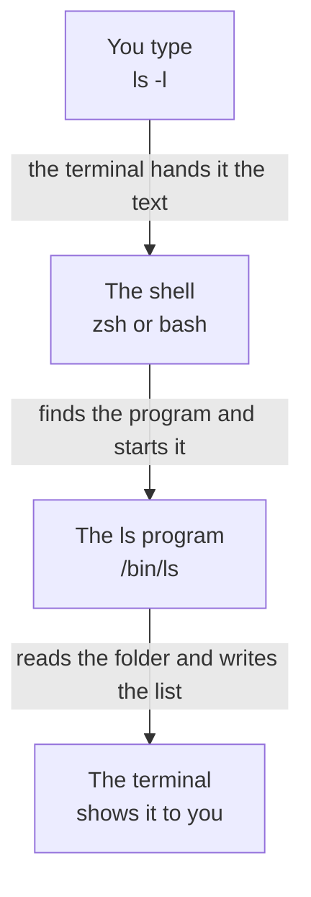

import { FileTree } from '@astrojs/starlight/components';
import Term from '~/components/Term.astro';
import TryIt from '~/components/TryIt.astro';
import Analogy from '~/components/Analogy.astro';
import SelfCheck from '~/components/SelfCheck.astro';
import Quiz from '~/components/Quiz.astro';
import QuizQuestion from '~/components/QuizQuestion.astro';
import QuizOption from '~/components/QuizOption.astro';

## The problem

Imagine you've just logged in to a server. There's no desktop, no windows and no mouse: only a line like `ubuntu@course:~$` and a blinking cursor. There's no Finder or File Explorer: to find out what's in a folder, you have to ask in writing. In [Phase 8](/en/phase-8/what-is-a-vps/) you'll rent a server on the internet, and that will be the only way into it.

In Phase 0 you already typed commands in the <Term id="terminal">terminal</Term>: `curl`, `dig`, `nc`. They worked, but you probably copied them without really knowing which part was which. It was like repeating sentences in a language you don't speak. In this lesson you start learning that language.

Typing has another advantage, too. A written instruction can be repeated, saved in a file so it runs by itself (you'll do that in [lesson 8](/en/phase-1/bash-scripts/)) or handed to someone else so they do exactly the same thing. You can't copy and paste a click.

## The analogy

<Analogy>

Imagine a huge building with no windows. From the lobby, stairs lead down to several rooms; from each room, more stairs lead down to more rooms, and so on for many floors. The rooms hold papers. The rooms are the folders on your computer, and the papers, the files.

You're always in a single room, and you can't see anything else. To find something out, you pass notes to a very literal receptionist: “Where am I?” (`pwd`), “What's in this room?” (`ls`) or “Take me to such-and-such room” (`cd`). That receptionist is the <Term id="shell">shell</Term>.

For them to take you somewhere, you give them directions. If they're complete, starting from the lobby (“go down to Staff, then to Ana, then to Course”), they work wherever you are: that's an absolute <Term id="path">path</Term>. If they start from where you are (“the room above”), it's a relative path.

<div slot="limits">

- In a real building, when you walk into a room you see what's there. Not in the terminal: you only know what you ask.
- The receptionist doesn't guess: one misspelled name, one extra capital letter or one space without quotes, and they don't understand you.
- They don't ask “Are you sure?” either. If you ask them to delete something, they delete it, and there's no trash. You'll see it in [lesson 2](/en/phase-1/linux-file-commands/).

</div>

</Analogy>

## How it really works

### The terminal and the shell

Open the terminal (if you don't know how, see [the Phase 0 introduction](/en/phase-0/#before-you-start-the-terminal)). You'll see a window with a bit of text and a cursor. It looks like one thing, but it's two:

- **The terminal** is the application: the window that shows the text and picks up what you type.
- **The shell** is the program running inside it. It reads what you type, interprets it and runs it: it's the receptionist from the analogy.

There are several shells. Macs have come with one called zsh since 2019; Linux and WSL almost always come with one called bash. Everything in this lesson works the same in both, and when something changes, we'll tell you. (If your Mac says `/bin/bash`, your account dates from before 2019; the commands are the same.)

The text in front of the cursor is the <Term id="prompt">prompt</Term>: it means “I'm waiting for an instruction.” It usually includes your user, the computer's name and the folder you're in. On a Mac it looks something like `ana@laptop ~ %`, and on Linux or WSL, like `ana@laptop:~$`.

On this site, the prompt is shortened to a `$` in front of each command. You don't type that `$`, and the copy button already leaves it out.

When you type an instruction and press Enter, this happens:



The shell doesn't know how to list folders. What it does is find a program that does, `ls`, which is a file stored at `/bin/ls` (on Linux, at `/usr/bin/ls`), and start it. When it finishes, the shell prints the prompt again. Almost every command is a program like that: a file stored in some folder on the disk.

### The parts of a command

The shell cuts each instruction into pieces at the spaces:

| Part | In `ls -l /usr/bin` | What it is |
|---|---|---|
| Command | `ls` | The program you want to run |
| Option | `-l` | Changes how it works. Starts with `-` (or with `--` if it's a word, like `--help`) |
| Argument | `/usr/bin` | What it works on: here, the folder you want to list |

The shell doesn't know what `-l` means: the first piece tells it which program to start, and it passes the rest along as is. It's `ls` that decides `-l` means “long format.” That's why every program has its own options.

Three rules:

- One-letter options can be combined: `ls -la` is the same as `ls -l -a`.
- Options that are a word take two dashes: `--help`.
- Spaces separate the parts, so a name with spaces goes in quotes: `cd "My documents"`. Without them, the shell sees two arguments, `My` and `documents`.

### Folders form a tree

In the terminal, folders are also called <Term id="directory">directories</Term>.

Everything hangs from a single folder, the **root**, written `/`: it's the lobby from the analogy. On Mac and Linux there are no drives like Windows' `C:`: everything is somewhere below `/`.

Your **home folder**, the one with your documents and downloads, has a shortcut: `~` (the tilde). On a Mac it's `/Users/ana`, and on Linux and WSL, `/home/ana`, with your user instead of `ana`. On a US keyboard, `~` is <kbd>Shift</kbd> plus the key to the left of <kbd>1</kbd>.

This is part of a Mac's tree. Names that end in `/` are folders:

<FileTree>

- /
  - bin/
    - ls the ls program (on Linux it's in /usr/bin)
  - Users/ on Mac, the home folders (on Linux it's called home)
    - ana/ your home folder, ~
      - backend-course/
        - phase-1/
  - usr/
    - bin/ more programs
  - tmp/ temporary files

</FileTree>

Every folder has a unique address, its path: the folders you go through from the root, separated by `/`. Your practice folder's is `/Users/ana/backend-course/phase-1`. The slash has two roles: at the start it's the root, and between two names, a separator.

### Where you are and what's there: `pwd` and `ls`

In the terminal you're always in one folder, your **current folder**, just like in the building. When you open the terminal, you start in your home folder. In WSL, it sometimes opens in a folder like `/mnt/c/Users/Ana`, which is your Windows folder: type `cd`, press Enter and you'll be in your Linux one.

- `pwd` (*print working directory*) prints the full path of your current folder.
- `ls` (from *list*) shows what's in it. Given a path, it shows what's in another one: `ls /usr/bin`.
- `ls -l` (from *long*) shows one line per file, with more details: the size, the date, the owner. The letters at the start, like `drwxr-xr-x`, are the permissions, which you'll see in [lesson 4](/en/phase-1/linux-users-and-permissions/).
- `ls -a` (from *all*) also shows hidden files: the ones that start with a dot, like `.zshrc`. They don't appear in a normal `ls` or in the Finder. They're usually configuration files, and they're hidden to stay out of the way.
- `ls -la` combines the two.

### Moving around: `cd`

`cd` (*change directory*) moves you:

- `cd phase-1` goes into `phase-1`, if it's inside where you are.
- `cd ..` goes up to the folder above.
- `cd` on its own, or `cd ~`, takes you back to your home folder.
- `cd -` takes you back to the previous folder, like the browser's back button, and tells you which one it is.

If all goes well, `cd` prints nothing: in the terminal, silence is usually a good sign.

`ls` is a separate program, but `cd` is part of the shell itself: it's what's called a *builtin*. It has to be. Every running program, every <Term id="process">process</Term>, has its own current folder. A separate `cd` would change *its own* folder and exit, and you'd stay where you were. It would be as if the receptionist, instead of taking you, sent a messenger: the messenger would get there, but you wouldn't.

That's why the shell itself makes the change. `type cd` confirms it: it answers `cd is a shell builtin`.

### Absolute and relative paths

You're in `/Users/ana/backend-course` and you want to go into `phase-1`. You can give the shell the full way there, `cd /Users/ana/backend-course/phase-1`, or just the step you're missing, `cd phase-1`. Both take you to the same place, but they don't work the same way:

- **Absolute:** the first one. It starts with `/` and describes the full way from the root. It works wherever you are.
- **Relative:** the second one. It doesn't start with `/` and starts from your current folder. `cd phase-1` only works if `phase-1` is where you are.

And three shortcuts:

- `~` is your home folder. The shell replaces it with the full path, so `~/backend-course` works from anywhere, like an absolute path.
- `.` is the folder you're in: `./phase-1` is the same as `phase-1`.
- `..` is the one above, and it can be repeated: `../..` goes up two levels.

More examples, also from `/Users/ana/backend-course`:

| To go to | Absolute path | Relative path |
|---|---|---|
| The `phase-1` folder | `/Users/ana/backend-course/phase-1` (or `~/backend-course/phase-1`) | `phase-1` (or `./phase-1`) |
| Your home folder | `/Users/ana` (or `~`) | `..` |
| The root | `/` | `../../..` |

The absolute one doesn't depend on where you are; the relative one does.

### Typing less: tab completion and history

Two helpers save you almost all the typing.

**The Tab key.** Type the start of a name and press <kbd>Tab</kbd>: the shell completes it. `cd ~/bac` becomes `cd ~/backend-course/`. It works with folders, files and commands. If several names start the same way, it completes what they share; press <kbd>Tab</kbd> again and it shows you the options. And if it completes nothing, that name doesn't exist where you think it does.

**The history.** <kbd>↑</kbd> and <kbd>↓</kbd> step through the instructions you've already typed: you can change them or repeat them with Enter. <kbd>Ctrl</kbd> + <kbd>R</kbd> searches the history: type a piece and the last instruction that contained it appears. `history` shows the numbered list. In zsh only the last 16 appear; with `history 1`, all of them.

The keys work the same in zsh and bash.

### Getting help: `man` and `which`

`man ls` opens the manual for `ls`. It takes up the whole window: <kbd>Space</kbd> moves forward, <kbd>/</kbd> searches (type and press Enter) and <kbd>Q</kbd> quits. It's dense: use it to look up a specific option, not to read it cover to cover.

Many programs give a summary with `--help`: `curl --help`, or `ls --help` on Linux. But the Mac's `ls` doesn't understand it. Mac and Linux come with different versions of the basic tools, very similar, but not the same.

`which ls` tells you where a program is: `/bin/ls` on a Mac and `/usr/bin/ls` on Linux. With `cd` it gives no path: zsh tells you it's part of the shell, and bash prints nothing.

## Try it

The goal: move around your computer without the mouse and, at the end, complete a challenge without copying a single instruction. If you don't have the practice folder yet, create it as explained in [the introduction](/en/phase-1/#before-you-start-your-practice-folder). Everything happens in your terminal, and no exercise creates, changes or deletes anything: you only look and move around.

The outputs are from a Mac, with the user replaced by an example one, `ana`. In each exercise we tell you what changes on Linux and WSL.

<TryIt title="1. Which shell do you use?" cmd={`echo $SHELL`} output="/bin/zsh">

`echo` prints whatever you ask it to, and `$SHELL` is a variable: a name that holds a value, here the shell you use. You'll see them in [lesson 7, “Environment variables”](/en/phase-1/environment-variables/).

You do type this `$`, because it's stuck to the variable's name. The prompt's one stands alone, at the start of the line.

On Linux and WSL you get `/bin/bash`. On Windows, if nothing comes out, you're in PowerShell and not in Ubuntu: open “Ubuntu” from the Start menu, as in [Phase 0](/en/phase-0/#before-you-start-the-terminal).

</TryIt>

<TryIt
  title="2. Where you are and what's there"
  cmd={`cd ~/backend-course/phase-1\npwd\nls -la`}
  output={`/Users/ana/backend-course/phase-1
total 0
drwxr-xr-x@ 2 ana  staff  64 Oct 12 15:29 .
drwxr-xr-x@ 3 ana  staff  96 Oct 12 15:29 ..`}
>

You can paste the three instructions together and press Enter: the shell runs them one after another. If the first line answers `no such file or directory`, you haven't created the practice folder yet: create it as in the introduction and try again.

The folder is empty, but `ls -a` shows `.` and `..`: the folder itself and the one above. They're in every folder, and that's why `cd ..` works anywhere.

The `d` at the start says both are real folders (*directory*). The `@` is a macOS mark: the folder carries extra information that the system stores separately. You may not get it, and on Linux you never do.

Your dates will be different. On Linux and WSL, the path starts with `/home/ana`, you get `total 8`, you get `ana ana` instead of `ana staff` (the second name is the group; you'll see it in lesson 4), folders show a size of `4096` and a letter or two of the permissions may change.

</TryIt>

<TryIt
  title="3. Go up and come back"
  cmd={`cd ..\npwd\nls\ncd phase-1`}
  output={`/Users/ana/backend-course
phase-1`}
>

`cd ..` takes you up to `backend-course`, `ls` shows what's there (only `phase-1`) and `cd phase-1` takes you back down with a relative path. Neither `cd` prints anything.

On Linux and WSL, the path starts with `/home/ana`.

</TryIt>

<TryIt
  title="4. Jump to the root and back"
  cmd={`cd /\nls\ncd -`}
  output={`Applications    dev             Library         sbin            Users           Volumes
bin             etc             opt             System          usr
cores           home            private         tmp             var
~/backend-course/phase-1`}
>

`cd /` takes you to the root, and `ls` shows what hangs from it: `Users`, with the home folders, and system folders you don't need to touch. Your Mac may have one more or one fewer, and the columns depend on the width of the window.

`cd -` takes you back to where you were and prints the folder. In zsh, your home folder is shortened to `~`.

On Linux and WSL, `ls /` shows other folders, like `boot`, `media`, `root` or `srv`, and no `Users` or `Applications`. And bash prints the full path: `/home/ana/backend-course/phase-1`.

</TryIt>

<TryIt
  title="5. Program or part of the shell?"
  cmd={`which ls\ntype cd`}
  output={`/bin/ls
cd is a shell builtin`}
>

`ls` is a file on the disk, and `cd`, part of the shell. On Linux and WSL, `which ls` gives `/usr/bin/ls`.

</TryIt>

Finally, three things you do with the keyboard that have no output to copy:

1. Type `cd ~/bac`, without pressing Enter, and press <kbd>Tab</kbd>. The shell completes it: `cd ~/backend-course/`. Now press Enter.
2. Press <kbd>↑</kbd> several times: the instructions from these exercises appear, from most recent to oldest. To clear the line without running anything, press <kbd>Ctrl</kbd> + <kbd>C</kbd>.
3. Type `man ls` and press Enter. Inside, type `/-a` and press Enter: you jump to the explanation of the `-a` option. Quit with <kbd>Q</kbd>.

And now, the challenge. Step 1 left you in `backend-course`: first go back to your practice folder with `cd phase-1`. This time, type the instructions yourself, without copying them:

<SelfCheck question="Challenge: from your practice folder, get to /tmp with a relative path, check it with pwd and come back with a single instruction.">

```sh
cd ../../../../tmp
pwd
cd -
```

From `~/backend-course/phase-1` there are four levels up to the root: `phase-1`, `backend-course`, `ana` and `Users` (on Linux and WSL, `home`). That's why you need four `..`, and from the root you go down into `tmp`. `pwd` answers `/tmp`, and `cd -` takes you back to `~/backend-course/phase-1`.

If you get `no such file or directory`, count the levels with `pwd` before leaving: each folder in the path is one `..`. If you press <kbd>Tab</kbd> twice after each `../`, you'll see what's at that level.

</SelfCheck>

## You have already seen it

You've been using paths and instructions for a long time, even if you didn't call them that:

- Web addresses have paths too. This page's ends in `/en/phase-1/basic-terminal-commands/`: folders separated by `/`, the same idea as on your disk.
- The Finder accepts paths: in the Go menu, choose “Go to Folder” (<kbd>Cmd</kbd> + <kbd>Shift</kbd> + <kbd>G</kbd>) and type `~/backend-course`.
- In Phase 0, `curl -v http://localhost:8080` was already an instruction with its three parts: the command (`curl`), an option (`-v`) and an argument (the address).

And if you code:

- `import Button from '../components/Button'` uses a relative path: `..` goes up to the folder above, just like in the terminal.
- VS Code's integrated terminal is a terminal with a shell inside, the same zsh or bash as always.
- When you type `npm run dev`, it's the shell that finds the `npm` program and starts it with two arguments, `run` and `dev`.

## Common mistakes

- **A name with spaces, without quotes.** `cd My documents` gives `cd` two arguments, `My` and `documents`. zsh answers with a strange message, `cd: string not in pwd: My`, and bash with a clearer one, `bash: cd: too many arguments`. Use quotes (`cd "My documents"`), a backslash before the space (`cd My\ documents`) or <kbd>Tab</kbd>, which adds it for you.
- **Capital letters.** By default, the Mac doesn't tell uppercase from lowercase in names: if you have a `Documents` folder, `cd documents` also takes you there. Linux does tell them apart, and there it fails. What works on your Mac can fail on the server: type names exactly as they are, or let <kbd>Tab</kbd> complete them.
- **Mixing up the root and your folder.** `cd /phase-1` gives `cd: no such file or directory: /phase-1` (in bash, `bash: cd: /phase-1: No such file or directory`). The `/` at the start makes it look for `phase-1` in the root. Remove it, or use `~/backend-course/phase-1`.
- **Copying the prompt's `$`** from other websites, as in `$ pwd`. The shell looks for a program called `$` and answers `zsh: command not found: $` (in bash, `$: command not found`). Copy only what comes after it.
- **Getting stuck inside `man`.** You haven't broken anything: quit with <kbd>Q</kbd>.
- **`ls --help` on the Mac.** It answers ``ls: unrecognized option `--help'`` and a line with its usage. Use `man ls`; on Linux and WSL, `--help` does work.

## Summary

- The terminal is the window; the shell (zsh on Mac, bash on Linux and WSL) is the program that reads your instructions and starts other programs.
- An instruction is cut at the spaces into a command, options and arguments. A name with spaces goes in quotes.
- `pwd` tells you where you are, `ls` what's there and `cd` moves you. `cd` is part of the shell because it changes the shell's own folder.
- An absolute path starts at the root (`/`) and works from anywhere; a relative one starts from where you are. `~` is your folder, `.` the current one and `..` the one above.
- <kbd>Tab</kbd> completes, <kbd>↑</kbd> repeats and `man` explains commands to you.

## Did you get it?

<Quiz>

<QuizQuestion
  question="On the server you’re in /home/ubuntu/projects/shop/web. Where does cd ../.. take you?"
  review="Absolute and relative paths"
>

<QuizOption text="To /home/ubuntu/projects/shop.">

That's where `cd ..` takes you, which goes up a single level. With `../..` you go up two.

</QuizOption>

<QuizOption text="To /home/ubuntu/projects." correct>

Each `..` goes up one level: the first, from `web` to `shop`, and the second, from `shop` to `projects`.

</QuizOption>

<QuizOption text="To the root, /: two .. are enough to go all the way up.">

Each `..` goes up a single level. From `web`, reaching the root would take five, one for each folder in the path.

</QuizOption>

</QuizQuestion>

<QuizQuestion
  question="You’ve written down the instruction cd phase-1. It worked yesterday, but today, right after opening the terminal, it answers no such file or directory. What happened?"
  review="Absolute and relative paths"
>

<QuizOption text="It’s a relative path, and today you’re in a different folder." correct>

The shell looks for `phase-1` inside your current folder, and when you open the terminal you're in your home folder. `cd ~/backend-course/phase-1` works from anywhere.

</QuizOption>

<QuizOption text="It’s missing the slash at the start: it should be cd /phase-1.">

With the `/` in front, the shell looks for `phase-1` in the root, and it isn't there. That would be a different error, not the fix.

</QuizOption>

<QuizOption text="The terminal opens in the root, /, every day, and you have to go down from there.">

The terminal opens in your home folder, `~`, not in the root. And `phase-1` isn't there either: it's inside `backend-course`.

</QuizOption>

</QuizQuestion>

<QuizQuestion
  question="Imagine someone writes a separate cd program, a file on the disk like /bin/ls. What would happen when you used it?"
  review="Moving around: cd"
>

<QuizOption text="It would work just like the shell’s cd, only a bit slower.">

It wouldn't move you. The program would change its own current folder and exit, and the shell, and you with it, would stay in the same place.

</QuizOption>

<QuizOption text="It wouldn’t start: the shell only starts the programs that come with the system.">

The shell also starts programs you install yourself, like `npm`. The problem is in what it would do once started.

</QuizOption>

<QuizOption text="It would change its own folder, not yours: you’d stay where you were." correct>

Each process has its own current folder. That's why `cd` is part of the shell: that way it changes the folder of the shell itself. In fact, the Mac comes with a `/usr/bin/cd` program, and `/usr/bin/cd /tmp` doesn't move you.

</QuizOption>

</QuizQuestion>

<QuizQuestion
  question="In the instruction curl -sI https://example.com, what is -sI?"
  review="The parts of a command"
>

<QuizOption text="The argument: what curl has to request.">

The argument is `https://example.com`. `-sI` starts with `-`, and that marks it as an option.

</QuizOption>

<QuizOption text="Two one-letter options combined, -s and -I." correct>

Just as `ls -la` is `ls -l -a`, `-sI` is `-s -I`: two options that change how `curl` works.

</QuizOption>

<QuizOption text="A shell option, which the shell applies before starting curl.">

The shell doesn't know what it means: it passes it along as is to `curl`, and it's `curl` that decides what to do with it.

</QuizOption>

</QuizQuestion>

<QuizQuestion
  question="You want to go into a folder called Trip photos. You type cd Trip photos and get an error. Why?"
  review="Common mistakes"
>

<QuizOption text="The space splits the name into two arguments: Trip and photos." correct>

The shell cuts the instruction at the spaces. With quotes, `cd "Trip photos"`, or with <kbd>Tab</kbd>, the name arrives as a single argument.

</QuizOption>

<QuizOption text="On Mac and Linux, a folder name can’t contain spaces.">

It can. In the terminal, though, you have to write them in quotes or with a backslash in front: `cd Trip\ photos`.

</QuizOption>

<QuizOption text="cd only accepts absolute paths, the ones that start with /.">

`cd` accepts both: `cd phase-1` is a relative path and it works. What fails here is the space.

</QuizOption>

</QuizQuestion>

<QuizQuestion
  question="On your Mac you type ls --help and it answers unrecognized option. What’s going on?"
  review="Getting help: man and which"
>

<QuizOption text="Long options take a single dash: it should be -help.">

It's the other way around: options that are a word take two dashes. With one, `ls` reads `-help` as four one-letter options combined: `-h`, `-e`, `-l` and `-p`.

</QuizOption>

<QuizOption text="The Mac has no help for commands: you have to look it up online.">

It does: `man ls` opens the manual for `ls` right in the terminal.

</QuizOption>

<QuizOption text="The Mac’s ls doesn’t understand --help: its help is in man ls." correct>

Mac and Linux come with different versions of `ls`. On Linux, `ls --help` does work; on the Mac, use `man ls`.

</QuizOption>

</QuizQuestion>

</Quiz>

## Further reading

- [The Linux Command Line](https://linuxcommand.org/tlcl.php), by William Shotts: a free book that starts where this lesson starts and goes much further.
- [MDN's command line crash course](https://developer.mozilla.org/en-US/docs/Learn_web_development/Getting_started/Environment_setup/Command_line): an introduction to the terminal for people who are starting to build websites.
