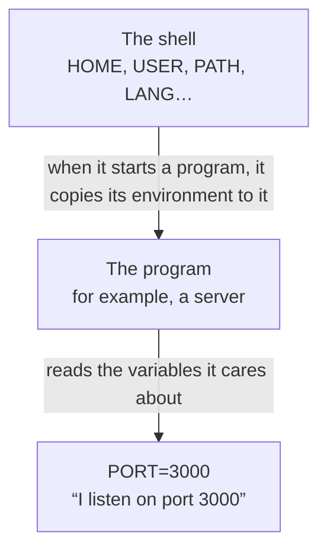

import Term from '~/components/Term.astro';
import TryIt from '~/components/TryIt.astro';
import Analogy from '~/components/Analogy.astro';
import SelfCheck from '~/components/SelfCheck.astro';
import Quiz from '~/components/Quiz.astro';
import QuizQuestion from '~/components/QuizQuestion.astro';
import QuizOption from '~/components/QuizOption.astro';

## The problem

Imagine you've written your first backend: a program that listens on port 3000 and takes card payments using a key your bank gave you. It works fine on your laptop. Now you want to move it to the server, where it has to listen on a different port and use the real key, not the test one.

If the port and the key are written inside the code, you have two problems. You need one version of the code for each place. And the key travels with the code: if you upload it to GitHub, the website where code is stored and shared, anyone who can read it can charge payments in your name.

The solution is for the code not to know those things, but to receive them when it starts. Whoever starts it tells it the port and the key with <Term id="environment-variable">environment variables</Term>. And you've already run into one: every `command not found` in the terminal has to do with a variable, `PATH`.

## The analogy

<Analogy>

Imagine a restaurant kitchen. The head chef has a notebook with notes, and she marks the ones meant for the team: “table 3 is gluten-free today.” When a cook comes in, she copies the marked notes onto a card for him, and he works with that card.

The head chef is the <Term id="shell">shell</Term>; each cook, a program the shell starts, and his card, his environment. Each note on the card is an environment variable, and marking a note is what `export` does.

One note says where to look for utensils: “first in drawer 1, then in drawer 2.” If what you ask for isn't in either one, the head chef answers “I can't find it,” even if it's in the storeroom. That note is `PATH`.

<div slot="limits">

- The card is copied when the cook comes in. If the head chef changes a note later, the cooks already working don't find out, and on a computer there's no way to tell them: you have to start the program again.
- It doesn't work the other way around either: whatever a program changes in its environment doesn't reach the shell that started it.
- The card isn't entirely private: on a server, the administrator can read any program's variables.

</div>

</Analogy>

## How it really works

### Every program starts with its list of variables

Type `env` and press Enter. You get a list of about twenty lines; on a Mac, among them, these:

```
TERM_PROGRAM=Apple_Terminal
SHELL=/bin/zsh
USER=ana
PWD=/Users/ana/backend-course/phase-1
LANG=en_US.UTF-8
HOME=/Users/ana
```

Each line is an environment variable: a name, an `=` and a value. Names are uppercase by convention. The whole list is the **environment**, the card from the analogy. Each program reads the variables it cares about and ignores the rest:

| Variable | What it holds | Where you've seen it |
|---|---|---|
| `HOME` | Your home folder | `~` is its value, and `cd` on its own takes you there |
| `SHELL` | Your shell | In [lesson 1](/en/phase-1/basic-terminal-commands/), with `echo $SHELL` |
| `LANG` | Your language | It's why `ls -l` writes its dates in English, “Oct 7” |
| `PWD` | The folder you're in | It's what `pwd` prints |
| `PATH` | Where to look for commands | Further down |

To see just one, `echo $HOME`. The `$` in front of the name tells the shell “put its value here”: before running `echo`, it replaces it with `/Users/ana`.



The copy is made only once, at startup. If you change a variable in the shell afterwards, the program that's already running doesn't find out: you have to stop it and start it again.

### Shell variables and environment variables

Look at what happens when you create a variable:

<TryIt
  title="Who sees the variable?"
  cmd={`GREETING=hello\necho $GREETING\nprintenv GREETING\nexport GREETING\nprintenv GREETING`}
  output={`hello
hello`}
>

Only two `hello`s: the one from `echo` and the one from the last `printenv`. Same on Linux and WSL.

</TryIt>

`GREETING=hello` creates a **shell variable**: only the shell knows about it. `echo $GREETING` works because it's the shell itself that replaces `$GREETING` with `hello`.

`printenv`, on the other hand, is a separate program that prints a variable from *its* environment. The first time it prints nothing: `GREETING` was an unmarked note, and it wasn't in its copy.

`export GREETING` marks it: from then on it's an **environment variable**, and every program the shell starts gets a copy. You can create it and mark it in one go: `export GREETING=hello`, with no spaces around the `=`. They all disappear when you close the terminal.

### A variable for a single program

This command shows up in almost every backend tutorial:

```sh
PORT=3000 node app.js
```

`node` is Node.js, a program that runs JavaScript code (you'll install it in Phase 3), and `app.js` would be your server. What's new is the beginning: a `NAME=value` in front of a command passes that variable **only to that program**, without creating it in the shell. It's the most common way to configure a server: the same code starts with `PORT=3000` on your laptop and with another port on the server.

<TryIt title="The same thing, without Node.js" cmd={`PORT=3000 printenv PORT\nprintenv PORT`} output="3000">

The second `printenv` prints nothing: the shell didn't keep the variable. Same on Linux and WSL.

</TryIt>

And how does the program read it? In Node.js, its environment variables are in `process.env`: `process.env.PORT` is `"3000"`. The quotes matter: a value always arrives as text, and it's up to the program to turn it into a number.

### PATH: where the shell looks for commands

In lesson 1, `which ls` answered `/bin/ls`, but you only typed `ls`. How does the shell know where it is? Through `PATH`. Look at its value, one folder per line:

<TryIt
  title="The folders in PATH"
  cmd={`echo $PATH | tr ':' '\\n'`}
  output={`/usr/local/bin
/System/Cryptexes/App/usr/bin
/usr/bin
/bin
/usr/sbin
/sbin
/var/run/com.apple.security.cryptexd/codex.system/bootstrap/usr/local/bin
/var/run/com.apple.security.cryptexd/codex.system/bootstrap/usr/bin
/var/run/com.apple.security.cryptexd/codex.system/bootstrap/usr/appleinternal/bin
/Library/Apple/usr/bin
/opt/homebrew/bin`}
>

`tr ':' '\n'` replaces each `:` with a line break, and the `|` hands `tr` what `echo` prints, as in [lesson 3](/en/phase-1/pipes-and-redirection/).

Your list will be different: `/opt/homebrew/bin` only shows up if you have Homebrew, a program for installing tools on the Mac. On Ubuntu it goes from `/usr/local/sbin` to `/snap/bin`, and on WSL it also has the Windows folders (`/mnt/c/…`).

</TryIt>

`PATH` is a list of folders separated by `:`.

When you type `ls`, the shell looks for a file called `ls` in the first folder on the list, then in the second, and so on to the end. It runs the first one it finds, and if it isn't in any of them, it answers `command not found`. Three rules follow from that:

- **A program outside those folders isn't found,** even if it exists.
- **Order matters:** if two folders have a program with the same name, the one listed first wins.
- **A command with a `/` isn't looked up:** `./bin/hello` or `/bin/ls` run as they are. The folder you're in isn't on the list, and that's why, to run something from here, you type `./` in front.

To add a folder, you build a new `PATH` with it in front and the old list behind:

```sh
export PATH="$HOME/bin:$PATH"
```

The `$PATH` at the end is the old list. If you forget it, `PATH` is left with a single folder and almost every command stops working.

### Making it last: .zshrc and .bashrc

Everything above lasts until you close the terminal: each new terminal starts a new shell, which builds its environment from scratch. To make a change last, you write it in the file the shell reads when it starts: `~/.zshrc` in zsh (the Mac) and `~/.bashrc` in bash (Linux and WSL).

They're hidden files (lesson 1) with commands, one per line, that the shell runs at startup as if you typed them yourself. To add one at the end:

```sh
echo 'export PATH="$HOME/backend-course/phase-1/variables/bin:$PATH"' >> ~/.zshrc
```

- `>>` adds the line at the end. With a single `>`, the file would be emptied first and you'd lose what it had ([lesson 3](/en/phase-1/pipes-and-redirection/)).
- The single quotes make `$HOME` and `$PATH` get written as they are. They'll be replaced with their values every time the shell starts.

The change shows up in the terminals you open afterwards. In the one you have open, `source ~/.zshrc` reads the file again.

### Keeping secrets out of the code

A <Term id="secret">secret</Term> is a piece of data that gives access to something: the <Term id="database">database</Term> password, the key for a payments <Term id="api">API</Term>. The rule is that **it's never written inside the code**.

The code is stored in <Term id="git">Git</Term>, the program that keeps a project's history ([lesson 10](/en/phase-1/git-internals/)), and from there it gets copied to GitHub, to each teammate's computer and to the server. The secret, on the other hand, goes in an environment variable that only exists on the machine that needs it:

| What | Example | Where it goes |
|---|---|---|
| The code | The program that takes payments | In Git |
| Configuration that changes from place to place | The port | In environment variables |
| Secrets | The payments key | In environment variables, never in Git |

That way, the same code uses the test key on your laptop and the real one on the server.

### .env files

Typing `PAYMENTS_KEY=… PORT=… node app.js` every time gets tiring. That's why, while you develop, the variables are kept in a `.env` file in the project folder, one per line:

```
# Configuration for my laptop
PORT=3000
PAYMENTS_KEY=sk_test_4f9a2c
```

The shell doesn't read it by itself: the program reads it when it starts. Node.js, for example, with `node --env-file=.env app.js`.

Since it holds secrets, the `.env` is never stored in Git. To keep Git from seeing it, its name goes in another file, `.gitignore`: the list of what Git should ignore. What does get stored is a `.env.example`, with the names of the variables and without the values.

On the server there's usually no `.env`: the variables go in the configuration of the service (in the unit file from [lesson 6](/en/phase-1/systemd-services-and-apt/), with a line `Environment=PORT=8000`), of the container (Phase 7) or of the platform where you publish the website.

## Try it

The goal: start a small web server choosing its port with a variable, keep a secret where Git can't see it and fix a `command not found`. It all happens in your terminal, in a new folder, `~/backend-course/phase-1/variables`.

You need `python3` and `git`. On Ubuntu and WSL they usually come preinstalled (if `git` is missing, install it with `sudo apt install git`; you'll use it in depth in lesson 10). On a Mac, if a window pops up offering to install the “command line developer tools” when you use them, accept.

The outputs are from a Mac, with the user changed to an example one, `ana`. Each exercise tells you what changes on Linux and WSL.

First, the server. These commands create the folder, a `public` subfolder with a text file and a script, `server.sh`: a file with commands for the shell ([lesson 8](/en/phase-1/bash-scripts/)). Paste them all together and press Enter:

<TryIt
  title="1. A server you configure with variables"
  cmd={`mkdir -p ~/backend-course/phase-1/variables/public
cd ~/backend-course/phase-1/variables
echo 'Hello from the public folder' > public/hello.txt
echo 'echo "Serving the \${FOLDER:-current} folder at http://localhost:\${PORT:-8000}/"' > server.sh
echo 'python3 -m http.server "\${PORT:-8000}" --bind 127.0.0.1 --directory "\${FOLDER:-.}"' >> server.sh
cat server.sh`}
  output={`echo "Serving the \${FOLDER:-current} folder at http://localhost:\${PORT:-8000}/"
python3 -m http.server "\${PORT:-8000}" --bind 127.0.0.1 --directory "\${FOLDER:-.}"`}
>

The last two `echo`s write the script: `>` creates the file and `>>` adds a line at the end.

The important part is the variables. `${PORT:-8000}` means “the value of `PORT` or, if it doesn't exist, `8000`.” `python3 -m http.server` is a web server that comes with Python and serves the files in a folder; `--bind 127.0.0.1` makes it answer only your own computer.

</TryIt>

<TryIt
  title="2. Start it without variables"
  cmd="bash server.sh"
  output={`Serving the current folder at http://localhost:8000/
Serving HTTP on 127.0.0.1 port 8000 (http://127.0.0.1:8000/) ...
^C
Keyboard interrupt received, exiting.`}
>

Without variables, it uses port 8000 and the current folder. The server sits waiting for requests: stop it with <kbd>Ctrl</kbd> + <kbd>C</kbd> (`^C` shows up). Same on Linux and WSL.

</TryIt>

<TryIt
  title="3. Now, on port 3000"
  cmd="PORT=3000 FOLDER=public bash server.sh"
  output={`Serving the public folder at http://localhost:3000/
Serving HTTP on 127.0.0.1 port 3000 (http://127.0.0.1:3000/) ...
127.0.0.1 - - [12/Oct/2026 15:29:11] "GET /hello.txt HTTP/1.1" 200 -`}
>

The same script, without changing a single letter, listens on another port and serves another folder. Leave it running, open another terminal and ask it for the file, as in [Phase 0](/en/phase-0/client-server-model/): `curl http://localhost:3000/hello.txt` answers `Hello from the public folder`.

The server's last line appears when your request arrives: the time (yours will be different) and the `200` for “all good.” Stop it with <kbd>Ctrl</kbd> + <kbd>C</kbd>. Same on Linux and WSL.

If you get a long error that ends in `Address already in use`, another program is using that port. That's what the variable is for: try `PORT=3001`.

</TryIt>

Now, a secret. You're going to create a `.env` with a made-up key, turn the folder into a Git <Term id="repository">repository</Term> (a folder whose history Git keeps) and see what it would store:

<TryIt
  title="4. A secret Git can't see"
  cmd={`printf 'PORT=4000\\nPAYMENTS_KEY=sk_test_4f9a2c\\n' > .env
git init -q
echo '.env' > .gitignore
git status --short --ignored`}
  output={`?? .gitignore
?? public/
?? server.sh
!! .env`}
>

`printf` writes the text to the file, and each `\n` is a line break. `git init -q` creates the repository without saying anything, and the third line creates the `.gitignore`, with a single name. `git status` tells you what Git sees in the folder: `--short`, one file per line with a mark in front, and `--ignored`, also the ones it ignores.

Look at the marks: `??` are files Git could store, and `!!`, the ones it ignores. Without the `.gitignore`, the `.env` would show up with `??`, like any other file. Same on Linux and WSL.

</TryIt>

And finally, the `command not found`. This script, `hello`, goes in a `bin` folder, the usual name for folders of programs, and says hello using `$USER`. `chmod +x` gives it permission to run as a program ([lesson 4](/en/phase-1/linux-users-and-permissions/)):

<TryIt
  title="5. A program the shell can't find"
  cmd={`mkdir bin
printf '#!/bin/sh\\necho "Hello, $USER"\\n' > bin/hello
chmod +x bin/hello
hello`}
  output="zsh: command not found: hello"
>

The program exists, but the shell looked for `hello` in the `PATH` folders, and `bin` isn't one of them. On Linux and WSL, bash puts it like this: `hello: command not found`.

</TryIt>

<SelfCheck question="Challenge: make hello work. There are two ways: one without touching PATH and one touching it.">

```sh
./bin/hello
export PATH="$PWD/bin:$PATH"
hello
which hello
```

The first one gives it the path: with a `/`, the shell doesn't search. The second puts the folder at the front of `PATH`; `$PWD` is another environment variable, the folder you're in. Both answer `Hello, ana`, and `which` gives `/Users/ana/backend-course/phase-1/variables/bin/hello` (on Linux and WSL, it starts with `/home/ana`).

That new `PATH` only applies in this terminal.

</SelfCheck>

To make `hello` work in all your terminals, add that folder in your `.zshrc` (it's optional). On Linux and WSL, change `~/.zshrc` to `~/.bashrc` in both commands.

<TryIt
  title="6. Make it last (optional)"
  cmd={`echo 'export PATH="$HOME/backend-course/phase-1/variables/bin:$PATH"' >> ~/.zshrc
tail -n 1 ~/.zshrc`}
  output={`export PATH="$HOME/backend-course/phase-1/variables/bin:$PATH"`}
>

`tail -n 1` shows the last line of the file: the one you just added. Open a new terminal and type `hello` from any folder: it answers `Hello, ana`.

To undo it, open the file with `nano ~/.zshrc` ([lesson 2](/en/phase-1/linux-file-commands/)), go down with the arrow keys to that last line, delete it with <kbd>Ctrl</kbd> + <kbd>K</kbd>, save with <kbd>Ctrl</kbd> + <kbd>O</kbd> and Enter, and exit with <kbd>Ctrl</kbd> + <kbd>X</kbd>.

</TryIt>

## You have already seen it

They were there from the start:

- `~` is the value of `HOME`, and in lesson 1, `echo $SHELL` was already reading a variable.
- Try `LANG=es_ES.UTF-8 date`: the same command, with another language just for it, writes the date in Spanish, `lunes, 12 de octubre de 2026, 15:29:40 CEST` instead of `Mon Oct 12 15:29:40 CEST 2026`. With `ls -l`, the dates come out as `7 oct.` instead of `Oct 7`. On Linux and WSL it only works if Spanish is installed (`locale -a` lists the languages you have); if not, it stays in English.
- In the practice log from lessons [2](/en/phase-1/linux-file-commands/) and [3](/en/phase-1/pipes-and-redirection/), the IP `198.51.100.23` requests `/.env`, `/.git/config` and `/.aws/credentials` in the middle of the night. It's a program that looks for servers that publish their secrets by mistake.

And if you code:

- `npm run` adds `node_modules/.bin` to `PATH` before starting your script. That's why `vite` works inside `npm run dev` and answers `command not found` in the terminal.
- In Vite, the variables that start with `VITE_` (in Next.js, `NEXT_PUBLIC_`) end up written into the code the browser downloads. A key there stops being secret.

## Common mistakes

- **Spaces around the `=`.** `PORT = 3000` answers `zsh: command not found: PORT` (in bash, `PORT: command not found`): the shell thinks you want to run a program called `PORT`. Write it all together: `PORT=3000`.
- **Forgetting the `export`.** If you create the variable with `NAME=value` and start the program in another command, it doesn't see it. Use `export NAME=value`, or put it in front of the command.
- **Wiping out your `PATH`.** `PATH=~/bin`, without `:$PATH` at the end, leaves a single folder on the list, and even `ls` answers `zsh: command not found: ls`. Open another terminal. If the mistake is in your `.zshrc`, fix it with `/usr/bin/nano ~/.zshrc`: with the full path, the shell doesn't need `PATH`.
- **`>` instead of `>>` when adding something to `.zshrc` or `.bashrc`.** With a single `>`, the file is left with only your line.
- **Storing the `.env` in Git.** Even if you delete it later, it's still in the history, and anyone with a copy of the repository can read it. Consider the key lost and change it. And write the `.gitignore` before storing anything.

## Summary

- Every program receives a copy of the environment when it starts, with variables like `HOME`, `LANG` or `PORT`. `env` shows them all, and `echo $NAME`, one.
- `export` turns a shell variable into an environment variable. `NAME=value program` passes it only to that program.
- `PATH` is the list of folders where the shell looks for commands. A `command not found` is a program that isn't in any of them: give its path or add its folder to `PATH`.
- To make a change last, add it with `>>` to `~/.zshrc` (zsh) or `~/.bashrc` (bash).
- Secrets go in environment variables, never in the code. In development, in a `.env` that's in the `.gitignore`.

## Did you get it?

<Quiz>

<QuizQuestion
  question="You start the server with PORT=4000 bash server.sh and it answers on 4000. In that same terminal, after stopping it, you type printenv PORT. What comes out?"
  review="A variable for a single program"
>

<QuizOption text="4000: the shell keeps the variable for the following commands.">

It doesn't keep it. A `NAME=value` in front of a command only exists for that program, and it disappears with it.

</QuizOption>

<QuizOption text="Nothing." correct>

`PORT=4000` was passed only to the server. The shell didn't create it, so `printenv` doesn't receive it.

</QuizOption>

<QuizOption text="8000: when the server stops, PORT goes back to its default value.">

The shell has no `PORT` at all, neither before nor after. The 8000 only exists inside the script, which uses it when the variable is missing.

</QuizOption>

</QuizQuestion>

<QuizQuestion
  question="You type KEY=abc and, on the next line, start a program that reads the KEY variable. The program says it doesn’t exist. What happened?"
  review="Shell variables and environment variables"
>

<QuizOption text="The export is missing: the variable only exists in the shell." correct>

Without `export`, `KEY` is an unmarked note: the shell doesn't copy it to programs. With `export KEY=abc`, or with `KEY=abc` in front of the command, the program sees it.

</QuizOption>

<QuizOption text="Programs only read variables from a .env file.">

Every program receives its environment when it starts, whether there's a `.env` or not. The `.env` is just a convenient way to keep them.

</QuizOption>

<QuizOption text="Variables only work if you write them in .zshrc.">

You don't need to: `.zshrc` is for making them last in every terminal. In this one, `export` would be enough.

</QuizOption>

</QuizQuestion>

<QuizQuestion
  question="You install a tool, deploy, in the ~/.local/bin folder. ls ~/.local/bin shows it, but when you type deploy you get command not found. Why?"
  review="PATH: where the shell looks for commands"
>

<QuizOption text="The installation failed: if the program existed, the shell would find it.">

The shell doesn't search the whole disk: only the `PATH` folders. The program can exist and still not be found.

</QuizOption>

<QuizOption text="You have to go into that folder with cd to be able to use it.">

The folder you're in isn't in `PATH`, so `deploy` isn't found inside it either. You'd need to type `./deploy`.

</QuizOption>

<QuizOption text="~/.local/bin isn’t in your PATH." correct>

The shell only looks in the `PATH` folders. Add it with `export PATH="$HOME/.local/bin:$PATH"`, and write that line in your `.zshrc` or `.bashrc` to make it last.

</QuizOption>

</QuizQuestion>

<QuizQuestion
  question="You add the PATH line at the end of your .zshrc, go back to the terminal you had open, and deploy still isn’t found. What do you do?"
  review="Making it last: .zshrc and .bashrc"
>

<QuizOption text="Type zsh ~/.zshrc so the change takes effect.">

`zsh ~/.zshrc` starts another shell, which reads the file, changes its own `PATH` and exits. Whatever a program changes in its environment doesn't reach the shell that started it: yours stays the same.

</QuizOption>

<QuizOption text="Open a new terminal, or type source ~/.zshrc." correct>

`.zshrc` is read when the shell starts. The open terminal already read it before your change: either you start another one, or you make it read the file again with `source`.

</QuizOption>

<QuizOption text="Check the line: if it were right, it would work right away.">

It may be perfect. The shell doesn't look at `.zshrc` again while it's open, so the change hasn't arrived yet.

</QuizOption>

</QuizQuestion>

<QuizQuestion
  question="Your backend takes payments with a test key on your laptop and with the real one on the server. How do you set it up?"
  review="Keeping secrets out of the code"
>

<QuizOption text="With two versions of the code, one with each key.">

You'd have to maintain two copies of the same program, and both would carry a secret inside, which would end up in Git.

</QuizOption>

<QuizOption text="With both keys in the code, and the program choosing based on the computer.">

The real key would travel with the code to Git, to GitHub and to every teammate, even though it's only used on the server.

</QuizOption>

<QuizOption text="The same code reads the key from an environment variable." correct>

Each machine sets its own value: the test one in your `.env` and the real one in the server's configuration. The code doesn't change and carries no secret.

</QuizOption>

</QuizQuestion>

<QuizQuestion
  question="You accidentally push a .env with the payments key to GitHub. You notice, delete the file and push the project again. Is it fixed?"
  review="Common mistakes"
>

<QuizOption text="No: the key is still in the history; you have to change it." correct>

Git keeps every version, including the one that had the `.env`. Consider the key lost, ask for a new one and write `.env` in the `.gitignore`.

</QuizOption>

<QuizOption text="Yes: if the file is no longer in the project, neither is the key.">

Deleting it only creates a new version without it. The earlier ones are still in the history, and anyone with a copy of the repository can read them.

</QuizOption>

<QuizOption text="Yes, as long as the repository is private.">

Private doesn't mean safe: everyone with access reads it, and each of them keeps a copy. Secrets don't go in Git.

</QuizOption>

</QuizQuestion>

</Quiz>

## Further reading

- [The Twelve-Factor App: Config](https://12factor.net/config): the classic text on why configuration goes in environment variables and not in the code.
- [Secret scanning](https://docs.github.com/en/code-security/concepts/secret-security/secret-scanning), in GitHub's documentation: how GitHub looks for keys uploaded by mistake, because it happens often.
- [process.env in the Node.js documentation](https://nodejs.org/api/process.html#processenv): you'll use it in Phase 3.
