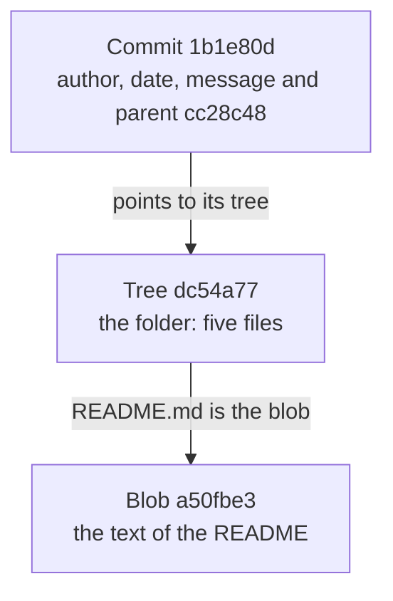
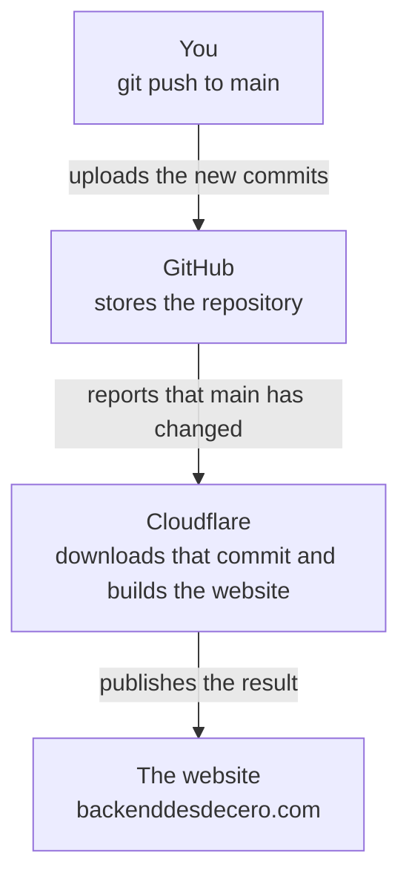

import Term from '~/components/Term.astro';
import TryIt from '~/components/TryIt.astro';
import Analogy from '~/components/Analogy.astro';
import Quiz from '~/components/Quiz.astro';
import QuizQuestion from '~/components/QuizQuestion.astro';
import QuizOption from '~/components/QuizOption.astro';

## The problem

Imagine Ana and Luis have a small online shop. One Monday, a customer writes in: she spent exactly €50 and was charged €5 for shipping, when the website says shipping is free from €50. Last week it worked. Since then they've saved ten changes, and none of them says it touches the shipping price.

They keep their code with <Term id="git">Git</Term>, which records every change to a project. Each saved change is a <Term id="commit">commit</Term>. Lots of people use Git with five commands learned by heart and, when something goes wrong, delete the folder and download it again ([xkcd 1597](https://xkcd.com/1597/)).

In this lesson you open the box. Once you know what a commit is and what a branch is, finding that bug takes a minute, and almost any mistake can be fixed.

## The analogy

<Analogy>

Imagine the photo album of a house under renovation. Every time you finish something, you take a photo of the **whole** house, and on the back you write who took it, when, what you did and which photo came before. Those photos are the commits.

The photos don't have numbers. Instead, they have a code worked out from everything you can see in them and from what's written on the back. If someone retouches a photo, even by a hair, the code no longer matches. That code is the hash.

So you don't get lost, you stick sticky notes on them: “main” on the latest photo, “v1.0” on the one from the opening day. When you add a photo, you move the “main” note to the new one. Branches are those sticky notes. And in a notebook you write down every time you move one: that's the reflog.

<div slot="limits">

- Two real photos never come out identical; two commits can: with the same files, author, date, message and parent, they give the same hash on any computer.
- Git doesn't store every file in every photo: if a file doesn't change, all the photos point to the same one.
- Removing a sticky note doesn't destroy the photo right away, but it doesn't keep it forever either: whatever has no sticky note and isn't in the notebook, Git throws away after a while.

</div>

</Analogy>

## How it really works

### Git in a minute

Git keeps the history of a folder, the <Term id="repository">repository</Term>, in a hidden folder inside it, `.git`. The usual cycle:

1. You change files with your editor.
2. `git add price.sh` chooses which changes go in the next snapshot.
3. `git commit -m "Fix shipping"` takes the snapshot, with a message that explains why.

`git log` shows the commits, from newest to oldest. Each commit carries your name and your email: tell Git once with `git config --global user.name "Ana García"`, and the same with `user.email`. Otherwise, your first commit fails with `Author identity unknown`.

If your Mac doesn't have `git`, typing it offers to install Apple's command line tools, which include it: accept. On Ubuntu (your VM or WSL) it usually comes preinstalled; if not, `sudo apt install git` ([lesson 6](/en/phase-1/systemd-services-and-apt/)).

### A commit is a snapshot with a fingerprint

A commit doesn't store “the changes.” Git stores three kinds of objects, and each one is named by its hash:

- **Blob:** the contents of a file, without its name.
- **Tree:** a folder, that is, a list of names with their permissions and the hash of each blob (or of another tree, if it's a subfolder).
- **Commit:** the hash of the top-level tree, the hash of the previous commit (its **parent**), the author, the date and the message.

This is how the last commit of the shop you'll create in “Try it” is linked:



If `README.md` doesn't change in the next commit, the new tree points to the same blob: each version of a file is stored only once. The differences `git show` displays are worked out when you ask for them, by comparing two snapshots.

### The hash, the fingerprint of the data

A <Term id="hash">hash</Term> is a fixed-size summary worked out from some data. Look at what happens when you change one letter:

```text
$ echo 'hello' | git hash-object --stdin
ce013625030ba8dba906f756967f9e9ca394464a
$ echo 'Hello' | git hash-object --stdin
e965047ad7c57865823c7d992b1d046ea66edf78
```

It works like a fingerprint:

- The same data always gives the same hash, on any computer.
- A tiny change gives a completely different one.
- From the hash you can't rebuild the original, or deliberately make other data with the same hash.

Git works it out with SHA-1, a hash formula, from the word `blob`, the size and the contents (`printf 'blob 6\0hello\n' | shasum` gives the same `ce01362…`). It's 40 characters (digits and the letters a to f), and the first 7 are almost always enough. In 2017, someone managed to make two files with the same SHA-1 ([SHAttered](https://shattered.io/)), and Git is moving to SHA-256, which is more secure.

In [lesson 8 of Phase 0](/en/phase-0/tls-and-https/), a signature stopped being valid if the message changed by one letter: under the hood, what gets signed is a hash of the message. And the server fingerprint from [lesson 9](/en/phase-1/what-is-ssh/) (`SHA256:…`) is the hash of its public key.

Since every commit carries its parent's hash, the history is a chain. Changing a comma in an old commit changes its hash, and with it the hash of every commit that comes after: nobody can sneak a change into the past without it showing.

### A branch is a sticky note

A <Term id="branch">branch</Term> is a text file with a hash inside. The shop's `main` branch is `.git/refs/heads/main`, and it contains `1b1e80d…`, the last commit. Creating a branch (`git switch -c fix-shipping`) means writing another 41-byte file: it copies nothing.

`HEAD` is the “you are here”: the `.git/HEAD` file says which branch you're on (`ref: refs/heads/main`). Each new commit has the current one as its parent, and your branch's sticky note moves forward to it.

- **A tag**, like `v1.0`, is a fixed sticky note that marks a version.
- **Detached HEAD:** if you go to a specific commit (`git switch --detach fb511b4`), `HEAD` points to the commit and not to a branch. You can look around and try things, but no sticky note follows what you save there. `git bisect` leaves you like that.

### Joining branches: merge or rebase

Imagine Ana fixes the shipping on the `fix-shipping` branch while Luis adds another commit to `main`. `git log --oneline --graph --all` draws how they've split apart (each `*` is a commit, and the lines lead to its parent):

```text
* 6cb3dcb (HEAD -> main) Add an example to the changelog
| * 9328a34 (fix-shipping) Fix shipping on €50 orders
|/
* 1b1e80d Note the --help option in the changelog
```

**`git merge fix-shipping`**, from `main`, creates a new commit with two parents. The history tells what happened: two lines of work that come together.

```text
*   bbac410 (HEAD -> main) Merge branch 'fix-shipping'
|\
| * 9328a34 (fix-shipping) Fix shipping on €50 orders
* | 6cb3dcb Add an example to the changelog
|/
* 1b1e80d Note the --help option in the changelog
```

**`git rebase main`**, from `fix-shipping`, reapplies the branch's commits on top of the last one in `main`, as if Ana had started later. Then `git merge` only has to move the `main` sticky note forward (*fast-forward*), and the history stays straight:

```text
* aa7a07b (HEAD -> main, fix-shipping) Fix shipping on €50 orders
* 6cb3dcb Add an example to the changelog
* 1b1e80d Note the --help option in the changelog
```

Look at the hash: Ana's commit was `9328a34` and now it's `aa7a07b`. It has a different parent, so it's **a different commit**. Rebase doesn't move commits: it makes new copies and moves the sticky note.

| | Merge | Rebase |
|---|---|---|
| The history | As it happened, with forks | In a straight line, easier to read |
| Your commits | The same ones | New copies, with different hashes |
| If you had already pushed them | No problem | Whoever was working on top is left with the old ones |

The golden rule: only rebase commits that nobody else has.

### Rewriting your commits: interactive rebase

`git rebase -i HEAD~3` (“interactive,” on the last three commits) opens your editor with a list, from the oldest commit to the newest (old versions of Git don't add the `#`):

```text
pick 10175b0 # Add --help to the README
pick cc28c48 # Also ignore the macOS .DS_Store files
pick 1b1e80d # Note the --help option in the changelog
```

On a Mac, that editor is `vim` (how to get out, in [lesson 2](/en/phase-1/linux-file-commands/#getting-out-of-vim)); on Ubuntu, `nano`. To use `nano` just that once: `GIT_EDITOR=nano git rebase -i HEAD~3`.

You change the word at the start, save and close, and Git redoes those commits: `reword` changes the message, `squash` or `fixup` melds it into the previous one, `drop` removes it, and moving a line moves the commit. It's for tidying up your work before sharing it, with the same golden rule: every rewritten commit is a new one.

### The reflog: the diary that remembers everything

Git writes in the **reflog** every time `HEAD` moves: every commit, branch switch, merge, rebase or `reset`. If a `reset` or a rebase takes commits away, they're still in `.git`, and the reflog gives you their hash:

```text
1bfe54e (HEAD -> main) HEAD@{0}: reset: moving to HEAD~3
1b1e80d HEAD@{1}: commit: Note the --help option in the changelog
```

`HEAD@{1}` is “where HEAD was one step before.” `git reset --hard HEAD@{1}` goes back there, and `git branch rescue 1b1e80d` sticks a new sticky note on it. By default, entries last at least a month.

Two limits: the reflog is local (it isn't uploaded with `push`), and it only records commits. Whatever you never saved in a commit isn't anywhere.

### Finding the bug: bisect

`git bisect` does a **binary search**, like when you look up a word by opening the dictionary in the middle: it takes you to the commit in the middle, you test it, and it rules out half of the suspects. With 10 commits, 4 tests at most are enough.

1. `git bisect start main v1.0`: `main` is bad and `v1.0` is good.
2. Git leaves you on the commit in the middle. You test it and tell it `git bisect good` or `git bisect bad`, until it tells you which was the first bad commit.
3. `git bisect reset` takes you back to `main`.

If a script checks for the bug, Git tests on its own: `git bisect run ./check.sh`. It looks at how the script ends, its <Term id="exit-code">exit code</Term> ([lesson 3](/en/phase-1/pipes-and-redirection/)): `0` is “good,” and almost any other number, “bad.”

### Remotes over SSH

A **remote** is another copy of the repository, on another computer. Over SSH, its address looks a lot like the one for `ssh`:

```text
$ ssh ubuntu@course git init --bare -b main shop.git
Initialized empty Git repository in /home/ubuntu/shop.git/
$ git remote add origin ubuntu@course:shop.git
$ git push -u origin main
Enumerating objects: 54, done.
Counting objects: 100% (54/54), done.
Delta compression using up to 4 threads
Compressing objects: 100% (51/51), done.
Writing objects: 100% (54/54), 6.31 KiB | 3.16 MiB/s, done.
Total 54 (delta 21), reused 0 (delta 0), pack-reused 0
To course:shop.git
 * [new branch]      main -> main
branch 'main' set up to track 'origin/main'.
```

- The first command creates on the `course` server an empty repository with no working folder (`--bare`). With your VM, `course` is the nickname from your `~/.ssh/config` in lesson 9.
- `origin` is the name of the remote, and `ubuntu@course:shop.git` means “the `shop.git` folder of the `ubuntu` user on `course`.”
- `git push` opens an SSH connection with your key and sends the objects the other side is missing: 54 blobs, trees and commits.

With GitHub it's the same: in `git@github.com:ana/shop.git`, the user is `git`, and it recognizes you by the key you uploaded in lesson 9. `https://` addresses also work, but they ask for a *token* (a long password you generate on GitHub) instead of your key.

### Signing your commits with your SSH key

A commit's name and email are just text: anyone can put yours with `git config`. To prove a commit is yours, sign it with your private key from lesson 9. `user.signingkey` points to the public key, and Git signs with the private key that goes with it:

```sh
git config --global gpg.format ssh
git config --global user.signingkey ~/.ssh/id_ed25519.pub
git config --global commit.gpgsign true
```

From then on, every commit carries its <Term id="digital-signature">digital signature</Term> inside the object itself, so it's also part of its hash. `git cat-file -p HEAD` shows it (trimmed):

```text
tree 0efc85f399eda5453ad4fff9343be321479cdb44
parent 1b1e80dd45422051d328bc1d041326bf97eb58f1
author Ana García <ana@example.com> 1790062200 +0200
committer Ana García <ana@example.com> 1790062200 +0200
gpgsig -----BEGIN SSH SIGNATURE-----
 U1NIU0lHAAAAAQAAADMAAAALc3NoLWVkMjU1MTkAAAAgb9Nkl/75Dx7RSX0ic+LJGYA6+J
 …
 -----END SSH SIGNATURE-----

Fix shipping on €50 orders
```

On GitHub, add the same public key as a *Signing key* (Settings → SSH and GPG keys), and your commits will show the “Verified” label.

### Coming up: a push that deploys

In Phase 8, `git push` will put your code to work on a server: that's a <Term id="deployment">deployment</Term>. This very website works like that:



Every published version is a commit: if something goes wrong, the previous one is published again.

## Try it

The goal: in Ana and Luis's shop, orders of exactly €50 are charged shipping. You're going to look inside a commit, “lose” three commits and rescue them and, at the end, find the guilty commit.

The outputs are from a Mac, and on Linux and WSL they're the same, hashes included: the script fixes the authors and dates, so your repository is identical to the one in this lesson.

<TryIt title="1. Do you have Git?" cmd="git --version" output="git version 2.50.1 (Apple Git-155)">

Your version may be different; signing commits with SSH needs at least 2.34. On Ubuntu 24.04 you get `git version 2.43.0`. If you get `command not found` or a window to install tools, see [“Git in a minute”](#git-in-a-minute).

</TryIt>

<TryIt
  title="2. Download the practice repository"
  cmd={`cd ~/backend-course/phase-1\ncurl -O https://backenddesdecero.com/practicas/repo-shop.sh`}
  output={`  % Total    % Received % Xferd  Average Speed   Time    Time     Time  Current
                                 Dload  Upload   Total   Spent    Left  Speed
100 11991  100 11991    0     0   238k      0 --:--:-- --:--:-- --:--:--  238k`}
>

`curl -O` saves the file with its own name, `repo-shop.sh`. Your speed figures will be different. If you get `Could not resolve host`, check your connection.

</TryIt>

Before running it, **read it**: `less repo-shop.sh` ([lesson 2](/en/phase-1/linux-file-commands/); quit with <kbd>Q</kbd>). It only creates a folder, `shop`, writes a few files and makes 18 commits. Online you'll often see `curl … | bash`, which runs whatever arrives without reading it: if the website were compromised, or the file arrived half-downloaded, it would run anyway.

<TryIt
  title="3. Create the shop and look at its history"
  cmd={`bash repo-shop.sh\ncd shop\ngit log --oneline`}
  output={`Done: the "shop" folder has a repository with 18 commits.
Go into it with: cd shop
1b1e80d (HEAD -> main) Note the --help option in the changelog
cc28c48 Also ignore the macOS .DS_Store files
10175b0 Add --help to the README
1bfe54e Add the --help option
4e4ff5f Note the changes since 1.0
2859a11 Tidy up the code and add comments
e9edf89 Mention the breakdown in the README
757285c Show the breakdown: order, VAT and shipping
303b6c0 Ignore editor backup files
89af321 Reject prices that are not numbers
fb511b4 (tag: v1.0) Prepare version 1.0
a9c203b Explain the usage when the price is missing
298812d Explain in the README how to use it
9d807d9 Add check.sh with the test cases
e449103 Add the PROMO10 discount code
c4e8429 Charge €5 shipping on orders under €50
2c34a7b Add price.sh: the price with VAT
d044423 Add the README`}
>

Look at the sticky notes: `HEAD -> main` on the last commit and `tag: v1.0` on the eighth. If the list doesn't fit in the window, Git opens it in `less`: quit with <kbd>Q</kbd>. If you get `"shop" already exists`, you had already run it: delete it with `rm -rf shop` and try again.

</TryIt>

<TryIt
  title="4. Inside a commit"
  cmd="git cat-file -p 1b1e80d"
  output={`tree dc54a7788a4ddfca96a035b5924c4a79f3434e76
parent cc28c48d2af3a80eb65377bef032fb037acb7f8a
author Ana García <ana@example.com> 1789974900 +0200
committer Ana García <ana@example.com> 1789974900 +0200

Note the --help option in the changelog`}
>

`cat-file -p` shows an object as Git stores it. This is a whole commit: its tree, its parent, the author and who saved it (with the date in seconds since 1970) and the message.

</TryIt>

<TryIt
  title="5. Its tree and a blob"
  cmd={`git cat-file -p dc54a77\ngit hash-object README.md`}
  output={`100644 blob 3c683b376a33820b8d2827f16713f5d2fd14793a	.gitignore
100644 blob 454b43be8c63fd01dfe90d023d2c3a189985f3a7	CHANGELOG.md
100644 blob a50fbe35a779e8925a5efa1cf6b099aa6060f396	README.md
100755 blob 56fb3beeb80b1e7fb2c6849bd17d4e58eb8e92ea	check.sh
100755 blob 02c2f9de8a33b65468fbe93285d8e983dc61ff83	price.sh
a50fbe35a779e8925a5efa1cf6b099aa6060f396`}
>

The tree is the folder: each file with its permissions (`100755` can be run; `100644` can't), its type and its hash. `git hash-object` works out the hash of your `README.md`, and it's the same `a50fbe3…` as in the list: the blob is named after its contents. To read it, `git cat-file -p a50fbe3`.

</TryIt>

<TryIt
  title="6. Branches are files"
  cmd={`cat .git/HEAD\ncat .git/refs/heads/main`}
  output={`ref: refs/heads/main
1b1e80dd45422051d328bc1d041326bf97eb58f1`}
>

`HEAD` says “I'm on `main`,” and `main` is the hash of the last commit. In a cloned repository, the pointers are sometimes all together in `.git/packed-refs`.

</TryIt>

Now, the scare. Imagine you wanted to undo the last commit and you type `HEAD~3` (“three commits before HEAD”) instead of `HEAD~1`. `git reset --hard` moves the branch's sticky note to that commit and leaves the files as they were in it:

<TryIt
  title="7. Lose three commits"
  cmd={`git reset --hard HEAD~3\ngit log --oneline -3`}
  output={`HEAD is now at 1bfe54e Add the --help option
1bfe54e (HEAD -> main) Add the --help option
4e4ff5f Note the changes since 1.0
2859a11 Tidy up the code and add comments`}
>

The last three commits no longer show up: `git log` only shows what can be reached from a sticky note.

</TryIt>

<TryIt
  title="8. Rescue them with the reflog"
  cmd={`git reflog -5\ngit reset --hard HEAD@{1}`}
  output={`1bfe54e (HEAD -> main) HEAD@{0}: reset: moving to HEAD~3
1b1e80d HEAD@{1}: commit: Note the --help option in the changelog
cc28c48 HEAD@{2}: commit: Also ignore the macOS .DS_Store files
10175b0 HEAD@{3}: commit: Add --help to the README
1bfe54e (HEAD -> main) HEAD@{4}: commit: Add the --help option
HEAD is now at 1b1e80d Note the --help option in the changelog`}
>

The reflog goes from most recent to oldest: `HEAD@{0}` is the `reset`, and right before it, in `HEAD@{1}`, you were on `1b1e80d`. The second `reset` takes you back there; check it with `git log --oneline -3`. If you've done other things in between, `HEAD@{1}` will be something else: use the hash, `git reset --hard 1b1e80d`.

</TryIt>

And now, the customer's bug. `check.sh` tests `price.sh` with four orders whose total is known:

<TryIt
  title="9. Reproduce the bug"
  cmd="./check.sh"
  output={`ok    ./price.sh 10
FAIL  ./price.sh 50: expected "Total: €60.50" and got "Total: €65.50"
ok    ./price.sh 100
ok    ./price.sh 100 PROMO10`}
>

€50 plus 21% VAT is €60.50, but you get €65.50: the €5 for shipping. The script ends with the code `1`, “something failed” (check it with `echo $?`), and that's all `bisect` needs. If you get `no such file or directory`, you're not in the shop: `cd ~/backend-course/phase-1/shop`.

</TryIt>

<TryIt
  title="10. Find the culprit with bisect"
  cmd={`git bisect start main v1.0\ngit bisect run ./check.sh`}
  output={`Bisecting: 4 revisions left to test after this (roughly 2 steps)
[2859a11890e289f94cb61999a18e841899cc85d8] Tidy up the code and add comments
running './check.sh'
ok    ./price.sh 10
FAIL  ./price.sh 50: expected "Total: €60.50" and got "Total: €65.50"
ok    ./price.sh 100
ok    ./price.sh 100 PROMO10
Bisecting: 2 revisions left to test after this (roughly 1 step)
[303b6c08ba0d141ad8ae7bb21f4cb509652e5d11] Ignore editor backup files
running './check.sh'
ok    ./price.sh 10
ok    ./price.sh 50
ok    ./price.sh 100
ok    ./price.sh 100 PROMO10
Bisecting: 0 revisions left to test after this (roughly 1 step)
[e9edf89c0fc9d63af72f5d30a5537f1a165f3eda] Mention the breakdown in the README
running './check.sh'
ok    ./price.sh 10
ok    ./price.sh 50
ok    ./price.sh 100
ok    ./price.sh 100 PROMO10
2859a11890e289f94cb61999a18e841899cc85d8 is the first bad commit
commit 2859a11890e289f94cb61999a18e841899cc85d8
Author: Luis Pérez <luis@example.com>
Date:   Mon Sep 14 18:25:00 2026 +0200

    Tidy up the code and add comments

 price.sh | 25 ++++++++++++++++++-------
 1 file changed, 18 insertions(+), 7 deletions(-)
bisect found first bad commit`}
>

Follow the search: `2859a11`, the one in the middle, fails; `303b6c0`, older, works; and `e9edf89`, the one right before `2859a11`, works too. The first bad commit is `2859a11`, and three tests were enough. It said it “only tidied up”: that's why nobody suspected it.

</TryIt>

<TryIt
  title="11. Go back to main and look at the change"
  cmd={`git bisect reset\ngit show 2859a11`}
  output={`Previous HEAD position was e9edf89 Mention the breakdown in the README
Switched to branch 'main'
commit 2859a11890e289f94cb61999a18e841899cc85d8
Author: Luis Pérez <luis@example.com>
Date:   Mon Sep 14 18:25:00 2026 +0200

    Tidy up the code and add comments
…
-shipping=0
-if [ "$cents" -lt 5000 ]; then
-  shipping=500
+
+# Shipping is free from €50.
+shipping=$SHIPPING
+if [ "$cents" -gt 5000 ]; then
+  shipping=0
 fi
…`}
>

`git bisect reset` gets you out of the detached HEAD and takes you back to `main`. `git show` shows the change: lines with `-` were removed and lines with `+` were added. We've trimmed the rest (`…`); in your terminal it opens in `less`.

Before, shipping was charged if the order was **less** than €50 (`-lt`, *less than*). Now it's free if it's **greater** (`-gt`, *greater than*), and exactly €50 pays shipping. The right comparison was `-ge` (*greater or equal*).

</TryIt>

## You have already seen it

- **Version history** in Google Docs is the same idea: snapshots of the document you can go back to.
- **Short hashes** like `2859a11` show up on GitHub and GitLab next to each change, and the “Verified” label marks a signed commit.

And if you code:

- GitHub's “Squash and merge” button melds the commits of a pull request into one, like `squash` in `rebase -i`.
- `git pull` is `git fetch` (bringing the new objects from the remote) plus a `merge` or a `rebase`.

## Common mistakes

- **“If I delete a branch, I delete its commits.”** You delete the sticky note. The commits are still there, and the reflog gives you their hash so you can put another one on them.
- **`git reset --hard` with unsaved changes.** Whatever wasn't in a commit is really lost. First, make a commit or set it aside with `git stash`.
- **Rebasing commits you've already pushed.** You'll have to force the push (`git push --force`) and whoever was working on top will be in a mess. If you have to, use `--force-with-lease`, which refuses if someone has pushed something you don't have.
- **Pushing a secret and deleting it in the next commit.** It's still in the history, and anyone with a copy can read it: change the secret. (Why `.env` files aren't pushed, in [lesson 7](/en/phase-1/environment-variables/).)
- **Forgetting `git bisect reset`.** You're left with a detached HEAD on an old commit, and whatever you save doesn't go to any branch.

## Summary

- A commit is a complete snapshot of the project, made of blobs (files) and trees (folders), with its author, its message and its parent.
- Every object is named by its hash, the fingerprint of its contents: changing something in the past changes every hash that comes after.
- A branch is a file with a hash, and `HEAD` says which one you're on. Merge joins histories with a new commit; rebase makes new copies on top of another branch.
- The reflog remembers where `HEAD` has been and rescues “lost” commits. `git bisect` finds, by splitting in two, the commit that broke something.
- Remotes over SSH use your key from lesson 9, which also signs your commits.

## Did you get it?

<Quiz>

<QuizQuestion
  question="Someone changes a comma in a commit from a month ago and rewrites the history from there. Which hashes change?"
  review="The hash, the fingerprint of the data"
>

<QuizOption text="Only that commit’s: each hash is independent.">

Every commit carries its parent's hash inside. If the parent changes, the child does too, and so on up to the last one.

</QuizOption>

<QuizOption text="That commit’s and those of every later commit." correct>

The comma changes that commit's hash, and every later commit carries its parent's inside.

</QuizOption>

<QuizOption text="None: the hash only depends on the author and the date.">

The hash is worked out from the whole object, files included: a comma changes the blob, the tree and the commit.

</QuizOption>

</QuizQuestion>

<QuizQuestion
  question="With git branch -D, you delete a branch with two commits that aren’t on any other branch. What has happened to those commits?"
  review="A branch is a sticky note"
>

<QuizOption text="They’ve been deleted from the disk along with the branch.">

The branch is a file with a hash. Deleting it removes the sticky note, not the photos.

</QuizOption>

<QuizOption text="They’ve moved to the main branch on their own.">

No commit changes branch on its own: `main` stays where it was, and those commits are left without a sticky note.

</QuizOption>

<QuizOption text="They’re still in .git, without any branch." correct>

They stay there until Git cleans up, after a while. The reflog gives you their hash, and `git branch rescue <hash>` puts a new sticky note on them.

</QuizOption>

</QuizQuestion>

<QuizQuestion
  question="Your branch is already on GitHub and a teammate is working on top of it. You want to bring what’s new in main into your branch. What do you do?"
  review="Joining branches: merge or rebase"
>

<QuizOption text="A merge of main into your branch." correct>

The merge adds a new commit without touching the ones your teammate already has.

</QuizOption>

<QuizOption text="A rebase onto main: your commits stay the same.">

Rebase makes new copies of your commits, with different hashes, and your teammate would be left with the old ones.

</QuizOption>

<QuizOption text="It doesn’t matter: both leave the same history.">

Merge keeps your commits and adds one with two parents; rebase replaces them with copies in a straight line.

</QuizOption>

</QuizQuestion>

<QuizQuestion
  question="You had changes in price.sh that weren’t in any commit yet, and you type git reset --hard. Can the reflog give them back to you?"
  review="The reflog: the diary that remembers everything"
>

<QuizOption text="Yes: git reset never deletes anything.">

`reset --hard` leaves the files as they were in the commit you go to, and whatever wasn't in any commit is lost.

</QuizOption>

<QuizOption text="No: the reflog only records commits." correct>

Those changes never made it into a commit, so they aren't anywhere. Next time, make a commit or a `git stash` first.

</QuizOption>

<QuizOption text="Yes: the reflog keeps every change to every file.">

The reflog doesn't look at your files: it only records which commits `HEAD` has been through.

</QuizOption>

</QuizQuestion>

<QuizQuestion
  question="Between the version that worked and today’s there are about 1,000 commits. Roughly how many will you have to test with bisect?"
  review="Finding the bug: bisect"
>

<QuizOption text="About 500: half of the commits.">

Bisect doesn't stop at one half: with each test it splits what's left in two again.

</QuizOption>

<QuizOption text="All 1,000: you have to test them all, one by one.">

That would be searching one by one. Bisect rules out half of the suspects with each test.

</QuizOption>

<QuizOption text="About 10." correct>

1,000, 500, 250, 125… Ten halvings are enough to be left with a single commit.

</QuizOption>

</QuizQuestion>

<QuizQuestion
  question="On GitHub you see a commit with your boss’s name and email, without the Verified label. Does it prove she made it?"
  review="Signing your commits with your SSH key"
>

<QuizOption text="No: anyone can write the name and the email." correct>

They're text that everyone sets with `git config`. What would prove it is a signature made with her private key.

</QuizOption>

<QuizOption text="Yes: GitHub checks the email of every commit it receives.">

GitHub shows what the commit says, but without a signature it can't know who wrote it.

</QuizOption>

<QuizOption text="Yes: the commit’s hash proves who made it.">

The hash proves the contents haven't changed, but anyone can work it out: it doesn't say who wrote the commit.

</QuizOption>

</QuizQuestion>

</Quiz>

## Further reading

- [Pro Git](https://git-scm.com/book/en/v2), by Scott Chacon and Ben Straub, free. Its chapter 10, [“Git Internals”](https://git-scm.com/book/en/v2/Git-Internals-Plumbing-and-Porcelain), covers the objects in this lesson in more detail.
- [git bisect](https://git-scm.com/docs/git-bisect) and [git reflog](https://git-scm.com/docs/git-reflog), in the official documentation.
- [About commit signature verification](https://docs.github.com/en/authentication/managing-commit-signature-verification/about-commit-signature-verification), in GitHub's documentation: how to get “Verified” with your SSH key.
