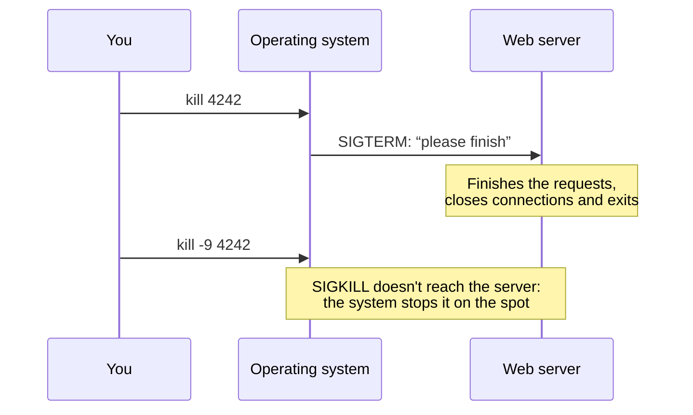

import Term from '~/components/Term.astro';
import TryIt from '~/components/TryIt.astro';
import Analogy from '~/components/Analogy.astro';
import Quiz from '~/components/Quiz.astro';
import QuizQuestion from '~/components/QuizQuestion.astro';
import QuizOption from '~/components/QuizOption.astro';

## The problem

Imagine that yesterday you left a test server running in some terminal window. Today you start it again and it replies that port 8080 is already in use, but you can't see any window to close. Who's holding the port, and how do you stop it?

On a server this happens every day: a program eats up the CPU (the processor), you have to restart the website without cutting off anyone who's in the middle of buying something, or you launch a long task, close the terminal and, when you come back, it's gone.

All of those are **processes**: running programs. Here you learn to see them, to talk to them with signals and to stop them without breaking anything.

## The analogy

<Analogy>

Think of a restaurant kitchen. A recipe written in a book doesn't cook anything: it's a program, a file sitting still on the disk. When a cook starts making it, that's a process: the recipe in action. Three cooks can make the same recipe at once, and each dish carries its order number: that number is the PID.

The head chef stays away from the stove and passes short notes. “Stop what you're doing.” “Finish when you can and clean up your station.” Those notes are the signals. And if someone doesn't listen, the head chef calls security, who takes them out of the kitchen on the spot, with no time to turn off the burner.

<div slot="limits">

- The notes don't carry free text: a signal is just a number from a fixed list.
- A process can ignore the “finish” note and keep its station. That's why there's a signal that can't be ignored: the security one.
- When a process is forced out, the operating system does clean up part of its station: it closes its files and frees its port. What's lost is whatever it had half done.

</div>

</Analogy>

## How it really works

### A running program is a process

Open the terminal and type this:

```sh
echo $$
ps
```

The first command prints a number, for example `75474`: the shell replaces `$$` with its own number. The second, `ps` (for *process status*), shows it in a list next to `-zsh` (or `bash`, on Linux). Your shell is a running program.

A **program** is a file on the disk, like `/bin/sleep`. A <Term id="process">process</Term> is a copy of that program in action, with its own memory and its own current folder (that's why `cd` is part of the shell, as you saw in [lesson 1](/en/phase-1/basic-terminal-commands/)). Three terminal windows are three zsh processes: the same program, three times.

The operating system gives each process a number, its <Term id="pid">PID</Term>, which is what you use to address it. PIDs are handed out in order and reused: today's `sleep` won't have the same number tomorrow.

Each process also has a parent, the one that started it: when you type `sleep 60`, the parent of `sleep` is your shell. If you climb up the family tree, you reach **PID 1**, the first one the system starts: `launchd` on the Mac and, on almost every Linux, `systemd`, which you'll see in [lesson 6](/en/phase-1/systemd-services-and-apt/).

### Seeing processes: `ps`, `pgrep` and `top`

With no options, `ps` shows few processes: on the Mac, yours that have a terminal; on Linux, only the ones in this window. To see them all, from every user, you use `ps aux` (no dash: an old `ps` habit). That's hundreds of lines, so you filter them with `grep`, as in [lesson 3](/en/phase-1/pipes-and-redirection/): `ps aux | grep nginx` looks for the nginx web server.

The columns you'll look at the most:

| Column | What it says |
|---|---|
| `USER` | The user who owns the process |
| `PID` | Its number |
| `%CPU` and `%MEM` | How much processor and how much memory it uses |
| `STAT` | Its state: `R` is working, `S` is waiting for something (the normal case), `T` is paused |
| `COMMAND` | The command that started it |

If you know the name, `pgrep` gives you the PIDs directly: `pgrep sleep` prints the PID of every process whose name contains `sleep`. Containing it is enough (on the Mac, `pgrep nc` also finds `launchservicesd`), so `-l`, which also prints the name, is a good idea. And `-f` searches the full command: `pgrep -fl "sleep 600"`.

`top` is the live version: a table that refreshes every second, with the processes that use the most at the top. You quit with <kbd>Q</kbd>. On Linux it sorts by CPU; on the Mac, by PID, and you have to ask for it with `top -o cpu` (`-o` for *order*).

### Signals: messages for a process

To stop a process, you send it a <Term id="signal">signal</Term> with `kill` and its PID:

```sh
kill 78026
```

The name is misleading: `kill` doesn't kill anything by itself. It asks the operating system to deliver a signal to that process: a short message, a number with a name that starts with `SIG` (for *signal*). The process receives it in the middle of whatever it's doing and reacts.

There are more than thirty (`kill -l` lists them), but day to day you'll use four, with the same numbers on the Mac and on Linux:

| Signal | Number | Who sends it | What it asks | Can it be ignored? |
|---|---|---|---|---|
| `SIGINT` (*interrupt*) | 2 | <kbd>Ctrl</kbd> + <kbd>C</kbd> | Stop what you're doing | Yes |
| `SIGTERM` (*terminate*) | 15 | `kill`, with no options | Finish, cleaning up first | Yes |
| `SIGKILL` | 9 | `kill -9` | Nothing: the system stops it | No |
| `SIGHUP` (*hang up*) | 1 | Closing the terminal | “Your terminal is gone” | Yes |

<kbd>Ctrl</kbd> + <kbd>C</kbd> isn't sent by the shell: the terminal sees that key combination and sends `SIGINT` to the program in front of you, whatever it is.

With `kill` you choose the signal by its name, without the `SIG`, or by its number: `kill -INT 78026` is the same as pressing <kbd>Ctrl</kbd> + <kbd>C</kbd> in its window, and `kill -9 78026` is `kill -KILL 78026`.

Two limits:

- **You can only send signals to your own processes.** With other users' processes, `kill` replies `operation not permitted`. The root user can do it with all of them, as you saw in [lesson 4](/en/phase-1/linux-users-and-permissions/).
- **Each program decides what to do with each signal**, except with `SIGKILL`. That's why some programs don't stop with <kbd>Ctrl</kbd> + <kbd>C</kbd>, like the `man` pager: they catch the signal and wait for you to quit with <kbd>Q</kbd>.

### Ending cleanly or ending now: SIGTERM and SIGKILL

`kill` sends `SIGTERM` by default for a good reason: the program can catch it and **end cleanly**. A web server that receives `SIGTERM` stops accepting new requests, finishes the ones it has in progress, closes its connection to the database and exits. This is called a *graceful shutdown*.

`SIGKILL` doesn't even reach the program: the operating system removes it on the spot.



With `SIGKILL`, the purchase that was half done gets cut off, and a file can be left half written. On the other hand, the operating system closes the process's <Term id="socket">sockets</Term>, so its <Term id="port">port</Term> is freed.

The rule: **first `kill`, wait a few seconds and, only if it's still alive, `kill -9`**. `docker stop` (Phase 7) does exactly that: it sends `SIGTERM`, waits ten seconds by default and, if the program is still there, `SIGKILL`.

When a process ends because of a signal, its <Term id="exit-code">exit code</Term> (the `$?` from lesson 3) is 128 plus the signal's number: 130 after <kbd>Ctrl</kbd> + <kbd>C</kbd>, 143 with `SIGTERM` and 137 with `SIGKILL`.

### Foreground and background

When you type `sleep 60`, the terminal waits, because `sleep` is in the **foreground**: it receives what you type, and you don't get the prompt back until it ends.

If you add `&` at the end, it starts in the **background**: it keeps running and the shell gives you the prompt back right away, with two numbers, like `[1] 78026`. The `1` is the **job number**, which only exists in this window, and `78026` is the PID.

To manage a window's jobs:

| What you want | How |
|---|---|
| Start a program in the background | `command &` |
| See this window's jobs | `jobs` |
| Bring a job to the foreground | `fg` (the last one) or `fg %2` (number 2) |
| Pause the one in the foreground | <kbd>Ctrl</kbd> + <kbd>Z</kbd> |
| Resume a paused one in the background | `bg` |
| Stop it by its job number | `kill %1` |

<kbd>Ctrl</kbd> + <kbd>Z</kbd> also sends a signal, `SIGTSTP` (for *terminal stop*), which **pauses** the process without ending it: it stays in memory with everything it had open, its port included. `fg` and `bg` wake it up.

### When you close the terminal: SIGHUP and nohup

When you close a terminal window, its shell receives `SIGHUP` and passes it on to its jobs: whatever you left in the background dies with the window. The name comes from the days when terminals connected over the phone.

For a process to survive, launch it with `nohup` (*no hang up*) in front: `nohup command &`. `nohup` makes the program ignore `SIGHUP` and saves whatever it writes in a file, `nohup.out`, because once the window is closed there will be no terminal to write to.

On a server, `nohup` is a stopgap: if the program fails or the server restarts, nobody starts it again. That's what `systemd` services are for, in [lesson 6](/en/phase-1/systemd-services-and-apt/).

Some programs without a terminal, like nginx, give `SIGHUP` another meaning: “read your configuration again.” That way you change it without stopping them.

### Which process is listening on a port

In [lesson 5 of Phase 0](/en/phase-0/ip-ports-sockets/) you used `lsof` to see which programs are listening. Now it gives you the PID of the one holding a port:

```sh
lsof -nP -iTCP:8080 -sTCP:LISTEN
```

It asks for the TCP sockets on port 8080 that are listening, with addresses and ports as numbers (`-n` and `-P`). The `PID` column has the number for `kill`. If it prints nothing, nobody is listening on that port.

Two details:

- **Without `sudo`, `lsof` only shows your processes.** A system nginx, which belongs to another user, wouldn't show up. On your practice server, `sudo lsof -nP -iTCP:80 -sTCP:LISTEN` shows everything.
- **On Linux, it may not come installed.** On Ubuntu you install it with `sudo apt install lsof`.

## Try it

The goal: find and stop a server without knowing which window you started it in. Everything happens in your terminal, in the practice folder (`cd ~/backend-course/phase-1`), and the only thing created is an empty file, which you'll delete at the end.

The outputs come from a Mac with zsh. Your numbers will be different, and each exercise says what changes on Linux and in WSL, with bash.

<TryIt
  title="1. Your shell is a process too"
  cmd={`echo $$\nps`}
  output={`75474
  PID TTY           TIME CMD
75474 ttys015    0:00.02 -zsh
75479 ttys016    0:00.02 -zsh`}
>

Notice that `75474` shows up in the list. On the Mac, `ps` shows your processes from every window, and `TTY` says which one each belongs to. The dash in `-zsh` marks the shell the window was opened with. On Linux and WSL only the ones in this window show up: `bash` and `ps` itself.

</TryIt>

<TryIt title="2. Stop the one in front with Ctrl+C" cmd="sleep 60" output="^C">

`sleep 60` waits 60 seconds doing nothing, in the foreground. Press <kbd>Ctrl</kbd> + <kbd>C</kbd>. The terminal prints `^C`, sends `SIGINT` to `sleep` and the prompt comes back.

Now type `echo $?`. It replies `130`: 128 plus the 2 of `SIGINT`. It's the same on Linux.

</TryIt>

<TryIt
  title="3. To the background"
  cmd={`sleep 300 &\njobs\nps`}
  output={`[1] 78026
[1]  + running    sleep 300
  PID TTY           TIME CMD
75474 ttys015    0:00.03 -zsh
78026 ttys015    0:00.00 sleep 300
75479 ttys016    0:00.02 -zsh`}
>

You can paste the three commands together: with `&`, the shell doesn't wait. `jobs` says job 1 is `running`, and `ps` shows `sleep` with the PID that `[1] 78026` gave you.

On Linux and WSL, `jobs` prints `[1]+  Running                 sleep 300 &`, and `ps` shows just `sleep`, without the `300`.

</TryIt>

<TryIt
  title="4. Pause, resume and stop"
  cmd={`fg\nbg\nkill 78026`}
  output={`[1]  + running    sleep 300
^Z
zsh: suspended  sleep 300
[1]  + continued  sleep 300
[1]  + terminated  sleep 300`}
>

This time, type the commands one at a time:

1. `fg` brings `sleep` to the foreground: the terminal waits again.
2. Press <kbd>Ctrl</kbd> + <kbd>Z</kbd>. zsh says `suspended`: the process is paused, not ended.
3. `bg` resumes it in the background (`continued`) and gives you the prompt back.
4. `kill`, with the PID from exercise 3, sends it `SIGTERM`. zsh reports `terminated` (with `kill -9` it would be `killed`); if it doesn't show up right away, press Enter.

If `kill` replies `no such process`, that PID isn't yours: `jobs -l` shows it to you.

On Linux and WSL, bash prints `sleep 300` on `fg`, `[1]+  Stopped` when you pause it, `[1]+ sleep 300 &` when you resume it and `[1]+  Terminated` when you stop it.

</TryIt>

Now, a process that really uses the CPU. `yes` prints the letter `y` nonstop, and `> /dev/null` throws away everything it writes, so all it does is keep the processor busy.

<TryIt
  title="5. Who's eating the CPU?"
  cmd={`yes > /dev/null &\ntop -o cpu`}
  output={`Processes: 521 total, 7 running, 514 sleeping, 3089 threads                                14:58:11
Load Avg: 12.22, 8.13, 6.42  CPU usage: 42.64% user, 42.53% sys, 14.81% idle
…
PID    COMMAND      %CPU  TIME     #TH    #WQ  #PORT MEM    PURG   CMPRS  PGRP  PPID  STATE
47458  yes          91.0  00:11.96 1/1    0    11    816K   0B     0B     47458 45645 running
0      kernel_task  9.9   04:11:54 821/8  0    0     13M+   0B     0B     0     0     running
47670  top          8.5   00:01.14 1/1    0    46+   6256K  0B     0B     47670 45645 running
394    WindowServer 7.8   04:17:39 21     4    2872+ 445M-  5840K+ 128M   394   1     sleeping
…`}
>

The processes are sorted by `%CPU`, and `yes` comes first, close to 100%: a whole processor core. Look at `PPID` (*parent PID*): `yes` and `top` have the same one, `45645`, your shell. We've removed lines from other programs; yours will be different.

Quit with <kbd>Q</kbd> and stop `yes` with `kill %1`: zsh replies `[1]  + terminated  yes > /dev/null`.

On Linux and WSL, type just `top`, which already sorts by CPU: `yes` shows up with an `R` in the `S` column (for *state*) and `100.0` in `%CPU`.

</TryIt>

Now, a process that outlives its window:

<TryIt
  title="6. Survive closing the window"
  cmd="nohup sleep 600 &"
  output={`[1] 95202
appending output to nohup.out`}
>

`nohup` warns that it will save whatever the program writes in `nohup.out`, in this folder. With `sleep` it will stay empty.

Now close the whole window. If the terminal asks whether you want to end its processes, accept: `sleep` will ignore the `SIGHUP`.

On Linux and WSL, the warning is `nohup: ignoring input and appending output to 'nohup.out'`.

</TryIt>

Open a new window and look for it:

<TryIt
  title="7. Find it from another window"
  cmd={`pgrep -f "sleep 600"\nps -p 95202`}
  output={`95202
  PID TTY           TIME CMD
95202 ??         0:00.01 sleep 600`}
>

`pgrep -f` finds it by its full command. Replace the `95202` in `ps -p` (`-p` for *process*) with yours: it's still alive, and its `TTY` is `??`, because it no longer belongs to any terminal.

`jobs` wouldn't show it: jobs belong to the window that launched them, which no longer exists. Stop it with `kill` and your PID, and delete the empty file with `rm ~/backend-course/phase-1/nohup.out`. If you repeat the test without `nohup`, `pgrep` finds nothing: the process died with the window.

On Linux and WSL, `TTY` is `?` and `CMD` is just `sleep`.

</TryIt>

And now, the ghost server. Open a window, start `nc -l 8080`, as in Phase 0, and forget about it. From another one, find who's holding port 8080 and stop it:

<TryIt
  title="8. Who's holding port 8080?"
  cmd="lsof -nP -iTCP:8080 -sTCP:LISTEN"
  output={`COMMAND   PID USER   FD   TYPE             DEVICE SIZE/OFF NODE NAME
nc      86565  ana    3u  IPv4 0x959f2d62bde58997      0t0  TCP *:8080 (LISTEN)`}
>

It's held by `nc`, with PID `86565`. Stop it with `kill` and your number. In the `nc` window, `zsh: terminated  nc -l 8080` appears (in bash, `Terminated`) and the prompt comes back. Repeat the `lsof`: it no longer prints anything.

We've changed the username to `ana`. If `lsof` prints nothing from the start, check that `nc` is still waiting in the other window. On Linux and WSL, the output is almost the same.

</TryIt>

## You have already seen it

- **<kbd>Ctrl</kbd> + <kbd>C</kbd>** has been your way of stopping `nc`, `curl` or `traceroute` since Phase 0: it was `SIGINT`.
- **The Mac's Activity Monitor** (or the Windows Task Manager) is a `top` with windows. Its “Force Quit” is like `kill -9`: the program gets no chance to save anything.
- **When you close a terminal window with something running**, many terminals ask you to confirm: that something will die from the `SIGHUP`.

And if you code:

- **`npm run dev`** stops with <kbd>Ctrl</kbd> + <kbd>C</kbd>. For your Node server to end cleanly, you catch the signal with `process.on('SIGTERM', …)`, close the server and exit.
- **`Error: listen EADDRINUSE: address already in use :::3000`** is the ghost server: `lsof -nP -iTCP:3000 -sTCP:LISTEN` gives you the PID you have to stop.
- **“Exited with code 137”** in Docker or in a cloud service is 128 + 9: the process ended with `SIGKILL`, often because it ran out of memory and the system stopped it.

## Common mistakes

- **Using `kill -9` right away.** It works, but whatever the program had half done is lost. Try `kill` first and use `-9` only if it's still alive a few seconds later.
- **Pressing <kbd>Ctrl</kbd> + <kbd>Z</kbd> to quit a program.** It only pauses it, and the process keeps holding its memory and its port. If, when you exit, zsh says `you have suspended jobs.` or bash says `There are stopped jobs.`, that's why: go back with `fg` and quit with <kbd>Ctrl</kbd> + <kbd>C</kbd>.
- **Believing `ps aux | grep nginx` found something.** The list almost always includes `grep` itself, which is running while it searches: the line that ends in `grep nginx` is your search, not nginx. `pgrep nginx` doesn't have that problem.
- **Mixing up the job number and the PID.** `kill 1` tries to stop PID 1, the one that starts the system; since it isn't yours, it replies `kill: kill 1 failed: operation not permitted` (in bash, `bash: kill: (1) - Operation not permitted`). You meant `kill %1`.

## Summary

- A process is a running program, and the PID is its number. `ps`, `pgrep` and `top` tell you which ones there are and how much they use.
- A signal is a message the system delivers to a process. <kbd>Ctrl</kbd> + <kbd>C</kbd> sends `SIGINT`; `kill`, `SIGTERM`; `kill -9`, `SIGKILL`; and closing the terminal, `SIGHUP`.
- `SIGTERM` lets the program end cleanly; `SIGKILL` stops it on the spot. First one, and the other only if needed.
- `&` launches in the background, `jobs` lists the jobs, `fg` and `bg` move them and <kbd>Ctrl</kbd> + <kbd>Z</kbd> pauses. `nohup` makes a process survive the terminal closing.
- `lsof -nP -iTCP:PORT -sTCP:LISTEN` gives you the PID of the process listening on a port.

## Did you get it?

<Quiz>

<QuizQuestion
  question="You start your test server and it replies that port 3000 is already in use. What do you do?"
  review="Which process is listening on a port"
>

<QuizOption text="Restart the computer, because a busy port is only freed by shutting it down.">

No need: the port is freed as soon as the process holding it ends.

</QuizOption>

<QuizOption text="Use lsof to find which process is listening on 3000 and stop it with kill." correct>

`lsof -nP -iTCP:3000 -sTCP:LISTEN` gives you the PID of the one holding it, and `kill` with that PID asks it to end.

</QuizOption>

<QuizOption text="Type kill 3000, which stops whatever is on that port.">

`kill` knows nothing about ports: the number you give it is a PID. `kill 3000` would go to process number 3000, if it exists.

</QuizOption>

</QuizQuestion>

<QuizQuestion
  question="An online shop’s server is handling orders and you have to stop it to update it. Which signal do you send it first?"
  review="Ending cleanly or ending now: SIGTERM and SIGKILL"
>

<QuizOption text="SIGKILL, with kill -9, which is the right way to shut down a server.">

`SIGKILL` stops it on the spot and cuts off the orders it was handling. It's the last resort, not the normal way.

</QuizOption>

<QuizOption text="SIGHUP, which is the shutdown signal.">

`SIGHUP` reports that the terminal has closed, and servers like nginx use it to read their configuration again without stopping.

</QuizOption>

<QuizOption text="SIGTERM, with kill and no options." correct>

`SIGTERM` asks it to end and lets it do so cleanly: finish the orders in progress, close its connections and exit.

</QuizOption>

</QuizQuestion>

<QuizQuestion
  question="In one window you launch sleep 500 & and the terminal replies [2] 8123. You want to stop it from another window. What do you type?"
  review="Foreground and background"
>

<QuizOption text="kill 8123, the PID." correct>

The PID belongs to the operating system and works from any window.

</QuizOption>

<QuizOption text="kill %2, because jobs can be seen from every window.">

Each window has its own jobs. In another one, job 2 doesn't exist (zsh would reply `no such job`) or is a different one.

</QuizOption>

<QuizOption text="kill 2, because the number in brackets is the PID.">

The number in brackets is the job's, and it only works with `%` in front. `kill 2` would go to the process with PID 2, which is a different one.

</QuizOption>

</QuizQuestion>

<QuizQuestion
  question="You log into a server, launch a long script with & and close the terminal window. When you come back, the script is gone. What happened?"
  review="When you close the terminal: SIGHUP and nohup"
>

<QuizOption text="Background processes end on their own after a while.">

A background process keeps running as long as nobody stops it. This time a signal stopped it.

</QuizOption>

<QuizOption text="Linux doesn’t let a process keep running without an open session.">

Yes, it does: with `nohup` the process survives, and `systemd` services run without anyone logged in.

</QuizOption>

<QuizOption text="It got SIGHUP when the window closed." correct>

The shell received `SIGHUP` and passed it on to its jobs. Launched with `nohup`, the script would have ignored it.

</QuizOption>

</QuizQuestion>

<QuizQuestion
  question="A process ignores kill 4242, so you use kill -9 4242. What can happen?"
  review="Ending cleanly or ending now: SIGTERM and SIGKILL"
>

<QuizOption text="Nothing different: kill -9 does the same as kill, only faster.">

They don't do the same thing: `kill` asks it to end, and it can clean up first; with `-9`, the system stops it without telling it.

</QuizOption>

<QuizOption text="Whatever it had half done and unsaved is lost." correct>

`SIGKILL` gives it no chance to save or close anything. That's why it goes after `SIGTERM`, not before.

</QuizOption>

<QuizOption text="Its port stays busy until you restart the computer.">

The operating system closes the sockets of a process that ends, with `SIGKILL` too, so the port is freed.

</QuizOption>

</QuizQuestion>

<QuizQuestion
  question="To quit nc -l 8080 you press Ctrl+Z instead of Ctrl+C. Afterwards, lsof still shows nc listening on 8080. Why?"
  review="Foreground and background"
>

<QuizOption text="Ctrl+Z only paused it: it’s still alive and has the port open." correct>

<kbd>Ctrl</kbd> + <kbd>Z</kbd> sends `SIGTSTP`, which pauses without ending. Bring it back with `fg` and stop it with <kbd>Ctrl</kbd> + <kbd>C</kbd>, or use `kill %1`.

</QuizOption>

<QuizOption text="lsof also shows processes that ended recently.">

`lsof` only shows what's open at that moment. If `nc` shows up, it's still alive.

</QuizOption>

<QuizOption text="Ctrl+Z closes the terminal, but leaves the programs that were in it alive.">

<kbd>Ctrl</kbd> + <kbd>Z</kbd> doesn't close anything: the terminal is still open. What changes is the state of `nc`.

</QuizOption>

</QuizQuestion>

</Quiz>

## Further reading

- [The Linux Command Line](https://linuxcommand.org/tlcl.php), by William Shotts: its chapter 10, “Processes,” adds commands like `pstree` and `killall`.
- [signal(7)](https://man7.org/linux/man-pages/man7/signal.7.html): every Linux signal, with its number and its default action.
- [Job control in the bash manual](https://www.gnu.org/software/bash/manual/html_node/Job-Control-Basics.html): `&`, `jobs`, `fg`, `bg` and the `%`.
