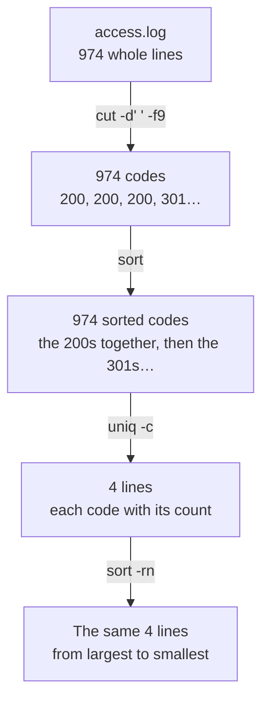

import Term from '~/components/Term.astro';
import TryIt from '~/components/TryIt.astro';
import Analogy from '~/components/Analogy.astro';
import SelfCheck from '~/components/SelfCheck.astro';
import Quiz from '~/components/Quiz.astro';
import QuizQuestion from '~/components/QuizQuestion.astro';
import QuizOption from '~/components/QuizOption.astro';

## The problem

Imagine you run an online shop and a customer writes to you: “Yesterday afternoon I tried to pay three times and couldn't.” You log in to the server. There's the <Term id="log">log</Term>: a file where the web server writes down one line for every <Term id="request">request</Term> it receives. Yesterday's has 974 lines.

From [lesson 2](/en/phase-1/linux-file-commands/) you know how to search it with `grep`. But you don't want to read lines: you want answers. How many payments failed? Starting when?

No single command answers that. But the terminal lets you **chain small commands**: one keeps the time from each line, another sorts them and another counts them. Together, they answer in a single line.

## The analogy

<Analogy>

Imagine a kitchen with several cooks in a row. Each one does a single thing: one peels, another chops and another plates. Each one gets what they need through a hatch on their left, and puts what they've made through another hatch on their right.

If you put two cooks side by side, the first one's outgoing hatch is the second one's incoming hatch: that's a <Term id="pipe">pipe</Term>. If, instead of opening onto the next cook, the hatch opens onto the fridge, what comes out is stored for later: that's a redirection.

If a cook finds a rotten tomato, they don't put it on the plate: they shout it out, so the head chef hears it even though the plate keeps moving. And when they finish, each one says “done” or “that went wrong.”

<div slot="limits">

- In the kitchen, the plate moves on whole. In the terminal, lines go through one by one and all the programs work at the same time, although `sort`, for example, has to wait until it has them all.
- What you “put in the fridge” with `>` replaces what was there; a real fridge doesn't throw anything away.
- A program's “done” is a number, and the opposite of what you'd expect: 0 means it went well.

</div>

</Analogy>

## How it really works

### One program, one input and two outputs

Go to your practice folder, where you downloaded `access.log` in [lesson 2](/en/phase-1/linux-file-commands/), and ask `ls` for two files, one that exists and one that doesn't:

```sh
cd ~/backend-course/phase-1
ls access.log missing
```

```text
ls: missing: No such file or directory
access.log
```

(On Linux and WSL, the error says `ls: cannot access 'missing'`.) Two lines come out mixed together on the screen, but `ls` wrote them through two different places. Every program the shell starts has three channels open, numbered 0 to 2:

| Number | Name | What for | Unless you say otherwise |
|---|---|---|---|
| 0 | <Term id="stdin">stdin</Term>, standard input | What the program reads | What you type |
| 1 | <Term id="stdout">stdout</Term>, standard output | The results | The screen |
| 2 | <Term id="stderr">stderr</Term>, standard error | Errors and warnings | The screen |

The `access.log` line came out through output 1, and the error through output 2. Since both go to the screen, you see them together. But they're different channels, and you can send each one somewhere else.

### Sending the output to a file

`>` sends standard output to a file instead of the screen:

```sh
ls access.log missing > list.txt
cat list.txt
```

```text
ls: missing: No such file or directory
access.log
```

The error still shows up on the screen, because `>` only redirects output 1. The `access.log` line no longer does: it ended up in `list.txt`, and `cat` shows it afterwards. If the file doesn't exist, `>` creates it.

- **`>` overwrites:** if the file already had something in it, the shell empties it before starting the program, without asking.
- **`>>` appends to the end:** what was there stays. It's useful for collecting results into a report.

### Separating the errors

The channel number goes right before `>`. Since `>` is the same as `1>`, standard error is sent with `2>`:

```sh
ls access.log missing 2> errors.txt
cat errors.txt
```

```text
access.log
ls: missing: No such file or directory
```

Now it's the other way around: the result shows up on the screen and the error is saved. Three very common variants:

- **`> all.txt 2>&1`** puts both outputs in the same file. `2>&1` reads “send output 2 wherever output 1 is going right now.” The `&` says that `1` is a channel and not a file called “1.”
- **`2> /dev/null`** throws the errors away. `/dev/null` is a special file that swallows everything you write to it.
- **`>&2`** does the opposite of `2>&1`: it sends normal output to standard error. That's how scripts write their warnings, as you'll see in [lesson 8](/en/phase-1/bash-scripts/).

Order matters, because the shell reads redirections from left to right. In `2>&1 > all.txt`, output 2 goes where output 1 was at that moment, the screen, and only output 1 ends up in the file.

### Connecting programs with a pipe

`|` (the vertical bar; on a US keyboard, <kbd>Shift</kbd> + <kbd>\\</kbd>, the backslash key) connects one program's standard output to the next one's standard input. For example, to count the 404s in the log with two programs from lesson 2:

```sh
grep '" 404 ' access.log | wc -l
```

```text
      64
```

`grep` lets the lines with a 404 code through and, instead of writing them on the screen, hands them to `wc -l`, which counts them. Neither one knows the other exists: `grep` writes to its output, `wc` reads from its input and the shell connects them.

The pipe only carries output 1. Errors still go to the screen:

```sh
ls access.log missing | wc -l
```

```text
ls: missing: No such file or directory
       1
```

`wc` only got `access.log`. To send it the error too, write `2>&1 |`.

### Each piece of a line has its number

In [lesson 2](/en/phase-1/linux-file-commands/) you saw what each part of a log line says. To get answers out of it, you still need to know each part's number. This is the first line:

```text
203.0.113.50 - - [01/Oct/2026:00:00:41 +0000] "GET /robots.txt HTTP/1.1" 200 12378 "-" "ExampleBot/1.0 (+https://example.com/bot)"
```

If you split it at the spaces, each piece is a field, and they're counted from 1:

| Field | In this line | What it is |
|---|---|---|
| 1 | `203.0.113.50` | The IP of whoever is asking |
| 4 | `[01/Oct/2026:00:00:41` | The day and time |
| 6 and 7 | `"GET` and `/robots.txt` | What they're asking for: the method and the path |
| 9 | `200` | The response's <Term id="status-code">status code</Term> |
| 10 | `12378` | How many bytes the response took up |

### Cut, sort and count

With three programs you can count almost anything in a log:

- **`cut`** keeps one piece of each line. `-d' '` says which character to split at (here, the space) and `-f9`, which field to keep.
- **`sort`** sorts the lines. With `-n` it sorts them as numbers, and with `-r`, in reverse, from largest to smallest.
- **`uniq -c`** merges identical lines that come one after another and writes in front how many there were.

Here's how to count the status codes in the log, step by step. First, `cut` on the first line, to check that field 9 is the code:

```sh
head -1 access.log | cut -d' ' -f9
```

```text
200
```

Now on the whole log, sorting so identical codes end up together, and counting them:

```sh
cut -d' ' -f9 access.log | sort | uniq -c
```

```text
 865 200
  19 301
  64 404
  26 500
```

And so the most frequent comes first, you sort again, this time by the number:

```sh
cut -d' ' -f9 access.log | sort | uniq -c | sort -rn
```

```text
 865 200
  64 404
  26 500
  19 301
```

Yesterday, the server answered fine 865 times, didn't find what it was asked for 64 times and failed 26 times. Along the way, the data flows like this:



On Linux and WSL, `uniq -c` puts more spaces in front of the numbers (`    865 200`), and `wc -l` puts none (`64`). It's just formatting: the numbers are the same.

### Every program ends with a code

When a program finishes, it leaves a number behind: its <Term id="exit-code">exit code</Term>. It doesn't show up on the screen, but the shell keeps it, and `echo $?` shows it to you:

```sh
grep '" 500 ' access.log > /dev/null
echo $?
```

```text
0
```

`grep` found lines (you sent them to `/dev/null` so you wouldn't see them), so it finished with 0. **0 means everything went well**, and any other number means something failed. `grep` has three:

| Code | What it means for `grep` | Example |
|---|---|---|
| 0 | It found at least one line | `grep '" 500 ' access.log` |
| 1 | It didn't find any | `grep '" 503 ' access.log` (there are no 503s) |
| 2 | There was an error | `grep '" 500 ' acess.log` (the file doesn't exist) |

`$?` holds the code of the last command, so you have to check it right afterwards: `echo` itself changes it.

### Chaining based on the result

With the exit code, the shell decides what to do next:

- **`a && b`** runs `b` only if `a` succeeded (finished with 0).
- **`a || b`** runs `b` only if `a` failed.
- **`a ; b`** always runs `b`, whatever happens with `a`.

```sh
grep '" 500 ' access.log > /dev/null && echo "There are 500 errors"
grep '" 503 ' access.log > /dev/null || echo "No 503s"
```

```text
There are 500 errors
No 503s
```

`&&` prevents chains of errors. With `cd old && rm *.txt`, if the `old` folder doesn't exist, `rm` doesn't run; with `;`, it would delete the `.txt` files wherever you happened to be. When a step depends on the previous one, join them with `&&`.

## Try it

The goal: you're the one keeping an eye on the `example.com` shop, and yesterday's log, from October 1, hides four stories. You already know one: the scanner from [lesson 2](/en/phase-1/linux-file-commands/). Find the other three without opening it, using only pipes. Everything happens in your terminal, inside your practice folder.

The outputs are from a Mac. On Linux and WSL, the numbers from `uniq -c` have more spaces in front, and the ones from `wc -l` have none; there are no other differences.

<TryIt
  title="1. Check that you have the log"
  cmd={`cd ~/backend-course/phase-1\nwc -l access.log`}
  output={`     974 access.log`}
>

If it answers `No such file or directory`, download it as in [lesson 2](/en/phase-1/linux-file-commands/), with `curl -O https://backenddesdecero.com/practicas/access.log`. It has to say 974: the log is the same for everyone, so your numbers will be the ones on this page.

</TryIt>

<TryIt
  title="2. Who asks you for the most?"
  cmd={`cut -d' ' -f1 access.log | sort | uniq -c | sort -rn | head -5`}
  output={` 144 203.0.113.50
  65 192.0.2.10
  40 198.51.100.23
  36 192.0.2.253
  23 203.0.113.99`}
>

The status code recipe, with field 1, the IP, and `head -5` to keep the top five. The first one asks for more than twice as much as the second. Investigate it.

</TryIt>

<TryIt
  title="3. Who is 203.0.113.50?"
  cmd={`grep '^203.0.113.50 ' access.log | cut -d'"' -f6 | sort | uniq -c\ngrep '^203.0.113.50 ' access.log | cut -d: -f2 | sort | uniq -c | head -3`}
  output={` 144 ExampleBot/1.0 (+https://example.com/bot)
   6 00
   6 01
   6 02`}
>

The space after the IP, as in lesson 2, says that it ends there. The `^` means “at the start of the line”: that way it only finds the IP in field 1.

The first command splits at the double quotes (`-d'"'`): the sixth piece is the program's name. All 144 requests are from `ExampleBot`. The second splits at the colons, and field 2 is the hour: it asks 6 times every hour, from 00 to 23, like clockwork.

**First story:** it's a robot (a *bot*) that crawls the shop all day, like search engines do. It does no harm: it's just the one that asks the most.

</TryIt>

<TryIt
  title="4. Who asks for what doesn't exist?"
  cmd={`grep '" 404 ' access.log | cut -d' ' -f1 | sort | uniq -c | sort -rn | head -3`}
  output={`  40 198.51.100.23
   2 203.0.113.50
   2 203.0.113.184`}
>

First you filter the lines with a 404, and then you count their IPs. The quotes and spaces in `'" 404 '` look for the 404 in the code field, and not inside some other number.

Of the 64 404 errors, 40 come from a single IP: `198.51.100.23`, the scanner you found in lesson 2. The rest have 2 or fewer: broken links and mistyped addresses.

</TryIt>

<TryIt
  title="5. What was 198.51.100.23 looking for, and when?"
  cmd={`grep '^198.51.100.23 ' access.log | cut -d' ' -f4,7,9 | head -5`}
  output={`[01/Oct/2026:03:12:23 /.env 404
[01/Oct/2026:03:12:24 /.env.backup 404
[01/Oct/2026:03:12:25 /.git/config 404
[01/Oct/2026:03:12:26 /.git/HEAD 404
[01/Oct/2026:03:12:27 /wp-login.php 404`}
>

`-f4,7,9` keeps the time, the path and the code. Now you can see what else the scanner tried, almost one request per second: besides `.env`, the Git configuration and the WordPress admin login page.

**The scanner's story, complete:** it tried well-known addresses in case the shop had left them exposed, and they all got a 404. Change `head -5` to `tail -2` and you'll see that it finished at 03:13.

</TryIt>

<TryIt
  title="6. Requests per hour"
  cmd={`cut -d: -f2 access.log | sort | uniq -c`}
  output={`  13 00
  12 01
  14 02
  51 03
   6 04
  13 05
  24 06
  40 07
  42 08
  44 09
  87 10
  83 11
  49 12
  37 13
  71 14
  46 15
  24 16
  22 17
  45 18
  65 19
  75 20
  72 21
  26 22
  13 23`}
>

Without the final `sort -rn`, because here you want the hours in order. Normal for a shop: little in the early hours, more in the late morning and another peak in the evening. One hour doesn't fit: 03, with 51 requests. You already know why: 40 of them are from the scanner.

</TryIt>

<TryIt
  title="7. When did the 500 errors start?"
  cmd={`grep '" 500 ' access.log | cut -d: -f2,3 | sort | uniq -c`}
  output={`   1 14:05
   1 14:07
   2 14:08
   1 14:09
   3 14:10
   2 14:11
   2 14:13
   1 14:14
   1 14:16
   2 14:17
   2 14:21
   2 14:22
   2 14:23
   4 14:24`}
>

With `-f2,3`, `cut` keeps the hour and the minute. The 26 500 errors fall within just twenty minutes: from 14:05 to 14:24. There are none before or after.

</TryIt>

<TryIt
  title="8. What was failing?"
  cmd={`grep '" 500 ' access.log | cut -d' ' -f6,7 | sort | uniq -c`}
  output={`   1 "GET /api/products?page=3
  25 "POST /api/orders`}
>

25 of the 26 failures are `POST /api/orders`: submitting an order.

**Second story:** between 14:05 and 14:25, the shop couldn't charge for orders. If you count the IPs in those lines, you'll see that some repeat: people who, like your customer, tried again.

</TryIt>

<TryIt
  title="9. Save the report"
  cmd={`echo "500 errors per minute" > report.txt\ngrep '" 500 ' access.log | cut -d: -f2,3 | sort | uniq -c >> report.txt && echo "Report saved"\nhead -3 report.txt`}
  output={`Report saved
500 errors per minute
   1 14:05
   1 14:07`}
>

The first line creates `report.txt` with a title, and the second appends the count below it with `>>` (with `>` you would have erased the title). `&& echo` only writes “Report saved” if the pipe succeeded.

</TryIt>

One story is left. This time, write the commands yourself, without copying them:

<SelfCheck question="Challenge: the second IP that asks the most, 192.0.2.10, isn’t a robot. At what hours does it ask? How many different browsers does it use? What do you think it is?">

```sh
grep '^192.0.2.10 ' access.log | cut -d: -f2 | sort | uniq -c
grep '^192.0.2.10 ' access.log | cut -d'"' -f6 | sort | uniq | wc -l
```

`uniq` without `-c` leaves one line of each, and `wc -l` counts how many are left. The first command answers with hours from 09 to 16: `8 09`, `4 10`, `13 11`, `1 12`, `12 13`, `20 15` and `7 16`. The second answers `4`: an iPhone, a Mac, a Windows PC and a Linux one.

**Third story:** it's an office. Several people, each with their own computer or phone, go out to the internet through the same router, and the shop sees them all as a single IP. It's the <Term id="nat">NAT</Term> from [Phase 0, lesson 5](/en/phase-0/ip-ports-sockets/). It only asks during working hours, and hardly at all at lunchtime.

</SelfCheck>

## You have already seen it

- **The “Error 404” and “Error 500” pages** you come across while browsing: each one usually gets written down in that server's log.
- **A spreadsheet**, when you sort a column and count how many times each value appears with a pivot table: it's `sort | uniq -c` with a mouse.

And if you code:

- `npm run build && npm run deploy`: if the build fails, nothing gets published. It's this lesson's `&&`.
- In Node, `console.log` writes to stdout and `console.error`, to stderr.
- A GitHub Actions step turns red when a command finishes with a code other than 0, like the one `process.exit(1)` leaves.

## Common mistakes

- **Searching for the bare number.** `grep -c 404 access.log` answers 113, not 64: it also counts the 49 responses that take up `4047` bytes. Anchor what you're looking for to its field, as in `'" 404 '`, or cut it out first with `cut`.
- **`uniq -c` without a `sort` first.** `uniq` only merges identical lines that come one after another. Without sorting, `cut -d' ' -f9 access.log | uniq -c` starts with `19 200`, `1 301`, `21 200`…: the same code, counted in bits. Always sort first.
- **Reading and writing the same file.** `sort access.log > access.log` leaves the file empty: the shell empties it because of the `>` before `sort` starts reading it. Write to another file; if it happens to you with the log, download it again.
- **A space in `2>`.** In `ls access.log missing 2 > errors.txt`, the shell sees an argument `2` and a regular `>`: `ls` looks for a file called `2`, and the normal output ends up in `errors.txt`. The `2` goes right up against the `>`.
- **Checking `$?` after a pipe.** It's the code of the last program. `cut -d' ' -f1 acess.log | sort | uniq -c` writes an error, but `$?` gives 0, because `uniq` succeeded. In [lesson 8](/en/phase-1/bash-scripts/) you'll see how to make a pipe fail if any of its parts fails.

## Summary

- Every program has one input (stdin, 0) and two outputs: the results (stdout, 1) and the errors (stderr, 2).
- `>` sends output to a file and overwrites it; `>>` appends to the end; `2>` sends the errors; `2>&1` joins the errors with the output, and `/dev/null` swallows whatever you send it.
- `|` connects one program's output to the next one's input. With `cut`, `sort` and `uniq -c` you can count whatever you want in a log.
- Every program finishes with a code: 0 if it went well and another number if not. `$?` shows it, `&&` continues only if it went well and `||`, only if it failed.

## Did you get it?

<Quiz>

<QuizQuestion
  question="Every night you save the day’s summary with a command that ends in “> summary.txt”. After a week, what’s in summary.txt?"
  review="Sending the output to a file"
>

<QuizOption text="All seven summaries, one after another.">

No: `>` empties the file every time before writing. To keep adding, the command would have to end in `>> summary.txt`.

</QuizOption>

<QuizOption text="Only last night’s." correct>

Every night, `>` empties the file and writes the new summary. The previous six are lost.

</QuizOption>

<QuizOption text="Only the first night’s: > doesn’t touch a file that already exists.">

`>` protects nothing: if the file exists, it empties it without asking. That's why you can lose data with it without noticing.

</QuizOption>

</QuizQuestion>

<QuizQuestion
  question="You type cut -d' ' -f1 acess.log > ips.txt, with the log’s name misspelled. The screen shows “cut: acess.log: No such file or directory”. What’s in ips.txt?"
  review="Separating the errors"
>

<QuizOption text="Nothing: the file exists, but it’s empty." correct>

The shell creates `ips.txt` before starting `cut`. The error goes through stderr, which `>` doesn't redirect, and that's why you see it on the screen and not in the file.

</QuizOption>

<QuizOption text="The error message.">

`>` only redirects standard output, number 1, and the error goes through number 2. To save it, you'd need `2>` or `2>&1`.

</QuizOption>

<QuizOption text="It doesn’t exist: > doesn’t create the file if the command fails.">

The shell sets up the redirections before starting the program, so it doesn't know whether it will fail: the file is always created.

</QuizOption>

</QuizQuestion>

<QuizQuestion
  question="To count the requests from each IP you type cut -d' ' -f1 access.log | uniq -c, and the same IP shows up on many lines, each with a small number. What’s going on?"
  review="Cut, sort and count"
>

<QuizOption text="uniq -c compares the log’s whole lines, not just the IP.">

`uniq` doesn't see the log: it only gets what comes out of `cut`, one IP per line. Two requests from the same IP reach it as two identical lines.

</QuizOption>

<QuizOption text="The log writes the same IP in different ways, and uniq counts them separately.">

An IP is always written the same way in the log. Otherwise, sorting wouldn't bring them together either, and with `sort` in front they come out right.

</QuizOption>

<QuizOption text="There’s a sort missing before uniq -c." correct>

`uniq` only merges identical lines that come one after another. In the log, an IP's requests are scattered among other IPs' requests, and you have to sort them so they end up together.

</QuizOption>

</QuizQuestion>

<QuizQuestion
  question="You’re told that yesterday a lot of orders failed at some point in the afternoon. You have the server’s log. How do you find out what time it started?"
  review="Try it"
>

<QuizOption text="You count the requests per hour: the hour with the most requests is when it failed.">

More requests isn't the same as more errors. In the practice log, the hour with the most requests is 10 a.m., and the failure was at 2 p.m.

</QuizOption>

<QuizOption text="You filter the 500s, cut out the hour and minute, and count them." correct>

A 500 is a server error. By keeping only those and counting them per minute, you see the first minute with failures and how long it lasted.

</QuizOption>

<QuizOption text="You count the IPs that ask the most: the top one is what caused the failure.">

The IP that asks the most isn't necessarily the culprit. In the practice log it's a harmless robot, and the failures came from the server itself.

</QuizOption>

</QuizQuestion>

<QuizQuestion
  question="On another server, you type grep 'wp-login' access.log > /dev/null and then echo $?, and it answers 1. What does that mean?"
  review="Every program ends with a code"
>

<QuizOption text="grep found one line with wp-login.">

`$?` isn't a count: it's the code `grep` finished with. If it had found any line, it would be 0.

</QuizOption>

<QuizOption text="The command went well: 1 means “yes.”">

In the terminal it's the other way around: 0 means everything went well, and any other number means it didn't.

</QuizOption>

<QuizOption text="There’s no line with wp-login." correct>

For `grep`, 1 means “I didn't find anything”; a real error, like a file that doesn't exist, would be a 2. That server hasn't received any request for `wp-login`.

</QuizOption>

</QuizQuestion>

<QuizQuestion
  question="You type mkdir reports && cd reports, but you already had a reports folder. mkdir answers “File exists”. Where do you end up?"
  review="Chaining based on the result"
>

<QuizOption text="In the same folder you were in." correct>

`mkdir` couldn't create the folder and finishes with 1, so `&&` doesn't run `cd`. With `mkdir -p reports`, which doesn't complain if it already exists, it would finish with 0 and you would go in.

</QuizOption>

<QuizOption text="Inside reports: “File exists” is just a warning, and && keeps going.">

For the shell there are no warnings: only the exit code counts, and `mkdir`'s here is 1. With `;` you would go in, because it continues whatever happens.

</QuizOption>

<QuizOption text="Inside a new, empty reports folder: mkdir replaces the one that was there.">

`mkdir` never touches a folder that already exists: it fails and leaves it as it was, with everything it had inside.

</QuizOption>

</QuizQuestion>

</Quiz>

## Further reading

- [The Linux Command Line](https://linuxcommand.org/tlcl.php), by William Shotts: chapter 6, “Redirection,” covers the same ground as this lesson with more examples.
- [Redirections](https://www.gnu.org/software/bash/manual/html_node/Redirections.html), in the bash manual: every way to redirect, including the ones we haven't covered.
