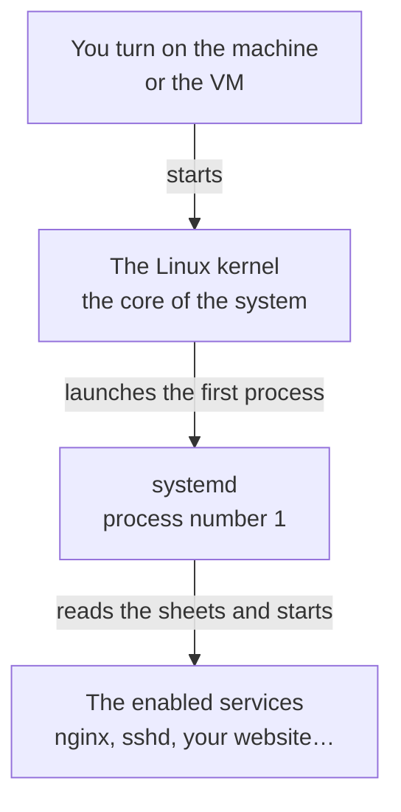

import { Aside } from '@astrojs/starlight/components';
import Term from '~/components/Term.astro';
import TryIt from '~/components/TryIt.astro';
import Analogy from '~/components/Analogy.astro';
import Quiz from '~/components/Quiz.astro';
import QuizQuestion from '~/components/QuizQuestion.astro';
import QuizOption from '~/components/QuizOption.astro';

## The problem

Imagine you already have your first website working on your practice server. You started it with a command, tried it with `curl` and it answered. You close the terminal, go to sleep and, in the morning, nobody answers. The program died with your session.

And even if you leave it open: who starts it again if it crashes at three in the morning, or if the server restarts after an update? A real server can't depend on someone keeping a terminal open.

And before that, another question: where does the program come from, if a server has no browser to download it with? This lesson solves both things: installing programs with apt and keeping them running with systemd.

## The analogy

<Analogy>

Think of a restaurant. The cooks and the waiters are the programs. None of them opens the place on their own: every morning the manager arrives, opens up and calls the people on shift.

For each position, the manager has a sheet: who it is, what they do, when they start and what to do if they leave in the middle of the shift (call them back). Everything that happens goes into the logbook. The manager is <Term id="systemd">systemd</Term>, the sheets are the *unit files* and the logbook is its journal.

The equipment (the ovens, the coffee machine) comes from a trusted supplier with a catalog, who delivers each appliance with the parts it needs and leaves it installed. That supplier is apt.

<div slot="limits">

- The manager only checks that the employee is still there, not that they're working well. A frozen server that doesn't answer can still show up as “running.”
- A real manager would find someone else; systemd starts the same program again. If the fault is in the sheet, it will fail the same way every time, and after several attempts in a row it gives up.
- The supplier doesn't tell you about its new products: you have to ask for the catalog yourself.

</div>

</Analogy>

## How it really works

### A daemon is a program that doesn't depend on you

When you install nginx, a web server, in “Try it,” it will answer on port 80 without you starting it. It will keep answering when you log out and after you restart the machine.

A program like that is a <Term id="daemon">daemon</Term>: a <Term id="process">process</Term> that keeps running on its own, with no window or terminal, waiting to do its job. Many have a `d` at the end of their name: `sshd` is the SSH server and `systemd`, the one that watches over all the others.

What you start from the terminal, on the other hand, hangs from it: as you saw in [lesson 5, “Processes and signals”](/en/phase-1/linux-processes-and-signals/), when you close it, its processes receive a signal (`SIGHUP`) and end.

### systemd starts everything else

When you turn on a Linux machine, the first thing that starts is its *kernel*, the core of the system, the part that talks to the computer's hardware. The kernel launches a single program, which starts everything else:



That program is systemd, and it always has PID 1. Almost every Linux used on servers runs it, Ubuntu included.

Each program that systemd keeps running is a **service**, with a named sheet (`nginx.service`) that says what to start and how to look after it.

### systemctl: the remote control for each service

You give systemd orders with `systemctl`, almost always with the same pattern: `systemctl` + action + service:

| Command | What it does |
|---|---|
| `systemctl status nginx` | Says whether it's running, its PID and its last log lines |
| `sudo systemctl start nginx` | Starts it now |
| `sudo systemctl stop nginx` | Stops it now |
| `sudo systemctl restart nginx` | Stops it and starts it again |
| `sudo systemctl enable nginx` | Signs it up to start every time the machine boots |
| `sudo systemctl disable nginx` | Takes it off that list |
| `systemctl list-units --type=service` | Lists every service systemd has loaded |

Looking needs no permissions, but changing a service affects the whole machine: that's why those commands carry `sudo`, which runs them as root ([lesson 4](/en/phase-1/linux-users-and-permissions/)).

The difference that confuses people the most is **`start` versus `enable`**. `start` acts now and leaves nothing written down. `enable` only signs it up for the next boot. For both at once, `sudo systemctl enable --now nginx`.

### journalctl: the services' journal

What a service prints on screen, and what systemd does with it, goes to one place: the *journal*, the logbook from the analogy. You read it with `journalctl`:

- `journalctl -u nginx`: everything about one service (`-u` for *unit*, the sheet).
- `journalctl -u nginx -n 20`: only the last 20 lines.
- `journalctl -u nginx -f`: shows new lines as they arrive, like `tail -f` in [lesson 2](/en/phase-1/linux-file-commands/). You quit with <kbd>Ctrl</kbd> + <kbd>C</kbd>.

If the output doesn't fit in the window, it opens in a pager like the one `man` uses: <kbd>Space</kbd> goes down and <kbd>Q</kbd> quits.

### The service sheet: the unit file

Each service is described in a text file, its *unit file*. This is the one you'll write in “Try it” for a web server made with Python:

```ini
[Unit]
Description=Course practice website

[Service]
User=ubuntu
WorkingDirectory=/home/ubuntu/web
ExecStart=/usr/bin/python3 -m http.server 8000
Restart=always

[Install]
WantedBy=multi-user.target
```

It has three parts, and each line is a name, an `=` and a value:

- **`[Unit]`**: what it is. `Description` is the name you'll see in `status` and in the journal.
- **`[Service]`**: how it runs.
  - `ExecStart` is the command that starts the program, with the full path.
  - `User` says which user it runs as. Without that line, it would run as root, with every permission: exactly what [lesson 4](/en/phase-1/linux-users-and-permissions/) advises against.
  - `WorkingDirectory` is the folder it starts from, as if you did `cd` first.
  - `Restart=always`: if the program ends, for whatever reason, systemd starts it again. It only stays stopped if you stop it with `systemctl stop`, or if it fails so many times in a row that systemd gives up (you'll see it in the challenge).
- **`[Install]`**: what `enable` does. `WantedBy=multi-user.target` means “start it on a normal boot.”

The sheets of installed programs are in `/usr/lib/systemd/system/`, and yours go in `/etc/systemd/system/`.

systemd reads the sheets once and keeps them in memory. **If you change one, tell it with `sudo systemctl daemon-reload`**, or it will keep using the old version.

### apt installs programs from a trusted catalog

On Ubuntu, programs are installed as **packages**: the program, its configuration and, if it's a server, its systemd sheet, all in one file. They're in Ubuntu's repositories, servers on the internet that act as a catalog. The one that finds, downloads and installs them is apt, a <Term id="package-manager">package manager</Term>.

| Command | What it does |
|---|---|
| `sudo apt update` | Downloads the updated catalog: which packages there are and in which version. It installs nothing |
| `sudo apt install nginx` | Installs nginx and the packages it needs to work |
| `sudo apt upgrade` | Updates what you already have to the catalog's versions |
| `sudo apt remove nginx` | Uninstalls it (with `purge` instead of `remove`, it also deletes its configuration) |
| `apt search` and `apt show` | Search the catalog and describe a package, without `sudo` |

nginx uses files that come in another package, `nginx-common`, and apt installs it too. Those packages are called **dependencies**.

And why “trusted”? Ubuntu signs its catalog with its private key, and apt checks the <Term id="digital-signature">digital signature</Term> with the public key that already comes with the system, as you saw in [lesson 8 of Phase 0](/en/phase-0/tls-and-https/). If someone swaps a package along the way, the signature doesn't match and apt rejects it. Downloading a program from some random website gives you no such guarantee.

### On your Mac: launchd and Homebrew

macOS has its own equivalent of systemd, launchd, which is also process number 1. And Homebrew is a package manager like apt: `brew install nginx` installs it and `brew services start nginx` keeps it running with launchd. You won't use them in this course.

<TryIt title="On your Mac: who is process 1?" cmd="ps -p 1" output={`  PID TTY           TIME CMD
    1 ??        56:20.99 /sbin/launchd`}>

`ps -p 1` shows the process with PID 1. Your `TIME`, the processor time it has used so far, will be different.

</TryIt>

## Try it

The goal: install a real web server, create your own service and check that it survives being killed and the machine restarting. At the end you'll break it on purpose and look for the cause.

Everything happens on your practice server, the `course` VM from [lesson 4](/en/phase-1/linux-users-and-permissions/): log in with `multipass shell course`. You'll use `sudo`, because installing programs and touching services changes the whole system, but everything stays inside the VM.

<Aside type="tip" title="On Windows, with WSL">

WSL can be your practice server if it has systemd. Do the first exercise: if `ps -p 1` says `systemd`, carry on. If it says something else, like `init`, open `sudo nano /etc/wsl.conf`, add these two lines and save:

```ini
[boot]
systemd=true
```

Then run `wsl --shutdown` in PowerShell and open Ubuntu again. Recent installations already have it turned on.

</Aside>

### First, nginx from apt

<TryIt title="1. Who is process 1?" cmd="ps -p 1" output={`    PID TTY          TIME CMD
      1 ?        00:00:00 systemd`}>

In the VM, process 1 is `systemd`. Check that the prompt says `ubuntu@course` (in WSL, your user): if it says `ana@laptop`, you're on your Mac and you'll see `launchd`.

</TryIt>

<TryIt title="2. Ask for the catalog" cmd="sudo apt update" output={`Get:1 http://ports.ubuntu.com/ubuntu-ports noble InRelease [256 kB]
…
Get:19 http://ports.ubuntu.com/ubuntu-ports noble-security/main arm64 Packages [1448 kB]
Fetched 35.4 MB in 4s (9916 kB/s)
Reading package lists... Done
Building dependency tree... Done
Reading state information... Done
2 packages can be upgraded. Run 'apt list --upgradable' to see them.`}>

apt downloads the catalog of each repository (`noble` is Ubuntu 24.04). The last line warns that there are new versions: `sudo apt upgrade` would install them. Your numbers will be different, and with an Intel or AMD processor you'll see `archive.ubuntu.com` and `amd64` instead of `ports.ubuntu.com` and `arm64`.

</TryIt>

<TryIt title="3. Install nginx" cmd="sudo apt install -y nginx" output={`Reading package lists... Done
Building dependency tree... Done
Reading state information... Done
The following additional packages will be installed:
  nginx-common
…
The following NEW packages will be installed:
  nginx nginx-common
…
Setting up nginx-common (1.24.0-2ubuntu7.18) ...
Created symlink /etc/systemd/system/multi-user.target.wants/nginx.service → /usr/lib/systemd/system/nginx.service.
Setting up nginx (1.24.0-2ubuntu7.18) ...
…`}>

`-y` answers “yes” to apt's question. Notice two things:

- `additional packages`: the dependency, `nginx-common`, comes in on its own.
- `Created symlink`: that's what `enable` does. The package has enabled the service, so nginx is already running and will start on every boot.

We've removed parts (`…`), and your version may be newer.

</TryIt>

<TryIt title="4. Look at the service" cmd="systemctl status nginx" output={`● nginx.service - A high performance web server and a reverse proxy server
     Loaded: loaded (/usr/lib/systemd/system/nginx.service; enabled; preset: enabled)
     Active: active (running) since Mon 2026-10-12 13:28:48 UTC; 4s ago
       Docs: man:nginx(8)
…
   Main PID: 384 (nginx)
…`}>

Look at three lines:

- `Loaded`: where its sheet is, and `enabled`, meaning it will start on boot.
- `Active: active (running)`: it's running, and since when.
- `Main PID`: the number of its main process. Yours will be different.

If the command doesn't give you the prompt back, quit with <kbd>Q</kbd>.

</TryIt>

<TryIt title="5. Ask it for the page" cmd="curl localhost" output={`<!DOCTYPE html>
<html>
<head>
<title>Welcome to nginx!</title>
…
<h1>Welcome to nginx!</h1>
<p>If you see this page, the nginx web server is successfully installed and
working. Further configuration is required.</p>
…`}>

Your VM is already a web server: nginx answers on port 80, the one `curl` uses if you don't tell it another, with its welcome page. If you get `Couldn't connect to server`, the service isn't `active`: check the previous step.

</TryIt>

<TryIt title="6. Stop it and start it again" cmd={`sudo systemctl stop nginx\nsystemctl is-active nginx\ncurl localhost\nsudo systemctl start nginx`} output={`inactive
curl: (7) Failed to connect to localhost port 80 after 0 ms: Couldn't connect to server`}>

`is-active` answers with one word. With nginx stopped, nobody is listening on port 80 and `curl` can't connect. `start` starts it again.

</TryIt>

<TryIt title="7. Read its journal" cmd="journalctl -u nginx" output={`Oct 12 13:28:48 course systemd[1]: Starting nginx.service - A high performance web server and a reverse proxy server...
Oct 12 13:28:48 course systemd[1]: Started nginx.service - A high performance web server and a reverse proxy server.
Oct 12 13:28:52 course systemd[1]: Stopping nginx.service - A high performance web server and a reverse proxy server...
Oct 12 13:28:52 course systemd[1]: nginx.service: Deactivated successfully.
Oct 12 13:28:52 course systemd[1]: Stopped nginx.service - A high performance web server and a reverse proxy server.
Oct 12 13:28:52 course systemd[1]: Starting nginx.service - A high performance web server and a reverse proxy server...
Oct 12 13:28:52 course systemd[1]: Started nginx.service - A high performance web server and a reverse proxy server.`}>

Each line carries the date, the machine and who writes it: `systemd[1]` is systemd, with its PID in brackets. It's the story of steps 3 and 6: it started when it was installed, you stopped it and you started it again.

If you get `No journal files were opened due to insufficient permissions`, your user can't read the system journal: repeat the command with `sudo` in front.

Leave nginx installed: you'll use it in [lesson 9, “SSH”](/en/phase-1/what-is-ssh/), to open a tunnel.

</TryIt>

### Then, your own service

Now you'll turn a program that doesn't come ready for it into a service. Python comes with a minimal web server: `python3 -m http.server 8000` serves, on port 8000, the files in the folder where you start it. First, create that folder with a page:

<TryIt title="8. A page to serve" cmd={`mkdir -p ~/web\necho '<h1>Hello from my service</h1>' > ~/web/index.html`}>

They print nothing: if there's no error, the page is in `~/web/index.html`.

</TryIt>

Now, the sheet. Open it with `nano`, as in [lesson 2](/en/phase-1/linux-file-commands/). It needs `sudo` because `/etc` belongs to the system:

<TryIt title="9. Write the sheet" cmd="sudo nano /etc/systemd/system/web-course.service" />

Copy into it the unit file from [“The service sheet”](#the-service-sheet-the-unit-file), as is. In WSL, change `ubuntu` to your user in `User` and in `WorkingDirectory`. Save with <kbd>Ctrl</kbd> + <kbd>O</kbd> and <kbd>Enter</kbd>, and quit with <kbd>Ctrl</kbd> + <kbd>X</kbd>.

<TryIt title="10. Enable it and start it" cmd={`sudo systemctl daemon-reload\nsudo systemctl enable --now web-course`} output={`Created symlink /etc/systemd/system/multi-user.target.wants/web-course.service → /etc/systemd/system/web-course.service.`}>

`daemon-reload` makes systemd read the new sheet, and `enable --now` enables it and starts it at the same time. It's the same `Created symlink` as with nginx.

</TryIt>

<TryIt title="11. Check it" cmd={`systemctl status web-course\ncurl localhost:8000`} output={`● web-course.service - Course practice website
     Loaded: loaded (/etc/systemd/system/web-course.service; enabled; preset: enabled)
     Active: active (running) since Mon 2026-10-12 13:28:57 UTC; 4ms ago
   Main PID: 470 (python3)
…
<h1>Hello from my service</h1>`}>

It's running, and the last line is your page. Write down the `Main PID`: you need it in the next step. If `curl` says `Couldn't connect to server`, try again in a second: Python takes a moment to start listening.

</TryIt>

<TryIt title="12. Kill it and see what happens" cmd={`kill 470\nsystemctl status web-course`} output={`● web-course.service - Course practice website
     Loaded: loaded (/etc/systemd/system/web-course.service; enabled; preset: enabled)
     Active: active (running) since Mon 2026-10-12 13:29:00 UTC; 662ms ago
   Main PID: 483 (python3)
…
Oct 12 13:29:00 course systemd[1]: web-course.service: Scheduled restart job, restart counter is at 1.
Oct 12 13:29:00 course systemd[1]: Started web-course.service - Course practice website.`}>

Replace `470` with your `Main PID`. `kill` asks the process to end, as in [lesson 5](/en/phase-1/linux-processes-and-signals/), and doesn't need `sudo` because the process belongs to your user. The service is still `active (running)`, but with a different `Main PID`: the last two lines say that systemd scheduled a restart (`Scheduled restart job`) and started another process, because of `Restart=always`.

</TryIt>

One last test is left: restarting the machine. Leave the VM with `exit`, restart it from your terminal with `multipass restart course` and log back in with `multipass shell course`. In WSL, close Ubuntu, run `wsl --shutdown` in PowerShell and open it again.

<TryIt title="13. After restarting" cmd={`systemctl is-active nginx web-course\ncurl localhost:8000`} output={`active
active
<h1>Hello from my service</h1>`}>

Nobody started anything by hand: systemd started both on boot, because they're `enabled`.

</TryIt>

### The challenge: break it and find the cause

On a real server, services break. Open the sheet again with `sudo nano /etc/systemd/system/web-course.service` and change `http.server` to `http.sever` (without the second `r`). Save, quit and apply the change:

<TryIt title="14. Break it" cmd={`sudo systemctl daemon-reload\nsudo systemctl restart web-course\nsystemctl is-active web-course\ncurl localhost:8000`} output={`failed
curl: (7) Failed to connect to localhost port 8000 after 0 ms: Couldn't connect to server`}>

`restart` doesn't complain, but the service has ended up `failed`. If `is-active` says `activating` or `active`, repeat it in a couple of seconds: systemd is still trying.

</TryIt>

`curl` only knows that nobody answers; the reason is in the journal. Before you read on, look for it yourself.

<TryIt title="15. Find the cause" cmd="journalctl -u web-course -n 12" output={`Oct 12 13:29:21 course python3[137]: /usr/bin/python3: No module named http.sever
Oct 12 13:29:21 course systemd[1]: web-course.service: Main process exited, code=exited, status=1/FAILURE
Oct 12 13:29:21 course systemd[1]: web-course.service: Failed with result 'exit-code'.
Oct 12 13:29:22 course systemd[1]: web-course.service: Scheduled restart job, restart counter is at 3.
Oct 12 13:29:22 course systemd[1]: Started web-course.service - Course practice website.
Oct 12 13:29:22 course python3[139]: /usr/bin/python3: No module named http.sever
Oct 12 13:29:22 course systemd[1]: web-course.service: Main process exited, code=exited, status=1/FAILURE
Oct 12 13:29:22 course systemd[1]: web-course.service: Failed with result 'exit-code'.
Oct 12 13:29:22 course systemd[1]: web-course.service: Scheduled restart job, restart counter is at 4.
Oct 12 13:29:22 course systemd[1]: web-course.service: Start request repeated too quickly.
Oct 12 13:29:22 course systemd[1]: web-course.service: Failed with result 'exit-code'.
Oct 12 13:29:22 course systemd[1]: Failed to start web-course.service - Course practice website.`}>

There are two voices. `python3[139]` is the program, and it states the problem: `No module named http.sever`, nothing with that name exists. `systemd[1]` says that the program ended with an error (`status=1/FAILURE`) and that it tried again until it gave up: `Start request repeated too quickly`.

</TryIt>

Fix it: put `http.server` back in the sheet and repeat `daemon-reload` and `restart`. Check with `curl localhost:8000` that your page is back. If `restart` replies `Job for web-course.service failed`, you've been faster than systemd: after giving up, it waits ten seconds before letting you start it again.

If you want to remove the service when you're done, `sudo systemctl disable --now web-course` stops it and takes it off the boot list.

## You have already seen it

- **The windowless programs on your computer.** The one that syncs your photos or the one that checks for updates are there, with no window: they're daemons.
- **Your phone's app store.** It's a package manager: a trusted catalog, signed programs and updates that come from the same place.
- **The Phase 0 server.** The `nc -l 8080` from [lesson 2](/en/phase-0/client-server-model/) stopped with <kbd>Ctrl</kbd> + <kbd>C</kbd> or when you closed the terminal. It was a server, but not a service.

And if you code:

- npm is a package manager: `npm install` also brings in your dependencies' dependencies, like apt with `nginx-common`.
- `npm run dev` dies when you close the terminal, like the Python server. In production, your Node app is kept alive by systemd, by a tool like pm2 or, in Phase 7, by Docker. And with systemd, every `console.log` ends up in `journalctl`.

## Common mistakes

- **Using `start` and expecting it to survive a restart.** `start` only starts it this time. For every boot, `enable`, or `enable --now` for both.
- **Changing the sheet and forgetting `daemon-reload`.** systemd keeps the old version, and warns you: `Warning: The unit file, source configuration file or drop-ins of web-course.service changed on disk. Run 'systemctl daemon-reload' to reload units.`
- **Installing without `apt update`.** On a freshly created server, the catalog may be empty, and `sudo apt install nginx` replies `E: Unable to locate package nginx`; or old, and the download fails with `404 Not Found`. Run `sudo apt update` first.
- **Stopping at `systemctl status`.** It only shows a few lines of the journal, sometimes cut off. The cause is usually further up: look for it with `journalctl -u`.
- **Forgetting `User=` in the sheet.** The service will run as root. If someone finds a bug in your program, they'll be able to do whatever they want with the machine.

## Summary

- A daemon is a program that runs on its own, with no terminal. On Linux, systemd, process number 1, starts them and watches over them.
- `systemctl` manages services: `status` to look, `start`, `stop` and `restart` for now, and `enable` for every boot.
- What a service writes goes to the journal: `journalctl -u`. That's where the cause is when something fails.
- A unit file of a few lines turns any program into a service. After changing it, `sudo systemctl daemon-reload`.
- `apt` installs signed programs, with their dependencies. First `apt update`, then `apt install`.

## Did you get it?

<Quiz>

<QuizQuestion
  question="You started python3 -m http.server 8000 on your VM from an SSH session, closed your laptop and in the morning the website doesn’t answer. What happened?"
  review="A daemon is a program that doesn't depend on you"
>

<QuizOption text="The VM closes the ports nobody uses overnight.">

Linux doesn't close ports for sitting idle. What closed was your session, and the program went with it.

</QuizOption>

<QuizOption text="It stopped when the session you started it from closed." correct>

It hung from the terminal you started it from. For it to keep going without you, turn it into a service.

</QuizOption>

<QuizOption text="Python servers shut down on their own after a few hours without visits.">

They have no time limit: it would have kept going for days if nothing had stopped it.

</QuizOption>

</QuizQuestion>

<QuizQuestion
  question="You created a service, started it with sudo systemctl start web-course and it worked. After restarting the VM, it isn’t running. Why?"
  review="systemctl: the remote control for each service"
>

<QuizOption text="systemd deletes the services you create when it restarts.">

Your sheet is still in `/etc/systemd/system`: systemd doesn't delete anything. On boot, it only starts the enabled services.

</QuizOption>

<QuizOption text="You have to run daemon-reload after every restart.">

systemd reads every sheet when it starts. `daemon-reload` is only needed when you change one while the machine is on.

</QuizOption>

<QuizOption text="enable was missing: start only starts it this time." correct>

`start` acts now, and `enable` signs it up for every boot. `sudo systemctl enable --now web-course` does both.

</QuizOption>

</QuizQuestion>

<QuizQuestion
  question="In your service’s sheet you change port 8000 to 8080, run sudo systemctl restart web-course and it keeps listening on 8000. What are you missing?"
  review="The service sheet: the unit file"
>

<QuizOption text="A sudo systemctl daemon-reload before the restart." correct>

systemd keeps in memory the sheets it has already read, and `daemon-reload` makes it read them again. If you forget, `restart` warns you with a `Warning`.

</QuizOption>

<QuizOption text="Running stop and then start, because that way systemd rereads the sheet.">

`stop` and `start` use the same copy in memory as `restart`. Without `daemon-reload`, it will stay on 8000.

</QuizOption>

<QuizOption text="Root permission: the ubuntu user can’t open 8080.">

Only ports 0 to 1023 need root, and 8080 isn't one of them. Besides, without permission the service would fail, not stay on 8000.

</QuizOption>

</QuizQuestion>

<QuizQuestion
  question="Your service shows up as failed in systemctl status. Where do you look for why it failed?"
  review="journalctl: the services' journal"
>

<QuizOption text="In the unit file itself, where systemd writes down the errors.">

systemd never writes in your sheets: it only reads them. Errors go to the journal.

</QuizOption>

<QuizOption text="In what curl replies, which tells you what failed in the program.">

`curl` only sees that nobody answers. The journal knows why.

</QuizOption>

<QuizOption text="In journalctl -u and the service’s name." correct>

The journal keeps what the program wrote before it ended, like the `No module named http.sever` from the challenge.

</QuizOption>

</QuizQuestion>

<QuizQuestion
  question="On a freshly created server, sudo apt install nginx replies “Unable to locate package nginx”. What do you do?"
  review="apt installs programs from a trusted catalog"
>

<QuizOption text="Download it from the nginx website, because it isn’t in Ubuntu.">

nginx is in Ubuntu's catalog: it's the one you installed in “Try it.”

</QuizOption>

<QuizOption text="Run sudo apt update first." correct>

The server doesn't have the catalog yet, or has an old one. `apt update` downloads it, and then `apt install` finds the package.

</QuizOption>

<QuizOption text="Add the exact version to the name, like nginx-1.24.0.">

The package is called just `nginx`, and apt picks the version from the catalog. Without a catalog, it wouldn't find any.

</QuizOption>

</QuizQuestion>

<QuizQuestion
  question="You want to stop web-course for a while. You run kill with its PID, but it’s soon running again with a different PID. Why?"
  review="The service sheet: the unit file"
>

<QuizOption text="systemd starts it again, because of Restart=always." correct>

For systemd, a process that ends is something to fix. To really stop it, `sudo systemctl stop web-course`.

</QuizOption>

<QuizOption text="kill didn’t kill it: it needed kill -9.">

It did kill it: that's why the PID changes. With `-9` the same would happen, because the one that starts it again is systemd.

</QuizOption>

<QuizOption text="Python keeps a backup copy ready in case it gets killed.">

Python doesn't make copies of itself. The new process is started by systemd: `Scheduled restart job`, says the journal.

</QuizOption>

</QuizQuestion>

</Quiz>

## Further reading

- [systemd on the ArchWiki](https://wiki.archlinux.org/title/Systemd): systemctl, unit files and the journal, in more detail. It's for another Linux, Arch, but systemd works the same.
- [systemd.service](https://www.freedesktop.org/software/systemd/man/latest/systemd.service.html): everything the `[Service]` part of a unit file can contain.
- [Package management on Ubuntu Server](https://documentation.ubuntu.com/server/how-to/software/package-management/): apt, the repositories and automatic updates.
- [Use systemd in WSL](https://learn.microsoft.com/en-us/windows/wsl/systemd), from Microsoft.
