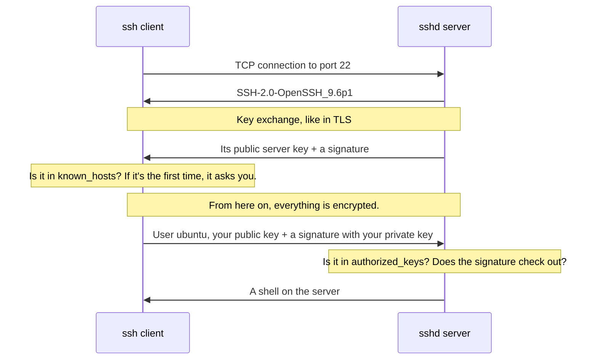
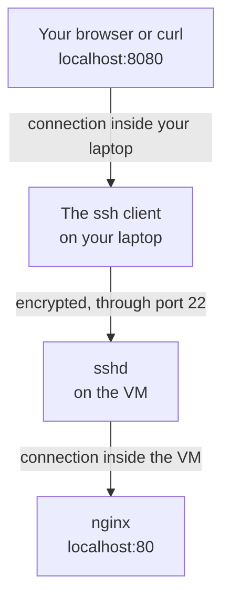

import Term from '~/components/Term.astro';
import TryIt from '~/components/TryIt.astro';
import Analogy from '~/components/Analogy.astro';
import Quiz from '~/components/Quiz.astro';
import QuizQuestion from '~/components/QuizQuestion.astro';
import QuizOption from '~/components/QuizOption.astro';

## The problem

Imagine that in [Phase 8](/en/phase-8/what-is-a-vps/) you rent a server. It's hundreds of miles away, with no screen or keyboard, and you have to install programs, read its logs and start your website from your terminal.

This used to be done with Telnet, which connected your keyboard to the server over the network. But everything traveled like a postcard, password included. In 1995, after someone stole passwords by snooping on his university's network, the Finn Tatu Ylönen designed an encrypted replacement ([the story, on Wikipedia](https://en.wikipedia.org/wiki/Secure_Shell#History)).

That replacement is <Term id="ssh">SSH</Term> (*Secure Shell*). It gives you a shell on another computer with everything encrypted, like HTTPS, and lets you log in with a key instead of a password that can be guessed. That's how almost every server in the world is managed, and how your computer talks to GitHub when you run `git push`.

## The analogy

<Analogy>

Imagine you often visit an office in another city. The first time you arrive, you take a photo of the building's front. Every time you come back, you compare it: if one day the front looks different, you suspect you've been taken to another building and you don't go in.

To get in, you don't say a password out loud to the doorman. Before your first visit you left a photo of the mark your seal makes, and the doorman has it on his list. Every day he hands you a different piece of paper, you stamp it and he compares the mark. The seal never leaves your pocket.

The photo of the front is the server's <Term id="fingerprint">fingerprint</Term>. The doorman's list is the `authorized_keys` file, and your seal is your <Term id="private-key">private key</Term>: the same wax seal from [the TLS lesson](/en/phase-0/tls-and-https/).

<div slot="limits">

- Nobody guarantees that the first photo is the right one: if on the first day you were taken to a fake building, you keep the photo of the fake. That's why it's a good idea to compare the fingerprint with one that reaches you some other way.
- A seal's mark can be copied just by looking at it. A private key can't be worked out from the public one.
- If you lose a seal, you notice. If someone copies your private key file, you don't: that's why it's protected with a phrase.

</div>

</Analogy>

## How it really works

### A client, a server and port 22

SSH is client-server, like the web. On your computer you use the client, `ssh`, which comes with macOS, Linux and WSL. On the server runs `sshd`, which listens on <Term id="port">port</Term> 22. The `d` stands for <Term id="daemon">daemon</Term>, like the services in [lesson 6](/en/phase-1/systemd-services-and-apt/).

With `nc`, the one from [Phase 0](/en/phase-0/client-server-model/), you can call that port on your practice server. Here the server speaks first:

```sh
$ nc 192.168.64.2 22
SSH-2.0-OpenSSH_9.6p1 Ubuntu-3ubuntu13.19
```

`SSH-2.0` is the protocol version, and `OpenSSH` is the server program, by far the most used. Then it waits for your client to answer in the same language: quit with <kbd>Ctrl</kbd> + <kbd>C</kbd>.

When you connect with the real `ssh`, this happens:



There are two checks: first the server proves who it is, and then you do.

### The first time: the server's fingerprint

The first time you connect to a server, `ssh` stops and asks you:

```
The authenticity of host '192.168.64.2 (192.168.64.2)' can't be established.
ED25519 key fingerprint is: SHA256:YT3BmapFljkFRZNR89J/feDei3USNV/Yk6w53rp0rpw
This key is not known by any other names.
Are you sure you want to continue connecting (yes/no/[fingerprint])?
```

“I can't check that this server is who it says it is. Its key has this fingerprint. Shall I go on?” The **fingerprint** is a short summary of the server's public key: if the key changed by a single character, the fingerprint would come out completely different.

If you answer `yes`, `ssh` saves the server's key in `~/.ssh/known_hosts`, the list of servers you know. The next times it compares it without asking, and if one day it doesn't match, it refuses to connect.

It's the same idea as the HTTPS <Term id="certificate">certificate</Term>, with one important difference: here there's no <Term id="certificate-authority">certificate authority</Term>.

| | HTTPS (TLS) | SSH |
|---|---|---|
| The server proves who it is with | Its certificate and a signature | Its server key and a signature |
| Who vouches for that key | A certificate authority | Nobody: you, the first time |
| Where who you trust is stored | Your system's list of authorities | Your `~/.ssh/known_hosts` |
| If something doesn't match | An error screen | `REMOTE HOST IDENTIFICATION HAS CHANGED!` and it doesn't connect |

This is called *trust on first use*. It works if, the first time, you compare the fingerprint with one that reaches you some other way, as you'll do in “Try it.”

### Your key: an ed25519 pair

To prove who you are, you create a key pair with `ssh-keygen`. Two files appear in `~/.ssh`:

- `id_ed25519`: your private key. It never leaves your computer: it's not sent anywhere, and it's not pasted into any website.
- `id_ed25519.pub` (for *public*): your <Term id="public-key">public key</Term>. It's a single line, like `ssh-ed25519 AAAAC3Nz… ana@laptop`, and you can give it to anyone you like.

`ed25519` is the key type recommended today, short and fast. The classic one, `rsa`, works, but its keys are much longer.

When you create it, `ssh-keygen` asks you for a **passphrase** and encrypts the private key file with it. If someone copies the file, it's useless to them without the phrase. You can leave it empty, but then the file is the key.

### authorized_keys: the list of keys that open the door

On the server, each user has a `~/.ssh/authorized_keys` file with one public key per line: those of the people who can log in as that user.

When you connect, your client says “I want to log in as `ubuntu`, with this public key.” If it's on the list, the server asks it for proof: to sign, with the private key, some data that's different on every connection. The server checks the signature with the public key. Your private key never travels, and a recorded signature is useless for another connection.

`sshd` is suspicious about the permissions from [lesson 4](/en/phase-1/linux-users-and-permissions/):

- If other users can write to your `~/.ssh` or to `authorized_keys`, it ignores them: anyone could add their key and log in as you.
- The right setting is `700` for the folder (only you get in) and `600` for `authorized_keys` (only you read and write).
- Your client checks too: if other users can read your private key, it refuses to use it.

On the Multipass VM, and on almost every cloud server, logging in with a password already comes disabled: you can only log in with a key. In [Phase 8](/en/phase-8/secure-linux-server/) you'll do the same on your server.

### ssh-agent: the phrase, just once

If your key has a phrase, `ssh` asks for it on every connection. `ssh-agent` is a program that keeps your keys, already decrypted, in memory for as long as your session lasts, and signs on behalf of `ssh`.

- `ssh-add` adds your key to the agent (it asks for the phrase once).
- `ssh-add -l` lists the ones it has.

On macOS, the agent is already running. On Linux and WSL, sometimes it isn't: you start it with `eval "$(ssh-agent -s)"`, which answers something like `Agent pid 74`.

### ~/.ssh/config: nicknames for your servers

Typing `ssh ubuntu@192.168.64.2` every time gets tiring, and on Bandit you also have to add the port. The `~/.ssh/config` file keeps those details under a short name:

```
Host course
    HostName 192.168.64.2
    User ubuntu

Host bandit
    HostName bandit.labs.overthewire.org
    Port 2220
    User bandit0
```

With it, `ssh course` is the same as `ssh ubuntu@192.168.64.2`, and `ssh bandit`, the same as `ssh bandit0@bandit.labs.overthewire.org -p 2220`. `scp`, `rsync` and `git` read it too.

### Copying files: scp and rsync

`scp` is like `cp`, but between computers. The remote side is written `server:path`, and if the path is empty, it's the user's home folder:

```sh
$ scp notes.txt course:
notes.txt                                     100%   22    33.1KB/s   00:00
$ ssh course cat notes.txt
Hello from the laptop
```

The second command runs `cat notes.txt` on the VM and brings you the output, without staying inside. The other way around, `scp course:notes.txt .` brings the file to your current folder.

`rsync` is for folders: it compares both sides and only sends what has changed. Copying a `web` folder to the VM twice in a row proves it:

```sh
$ rsync -av web/ course:web/
Transfer starting: 3 files
created directory web
./
index.html
styles.css

sent 272 bytes  received 70 bytes  162857 bytes/sec
total size is 35  speedup is 0.10
$ rsync -av web/ course:web/
Transfer starting: 3 files

sent 139 bytes  received 20 bytes  75714 bytes/sec
total size is 35  speedup is 0.22
```

The first time it copies both files; the second, none, because they haven't changed. `-a` keeps the permissions and dates, and `-v` says what it's doing. The final `/` in `web/` means “what's inside `web`”: without it, you'd create `web/web` on the other side. On Linux, the first line is `sending incremental file list`.

### Tunnels: a faraway port on your computer

An <Term id="ssh-tunnel">SSH tunnel</Term> makes a port on your computer lead to a port on the server, through the SSH connection:

```sh
ssh -N -L 8080:localhost:80 course
```

It reads like this: “listen on my port 8080 (`-L`, for *local*). Whatever arrives, carry it encrypted to `course` and, from there, connect to `localhost:80`.” That <Term id="localhost">localhost</Term> is the server's, not yours. `-N` says you don't want a shell, only the tunnel.



Why bother, if you can reach the VM directly? On a real server, the firewall only leaves port 22 open, and the Phase 5 database only listens on `localhost`. The tunnel lets you reach them without opening anything else.

## Try it

The goal: log in to three servers (Bandit with a password, and GitHub and your VM with your key) and see your VM's nginx page through a tunnel.

The outputs are from a Mac with the user `ana`, and the VM's, from Ubuntu 24.04. **On Windows,** do exercises 1 to 5 in WSL. Exercises 6 to 8 need the Multipass VM, which you don't use on Windows: just read them.

<TryIt
  title="1. Log in to Bandit, with a password"
  cmd="ssh bandit0@bandit.labs.overthewire.org -p 2220"
  output={`The authenticity of host '[bandit.labs.overthewire.org]:2220 ([13.51.99.177]:2220)' can't be established.
ED25519 key fingerprint is: SHA256:C2ihUBV7ihnV1wUXRb4RrEcLfXC5CXlhmAAM/urerLY
This key is not known by any other names.
Are you sure you want to continue connecting (yes/no/[fingerprint])? yes
Warning: Permanently added '[bandit.labs.overthewire.org]:2220' (ED25519) to the list of known hosts.
…
                      This is an OverTheWire game server.
            More information on http://www.overthewire.org/wargames

backend: gibson-1
bandit0@bandit.labs.overthewire.org's password:
…
bandit0@bandit:~$`}
>

[Bandit](https://overthewire.org/wargames/bandit/) is a game for learning Linux, and each level is a user on its server. `bandit0` is the level 0 user, and `-p 2220` is the port: Bandit doesn't use 22.

- Answer `yes` to the fingerprint question: you have no other one to compare it with.
- The password is on [the level 0 page](https://overthewire.org/wargames/bandit/bandit0.html). Nothing shows up as you type it, not even asterisks: that's normal. If you get it wrong, it answers `Permission denied, please try again.`
- Inside, you'll see the rules of the game, and the prompt changes to `bandit0@bandit:~$`: you're on another computer. Leave with `exit`.

The rules ask you not to publish passwords or solutions: the next levels are up to you. Your Bandit IP may be different.

</TryIt>

<TryIt
  title="2. Create your key pair"
  cmd={`ssh-keygen -t ed25519 -C "ana@laptop"`}
  output={`Generating public/private ed25519 key pair.
Enter file in which to save the key (/Users/ana/.ssh/id_ed25519):
Enter passphrase for "/Users/ana/.ssh/id_ed25519" (empty for no passphrase):
Enter same passphrase again:
Your identification has been saved in /Users/ana/.ssh/id_ed25519
Your public key has been saved in /Users/ana/.ssh/id_ed25519.pub
The key fingerprint is:
SHA256:ko4J3qj4vKFLDWN/lx2xm217IX7TX9J3lMrkp3MQ4g8 ana@laptop
The key's randomart image is:
+--[ED25519 256]--+
|                 |
|                 |
|         .       |
|       .  o. .  .|
| +.   o So. .....|
|..=+ + .o =E+o.o |
| .+o+..o +.o++=.=|
|o+ .. .   ...*o++|
|=o+.       .o.+ o|
+----[SHA256]-----+`}
>

`-t` chooses the key type, and `-C` adds a comment so you can recognize it: your user and your computer.

1. At the first question, press Enter: it accepts the usual place.
2. Type a passphrase twice. It doesn't show up as you type it either.

If it answers `Overwrite (y/n)?`, you already had a key: answer `n` and use the one you have. If you overwrite it, you lose access to wherever you used it.

Your fingerprint and your drawing (*randomart*, the fingerprint as a picture) will be different. If you didn't have the `~/.ssh` folder yet, you'll also see `Created directory`. On Linux and WSL, the third line is `Enter passphrase (empty for no passphrase):`.

</TryIt>

<TryIt
  title="3. Check the permissions"
  cmd="ls -l ~/.ssh"
  output={`total 24
-rw-------@ 1 ana  staff  444 Oct 12 14:49 id_ed25519
-rw-r--r--@ 1 ana  staff   92 Oct 12 14:49 id_ed25519.pub
-rw-r--r--@ 1 ana  staff  116 Oct 12 14:46 known_hosts`}
>

Look at the letters at the start. The private key is `-rw-------` (`600`): only you can read it. The public one, `-rw-r--r--` (`644`): anyone can read it, and that's fine. `ssh-keygen` already leaves them like that.

`known_hosts` keeps Bandit's key from exercise 1. On Linux and WSL you'll see `ana ana` instead of `ana staff`, and no `@`.

</TryIt>

<TryIt
  title="4. Give your key to the agent"
  cmd={`ssh-add\nssh-add -l`}
  output={`Enter passphrase for /Users/ana/.ssh/id_ed25519:
Identity added: /Users/ana/.ssh/id_ed25519 (ana@laptop)
256 SHA256:ko4J3qj4vKFLDWN/lx2xm217IX7TX9J3lMrkp3MQ4g8 ana@laptop (ED25519)`}
>

`ssh-add` asks for the phrase once, and `ssh-add -l` shows the fingerprint of the key the agent holds: the same one as in exercise 2. Until you close your session, `ssh` won't ask for it again.

On Linux and WSL, if it answers `Could not open a connection to your authentication agent`, start the agent first with `eval "$(ssh-agent -s)"` and try again.

</TryIt>

Now, GitHub. Before you give it your key, connect to see what happens and check its fingerprint:

<TryIt
  title="5. Your key on GitHub"
  cmd="ssh -T git@github.com"
  output={`The authenticity of host 'github.com (140.82.121.3)' can't be established.
ED25519 key fingerprint is: SHA256:+DiY3wvvV6TuJJhbpZisF/zLDA0zPMSvHdkr4UvCOqU
This key is not known by any other names.
Are you sure you want to continue connecting (yes/no/[fingerprint])? yes
Warning: Permanently added 'github.com' (ED25519) to the list of known hosts.
git@github.com: Permission denied (publickey).`}
>

Before you answer `yes`, open [the fingerprints GitHub publishes](https://docs.github.com/en/authentication/keeping-your-account-and-data-secure/githubs-ssh-key-fingerprints) and compare the `ED25519` one. `-T` says you don't want a shell, because GitHub doesn't give one. Your GitHub IP may be different.

`Permission denied (publickey)` is expected: GitHub doesn't know your key yet. Give it to GitHub:

1. Show your public key with `cat ~/.ssh/id_ed25519.pub` and copy the whole line.
2. On GitHub, go to *Settings* → *SSH and GPG keys* → *New SSH key*, paste the line and save it.
3. Run `ssh -T git@github.com` again.

Now it answers `Hi ana! You've successfully authenticated, but GitHub does not provide shell access.`, with your GitHub user instead of `ana`: it has recognized you by your key. If it still says `Permission denied`, check that you pasted the `.pub` file.

</TryIt>

Last, your VM. Its IP is shown by `multipass list`, in the `IPv4` column: in the examples it's `192.168.64.2`, and yours may be different. First, ask the VM for its fingerprint some other way, through Multipass, and copy your public key into it:

<TryIt
  title="6. Get the VM ready"
  cmd={`multipass exec course -- ssh-keygen -lf /etc/ssh/ssh_host_ed25519_key.pub\ncat ~/.ssh/id_ed25519.pub | multipass exec course -- tee -a /home/ubuntu/.ssh/authorized_keys`}
  output={`256 SHA256:YT3BmapFljkFRZNR89J/feDei3USNV/Yk6w53rp0rpw root@course (ED25519)
ssh-ed25519 AAAAC3NzaC1lZDI1NTE5AAAAICrCC5s7Ocaft6KTRg9Ea+DkdipuwEMlkTBxufSg1hev ana@laptop`}
>

`multipass exec course --` runs whatever comes after it on the VM, through Multipass and not through your `ssh`.

- The first command shows the fingerprint of the VM's server key. Write it down.
- The second adds your public key to the `ubuntu` user's `authorized_keys`. The `|` from [lesson 3](/en/phase-1/pipes-and-redirection/) passes it to `tee`, which writes it to the file and to the screen (that's why you see it), and `-a` (*append*) puts it at the end. Without `-a`, you'd erase the key `multipass shell` uses.

</TryIt>

<TryIt
  title="7. Log in without a password"
  cmd="ssh ubuntu@192.168.64.2"
  output={`The authenticity of host '192.168.64.2 (192.168.64.2)' can't be established.
ED25519 key fingerprint is: SHA256:YT3BmapFljkFRZNR89J/feDei3USNV/Yk6w53rp0rpw
This key is not known by any other names.
Are you sure you want to continue connecting (yes/no/[fingerprint])? yes
Warning: Permanently added '192.168.64.2' (ED25519) to the list of known hosts.
Welcome to Ubuntu 24.04.5 LTS (GNU/Linux 6.8.0-117-generic aarch64)
…
ubuntu@course:~$`}
>

Compare the fingerprint with the one you wrote down in exercise 6: if it's the same, answer `yes`. No password and no phrase: your key opens the door, and the agent unlocked it in exercise 4. Leave with `exit`.

If it answers `Permission denied (publickey)`, go back over exercise 6. Your fingerprint and your versions will be different.

</TryIt>

Now create `~/.ssh/config` with `nano ~/.ssh/config` (the editor from [lesson 2](/en/phase-1/linux-file-commands/)), copy the `Host course` block from above into it, with your VM's IP, and save it. Then:

<TryIt
  title="8. A nickname and a tunnel"
  cmd={`ssh course whoami\nssh -f -N -L 8080:localhost:80 course\ncurl -I http://localhost:8080`}
  output={`ubuntu
HTTP/1.1 200 OK
Server: nginx/1.24.0 (Ubuntu)
Date: Mon, 12 Oct 2026 13:31:25 GMT
Content-Type: text/html
Content-Length: 615
Last-Modified: Mon, 12 Oct 2026 13:29:44 GMT
Connection: keep-alive
ETag: "6acce0c8-267"
Accept-Ranges: bytes`}
>

- `ssh course whoami` uses the nickname, runs `whoami` on the VM and answers `ubuntu`.
- The second command opens the tunnel, and `-f` sends it to the background so you can keep typing.
- `curl -I` asks your port 8080 for the page, and the VM's nginx answers, the one from lesson 6: notice `Server: nginx/1.24.0 (Ubuntu)`. In the browser, `http://localhost:8080` shows “Welcome to nginx!” Your dates will be different.

If `curl` answers `Failed to connect to localhost port 8080`, the tunnel didn't open: check whether the second command gave an error. If it says `Address already in use`, another program is using your 8080: try `-L 8081:localhost:80`.

To close the tunnel, find its PID with `pgrep -f 8080:localhost` (a pattern that only appears in the tunnel's command) and stop it with `kill` and that number, as in [lesson 5](/en/phase-1/linux-processes-and-signals/).

</TryIt>

## You have already seen it

- **GitHub's “Code” button** has an SSH tab with addresses like `git@github.com:user/repo.git`: the user `git`, on the server `github.com`.
- **When you create a cloud server,** the provider asks you for your public SSH key and puts it in the new server's `authorized_keys`, as you did in exercise 6.
- **`multipass shell course`** also logs in over SSH, with a key Multipass created for you.

And if you code:

- **`git push` and `git pull`** with a `git@github.com:…` address use your key and your agent. If they fail, `ssh -T git@github.com` tells you whether the problem is the key.

## Common mistakes

- **Deleting the warning without thinking.** If you recreate the VM and it gets the same IP, the key no longer matches, and `ssh` answers `WARNING: REMOTE HOST IDENTIFICATION HAS CHANGED!` and doesn't connect. Check the new fingerprint as in exercise 6, and only then delete the old one with `ssh-keygen -R 192.168.64.2`. If you don't know why it changed, don't connect.
- **Open permissions on your key.** If others can read your private key, `ssh` ignores it: `WARNING: UNPROTECTED PRIVATE KEY FILE!` and `Permissions 0644 for '/Users/ana/.ssh/id_ed25519' are too open.` Fix it with `chmod 600 ~/.ssh/id_ed25519`.
- **Open permissions on the server.** With `authorized_keys` at `666`, the client only sees `Permission denied (publickey)`. The reason is in the VM's log (`sudo journalctl -u ssh`): `Authentication refused: bad ownership or modes for file /home/ubuntu/.ssh/authorized_keys`.
- **Forgetting the user.** `ssh 192.168.64.2`, without `ubuntu@`, uses your laptop user, which doesn't exist on the VM: `ana@192.168.64.2: Permission denied (publickey).` Add the user, or a `User` line in `~/.ssh/config`.

## Summary

- SSH opens a terminal on another computer with everything encrypted. The client is `ssh`, and the server, `sshd`, on port 22.
- The server proves who it is with its key. The first time you check its fingerprint yourself, because there's no certificate authority, and `known_hosts` remembers it.
- You log in with your private key, which never leaves your computer. The public one goes in the server's `authorized_keys` or on GitHub, and the permissions have to be `600`.
- `ssh-agent` saves you from repeating the phrase, and `~/.ssh/config` saves you from repeating the IP, the user and the port.
- `scp` and `rsync` copy files over SSH, and `ssh -L` takes a port of yours to a port on the server.

## Did you get it?

<Quiz>

<QuizQuestion
  question="You log in to your company’s server over SSH every day. Today ssh answers WARNING: REMOTE HOST IDENTIFICATION HAS CHANGED!, and nobody has announced any change. What do you do?"
  review="The first time: the server's fingerprint"
>

<QuizOption text="You delete the old key with ssh-keygen -R and log in again: the warning shows up every time the server restarts.">

Restarting doesn't change the server's key. If it changes with no explanation, you may be talking to another computer pretending to be yours.

</QuizOption>

<QuizOption text="You don’t log in, and you ask whoever runs the server whether its key has changed." correct>

A new key needs an explanation, like a reinstalled server. Without one, it may be a fake server. If they confirm it, you check the new fingerprint and delete the old one with `ssh-keygen -R`.

</QuizOption>

<QuizOption text="You create another key with ssh-keygen: the warning says yours has expired and the server no longer accepts it.">

The warning is about the server's key, not yours, and SSH keys don't expire. Your key is still valid.

</QuizOption>

</QuizQuestion>

<QuizQuestion
  question="A tutorial tells you: “paste your SSH key into GitHub.” What do you paste?"
  review="Your key: an ed25519 pair"
>

<QuizOption text="The contents of id_ed25519, because GitHub needs the private key to check that it’s you.">

To check a signature, the public key is enough. The private key never leaves your computer: if you paste it, consider it lost.

</QuizOption>

<QuizOption text="Your known_hosts file, which is what tells GitHub who you are.">

`known_hosts` keeps the keys of the servers *you* trust. It says nothing about you.

</QuizOption>

<QuizOption text="The line in id_ed25519.pub." correct>

It's your public key, the one you can give to anyone. GitHub keeps it and, with it, checks the signatures your private key makes.

</QuizOption>

</QuizQuestion>

<QuizQuestion
  question="A coworker sends you their id_ed25519 file over chat so you can log in to the server with their key, because it’s quicker. What’s the problem?"
  review="authorized_keys: the list of keys that open the door"
>

<QuizOption text="Their private key is no longer secret: they should replace it, and you should use your own." correct>

A private key that has gone through a chat may be in more places. The right way is for your public key to go in the server's `authorized_keys`, so each person logs in with their own.

</QuizOption>

<QuizOption text="None, as long as the chat is encrypted and you keep the file with 600 permissions.">

Permissions protect the file on your disk, not the copies left in the chat, on other devices or in backups.

</QuizOption>

<QuizOption text="The server will notice the key comes from another computer and reject it.">

The server doesn't know which computer a key is used from: it only checks the signature. That's why it's so serious if it gets copied.

</QuizOption>

</QuizQuestion>

<QuizQuestion
  question="You run ssh -N -L 5433:localhost:5432 course. Where does a connection to localhost:5433 on your laptop end up?"
  review="Tunnels: a faraway port on your computer"
>

<QuizOption text="At port 5432 on your laptop, because localhost is always your own computer.">

In a tunnel, the `localhost` in the middle is resolved on the server, on the other side of the SSH connection. It's the VM's `localhost`.

</QuizOption>

<QuizOption text="At port 5433 on the VM, because the tunnel keeps the port number.">

The first number is your laptop's port, and the last one, the server's. They can be different, and here they are.

</QuizOption>

<QuizOption text="At port 5432 on the VM." correct>

Your laptop listens on 5433. Whatever arrives travels encrypted over SSH to the VM, and there `sshd` connects to `localhost:5432`, its own port.

</QuizOption>

</QuizQuestion>

<QuizQuestion
  question="You add your public key to authorized_keys on the VM, but ssh still answers Permission denied (publickey). ls -ld ~/.ssh shows drwxrwxrwx. What’s going on?"
  review="authorized_keys: the list of keys that open the door"
>

<QuizOption text="The public key has to go in known_hosts, not in authorized_keys.">

`known_hosts` is the list of servers a client trusts. The keys that can log in to the server go in `authorized_keys`.

</QuizOption>

<QuizOption text="sshd doesn’t trust the folder, because anyone can write to it: set it to 700." correct>

Whoever can write to the folder can change `authorized_keys` and log in as you, so `sshd` doesn't read it. With `chmod 700 ~/.ssh`, only you get in, and the key works.

</QuizOption>

<QuizOption text="authorized_keys needs 777 too, because sshd has to be able to write to it.">

`sshd` only reads it, and its owner can already read it. Opening up the permissions makes the problem worse: it's exactly what makes it suspicious.

</QuizOption>

</QuizQuestion>

<QuizQuestion
  question="Your browser doesn’t ask you about any fingerprint when you visit your bank for the first time. Why does ssh do it with a new server?"
  review="The first time: the server's fingerprint"
>

<QuizOption text="Because a certificate authority vouches for the bank; for the SSH server, nobody does." correct>

The browser trusts the certificate because an authority on its list signs it. In SSH there's no authority, so the decision is yours.

</QuizOption>

<QuizOption text="Because the fingerprint is the key that encrypts everything you send to the server.">

The fingerprint doesn't encrypt anything: it's a summary of the server's key so you can recognize it. The keys that encrypt come out of the key exchange, as in TLS.

</QuizOption>

<QuizOption text="Because HTTPS doesn’t use public keys: the bank is identified by its domain, and SSH by a key.">

HTTPS uses a public key too: it goes inside the certificate, and the server signs with the private key that goes with it.

</QuizOption>

</QuizQuestion>

</Quiz>

## Further reading

- [Connecting to GitHub with SSH](https://docs.github.com/en/authentication/connecting-to-github-with-ssh), GitHub's guide, with the fix for the most common problems.
- [OverTheWire: Bandit](https://overthewire.org/wargames/bandit/): the game from exercise 1, level by level.
- [The ssh manual](https://man.openbsd.org/ssh) and [the ssh_config one](https://man.openbsd.org/ssh_config), from the OpenSSH authors.
