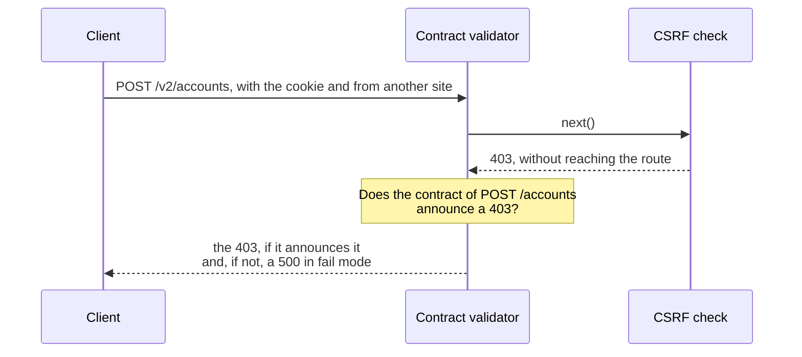

import Term from '~/components/Term.astro';
import TryIt from '~/components/TryIt.astro';
import Analogy from '~/components/Analogy.astro';
import SelfCheck from '~/components/SelfCheck.astro';
import ProjectCode from '~/components/ProjectCode.astro';
import Quiz from '~/components/Quiz.astro';
import QuizQuestion from '~/components/QuizQuestion.astro';
import QuizOption from '~/components/QuizOption.astro';

## The problem

Imagine you build the shop’s frontend. One morning, the mug’s product card says “€NaN.” In the Network tab of <Term id="devtools">DevTools</Term>, the response of `GET /v2/products/2` carries `"price": 850`, and your code reads `priceCents`. Did you break it, or did the backend?

The person writing this course comes from the frontend, and that’s what they missed most: something that says the bug is the backend’s, **“a DTO bug.”** A DTO (*data transfer object*) is the shape of the data that travels from one part to another: here, the JSON of a response.

Who’s right is already written down in the <Term id="api-contract">API contract</Term>, the OpenAPI document from [Phase 4](/en/phase-4/openapi-swagger/): if the response doesn’t keep what it promises, the bug is the backend’s. In this lesson, the shop checks it itself, in the tests and in production.

## The analogy

<Analogy>

A bakery supplies twenty cafés every morning, and with each one it signed a sheet: what goes in each box. Before loading the van, someone compares each box with its sheet. If something is missing, they note it down and send it anyway, or they don’t send it and call. That way the café doesn’t discover the mistake in front of its customers, without knowing whether it was the oven or the delivery.

<div slot="limits">

- Comparing every box takes time, and in the API too: in our tests, between 1% and 11% fewer requests per second, depending on the run.
- The sheet says what has to be there, not what can’t be: a free pastry gets through. In the API, an extra field also gets through, even if it’s data that shouldn’t have gone out.

</div>

</Analogy>

## How it really works

### A contract is what the frontend takes for granted

The frontend reads `product.priceCents` because `/v2/openapi.json` promises it: a product has `id`, `name`, `priceCents`, `stock` and `categories`, all required.

A **<Term id="contract-test">contract test</Term>** takes a real response and compares it with what the document promises for that route and that status: the fields, their names and their types. Not every change matters the same. One that makes a client that worked fail is a <Term id="breaking-change">breaking change</Term> ([Phase 4](/en/phase-4/api-versioning/#a-change-breaks-if-a-client-that-worked-stops-working)):

| Change in a response | Does it break? |
|---|---|
| Adding a field, `description` | No: whoever doesn’t know it doesn’t read it |
| Renaming or removing a field | Yes: whoever read it gets `undefined` |
| Changing its type, `stock` from number to text | Yes: `"60" + 1` gives `"601"` |
| A status code the contract doesn’t announce | It depends: the client doesn’t know what to do with it |

### TypeScript looks at the code, not the data

In [Phase 4](/en/phase-4/openapi-swagger/#typescript-checks-that-the-code-keeps-the-contract) you saw that `npm run check` fails if a route returns something its contract doesn’t have. It’s the first barrier, but it checks what the code **says** the data is, not what it is when it runs ([Phase 3](/en/phase-3/typescript-with-node/#node-erases-the-types-when-it-runs)). There are places where the code claims it without checking:

- **[Phase 9’s](/en/phase-9/redis-cache/) cache** takes what it reads from Redis at face value with `JSON.parse(stored) as T`. After a deployment that renames a field, it can serve the old shape for the minute the key lasts.
- **A `count(*)` arrives as text** ([Phase 5](/en/phase-5/node-postgres/#from-rows-to-json-names-dates-and-count)), even if the code says it’s a number.

And Zod validates what comes in, not what goes out: the hole [Phase 4](/en/phase-4/openapi-swagger/#what-the-contract-doesnt-check) left open. This lesson closes it by checking the responses **when they run**.

### A validator made from the contract itself

OpenAPI 3.1 schemas are <Term id="json-schema">JSON Schema</Term>, and in Node the most widely used program to check data against a schema is **Ajv**, which step 43 installs at version 8.20.0. The document is the same one `/v2/openapi.json` publishes, in `src/contract-responses.ts`:

<ProjectCode file="shop-api/43-contract/src/contract-responses.ts" region="document" />

With it, `createValidator`, in the same file, compiles each response’s schema the first time it’s needed, and keeps it. If something doesn’t keep it, it says **where** (`/priceCents`), **which rule** of JSON Schema fails (`required`, `type`) and a message, but **never the value**: a response can carry someone’s email, and this ends up in the log.

### The contract tests: every route, with its real response

The tests use it with `matchesContract`, in `test/contract.ts`:

<ProjectCode file="shop-api/43-contract/test/contract.ts" />

It receives a response from `app.request` and the route as the document writes it, with braces. It reads a copy (`res.clone()`), and if there are failures, the message lists them one per line.

`test/contract.test.ts` has, for every route of `/v2`, a request that gives the good response and another that gives an error, a <Term id="problem-details">Problem Details</Term>. One more test checks that the list is complete: **a new route without its case doesn’t pass**. In total, 57 tests.

### In the tests, every response goes through the contract

A new <Term id="middleware">middleware</Term>, `validateResponses`, lets the route answer and then compares what it answered with the contract. It only looks at the JSON responses of `/v2`: a `204` with no body, an event stream or the `/shop` page go through untouched.

What it does with a response that doesn’t keep the contract is decided by `VALIDATE_RESPONSES`, and `test/.env` says `fail`: **it replaces it with a `500`**. That way, every test that asks `/v2` for something also checks the contract.

### What it found in the shop itself

The first time the tests ran with `fail`, while step 43 was being built, five tests that were green turned red. No DTO was failing: **the contract was**. The routes that receive a body answer `400` if the JSON is badly written and `415` if it doesn’t say it’s JSON (`Content-Type: application/json`), and the contract hadn’t announced it since it was created, in step 14.

Another gap wasn’t found by the validator, but by the people who built and reviewed the step, reading the code: [Phase 6’s](/en/phase-6/csrf-ssrf/#second-wall-where-the-request-comes-from) <Term id="csrf">CSRF</Term> check answers `403` on `POST /v2/accounts`, `POST /v2/session`, `DELETE /v2/session` and `POST /v2/webhooks/payments`, and none of them announced it. The validator couldn’t see it: it was mounted behind that check.

Step 43’s contract announces the `400`, the `415` and the `403`, and every `403` has its test. **A validator finds what goes past it; the rest, someone reading the code.**

### The validator goes right after the log

A middleware only sees what the ones behind it answer, inside its `next()` ([Phase 3](/en/phase-3/what-is-middleware/#order-matters)). At first, the validator went right before the routes, and a `403` from the CSRF check went out without passing through it. Now it goes third, in `src/app.ts`, after `requestId()` and `requestLog`:



### A 500 doesn’t break the contract

No route announces a `500`: it isn’t a promised response, it’s a breakdown. At first, the validator counted it as a break, and every PostgreSQL outage would also have left a contract warning; in `fail`, on top of that, the real “Internal Server Error” was replaced with “The response does not meet the contract,” and the cause was hidden.

Now it lets any `5xx` through: `app.onError` already writes it to the log ([Phase 4](/en/phase-4/api-errors-problem-details/#the-500-and-its-instance)).

### Three modes: no, log and fail

| `VALIDATE_RESPONSES` | A response that breaks the contract… | Where the step sets it |
|---|---|---|
| `no` | Goes out as it is, and nobody finds out | If you don’t set it, and in `.env.production.example` |
| `log` | Goes out as it is, and leaves a warning (`warn`), “response outside the contract” | `.env.example`, for your computer |
| `fail` | Is replaced with a `500`, and leaves the same line at level `error` | `test/.env` |

The warning carries the `requestId`, the route, the status and the failures, **never the body**.

**In production, the one that makes sense is `log`.** `fail` would replace with a `500`, for everyone at once, a response the frontend might have been able to half-read. `log` doesn’t change what anyone receives, but it costs, probably because Ajv goes through every whole response. That’s why the step leaves it at `no` in production, until you measure it.

### From the browser’s X-Request-Id to the log line

Every response of the shop carries an `X-Request-Id` header ([Phase 3](/en/phase-3/node-errors-and-logging/#an-id-for-every-request)). With `log`, that id takes you from the browser to the bug:

1. **In the Network tab**, in the headers of the response that failed, you copy `x-request-id`.
2. **On the server**, you look for that id in the API’s log.
3. **If a “response outside the contract” warning comes up**, the bug is the backend’s, and it says which field. If only the request’s line comes up, with a `2xx` or a `4xx` from `/v2`, the response kept the contract: look at the frontend.

Sentry, the service that collects the frontend’s errors, gives you the same id if your code records it next to the error. If your frontend is on another site, the API has to name the header in `Access-Control-Expose-Headers` ([CORS](/en/phase-2/what-is-cors/)) so your JavaScript can read it.

### The snapshot: contract.json

Contract tests compare the code with the document. If someone renames `priceCents` in the Zod schema **and** in the route, the two still agree and everything passes: the contract has changed without anyone seeing it.

That’s why the step keeps the published contract in Git, `contract.json`, which `npm run contract` writes again, and two tests compare it with the one the API generates:

<ProjectCode file="shop-api/43-contract/test/contract.test.ts" region="snapshot" />

The first compares the contents, and its message says what to do; the second, character by character, so the file is exactly what `npm run contract` writes. That way, **every contract change reaches the review as a diff of `contract.json`**, the lines that change. Tools like [oasdiff](https://github.com/oasdiff/oasdiff) compare two OpenAPI documents and say which changes break.

### Contracts the client writes: Pact

Another way: each client writes what it uses, and the API’s tests check everyone’s. The best-known tool is [Pact](https://docs.pact.io/), and it pays off with many teams; for the shop, its own contract is enough.

## Try it

The goal: break a route’s contract on purpose, see which layer catches it first, what a client receives in each mode and how much watching it costs. The outputs are from Node 26, on Linux, on October 24, 2026; your ids, times and numbers will be different.

### Get the step ready

Put your project on step 43, as in the [introduction](/en/phase-10/#each-lesson-its-step):

```sh
cd ~/backend-course/phase-3
curl -O https://backenddesdecero.com/practicas/shop-api/43-contract.tar.gz
tar -xzf 43-contract.tar.gz
cp -R 43-contract/. shop-api/
cd shop-api
npm install
```

The tests need PostgreSQL with `shop_test` and the tests’ Redis ([“Before you start”](/en/phase-10/#before-you-start)).

### Rename a field

In `src/v2.ts`, look for the route that shows a product, `v2.openapi(contract.getProduct, …)`. Its last line is `return c.json(product, 200);`. Delete it and write two in its place: first, `const { priceCents, ...rest } = product;`, which separates the `priceCents` field and leaves everything else in `rest`; then, `return c.json({ ...rest, price: priceCents }, 200);`, which answers the product with the price under another name, `price`. Save.

<TryIt
  title="1. TypeScript catches it first"
  cmd="npm run check"
  output={`> shop-api@1.0.0 check
> tsc --noEmit

src/v2.ts(79,33): error TS2345: Argument of type '(c: Context<Env, "/products/:id", { in: { param: { id: unknown; }; }; out: { param: { id: number; }; }; }>) => Promise<JSONRespondReturn<...> | JSONRespondReturn<...>>' is not assignable to parameter of type 'Handler<Env, "/products/:id", { in: { param: { id: unknown; }; }; out: { param: { id: number; }; }; }, MaybePromise<RouteConfigToTypedResponse<{ method: "get"; path: "/products/{id}"; tags: string[]; summary: string; request: { params: ZodObject<{ id: ZodCoercedNumber<unknown>; }, $strip>; }; responses: { ...; }; } ...'.
…
            Types of property '_data' are incompatible.
              Property 'priceCents' is missing in type '{ id: number; name: string; stock: number; categories: string[]; price: number; }' but required in type '{ id: number; name: string; priceCents: number; stock: number; categories: string[]; }'.`}
>

We’ve removed five lines from the middle. The last one says the cause: **`priceCents` is missing**.

The image isn’t built either: the `Dockerfile` runs `npm run check` in its `check` stage ([Phase 7](/en/phase-7/docker-multi-stage-build/#why-the-final-stage-copies-from-check)), and `docker compose up --build` stops with `failed to solve: process "/bin/sh -c npm run check" did not complete successfully: exit code: 1`.

</TryIt>

### The contract tests, without TypeScript

Node erases the types without checking them, so the tests run even though `npm run check` fails:

<TryIt
  title="2. The contract test, with fail"
  cmd="node --env-file=test/.env --test test/contract.test.ts | grep -A 5 'failing tests'"
  output={`✖ failing tests:

test at test/contract.test.ts:291:3
✖ GET /products/{id}: the good response meets the contract (5.984026ms)
  AssertionError [ERR_ASSERTION]: GET /products/{id} → 500 does not meet the contract:
    (root): the contract does not describe a 500 for GET /products/{id} [no-response-in-the-contract]`}
>

`grep -A 5` shows the line it looks for and the five after it. 1 out of 57 fails, but **the message talks about a `500`, not the field**: with `fail`, the middleware has replaced the response before the test saw it. If you get `ECONNREFUSED`, PostgreSQL isn’t running.

</TryIt>

To see the real response, turn the validator off for this run: a variable already in the environment wins over the one from `--env-file`.

<TryIt
  title="3. The same test, with the validator off"
  cmd="VALIDATE_RESPONSES=no node --env-file=test/.env --test test/contract.test.ts | grep -A 5 'failing tests'"
  output={`✖ failing tests:

test at test/contract.test.ts:291:3
✖ GET /products/{id}: the good response meets the contract (5.192429ms)
  AssertionError [ERR_ASSERTION]: GET /products/{id} → 200 does not meet the contract:
    /priceCents: must have required property 'priceCents' [required]`}
>

A `200` that’s **missing `/priceCents`**. 2 out of 57 fail: the other one, which `grep` doesn’t show, watches that `test/.env` says `fail`.

</TryIt>

With the whole `npm test`, **19 out of 382** fail: the contract one and 18 regular ones, almost all tests that read a product by its id.

### What a client receives in each mode

To build the image you have to get past TypeScript. In your second line, right before `, 200)`, write `as unknown as typeof product`. It’s an unchecked claim: it tells TypeScript “this object is a product, trust me,” and it trusts it, even though `priceCents` is missing. **It’s what the cache does with `JSON.parse(stored) as T`**, and that’s why you need to check when it runs.

In your `.env`, add `VALIDATE_RESPONSES=no`, and start with `docker compose up -d --build --wait`. If `docker compose port api 3000` says `3001`, use that port.

<TryIt
  title="4. Mode no"
  cmd={`curl -si localhost:3000/v2/products/2; echo\ndocker compose logs api --no-log-prefix | grep 'outside the contract'`}
  output={`HTTP/1.1 200 OK
content-type: application/json
…
x-request-id: fc270365-2607-40b6-a9e8-e1e7be0e4a64
…

{"id":2,"name":"Mug","stock":60,"categories":["Home","Gifts"],"price":850}`}
>

We’ve removed the rest of the headers. `; echo` adds the line break curl doesn’t, and `--no-log-prefix` removes the `api-1 |` from the log. A `200` with **`"price":850`**, and the log, silent.

</TryIt>

Change your `.env` to `VALIDATE_RESPONSES=log` and recreate the API with `docker compose up -d --wait api`:

<TryIt
  title="5. Mode log"
  cmd={`curl -si localhost:3000/v2/products/2; echo\ndocker compose logs api --no-log-prefix | grep 'outside the contract'`}
  output={`HTTP/1.1 200 OK
content-type: application/json
…
x-request-id: f7dd73bf-e113-4dcf-a1c5-14579f3bebe4
…

{"id":2,"name":"Mug","stock":60,"categories":["Home","Gifts"],"price":850}
{"level":40,"time":1792839965899,"pid":1,"hostname":"332e667a22f9","requestId":"f7dd73bf-e113-4dcf-a1c5-14579f3bebe4","method":"GET","route":"/products/{id}","status":200,"failures":[{"where":"/priceCents","rule":"required","message":"must have required property 'priceCents'"}],"msg":"response outside the contract"}`}
>

The client receives the same. What’s new is the log line: **`"level":40`**, a warning ([Phase 3](/en/phase-3/node-errors-and-logging/#levels-how-much-the-log-says)); the header’s `requestId`; the document’s route, `/products/{id}`; and **`failures`**, with where, which rule and the message. **The `850` doesn’t appear.**

</TryIt>

### From the id to the broken field

Now, the frontend’s path: keep the id of a response, as if you’d copied it from DevTools, and look it up.

<TryIt
  title="6. From the X-Request-Id to the log"
  cmd={`ID=$(curl -si localhost:3000/v2/products/2 | grep -i x-request-id | cut -d' ' -f2 | tr -d '\\r')\necho "X-Request-Id: $ID"\ndocker compose logs api --no-log-prefix | grep "$ID" | jq .`}
  output={`X-Request-Id: 725089f1-7657-4cfc-b07b-383313d6dac2
{
  "level": 40,
  "time": 1792839997728,
  "pid": 1,
  "hostname": "d1dedb9b6ac4",
  "requestId": "725089f1-7657-4cfc-b07b-383313d6dac2",
  "method": "GET",
  "route": "/products/{id}",
  "status": 200,
  "failures": [
    {
      "where": "/priceCents",
      "rule": "required",
      "message": "must have required property 'priceCents'"
    }
  ],
  "msg": "response outside the contract"
}
{
  "level": 30,
  "time": 1792839997729,
  "pid": 1,
  "hostname": "d1dedb9b6ac4",
  "requestId": "725089f1-7657-4cfc-b07b-383313d6dac2",
  "method": "GET",
  "path": "/v2/products/2",
  "status": 200,
  "ms": 45,
  "msg": "request"
}`}
>

`cut` keeps what comes after the space, and `tr -d '\r'` removes the carriage return at the end of each HTTP header. **Two lines with the same id:** the warning and the usual line, “request.” With that, the frontend can say “DTO bug: `priceCents` is missing in `GET /v2/products/{id}`,” without opening the backend’s code.

</TryIt>

Finally, `VALIDATE_RESPONSES=fail` in your `.env`, and `docker compose up -d --wait api` again:

<TryIt
  title="7. Mode fail"
  cmd={`curl -si localhost:3000/v2/products/2; echo\ndocker compose logs api --no-log-prefix | grep 'outside the contract'`}
  output={`HTTP/1.1 500 Internal Server Error
content-type: application/problem+json
…
x-request-id: b9263322-6855-4a12-8e4b-91a600922be5
…

{"type":"about:blank","title":"The response does not meet the contract","status":500,"detail":"This response doesn't have the shape the contract promises (/v2/openapi.json).","instance":"urn:uuid:b9263322-6855-4a12-8e4b-91a600922be5"}
{"level":50,"time":1792839949927,"pid":1,"hostname":"1a031a404196","requestId":"b9263322-6855-4a12-8e4b-91a600922be5","method":"GET","route":"/products/{id}","status":200,"failures":[{"where":"/priceCents","rule":"required","message":"must have required property 'priceCents'"}],"msg":"response outside the contract"}`}
>

The client receives a **`500`**, with the id in `instance`. The line is the same, with **`"level":50`**, an error, and `"status":200`, the code the route gave before the validator changed it. In the tests, exactly what you want; in production, the mug would disappear for everyone.

</TryIt>

### What watching costs

Put the code back as it was (`cp ../43-contract/src/v2.ts src/`), set `VALIDATE_RESPONSES=no` and rebuild with `docker compose up -d --build --wait`. Every response keeps the contract: you only measure the work of checking them. The <Term id="load-test">load test</Term> is [Phase 9’s](/en/phase-9/), with the project’s script:

<TryIt
  title="8. Without validating"
  cmd="npm run load -- -c 10 -d 10 http://localhost:3000/v2/products"
  output={`…
┌───────────┬─────────┬─────────┬─────────┬────────┬─────────┬──────────┬─────────┐
│ Stat      │ 1%      │ 2.5%    │ 50%     │ 97.5%  │ Avg     │ Stdev    │ Min     │
├───────────┼─────────┼─────────┼─────────┼────────┼─────────┼──────────┼─────────┤
│ Req/Sec   │ 7,871   │ 7,871   │ 12,239  │ 13,975 │ 12,261  │ 1,616.82 │ 7,871   │
├───────────┼─────────┼─────────┼─────────┼────────┼─────────┼──────────┼─────────┤
│ Bytes/Sec │ 7.35 MB │ 7.35 MB │ 11.4 MB │ 13 MB  │ 11.5 MB │ 1.51 MB  │ 7.35 MB │
└───────────┴─────────┴─────────┴─────────┴────────┴─────────┴──────────┴─────────┘

Req/Bytes counts sampled once per second.
# of samples: 10

123k requests in 10.01s, 115 MB read`}
>

We’ve removed the latency table and the beginning, which says `http://api:3000`: it ran inside Compose’s network, not through the published port. **`Req/Sec`, `Avg`**: 12,261; in two other runs, 11,520.55 and 13,286.91.

</TryIt>

Now `VALIDATE_RESPONSES=log`, `docker compose up -d --wait api`, and again:

<TryIt
  title="9. Validating every response"
  cmd="npm run load -- -c 10 -d 10 http://localhost:3000/v2/products"
  output={`…
┌───────────┬─────────┬─────────┬────────┬────────┬───────────┬────────┬─────────┐
│ Stat      │ 1%      │ 2.5%    │ 50%    │ 97.5%  │ Avg       │ Stdev  │ Min     │
├───────────┼─────────┼─────────┼────────┼────────┼───────────┼────────┼─────────┤
│ Req/Sec   │ 10,143  │ 10,143  │ 11,791 │ 12,879 │ 11,782.19 │ 808.84 │ 10,140  │
├───────────┼─────────┼─────────┼────────┼────────┼───────────┼────────┼─────────┤
│ Bytes/Sec │ 9.48 MB │ 9.48 MB │ 11 MB  │ 12 MB  │ 11 MB     │ 754 kB │ 9.47 MB │
└───────────┴─────────┴─────────┴────────┴────────┴───────────┴────────┴─────────┘

Req/Bytes counts sampled once per second.
# of samples: 11

130k requests in 11.01s, 121 MB read`}
>

**11,782.19**, and in two other runs, 11,407.8 and 12,152.37. On average, over the three runs of each mode, about 12,360 without validating and about 11,780 validating: **about 5% less**.

</TryIt>

Run against run, the difference went from 1% to 11%: **on our MacBook, with Docker in a 2 GB virtual machine, validating cost between 1% and 11%**, depending on the run. It depends on the machine and the run: do several of each mode, alternating them, before deciding.

<SelfCheck question="Challenge: a coworker adds a new field to the products, description, in the schema and in the route. Which test warns her, and what does she have to do?">

The contract tests pass: code and document say the same. The two for `contract.json` fail. The diff only **adds** a field, which breaks no one: `npm run contract`, and `contract.json` goes in the same commit. If she renamed one, she’d have to [change by adding](/en/phase-4/api-versioning/#first-change-by-adding).

</SelfCheck>

When you finish, leave `VALIDATE_RESPONSES=log` in your `.env`, as `.env.example` suggests.

### On your server

Your server’s `.env` doesn’t have `VALIDATE_RESPONSES`, so there it’s `no`, and the timer from [Phase 8](/en/phase-8/ci-cd-github-actions/) deploys the step as always. If you want `log`, measure on your server first and add the line to its `.env`. In lesson 5, the warnings are also counted on a dashboard.

## You have already seen it

- **The response headers in the Network tab**: the shop’s `x-request-id` has been there since Phase 3.
- **The types `openapi-typescript` generates for a frontend**: if the backend breaks the contract, the frontend compiles just the same, and fails when it runs.

## Common mistakes

- **Believing TypeScript is enough.** An `as`, the cache or a query can say something else when it runs.
- **Regenerating `contract.json` without looking at the diff.** The test exists so someone reads the change.
- **`fail` in production.** It turns into a `500` for everyone a response that maybe could have been used.
- **Mounting the validator behind the middleware that answer**, or counting `5xx` as breaks: you miss some responses, and you mix breakdowns with broken DTOs.

## Summary

- A contract test compares a real response with what the OpenAPI document promises. Renaming, removing or changing the type of a field breaks clients; adding one doesn’t.
- TypeScript checks the code, not the data when it runs. Ajv checks every response against the contract’s own schemas, without copying its value.
- In the tests, `fail` turns every test that asks `/v2` for something into a contract test. In production, `log` leaves a warning with the id and the field; in our tests it cost between 1% and 11%: measure it on your machine.
- The validator goes in front of the middleware that answer and lets `5xx` through.
- `contract.json`, in Git, makes every contract change reach the review as a diff.

## Did you get it?

<Quiz>

<QuizQuestion
  question="A product’s card shows “€NaN.” In the Network tab you see the response is a 200 and you note its x-request-id. The API is in log mode. How do you know whose bug it is?"
  review="From the browser’s X-Request-Id to the log line"
>

<QuizOption text="You open the error in Sentry: the JavaScript stack trace says whether the frontend or the backend is to blame.">

Sentry says where the frontend broke, not whether the response was the one the backend promised. Only the contract says that.

</QuizOption>

<QuizOption text="You look for the id in the API’s log: a “response outside the contract” warning says it’s the backend’s, and which field." correct>

With `log`, every response that doesn’t keep the contract leaves a line with its `requestId` and its failures. If only the request’s line comes up, with a `2xx` or a `4xx`, the response kept it.

</QuizOption>

<QuizOption text="You switch the API to fail mode: if the response turns into a 500, the bug is the backend’s.">

You’d find out by breaking the page for every customer.

</QuizOption>

</QuizQuestion>

<QuizQuestion
  question="In a review, the diff of contract.json brings three changes. Which one breaks the clients that already use the API?"
  review="A contract is what the frontend takes for granted"
>

<QuizOption text="Products gain a new field, description.">

A client that doesn’t know `description` doesn’t read it, and keeps working: adding is the safe way to change.

</QuizOption>

<QuizOption text="A route now announces a 415 it already answered before.">

The route already answered it: the contract now tells the truth, as step 43 did. Nobody receives anything different.

</QuizOption>

<QuizOption text="A product’s stock goes from being a number to being text." correct>

The field is still there, with another type, and a client that adds units gets `"601"`. Changing the type breaks as much as renaming.

</QuizOption>

</QuizQuestion>

<QuizQuestion
  question="A coworker says: “npm run check already checks that every route returns what its contract says; validating the responses when they run is doing it twice.” What do you answer?"
  review="TypeScript looks at the code, not the data"
>

<QuizOption text="That TypeScript checks what the code says about the data, and an as or the cache can bring something else." correct>

The cache returns `JSON.parse(stored) as T`: TypeScript believes it, and after a deployment it can serve the old shape. Only a check when it runs sees the real data.

</QuizOption>

<QuizOption text="That TypeScript only checks requests, and doesn’t look at responses.">

It does look at them: in “Try it,” the renamed field didn’t get past `npm run check`. What it doesn’t see is the data when it runs.

</QuizOption>

<QuizOption text="That they’re right: if the project compiles, every response keeps the contract.">

With `as unknown as typeof product`, the renamed field compiles and breaks the contract all the same.

</QuizOption>

</QuizQuestion>

<QuizQuestion
  question="You’re going to watch the contract in the production API, used by a phone app and a website. Which mode do you set?"
  review="Three modes: no, log and fail"
>

<QuizOption text="fail: that way no client ever receives a response with the wrong shape.">

It replaces those responses with a `500` for everyone, even if the app could half-use them. It’s for the tests.

</QuizOption>

<QuizOption text="log, after measuring with a load test what it costs your API." correct>

It doesn’t change what anyone receives and leaves a warning with the id and the field. It costs time on every response: that’s why you measure first.

</QuizOption>

<QuizOption text="no: the contract tests already check every response before deploying.">

The tests check the responses they ask for. What only happens in production, like an old key in the cache, they don’t see.

</QuizOption>

</QuizQuestion>

<QuizQuestion
  question="You’ve renamed a field in the Zod schema and in the route. The contract tests pass, but two fail with “The contract has changed: look at the diff of contract.json…”. What do you do?"
  review="The snapshot: contract.json"
>

<QuizOption text="You read the diff: renaming breaks clients, so you add the new field and keep the old one." correct>

The test isn’t complaining about a bug in the code, but about a change to the contract, so someone thinks about it. Adding next to the old one doesn’t break anything.

</QuizOption>

<QuizOption text="You run npm run contract and commit: the test only asks for the two documents to match.">

You’ll be back to green, and the breaking change will reach clients without anyone having thought about it.

</QuizOption>

<QuizOption text="You delete contract.json: if the document comes from the code, keeping a copy is unnecessary.">

The copy is what makes the change visible in the review.

</QuizOption>

</QuizQuestion>

<QuizQuestion
  question="PostgreSQL stops and POST /v2/session starts answering 500. The API is in log mode. Does a “response outside the contract” warning come up in the log?"
  review="A 500 doesn’t break the contract"
>

<QuizOption text="Yes: no route announces a 500, so every one breaks the contract.">

That’s how it was in step 43’s first attempt, and it was changed: it mixed outages with broken DTOs.

</QuizOption>

<QuizOption text="Yes, and in fail mode the 500 would be replaced with “The response does not meet the contract.”">

That would hide the real error behind another one. The validator lets `5xx` through as they are, in both modes.

</QuizOption>

<QuizOption text="No: a 5xx is a breakdown, not a wrong shape, and app.onError already logs it." correct>

PostgreSQL’s error stays in its usual line, and the contract warning keeps meaning just one thing: a broken DTO.

</QuizOption>

</QuizQuestion>

</Quiz>

## Further reading

- [Ajv](https://ajv.js.org/): its documentation, with JSON Schema 2020-12, the one in OpenAPI 3.1.
- [ContractTest](https://martinfowler.com/bliki/ContractTest.html), by Martin Fowler: what a contract test is.
- [Consumer-Driven Contracts](https://martinfowler.com/articles/consumerDrivenContracts.html), by Ian Robinson: contracts the client writes, the idea behind Pact.
- [oasdiff](https://github.com/oasdiff/oasdiff): compares two OpenAPI documents and says which changes break.
