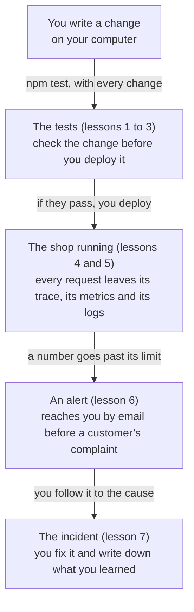

import Term from '~/components/Term.astro';
import TryIt from '~/components/TryIt.astro';
import Analogy from '~/components/Analogy.astro';
import SelfCheck from '~/components/SelfCheck.astro';

At the end of Phase 9, the shop can take much more than at the start: a queue with its worker, a cache, two copies that take turns when deploying and events that don’t get lost. It also has more than 300 tests that you copied step by step and never wrote, JSON logs with an id for every request, and a route, `/health`, that says whether the API can reach its database.

What it doesn’t have is anything that warns you when something goes wrong. This phase answers two questions:

- **Before deploying, how do I know it works?** With tests you write yourself, of the kind that suits what you want to check.
- **After deploying, how do I know it’s failing, and why?** With <Term id="observability">observability</Term>, what the shop tells about itself while it works, and with alerts that warn you before your customers do.

## A bug nobody saw for twenty steps

Let’s start with a real bug, from this course. In [Phase 5’s transactions lesson](/en/phase-5/acid-transactions/), the shop started reserving stock: when you place an order, the mugs leave the stock, and when you cancel it, they come back. Since [Phase 4](/en/phase-4/what-is-a-rest-api/) there had also been a route to change the quantity of a pending order, the one that is `PATCH /v2/orders/:id` today. That route changed the order’s number and **didn’t touch the stock**.

For example, with 10 mugs in the warehouse:

1. Carmen orders 1 mug: the stock goes down to 9.
2. She changes her order to 3 mugs: the stock stays at 9, when it should be at 7.
3. She cancels the order: her 3 mugs come back, and the stock goes up to 12.

The shop thinks it has 12 mugs, and the warehouse has 10: it can sell two that don’t exist.

The bug was there for **twenty steps, from 22 to 41**: the rest of Phase 5 and the whole of Phases 6, 7, 8 and 9. And the route had its test, since Phase 4: “PATCH /orders/:id changes the quantity and returns the whole order.” It changes the quantity to 5 and checks that the order comes back with 5.

What it checks is true, and it passed. But it was written when the shop didn’t have stock yet, and when it did, nobody added the question that mattered: what about the stock? **Hundreds of green tests, and none of them looked at the stock after changing a quantity.**

We fixed it in October 2026, right before writing this phase, in [pull request #48](https://github.com/backendfromscratch/backend-from-scratch/pull/48) of the course’s repository. Changing the quantity now moves the stock, in a transaction, and every step from 22 to 41 gained the tests that check it: in step 41, the transactions file went from 7 tests to 18.

The same fix closed a similar gap: a payment that arrived just as the order was being cancelled turned it back to “paid,” and cancelling it again gave its stock back a second time.

**A test only checks what someone thought of checking.** Counting them says nothing about what they check; what you need is to know how to write them and how to read what each one promises. In [lesson 1](/en/phase-10/writing-tests-node/) you’ll break that fix on purpose and see which of the new tests turn red.

## After deploying: how you find out something is failing

On many websites, the team finds out about a failure in one of two ways: someone reports that the site doesn’t work, or an error shows up in Sentry, a service that collects the errors that happen, above all those of the JavaScript running in visitors’ browsers. Both arrive when the failure has already happened, and often they don’t say whether the frontend or the backend is to blame.

Today, the shop has this to look inside:

- **JSON logs**, one line per request, with its `requestId` ([Phase 3](/en/phase-3/node-errors-and-logging/#an-id-for-every-request)), which you read with `docker compose logs`.
- **`/health`**, which answers `200` if the API can reach PostgreSQL ([Phase 7](/en/phase-7/docker-multi-stage-build/#healthcheck-is-the-shop-fine)).

With that, you can’t answer questions like these:

- **“The payment takes three seconds.”** The log says how long the whole request took, not whether the time went into PostgreSQL, Redis or the queue.
- **“It was slower this morning.”** A log is one line per event. To see how something changes over the day, you have to count, minute by minute.
- **“I never got the email.”** If the queue’s Redis freezes, payments keep answering fine and emails stop going out. No response gives an error: you find out when a customer asks about hers.

**Observability is being able to answer those questions** with what the shop emits while it works: the logs you already have, <Term id="metric">metrics</Term> (numbers measured over time, like errors per minute) and <Term id="trace">traces</Term> (the path of a request, piece by piece, with how long each one took). And the other half of the phase is reliability: health checks done right, alerts that reach you by email and an order for handling an <Term id="incident">incident</Term> when it comes.

## Check before leaving, watch along the way

<Analogy>

Before a long trip, you take the car to the garage. They check the brakes, the lights and the tires, one thing after another, following their list. If everything passes, you leave.

On the road, you look at the dashboard: the speed, the engine temperature, the fuel. You don’t look at it all the time: if something goes past its limit, a warning light comes on. And if the car makes a strange noise, the mechanic plugs in their machine and reads which part failed, and when.

<div slot="limits">

- The garage checks the car once before you leave. Tests run with every change, in minutes, and a machine runs them for you before every deployment ([Phase 8](/en/phase-8/ci-cd-github-actions/)).
- The dashboard comes from the factory. In your API, you choose and add every number yourself: what you don’t measure doesn’t show up anywhere.
- A car makes one trip at a time. Your API serves hundreds of people at once, and every request makes its own trip: that’s why there is one trace per request, and not one for the whole shop.

</div>

</Analogy>

The garage’s checks are the tests; the dashboard, the metrics; the warning lights, the alerts; and the mechanic’s machine, the traces and the logs.

## The map of the phase

This is the path of a change to the shop at the end of the phase, from when you write it until something fails and you fix it:



Each lesson answers a question, and almost all of them bring a new step of the project:

| Lesson | The question | What the shop gains | Folder |
|---|---|---|---|
| 1. Writing tests | How do you write a test, and how do I know it checks something? | Your first tests, written from an empty file, and the quantity bug, broken on purpose to see its tests turn red | `42-tests` |
| 2. Types of tests | Which type of test suits each case? | An <Term id="end-to-end-test">end-to-end test</Term> that buys like a real customer, over HTTP only, and a report of the lines no test runs | `42-tests` |
| 3. Contract | Do my responses have the shape the frontend expects? | <Term id="contract-test">Contract tests</Term> against the OpenAPI document, and an API that warns you when a response breaks its contract | `43-contract` |
| 4. Traces | Why is this payment slow? | <Term id="opentelemetry">OpenTelemetry</Term> and <Term id="jaeger">Jaeger</Term>: the path of a payment, from the API to the worker, in a single trace | `44-tracing` |
| 5. Metrics | How many requests arrive, how many fail and how long do they take? | <Term id="prometheus">Prometheus</Term> and <Term id="grafana">Grafana</Term>, with a dashboard of the shop | `45-metrics` |
| 6. Alerts | How do I find out before my customers? | Two new health checks, four alert rules that arrive by email, and a shop that fails better when Redis doesn’t answer | `46-alerts` |
| 7. Incidents | What do I do when the alert fires? | A practice incident, the queue’s Redis frozen, from start to finish, and its <Term id="postmortem">postmortem</Term> | The same `46-alerts` |

## What you’ll learn

By the end of this phase you’ll know how to:

- Write a <Term id="unit-test">unit test</Term> from an empty file, and tell when an <Term id="integration-test">integration</Term> or an end-to-end test pays off more.
- Check that your API’s responses keep the contract it publishes, in the tests and in production.
- Follow a request with a trace through the API, PostgreSQL, Redis, the queue and the worker, read the shop’s metrics on a dashboard and find the logs of that same request.
- Separate “the process is alive” from “it can serve,” put alerts on what customers notice and handle an incident all the way to its postmortem.

## The lessons

1. [Writing tests](/en/phase-10/writing-tests-node/)
2. [Types of tests](/en/phase-10/unit-integration-e2e-tests/)
3. [Contract](/en/phase-10/contract-testing-openapi/)
4. Traces
5. Metrics
6. Alerts
7. Incidents

## Where you will practice

Everything on your computer, with Docker Compose as in [Phase 9](/en/phase-9/). Nothing in this phase costs money.

- **The observability tools** arrive one at a time: Jaeger, for traces, in lesson 4; Prometheus and Grafana, for metrics and alerts, in lesson 5. They live in a second Compose file, `compose.observability.yaml`: `docker compose up` starts the shop just as in Phase 9, and lesson 4 shows you how to add that file to it.
- **They fit in a small Docker.** With the whole shop and the three tools, nine containers, our 2 GB Docker virtual machine had about 715 MB available at rest, and never less than about 490 during a load test with Grafana’s dashboard open.
- **The measurements** were made on a MacBook with Docker in Colima (another way of having Docker on a Mac, like Docker Desktop), in a 2 GB virtual machine. **Your numbers will be different:** compare your before and your after with each other, not with ours.
- **If your shop is already on your server,** every push keeps deploying, and steps 42 to 46 work there with nothing new: traces and metrics are only sent if you give them an address, and on the server there is none. Where there is something to copy to the server, the lesson says so at the end.
- **On Windows,** everything is done in WSL, with Docker as in [Phase 7’s introduction](/en/phase-7/).

## Before you start

You need the same as at the end of Phase 9:

- **Docker running on your computer.**
- **Your project, in `~/backend-course/phase-3/shop-api`,** up to date with step `41-events` and with your `.env`: the one you’ve used since [Phase 7](/en/phase-7/docker-compose/), with `POSTGRES_PASSWORD` and your secrets.
- **PostgreSQL 18 on your computer, with the `shop_test` database,** as in [Phase 5’s introduction](/en/phase-5/): the tests use it, empty it and fill it again every time.
- **A Redis for the tests that use one** (the cache, the queue, the attempt limits). Without it they don’t fail: they’re skipped, and they check nothing.

The shop’s Redis won’t do, because Compose doesn’t publish its port on your computer. Start another one, separately, just for the tests:

```sh
docker run --rm -d --name redis-tests -p 127.0.0.1:6379:6379 redis:8
```

Then, in `test/.env`, remove the `#` at the start of the last line, so it reads `REDIS_URL_TESTS=redis://localhost:6379/1`. The tests use their own databases of that Redis, 1 and 2. When you finish the phase, stop it with `docker stop redis-tests`, and since you started it with `--rm`, it gets deleted.

### If you’d rather start fresh

If your project has been left half-done, start with the end of Phase 9, as in [Phase 9’s introduction](/en/phase-9/#if-youd-rather-start-fresh): from `~/backend-course/phase-3`, `curl -O https://backenddesdecero.com/practicas/shop-api/41-events.tar.gz`, `tar -xzf 41-events.tar.gz`, `mv shop-api shop-api-before` and `mv 41-events shop-api`. Then copy your `.env` with `cp shop-api-before/.env shop-api/` and install the dependencies with `npm install` inside `shop-api`.

### Each lesson, its step

Lessons 1, 3, 4, 5 and 6 come with their step, from `42-tests` to `46-alerts`, and all of them do it the same way as in Phase 9: from `~/backend-course/phase-3`, they download it and copy it over your project. For lesson 1:

```sh
cd ~/backend-course/phase-3
curl -O https://backenddesdecero.com/practicas/shop-api/42-tests.tar.gz
tar -xzf 42-tests.tar.gz
cp -R 42-tests/. shop-api/
```

Each step is the whole project, as it stands at the end of its lesson: copying it over brings yours up to date, and overwrites anything you’d changed by hand.

It doesn’t include `.env`, so yours stays, nor `node_modules`: after copying it, `npm install` inside `shop-api` installs whatever the step added to `package.json`. No step deletes files from the previous one. Lessons 2 and 7 don’t bring a step: they use the previous lesson’s.

## Try it: count your shop’s tests

The goal: find out how many tests your shop really has, which file has the most, and run the ones that would have caught the quantity bug.

All of it from your project, with the shop as Phase 9 left it (step `41-events`). The outputs are from Node 26, on Linux; your times will be different.

### All at once

<TryIt
  title="1. All the shop’s tests"
  cmd={`cd ~/backend-course/phase-3/shop-api\nnpm test`}
  output={`ℹ tests 322
ℹ suites 0
ℹ pass 322
ℹ fail 0
ℹ cancelled 0
ℹ skipped 0
ℹ todo 0
ℹ duration_ms 135134.363598`}
>

Before this ending come hundreds of lines, one per test, with its `✔`; here is only the summary. Look at **`pass 322`** and **`fail 0`**: 322 tests, according to Node, all green. And at `duration_ms`: a bit over two minutes, on our machine.

If `skipped` isn’t `0`, and `pass` drops by as much, it isn’t a failure, but those tests haven’t checked anything: they can’t find the tests’ Redis. Check that `redis-tests` is running (`docker ps`) and that the `REDIS_URL_TESTS` line in `test/.env` doesn’t start with `#`, as in [“Before you start”](#before-you-start). If the first one that fails says `Is PostgreSQL running?`, check that PostgreSQL is running and that `shop_test` exists. If a few `npm notice` lines about a new version of npm come after the summary, they’re npm’s, not the tests’: you don’t have to do anything.

</TryIt>

### File by file

`npm test` runs them all at once. To count them file by file, you can hand Node the files one at a time with a `for` from [Phase 1](/en/phase-1/bash-scripts/#for-repeating-the-same-thing-with-each-item):

<TryIt
  title="2. How many tests each file has"
  cmd={`for f in test/*.test.ts; do printf '%-36s ' "$f"; node --env-file=test/.env --test "$f" | grep -E '^ℹ (tests|pass|fail) ' | tr '\\n' ' '; echo; done`}
  output={`test/api-keys.test.ts                ℹ tests 4 ℹ pass 4 ℹ fail 0 
test/cache.test.ts                   ℹ tests 14 ℹ pass 14 ℹ fail 0 
test/compose.test.ts                 ℹ tests 6 ℹ pass 6 ℹ fail 0 
test/csrf-ssrf.test.ts               ℹ tests 9 ℹ pass 9 ℹ fail 0 
test/deployment-files.test.ts        ℹ tests 23 ℹ pass 23 ℹ fail 0 
test/docker.test.ts                  ℹ tests 6 ℹ pass 6 ℹ fail 0 
test/email.test.ts                   ℹ tests 4 ℹ pass 4 ℹ fail 0 
test/errors.test.ts                  ℹ tests 4 ℹ pass 4 ℹ fail 0 
test/events.test.ts                  ℹ tests 11 ℹ pass 11 ℹ fail 0 
test/indexes.test.ts                 ℹ tests 4 ℹ pass 4 ℹ fail 0 
test/injection-xss.test.ts           ℹ tests 4 ℹ pass 4 ℹ fail 0 
test/jwt.test.ts                     ℹ tests 6 ℹ pass 6 ℹ fail 0 
test/migrations.test.ts              ℹ tests 6 ℹ pass 6 ℹ fail 0 
test/modeling.test.ts                ℹ tests 10 ℹ pass 10 ℹ fail 0 
test/oauth.test.ts                   ℹ tests 6 ℹ pass 6 ℹ fail 0 
test/openapi.test.ts                 ℹ tests 10 ℹ pass 10 ℹ fail 0 
test/optional-provider.test.ts       ℹ tests 5 ℹ pass 5 ℹ fail 0 
test/orm.test.ts                     ℹ tests 9 ℹ pass 9 ℹ fail 0 
test/pagination.test.ts              ℹ tests 9 ℹ pass 9 ℹ fail 0 
test/passwords.test.ts               ℹ tests 9 ℹ pass 9 ℹ fail 0 
test/postgres.test.ts                ℹ tests 7 ℹ pass 7 ℹ fail 0 
test/problems.test.ts                ℹ tests 9 ℹ pass 9 ℹ fail 0 
test/production-files.test.ts        ℹ tests 14 ℹ pass 14 ℹ fail 0 
test/production.test.ts              ℹ tests 8 ℹ pass 8 ℹ fail 0 
test/proxy.test.ts                   ℹ tests 6 ℹ pass 6 ℹ fail 0 
test/queue.test.ts                   ℹ tests 7 ℹ pass 7 ℹ fail 0 
test/rate-limits.test.ts             ℹ tests 6 ℹ pass 6 ℹ fail 0 
test/realtime.test.ts                ℹ tests 7 ℹ pass 7 ℹ fail 0 
test/redis-store.test.ts             ℹ tests 4 ℹ pass 4 ℹ fail 0 
test/rest.test.ts                    ℹ tests 12 ℹ pass 12 ℹ fail 0 
test/roles.test.ts                   ℹ tests 8 ℹ pass 8 ℹ fail 0 
test/scaling.test.ts                 ℹ tests 13 ℹ pass 13 ℹ fail 0 
test/serialization.test.ts           ℹ tests 6 ℹ pass 6 ℹ fail 0 
test/sessions.test.ts                ℹ tests 9 ℹ pass 9 ℹ fail 0 
test/shutdown.test.ts                ℹ tests 7 ℹ pass 7 ℹ fail 0 
test/transactions.test.ts            ℹ tests 18 ℹ pass 18 ℹ fail 0 
test/versioning.test.ts              ℹ tests 9 ℹ pass 9 ℹ fail 0 
test/webhooks.test.ts                ℹ tests 11 ℹ pass 11 ℹ fail 0 `}
>

Word by word:

- **`for f in test/*.test.ts; do … done`** repeats what’s in between with every file in `test/` that ends in `.test.ts`, and keeps it in the variable `f`.
- **`printf '%-36s ' "$f"`** writes the file’s name, padded with spaces up to 36 characters, so the numbers line up in a column.
- **`node --env-file=test/.env --test "$f"`** is what `npm test` does, but with a single file: it reads the tests’ variables and runs the ones in that file.
- **`grep -E '^ℹ (tests|pass|fail) '`** keeps three lines of the summary, and **`tr '\n' ' '`** joins them into one, swapping each line break for a space.
- **`echo`** ends the file’s line.

It takes a bit longer than `npm test`, because it starts Node once per file. There are 38 files, and the one with the most tests is `deployment-files.test.ts`, with 23. If in one of them `pass` is less than `tests` with no `fail`, those are Redis tests that were skipped, in `cache`, `events`, `queue`, `redis-store` or `scaling`. The `tests` column counts them all the same, skipped or not, so the sum doesn’t change.

</TryIt>

If you add up the `tests` column, you get 320. `npm test` said 322.

<SelfCheck question="Challenge: where do the two extra tests come from? Hint: look at what’s in test/ with ls test.">

In `test/` there are two files that don’t end in `.test.ts`: `db.ts`, which prepares the tests’ database, and `identities.ts`, which creates the sessions of Ana, Carmen and the other accounts. They’re helpers: the tests use them, but they don’t have any test inside.

`npm test` runs `node --test` without telling it which files. Then Node searches on its own, with some default patterns, and one of them is “any `.ts` file inside a `test` folder.” It runs the two helpers and counts each one as a test that passes, because they run without an error. 320 plus 2, 322.

Your loop, on the other hand, only took `test/*.test.ts`. That’s what `npm test` will do from step 42: tell Node which files are tests, instead of letting it guess. Even the number of tests has to be checked.

</SelfCheck>

### Just one: the tests of the quantity bug

<TryIt
  title="3. The transactions tests"
  cmd="node --env-file=test/.env --test test/transactions.test.ts"
  output={`✔ 20 orders at once for a product with stock 5: 5 go through, 15 get 409, and the stock ends at 0 (113.120986ms)
✔ without enough stock: 409, with its own type and what is left in detail (2.987372ms)
✔ an order takes its quantity from the stock; cancelling it gives it back, only once (7.613485ms)
✔ an error halfway through the transaction leaves the stock as it was (2.537341ms)
✔ db.transaction: if the function throws an error, nothing it did is saved (1.153667ms)
✔ asking for more units of a pending order takes the difference from the stock (7.134593ms)
✔ asking for more units than are left: 409, with what is left, and neither the order nor the stock changes (5.278334ms)
✔ asking for fewer units gives the difference back to the stock (4.127382ms)
✔ changing the quantity and then cancelling leaves the stock as it was before the order (7.944608ms)
✔ changing the quantity and cancelling at the same time: the stock ends as before the orders (42.730959ms)
✔ an order that is no longer pending: 409, and neither the order nor the stock changes (4.722759ms)
✔ paying and cancelling at the same time: a cancelled order does not go back to paid, and the stock comes back only once (51.956079ms)
✔ paying and changing the quantity at the same time: the order ends paid with the final quantity, and the stock adds up (34.436984ms)
✔ shipping and cancelling at the same time: a cancelled order does not leave, and only the stock of the cancelled ones comes back (38.247359ms)
✔ cancelling and shipping at the same time: either it is cancelled and the stock comes back, or 409 and the order leaves as it was (35.197346ms)
✔ if it is shipped while being cancelled, the cancellation changes nothing and answers 409 (5.567631ms)
✔ examples/race.ts: reading and writing separately oversells; with a conditional UPDATE, it does not (547.099324ms)
✔ the contract documents the 409 of POST /orders (10.052018ms)
ℹ tests 18
ℹ suites 0
ℹ pass 18
ℹ fail 0
ℹ cancelled 0
ℹ skipped 0
ℹ todo 0
ℹ duration_ms 1600.508183`}
>

It’s the loop’s same command, with a single file and without `grep`: every test comes out with its name, its `✔` and how long it took.

Look at the names: each one says what the shop promises. **“changing the quantity and then cancelling leaves the stock as it was before the order”** is exactly Carmen’s example, from above. The eleven from “asking for more units of a pending order…” to “if it is shipped while being cancelled…” are the ones that came with the fix: before it, this file had 7.

If your file has 7 tests and not 18, or one of the eleven fails, your project is from before the fix: download `41-events` again and copy it over, as in [“Each lesson, its step”](#each-lesson-its-step).

</TryIt>

### What this number doesn’t tell you

The 320 green tests say that the shop does 320 things someone thought of checking. They don’t say which ones are missing: for twenty steps, one was. In lesson 1, [“Writing tests”](/en/phase-10/writing-tests-node/), you’ll write your first tests from an empty file, see each one fail before it passes, and then break the quantity fix on purpose to see which of these eleven turn red.
