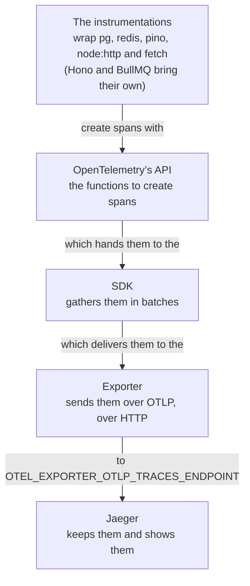
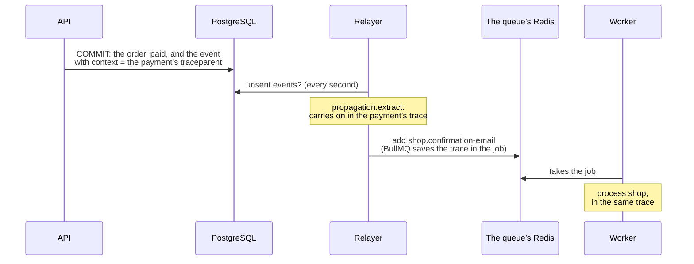

import Term from '~/components/Term.astro';
import TryIt from '~/components/TryIt.astro';
import Analogy from '~/components/Analogy.astro';
import ProjectCode from '~/components/ProjectCode.astro';
import Quiz from '~/components/Quiz.astro';
import QuizQuestion from '~/components/QuizQuestion.astro';
import QuizOption from '~/components/QuizOption.astro';

## The problem

Imagine a customer writes to you: “I waited twelve seconds to sign in to the shop.” In the log you find her request: `POST /v2/session`, `200`, `"ms": 12159`. The log says **how long** it took, not **where**: PostgreSQL, Redis, the password?

With a payment it’s worse: the API answers in 11 ms, and the email is sent by another process, the worker, after going through the outbox and the queue. The `requestId` from [Phase 3](/en/phase-3/node-errors-and-logging/#an-id-for-every-request) only exists in one of the two.

[Phase 9](/en/phase-9/monolith-vs-microservices/#what-it-costs-many-pieces-to-deploy-and-watch) left it written down: to follow a request through several services, there are <Term id="trace">traces</Term>. Here the shop leaves one per request.

## The analogy

<Analogy>

When you send a parcel, they stick a label on it with a tracking number. Every warehouse it goes through reads it and writes down when it arrived and when it left. With the number you see the whole trip, and in which warehouse it got stuck.

<div slot="limits">

- A parcel is in one place at a time. In a trace, one piece happens **inside** another (the query, inside the request), and several at once.
- The label is stuck to the parcel. In a program, the number has to be passed by hand from one process to the next; if one forgets, the trip comes out split in two.
- Scanning a parcel costs little. Writing down every request took 30% of the API’s requests per second in our test.

</div>

</Analogy>

## How it really works

### Monitoring isn’t the same as observing

Monitoring is checking what you already know can fail: does `/health` answer? <Term id="observability">Observability</Term> is being able to answer the questions you didn’t have ready, like the twelve seconds, **with what the shop already emits**, without deploying new code to find out.

### Three signals, three questions

| Signal | What it is | What it answers | In the shop |
|---|---|---|---|
| Log | One line per event | What exactly happened with this request? | pino, since [Phase 3](/en/phase-3/node-errors-and-logging/#structured-logs-one-json-line-per-event) |
| <Term id="metric">Metric</Term> | A number over time | How many arrive, how many fail, how long do they take? | Prometheus, in lesson 5 |
| Trace | The path of a request, piece by piece | Where did it go, and where did the time go? | <Term id="jaeger">Jaeger</Term>, in this lesson |

They’re used in a chain: **the metric warns you that something is wrong, the trace says where and the log says what**. Logs and traces share an id: from a log line you jump to its trace, and the other way around.

### A trace is a tree of spans

This is a payment’s trace, one line per piece: its name, the service, how long it lasted and when it started, counting from the beginning. The indentation says which one is inside which:

```text
POST /v2/webhooks/payments                                shop-api               11.18 ms   +0 ms
  pg-pool.connect                                         shop-api                0.10 ms   +1 ms
  pg.query:SELECT shop                                    shop-api                0.87 ms   +1 ms
  pg-pool.connect                                         shop-api                0.07 ms   +3 ms
  pg.query:BEGIN shop                                     shop-api                0.22 ms   +3 ms
  pg.query:INSERT shop                                    shop-api                0.72 ms   +3 ms
  pg.query:UPDATE shop                                    shop-api                0.73 ms   +4 ms
  pg.query:SELECT shop                                    shop-api                0.87 ms   +5 ms
  pg.query:INSERT shop                                    shop-api                1.65 ms   +7 ms
  pg.query:COMMIT shop                                    shop-api                0.88 ms   +9 ms
  redis-PUBLISH                                           shop-api                3.67 ms   +10 ms
  add shop.confirmation-email                             shop-worker             2.24 ms   +880 ms
    redis-EVALSHA                                         shop-worker             1.63 ms   +881 ms
    process shop                                          shop-worker            21.74 ms   +888 ms
      pg-pool.connect                                     shop-worker             7.96 ms   +889 ms
        pg.connect                                        shop-worker             7.19 ms   +890 ms
      pg.query:SELECT shop                                shop-worker             1.31 ms   +897 ms
      complete shop                                       shop-worker             0.95 ms   +909 ms
        redis-EVALSHA                                     shop-worker             0.67 ms   +909 ms
```

We took it out of Jaeger and summarized it. Each piece is a <Term id="span">span</Term>: something that happened, with its start, its duration and some data. One that happens inside another is its **child**; the outer one, its **parent**. They all share the **trace id**.

Jaeger draws them as bars on a timeline, one under the other: the **waterfall**. This one reads like this:

- The API took 11 ms, about 6 of them in PostgreSQL, most in the payment’s <Term id="transaction">transaction</Term>, from `BEGIN` to `COMMIT` ([Phase 9](/en/phase-9/event-driven-architecture/#the-outbox-the-notice-in-the-same-transaction)).
- For almost 870 ms nothing happens: the event waits in the table until the relayer, which looks every second, puts it in the queue (`add`).
- The worker does the job in 22 ms: `process`, with one query, and `complete`.

**Sending the email has no span**: the shop doesn’t instrument nodemailer, the library that sends it. A trace only shows what someone decided to measure.

### OpenTelemetry: from the library to Jaeger

The shop doesn’t create these spans by hand: <Term id="opentelemetry">OpenTelemetry</Term> does, the open standard for emitting traces, metrics and logs in a common format. It’s four pieces in a chain:



Careful: this “API” isn’t the shop’s. **OpenTelemetry’s API is the functions a library uses to say “start a span” and “end it.”** Without an SDK they do nothing, so a library can bring them without forcing anyone to keep spans. The SDK collects them, gathers them and gives them to the exporter.

An <Term id="instrumentation">instrumentation</Term> is the code that makes a library emit spans; OTLP, OpenTelemetry’s protocol. Many teams put a **collector** between the exporter and the destination, a program that receives, filters and distributes; the shop sends straight to Jaeger.

The shop picks its instrumentations one by one, in `src/instrumentation.ts`:

<ProjectCode file="shop-api/44-tracing/src/instrumentation.ts" region="instrumentations" />

- `HttpInstrumentation`, only for the requests that go out: for the ones that come in, `@hono/otel` makes the span, with the route’s name. One request, a single server span.
- `requireParentSpan: true`: PostgreSQL and Redis, only inside a request or a job; otherwise every question from the relayer would be a loose trace. That’s why those questions don’t show up.

Before anything else, `startInstrumentation` looks at `OTEL_EXPORTER_OTLP_TRACES_ENDPOINT`. Without it, nothing starts, and the shop works as in Phase 9.

### The instrumentation is loaded before the shop

Each instrumentation changes its library at the moment someone loads it with `import`, the statement that brings in the code of another file or <Term id="package">package</Term>. If `src/server.ts` had already loaded `pg`, it would arrive late: **there would be no PostgreSQL spans, and no error to warn you**.

That’s why it goes first, with Node’s `--import` option: `node --import ./src/instrumentation.ts src/server.ts`, in the `package.json` scripts, the `Dockerfile`’s `CMD` and the worker in `compose.yaml`.

With `import`, Node also needs a *hook*: code Node runs every time it loads a file, to let the instrumentation change it. `import-in-the-middle` puts it there, with `module.registerHooks`.

### Jaeger, in a separate Compose file

`compose.yaml` gains no service: Jaeger lives in a second file, `compose.observability.yaml`:

<ProjectCode file="shop-api/44-tracing/compose.observability.yaml" region="jaeger" />

Its web page, on 16686, only on your computer; 4318, where it receives, only inside Compose’s network. **It keeps the traces in memory**: when it stops, they’re lost. The same file gives the address to the API and the worker:

<ProjectCode file="shop-api/44-tracing/compose.observability.yaml" region="api-and-worker" />

Compose joins the two files if you give them to it with `-f`, or if your `.env` says `COMPOSE_FILE=compose.yaml:compose.observability.yaml`, as in “Try it.”

### From the X-Request-Id to the trace

Each request’s span is created by `@hono/otel`, the first <Term id="middleware">middleware</Term> in `src/app.ts`, so it measures everything that comes after:

<ProjectCode file="shop-api/44-tracing/src/app.ts" region="trace" />

It’s named after the **route’s template**, `GET /v2/orders/:id`, never with an order’s id, to group the requests to the same route. And it carries the `requestId` as `shop.request_id`: **with the `X-Request-Id` the frontend sees, you find the trace**.

### Context propagation: traceparent

For another process to carry on the same trace, someone has to pass it the id: that’s <Term id="context-propagation">context propagation</Term>. Over HTTP it goes in a W3C standard <Term id="header">header</Term>, `traceparent`. With the ids of a log line from “Try it,” it would be this one:

```text
traceparent: 00-3c359d0e003c75766aac2eb1c507928b-3c43199ef117620a-01
```

The version (`00`), **the trace id** (32 hexadecimal digits), **the parent span’s id** (16) and some flags (`01`: this trace is kept). The `node:http` and `fetch` instrumentations add it to every request that goes out, like the notice to the delivery company; and if one arrives with it, `@hono/otel` carries on that trace.

### Through the queue and the outbox

In a queue, the id travels with the message. With the `telemetry` option, BullMQ saves in each job the trace it was written down in, and the worker carries on with it:

<ProjectCode file="shop-api/44-tracing/src/queue.ts" region="telemetry" />

It wasn’t enough. Since [Phase 9’s lesson 7](/en/phase-9/event-driven-architecture/#the-relayer-from-the-table-to-the-queue), the API saves the event in `outbox_events` (the <Term id="transactional-outbox">outbox</Term>), and the relayer enqueues it, in another process and without a request. **In the first test, the payment and the email came out in two traces**: the relayer didn’t know which trace each event came from.

Step 44’s solution: save the trace **with the event**, in a new column, `context` (migration 012):

<ProjectCode file="shop-api/44-tracing/db/migrations/012-event-context.sql" region="context" />

When the event is saved, in the payment’s transaction, `propagation.inject` writes the active span’s `traceparent`:

<ProjectCode file="shop-api/44-tracing/src/outbox.ts" region="save-outbox" />

And the relayer reads it with `propagation.extract` and enqueues **inside** that trace:

<ProjectCode file="shop-api/44-tracing/src/outbox.ts" region="in-its-trace" />



That’s why, in the waterfall, `add` hangs from the payment’s span, even though another process did it almost 870 ms later.

### From the log to the trace, and back

`PinoInstrumentation` adds `trace_id`, `span_id` and `trace_flags` to every log line written inside a span. From the `trace_id` you get to the trace in Jaeger, and from a trace’s id, with `docker compose logs api worker --no-log-prefix | grep`, to its lines, the worker’s included.

The logs stay on <Term id="stdout">stdout</Term>: Jaeger only keeps traces. To search them from a web page, a team adds another tool, like **Loki**, which shows them in Grafana; Grafana arrives in [lesson 5](/en/phase-10/prometheus-grafana-metrics/).

### What never goes into a span

A trace leaves the shop for another system, with other people and another retention time. **A trace must not carry what the log doesn’t**: no passwords, no tokens, no personal data. While reviewing step 44, two leaks came up, already fixed:

- **The URL, with its query.** The return from the identity provider carries the sign-in’s `code` and `state` in it. A span processor, `removeQuery`, takes the query off every URL before exporting it.
- **The key of every Redis command.** The keys of the [attempt limits](/en/phase-6/rate-limiting-secrets/#by-email-and-by-ip-the-shops-limits) carry the email and the IP. Now the span only says the command and what the key is for:

<ProjectCode file="shop-api/44-tracing/src/instrumentation.ts" region="command-without-data" />

`ZADD limits:session-email:ana@example.com` becomes `ZADD limits:?`, and a test in the step checks that no value in the trace contains the email.

### Keeping everything costs: sampling

The shop keeps the trace of **every** request, and you’ll measure it: in our test, 30% fewer requests per second. In production you do <Term id="sampling">sampling</Term>: you keep a part, at random when the trace starts (one in ten, for example), or when it ends, usually in a collector, to keep all the slow ones and the ones that fail.

## Try it

The goal: find a payment’s trace from its `X-Request-Id` and follow it to the worker; freeze Redis and see which span waits; and measure what tracing everything costs.

The outputs are from Node 26, on Linux, on October 24, 2026, on a MacBook with Docker in a 2 GB virtual machine. Your ids, times and numbers will be different.

### Get the step ready

Put your project on step 44, as in the [introduction](/en/phase-10/#each-lesson-its-step), and add Jaeger with one line in your `.env`:

```sh
cd ~/backend-course/phase-3
curl -O https://backenddesdecero.com/practicas/shop-api/44-tracing.tar.gz
tar -xzf 44-tracing.tar.gz
cp -R 44-tracing/. shop-api/
cd shop-api
npm install
printf '\nCOMPOSE_FILE=compose.yaml:compose.observability.yaml\n' >> .env
docker compose up -d --build --wait
```

`migrate` applies migration 012, and the `jaeger` service shows up. Open `http://localhost:16686`: it’s Jaeger’s web page. If `docker compose port api 3000` says `3001`, use that port (it happened to us).

### A payment, with its X-Request-Id

Carmen, the practice customer, signs in and orders a mug. These two commands don’t print anything: the cookie stays in `carmen.txt`, and the order’s id, in the variable `ORDER`:

```sh
curl -s -o /dev/null -c carmen.txt --json '{"email":"carmen@example.com","password":"carmen-practice-2026"}' localhost:3000/v2/session
ORDER=$(curl -s -b carmen.txt --json '{"productId":2,"quantity":1}' localhost:3000/v2/orders | jq .id)
```

Check that `echo $ORDER` gives a number. If it says `null`, repeat the second command without `-s` or `| jq .id` to see what the shop answers.

The fake gateway (`npm run gateway`) doesn’t show the headers, and you need `X-Request-Id`: you are the gateway. Sign the notice with your `WEBHOOK_SECRET`, as in the challenge of [Phase 4](/en/phase-4/webhooks-idempotency/), and send it with `curl -si`:

<TryIt
  title="1. Pay the order"
  cmd={`SECRET=$(grep '^WEBHOOK_SECRET=' .env | cut -d= -f2-)
BODY=$(printf '{"id":"evt_%s","type":"payment.completed","orderId":%s}' "$(openssl rand -hex 8)" "$ORDER")
SIGNATURE=$(printf '%s' "$BODY" | openssl dgst -sha256 -hmac "$SECRET" | awk '{print $NF}')
curl -si -H "X-Signature: sha256=$SIGNATURE" --json "$BODY" localhost:3000/v2/webhooks/payments | tee payment.txt`}
  output={`HTTP/1.1 200 OK
…
x-request-id: a5df8e97-49c9-4355-8bd3-655876ff968d
…

{"received":"evt_f459a6fdefbcc708","repeated":false}`}
>

`cut -d= -f2-` keeps what goes after the first `=`; `openssl rand -hex 8` gives a new event id; `tee` writes the response on the screen and in `payment.txt`. We’ve removed the other headers: look at **`x-request-id`**. If you get `invalid-signature`, the secret isn’t the API’s.

</TryIt>

### Find its trace in Jaeger

In Jaeger’s web page, in **Search**, choose the service `shop-api`; in **Attributes**, type `shop.request_id=` and your `x-request-id`, and press **Find Traces**. One trace comes out, `shop-api: POST /v2/webhooks/payments`, with two services: `shop-api` and `shop-worker`. Open it: it’s the [waterfall from above](#a-trace-is-a-tree-of-spans), with your times. Look for the API’s short bar, the gap until `add` (up to a second) and `process shop`.

If the worker’s part is missing, wait and reload: it sends its spans in batches, every 5 seconds or so. There will also be lots of `GET /health` traces, Docker’s health check: that’s why you search by the id.

### From the log to the trace

<TryIt
  title="2. The log line, with its trace_id"
  cmd={`ID=$(grep -i x-request-id payment.txt | cut -d' ' -f2 | tr -d '\\r')
echo "X-Request-Id: $ID"
docker compose logs api --no-log-prefix | grep "$ID" | jq .`}
  output={`X-Request-Id: a5df8e97-49c9-4355-8bd3-655876ff968d
{
  "level": 30,
  "time": 1792865583704,
  "pid": 1,
  "hostname": "0c6a1af0338e",
  "trace_id": "3c359d0e003c75766aac2eb1c507928b",
  "span_id": "3c43199ef117620a",
  "trace_flags": "01",
  "requestId": "a5df8e97-49c9-4355-8bd3-655876ff968d",
  "method": "POST",
  "path": "/v2/webhooks/payments",
  "status": 200,
  "ms": 8,
  "msg": "request"
}`}
>

`tr -d '\r'` removes the header’s carriage return, as in [lesson 3](/en/phase-10/contract-testing-openapi/#from-the-id-to-the-broken-field). The usual line, with **three new fields**: `trace_id`, `span_id` and `trace_flags`.

</TryIt>

Paste your `trace_id` in the **Lookup by Trace ID** box, at the top of Jaeger: it opens the payment’s trace. Ours, with 21 spans: `shop-api` (13) and `shop-worker` (8). Two more than the waterfall above: it was the first payment of a freshly started shop, and the API opened its connection to Redis then (two `redis-connect` spans).

### Freeze Redis and sign in

Now, the twelve seconds. Freeze the queue’s Redis, the one of the attempt limits, as in [Phase 9](/en/phase-9/event-driven-architecture/):

<TryIt
  title="3. Freeze Redis"
  cmd="docker compose pause redis"
  output={` Container shop-redis-1 Paused `}
>

Redis doesn’t answer, but its connections stay open: whoever asks it gets no error, only silence.

</TryIt>

Carmen tries to sign in, and curl is left waiting:

<TryIt
  title="4. Sign in"
  cmd={`curl -si -o session.txt -w 'curl: HTTP %{http_code} in %{time_total} s\\n' --json '{"email":"carmen@example.com","password":"carmen-practice-2026"}' localhost:3000/v2/session`}
  output={`curl: HTTP 200 in 12.164965 s`}
>

`-o` saves the response in `session.txt`, and `-w` writes the code and the time at the end. While it waits, in another terminal, in the project’s folder, count about twelve seconds and unfreeze it: `docker compose unpause redis` (it says ` Container shop-redis-1 Unpaused `). Then curl finishes: **`200` in 12.2 seconds**. Nothing has failed; it has only taken long.

</TryIt>

<TryIt
  title="5. Its id"
  cmd="grep -i -e '^HTTP/' -e '^x-request-id' session.txt"
  output={`HTTP/1.1 200 OK
x-request-id: 06774669-d9e7-4b15-9210-d913efe04a3a`}
>

Look it up in Jaeger as before, with `shop.request_id=`.

</TryIt>

Ours, summarized like the payment’s:

```text
POST /v2/session                                          shop-api            12159.62 ms   +0 ms
  redis-ZREMRANGEBYSCORE                                  shop-api            12134.92 ms   +0 ms
  redis-ZRANGE                                            shop-api            12134.90 ms   +0 ms
  redis-ZREMRANGEBYSCORE                                  shop-api                0.88 ms   +12135 ms
  redis-ZRANGE                                            shop-api                0.80 ms   +12135 ms
  pg-pool.connect                                         shop-api                0.08 ms   +12136 ms
  pg.query:SELECT shop                                    shop-api                1.35 ms   +12136 ms
  pg-pool.connect                                         shop-api                0.08 ms   +12157 ms
  pg.query:INSERT shop                                    shop-api                1.25 ms   +12157 ms
```

- The first two Redis commands, 12,135 ms: the limit by email, waiting for a frozen Redis. Almost the whole request.
- The next two, the limit by IP, with Redis back: under a millisecond.
- Then, PostgreSQL: finding Carmen and, after about 20 ms with no spans (probably checking her password with argon2, which isn’t instrumented), saving the session.

We looked: no span had an error status. Redis didn’t fail, it took long. The log said how long; **the trace says where**. And it shows a flaw in step 44: the shop waits for Redis with no limit; in [lesson 6](/en/phase-10/health-checks-alerts/#failing-well-the-three-fixes-phase-9-left), each limit will wait 200 ms at most.

### What tracing everything costs

[Phase 9’s](/en/phase-9/#requests-per-second-how-much-it-handles) <Term id="load-test">load test</Term>, with every trace on its way to Jaeger:

<TryIt
  title="6. With traces"
  cmd="npm run load -- -c 10 -d 10 http://localhost:3000/v2/products"
  output={`…
┌───────────┬─────────┬─────────┬─────────┬─────────┬─────────┬──────────┬─────────┐
│ Stat      │ 1%      │ 2.5%    │ 50%     │ 97.5%   │ Avg     │ Stdev    │ Min     │
├───────────┼─────────┼─────────┼─────────┼─────────┼─────────┼──────────┼─────────┤
│ Req/Sec   │ 3,397   │ 3,397   │ 7,231   │ 7,871   │ 6,807.9 │ 1,262.04 │ 3,397   │
├───────────┼─────────┼─────────┼─────────┼─────────┼─────────┼──────────┼─────────┤
│ Bytes/Sec │ 3.17 MB │ 3.17 MB │ 6.75 MB │ 7.35 MB │ 6.36 MB │ 1.18 MB  │ 3.17 MB │
└───────────┴─────────┴─────────┴─────────┴─────────┴─────────┴──────────┴─────────┘

Req/Bytes counts sampled once per second.
# of samples: 10

68k requests in 10.01s, 63.6 MB read`}
>

We’ve removed the beginning and the latency table. **`Req/Sec`, `Avg`**: 6,807.9. Two other runs of ours, from a container inside Compose’s network instead of through the published port, gave 7,035.9 and 7,712.6.

</TryIt>

Now, without Jaeger’s URL. `-f compose.yaml` overrides your `COMPOSE_FILE`: the API is recreated without `OTEL_EXPORTER_OTLP_TRACES_ENDPOINT`, and the SDK doesn’t start:

```sh
docker compose -f compose.yaml up -d api
```

Compose warns that `shop-jaeger-1` is an orphan container: that’s expected. Recreating the API can change its port (ours went from 3001 to 3000): check `docker compose port api 3000` again.

<TryIt
  title="7. Without traces"
  cmd="npm run load -- -c 10 -d 10 http://localhost:3000/v2/products"
  output={`…
┌───────────┬─────────┬─────────┬─────────┬─────────┬─────────┬──────────┬─────────┐
│ Stat      │ 1%      │ 2.5%    │ 50%     │ 97.5%   │ Avg     │ Stdev    │ Min     │
├───────────┼─────────┼─────────┼─────────┼─────────┼─────────┼──────────┼─────────┤
│ Req/Sec   │ 6,551   │ 6,551   │ 9,367   │ 11,391  │ 9,770.6 │ 1,433.27 │ 6,549   │
├───────────┼─────────┼─────────┼─────────┼─────────┼─────────┼──────────┼─────────┤
│ Bytes/Sec │ 6.12 MB │ 6.12 MB │ 8.75 MB │ 10.6 MB │ 9.13 MB │ 1.34 MB  │ 6.12 MB │
└───────────┴─────────┴─────────┴─────────┴─────────┴─────────┴──────────┴─────────┘

Req/Bytes counts sampled once per second.
# of samples: 10

98k requests in 10.02s, 91.3 MB read`}
>

**9,770.6**, and in the two runs inside Compose’s network, 10,268.6 and 10,901.46. On average, about 7,190 with traces and about 10,310 without: **30% less**.

</TryIt>

The two ways of measuring gave the same: **on our MacBook, tracing every request cost 30% of the requests per second**, more than validating the contract in lesson 3. We didn’t measure which part weighs most: creating the spans, the instrumentations or sending them. Measure it on your machine.

Jaeger keeps every trace in memory: in our run with traces, it went from 65 to 304 MB. If your Docker has little memory and Jaeger stops, `docker compose up -d --wait` starts it again, empty.

When you finish, `docker compose up -d --wait api` gives the API its URL back. And delete `carmen.txt`, `session.txt` and `payment.txt`: they carry Carmen’s session, and they don’t go into Git.

### On your server

Your server’s `.env` doesn’t have `OTEL_EXPORTER_OTLP_TRACES_ENDPOINT`: nothing starts there, and the timer from [Phase 8](/en/phase-8/ci-cd-github-actions/) deploys the step as always, with migration 012. If one day you have somewhere to send the traces, `.env.production.example` says where their URL goes; measure what it costs first.

## You have already seen it

- **The “Waterfall” column of the Network tab in <Term id="devtools">DevTools</Term>**: every request of the page, a bar in time. Hovering over it you see where the time went: DNS, connecting, waiting for the server, downloading.
- **Sentry**, if you use it on the frontend: it also draws traces, and joins them with the backend’s with its `sentry-trace` header.

## Common mistakes

- **Loading the instrumentation late**, with an `import` in `server.ts` after others, instead of `--import`. It starts with no errors, and without the spans of the libraries already loaded.
- **Putting in a span what you wouldn’t put in a log**: a URL’s query, a key with an email, a request’s body.
- **Breaking the chain.** A queue without `telemetry` or an outbox without the saved trace split the trip into two traces.
- **Believing tracing is free.** Here it cost 30%: in production, sampling.

## Summary

- Observability answers new questions with what the system emits: logs (what happened), metrics (how much) and traces (where the time went).
- A trace is a tree of spans with the same id; in the waterfall, the indentation says which one is inside which.
- OpenTelemetry: instrumentations, API, SDK and exporter. It’s loaded with `--import`, before the shop, and without `OTEL_EXPORTER_OTLP_TRACES_ENDPOINT` it exports nothing.
- The context travels in the `traceparent` header, in BullMQ’s jobs and, in the shop, saved with each outbox event: a payment is a single trace.
- A trace doesn’t carry what the log doesn’t. Tracing everything cost 30%: in production, sampling.

## Did you get it?

<Quiz>

<QuizQuestion
  question="A customer says signing in to the shop took twelve seconds, and she gives you that request’s X-Request-Id. What do you look at to know where the time went?"
  review="Three signals, three questions"
>

<QuizOption text="That request’s log line: its ms field says how long each part took.">

`ms` is the request’s total time. The log confirms it took long, not where.

</QuizOption>

<QuizOption text="Its trace in Jaeger, searched by shop.request_id." correct>

One span per query and per Redis command, each with its duration: the waterfall points to the long part.

</QuizOption>

<QuizOption text="The route’s p99 on the metrics dashboard: if it goes up, you know which part is slow.">

A metric lumps all the requests together: it doesn’t say where the time went in this one.

</QuizOption>

</QuizQuestion>

<QuizQuestion
  question="In the trace of GET /v2/orders, the request’s span lasts 5,000 ms. Inside, pg.query:SELECT shop lasts 4,900 ms, and no span is marked with an error. What does it tell you?"
  review="A trace is a tree of spans"
>

<QuizOption text="That almost all the time went into that query, which did end up answering." correct>

The child goes inside the parent: its 4,900 ms are part of the 5,000. Without an error, PostgreSQL didn’t fail: it took long.

</QuizOption>

<QuizOption text="That the request lasted almost 10 seconds: the API’s 5,000 ms plus the query’s 4,900.">

A child happens inside its parent: its time is already counted in the parent’s.

</QuizOption>

<QuizOption text="That PostgreSQL returned an error, because a query that works never lasts that long.">

A long span with no error is a wait, like the one of frozen Redis in “Try it.”

</QuizOption>

</QuizQuestion>

<QuizQuestion
  question="A coworker removes --import from npm start and puts import './instrumentation.ts' after the other imports in server.ts. The shop starts with no errors. What happens to the traces?"
  review="The instrumentation is loaded before the shop"
>

<QuizOption text="Nothing: as long as it’s imported somewhere, the instrumentation changes pg all the same.">

The instrumentation changes each library at the moment it’s loaded. If `pg` was loaded before, it arrives late.

</QuizOption>

<QuizOption text="The shop will stop working as soon as the first query to PostgreSQL arrives.">

There’s no error at all: that’s what makes it dangerous.

</QuizOption>

<QuizOption text="The spans of pg and the other libraries already loaded are missing, with no warning." correct>

The instrumentations change `pg` or `redis` when they’re loaded. `--import` puts them before everything else.

</QuizOption>

</QuizQuestion>

<QuizQuestion
  question="With traces but without the context column, the payment and its email came out in two different traces, even though BullMQ already carried the job’s trace. Why?"
  review="Through the queue and the outbox"
>

<QuizOption text="Because the relayer enqueues from another process, without a request, and didn’t know which trace it came from." correct>

BullMQ carries the trace from when the job is written down; the cut was earlier, and the `traceparent` saved with the event closes it.

</QuizOption>

<QuizOption text="Because the API and the worker have different OTEL_SERVICE_NAME values, and each service makes its own traces.">

A trace crosses services: the payment’s has spans from `shop-api` and from `shop-worker`.

</QuizOption>

<QuizOption text="Because Redis can’t store a trace’s id, and the queue always cuts the trip.">

With `telemetry`, BullMQ saves the trace in each job, in Redis, and the worker carries on with it.

</QuizOption>

</QuizQuestion>

<QuizQuestion
  question="To debug sign-ins, someone proposes writing down in the span the email someone is trying to sign in with. What do you tell them?"
  review="What never goes into a span"
>

<QuizOption text="Yes: only the team sees Jaeger, and the email isn’t a secret like the password.">

The email is personal data, and the trace leaves for another system. Step 44 removes it even from the Redis keys.

</QuizOption>

<QuizOption text="No: an email is personal data, and in a span the log’s rule applies." correct>

The rule is the logs’ one. To find a sign-in you already have the `requestId` and the `trace_id`.

</QuizOption>

<QuizOption text="Yes, as long as Jaeger keeps the traces in memory, because they’re deleted when it stops.">

The rule doesn’t depend on where they’re kept.

</QuizOption>

</QuizQuestion>

<QuizQuestion
  question="You’re going to turn on traces in a production API with a lot of traffic. What do you do?"
  review="Keeping everything costs: sampling"
>

<QuizOption text="Export them all: if there are no errors, sending spans costs nothing.">

It costs on every request, whether it fails or not: in our test, 30%.

</QuizOption>

<QuizOption text="Turn them on only when there’s an incident, and off when it’s over.">

The slow request already happened, and its trace only exists if it was being traced at the time.

</QuizOption>

<QuizOption text="Sample: keep only a part, and measure what it costs first." correct>

Plenty of traces to see where the time goes, for part of the price.

</QuizOption>

</QuizQuestion>

</Quiz>

## Further reading

- [Traces](https://opentelemetry.io/docs/concepts/signals/traces/), from OpenTelemetry: traces, spans and context.
- [Trace Context](https://www.w3.org/TR/trace-context/), from the W3C: the standard for the `traceparent` header.
- [Sampling](https://opentelemetry.io/docs/concepts/sampling/), from OpenTelemetry: the ways to sample.
- [Jaeger](https://www.jaegertracing.io/docs/): its documentation, with the search and the waterfall.
- [OpenTelemetry for JavaScript](https://opentelemetry.io/docs/languages/js/): Node’s SDK and its instrumentations.
