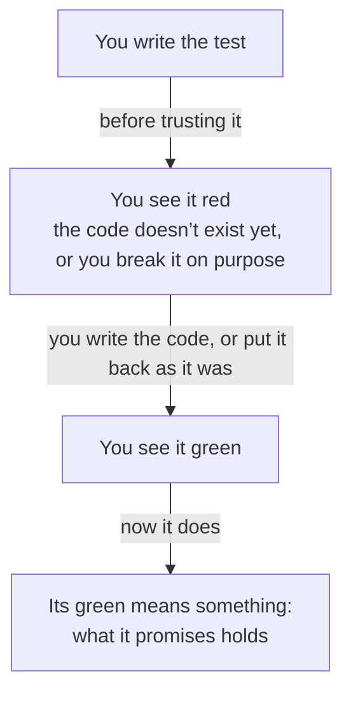

import Term from '~/components/Term.astro';
import TryIt from '~/components/TryIt.astro';
import Analogy from '~/components/Analogy.astro';
import SelfCheck from '~/components/SelfCheck.astro';
import ProjectCode from '~/components/ProjectCode.astro';
import Quiz from '~/components/Quiz.astro';
import QuizQuestion from '~/components/QuizQuestion.astro';
import QuizOption from '~/components/QuizOption.astro';

## The problem

This test of the shop is called “a signature made with the same secret is valid.” It signs a payment notification with the shop’s secret and checks that `validSignature`, the function that decides whether a notification comes from the payment gateway ([Phase 4](/en/phase-4/webhooks-idempotency/)), says yes. It comes out green.

Now change `validSignature` so it says yes to everything, including a notification with no signature. That shop marks as paid the order of anyone who sends it a `curl`. **And the test stays green**: it checks that a good signature is valid, and that’s still true.

In [Phase 3](/en/phase-3/node-http-server/) we promised you’d learn to write the tests you were copying. Writing one is a few lines; the hard part is knowing whether it checks anything. Here you write the ones for `validSignature` from an empty file, watch each one fail, and break the quantity fix from the [introduction](/en/phase-10/) to see which tests catch it.

## The analogy

<Analogy>

On your ceiling there’s a smoke detector with a little green light. The light says it has a battery, not that it would beep if there were smoke. To find out, you press the test button: if it beeps, it works.

A green test is that light. Watching it fail on purpose is pressing the button. And what the box says, “detects smoke,” is its name: the promise it checks.

<div slot="limits">

- The button imitates smoke. To see a test red there’s no imitation: you really break the code, for a moment, and put it back as it was.
- A smoke detector doesn’t warn you about carbon monoxide, and nobody blames it: it doesn’t promise to. A test doesn’t catch what it doesn’t check either, even if it’s in the same function.

</div>

</Analogy>

## How it really works

### What you’re going to test: the webhooks’ signature

`validSignature` calculates the signature a payment notification should carry and compares it with the one it carries ([Phase 4](/en/phase-4/webhooks-idempotency/#checking-the-signature-the-body-as-it-is-in-constant-time)). The last line first checks that the two are the same size, because `timingSafeEqual` only compares things of the same size:

<ProjectCode file="shop-api/42-tests/src/signature.ts" region="check" />

It doesn’t use the database or the network, and with the same data it always returns the same thing. A test that tests a piece like that, on its own, is a <Term id="unit-test">unit test</Term>. Until now, the signature was only tested through the webhook’s route.

### A test: a name and a function that checks

This is `test/signature.test.ts`, the new test file of step 42. Start with what’s highlighted:

<ProjectCode file="shop-api/42-tests/test/signature.test.ts" mark={[6, 7, 8, 10, 11, 13, 14, 15]} />

Word by word:

- **`import assert from 'node:assert/strict'`** brings in Node’s checks. With `/strict`, they compare strictly, like `===` in [Phase 3’s lesson 2](/en/phase-3/javascript-for-backend/): `9` and `'9'` aren’t equal.
- **`import { test } from 'node:test'`** brings in the function that defines a test. Both come with Node ([the `node:` prefix](/en/phase-3/what-is-node-js/#modules-code-in-pieces)): nothing to install.
- **`import { sign, validSignature } from '../src/signature.ts'`** brings in what you’re going to test, and `sign`, to make good signatures.
- **`SECRET` and `BODY`** are the test data.
- **`test('…', () => { … })`** defines a test: its name and a function with no name holding what it does.
- **`assert.equal(what comes out, what should come out)`** is an <Term id="assertion">assertion</Term>: if they aren’t equal, it throws an error that shows both.

That’s a test: code that calls yours and checks what it returns. **Node prints `✔` if the test’s function ends without an error, and `✖` if one is thrown.**

### Arrange, act, assert

Almost every test has three parts, in this order: **arrange** the data, **act** (call what you’re testing) and **assert** the result. They’re known as the three A’s.

In short tests, like the signature ones, act and assert fit on one line. In the shop’s tests they’re easier to see. This is “asking for fewer units gives the difference back to the stock,” in `test/transactions.test.ts`:

1. **Arrange**: it notes the mug’s stock, `before`, and places an order for 5.
2. **Act**: it changes the order to 2, with a `PATCH`, the way a customer would.
3. **Assert** a `200`, that the order says 2 and that the stock is `before - 2`: the 3 extra ones have come back.

### The name states the promise

Read the signature tests’ names: “a signature made with another secret is not valid,” “without a signature it is not valid.” Each one says what the code promises, with a concrete case, **not “validSignature works” or “test 2.”** It’s what you read when it fails, and it tells you what broke without opening the file.

The eleven tests of the quantity fix ([pull request #48](https://github.com/backendfromscratch/backend-from-scratch/pull/48)) were written like this, one per promise, like “changing the quantity and then cancelling leaves the stock as it was before the order.”

The Phase 4 one also said what it promised, “changes the quantity and returns the whole order”: read today, you can see it doesn’t mention the stock because it didn’t look at it.

**One promise per test.** A test stops at the first assertion that fails: if it checks five things, you learn nothing about the other four.

### Other checks: deepEqual and rejects

`assert.equal` compares with `===`: it works for numbers, text, `true` and `false`. Not for objects, because two different objects are never `===`, even if they hold the same thing.

- **`assert.deepEqual(a, b)`** compares the contents, field by field. The shop uses it to compare the whole body of a [Problem Details](/en/phase-4/api-errors-problem-details/) error, with its four fields.
- **`await assert.rejects(promise, /message/)`** is for what has to fail and returns a [promise](/en/phase-3/javascript-for-backend/#waiting-for-what-takes-time-promises-async-and-await): it passes if it fails with a message that matches, and fails if it goes well. “db.transaction: if the function throws an error, nothing it did is saved” checks that way that the transaction fails, and then that the stock is as before.

### Red first: a test that has never failed proves nothing

A green test can pass because the code is right, or because it doesn’t look at what you think: the one in “The problem” passes with a `validSignature` that says yes to everything. **The only way to know is to see it red once.**



There are two ways to get to red:

- **Write the test before the code**, and then just enough for it to pass: test-driven development (TDD).
- **Break the code on purpose**, if it already exists: you remove what the test watches, see the `✖` and put it back as it was.

### Before and after the tests: before, after and describe

To have something ready before the tests, like a database with its tables, `node:test` brings four functions:

- **`before(function)`**: once, before the file’s first test.
- **`after(function)`**: once, after the last one, to clean up.
- **`beforeEach` and `afterEach`**: before and after each test.

The shop has used them since Phase 5: almost all of its test files start with `useDb()`, from `test/db.ts`, a `before` that rebuilds the tests’ database, with its tables and the sample data, and an `after` that closes the connections.

Since all the files share that database, `npm test` runs the files one at a time (`--test-concurrency=1`).

`describe('name', () => { … })` groups tests; the shop doesn’t use it, because it already has one file per topic.

### Test doubles: fake pieces you already know

If what you’re testing talks to something slow, paid or out of your control, like a mail server or Google, in the test you put in its place a fake piece that behaves the same from the outside: a <Term id="test-double">test double</Term>. The course has already given you four:

- **The payment gateway**, `npm run gateway` ([Phase 4](/en/phase-4/webhooks-idempotency/)): it signs payment notifications without charging anyone.
- **Mailpit** ([Phase 9](/en/phase-9/background-jobs-queues/#the-email-mailpit-and-short-waits)): a mail server that receives everything and delivers nothing.
- **The practice OpenID Connect provider** ([Phase 6](/en/phase-6/oauth-openid-connect/#start-the-practice-provider)): it plays Google. `test/oauth.test.ts` starts it, and stops it with an `after`.
- **`test/docker-fake.sh`**, since step 40: a fake `docker` that writes down every command of `deploy.sh`, to check in which order it swaps the copies without starting a single container.

### Mocks and a fake clock

A <Term id="mock">mock</Term> is a double that also writes down how it was used. `node:test` brings them in `mock`:

- **`mock.fn()`** creates a fake function that writes down every call. You give it to the shop instead of, say, the one that notifies the delivery company, and check it was called once, with the right order.
- **`mock.method(object, 'name')`** wraps a function of an object: it keeps doing its job and writes down every call: a spy (if you give it another function, it replaces it). In `test/email.test.ts`, “without SMTP_URL, it sends nothing and says so in the log” uses it with `log.info` and checks what it wrote.

**`mock.timers`** writes nothing down: it’s a fake clock, another double. The shop already has its own: `createLimiter`, in `src/rate-limits.ts`, receives where to get the time from, and `test/rate-limits.test.ts` passes it `() => now`; by changing `now`, a minute goes by instantly. `mock.timers` does the same with `Date` and `setTimeout`, without adding that parameter ([Node’s documentation](https://nodejs.org/api/test.html#mocking)).

### The database isn’t faked

You could do the same with PostgreSQL: a double that answers whatever stock each test says. **It wouldn’t have caught the quantity bug.**

That bug lived in the database: in which `UPDATE` was run, inside which <Term id="transaction">transaction</Term> and with which locks against [Phase 5’s](/en/phase-5/acid-transactions/#two-buyers-one-mug-the-race-condition) <Term id="race-condition">race condition</Term>. A double answers what you believed: it checks your idea of PostgreSQL, not PostgreSQL.

That’s why the shop’s tests talk to a real PostgreSQL, `shop_test`: they’re <Term id="integration-test">integration tests</Term>, and [lesson 2](/en/phase-10/unit-integration-e2e-tests/) explains when each type pays off. **The rule: doubles for what’s outside your shop, not for what you’re testing.**

### What changes in step 42

- **`test/signature.test.ts`**, the file above.
- **`npm test` gives Node the pattern `'test/*.test.ts'`**, instead of letting it guess ([the introduction’s challenge](/en/phase-10/#file-by-file)): a new test file has to be in `test/` and end in `.test.ts`.
- That’s why **`npm test -- test/signature.test.ts` no longer runs a single file**, as in [Phase 5](/en/phase-5/acid-transactions/#the-tests), but all of them. For just one: `node --env-file=test/.env --test test/signature.test.ts`.

## Try it

The goal: write the tests for `validSignature` from an empty file, watch each one fail, and break the quantity fix to find out which of the 18 transactions tests catch it.

The outputs are from Node 26, on Linux, on October 24, 2026; your times will be different. Where they say `file:///p/`, yours show your project’s folder (ours was in `/p`, in a container).

### Get the step ready

Put your project on step 42, as in the [introduction](/en/phase-10/#each-lesson-its-step):

```sh
cd ~/backend-course/phase-3
curl -O https://backenddesdecero.com/practicas/shop-api/42-tests.tar.gz
tar -xzf 42-tests.tar.gz
cp -R 42-tests/. shop-api/
cd shop-api
npm install
```

From the `42-tests` folder you’ll take the good code every time you break it. The transactions tests need PostgreSQL with `shop_test` ([“Before you start”](/en/phase-10/#before-you-start)).

### Write the signature tests from scratch

Delete the step’s file: `rm test/signature.test.ts`. A copy stays in `../42-tests/test/signature.test.ts`.

Create `test/signature.test.ts`, empty, in your editor. Write the three `import` lines, the secret, the test body and one test for each of these promises, with the promise as its name:

1. a signature made with the same secret is valid;
2. a signature made with another secret is not valid;
3. a body changed in a single byte is not valid, even with the original signature;
4. without a signature it is not valid (the signature is `undefined`);
5. a signature of another size is not valid, and does not make `timingSafeEqual` fail (try `'sha256=abc'` and `''`).

If you get stuck, look at the one above. Save, and **don’t run it yet: first, break what it tests.** In `src/signature.ts`, replace what’s between the braces of `validSignature` with a single line, `return true;`.

<TryIt
  title="1. A validSignature that says yes to everything"
  cmd="node --env-file=test/.env --test test/signature.test.ts | head -n 36"
  output={`✔ a signature made with the same secret is valid (1.707553ms)
✖ a signature made with another secret is not valid (0.666511ms)
✖ a body changed in a single byte is not valid, even with the original signature (0.174306ms)
✖ without a signature it is not valid (0.108925ms)
✖ a signature of another size is not valid, and does not make timingSafeEqual fail (0.092883ms)
ℹ tests 5
ℹ suites 0
ℹ pass 1
ℹ fail 4
ℹ cancelled 0
ℹ skipped 0
ℹ todo 0
ℹ duration_ms 87.068714

✖ failing tests:

test at test/signature.test.ts:17:1
✖ a signature made with another secret is not valid (0.666511ms)
  AssertionError [ERR_ASSERTION]: Expected values to be strictly equal:
  
  true !== false
  
      at TestContext.<anonymous> (file:///p/test/signature.test.ts:18:10)
      at Test.runInAsyncScope (node:async_hooks:226:14)
      at Test.run (node:internal/test_runner/test:1402:25)
      at Test.processPendingSubtests (node:internal/test_runner/test:974:18)
      at Test.postRun (node:internal/test_runner/test:1542:19)
      at Test.run (node:internal/test_runner/test:1467:12)
      at async startSubtestAfterBootstrap (node:internal/test_runner/harness:387:3) {
    generatedMessage: true,
    code: 'ERR_ASSERTION',
    actual: true,
    expected: false,
    operator: 'strictEqual',
    diff: 'simple'
  }`}
>

`head -n 36` keeps the first 36 lines. **Four out of five red.** The one still green, “a signature made with the same secret is valid,” on its own would have passed a shop that accepts any notification.

In `true !== false`, what came out goes first and then what was expected, the order of `assert.equal`. `test at test/signature.test.ts:17:1` says where the test starts, and the first `at` line, where the assertion is; your line numbers and your order will be different.

If you get five `✔`, you didn’t save `src/signature.ts` or your tests don’t check what you think. If you get `SyntaxError`, the message says the line: almost always, a parenthesis or a brace left open.

</TryIt>

<SelfCheck question="Challenge: how would you see the first test red, the one that just passed?">

With `return false;`: the first one fails, since it expects `true`, and the other four pass.

</SelfCheck>

Put `src/signature.ts` back as it was: `cp ../42-tests/src/signature.ts src/`. Now break something else: in the last line of `validSignature`, remove `expected.length === received.length && `, so it reads `return timingSafeEqual(expected, received);`.

<TryIt
  title="2. Without the size check"
  cmd="node --env-file=test/.env --test test/signature.test.ts"
  output={`✔ a signature made with the same secret is valid (1.824362ms)
✔ a signature made with another secret is not valid (0.121802ms)
✔ a body changed in a single byte is not valid, even with the original signature (0.134553ms)
✔ without a signature it is not valid (0.072465ms)
✖ a signature of another size is not valid, and does not make timingSafeEqual fail (0.129803ms)
ℹ tests 5
ℹ suites 0
ℹ pass 4
ℹ fail 1
ℹ cancelled 0
ℹ skipped 0
ℹ todo 0
ℹ duration_ms 84.421282

✖ failing tests:

test at test/signature.test.ts:30:1
✖ a signature of another size is not valid, and does not make timingSafeEqual fail (0.129803ms)
  RangeError [Error]: Input buffers must have the same byte length
      at validSignature (file:///p/src/signature.ts:27:10)
      at TestContext.<anonymous> (file:///p/test/signature.test.ts:31:16)
      at Test.runInAsyncScope (node:async_hooks:226:14)
      at Test.run (node:internal/test_runner/test:1402:25)
      at Test.processPendingSubtests (node:internal/test_runner/test:974:18)
      at Test.postRun (node:internal/test_runner/test:1542:19)
      at Test.run (node:internal/test_runner/test:1467:12)
      at async Test.processPendingSubtests (node:internal/test_runner/test:974:7) {
    code: 'ERR_CRYPTO_TIMING_SAFE_EQUAL_LENGTH'
  }`}
>

**Only the fifth one fails**, with a `RangeError` from `timingSafeEqual`: a test also fails when the code throws an error. It guards the check you removed, and none of the other four notices it.

</TryIt>

<TryIt
  title="3. The code as it was: all five, green"
  cmd={`cp ../42-tests/src/signature.ts src/\nnode --env-file=test/.env --test test/signature.test.ts`}
  output={`✔ a signature made with the same secret is valid (1.344657ms)
✔ a signature made with another secret is not valid (0.130928ms)
✔ a body changed in a single byte is not valid, even with the original signature (0.119385ms)
✔ without a signature it is not valid (0.074423ms)
✔ a signature of another size is not valid, and does not make timingSafeEqual fail (0.09755ms)
ℹ tests 5
ℹ suites 0
ℹ pass 5
ℹ fail 0
ℹ cancelled 0
ℹ skipped 0
ℹ todo 0
ℹ duration_ms 75.531411`}
>

Five `✔`, and now their green means something: you’ve seen each one fail. The file takes about 75 milliseconds: it doesn’t touch the database.

</TryIt>

### Break the quantity fix

Now, the tests of a real bug. In `src/data.ts`, look for `async function changeQuantity`: it has an `if (difference > 0)`, for when the customer asks for more units, and an `else if (difference < 0)`, for when they ask for fewer.

The `else if` has a single statement, four lines long, that starts with `await tx`: the `UPDATE` that gives the extra units back to the stock. **Comment it out**: `//` at the start of each of its four lines (in VS Code, select them and press <kbd>Ctrl</kbd> + <kbd>/</kbd>, or <kbd>Cmd</kbd> + <kbd>/</kbd> on a Mac). Save.

<TryIt
  title="4. Asking for fewer no longer gives anything back to the stock"
  cmd="node --env-file=test/.env --test test/transactions.test.ts"
  output={`✔ 20 orders at once for a product with stock 5: 5 go through, 15 get 409, and the stock ends at 0 (124.544206ms)
✔ without enough stock: 409, with its own type and what is left in detail (3.013434ms)
✔ an order takes its quantity from the stock; cancelling it gives it back, only once (8.791113ms)
✔ an error halfway through the transaction leaves the stock as it was (2.495429ms)
✔ db.transaction: if the function throws an error, nothing it did is saved (1.195148ms)
✔ asking for more units of a pending order takes the difference from the stock (5.655751ms)
✔ asking for more units than are left: 409, with what is left, and neither the order nor the stock changes (5.577286ms)
✖ asking for fewer units gives the difference back to the stock (6.309768ms)
✖ changing the quantity and then cancelling leaves the stock as it was before the order (9.932006ms)
✔ changing the quantity and cancelling at the same time: the stock ends as before the orders (52.576744ms)
✔ an order that is no longer pending: 409, and neither the order nor the stock changes (5.397773ms)
✔ paying and cancelling at the same time: a cancelled order does not go back to paid, and the stock comes back only once (58.973507ms)
✔ paying and changing the quantity at the same time: the order ends paid with the final quantity, and the stock adds up (36.731941ms)
✔ shipping and cancelling at the same time: a cancelled order does not leave, and only the stock of the cancelled ones comes back (41.543746ms)
✔ cancelling and shipping at the same time: either it is cancelled and the stock comes back, or 409 and the order leaves as it was (39.843802ms)
✔ if it is shipped while being cancelled, the cancellation changes nothing and answers 409 (5.958698ms)
✔ examples/race.ts: reading and writing separately oversells; with a conditional UPDATE, it does not (605.598196ms)
✔ the contract documents the 409 of POST /orders (11.85214ms)
ℹ tests 18
ℹ suites 0
ℹ pass 16
ℹ fail 2
ℹ cancelled 0
ℹ skipped 0
ℹ todo 0
ℹ duration_ms 2310.649153

✖ failing tests:

test at test/transactions.test.ts:145:1
✖ asking for fewer units gives the difference back to the stock (6.309768ms)
  AssertionError [ERR_ASSERTION]: Expected values to be strictly equal:
  
  30 !== 33
  
      at TestContext.<anonymous> (file:///p/test/transactions.test.ts:151:10)
      at process.processTicksAndRejections (node:internal/process/task_queues:104:5)
      at async Test.run (node:internal/test_runner/test:1409:7)
      at async Test.processPendingSubtests (node:internal/test_runner/test:974:7) {
    generatedMessage: true,
    code: 'ERR_ASSERTION',
    actual: 30,
    expected: 33,
    operator: 'strictEqual',
    diff: 'simple'
  }

test at test/transactions.test.ts:154:1
✖ changing the quantity and then cancelling leaves the stock as it was before the order (9.932006ms)
  AssertionError [ERR_ASSERTION]: Expected values to be strictly equal:
  
  29 !== 30
  
      at TestContext.<anonymous> (file:///p/test/transactions.test.ts:160:10)
      at process.processTicksAndRejections (node:internal/process/task_queues:104:5)
      at async Test.run (node:internal/test_runner/test:1409:7)
      at async Test.processPendingSubtests (node:internal/test_runner/test:974:7) {
    generatedMessage: true,
    code: 'ERR_ASSERTION',
    actual: 29,
    expected: 30,
    operator: 'strictEqual',
    diff: 'simple'
  }`}
>

**Two out of eighteen red**, and both ask for fewer units:

- **“asking for fewer units gives the difference back to the stock,”** with `30 !== 33`: the order for 5 left the stock at 30, and going down to 2 should have given 3 back.
- **“changing the quantity and then cancelling…,”** with `29 !== 30`. Going from 4 to 3 should have given a mug back, and it didn’t.

The other sixteen don’t ask for fewer, and stay green. If all eighteen come out green, you didn’t save `src/data.ts`.

</TryIt>

<TryIt
  title="5. Back to green"
  cmd={`cp ../42-tests/src/data.ts src/\nnode --env-file=test/.env --test test/transactions.test.ts | tail -n 8`}
  output={`ℹ tests 18
ℹ suites 0
ℹ pass 18
ℹ fail 0
ℹ cancelled 0
ℹ skipped 0
ℹ todo 0
ℹ duration_ms 2242.289094`}
>

`tail -n 8` keeps the summary: **`pass 18`, `fail 0`**.

</TryIt>

### The real bug: the whole block

What sat in the shop for twenty steps wasn’t that statement: it was that `changeQuantity` never moved the stock at all. To see it, comment out the whole block, from `if (difference > 0) {` to the brace that closes the `else if`, included.

<TryIt
  title="6. Changing the quantity without touching the stock"
  cmd="node --env-file=test/.env --test test/transactions.test.ts | head -n 26"
  output={`✔ 20 orders at once for a product with stock 5: 5 go through, 15 get 409, and the stock ends at 0 (194.010655ms)
✔ without enough stock: 409, with its own type and what is left in detail (4.837533ms)
✔ an order takes its quantity from the stock; cancelling it gives it back, only once (10.838465ms)
✔ an error halfway through the transaction leaves the stock as it was (3.672633ms)
✔ db.transaction: if the function throws an error, nothing it did is saved (1.820252ms)
✖ asking for more units of a pending order takes the difference from the stock (8.04554ms)
✖ asking for more units than are left: 409, with what is left, and neither the order nor the stock changes (6.397178ms)
✖ asking for fewer units gives the difference back to the stock (6.052021ms)
✖ changing the quantity and then cancelling leaves the stock as it was before the order (10.538687ms)
✖ changing the quantity and cancelling at the same time: the stock ends as before the orders (47.604383ms)
✔ an order that is no longer pending: 409, and neither the order nor the stock changes (6.479727ms)
✔ paying and cancelling at the same time: a cancelled order does not go back to paid, and the stock comes back only once (67.892977ms)
✔ paying and changing the quantity at the same time: the order ends paid with the final quantity, and the stock adds up (38.442781ms)
✔ shipping and cancelling at the same time: a cancelled order does not leave, and only the stock of the cancelled ones comes back (46.123661ms)
✔ cancelling and shipping at the same time: either it is cancelled and the stock comes back, or 409 and the order leaves as it was (43.470012ms)
✔ if it is shipped while being cancelled, the cancellation changes nothing and answers 409 (6.000185ms)
✔ examples/race.ts: reading and writing separately oversells; with a conditional UPDATE, it does not (596.778433ms)
✔ the contract documents the 409 of POST /orders (11.617959ms)
ℹ tests 18
ℹ suites 0
ℹ pass 13
ℹ fail 5
ℹ cancelled 0
ℹ skipped 0
ℹ todo 0
ℹ duration_ms 2300.551146`}
>

**Five out of eighteen red**: the two from before, the two that ask for more units and “changing the quantity and cancelling at the same time.” With the bug that sold mugs that weren’t there, thirteen stay green.

</TryIt>

<SelfCheck question="Challenge: “paying and changing the quantity at the same time” checks that the stock adds up, and stays green with the stock broken. Why doesn’t it catch the bug?">

It fires a payment and a change to 3 at the same time for ten orders of one mug. If the change gets there first, the stock doesn’t add up and the test comes out red; if the payment gets there first, the change gets a `409` and everything adds up. That time, the ten payments won. **A test only catches what happens while it runs.** On your computer some change may win, and then this one will come out red too.

</SelfCheck>

Put `src/data.ts` back as it was (`cp ../42-tests/src/data.ts src/`) and repeat step 5: 18 out of 18.

### On your server

This lesson only changes tests: there’s nothing to copy to your server. If you push, the workflow from [Phase 8](/en/phase-8/ci-cd-github-actions/) runs `npm test`, with yours, before publishing the image: if one fails, it isn’t published. Before the commit, `git diff src/` shouldn’t show anything.

## You have already seen it

- **The test button** on a smoke detector, or the TEST button on a bathroom outlet: checking that it trips, without waiting for the fire.
- **The green check marks on a pull request on GitHub**: tests someone wrote, run by a machine.
- **Every `npm test` in the course**, since Phase 3: the files in `test/` you were copying were this.

## Common mistakes

- **Trusting a test you’ve never seen fail.** It may be green because it looks at nothing.
- **Names that say nothing**, like “works” or “test 2,” or **several promises in one test**: when it fails, you don’t know what broke.
- **Comparing objects with `assert.equal`**, or forgetting the `await` in front of `assert.rejects`: the first fails even if they hold the same thing; the second passes without checking anything.
- **Faking the database.** The double answers what you believe, not what PostgreSQL does.

## Summary

- A test calls your code and checks what it returns, with `node:test` and `node:assert`: arrange, act and assert.
- Its name states the promise: it’s the first thing you read when it fails.
- A test you’ve never seen fail proves nothing: write it before the code, or break the code on purpose.
- Test doubles take the place of what’s outside the shop; the database, where its bugs live, is the real thing.
- A test only catches what it checks: with the stock completely broken, thirteen of the eighteen transactions tests stayed green.

## Did you get it?

<Quiz>

<QuizQuestion
  question="You write a test for a new function, priceWithTax, and it comes out green the first time. What do you do before trusting it?"
  review="Red first: a test that has never failed proves nothing"
>

<QuizOption text="Nothing else: if it passed the first time, the function is right.">

It may have passed because the function is right or because the test doesn’t look at what you think. Green, on its own, can’t tell the two apart.

</QuizOption>

<QuizOption text="Break the function on purpose and see the test red." correct>

If it turns red, it watches what you broke; if it stays green, it wasn’t checking that.

</QuizOption>

<QuizOption text="Run it ten more times, to be sure the green isn’t luck.">

A test that checks nothing passes all ten times.

</QuizOption>

</QuizQuestion>

<QuizQuestion
  question="Three names for the same test of the shop. Which one helps you most the day it comes out with ✖?"
  review="The name states the promise"
>

<QuizOption text="“cancelOrder works fine in every case”">

It says which function, not what it promises: with a `✖` in front of it, you have to open the file.

</QuizOption>

<QuizOption text="“cancellation test number 2, the paid orders one”">

A number and a topic don’t say what’s expected: is it the stock, the status or the response’s code?

</QuizOption>

<QuizOption text="“cancelling an order gives its stock back only once”" correct>

It’s the promise, with its case. If it comes out with `✖`, you already know what stopped holding.

</QuizOption>

</QuizQuestion>

<QuizQuestion
  question="The test assert.equal(await res.json(), { id: 7, status: 'paid' }) fails, and the response carries exactly { id: 7, status: 'paid' }. Why?"
  review="Other checks: deepEqual and rejects"
>

<QuizOption text="Because they’re two different objects, and assert.equal compares with ===." correct>

Two different objects are never `===`, even if they hold the same thing. `assert.deepEqual` compares their contents, field by field.

</QuizOption>

<QuizOption text="Because res.json() returns the body as text, and it has to be compared with a JSON text.">

`res.json()` turns the body into data: it returns an object, not text. The problem is in how `assert.equal` compares.

</QuizOption>

<QuizOption text="Because assert.equal wants what’s expected first and then what comes out, and here they’re the other way around.">

The order only changes the error message. The other way around, it would fail just the same: two different objects are never `===`.

</QuizOption>

</QuizQuestion>

<QuizQuestion
  question="A cancellation test fails with 12 !== 10 on the line assert.equal(await stock(4), before). What happened?"
  review="Write the signature tests from scratch"
>

<QuizOption text="The stock is 10 and the test expected 12: cancelling left 2 mugs that didn’t come back.">

It’s the other way around: the message puts what came out first and then what was expected, the same order as `assert.equal`.

</QuizOption>

<QuizOption text="The stock is 12 and the test expected 10: 2 mugs too many came back." correct>

`12` came out, and what was expected, `before`, was `10`. Cancelling gave back more than the order had taken: maybe it gives it back twice.

</QuizOption>

<QuizOption text="The test is wrong: if the real stock is 12, you have to change it to expect 12.">

That way it goes green with the bug inside. The test says what has to happen; the one that’s wrong is the code.

</QuizOption>

</QuizQuestion>

<QuizQuestion
  question="Someone on your team proposes replacing PostgreSQL, in the tests, with a double that answers whatever stock each test says: they’d run ten times faster. What would happen to the quantity tests?"
  review="The database isn’t faked"
>

<QuizOption text="They’d catch the bug just the same: they still look at the stock after changing the quantity.">

They look at the stock the double answers, which is what the test’s author wrote.

</QuizOption>

<QuizOption text="They’d be more reliable, because each test would decide the exact stock it needs.">

Deciding the stock isn’t checking it: PostgreSQL’s locks, where the bug was, would never happen.

</QuizOption>

<QuizOption text="They’d pass green with the bug inside." correct>

The bug was in what PostgreSQL does (the `UPDATE`, the transaction, the locks), and a double does none of that.

</QuizOption>

</QuizQuestion>

<QuizQuestion
  question="Someone on your team adds a test, “paying for an order leaves it paid,” that pays and only checks that the response is 200. Will it catch a bug that leaves the order “pending”?"
  review="The name states the promise"
>

<QuizOption text="No: it checks the 200, not the order’s status." correct>

The name promises more than the test looks at. To keep it, it has to read the order after paying and check that it says `paid`.

</QuizOption>

<QuizOption text="Yes: if the order weren’t left paid, the route wouldn’t answer 200.">

A route can answer 200 and save nothing: the test only sees what it checks.

</QuizOption>

<QuizOption text="Yes, if someone has seen it red before by breaking the payment route.">

Seeing it red says it watches what you broke, not the rest: if the route doesn’t save the status but answers 200, it stays green.

</QuizOption>

</QuizQuestion>

</Quiz>

## Further reading

- [Test runner](https://nodejs.org/api/test.html), in Node’s documentation: `test`, `describe`, `before`, `after` and `mock`.
- [Assert](https://nodejs.org/api/assert.html): every check in `node:assert`, and what changes with `/strict`.
- [Mocks Aren’t Stubs](https://martinfowler.com/articles/mocksArentStubs.html), by Martin Fowler: the kinds of test doubles and when to use each one.
- [Pull request #48](https://github.com/backendfromscratch/backend-from-scratch/pull/48) of the course’s repository: the quantity fix and its eleven new tests.
