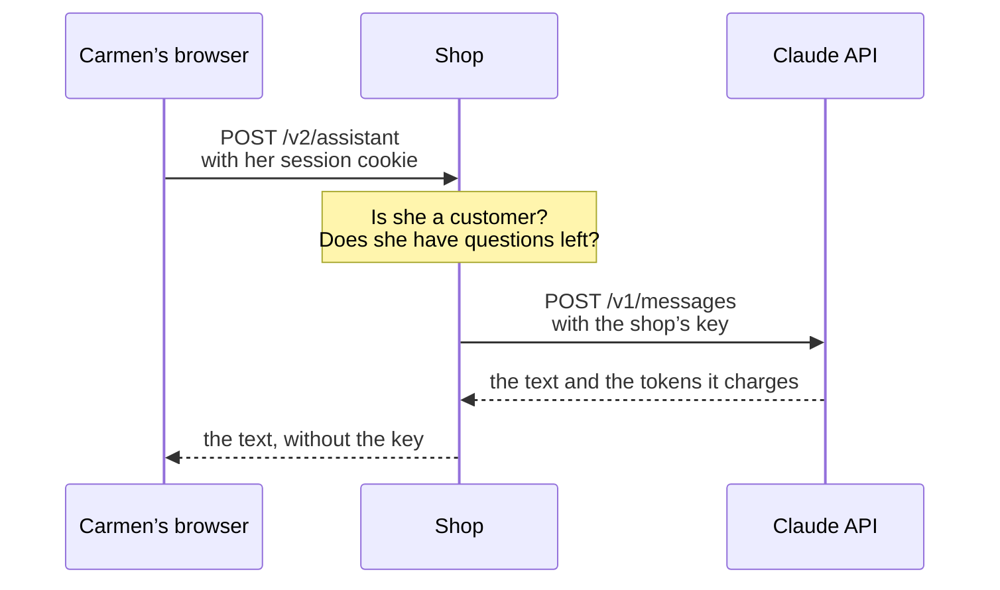

import Term from '~/components/Term.astro';
import TryIt from '~/components/TryIt.astro';
import Analogy from '~/components/Analogy.astro';
import SelfCheck from '~/components/SelfCheck.astro';
import ProjectCode from '~/components/ProjectCode.astro';
import Quiz from '~/components/Quiz.astro';
import QuizQuestion from '~/components/QuizQuestion.astro';
import QuizOption from '~/components/QuizOption.astro';
import Scene from '~/components/Scene.astro';

<Scene id="problem" />

## The problem

Imagine Luis wants the assistant this very afternoon. He copies the call to the <Term id="llm">model</Term> from an example, pastes it into the JavaScript of the shop's website, with the key inside, and it works: Carmen asks and the model answers.

The next day, the Console says the shop has spent all its credit. Someone opened DevTools, saw the key in the Network tab and used it for their own program. **Everything that reaches the browser can be read by whoever uses it.**

The fix is the usual one: the browser asks your backend, and your backend, with its key, asks the model. In this lesson you write that route, `POST /v2/assistant`, and see what travels, what comes back and what you pay for.

<Scene id="analogy" />

## The analogy

<Analogy>

The shop hires a phone translation service and pays for it with its card. When a foreign customer asks something at the counter, Ana calls, gives the card number and reads out the whole conversation from the start: the service doesn't remember earlier calls. It charges for every word it hears and every word it says.

Ana never writes the card number on a sign on the counter: whoever reads it can charge their own calls to the shop.

<div slot="limits">

- A call is charged by the minute. The API charges for the pieces of text it reads and writes, and writing costs five times more than reading.
- A translator who doesn't know something says so. A model can write something false with the same confidence.
- A person ends up getting tired of a pushy customer. The API answers whoever has the key, at any hour and as many times as they ask: you set the limit.

</div>

</Analogy>

<Scene id="key" />

## How it really works

### The key lives on the server

This is how one of Carmen's questions travels:



The key only leaves the server toward the API. Why not in the frontend:

- **Everything that reaches the browser can be read**: the code, the headers of every request in DevTools' Network tab, what the page stores.
- **Whoever has the key spends on your account**, without your session, without your limits and without going through your backend.
- **The SDK itself refuses**: in a browser, it throws an error unless you pass it the `dangerouslyAllowBrowser` option.

In the shop, the key is `ANTHROPIC_API_KEY`, in `.env`, like the other secrets ([Phase 6](/en/phase-6/rate-limiting-secrets/#secrets-out-of-the-code-and-out-of-git)). It's optional: without it, `POST /v2/assistant` answers `503` with `assistant-not-configured`, and the rest of the shop works the same.

<Scene id="who" />

### Who can ask, and how many times

The shop pays for every question. That's why, before it reaches the model:

- **Only a customer with their session can ask.** The new permission, `assistant:use`, belongs only to the `customer` role ([Phase 6](/en/phase-6/rbac-roles-permissions/)): without a session, `401`; with Fast Delivery's key, `403`.
- **At most 20 questions per customer every 10 minutes, and 60 per IP**, with the limiter from [Phase 6](/en/phase-6/rate-limiting-secrets/#by-email-and-by-ip-the-shops-limits) in Redis. The next one gets `429` with `Retry-After`, without reaching the model. If Redis doesn't answer, the limit closes: `503`.

<Scene id="request" />

### A request: the model, the instructions, the conversation and a limit

This is the request the shop sends to Claude's Messages API, in `src/assistant/conversation.ts`:

<ProjectCode file="shop-api/47-model/src/assistant/conversation.ts" region="request" />

- **`model`**: which model answers. It comes from `MODEL`, in `config.ts`: by default, `claude-haiku-5-5`.
- **`max_tokens`**: the longest the answer can be, 2048 <Term id="llm-token">tokens</Term>, the pieces of words the API counts and charges in. If it reaches the limit, it's cut.
- **`system`**: the <Term id="system-prompt">system prompt</Term>, what the model reads before the conversation: who it is, what it can do and how to answer.
- **`output_config.effort`**: how much it thinks before answering. What it thinks is paid for too, and the shop asks for `low`, which takes less time and costs less.
- **`messages`**: the conversation, with the API's roles, `user` and `assistant`.

It carries no `temperature` or anything like it: current models reject it with a `400`.

The instructions live in their own file, versioned like the code:

<ProjectCode file="shop-api/47-model/src/assistant/instructions.md" />

Look at the last part: the model can't see the catalog or the orders yet, and it's told not to make them up.

<Scene id="response" />

### The answer: blocks, why it stopped and what it costs

This is what the shop's fake model (below) answered to the `curl` in “Try it”: the fields the shop uses, with made-up text and tokens. Claude's may bring a few more:

```json
{
  "id": "msg_fake_2",
  "type": "message",
  "role": "assistant",
  "model": "claude-haiku-5-5",
  "content": [
    {
      "type": "thinking",
      "thinking": "",
      "signature": "fake-signature-2"
    },
    {
      "type": "text",
      "text": "I'm the fake model: I understand nothing, I just repeat your last question. It was: \"Hi, what do you sell?\"."
    }
  ],
  "stop_reason": "end_turn",
  "stop_sequence": null,
  "stop_details": null,
  "usage": {
    "input_tokens": 120,
    "output_tokens": 30,
    "cache_creation_input_tokens": 0,
    "cache_read_input_tokens": 0
  }
}
```

- **`content`** is a list of **blocks**. The `text` one is the answer. Before it there may be a `thinking` one, with empty text and a signature (`signature`): what the model thought, which it doesn't show but does charge for.
- **`stop_reason`** says why it stopped: `end_turn`, it has finished; `max_tokens`, it ran out of room; `refusal`, it refused; and, in lesson 3, `tool_use`.
- **`usage`** brings the tokens that are charged: `input_tokens`, what it read, and `output_tokens`, what it wrote, thinking included.

The shop keeps what's useful to Carmen: the text of the `text` blocks, the two numbers in `usage` and, if the model refused, a fixed sentence.

<ProjectCode file="shop-api/47-model/src/assistant/conversation.ts" region="answer" />

<Scene id="tokens" />

### Tokens: what's counted and what's paid for

Imagine 500 input tokens, between instructions and conversation, and an answer of 150, thinking included. With Claude Haiku 5.5's prices on November 21, 2026:

| | Tokens | Price per million | Cost |
|---|---|---|---|
| Input | 500 | $0.10 | $0.00005 |
| Output | 150 | $0.50 | $0.000075 |
| **Total** | | | **$0.000125** |

About eight thousand questions like that per dollar. Besides the model, two things move the bill:

- **Output costs five times more**, and what the model thinks counts as output.
- **Input grows with the conversation**, because it travels whole with every question (below).

There's also a maximum: the <Term id="context-window">context window</Term>, the most a model can read in one request. Claude Haiku 5.5's is one million tokens, and the shop stays very far from it on purpose (below).

<Scene id="stateless" />

### The API remembers nothing

Between one request and the next, the API forgets everything: it's <Term id="stateless">stateless</Term>, like the REST API from [Phase 4](/en/phase-4/what-is-a-rest-api/). For the model to know what you were talking about, **every request carries the whole conversation**.

The shop doesn't store conversations either: the frontend sends the latest messages each time, and the Zod schema limits them to 20, of 2,000 characters each. Storing them would add a table and decisions that aren't about code: they're Carmen's data.

What does change is the price: in a ten-question conversation, the first question is paid for ten times. Lesson 7 makes it cheaper with the cache.

<Scene id="retries" />

### The SDK: the same request, with types and retries

The shop doesn't write the request by hand: it uses Anthropic's official <Term id="sdk">SDK</Term> for TypeScript, `@anthropic-ai/sdk` 1.8.0, in `src/assistant/client.ts`:

<ProjectCode file="shop-api/47-model/src/assistant/client.ts" region="client" />

- **No key, no client**, and the route answers `503`.
- **`maxRetries`**: the SDK only repeats what's passing (`429`, `529`, another `5xx`, a network cut), waiting as long as `retry-after` says or, if it doesn't say, with an <Term id="exponential-backoff">exponential backoff</Term> like the one in [Phase 9](/en/phase-9/background-jobs-queues/). With 2, at most three attempts.
- **`timeout`**: how long each attempt waits, 15 seconds. Without it, it would be 10 minutes.
- **The API's address isn't there**: the SDK reads `ANTHROPIC_BASE_URL`, and without it uses Anthropic's. The tests change it (below).

`client.messages.create(…)` is the `POST /v1/messages` from above, with types and a class for each error.

<Scene id="errors" />

### When the API fails: what's passing and what's the shop's fault

In [Phase 6](/en/phase-6/rate-limiting-secrets/#429-and-retry-after-how-long-to-wait) we promised you model APIs that answer `429`. Here it is, with a twist: **that 429 isn't Carmen's**, but the shop's account's, which has asked too much. Passed on as it is, Carmen would think it was her fault.

| The API answers | What it means | The shop answers |
|---|---|---|
| `429` | The shop's account has asked too much | `503` with `Retry-After` |
| `529` or another `5xx` | The API is overloaded, or has failed | `503` with `Retry-After` |
| Nothing in time, or the network cuts out | The model isn't answering | `503` with `Retry-After` |
| `400`, `401`, `404` | The shop's request is wrong: a parameter, the key, the model | `500`, and the reason to the log |

The decision is in `src/assistant/errors.ts`:

<ProjectCode file="shop-api/47-model/src/assistant/errors.ts" region="model-failure" />

- **It decides by the error's class** (`instanceof`), never by the message's text, which can change.
- **The order matters**: `APIConnectionError` and `RateLimitError` are also `APIError`, so they go before the last check.
- **A `500` doesn't tell Carmen what the API said**: that goes to the log, as in [Phase 4](/en/phase-4/api-errors-problem-details/).

According to the documentation, the spend limit isn't a `429`: yours gives a `400`, and the shop, a `500`; your tier's cap, a `429` without `retry-after`. We haven't checked it.

<Scene id="deadline" />

### The time limit, and the customer who leaves

Three 15-second attempts and the waits between them add up to 46.5 seconds. But if the API asks for two minutes in `retry-after`, the SDK would wait all of them. That's why the whole answer has its own limit, 50 seconds (`ASSISTANT_TIMEOUT_MS`), below the 60 that nginx waits for the API ([Phase 8](/en/phase-8/nginx-reverse-proxy/)): that way the answer is the shop's `503`, not an nginx `504`.

<ProjectCode file="shop-api/47-model/src/assistant/route.ts" region="deadline-and-signal" />

- **`AbortSignal.timeout`** creates a signal that fires at 50 seconds and cancels the call to the model, also while the SDK waits to repeat it.
- **`c.req.raw.signal`** is the signal of Carmen's request: it fires if she closes the tab before the answer.
- **`AbortSignal.any`** joins the two and cancels with the first one to fire: the shop doesn't keep waiting for an answer nobody is going to read.

<Scene id="refusal" />

### A refusal isn't an error

Sometimes the model refuses to answer: the API responds `200`, with `stop_reason: "refusal"` and the category of the reason in `stop_details`. Carmen gets the shop's fixed sentence, with `refused: true`, and the log gets the message's id and the category, never the conversation.

<Scene id="fake" />

### The tests don't call the model

A test that called the real model would cost money, need the key in CI and answer differently every time. The tests use a **fake model**, `test/fake-model.ts`: a small HTTP server that speaks the part of the Messages API the shop uses and answers whatever each test asks for, a text, a `429` or a silence. The SDK reaches it because `ANTHROPIC_BASE_URL` points at its address: it's a <Term id="test-double">test double</Term> from [Phase 10](/en/phase-10/writing-tests-node/#test-doubles-fake-pieces-you-already-know).

You can run it too, for free: `docker compose --profile practice up -d fake-model` (with `SCENARIO=429`, `529` or `slow` in front); put `ANTHROPIC_BASE_URL=http://fake-model:4100` and any key in your `.env`, and restart the shop. To go back to the real one, delete that line.

### Another option: a model on your computer

Ollama serves open models on your computer, with its own API: you don't pay per token, but in memory and speed. The course uses a paid API because that's what you'll find in almost any company.

<Scene id="try" />

## Try it

The goal: ask a model a question, by hand and through the shop; work out what it cost; check that the API remembers nothing, and see what Carmen gets when the API says `429`.

The shop's answers are from its fake model; Claude's we don't copy, because they change every time.

**Before the first question, your spend limit.** If you don't have a key, follow the steps in [the introduction](/en/phase-11/#your-api-key-with-a-spend-limit), in that order: the limit before the key. If you already have one, check in the Console that the limit is still there.

### A question by hand

First, without the SDK or the shop: the request the shop will make, with `curl` and some short instructions. The answer is saved in a variable, so you can read it twice and pay for it once:

<TryIt
  title="1. A question, with curl"
  cmd={`cd ~/backend-course/phase-3/shop-api
export $(grep '^ANTHROPIC_API_KEY=' .env)
ANSWER=$(curl -s https://api.anthropic.com/v1/messages \\
  -H "x-api-key: $ANTHROPIC_API_KEY" -H 'anthropic-version: 2026-10-21' \\
  --json '{"model":"claude-haiku-5-5","max_tokens":2048,"output_config":{"effort":"low"},
    "system":"You are the assistant of the online shop of Ana and Luis. Answer in a few sentences.",
    "messages":[{"role":"user","content":"Hi, what do you sell?"}]}')
echo "$ANSWER" | jq .`}
>

It has the shape of the one above: look at the text, in `content`; at `"stop_reason": "end_turn"`, and at `usage`, with real tokens.

If you get `"type": "error"`, read its `error.type`: `authentication_error` is the key (repeat the `export`); `invalid_request_error`, something in the request, with the field in the message; `not_found_error`, the model's name.

</TryIt>

<TryIt
  title="2. What it cost"
  cmd={`echo "$ANSWER" | jq '.usage | (.input_tokens * 0.10 + .output_tokens * 0.50) / 1000000'`}
>

The input tokens times their price, plus the output ones times theirs, divided by a million: dollars. `jq` reads the saved answer, without calling again. With the fake model's (120 and 30) it writes `2.7e-05`: $0.000027.

</TryIt>

### The same question, through the shop

Put your project on step 47, as in the [introduction](/en/phase-11/#each-lesson-its-step):

```sh
cd ~/backend-course/phase-3
curl -O https://backenddesdecero.com/practicas/shop-api/47-model.tar.gz
tar -xzf 47-model.tar.gz
cp -R 47-model/. shop-api/
cd shop-api
npm install
docker compose up -d --build --wait
```

`npm install` brings `@anthropic-ai/sdk`. Save the API's port in `API`, as in [Phase 10](/en/phase-10/prometheus-grafana-metrics/#get-the-step-ready), and sign Carmen in:

```sh
API=$(docker compose port api 3000)
curl -s -o /dev/null -c carmen.txt --json '{"email":"carmen@example.com","password":"carmen-practice-2026"}' $API/v2/session
```

<TryIt
  title="3. Carmen asks"
  cmd={`curl -s -b carmen.txt --json '{"messages":[{"role":"user","text":"Hi, what do you sell?"}]}' $API/v2/assistant | jq .`}
  output={`{
  "text": "I'm the fake model: I understand nothing, I just repeat your last question. It was: \\"Hi, what do you sell?\\".",
  "refused": false,
  "usage": {
    "input": 120,
    "output": 30
  }
}`}
>

It's the shop's answer: `text`, `refused` and `usage`, without blocks or signatures. This one is the fake model's, which always says 120 and 30; **in your `usage.input`**, many more than in your `curl`: the whole instructions go along.

With `503` and `assistant-not-configured`, the API is missing your key: check your `.env` and repeat `docker compose up -d --wait`. With `401`, sign in again.

</TryIt>

### The API remembers nothing: check it

Carmen asks something that depends on an earlier message. First, sending only the last question:

<TryIt
  title="4. Only the last question"
  cmd={`curl -s -b carmen.txt --json '{"messages":[{"role":"user","text":"Who was the gift for?"}]}' $API/v2/assistant | jq .`}
>

Look in `text` for the model not knowing which gift you mean: nobody has told it in this request.

</TryIt>

Now, the whole conversation. The second message is what the assistant answered: on the website, the frontend sends what it showed.

<TryIt
  title="5. With the whole conversation"
  cmd={`curl -s -b carmen.txt --json '{"messages":[
  {"role":"user","text":"Hi, I am Carmen. I am looking for a gift for my brother."},
  {"role":"assistant","text":"Hi, Carmen! What does your brother like?"},
  {"role":"user","text":"Who was the gift for?"}]}' $API/v2/assistant | jq .`}
>

Now `text` should talk about your brother: it has read it in this request. Compare `usage.input` with test 4's: **what was said before is paid for again**.

</TryIt>

### A 429, with the fake model

A real `429` would mean using up your limits. The fake model answers one when asked to: run the tests with “429” in their name.

<TryIt
  title="6. The two 429s"
  cmd="node --env-file=test/.env --test --test-name-pattern=429 test/assistant.test.ts"
  output={`✔ a 429 from the API: a 503 for the customer, with the Retry-After the API gave (72.921789ms)
✔ a customer's 21st question in 10 minutes: 429 with Retry-After, and the model never gets it (73.056286ms)
ℹ tests 2
ℹ suites 0
ℹ pass 2
ℹ fail 0
ℹ cancelled 0
ℹ skipped 0
ℹ todo 0
ℹ duration_ms 1720.073294`}
>

`--test-name-pattern` runs only the tests whose name contains it. There are two:

- **“a 429 from the API”**: the fake model answers `429` with `retry-after: 17`, and Carmen gets `503` with `Retry-After: 17`.
- **“a customer's 21st question in 10 minutes”**: Carmen goes past her limit and gets `429`, which this time is hers, without the question reaching the model.

They spend nothing, and they need PostgreSQL with `shop_test`, as in the [introduction](/en/phase-11/#before-you-start). If you get `ECONNREFUSED`, PostgreSQL isn't running.

</TryIt>

This is the first one:

<ProjectCode file="shop-api/47-model/test/assistant.test.ts" region="api-429" />

`model.script(…)` tells the fake model what it will answer to the next request. `mock.method(log, 'warn', …)` silences the log's warning and counts how many times it's written, as in [Phase 10](/en/phase-10/writing-tests-node/#mocks-and-a-fake-clock).

<SelfCheck question="Challenge: in errors.ts, move the last check, the APIError one, to the start of modelFailure, and run test 6’s tests again. Which one turns red, and why?">

The first one, “a 429 from the API”: it expects `503` and gets `500`, because `RateLimitError` is also an `APIError` and the check at the top takes it as a failure of the shop's. The second one stays green: Carmen's limit comes before the model. Put the file back as it was with `cp ../47-model/src/assistant/errors.ts src/assistant/`.

</SelfCheck>

### On your server

Step 47 deploys as always: with no key on the server, the assistant answers `503` and nothing else changes. To have it there, **create a key in the Console just for the server**, with its own spend limit: if it leaks, you delete it without touching your computer's. Paste it into your server's `.env`, in `/opt/shop`:

<ProjectCode file="shop-api/47-model/.env.production.example" region="assistant" />

Do it before deploying, so the API's copies start with it.

<Scene end />

## You have already seen it

- **The help chats on many websites**, with their “How can I help you?”: behind them there's a route like this one, with the company's key.
- **The “too many requests, try again later”** of some AI apps: a `429` or a `529`, translated by the app.

## Common mistakes

- **Putting the key in the frontend, or in the code and in Git.** Whoever reads it spends on your account.
- **Using the API without a spend limit, or a route without a question limit.** A forgotten loop spends without stopping.
- **Passing the API's `429` on to your customer.** The limit is your account's, not theirs: for them, `503`.
- **Looking at the error's text instead of its class.** The text changes; the class doesn't.
- **Forgetting that the conversation travels whole.** A long conversation pays for each message many times.
- **Trusting what the model says about your shop.** It only knows what you give it.

## Summary

- The key lives on the server: the browser asks your backend, and your backend asks the model.
- A request carries the model, the instructions (`system`), the conversation (`messages`) and a limit (`max_tokens`); the answer, blocks (`content`), why it stopped (`stop_reason`) and the tokens (`usage`).
- You pay for the tokens it reads and the ones it writes, which cost five times more, and the whole conversation travels with every question.
- What's passing (`429`, `529`, a cut) is a `503` with `Retry-After` for your customer; a badly made request, a `500` and the reason to the log; a refusal, a `200` with a fixed sentence.
- The tests talk to a fake model, which `ANTHROPIC_BASE_URL` points at.

## Did you get it?

<Quiz>

<QuizQuestion
  question="Someone on your team suggests calling the model’s API from the browser, with the key inside the minified JavaScript: “that way nobody will find it.” What do you tell them?"
  review="The key lives on the server"
>

<QuizOption text="That it’s fine, as long as the API only accepts requests coming from your domain.">

CORS is applied by the browser, not by the API: with the key, anyone can use it from `curl` or from their own server, where there's no browser checking anything.

</QuizOption>

<QuizOption text="That it isn’t: what reaches the browser can be read, minified or not." correct>

The key shows up in the headers of every request, in DevTools' Network tab. It has to stay on the server.

</QuizOption>

<QuizOption text="That it’s fine: minified code can’t be read.">

Minifying removes spaces and shortens names, but the key's text is still there, and it travels with every request.

</QuizOption>

</QuizQuestion>

<QuizQuestion
  question="To save tokens, the shop’s frontend sends only Carmen’s last message, not the whole conversation. What will happen?"
  review="The API remembers nothing"
>

<QuizOption text="Nothing: the API remembers the conversation by the shop’s key.">

The API keeps nothing between requests, and the key is the same for all of the shop's customers.

</QuizOption>

<QuizOption text="Nothing: the shop remembers the conversation by Carmen’s session.">

The shop doesn't store conversations either: it passes the model what the frontend sends, and nothing more.

</QuizOption>

<QuizOption text="The model will answer without knowing what was said before." correct>

Each request is the only thing the model reads: if “And in blue?” arrives alone, it doesn't know which product you mean.

</QuizOption>

</QuizQuestion>

<QuizQuestion
  question="An answer from Claude Haiku 5.5 brings usage with 1,200 input tokens and 300 output tokens. At $0.10 and $0.50 per million, how much did it cost?"
  review="Tokens: what's counted and what's paid for"
>

<QuizOption text="$0.00027" correct>

1,200 × 0.10 divided by a million is $0.00012, and 300 × 0.50 divided by a million, $0.00015: together, $0.00027.

</QuizOption>

<QuizOption text="$0.00015, because you only pay for what the model writes">

You also pay for what it reads, the instructions and the conversation: here, $0.00012 more.

</QuizOption>

<QuizOption text="$0.00075, because everything is paid at the output price">

Input has its own price, $0.10 per million, five times cheaper than output's.

</QuizOption>

</QuizQuestion>

<QuizQuestion
  question="It’s three in the morning and the API answers the shop with a 429: its account has asked too much. What should Carmen get?"
  review="When the API fails: what's passing and what's the shop's fault"
>

<QuizOption text="A 429, so she knows she’s asking too much.">

The limit that was passed is the shop's account's: maybe it's Carmen's first question today.

</QuizOption>

<QuizOption text="A 503 with Retry-After, the one the API gave." correct>

It's something passing that doesn't depend on her: `503` says “I can't right now,” and `Retry-After`, when to come back.

</QuizOption>

<QuizOption text="A 500, because the request to the model failed.">

A `500` says the shop did something wrong, and the request was fine: waiting fixes it.

</QuizOption>

</QuizQuestion>

<QuizQuestion
  question="After a deployment, every question to the assistant gets a 500, and the log says not_found_error with “model: claude-haiku-5-6”. What has happened?"
  review="When the API fails: what's passing and what's the shop's fault"
>

<QuizOption text="The API is down: you have to wait for it to come back.">

An API that's down answers `5xx`, and the shop would give `503`. A `404` says that what's asked for doesn't exist.

</QuizOption>

<QuizOption text="Carmen is sending a badly formed conversation.">

A conversation that doesn't match the schema gets `422` before reaching the model. Here it's the shop's request that fails.

</QuizOption>

<QuizOption text="MODEL has a name that doesn’t exist." correct>

It's the shop's failure: `500`, with the reason in the log. Waiting doesn't fix it; changing `MODEL` does.

</QuizOption>

</QuizQuestion>

<QuizQuestion
  question="Someone proposes that the assistant’s tests call the real model, “to test the real thing.” What would happen?"
  review="The tests don't call the model"
>

<QuizOption text="They’d cost money, need the key and fail at random." correct>

Every run would pay for tokens, CI would need the key, and the model answers differently every time. The real thing is measured separately, with evals, by hand.

</QuizOption>

<QuizOption text="Nothing bad: the SDK repeats the same answer if the question is the same.">

The SDK doesn't store answers, and the API answers differently every time.

</QuizOption>

<QuizOption text="They’d be better: they’d also check that the model answers well.">

For that you need cases that look at behavior, not at the exact words, and that don't fail at random: they're lesson 7's evals.

</QuizOption>

</QuizQuestion>

</Quiz>

## Further reading

- [Messages API](https://platform.claude.com/docs/en/api/messages/create), in Claude's documentation: every field of the request and the response.
- [Errors](https://platform.claude.com/docs/en/api/errors): each code and which ones are retried.
- [Rate limits](https://platform.claude.com/docs/en/api/rate-limits): the per-minute limits, the spend limits and their headers.
- [Pricing](https://platform.claude.com/docs/en/about-claude/pricing): what each model costs.
- [The TypeScript SDK](https://github.com/anthropics/anthropic-sdk-typescript), Anthropic's: retries, timeouts and errors.
