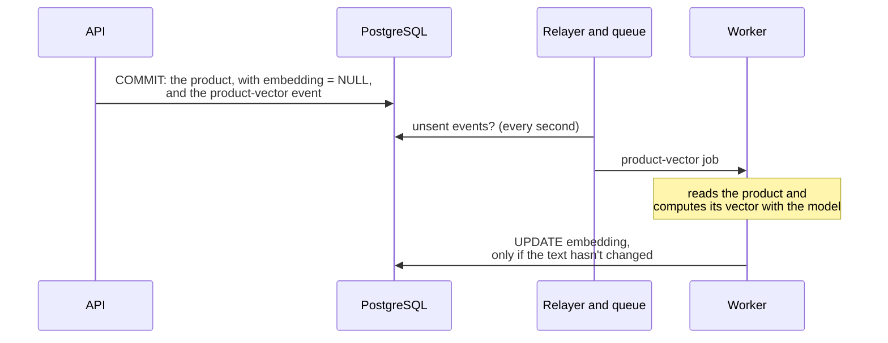

import Term from '~/components/Term.astro';
import TryIt from '~/components/TryIt.astro';
import Analogy from '~/components/Analogy.astro';
import ProjectCode from '~/components/ProjectCode.astro';
import SelfCheck from '~/components/SelfCheck.astro';
import Quiz from '~/components/Quiz.astro';
import QuizQuestion from '~/components/QuizQuestion.astro';
import QuizOption from '~/components/QuizOption.astro';

## The problem

Imagine that Carmen writes to the assistant: “do you have something for the cold?” `search_products`, the tool from [lesson 3](/en/phase-11/tool-use-function-calling/), looks for products whose name contains “something for the cold”. There are none.

And the shop sells a scarf, gloves, a wool hat and a blanket. **The words don't match; the meaning does.** Searching by words finds words, and people ask for what they need.

[Phase 5](/en/phase-5/sql-vs-nosql/) promised pgvector for Phase 11, the PostgreSQL extension that searches by similarity of meaning. Here the shop uses it for <Term id="semantic-search">semantic search</Term>: searching by what the question means, not by its words.

## The analogy

<Analogy>

In a supermarket, things are placed by what they are: one aisle for winter clothes, another for the beach. You ask for “something for the cold,” and they take you to the winter aisle, even though no sign says “cold.”

An *embedding* gives each product its place in a huge supermarket, arranged by what it means. Your question gets a place too, and the nearest products are the answer.

<div slot="limits">

- A supermarket has two dimensions. An *embedding* has hundreds (the shop's, 384), and none of them means something you can name, like “warm clothes.”
- To the model, “cold” and “hot” talk about the same thing, the temperature: you'll see a hand fan among the things for the cold.
- In a supermarket you may hear “we don't have that.” Here there's always a nearest product.

</div>

</Analogy>

## How it really works

### An embedding: a text turned into 384 numbers

This is how the scarf's vector starts, just as PostgreSQL stores it:

```text
[-0.018350273,0.04371399,-0.013365716,0.08882029,0.05043198,
```

They're the first numbers of a list of 384: the <Term id="embedding">*embedding*</Term> of “Scarf. Long, soft and cosy scarf of thick wool, for winter days.” A **vector**, which you can picture as a point in a space of 384 dimensions.

A model computes it, trained so that **two texts that mean the same thing give nearby points**. It doesn't write text, like the assistant's: it turns text into numbers. From each product, it turns its name and its description:

<ProjectCode file="shop-api/51-embeddings/src/embeddings.ts" region="product-text" />

That's why products now have a description, and the catalog goes from 4 to 20: warm clothes, coffee, summer and gifts.

### Close means similar: cosine distance

Picture each vector as an arrow that starts from the same spot: two texts about the same thing point the same way. **<Term id="cosine-distance">Cosine distance</Term> measures the angle between the arrows**, not how long they are:

| Distance | The arrows | The texts |
|---|---|---|
| 0 | Point exactly the same way | Mean the same |
| 1 | Form a right angle | Have nothing to do with each other |
| 2 | Point in opposite directions | Almost never happens |

On November 21, 2026, on the author's Mac, these were the five products nearest to “something for the cold”:

| Rank | Product | Distance |
|---|---|---|
| 1 | Hoodie | 0.477 |
| 2 | Blanket | 0.492 |
| 3 | Scarf | 0.514 |
| 4 | Wool hat | 0.529 |
| 5 | Hand fan | 0.547 |

None has “cold” in its name. The model gives vectors of **length 1**, and the math is short: 1 minus the sum of multiplying them number by number:

<ProjectCode file="shop-api/51-embeddings/scripts/check-embeddings.ts" region="distance" />

### A small model, on your computer

The Claude API doesn't compute *embeddings*: its documentation [points to Voyage AI](https://platform.claude.com/docs/en/build-with-claude/embeddings), by MongoDB, with another account. The shop uses a small model on your computer, with Transformers.js: **free, with no internet once downloaded, in English and in Spanish**.

<ProjectCode file="shop-api/51-embeddings/src/embeddings.ts" region="embedder" />

- `EMBEDDING_MODEL`: an open model, from Hugging Face. We chose it by measuring: the first one we tried put the sun cap first for “algo para el frío,” the same question in the Spanish shop.
- `DIMENSIONS = 384`: the database column must have the same number.
- `EMBEDDING_REVISION`: its exact version. With another one, the new vectors couldn't be compared with the stored ones, **and nothing would warn you**.
- `Embedder`: texts in, vectors out. The tests use a fake one.

The model is loaded the first time someone asks for a vector:

<ProjectCode file="shop-api/51-embeddings/src/embeddings.ts" region="load-model" />

- `import()` inside the function: a process that never searches by meaning doesn't load the library.
- `env.cacheDir`: where the files go. In Compose, a <Term id="volume">volume</Term>, `models`, shared by the API and the worker.
- `modelSource`: if the files are already in that folder, it loads them from there without asking anyone; if one is missing, it downloads them. That's how it works with no internet after the first time.
- `dtype: 'q8'`: each of the model's numbers in 8 bits instead of 32: four times smaller, and almost as good.

Measured on the author's Mac: 135 MB to download, about 30 seconds the first time, under one after that and about 3 ms per text. The image doesn't carry the model; with the library, it grows from 580 to 669 MB.

### pgvector: vectors inside PostgreSQL

pgvector adds a type to PostgreSQL, `vector`, with its distance operators and its indexes. It comes in the `pgvector/pgvector` image, in both Compose files:

<ProjectCode file="shop-api/51-embeddings/compose.yaml" region="db" />

It's PostgreSQL 18 with the extension inside. Migration `014` turns it on and adds two columns:

<ProjectCode file="shop-api/51-embeddings/db/migrations/014-embeddings.sql" region="extension" />

<ProjectCode file="shop-api/51-embeddings/db/migrations/014-embeddings.sql" region="columns" />

- `vector(384)`: exactly 384 numbers.
- `NULL` means “not computed yet”: the worker computes it, further down.

To search, the `<=>` operator, cosine distance. The most similar to the scarf, with no model at all:

```sql
SELECT name, embedding <=> (SELECT embedding FROM products WHERE name = 'Scarf') AS distance
FROM products
WHERE name <> 'Scarf'
ORDER BY distance
LIMIT 5;
```

In the shop, the same idea is written with Drizzle:

<ProjectCode file="shop-api/51-embeddings/src/assistant/tools/search-products.ts" region="nearest" />

`distance` is `<=>` with the query's vector (`cosineDistance`), and `alreadyIn`, the ones that already came up by name (you'll see why soon). `ORDER BY` the distance and `LIMIT 5`: the five nearest neighbors. Without an index, PostgreSQL computes the distance to **every** row.

### HNSW: jumping from neighbor to neighbor

With 20 products, it costs nothing; with a million, it does. [Phase 5's B-tree](/en/phase-5/database-indexes-explain/#inside-a-b-tree) is no use: 384 numbers together have no order. The shop uses an <Term id="hnsw">HNSW</Term> index (Hierarchical Navigable Small World), a graph:

- **At the bottom**, a floor with every vector, each linked to its close neighbors.
- **Above**, floors with fewer and fewer vectors, linked to farther neighbors.
- **To search**, it enters at the top and jumps to the neighbor closest to the question until none is closer. It goes down a floor and repeats. At the bottom, it gathers the best candidates.

Like a car trip: highway, road, street. Migration `014` creates it:

<ProjectCode file="shop-api/51-embeddings/db/migrations/014-embeddings.sql" region="index" />

`vector_cosine_ops`: for sorting by `<=>`.

### What it costs: approximate, and measured

**HNSW is approximate**: it looks at a small part of the table, and if the path of jumps doesn't pass near a neighbor, it misses it. `hnsw.ef_search` decides how many candidates it gathers (40, unless told otherwise).

`scripts/many-vectors.ts` measures it, like `many-orders` in Phase 5, with 50,000 vectors in a separate table, grouped in 500 topics, like a model's. On the author's Mac (Colima, 4 GB), on November 21, 2026:

| Over 20 searches for the 10 nearest | Reading the whole table | With the index (`ef_search` 40) | With the index (`ef_search` 100) |
|---|---|---|---|
| Time per search | 18.7 ms | 0.7 ms | 0.6 ms |
| Of the true 10, it finds | 10 | 9.3 on average | 9.8 on average |
| Average distance of what it returns | 0.181 | 0.216 | 0.181 |

Its `EXPLAIN ANALYZE`: 22.6 ms without the index and 0.5 ms with it. **Fast, and nearly all the true ones**: with 40 candidates, 186 of 200; with 100, 195 of 200.

With `--random`, 384 random numbers with no topics, it's the worst case: all vectors end up at almost the same distance from all others, and the graph has nothing to guide it. That day it found 24 of 200 with `ef_search` 40, and 54 with 100.

Building it took 11 seconds (39 with random vectors): like any [Phase 5 index](/en/phase-5/database-indexes-explain/#what-an-index-costs), you pay when you build it and on every write.

### Hybrid search: names first, then meaning

An embedding model understands sentences better than lone words. Here, “mug” finds the Mug first even by meaning, at 0.226, but that's luck: in the Spanish version of this shop, “taza” (mug) **didn't even make the five nearest**. So the shop combines both searches, by words and by meaning: a **hybrid search**.

<ProjectCode file="shop-api/51-embeddings/src/assistant/tools/search-products.ts" region="by-name-first" />

1. The query's vector, with the **same** model as the products': the only one the API computes.
2. First, the products with the query in their name, including those with no vector yet (`distance: null`).
3. Then, the five nearest, without repeats: the query from before.

The assistant and the MCP server from [lesson 4](/en/phase-11/mcp-model-context-protocol/) use it.

### There is always a nearest neighbor

For “something for the cold,” **the fifth is the hand fan**, “to cool down on hot days,” ahead of the gloves. The model understood what the question is about, the temperature, but not which way.

And it always returns five, even if none fits: vectors can't say “there's nothing.” That's why each product travels with its distance and its description, so the assistant's model looks at both before recommending. In [lesson 6](/en/phase-11/rag-retrieval-augmented-generation/) you'll see it say “I don't know.”

### The worker computes the vectors

A new product, or one with a new name or description, needs a new vector. The shop doesn't recompute it in that request: **it notes it down in [Phase 9's outbox](/en/phase-9/event-driven-architecture/#the-outbox-the-notice-in-the-same-transaction)**, in the change's <Term id="transaction">transaction</Term>:

<ProjectCode file="shop-api/51-embeddings/src/data.ts" region="pending-vector" />

The old vector becomes `NULL`; meanwhile, the product comes up by name. A price change doesn't touch the vector.



The <Term id="worker">worker</Term> does the job:

<ProjectCode file="shop-api/51-embeddings/src/queue.ts" region="compute-vector" />

- **Why the worker**: the model takes memory and time, and whoever changes a product shouldn't have to wait for it.
- **If the model fails**, the queue retries the job.
- **If the product changes while it's computing**, `saveVectors` doesn't write the old vector.

`npm run embeddings` computes the missing ones.

### Off by default: what the model takes in memory

Measured with `docker stats` on November 21, 2026:

| Process | Without the model | With the model loaded |
|---|---|---|
| API | 188 MiB | 566 MiB |
| Worker | 151 MiB | 532 MiB |

**About 380 MiB more per process.** With both loaded and Docker limited to 2 GB, when one more process started, the system killed the API for lack of memory: <Term id="exit-code">exit code</Term> `137`. That's why it ships off:

<ProjectCode file="shop-api/51-embeddings/.env.example" region="semantic-search" />

With `no`, the search goes by name and nobody loads the model.

### When searching by words is enough

| | `ILIKE '%mug%'` (lesson 3) | PostgreSQL full-text search | *Embeddings* |
|---|---|---|---|
| What it finds | The exact piece, in the name | The words, with their variants (glove, gloves) | What it means, in other words or another language |
| What it misses | “mugs”, “something for coffee” | What's asked for without those words | Codes and lone words; sometimes, the direction |
| What it needs | Nothing | A GIN index, in the same database | A model, its memory and a vector per row |
| Why each result comes up | You can see it | You can see it | You can't: it's a distance |

PostgreSQL's <Term id="full-text-search">full-text search</Term> splits each text into words, drops the ones that say nothing (“the,” “for”) and reduces each to its root. **If people search by the name of what they want**, or by codes, it's enough, and it's cheaper. *Embeddings* pay off when people describe what they need.

There are separate <Term id="vector-database">vector databases</Term>, like Pinecone or Qdrant. pgvector keeps the vectors next to the products, with their transactions: for the shop, that's plenty.

## Try it

The goal: search for “something for the cold” by name and find nothing; turn on search by meaning and find the warm clothes; find out where a new product ranks, and measure what the index saves and what it leaves out. No paid model needed.

The outputs are from Node 26, on Linux, on November 21, 2026, on a MacBook with Docker in Colima (4 GB). Your times and memory will be different; the distances, the same or nearly.

### Get the step ready

The 20-product catalog only loads into an empty database. `docker compose down -v` deletes the volumes, and with them your orders and your keys:

```sh
cd ~/backend-course/phase-3
curl -O https://backenddesdecero.com/practicas/shop-api/51-embeddings.tar.gz
tar -xzf 51-embeddings.tar.gz
cp -R 51-embeddings/. shop-api/
cd shop-api
npm install
docker compose down -v
docker compose up -d --build --wait
```

`npm install` brings Transformers.js: almost 500 MB. Create the price comparison site's key and the `mcp` function from [lesson 4](/en/phase-11/mcp-model-context-protocol/#two-keys-two-roles) again, and one more, `search`:

```sh
API=$(docker compose port api 3000)
docker compose exec api node scripts/create-key.ts "Price Comparison" catalogue
CATALOGUE=shop_…
mcp() { curl -s "http://$API/mcp" -H "Authorization: Bearer $1" -H 'Accept: application/json, text/event-stream' --json "$2"; }
search() { mcp "$CATALOGUE" "$(jq -nc --arg q "$1" '{jsonrpc:"2.0",id:1,method:"tools/call",params:{name:"search_products",arguments:{query:$q}}}')" | jq -r '.result.content[0].text'; }
```

Put your key in `CATALOGUE=`. `--arg q "$1"` passes the query to `jq`, with its quotes done right.

### “something for the cold” by name

<TryIt
  title="1. With semantic search off"
  cmd={`search "something for the cold"`}
  output={`[]`}
>

No name contains “something for the cold”. If `jq` gives an error, remove the function's last `jq` and look at what the shop answers.

</TryIt>

<TryIt
  title="2. By words, in the descriptions"
  cmd={`docker compose exec db psql -U shop -d shop -c "SELECT name FROM products WHERE to_tsvector('english', name || ' ' || description) @@ websearch_to_tsquery('english', 'cold');"`}
  output={`   name   
----------
 Wool hat
(1 row)`}
>

Full text, no index: with 20 rows it isn't needed. It finds the wool hat, “when it is cold,” and misses what says it another way, like the gloves, “so your hands never freeze.”

</TryIt>

### Give Docker memory and turn the search on

Give Docker 4 GB. With Colima, `colima stop && colima start --memory 4`. In Docker Desktop, in **Settings**, **VM resources**, **Advanced**, **Memory limit** (according to its documentation, half of your computer's by default). If you can't, stop here.

Put `SEMANTIC_SEARCH=yes` in your `.env` and run `docker compose up -d --wait`: Compose sees the change and recreates the API and the worker. Then compute the catalog's vectors in the worker, which has the model's volume:

<TryIt
  title="3. The catalog’s vectors"
  cmd="docker compose exec worker node scripts/embeddings.ts"
  output={`{"level":30,…,"model":"Xenova/paraphrase-multilingual-MiniLM-L12-v2","revision":"2c4055b12046f11709e9df2c122e59ffbdc2f900","folder":"./models","msg":"loading the embedding model"}
{"level":30,…,"ms":29377,"msg":"embedding model loaded"}
Vectors computed: 20, in 29.5 s`}
>

Almost all the time is the download. If it says `SEMANTIC_SEARCH=no: the shop doesn't use the vectors`, run `docker compose up -d --wait` again. If the container dies with code `137`, Docker is short of memory.

</TryIt>

The query for the products most similar to the scarf, with three decimals:

<TryIt
  title="4. The products most similar to the scarf"
  cmd={`docker compose exec db psql -U shop -d shop -c "SELECT name, round((embedding <=> (SELECT embedding FROM products WHERE name = 'Scarf'))::numeric, 3) AS distance FROM products WHERE name <> 'Scarf' ORDER BY distance LIMIT 5;"`}
  output={`    name     | distance 
-------------+----------
 Wool hat    |    0.415
 Blanket     |    0.504
 Hoodie      |    0.523
 Beach towel |    0.622
 Straw hat   |    0.632
(5 rows)`}
>

Three are warm clothes, and nobody told the database what those are. The beach towel and the straw hat are things to wear or wrap yourself in too: the model groups what looks alike, even the wrong way round.

</TryIt>

### “something for the cold” by meaning

<TryIt
  title="5. With semantic search on"
  cmd={`search "something for the cold" | jq -c '.[] | {name, distance}'`}
  output={`{"name":"Hoodie","distance":0.477}
{"name":"Blanket","distance":0.492}
{"name":"Scarf","distance":0.514}
{"name":"Wool hat","distance":0.529}
{"name":"Hand fan","distance":0.547}`}
>

Now yes: the warm clothes, and **the hand fan, fifth**, ahead of the gloves. The API loaded the model in under a second.

</TryIt>

<TryIt
  title="6. “mug”"
  cmd={`search "mug" | jq -c '.[] | {name, distance}'`}
  output={`{"name":"Mug","distance":0.226}
{"name":"Moka pot","distance":0.413}
{"name":"Coffee beans","distance":0.564}
{"name":"Teapot","distance":0.594}
{"name":"Scented candle","distance":0.677}
{"name":"Hoodie","distance":0.716}`}
>

The Mug comes first, by name, and the five nearest by meaning after it: six results.

</TryIt>

### A new product, found in seconds

Ana, the owner, adds some wool socks. Sign in as her and create the product:

```sh
curl -s -o /dev/null -c ana.txt --json '{"email":"ana@shop.example","password":"ana-practice-2026"}' "http://$API/v2/session"
curl -s -b ana.txt --json '{"name":"Wool socks","priceCents":900,"description":"Thick wool socks to keep your feet warm in winter."}' "http://$API/v2/products" | jq -c '{id, name}'
```

<TryIt
  title="7. The worker computes its vector"
  cmd={`docker compose logs worker --no-log-prefix --since 1m | grep 'product vector' | jq -c '{productId, saved, msg}'`}
  output={`{"productId":21,"saved":true,"msg":"product vector computed"}`}
>

`saved: true`: the vector is already in its row, after the event, the relayer, the queue and the model.

</TryIt>

<SelfCheck question="Challenge: repeat step 5. Where do the socks rank, and who drops out?">

Fourth, at 0.521, between the scarf and the wool hat. The hand fan drops out: now there's one more warm product closer than it.

</SelfCheck>

When you're done, delete `ana.txt`, with Ana's session.

### The model, without a database

`npm run check-embeddings` tries the model on your computer, outside Docker, with the catalog in `db/seed.sql` and four questions:

<TryIt
  title="8. The model, on your computer"
  cmd="npm run check-embeddings"
  output={`> shop-api@1.0.0 check-embeddings
> node --env-file=test/.env scripts/check-embeddings.ts

Model: ./models
Loading the model and 20 vectors: 65.9 s; the 20 again, already loaded: 56 ms (3 ms each)
Process memory (RSS): 185 MB before, 457 MB with the model

"something for the cold"
  0.477  Hoodie
  0.492  Blanket
  0.514  Scarf
  0.529  Wool hat
  0.547  Hand fan

"a gift for someone who loves coffee"
  0.213  Mug
  0.497  Coffee beans
  0.499  Moka pot
  0.606  Gift card
  0.607  Teapot

"something for the summer"
  0.491  Flip-flops
  0.518  Cap
  0.530  Hand fan
  0.578  Sunglasses
  0.606  Beach towel

"mug"
  0.226  Mug
  0.413  Moka pot
  0.564  Coffee beans
  0.594  Teapot
  0.677  Scented candle

Good: for "something for the cold", the first three are warm clothes`}
>

It downloads the model again, into `models/`, outside Git: your computer doesn't see Docker's volume (this time the download took longer). “something for the summer” gets all five right: it doesn't always get the direction wrong. If it ends with `Wrong: …`, tell us with the link at the end.

</TryIt>

### What it takes in memory

<TryIt
  title="9. The API and the worker, with the model loaded"
  cmd={`docker stats --no-stream --format 'table {{.Name}}\\t{{.MemUsage}}'`}
  output={`NAME             MEM USAGE / LIMIT
shop-worker-1    544.9MiB / 3.813GiB
shop-api-1       547.9MiB / 3.813GiB
shop-redis-1     13.32MiB / 3.813GiB
shop-cache-1     5.98MiB / 3.813GiB
shop-db-1        41.06MiB / 3.813GiB
shop-mailpit-1   8.617MiB / 3.813GiB`}
>

Compare them with [the table above](#off-by-default-what-the-model-takes-in-memory). Your numbers will be different.

</TryIt>

### The index, with 50,000 vectors

<TryIt
  title="10. With the index, without it, and what it gets right"
  cmd="docker compose exec api node scripts/many-vectors.ts"
  output={`50000 vectors grouped in 500 topics, in 7.3 s
HNSW index, in 10.9 s

With the index:
Limit  (cost=647.03..656.07 rows=5 width=12) (actual time=0.430..0.451 rows=5.00 loops=1)
  Buffers: shared hit=537 read=5 written=5
  InitPlan 1
    ->  Index Scan using test_vectors_pkey on test_vectors test_vectors_1  (cost=0.29..8.31 rows=1 width=1544) (actual time=0.019..0.019 rows=1.00 loops=1)
          Index Cond: (id = 1)
          Index Searches: 1
          Buffers: shared hit=1 read=2 written=2
  ->  Index Scan using test_vectors_embedding_idx on test_vectors  (cost=638.72..91004.00 rows=50000 width=12) (actual time=0.429..0.449 rows=5.00 loops=1)
        Order By: (embedding <=> (InitPlan 1).col1)
        Index Searches: 1
        Buffers: shared hit=537 read=5 written=5
Planning:
  Buffers: shared hit=26 read=8 dirtied=1 written=8
Planning Time: 0.206 ms
Execution Time: 0.496 ms

Without the index:
Limit  (cost=11463.79..11463.80 rows=5 width=12) (actual time=22.620..22.622 rows=5.00 loops=1)
  Buffers: shared hit=3724 read=6279 written=94
  InitPlan 1
    ->  Bitmap Heap Scan on test_vectors test_vectors_1  (cost=4.30..8.31 rows=1 width=1544) (actual time=0.010..0.010 rows=1.00 loops=1)
          Recheck Cond: (id = 1)
          Heap Blocks: exact=1
          Buffers: shared hit=3
          ->  Bitmap Index Scan on test_vectors_pkey  (cost=0.00..4.30 rows=1 width=0) (actual time=0.007..0.007 rows=1.00 loops=1)
                Index Cond: (id = 1)
                Index Searches: 1
                Buffers: shared hit=2
  ->  Sort  (cost=11455.48..11580.48 rows=50000 width=12) (actual time=22.619..22.620 rows=5.00 loops=1)
        Sort Key: ((test_vectors.embedding <=> (InitPlan 1).col1))
        Sort Method: top-N heapsort  Memory: 25kB
        Buffers: shared hit=3724 read=6279 written=94
        ->  Seq Scan on test_vectors  (cost=0.00..10625.00 rows=50000 width=12) (actual time=0.049..18.898 rows=50000.00 loops=1)
              Buffers: shared hit=3724 read=6279 written=94
Planning:
  Buffers: shared hit=1
Planning Time: 0.067 ms
Execution Time: 22.644 ms

Of the true 10 nearest, over 20 searches (vectors grouped in 500 topics):
  reading the whole table: 200 of 200 (100%), at 0.181 on average, in 18.7 ms per search
  with the index, hnsw.ef_search = 40: 186 of 200 (93%), at 0.216 on average, in 0.7 ms per search
  with the index, hnsw.ef_search = 100: 195 of 200 (98%), at 0.181 on average, in 0.6 ms per search`}
>

Plans are read from the bottom up, as in [Phase 5](/en/phase-5/database-indexes-explain/#explain-the-plan-before-running): an `Index Scan` on the HNSW index, which stops as soon as it has five, and a `Seq Scan` of the 50,000 rows with a `Sort` on top. The last lines are the table in [“What it costs”](#what-it-costs-approximate-and-measured): with more candidates, it gets more right. Your numbers will be different.

</TryIt>

With `--random` you'll see the worst case. Afterwards, drop it: `docker compose exec api node scripts/many-vectors.ts --drop`.

### On your server

`.env.production.example` also has `SEMANTIC_SEARCH=no`: **on Phase 8's 2 GB machine, leave it like that.** The timer deploys the step with the pgvector image and migration `014`. With memory to spare, set `yes` and compute the vectors: `docker compose -f compose.production.yaml exec worker node scripts/embeddings.ts`. Your products still have no description: give them one with `PATCH /v2/products/{id}`, and the worker will compute their vector.

## You have already seen it

- **Google Photos**, when you search for “dog” or “beach” and photos nobody labeled that way show up: the same idea, with images.
- **The search box of many online shops**, which finds products even if you don't type their exact name.

## Common mistakes

- **Comparing vectors from two models**, or from two versions of the same one. Pin the version and, if you change it, recompute them all (`npm run embeddings -- --all`).
- **Believing the search says “there's nothing.”** It always returns the nearest ones: look at the distance.
- **Searching names and codes by meaning alone**: hybrid search.
- **Computing the vector in the request that saves the product.** To the worker, through the outbox.
- **Turning the search on with Docker at 2 GB.** A process ends with code `137`.

## Summary

- An *embedding* is a text turned into a vector, a point: texts that mean the same thing end up close. Cosine distance measures the angle: 0, the same; 1, nothing to do with each other.
- The shop computes it with a small model on your computer, free, with a pinned version. It takes about 380 MiB per process: that's why the search ships off.
- pgvector stores the vectors in PostgreSQL, compares them with `<=>` and indexes them with HNSW: fast, but without guaranteeing the nearest ones.
- The search is hybrid, and always returns something: each result carries its distance.
- The worker computes the vectors, through the outbox. If people search by name, full-text search is enough.

## Did you get it?

<Quiz>

<QuizQuestion
  question="A customer searches for “a gift for someone who loves coffee.” By name, nothing comes up; by meaning, the mug, the coffee beans and the moka pot. Why?"
  review="An embedding: a text turned into 384 numbers"
>

<QuizOption text="Because the model looks for the word “coffee” inside each product’s description.">

That would be searching by words. The model turns the sentence into a point and looks at which products are close.

</QuizOption>

<QuizOption text="Because the sentence and those descriptions give nearby vectors: they’re about the same thing." correct>

The model is trained so that what means the same thing ends up close.

</QuizOption>

<QuizOption text="Because the assistant rewrites the question with each product’s exact name.">

Nobody rewrites anything: the sentence's vector is compared with each product's.

</QuizOption>

</QuizQuestion>

<QuizQuestion
  question="For “something for the cold,” the hand fan comes fifth, at 0.547, ahead of the gloves. What does it tell you?"
  review="There is always a nearest neighbor"
>

<QuizOption text="That the hand fan’s vector was computed wrong and has to be computed again.">

It was computed right: “hot” and “cold” talk about the same thing, the temperature, and the model places them close.

</QuizOption>

<QuizOption text="That cosine distance is no good for comparing what two texts mean.">

The first four are warm clothes. It works, with its limits: it catches the topic better than the direction.

</QuizOption>

<QuizOption text="That the model catches what the question is about, not always which way." correct>

That's why the tool returns the description and the distance.

</QuizOption>

</QuizQuestion>

<QuizQuestion
  question="With two million vectors and an HNSW index, you check by hand that one of the true five nearest didn’t come up in the result. Is it a pgvector bug?"
  review="What it costs: approximate, and measured"
>

<QuizOption text="Yes: an index must always return the same as reading the whole table.">

A B-tree, yes. HNSW is approximate: in exchange for not looking at the whole table, it doesn't guarantee the nearest ones.

</QuizOption>

<QuizOption text="No: HNSW is approximate. With more candidates (ef_search), it gets more right." correct>

It's the price of jumping from neighbor to neighbor instead of computing two million distances.

</QuizOption>

<QuizOption text="Yes: the statistics are stale, and an ANALYZE would bring back the missing one.">

`ANALYZE` helps choose a plan, but it doesn't change HNSW's path of jumps.

</QuizOption>

</QuizQuestion>

<QuizQuestion
  question="A hardware store has 50,000 parts, and its customers search by the part’s code: “T-4512.” Do you give it search by meaning?"
  review="When searching by words is enough"
>

<QuizOption text="No: for codes and exact names, searching by words is enough, and cheaper." correct>

No model, no extra memory, and you can see why each result comes up.

</QuizOption>

<QuizOption text="Yes: with embeddings, any search turns out better than searching by words.">

A code means nothing to the model: it may not even make the nearest five.

</QuizOption>

<QuizOption text="Yes, as long as the HNSW index holds all 50,000 of the store’s parts.">

The index speeds up the search by meaning, but it doesn't make the model understand a code.

</QuizOption>

</QuizQuestion>

<QuizQuestion
  question="Ana changes the blanket’s description and, right away, you search for “something for the sofa”: the blanket doesn’t come up by meaning. A few seconds later, it does. What happened?"
  review="The worker computes the vectors"
>

<QuizOption text="The API’s cache had kept the previous search, from before the change.">

The search by meaning doesn't go through the list's cache. The blanket's vector was `NULL`.

</QuizOption>

<QuizOption text="PostgreSQL takes a few seconds to update the HNSW index after an UPDATE.">

The index is updated with the write. What took time was computing the vector.

</QuizOption>

<QuizOption text="Its vector stayed NULL until the worker computed the new one." correct>

The outbox event, the relayer, the queue and the model. Meanwhile, the blanket only comes up by name.

</QuizOption>

</QuizQuestion>

<QuizQuestion
  question="You turn semantic search on with Docker at 2 GB. You run a few searches and the API vanishes: docker compose ps says Exited (137). What do you do?"
  review="Off by default: what the model takes in memory"
>

<QuizOption text="Give Docker 4 GB, or turn it off: the system killed it for lack of memory." correct>

Each process with the model loaded takes about 380 MiB more. In 2 GB, the API and the worker don't fit.

</QuizOption>

<QuizOption text="Delete the models volume and start again: the model downloaded badly.">

A badly downloaded model gives an error when loading, not a `137`. The `137` is the system killing a process.

</QuizOption>

<QuizOption text="Remove the HNSW index on products, which is what takes the most memory in the API.">

The index lives in PostgreSQL, in another container. What weighs is the model, inside the API.

</QuizOption>

</QuizQuestion>

</Quiz>

## Further reading

- [pgvector](https://github.com/pgvector/pgvector): types, operators and HNSW.
- [The paper that introduced HNSW](https://arxiv.org/abs/1603.09320), by Malkov and Yashunin.
- [Transformers.js](https://huggingface.co/docs/transformers.js): models in Node and in the browser.
- [Full-text search](https://www.postgresql.org/docs/18/textsearch.html), from PostgreSQL.
- [Embeddings](https://platform.claude.com/docs/en/build-with-claude/embeddings), from the Claude documentation: Voyage AI's models.
