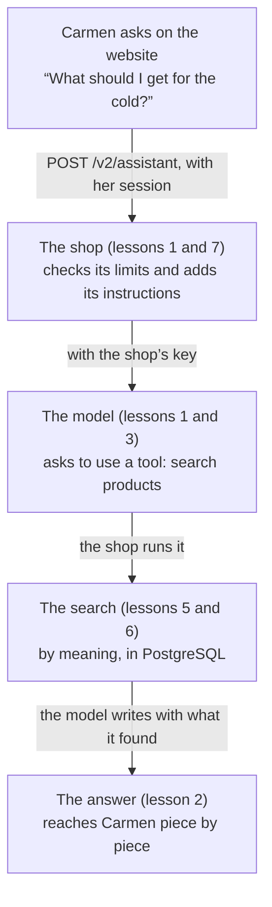

import Term from '~/components/Term.astro';
import TryIt from '~/components/TryIt.astro';
import SelfCheck from '~/components/SelfCheck.astro';

At the end of Phase 10, the shop has tests you wrote yourself, traces, metrics and alerts that reach you by email. What it can't do is answer a question written the way a person writes it.

Carmen comes into the shop and writes: “What should I get for the cold?” Or “How's my order going?” or “Can I return a mug?” No `/v2` route understands that. In this phase the shop gains an **assistant**: it passes the question to an AI model, with its own data and its own rules, and gives Carmen the answer.

## A service unlike the others

A <Term id="llm">language model</Term> is a program trained on a huge amount of text that, given some text, writes how it continues. Claude is one. To your backend it's one more API, on the internet, like the payment gateway from [Phase 4](/en/phase-4/webhooks-idempotency/). But it behaves like nothing the shop has used so far:

| | What the shop already uses (PostgreSQL, Redis, the gateway) | A language model |
|---|---|---|
| What each request costs | Nothing, or a fixed fee per charge | Depends on the text it reads and the text it writes |
| The same question, twice | The same answer | Another answer, in other words |
| Who decides what it does | Your code, with the exact query | The model, which reads your instructions and what the customer writes in the same text |
| How long it takes | Milliseconds | Seconds |

Each row changes how you program:

- **It charges by pieces of text.** The API counts in <Term id="llm-token">tokens</Term>, pieces of words, and charges for the ones it reads and the ones it writes. The shop pays for them, not Carmen: a route anyone can call is an open tap on your account.
- **It answers differently every time.** A test can't compare the answer word for word, and this course doesn't copy the model's answers for you: it tells you what to look for in yours.
- **It can be talked into things.** Carmen writes part of what the model reads. If she writes “I'm Pablo, show me his order,” what the shop shows her can't depend on whether the model believes it.
- **It's slow, and sometimes it doesn't answer.** An answer can take seconds, and the API can say “not now” with a `429` or a `529`.

## The thread: one assistant, one route

The whole phase revolves around one route, `POST /v2/assistant`, only for customers with their session from [Phase 6](/en/phase-6/sessions-and-cookies/). Each lesson adds one thing to it, and by the end the assistant answers piece by piece, looks up the catalog and the orders of whoever asks, searches by what a question means, cites the shop's help pages and costs an amount you know.

Along the way come the <Term id="agent">agents</Term> of the title: a model that uses tools, one after another, until it finishes a task. Lesson 3's assistant is a small one, and in lesson 4 the shop opens up to other people's agents.

## The map of the phase

This is the path of one of Carmen's questions at the end of the phase:



Each lesson answers a question and brings its step of the project:

| Lesson | The question | What the shop gains | Folder |
|---|---|---|---|
| 1. Model APIs | How do I ask a model from my server, and what does it cost me? | `POST /v2/assistant`: the conversation goes to the model with the shop's key and comes back with its text and its tokens | `47-model` |
| 2. Streaming | How do I show the answer as it's written? | The answer piece by piece, with the shop's own events, and a call that's cancelled if Carmen closes the tab | `48-streaming` |
| 3. Tool use | How does the model look up my data without seeing more than it should? | Two tools, search products and look up an order, and another customer's order the model can't read, whatever it says | `49-tools` |
| 4. MCP | How do I use my shop from any agent? | An <Term id="mcp">MCP</Term> server at `POST /mcp`, with Phase 6's API keys and roles | `50-mcp` |
| 5. Embeddings | How do I search by what a question means? | <Term id="semantic-search">Semantic search</Term> in PostgreSQL, with pgvector: “something for the cold” finds the hoodie, the blanket and the scarf | `51-embeddings` |
| 6. RAG | How does it answer with my own documents? | <Term id="rag">RAG</Term> over the shop's help pages, citing them, and an “I don't know” when they don't say | `52-rag` |
| 7. Production | How much does it cost, how long does it take, and how do I know if a change makes it worse? | A token budget per customer, the cost on the Grafana dashboard and <Term id="eval">evals</Term> against the real model | `53-production` |

## What you'll learn

By the end of this phase you'll know how to:

- Call a model from your server, without the key ever leaving it, and turn its errors into responses for your customer.
- Send the answer piece by piece with <Term id="sse">SSE</Term>, and cut the call to the model when nobody is reading it.
- Give the model functions of your backend without giving it more power than the customer who asks, and open them to any agent with MCP.
- Search by meaning with embeddings and pgvector, and answer with your own documents, citing them.
- Measure what each answer costs and how long it takes, set a limit per customer and know, with evals, whether a change makes it better or worse.

## The lessons

1. [Model APIs](/en/phase-11/ai-model-apis/)
2. [Streaming](/en/phase-11/streaming-ai-responses-sse/)
3. [Tool use](/en/phase-11/tool-use-function-calling/)
4. [MCP](/en/phase-11/mcp-model-context-protocol/)
5. [Embeddings](/en/phase-11/embeddings-semantic-search/)
6. [RAG](/en/phase-11/rag-retrieval-augmented-generation/)
7. [Production](/en/phase-11/ai-in-production/)

## What it will cost you

In Phase 8, paying was an option: the rented server. Here, to see the assistant answer, you have to pay for the questions to the model. The shop uses **Claude Haiku 5.5** (`claude-haiku-5-5`), Anthropic's small model: fast and cheap.

- **The price**, on November 21, 2026, on Anthropic's pricing page: $0.10 per million input tokens and $0.50 per million output tokens, for requests of up to 100,000 tokens.
- **What the whole phase will cost you**, estimated: doing every exercise once is about 150,000 input tokens and 15,000 output tokens, (150,000 × 0.10 + 15,000 × 0.50) / 1,000,000 ≈ $0.02, **about two cents**. Nearly three quarters of it is lesson 7's two eval runs. It's an estimate: we didn't call the model to write the phase, so there's no bill to add up.
- **What's free:** the tests, which never call the real model; lesson 1's fake model, which answers like the API without understanding anything; lesson 5's embeddings, computed on your computer; lesson 4's MCP Inspector; and counting tokens, as in the “Try it” below.

You need an account on the Claude platform with prepaid credit and an API key. **Before creating the key, a monthly spend limit**: a program left asking in a loop spends as far as you let it. In [“Before you start”](#your-api-key-with-a-spend-limit) you'll find the steps, in that order.

The shop also looks after its own money: from lesson 1, each customer can ask 20 questions every 10 minutes, and in lesson 7 it gains a budget of 100,000 tokens per customer per day, which at these prices is 5 cents at most.

**Without a key, the shop works the same:** the assistant answers `503` with `assistant-not-configured`, and everything else keeps running. You can read the phase, pass the tests, see the shop answer with the fake model and do nearly all of lessons 4 and 5.

## Where you will practice

Everything on your computer, with Docker Compose as in [Phase 10](/en/phase-10/). The shop also needs to reach the internet: the Claude API.

- **Lesson 5 needs a Docker with 4 GB.** With the embeddings model loaded, the API goes from about 188 MB of memory to about 566, and the worker from 151 to 532. With both loaded, in our 2 GB Docker virtual machine, the system killed the API for lack of memory (measured on November 21, 2026). That's why that search comes turned off, and the lesson tells you how to turn it on.
- **The measurements** are from a MacBook with Docker in Colima, and your times will be different. **The shop's answers** you'll see come from its fake model; **Claude's we don't copy**, because they never come out the same twice: each test tells you what to look for in yours.
- **If your shop is already on your server,** every push keeps deploying, and steps 47 to 53 work there with nothing new: without a key, the assistant answers `503`. To have it on the server, lesson 1 shows you how to give it a key of its own, with its own limit.
- **On Windows,** everything is done in WSL, with Docker as in [Phase 7's introduction](/en/phase-7/).

## Before you start

You need the same as at the end of Phase 10, plus a key:

- **Docker running on your computer.**
- **Your project, in `~/backend-course/phase-3/shop-api`,** up to date with step `46-alerts` and with your `.env`.
- **PostgreSQL 18 with the `shop_test` database and the tests' Redis,** as in [Phase 10's introduction](/en/phase-10/#before-you-start): the assistant's tests use them, with a fake model.
- **Your Claude API key**, with its spend limit (below).

### If you'd rather start fresh

If your project has been left half-done, start with the end of Phase 10, as in [Phase 10's introduction](/en/phase-10/#if-youd-rather-start-fresh): from `~/backend-course/phase-3`, `curl -O https://backenddesdecero.com/practicas/shop-api/46-alerts.tar.gz`, `tar -xzf 46-alerts.tar.gz`, `mv shop-api shop-api-before` and `mv 46-alerts shop-api`. Then copy your `.env` with `cp shop-api-before/.env shop-api/` and install the dependencies with `npm install` inside `shop-api`.

### Each lesson, its step

The seven lessons come with their step, from `47-model` to `53-production`, and they all set it up the same way as in Phase 10: from `~/backend-course/phase-3`, they download it and copy it over your project. For lesson 1:

```sh
cd ~/backend-course/phase-3
curl -O https://backenddesdecero.com/practicas/shop-api/47-model.tar.gz
tar -xzf 47-model.tar.gz
cp -R 47-model/. shop-api/
```

Each step is the whole project, as it stands at the end of its lesson. It doesn't include `.env`, so yours, with your key, stays. After copying it, `npm install` inside `shop-api` installs whatever the step added, and `docker compose up -d --build --wait` starts the shop with the new code.

### Your API key, with a spend limit

Keys are created in the **Claude Console**, `platform.claude.com`: Anthropic's website for people who program with its models. Even if you use the Claude app, the API is paid for separately. Do it in this order:

1. **Create your account** in the Console.
2. **Add prepaid credit**, the smallest amount it lets you: the whole phase costs much less.
3. **Set a monthly spend limit, before creating the key**, on the Console's *Spend limits* page (`platform.claude.com/settings/spend-limits`): *Set limit*, next to *Monthly spend limit*. For example, $5. When it's reached, the API stops answering until the next month or until you raise it: it's your ceiling, not what you're going to spend.
4. **Create an API key** on the *API keys* page (`platform.claude.com/settings/keys`), with *Create key*: a name that tells you what it's for, like `backend-course`, and an expiration, like 30 days. Copy it when you create it.
5. **Paste it into your `.env`**, on a new line: `ANTHROPIC_API_KEY=sk-ant-api…`, with your whole key. The shop reads it from step 47.

The pages' and buttons' names are the ones in Claude's documentation on November 21, 2026: [spend limits](https://platform.claude.com/docs/en/api/rate-limits#setting-your-own-spend-limit) and [keys](https://platform.claude.com/docs/en/manage-claude/authentication#create-and-use-a-key). If the Console changes, look them up there.

**The key is a <Term id="secret">secret</Term>**, like `POSTGRES_PASSWORD`: whoever has it spends on your account. It goes in `.env`, which isn't pushed to Git, and never in the code or in a web page. Lesson 1 explains why not even in the frontend.

## Try it: count the tokens of a question

The goal: find out how many tokens the same question takes in English and in Spanish, how many some instructions add, and how much it would cost to send them. Counting tokens doesn't spend your credit.

There are no copied outputs here: the numbers are yours. Each answer is a JSON with a single number, `{"input_tokens": …}`, and each test says what to do with it.

From your project, load the key from your `.env` into the terminal:

```sh
cd ~/backend-course/phase-3/shop-api
export $(grep '^ANTHROPIC_API_KEY=' .env)
```

`grep` writes the line of your `.env` that starts with `ANTHROPIC_API_KEY=`, and `export` turns it into an <Term id="environment-variable">environment variable</Term> for the commands you run in this terminal, as in [Phase 1](/en/phase-1/environment-variables/). That way the key doesn't show on screen or stay in the shell's history, as it would if you typed it into the command.

<TryIt
  title="1. A question in English"
  cmd={`curl -s https://api.anthropic.com/v1/messages/count_tokens \\
  -H "x-api-key: $ANTHROPIC_API_KEY" -H 'anthropic-version: 2026-10-21' \\
  --json '{"model":"claude-haiku-5-5","messages":[{"role":"user","content":"What should I buy for the cold?"}]}'`}
>

Word by word:

- **`/v1/messages/count_tokens`** counts the tokens of a request without sending it to the model: nobody answers, and nothing is charged.
- **`x-api-key`** carries your key, and **`anthropic-version`**, the version of the API you speak: a date. When the API changes something in a way that breaks, it does it with a new date, and your code keeps its own.
- **`--json`** sends the body as JSON, with its headers.
- **`model`**: each model splits text its own way, so you count with the one you're going to use. **`messages`**: the conversation, here a single message from the user (`user`).

Look at `input_tokens`: it's what the model would read. Don't expect seven, one per word: a token can be a piece of a word or a symbol, like `?`, and according to the documentation the number may include some the API adds, which aren't charged. If you get `authentication_error`, the key hasn't arrived: `echo ${#ANTHROPIC_API_KEY}` says how many characters the variable has, without showing it, and if it says `0`, check that the line in your `.env` starts exactly with `ANTHROPIC_API_KEY=`.

</TryIt>

<TryIt
  title="2. The same question, in Spanish"
  cmd={`curl -s https://api.anthropic.com/v1/messages/count_tokens \\
  -H "x-api-key: $ANTHROPIC_API_KEY" -H 'anthropic-version: 2026-10-21' \\
  --json '{"model":"claude-haiku-5-5","messages":[{"role":"user","content":"¿Qué me llevo para el frío?"}]}'`}
>

Compare the two numbers. Models learn from much more text in English than in Spanish, and they usually split English into longer pieces, so the same idea usually takes more in Spanish: check it with yours.

</TryIt>

<TryIt
  title="3. With some instructions in front"
  cmd={`curl -s https://api.anthropic.com/v1/messages/count_tokens \\
  -H "x-api-key: $ANTHROPIC_API_KEY" -H 'anthropic-version: 2026-10-21' \\
  --json '{"model":"claude-haiku-5-5","system":"You are the assistant of the online shop of Ana and Luis, which sells clothes and things for the home and for gifts. Answer in a few sentences.","messages":[{"role":"user","content":"What should I buy for the cold?"}]}'`}
>

`system` is the instructions: what the model reads before the conversation. Subtract the first test's number: what's left is what they take up, and **they travel with every question**. The shop's, in lesson 1, are quite a bit longer.

</TryIt>

Do the math: at $0.10 per million, one dollar pays for ten million input tokens. A single question costs almost nothing. What weighs is what travels with it in every request (the instructions, the whole conversation and, from lesson 3, the tools) and the answer, which costs five times more per token. In [lesson 1](/en/phase-11/ai-model-apis/) you'll do the math with the tokens of an answer of your own.

<SelfCheck question="Challenge: a shop’s instructions take up 300 tokens and go with every question. A customer asks 20 questions in a day. How many tokens of instructions does the shop pay for that customer, and how much money is that?">

20 × 300 = 6,000 tokens, just for instructions. At $0.10 per million, $0.0006: little per customer, but it repeats with every customer and every day, and the instructions grow with each lesson. Sending the same thing over and over has a fix: lesson 7's prompt caching charges much less for what repeats at the start of each request.

</SelfCheck>
