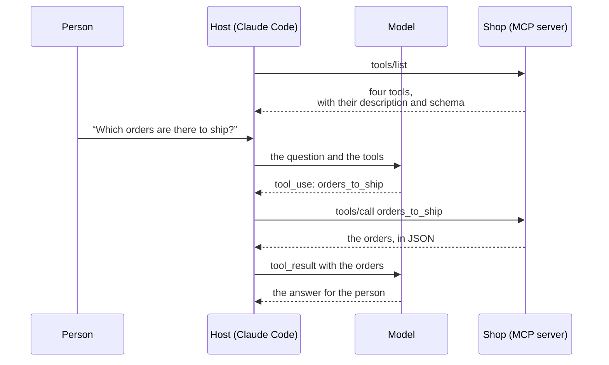
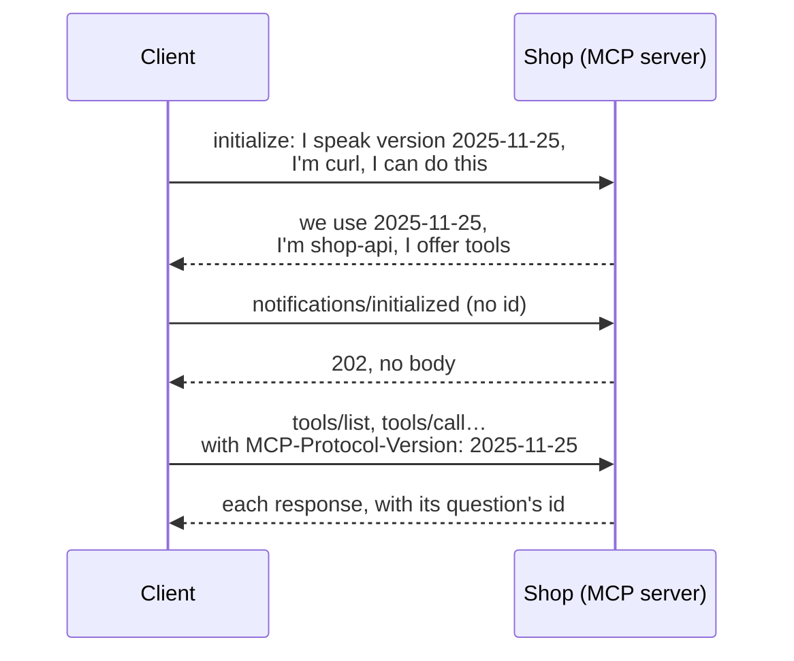

import Term from '~/components/Term.astro';
import TryIt from '~/components/TryIt.astro';
import Analogy from '~/components/Analogy.astro';
import ProjectCode from '~/components/ProjectCode.astro';
import Quiz from '~/components/Quiz.astro';
import QuizQuestion from '~/components/QuizQuestion.astro';
import QuizOption from '~/components/QuizOption.astro';

## The problem

Imagine that Fast Delivery, the delivery company from [Phase 6](/en/phase-6/rbac-roles-permissions/#least-privilege-for-the-delivery-key-too), swaps its program for an agent: a program in which a language model, like Claude, decides which tools to use until it finishes a task. Theirs checks which orders need delivering and marks them as shipped. A price comparison site wants its agent to browse your catalog. And you want to ask Claude Code what's left to ship.

Your assistant's tools, from [lesson 3](/en/phase-11/tool-use-function-calling/), live inside your loop: those agents can't use them. You would have to write a connector for each agent, and each agent, one for each service.

<Term id="mcp">MCP</Term> (Model Context Protocol) is the agreement that avoids it. Anthropic [published it on November 25, 2024](https://www.anthropic.com/news/model-context-protocol) as an open standard: an agent that speaks MCP uses any server that speaks MCP. In this lesson, the shop becomes one.

## The analogy

<Analogy>

A few years ago, every phone had its own charger, and a friend's was no use to you. With USB-C, any charger charges any phone and many laptops: manufacturers don't agree pair by pair, they all follow the same standard.

MCP is that standard for agents: an agent that speaks it connects to any server that follows it.

<div slot="limits">

- A plug doesn't say what the device does. An MCP server does: the agent asks for the list of tools, each with a description for the model.
- Anyone with a cable can plug in. An MCP server has to decide who gets in and what they can do: the protocol doesn't decide that for you.
- A charger decides nothing. On the other side of MCP, a model chooses which tool to use, and it can get it wrong or be tricked.

</div>

</Analogy>

## How it really works

### From twelve connectors to seven pieces

Three agents (Claude Code, Fast Delivery's and the price comparison site's) and four services (the shop, GitHub, a calendar and a database):

| | Without a common protocol | With MCP |
|---|---|---|
| What gets written | A connector for every pair of agent and service | An MCP client per agent and an MCP server per service |
| 3 agents and 4 services | 3 × 4 = 12 connectors | 3 + 4 = 7 pieces |
| One more agent arrives | 4 more connectors | 1 more client |

The price comparison site's agent knows nothing about your shop: **speaking MCP is enough**.

### Host, client and server: who is who

- **The host** is the application the person uses, with the model inside: Claude Code, Claude Desktop or Fast Delivery's agent.
- **The client** is the part of the host that keeps the connection with **one** server. A host connected to three servers has three clients.
- **The server** is the program that offers the tools. Here, the shop, at `POST /mcp`.

The model never talks to the server. A question in Claude Code connected to the shop:



In the middle, lesson 3's `tool_use` and `tool_result`. **MCP is the two sides**: how the host knows which tools there are and how it calls them. To the model, a tool from an MCP server is one more tool.

### What a server offers: tools, resources and prompts

An MCP server can offer three things, and someone different decides to use each one:

| What | What it is | Who decides to use it | An example |
|---|---|---|---|
| Tools | Functions that do or look something up | The model | `search_products`, `mark_shipped` |
| Resources | Data to read, each with its address (a URI) | The application, or the person who attaches it | A file, a help page |
| Prompts | Message templates with gaps | The person, by picking one from a menu | “Summarize today’s orders” |

**The shop only offers tools**: what an agent that acts needs.

### Underneath, JSON-RPC

Every MCP message is <Term id="json-rpc">JSON-RPC</Term> 2.0: calling a function of another program with a JSON message. It's the idea of [gRPC, from Phase 4](/en/phase-4/graphql-grpc-rest/#grpc-calling-a-function-of-another-service), in text you can read. This is how a client asks the shop to search for caps:

```json
{
  "jsonrpc": "2.0",
  "id": 3,
  "method": "tools/call",
  "params": { "name": "search_products", "arguments": { "query": "cap" } }
}
```

- `method`: the function being called. `params`: its arguments.
- `id`: a number the client chooses. **The response carries the same one**: that's how it knows which response belongs to which question.
- The response brings `result`, or `error` with a code and a sentence if the message isn't valid.
- A message without an `id` is a **notification**: it reports something and expects no response.

And this is how the shop answered:

```json
{
  "result": {
    "content": [
      {
        "type": "text",
        "text": "[{\"id\":4,\"name\":\"Cap\",\"priceCents\":1500,\"stock\":15}]"
      }
    ]
  },
  "jsonrpc": "2.0",
  "id": 3
}
```

`result.content` is a list of blocks. Here, one text block with the result as JSON inside (the `\"` are its quotes): any client can read text.

### Every connection starts with initialize

Before asking for anything, client and server introduce themselves:



**The protocol version is a date**, the one of the specification both follow: on November 21, 2026, the shop answered `2025-11-25`. `notifications/initialized` has no `id`, and gets a `202 Accepted` with no body.

### Streamable HTTP: one POST per message

MCP has two ways of carrying the messages, two **transports**:

- **stdio**: the host starts the server on your computer, and they talk through <Term id="stdin">stdin</Term> and <Term id="stdout">stdout</Term>. For local tools, like one that reads your files.
- **Streamable HTTP**: the server is on the network. Each message is a `POST` to a single address, and the response, a JSON or a stream of <Term id="sse">SSE</Term> events like the ones in [lesson 2](/en/phase-11/streaming-ai-responses-sse/).

The shop uses Streamable HTTP, with the official MCP SDK for TypeScript, in `src/mcp.ts`:

<ProjectCode file="shop-api/50-mcp/src/mcp.ts" region="route" />

- **Each `POST` creates its own server and transport**, with that request's key, and throws them away at the end. It's <Term id="stateless">stateless</Term> mode: there's no `Mcp-Session-Id` header, and it doesn't matter which copy of the API answers, as in [Phase 9](/en/phase-9/horizontal-scaling/).
- `enableJsonResponse: true`: the response, a whole JSON, not a stream. nginx needs nothing special.
- `GET` and `DELETE` would open a stream and close a session: with no sessions, `405`.

The client has to send `Accept: application/json, text/event-stream`. With only one type, `406 Not Acceptable`.

### A tool: name, description and schema

This is how the shop registers `search_products`:

<ProjectCode file="shop-api/50-mcp/src/mcp.ts" region="search-products" />

- **`description` is for the model**: it reads it to decide when to use it, what to pass and how to read what it returns.
- **`inputSchema`, the Zod schema, does two jobs.** The SDK turns it into the <Term id="json-schema">JSON Schema</Term> the agent sees in `tools/list`, and checks every call against it before running anything.
- **`annotations: { readOnlyHint: true }`** is a hint for the client, “it only reads”: it may use it without asking the person. It's never security.
- **`searchProductsByName` is the same function** the assistant uses: one way to search, two doors.

What each tool returns goes through two helpers:

<ProjectCode file="shop-api/50-mcp/src/mcp.ts" region="results" />

`asJson` puts the result in a text block, and `failure`, a sentence with `isError: true`. Every result is **bounded**, to 10 products or 50 orders: it goes into the model's conversation, and everything the model reads is paid for ([lesson 1](/en/phase-11/ai-model-apis/)).

### Two kinds of error

- **A protocol error** comes in `error`, with a JSON-RPC code (`-32601`: that method doesn't exist). The client reads it.
- **A tool error** comes in `result`, with `isError: true` and a sentence. The model reads it and decides: try another id, tell the person.

With the shop's SDK, an input that doesn't match the schema, or a tool that doesn't exist, is a tool error, with the code in the text: `MCP error -32602: …`.

If something breaks **inside** a tool, the agent gets a short sentence, and the log, the whole error. `use` does it:

<ProjectCode file="shop-api/50-mcp/src/mcp.ts" region="use" />

Without it, the agent would get the error as is, with a SQL query or a server's address inside.

### Who gets in: an API key, not a session

Before MCP, the shop checks who's calling, with the key that `loadApiKey`, Phase 6's <Term id="middleware">middleware</Term>, already looked up:

<ProjectCode file="shop-api/50-mcp/src/mcp.ts" region="require-key" />

- **Only an <Term id="api-key">API key</Term> gets in**, the one from [Phase 6](/en/phase-6/what-is-jwt/#api-keys-how-a-program-identifies-itself). An agent works with a role, like a company, not as a customer: Carmen's session gets `401`.
- **The `401` arrives before MCP**, with the usual `WWW-Authenticate` header. Without a key, not even the list of tools.

The MCP specification proposes <Term id="oauth">OAuth</Term> 2.1, the one from [Phase 6](/en/phase-6/oauth-openid-connect/), for public servers. Claude Code and the MCP Inspector also accept a fixed header, and that's what the shop uses.

### Each role, its tools

From this step there's one more role, `catalogue`, with no permissions at all: that of an agent that only browses the catalog. Migration `013` adds it:

<ProjectCode file="shop-api/50-mcp/src/permissions.ts" region="permissions" />

Each request's server only registers the tools its key's role can use. The order tools go inside an `if`, with the permissions of the `/v2` routes:

<ProjectCode file="shop-api/50-mcp/src/mcp.ts" region="mark-shipped" />

| Key | Role | What it sees in `tools/list` |
|---|---|---|
| Price comparison site | `catalogue` | `search_products` and `get_product` |
| Fast Delivery | `delivery` | Those two, plus `orders_to_ship` and `mark_shipped` |
| One of Ana's or Luis's | `admin` | All four |

**A tool the key can't use doesn't exist in its server.** It doesn't show up in the list, and if the agent calls it anyway, it gets `Tool mark_shipped not found`. And inside, `mark_shipped` only ships a paid order, whoever calls it.

From step 52, the one for [lesson 6](/en/phase-11/rag-retrieval-augmented-generation/), there will be one more tool for any key, `search_help`: the price comparison site will see three, and Fast Delivery, five.

### MCP is not authorization

MCP carries the call; it doesn't know who can do what. **Your code decides**: the key, its role and each tool's rules, the usual <Term id="authorization">authorization</Term>. These protect nothing:

- **The description.** “Only for the delivery company” is text for a model.
- **The `annotations`.** They're hints for the client, and the client is someone else's.
- **The agent's instructions.** They aren't yours, and a model can be tricked with text hidden in the data: lesson 3's prompt injection.

**An agent's power is its key's.** For the price comparison site, `catalogue`; never `admin` “just in case.” It's Phase 6's <Term id="least-privilege">least privilege</Term>: if the key leaks, or someone tricks the agent, the damage stays within what it could touch.

## Try it

The goal: find out what an agent sees of your shop with each key, ship an order as Fast Delivery's agent would, and check that the price comparison site's can't, even if it tries. Only the last part, which is optional, uses a model and costs money.

The outputs are from Node 26, on Linux, on November 21, 2026, on a MacBook with Docker in Colima. Your keys, orders and times will be different.

### Get the step ready

Put your project on step 50, as in the [introduction](/en/phase-11/):

```sh
cd ~/backend-course/phase-3
curl -O https://backenddesdecero.com/practicas/shop-api/50-mcp.tar.gz
tar -xzf 50-mcp.tar.gz
cp -R 50-mcp/. shop-api/
cd shop-api
npm install
docker compose up -d --build --wait
```

`npm install` brings `@modelcontextprotocol/sdk`, and `migrate` applies migration `013`. Save the API's address, as in [Phase 10](/en/phase-10/prometheus-grafana-metrics/#get-the-step-ready):

```sh
API=$(docker compose port api 3000)
```

### Two keys, two roles

<TryIt
  title="1. Fast Delivery’s and the price comparison site’s keys"
  cmd={`docker compose exec api node scripts/create-key.ts "Fast Delivery"
docker compose exec api node scripts/create-key.ts "Price Comparison" catalogue`}
  output={`Key 1, for "Fast Delivery" (role delivery):
shop_Kp4vR8nYc2XwT6mBq0sLd9hFz3gJa7eUu1oPiN5tVxM
Copy it now: the shop only keeps its hash and cannot show it to you again.
Key 2, for "Price Comparison" (role catalogue):
shop_Zt2mW9qXb4cNk7vRy0pLs3dGh8jFa5eUi1oTx6wBn_Q
Copy it now: the shop only keeps its hash and cannot show it to you again.`}
>

With no role after the name, the key is `delivery`'s. We've replaced the keys with example ones; yours are shown only once: copy them. If you already had a Fast Delivery key from Phase 6, this is another one, and both work.

</TryIt>

Save them in two variables, with your keys, and define a function so you don't repeat the whole `curl`:

```sh
DELIVERY=shop_…
CATALOGUE=shop_…
mcp() { curl -s "http://$API/mcp" -H "Authorization: Bearer $1" -H 'Accept: application/json, text/event-stream' --json "$2"; }
```

`mcp` is a shell function, like the ones in [Phase 9](/en/phase-9/zero-downtime-deployment/): `$1` is the key, and `$2`, the message, which `--json` sends as JSON.

### The greeting: initialize

First, the introduction. With `curl -si`, to see the headers:

<TryIt
  title="2. initialize"
  cmd={`curl -si "http://$API/mcp" -H "Authorization: Bearer $CATALOGUE" -H 'Accept: application/json, text/event-stream' \\
  --json '{"jsonrpc":"2.0","id":1,"method":"initialize","params":{"protocolVersion":"2025-11-25","capabilities":{},"clientInfo":{"name":"curl","version":"8"}}}'`}
  output={`HTTP/1.1 200 OK
content-type: application/json
…
content-length: 163
Date: Sat, 21 Nov 2026 12:51:56 GMT
…

{"result":{"protocolVersion":"2025-11-25","capabilities":{"tools":{"listChanged":true}},"serverInfo":{"name":"shop-api","version":"1.0.0"}},"jsonrpc":"2.0","id":1}`}
>

We've removed the security headers and `x-request-id`. Notice that **there's no `mcp-session-id` header**, because the shop keeps no sessions, and `capabilities`, with only `tools` (the SDK adds `listChanged`). If you get `406 Not Acceptable`, check the `Accept`.

</TryIt>

### What each key sees

The same question, `tools/list`, with each key. `jq -r` keeps only the names:

<TryIt
  title="3. tools/list, with both keys"
  cmd={`mcp "$CATALOGUE" '{"jsonrpc":"2.0","id":2,"method":"tools/list"}' | jq -r '.result.tools[].name'
echo ---
mcp "$DELIVERY" '{"jsonrpc":"2.0","id":2,"method":"tools/list"}' | jq -r '.result.tools[].name'`}
  output={`search_products
get_product
---
search_products
get_product
orders_to_ship
mark_shipped`}
>

**Two tools with the price comparison site's key, four with Fast Delivery's**, at the same address. If `jq` gives an error, remove `| jq …` and look at what the shop answered.

</TryIt>

You didn't send `initialize`, and it worked: stateless, each `POST` stands on its own. A real client always sends it first.

Now, what the model knows about a tool:

<TryIt
  title="4. search_products, as an agent sees it"
  cmd={`mcp "$CATALOGUE" '{"jsonrpc":"2.0","id":2,"method":"tools/list"}' | jq '.result.tools[0]'`}
  output={`{
  "name": "search_products",
  "title": "Search products",
  "description": "Searches the shop's catalogue for products by name. Search by one word of the name, in the singular (mug, hoodie, cap): it doesn't understand sentences or descriptions. Returns a JSON list of at most 10 products, each with its id, its name, its price in euro cents (priceCents: 850 is €8.50) and the units left (stock: 0 means it's sold out). An empty list means there's none with that name.",
  "inputSchema": {
    "$schema": "http://json-schema.org/draft-07/schema#",
    "type": "object",
    "properties": {
      "query": {
        "type": "string",
        "minLength": 1,
        "maxLength": 100,
        "description": "One word of the product's name, in the singular: mug, t-shirt, hoodie."
      }
    },
    "required": [
      "query"
    ],
    "additionalProperties": false
  },
  "annotations": {
    "readOnlyHint": true
  },
  "execution": {
    "taskSupport": "forbidden"
  }
}`}
>

Everything the agent knows about it. `minLength` and `maxLength` are Zod's `.min(1)` and `.max(100)`. The SDK adds `execution`: it can't run as a long task.

</TryIt>

### Fast Delivery ships an order

<TryIt
  title="5. The orders to ship"
  cmd={`mcp "$DELIVERY" '{"jsonrpc":"2.0","id":3,"method":"tools/call","params":{"name":"orders_to_ship","arguments":{"limit":2}}}' \\
  | jq -r '.result.content[0].text' | jq .`}
  output={`{
  "orders": [
    {
      "id": 20,
      "productId": 3,
      "quantity": 1,
      "status": "paid",
      "createdAt": "2026-10-06T22:00:00.000Z",
      "customerId": 4
    },
    {
      "id": 19,
      "productId": 2,
      "quantity": 4,
      "status": "paid",
      "createdAt": "2026-10-06T15:00:00.000Z",
      "customerId": 3
    }
  ],
  "next": "WyIyMDI2LTEwLTA2VDE1OjAwOjAwLjAwMFoiLDE5XQ"
}`}
>

The first `jq` takes out the text; the second reads its JSON. The two newest paid orders and the cursor from [Phase 4](/en/phase-4/api-pagination/).

</TryIt>

Save the first one's id (in our run, 20). `fromjson` does what the second `jq` did:

```sh
ORDER=$(mcp "$DELIVERY" '{"jsonrpc":"2.0","id":3,"method":"tools/call","params":{"name":"orders_to_ship","arguments":{"limit":1}}}' \
  | jq -r '.result.content[0].text | fromjson | .orders[0].id')
echo $ORDER
```

`jq -n` builds the message without reading anything, with the number as `$id`. The price comparison site tries first:

<TryIt
  title="6. The price comparison site tries to ship it"
  cmd={`SHIP=$(jq -nc --argjson id "$ORDER" '{jsonrpc:"2.0",id:4,method:"tools/call",params:{name:"mark_shipped",arguments:{id:$id}}}')
mcp "$CATALOGUE" "$SHIP" | jq .`}
  output={`{
  "result": {
    "content": [
      {
        "type": "text",
        "text": "MCP error -32602: Tool mark_shipped not found"
      }
    ],
    "isError": true
  },
  "jsonrpc": "2.0",
  "id": 4
}`}
>

**`Tool mark_shipped not found`**: in its server, the tool doesn't exist. The order is still paid.

</TryIt>

Now Fast Delivery, twice in a row:

<TryIt
  title="7. Fast Delivery ships it"
  cmd={`mcp "$DELIVERY" "$SHIP" | jq -r '.result.content[0].text'
mcp "$DELIVERY" "$SHIP" | jq '.result'`}
  output={`{"id":20,"productId":3,"quantity":1,"status":"shipped","createdAt":"2026-10-06T22:00:00.000Z","customerId":4}
{
  "content": [
    {
      "type": "text",
      "text": "The order is shipped: only a paid one is shipped."
    }
  ],
  "isError": true
}`}
>

The first time, the order comes back `"shipped"`. The second, `isError: true` and why not. That's why it carries `idempotentHint: true`: calling it twice changes nothing more.

</TryIt>

And without a key:

<TryIt
  title="8. Without a key"
  cmd={`curl -si "http://$API/mcp" -H 'Accept: application/json, text/event-stream' --json '{"jsonrpc":"2.0","id":2,"method":"tools/list"}'`}
  output={`HTTP/1.1 401 Unauthorized
content-type: application/problem+json
…
www-authenticate: Bearer realm="shop-api"
…

{"type":"about:blank","title":"Unauthorized","status":401,"detail":"Identify yourself with a shop API key: Authorization: Bearer shop_…"}`}
>

`401`, with `www-authenticate` and a *Problem Details* like the ones in [Phase 4](/en/phase-4/api-errors-problem-details/): the request never reached MCP.

</TryIt>

### What the log notes down

<TryIt
  title="9. Every tool used, in the log"
  cmd={`docker compose logs api --no-log-prefix | grep '(MCP)' | jq -c '{tool, apiKey, error}'`}
  output={`{"tool":"orders_to_ship","apiKey":1,"error":false}
{"tool":"orders_to_ship","apiKey":1,"error":false}
{"tool":"mark_shipped","apiKey":1,"error":false}
{"tool":"mark_shipped","apiKey":1,"error":true}`}
>

One line per tool that did some work, without what the agent passed it. **The price comparison site's attempt doesn't appear**: in its server, `mark_shipped` didn't exist, and `use` never ran.

</TryIt>

### With a real client: the MCP Inspector

The MCP Inspector is the official tool for trying MCP servers. It uses no model: you choose which tool to call. It needs Node 22.23.4, 24.22.1, 26.12.1 or later (`node --version`).

<TryIt
  title="10. The Inspector, connected to the shop"
  cmd={`npx @modelcontextprotocol/inspector@2.15.0 --transport http --server-url "http://$API/mcp" --header "Authorization: Bearer $DELIVERY"`}
  output={`Starting MCP inspector...
…
MCP Inspector Web is up and running at:
   http://127.0.0.1:6274?MCP_INSPECTOR_API_TOKEN=4e7d…

   Sandbox (MCP Apps): http://127.0.0.1:6275/sandbox

   Auth token: 4e7d…
…
Opening browser...`}
>

`npx` downloads it into its cache, without touching your project, and opens your browser on port 6274, with a token that's only good this time (we've shortened it). The removed lines say where it keeps secrets, and they change with your system. Stop it with <kbd>Ctrl</kbd> + <kbd>C</kbd>.

</TryIt>

In the browser:

1. The shop shows up on a card, **Disconnected**. Flip its switch: **Connected**, `MCP 2025-11-25`.
2. On the right, **Messages**: `initialize`, `notifications/initialized`, the only one without `OK` because it expects no response, and `tools/list`.
3. At the top, **Tools**: “Tools (4)”. Pick **Orders to ship**: the **READ-ONLY** label (its `readOnlyHint`) and one field per property of the schema. Put 2 in `limit` and press **Execute Tool**: **Results** shows the orders.
4. **Mark an order as shipped** carries the **IDEMPOTENT** label.

With `$CATALOGUE`, the list shrinks to two. With `--cli` in front and `--method tools/list` at the end, it answers in the terminal, with no browser.

### Optional: Claude Code, in your shop

If you use Claude Code, connect it with the key that can do the least, the price comparison site's:

<TryIt
  title="11. The shop, in Claude Code"
  cmd={`claude mcp add --transport http shop "http://$API/mcp" --header "Authorization: Bearer $CATALOGUE"
claude mcp list`}
  output={`Added HTTP MCP server shop with URL: http://127.0.0.1:3000/mcp to local config
Headers: {
  "Authorization": "[REDACTED]"
}
File modified: /Users/ana/.claude.json [project: /Users/ana/backend-course/phase-3/shop-api]
Checking MCP server health…

shop: http://127.0.0.1:3000/mcp (HTTP) - ✔ Connected`}
>

**local config** is the scope it uses unless told otherwise: just you, in this folder. The key stays in `~/.claude.json`: the output hides it, but the file keeps it as is. ✔ Connected: the shop answered, and no model has worked yet.

</TryIt>

Open Claude Code in that folder (`claude`) and ask it “What mugs do you have and how much are they?” **This does use a model, and costs money.** It will ask your permission to use `mcp__shop__search_products`, the tool's full name. Its answer changes every time: we don't copy it. If you ask it to ship an order, it can't: that tool doesn't exist for its key. When you're done, `claude mcp remove shop`.

### On your server

[Phase 8](/en/phase-8/ci-cd-github-actions/)'s timer deploys step 50 with its migration. `/mcp` goes through nginx's `location /`, and there it's on the internet: only whoever has a key gets in. Create one per company, with the smallest role that works for it:

```sh
docker compose -f compose.production.yaml exec api-a node scripts/create-key.ts "Price Comparison" catalogue
```

To shut an agent out, delete its key's row, as in [Phase 6](/en/phase-6/what-is-jwt/#fast-deliverys-key).

## You have already seen it

- **The connectors you can add to Claude**, on claude.ai and in Claude Desktop: underneath they're MCP servers, like your shop, and Claude is the host.
- **The OpenAPI document from [Phase 4](/en/phase-4/openapi-swagger/)** describes `/v2` for people who write code; `tools/list` describes `/mcp` for a model. That's why `/mcp` isn't in the contract.

## Common mistakes

- **Protecting with the description.** “Only for delivery” stops nobody.
- **Taking the `annotations` for security.** `readOnlyHint` is a hint the client can ignore.
- **Giving an agent a key with a bigger role than it needs.** Its power is its key's, also when it's tricked.
- **Returning lists with no limit.** Every result goes into the model's conversation, and is paid for.
- **Sending the agent the whole error.** To the agent, a sentence; to the log, the error.

## Summary

- MCP is an open protocol for any agent to use any server. The host is the application with the model; the client, its connection with one server, and the server offers tools, resources and prompts.
- Underneath it's JSON-RPC 2.0: `initialize`, `tools/list` and `tools/call`, each response with its question's `id`.
- The shop is an MCP server at `POST /mcp`, with Streamable HTTP and stateless.
- An API key gets in, and each request builds a server with what its role allows: `catalogue` sees two tools; `delivery`, four.
- MCP is not authorization: descriptions, hints and instructions protect nothing. The key, its role and the code do.

## Did you get it?

<Quiz>

<QuizQuestion
  question="You use Claude Code connected to three MCP servers: your shop, GitHub and your calendar. How many hosts, clients and servers are there?"
  review="Host, client and server: who is who"
>

<QuizOption text="One host, three clients and three servers." correct>

Claude Code is the host, and inside it has one client for each server it connects to.

</QuizOption>

<QuizOption text="Three hosts, one per server, each with its own model.">

There's a single application with a model. What multiplies is the clients, one per connection.

</QuizOption>

<QuizOption text="One host and one client, which talks to the three servers at once.">

Each client keeps the connection with a single server. Three servers, three clients.

</QuizOption>

</QuizQuestion>

<QuizQuestion
  question="A price comparison site wants its agent to browse your catalog through MCP. Which key do you give it?"
  review="Each role, its tools"
>

<QuizOption text="An admin one: that way it won’t have to ask for another if it ever needs more.">

If that key leaks, or someone tricks the agent, it could ship orders. Its power is its key's.

</QuizOption>

<QuizOption text="A delivery one, and in its agent’s instructions you write that it should only browse.">

The agent's instructions protect nothing: with that key, its server has `mark_shipped`.

</QuizOption>

<QuizOption text="A catalogue one: it will only see search_products and get_product." correct>

Just what it needs. The order tools don't exist in its key's server.

</QuizOption>

</QuizQuestion>

<QuizQuestion
  question="The price comparison site’s agent, with its catalogue key, calls mark_shipped with order 14, because it read the tool’s name on a forum. What happens?"
  review="Each role, its tools"
>

<QuizOption text="It ships: MCP runs any tool that is called by its name.">

MCP only carries the call. In that key's server, `mark_shipped` isn't even registered.

</QuizOption>

<QuizOption text="It gets isError, “Tool mark_shipped not found”, and nothing changes." correct>

Each request's server only has the tools its role allows: for the price comparison site, that one doesn't exist.

</QuizOption>

<QuizOption text="The shop answers 403, like a /v2 route without permission.">

The key exists, so the request gets into MCP. What fails is the tool: a result with `isError`.

</QuizOption>

</QuizQuestion>

<QuizQuestion
  question="To save the if per role, someone proposes giving all four tools to every key and writing in mark_shipped’s description “Only for the delivery company.” What do you tell them?"
  review="MCP is not authorization"
>

<QuizOption text="That it works: the model reads the description and won’t use it if it isn’t delivery.">

The description is text for a model, which can get it wrong or be tricked. Any key could ship orders.

</QuizOption>

<QuizOption text="That it works if they also set readOnlyHint: false, so the client asks first.">

Hints are for the client, which is someone else's and can ignore them.

</QuizOption>

<QuizOption text="That it doesn’t: what each one can do is decided by the code, with the key and its role." correct>

MCP is not authorization. Descriptions, hints and instructions protect nothing.

</QuizOption>

</QuizQuestion>

<QuizQuestion
  question="Your client sends notifications/initialized, and the shop answers 202, with no body and no result. Why?"
  review="Underneath, JSON-RPC"
>

<QuizOption text="Because it has no id: it’s a notification, and expects no response." correct>

With no `id`, there's no question to answer. The `202` only says the message arrived.

</QuizOption>

<QuizOption text="Because it failed: a 202 is the error for a badly formed message.">

A message that isn't valid gets a JSON-RPC `error`. The `202` means “received.”

</QuizOption>

<QuizOption text="Because the result will come later, through the stream a GET opens.">

The shop opens no streams: a `GET` gets `405`. And with no `id`, there's no result to send.

</QuizOption>

</QuizQuestion>

<QuizQuestion
  question="In production, the shop has two copies of the API behind nginx, which spreads the requests. Does Fast Delivery’s agent always have to go to the same copy?"
  review="Streamable HTTP: one POST per message"
>

<QuizOption text="Yes: only the copy that answered its initialize knows about it, and the other would reject it.">

The shop keeps nothing between requests: each `POST` creates its server and throws it away at the end.

</QuizOption>

<QuizOption text="No: the shop keeps no sessions, and any copy answers." correct>

With no sessions, each `POST` carries everything needed, key included.

</QuizOption>

<QuizOption text="Yes: each copy has its own tools, and the agent only knows one copy’s.">

Both copies are the same code: with the same key, they register the same tools.

</QuizOption>

</QuizQuestion>

</Quiz>

## Further reading

- [The MCP specification](https://modelcontextprotocol.io/specification/2025-11-25): version `2025-11-25`, with the transports, the tools and authorization.
- [JSON-RPC 2.0](https://www.jsonrpc.org/specification): the specification, short.
- [MCP Inspector](https://github.com/modelcontextprotocol/inspector): its code and its options.
- [MCP in Claude Code](https://code.claude.com/docs/en/mcp): servers, scopes and authentication.
- [Managed Agents](https://platform.claude.com/docs/en/managed-agents/overview): Anthropic's agents that run on its servers and use the MCP servers you give them, like your shop if it were on the internet.
