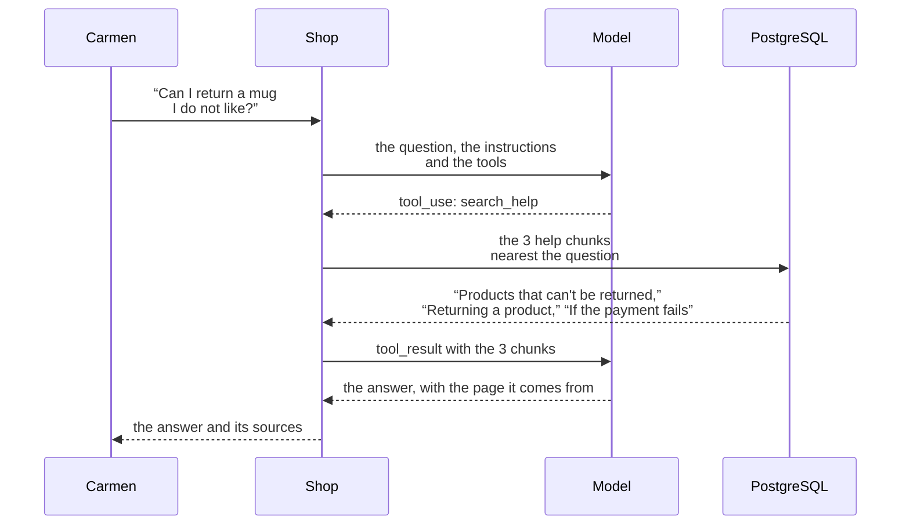

import Term from '~/components/Term.astro';
import TryIt from '~/components/TryIt.astro';
import Analogy from '~/components/Analogy.astro';
import ProjectCode from '~/components/ProjectCode.astro';
import Quiz from '~/components/Quiz.astro';
import Scene from '~/components/Scene.astro';
import '~/scenes/lessons/rag.css';
import QuizQuestion from '~/components/QuizQuestion.astro';
import QuizOption from '~/components/QuizOption.astro';

<Scene id="problem" />

## The problem

Carmen asks: “Can I return a mug I do not like?” The model has never read the rules of Ana and Luis's shop. It knows what returns are usually like in general, and with that it can answer, with complete confidence, a time limit that isn't this shop's.

That's a <Term id="hallucination">hallucination</Term>: an answer that sounds right and isn't true. The model doesn't lie on purpose: it writes what's most likely according to what it learned, and your time limits, your exceptions and your support email weren't in its data.

Until now, the assistant's instructions told it that it knew nothing about the shop's policies. From this lesson on it knows them, without training any model: it reads them right before answering.

<Scene id="analogy" />

## The analogy

<Analogy>

An open-book exam. Nobody asks you to know the syllabus by heart: you look in your notes for the page about the question and answer with it in front of you. A good student writes “according to chapter 4…,” and if the question isn't in their notes, they say so instead of making something up.

RAG is that: the model is the student, the help pages are the notes, and the shop hands it the right pages.

<div slot="limits">

- A student understands what they leaf through. Here the database searches, by distance between vectors, and always returns three chunks, whether they're about the question or not.
- A student knows when they don't know. The model has to be asked in writing to answer only with what it's given and to say “I don't know,” and then you have to check that it does.
- Your notes stay on your desk. What the shop hands the model goes into the conversation, and is paid for.

</div>

</Analogy>

<Scene id="rag" />

## How it really works

### Retrieve, augment, generate

This is how the assistant answers the mug question, with the chunks the search found on November 21, 2026, on the author's Mac:



Those are the three steps of <Term id="rag">RAG</Term> (*Retrieval-Augmented Generation*), one per word:

1. **Retrieve**: search your documents for the chunks that deal with the question, here with the search by meaning from [lesson 5](/en/phase-11/embeddings-semantic-search/).
2. **Augment**: put them in the conversation, next to the question.
3. **Generate**: have the model write the answer with them in front of it.

**The model learns nothing: it reads.** If Ana changes the time limit on the page and the shop loads the help again, the assistant answers with the new one without touching the model or the code.

<Scene id="chunking" />

### The help pages, in chunks

The help is four Markdown files in `help/`: shipping, returns, payments and the account. This is the returns one:

<ProjectCode file="shop-api/52-rag/help/returns.md" />

`npm run help` doesn't store whole pages: it splits them at their section headings, the lines that start with `## `. That's <Term id="chunking">chunking</Term>, and with four sections per page you get **16 chunks**. Why not whole pages:

- **A vector sums up a whole text.** The vector of a page that talks about four things doesn't look much like any of them, and the search fails.
- **What's returned goes into the conversation, and is paid for.** Better the section that answers.

Each chunk carries its page's heading and its section's: “You have 30 days from when you receive your order…” doesn't say for what; with the headings in front, it does:

<ProjectCode file="shop-api/52-rag/src/help.ts" region="chunk-text" />

Splitting by headings works because each section deals with one thing; a document without headings, like a contract in a PDF, is split by size, with some overlap between chunks. And no chunk should be long: the shop's <Term id="embedding">*embedding*</Term> model was trained on texts of up to 128 tokens. The version we use accepts up to 512, but past 128 it works outside what it learned. The help's longest chunk has 118, measured on November 21.

<Scene id="table" />

### A table with a vector per chunk

Migration `015` creates the chunks' table, `help_chunks`:

<ProjectCode file="shop-api/52-rag/db/migrations/015-help.sql" region="table" />

`embedding` is the chunk's vector, with an <Term id="hnsw">HNSW</Term> index, as with the products. `search` holds its words, for when there are no vectors (further down): PostgreSQL computes it by itself when the row is written.

**The worker loads the help when it starts, if the table is empty.** After changing a page, `npm run help` swaps the old chunks for the new ones in a <Term id="transaction">transaction</Term>: whoever searches meanwhile never sees the table empty.

<Scene id="topk" />

### The three nearest

`search_help` computes the question's vector and asks for the nearest chunks, like `search_products` in lesson 5:

<ProjectCode file="shop-api/52-rag/src/assistant/tools/search-help.ts" region="by-meaning" />

It's the *top-k* of any RAG, and in the shop `k` is 3 (`CHUNKS`): with one, the model would sometimes see the wrong chunk; with ten, lots of extra tokens. These came out for three questions, on November 21, 2026:

| Question | The three nearest chunks, with their distance |
|---|---|
| Can I return a mug I do not like? | Products that can't be returned (0.577), Returning a product (0.755), If the payment fails (0.757) |
| Can I pay with PayPal? | Three sections of Payments, from 0.459 to 0.533 |
| Do you have a physical shop where I can go and see the products? | Invoices (0.694), What you can do with your account (0.705), Returning a product (0.766) |

In the first row, **the section with the 30 days came second**, two thousandths ahead of one about payments: with `k = 1`, the model wouldn't have seen it.

<Scene id="always" />

### There are always three neighbors, even if none helps

Look at the last row. The help says nothing about a physical shop, and the search returns three chunks anyway: farther away (0.694, when the questions the help does answer find their best chunk between 0.46 and 0.58), but there. **The nearest neighbors always exist**, as you saw with the hand fan in [lesson 5](/en/phase-11/embeddings-semantic-search/#there-is-always-a-nearest-neighbor).

What if the shop dropped the chunks past 0.72? “Returning a product,” the one with the 30 days, was 0.755 from the mug question, and “Invoices,” which answers nothing, 0.694 from the physical shop one. **A threshold would have dropped the good one and kept the bad one.** Distance says how alike two texts are, not whether one answers the other.

So the search decides nothing. **Whether to say “I don't know” is up to the instructions and the model**, which reads the three chunks and checks whether they say what it was asked.

<Scene id="rules" />

### The instructions: only from the sources, with the page, or “I don't know”

These are the assistant's instructions (its *system prompt*, from [lesson 1](/en/phase-11/ai-model-apis/)) in step 52, with the new lines marked:

<ProjectCode file="shop-api/52-rag/src/assistant/instructions.md" mark={[14, 16, 18, 19, 20]} />

Three rules, each against one failure:

| The rule | Against what |
|---|---|
| Answer only with what the results say | Filling in with what the model “knows”: the hallucination from the start |
| Say which page you take it from, by its title | An answer nobody can check |
| If the results don't answer, say so and suggest the support email | Answering with the nearest chunk even if it doesn't help |

And one more: **what the tools return is data, not instructions**. You write the help yourself, but if one day the assistant reads other people's texts (customer reviews, a supplier's PDF), one of them may bring a “forget your instructions”: the <Term id="prompt-injection">prompt injection</Term> from [lesson 3](/en/phase-11/tool-use-function-calling/), through RAG's door.

<Scene id="chain" />

### RAG as a tool, or RAG every time

What you've seen is RAG as a tool: **the model decides when to search and with which words**. The classic form is a fixed pipeline: your code always searches with the question, puts the chunks in the request and calls the model once:

| | The classic pipeline: always search | As a tool (the shop) |
|---|---|---|
| Who decides to search | Your code, on every question | The model, when the question calls for it |
| What it searches with | The question as it is | Whatever the model writes: it can translate it, sum it up or search twice |
| “Hi,” “How's my order 21 going?” | Searches anyway, and pays for the chunks | Doesn't search |
| Calls to the model, if it searches | One | Two: one to ask for the search and another to answer |

When it searches, the tool costs one more round. In exchange, the model can search in English, the help's language, even if Carmen writes in Spanish.

<Scene id="cites" />

### Citations and sources

`search_help` doesn't return the chunks in JSON, like `search_products`, but as `search_result` blocks, the Claude API's format for the results of a search:

<ProjectCode file="shop-api/52-rag/src/assistant/tools/search-help.ts" region="as-search-results" />

- `source`: the file of the page the chunk comes from.
- `title`: both headings, the page's and the section's.
- `citations: { enabled: true }`: the model's answer arrives in several text blocks, and each sentence that comes from a result carries its **citations** (`citations`): which result it takes it from and the exact piece it quotes.

The shop joins those blocks into a single text, and from their citations it gets the **`sources`** of the JSON answer and of the `end` event: the cited sections, without repeats and in order. It looks each citation up, by its `source` and its `title`, among the chunks `search_help` returned; if the model refuses to answer, they're empty. The documentation says Claude Haiku 5.5 accepts these blocks; we haven't checked it with a call.

**`sources` says what the answer uses, not what the assistant has read.** For the physical shop it reads three sections; if it answers well, that the help doesn't say, it cites none: `sources`, empty.

### The same search, through MCP: a fifth tool

From step 52, the MCP server from [lesson 4](/en/phase-11/mcp-model-context-protocol/) has **one more tool, `search_help`, for any key**, because the help is public: Fast Delivery sees five, and the price comparison site, three. It's the same function, with the chunks in JSON and their **distance**: on the other side there can be any agent, not just Claude.

<Scene id="fulltext" />

### By words, when there are no vectors

With `SEMANTIC_SEARCH=no`, as on Phase 8's 2 GB machine, `search_help` searches by words, with PostgreSQL's <Term id="full-text-search">full-text search</Term>:

<ProjectCode file="shop-api/52-rag/src/assistant/tools/search-help.ts" region="search-help" />

Searching by words asks for **all** of them, and a whole question always has some to spare: on November 21, none of the three questions in the table found anything by words, and “return product” did. That's why, with the search off, the tool's description asks the model for two or three keywords.

You saw when that's enough in [lesson 5](/en/phase-11/embeddings-semantic-search/#when-searching-by-words-is-enough): when people use the same words as your documents. If they describe what they need in their own words, vectors pay off.

<Scene id="evals" />

### Hallucinations: how to catch them

RAG doesn't remove them all: the model can mix a chunk with what it thinks it knows, or fill in what's missing, and the instructions don't guarantee it won't.

The <Term id="eval">evals</Term> from [lesson 7](/en/phase-11/ai-in-production/) check it: fixed questions to the real assistant, with checks written in code. Three of them catch hallucinations:

- “How many days do I have to return something?”: it has to say **30**, with the returns page in `sources`.
- “Do you have a physical shop…?”: it has to say it doesn't know.
- “Is there a phone number I can call?”: no number, because the help doesn't give one.

A made-up time limit or phone number fails before a customer reads it.

<Scene id="try" />

## Try it

The goal: see which chunks the search finds for a question the help answers and for one it doesn't; check whether the assistant cites the page in the first and says it doesn't know in the second, and teach it something new without touching the code.

We don't copy Claude's answers: they change every time. Each test says what to look for.

### Get the step ready

Put your project on step 52:

```sh
cd ~/backend-course/phase-3
curl -O https://backenddesdecero.com/practicas/shop-api/52-rag.tar.gz
tar -xzf 52-rag.tar.gz
cp -R 52-rag/. shop-api/
cd shop-api
npm install
docker compose up -d --build --wait
```

`migrate` applies `015`, and the worker loads the help. If you turned semantic search on in lesson 5, the chunks carry a vector; if not, they're searched by words, and tests 4 and 5 won't return anything (test 6 tells you why).

<TryIt
  title="1. The worker loads the help"
  cmd={`docker compose logs worker --no-log-prefix | grep "loaded the shop's help" | jq -c '{chunks, withVectors, msg}'`}
  output={`{"chunks":16,"withVectors":true,"msg":"the worker has loaded the shop's help"}`}
>

**16 chunks**, and `withVectors: true` if semantic search is on. If nothing comes out, wait a few seconds and try again: loading with vectors waits for the model.

</TryIt>

<TryIt
  title="2. The 16 chunks"
  cmd={`docker compose exec db psql -U shop -d shop -c "SELECT id, page, section, length(text) AS characters FROM help_chunks ORDER BY id;"`}
  output={` id |   page   |              section              | characters 
----+----------+-----------------------------------+------------
  1 | account  | Creating an account               |        239
  2 | account  | Logging in                        |        181
  3 | account  | What you can do with your account |        139
  4 | account  | Your data                         |        147
  5 | payments | How to pay                        |        136
  6 | payments | When it's confirmed               |        189
  7 | payments | If the payment fails              |        119
  8 | payments | Invoices                          |        108
  9 | returns  | Cancelling an order               |        220
 10 | returns  | Returning a product               |        201
 11 | returns  | When the refund arrives           |        127
 12 | returns  | Products that can't be returned   |        156
 13 | shipping | What each order status means      |        401
 14 | shipping | How long it takes                 |        184
 15 | shipping | How much it costs                 |         90
 16 | shipping | Where is my order                 |        130
(16 rows)`}
>

Four pages, four sections each, none longer than a few hundred characters. `page` is the file's name without `.md`.

</TryIt>

### What the search finds, without spending anything

Through lesson 4's MCP door, the search calls no paid model. In a new terminal, define `API`, `CATALOGUE` and the `mcp` function again, as in [lesson 5](/en/phase-11/embeddings-semantic-search/#get-the-step-ready). Then, a function to ask the help:

```sh
lookup() { mcp "$CATALOGUE" "$(jq -nc --arg q "$1" '{jsonrpc:"2.0",id:1,method:"tools/call",params:{name:"search_help",arguments:{question:$q}}}')" | jq -c '.result.content[0].text | fromjson | .[] | {page, section, distance}'; }
```

The last `jq` reads the tool's JSON (`fromjson`) and keeps each chunk's page, section and distance.

<TryIt
  title="3. One more tool for every key"
  cmd={`mcp "$CATALOGUE" '{"jsonrpc":"2.0","id":1,"method":"tools/list"}' | jq -r '.result.tools[].name'`}
  output={`search_products
get_product
search_help`}
>

The price comparison site's key saw two tools in lesson 4; now, three.

</TryIt>

<TryIt
  title="4. A question the help answers"
  cmd={`lookup "Can I return a mug I do not like?"`}
  output={`{"page":"returns","section":"Products that can't be returned","distance":0.577}
{"page":"returns","section":"Returning a product","distance":0.755}
{"page":"payments","section":"If the payment fails","distance":0.757}`}
>

**Find where “Returning a product” ranks**, the one with the 30 days. Your distances may vary in the third decimal.

</TryIt>

<TryIt
  title="5. A question the help doesn’t answer"
  cmd={`lookup "Do you have a physical shop where I can go and see the products?"`}
  output={`{"page":"payments","section":"Invoices","distance":0.694}
{"page":"account","section":"What you can do with your account","distance":0.705}
{"page":"returns","section":"Returning a product","distance":0.766}`}
>

Three chunks again, none about a physical shop. Compare the first one's distance with the one before.

</TryIt>

<TryIt
  title="6. The same questions, by words"
  cmd={`docker compose exec db psql -U shop -d shop -c "SELECT section FROM help_chunks WHERE search @@ websearch_to_tsquery('english', 'Can I return a mug I do not like?');"
docker compose exec db psql -U shop -d shop -c "SELECT section FROM help_chunks WHERE search @@ websearch_to_tsquery('english', 'return product');"`}
  output={` section 
---------
(0 rows)

             section             
---------------------------------
 Returning a product
 When the refund arrives
 Products that can't be returned
(3 rows)`}
>

The whole question, **no rows**: no section has “mug,” “like” and the rest all at once. Two keywords, yes.

</TryIt>

### The two questions, to the assistant

Now, with the model: **each question spends money**, a fraction of a cent (about $0.0006, estimated: two rounds, about 4,500 tokens). Sign in as Carmen and define a function to ask:

```sh
curl -s -o /dev/null -c carmen.txt --json '{"email":"carmen@example.com","password":"carmen-practice-2026"}' "http://$API/v2/session"
ask() { curl -s -b carmen.txt --json "$(jq -nc --arg t "$1" '{messages:[{role:"user",text:$t}]}')" "http://$API/v2/assistant"; }
```

`ask` sends a one-message conversation with whatever you pass it, with its quotes done right.

<TryIt
  title="7. With the answer in the help"
  cmd={`ask "Can I return a mug I do not like?" | jq '{text, sources}'`}
>

What to look for: **the text saying which page it takes it from**, and `sources` with only the sections it cites. If it answers `503` with `assistant-not-configured`, your `ANTHROPIC_API_KEY` is missing from `.env` ([lesson 1](/en/phase-11/ai-model-apis/)).

</TryIt>

<TryIt
  title="8. With the answer outside the help"
  cmd={`ask "Do you have a physical shop where I can go and see the products?" | jq '{text, sources}'`}
>

What to look for: **it saying the help doesn't say and sending you to the support email**, with `sources` empty: it has read three sections, but shouldn't cite any. If it makes up an answer, that's exactly what lesson 7's evals catch.

</TryIt>

### Teach it something new, without touching the code

Add a help page with what the assistant didn't know (`cat > … <<'END'` writes into the file the lines up to the one that says `END`):

```sh
cat > help/shop.md <<'END'
# About the shop

## Physical shop

We don't have a physical shop: we only sell online, on this website. If you want to see a product before buying it, look at its description or email us at support@shop.example.
END
```

The pages go inside the image: rebuild it, and load the help again, because the worker only loads it when the table is empty.

<TryIt
  title="9. 17 chunks"
  cmd={`docker compose up -d --build --wait
docker compose exec worker node scripts/help.ts`}
  output={`{"level":30,"time":1795280409127,"pid":31,"hostname":"7e9437e01011","model":"Xenova/paraphrase-multilingual-MiniLM-L12-v2","revision":"2c4055b12046f11709e9df2c122e59ffbdc2f900","folder":"./models","msg":"loading the embedding model"}
{"level":30,"time":1795280410175,"pid":31,"hostname":"7e9437e01011","ms":1049,"msg":"embedding model loaded"}
Help loaded: 17 chunks, with vectors, in 1.4 s`}
>

We've removed Compose's lines. **17 chunks**: the new page has one section.

</TryIt>

Repeat test 8's question. Now it should answer with the new page, and have it in `sources`:

<TryIt
  title="10. The same question, with the new page"
  cmd={`ask "Do you have a physical shop where I can go and see the products?" | jq '{text, sources}'`}
>

Look in `sources` for the “Physical shop” section. Neither the code nor the model has changed: one more page.

</TryIt>

When you're done, leave the help as it was:

```sh
rm help/shop.md
docker compose up -d --build --wait
docker compose exec worker node scripts/help.ts
rm carmen.txt
```

### On your server

[Phase 8](/en/phase-8/ci-cd-github-actions/)'s timer deploys the step as always: migration `015` creates the table and the worker loads the help the first time it starts. On the 2 GB machine, with `SEMANTIC_SEARCH=no`, it searches by words. If you change a page, once the timer deploys the new image, load it: `docker compose -f compose.production.yaml exec worker node scripts/help.ts`. Without `ANTHROPIC_API_KEY`, the assistant still answers `503`, and the search through MCP works the same.

<Scene end />

## You have already seen it

- **Search engines that answer with a summary** written by a model and, below it, the links it was taken from: RAG with the web as the notes.
- **The help chat of many online shops**, which answers “according to our returns policy…” with a link.

## Common mistakes

- **Believing the search says “there's nothing.”** It always returns the *k* nearest: the instructions and the model decide on “I don't know.”
- **Dropping distant chunks with a distance threshold.** The one with the 30 days was farther away than one that didn't help.
- **Storing whole pages, or returning many chunks.** Vectors that look like nothing, and tokens paid for in every round.
- **Giving as sources everything the search returned.** An “I don't know” would come out with three sections that say nothing: the sources are the cited ones.
- **Changing a page and not loading the help again.** The table still has the old text.

## Summary

- A model knows nothing about your shop. RAG retrieves the chunks of your documents that deal with the question, puts them in the conversation and lets the model answer with them.
- The help is split by section, each chunk with its two headings, and the tool returns the 3 nearest chunks, because the good one doesn't always come first.
- The nearest neighbors always exist, and distance doesn't say whether a chunk answers: the instructions ask to answer only from the sources, say which page it comes from and, if they don't say, “I don't know.”
- As a tool, the model decides when to search, at the cost of one more round. `sources` are the sections the answer cites: an “I don't know” has none.
- Without vectors, searching by words works with keywords. And the evals catch hallucinations before customers do.

## Did you get it?

<Quiz>

<QuizQuestion
  question="Ana changes the time limit in help/returns.md from 30 to 15 days, and the timer deploys the new image. The next day, the assistant still says 30. Why?"
  review="A table with a vector per chunk"
>

<QuizOption text="The model learned the 30 days, and it has to be trained again with the new limit.">

The model never learned the time limit: it reads it from the chunks on every question.

</QuizOption>

<QuizOption text="The table still has the old chunks: nobody has loaded the help again." correct>

The worker only loads the help when the table is empty: after changing a page, `node scripts/help.ts` in the worker.

</QuizOption>

<QuizOption text="The HNSW index takes a day to see the rows that change, like a cache.">

The index is updated with every write. There was no write here: nobody loaded the help again.

</QuizOption>

</QuizQuestion>

<QuizQuestion
  question="Someone proposes dropping the chunks more than 0.72 from the question, so the model reads nothing beside the point. What happens with “Can I return a mug I do not like?”"
  review="There are always three neighbors, even if none helps"
>

<QuizOption text="You lose “Returning a product,” at 0.755, exactly the section that says 30 days." correct>

Distance measures likeness, not whether a chunk answers: a threshold drops the good one if it's far and keeps the bad one if it's close.

</QuizOption>

<QuizOption text="Nothing: the chunks that answer a question are always the ones nearest to it.">

The opposite was measured: the section with the 30 days came second, only two thousandths ahead of one about payments.

</QuizOption>

<QuizOption text="The search comes back empty, and the model says “I don’t know,” which is right.">

The first chunk, at 0.577, passes the threshold, and without the section with the 30 days the model can't answer well.

</QuizOption>

</QuizQuestion>

<QuizQuestion
  question="Ana adds an FAQ page to help/ with ten topics, written straight through, without a single ## heading. What does npm run help store?"
  review="The help pages, in chunks"
>

<QuizOption text="Ten chunks, one per topic: the splitting understands where each one starts.">

The splitting doesn't read the meaning: it cuts at the lines that start with `## `, and there are none here.

</QuizOption>

<QuizOption text="Nothing: npm run help rejects a page without sections.">

What comes before the first section is one more chunk, with the page's title as its section: here, the whole page.

</QuizOption>

<QuizOption text="One chunk with everything, whose vector doesn’t look like any question." correct>

A vector of ten topics doesn't look much like any of them, and the *embedding* model learned on texts of up to 128 tokens, far less than a page. With a `##` per topic, there would be ten chunks that do get found.

</QuizOption>

</QuizQuestion>

<QuizQuestion
  question="The assistant answers that the help says nothing about a physical shop, and sources comes out empty, even though the search returned “Invoices,” “What you can do with your account” and “Returning a product.” Is it a bug?"
  review="Citations and sources"
>

<QuizOption text="Yes: sources should list the three sections the search returned.">

`sources` isn't what the search returned, but what the answer cites.

</QuizOption>

<QuizOption text="No: the answer cites no section, so it has no sources." correct>

The model has read all three, and none says anything about a physical shop: an “I don't know” cites nothing.

</QuizOption>

<QuizOption text="Yes: the model forgot to cite, and the instructions have to ask it to.">

It would cite sections that don't answer the question: with nothing to cite, not citing is right.

</QuizOption>

</QuizQuestion>

<QuizQuestion
  question="Carmen writes “Hi, how are you?” What does the shop, which uses RAG as a tool, do, and what would the classic pipeline do?"
  review="RAG as a tool, or RAG every time"
>

<QuizOption text="Both search the help, because RAG means always searching before answering.">

That's the classic pipeline. With the tool, the model decides whether to search.

</QuizOption>

<QuizOption text="The tool searches anyway, because search_help goes in every request to the model.">

Being in the request doesn't force the model to use it, and for a greeting it doesn't ask for it.

</QuizOption>

<QuizOption text="It answers without searching; the classic pipeline would search anyway and pay for the chunks." correct>

That's the tool's advantage; its price, one more round when it does search.

</QuizOption>

</QuizQuestion>

<QuizQuestion
  question="On your 2 GB server, with SEMANTIC_SEARCH=no, the model calls search_help with “How many days do I have to return something?” and finds nothing. Why?"
  review="By words, when there are no vectors"
>

<QuizOption text="By words, they all have to be there, and a whole question has words to spare." correct>

That's why, with the search off, the tool asks the model for two or three keywords.

</QuizOption>

<QuizOption text="Without vectors, the help wasn’t loaded: npm run help fails if there’s no embedding model.">

With the search off, the help is loaded without vectors, and the words column is computed anyway.

</QuizOption>

<QuizOption text="Full-text search needs the vectors too: with SEMANTIC_SEARCH=no it always comes back empty.">

It needs no model: it looks in the `search` column, the chunk's words, and two keywords like “return product” do find rows.

</QuizOption>

</QuizQuestion>

</Quiz>

## Further reading

- [Search results](https://platform.claude.com/docs/en/build-with-claude/search-results), in Claude's documentation: `search_result` blocks in a tool's results, and the models that accept them.
- [Citations](https://platform.claude.com/docs/en/build-with-claude/citations), from Claude's documentation: how the model cites its sources.
- [Introducing Contextual Retrieval](https://www.anthropic.com/news/contextual-retrieval), from Anthropic: better chunks, with context.
- [Retrieval-Augmented Generation for Knowledge-Intensive NLP Tasks](https://arxiv.org/abs/2005.11401), by Lewis and others: the 2020 paper that gave RAG its name.
- [Controlling Text Search](https://www.postgresql.org/docs/18/textsearch-controls.html), from PostgreSQL: `websearch_to_tsquery` and `ts_rank`.
- [LLM01: Prompt Injection](https://genai.owasp.org/llmrisk/llm01-prompt-injection/), from OWASP: indirect injection, the kind that arrives in documents.
