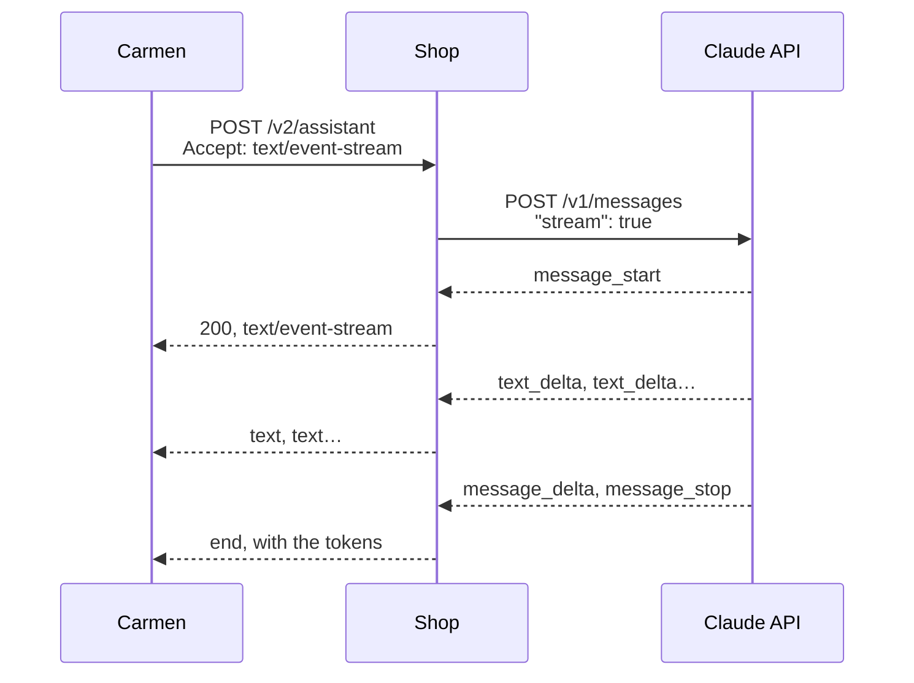

import Term from '~/components/Term.astro';
import TryIt from '~/components/TryIt.astro';
import Analogy from '~/components/Analogy.astro';
import SelfCheck from '~/components/SelfCheck.astro';
import ProjectCode from '~/components/ProjectCode.astro';
import Quiz from '~/components/Quiz.astro';
import QuizQuestion from '~/components/QuizQuestion.astro';
import QuizOption from '~/components/QuizOption.astro';

## The problem

Imagine that Carmen asks and the screen stays still. Lesson 1's shop waits for the model's whole answer before sending anything. Carmen doesn't know whether the assistant is thinking or has frozen, and she reloads the page: another question, paid for again.

In the AI chats you use, the text appears word by word. The answer doesn't finish sooner: it starts sooner. In [Phase 4](/en/phase-4/websockets-vs-sse/#which-one-to-use-for-what) we told you that model APIs send their answers piece by piece with <Term id="sse">SSE</Term>. Here you see it, from the model to the shop and from the shop to the browser.

## The analogy

<Analogy>

At a conference, the simultaneous interpreter doesn't wait for the speaker to finish: they translate sentence by sentence, as they hear it, and you listen almost at the same time. The consecutive interpreter waits until the end and tells you everything at once: meanwhile, the room sits in silence.

Streaming is the simultaneous interpreter. And if you get up and leave, the booth notices and stops translating for you.

<div slot="limits">

- An interpreter changes the words. The shop doesn't touch the model's text: it only changes the wrapping, the names of the events.
- What's said is said, in a stream too. But if the model refuses halfway, the last event tells the browser to replace what it has shown with a fixed sentence.
- The speaker keeps talking even if the room empties, and so does the model, if nobody hangs up: that's why the shop hangs up when Carmen leaves.

</div>

</Analogy>

## How it really works

### What the person waiting notices: the first piece, not the last

The model writes the answer piece by piece, in order. Without streaming, the shop gathers them all and sends the answer at the end. With streaming, it sends each piece as soon as it arrives:

| | Whole answer (lesson 1) | Streaming |
|---|---|---|
| First text on Carmen's screen | When the model finishes | When the model writes the first piece |
| Time until the last word | The same | The same |
| What she sees while she waits | Nothing | The text, growing |

What Carmen notices is the <Term id="time-to-first-token">time to first token</Term>: how long the first piece of the answer takes to arrive. It's the cousin of web pages' <Term id="ttfb">TTFB</Term>, for an answer that's written as it arrives. You'll measure it in “Try it.”

The first piece doesn't come out instantly: before it, the model reads the question and thinks a little. The longer the answer, the more the difference shows.

### What the API sends: its events, in order

With `"stream": true` in the request, Claude's API answers with a stream of SSE events, in the format from [Phase 4](/en/phase-4/websockets-vs-sse/#the-format-lines-of-text-and-a-blank-line): an `event:` line, a `data:` line with JSON and a blank line. This is the start and the end of one from the shop's [fake model](/en/phase-11/ai-model-apis/#the-tests-dont-call-the-model), which imitates the API, without the events in the middle:

```text
event: message_start
data: {"type":"message_start","message":{"id":"msg_fake_3","type":"message","role":"assistant","model":"claude-haiku-5-5","content":[],"stop_reason":null,"stop_sequence":null,"stop_details":null,"usage":{"input_tokens":120,"output_tokens":1,"cache_creation_input_tokens":0,"cache_read_input_tokens":0}}}

…

event: content_block_start
data: {"type":"content_block_start","index":1,"content_block":{"type":"text","text":""}}

event: content_block_delta
data: {"type":"content_block_delta","index":1,"delta":{"type":"text_delta","text":"I'm the "}}

event: content_block_delta
data: {"type":"content_block_delta","index":1,"delta":{"type":"text_delta","text":"fake mod"}}

…

event: message_delta
data: {"type":"message_delta","delta":{"stop_reason":"end_turn","stop_sequence":null,"stop_details":null},"usage":{"output_tokens":30}}

event: message_stop
data: {"type":"message_stop"}
```

The events always arrive in this order:

1. **`message_start`**: the message, still empty, with the input tokens.
2. For each block, **`content_block_start`**, its pieces in **`content_block_delta`** and **`content_block_stop`**. In a text block, each piece is a `text_delta`; in a thinking one, `thinking_delta` and `signature_delta`.
3. **`message_delta`**: why it stopped (`stop_reason`) and the output tokens.
4. **`message_stop`**: the end.

In between, a **`ping`** may arrive, so the connection doesn't look dead. And if something fails halfway, an **`error`** event: the answer had already started with a `200`, so the failure can't go in the status code.

The shop doesn't read this by hand. The SDK asks for the stream with `messages.stream()`, which sends the same request with `"stream": true`:

<ProjectCode file="shop-api/48-streaming/src/assistant/client.ts" region="ask-streaming" />

What it returns is read event by event, and at the end, `finalMessage()` gives the whole message, the same one `messages.create()` would give: with its text, its `stop_reason` and its `usage`.

### One route, two answers: Accept decides

The route is still `POST /v2/assistant`. What changes is what the client asks for in the `Accept` header:

<ProjectCode file="shop-api/48-streaming/src/assistant/route.ts" region="negotiate" />

With `text/event-stream`, events; with anything else, lesson 1's whole JSON. It's [Phase 2](/en/phase-2/http-headers/)'s <Term id="content-negotiation">content negotiation</Term>: what's asked for is the same, the assistant's answer, in two formats. A frontend that already used the JSON keeps working without changing anything.

### The shop's events, not the model's

The shop doesn't pass the API's events on to the browser as they are. It has its own, few and with its own names, in `src/assistant/events.ts`:

<ProjectCode file="shop-api/48-streaming/src/assistant/events.ts" region="events" />

And a function that translates each of the model's events:

<ProjectCode file="shop-api/48-streaming/src/assistant/events.ts" region="translate" />

- **Only the pieces of text go through**, as `text` events. What the model thinks isn't for Carmen, and the other events only mark where each block starts and ends.
- **The tokens and the reason it stopped** arrive together at the end, in `end`, with the same answer as the JSON: `text`, `refused` and `usage`. If `refused` is `true`, the frontend replaces what it has shown with the fixed sentence.
- **If something fails halfway**, an `error` event with a <Term id="problem-details">*Problem Details*</Term>, like the body of any of the shop's errors ([Phase 4](/en/phase-4/api-errors-problem-details/)).

Why translate? **The frontend only knows the shop's events.** If tomorrow you change models, or providers, or their API changes the format of its events, you change this function, and the frontend doesn't even notice. And the shop's OpenAPI document can describe them, because they're its own.

### Before the first event, a normal error; after it, an error event

The status code of an HTTP response goes in its first line, and it goes out only once. That's why the shop waits for the model's first event before opening its stream:

<ProjectCode file="shop-api/48-streaming/src/assistant/route.ts" region="first-event" />



- **If the API fails before its first event** (a `429`, a `529`, a model that doesn't answer), the shop hasn't sent anything yet: it answers lesson 1's `503`, in JSON and with `Retry-After`.
- **If it fails afterward**, the `200` has already gone out. The failure arrives as an `error` event, with the same *Problem Details* that would have been the body of the `503`, and the stream closes, with no `end`.

The frontend has to handle both cases: an error code before starting, and an `error` event halfway, with part of the text already on screen.

### The customer leaves: cancel the call to the model

If Carmen closes the tab halfway, nobody is going to read the rest. The shop notices and cancels the call to the model:

<ProjectCode file="shop-api/48-streaming/src/assistant/route.ts" region="cancel" />

- **`cancel` is an `AbortController`**: an object with a signal (`cancel.signal`) that fires when someone calls `cancel.abort()`.
- **The call to the model gets the signals together** (`AbortSignal.any`): `cancel`'s and `signal`, which already joins the 50-second time limit and Carmen's request ([lesson 1](/en/phase-11/ai-model-apis/#the-time-limit-and-the-customer-who-leaves)). The first one to fire cancels it.
- Once inside the stream, **`sse.onAbort(() => cancel.abort())`** calls `abort()` when the connection with Carmen closes.

When it fires, the SDK cuts its connection with the API, and the log keeps one line: “the customer left: cancelling the call to the model.” Whether the API then stops charging for what it no longer writes, we haven't checked: its documentation doesn't say.

### In the browser: fetch and a reader

In Phase 4, the browser read an order's events with `EventSource`. That won't do here: `EventSource` only makes `GET` requests, without a body, and the conversation goes in the body of a `POST`. The frontend uses `fetch`, as for any other request, and reads the response as it arrives:

1. **`fetch`** sends the `POST` with `Accept: text/event-stream`, and resolves as soon as the headers arrive, without waiting for the body.
2. **`res.body`** is the body as a <Term id="stream">*stream*</Term>: a **reader** (`getReader()`) returns the chunks as they arrive, and `TextDecoderStream` turns them from bytes into text.
3. **A chunk isn't an event.** It can bring two events, or half of one: the frontend gathers the text and cuts it at each blank line, the end of an event.
4. **From each event**, the `event:` line says what it is, and the `data:` line, in JSON, its data: with `text`, it adds the piece; with `end`, it finishes; with `error`, it shows the problem.

`EventSource` reconnects on its own if the connection drops. With `fetch`, reconnecting is up to you, and here it isn't a good idea: asking again is asking again, and paying again. You'll write it in “Try it.”

### What a proxy does to a stream: nginx's buffering

On your server, nginx sits in front of the API ([Phase 8](/en/phase-8/nginx-reverse-proxy/#events-that-dont-wait-sse-and-websocket)). By default, it holds what the API sends until it has a whole block: that's *buffering*, which is fine for normal responses. With a stream, Carmen would get the answer all at once, at the end, and streaming would be pointless. Step 48 turns it off for this route:

<ProjectCode file="shop-api/48-streaming/nginx/shop.conf" region="assistant" />

- **`location = /v2/assistant`**: only this address, exactly.
- **`proxy_buffering off`**: each piece goes out toward Carmen as soon as it arrives. For a JSON response, short and whole, it changes nothing.
- **`proxy_read_timeout` stays at 60 seconds**: it's what nginx waits between two reads, and between two pieces much less time goes by. The JSON response, which sends nothing until the end, is cut earlier by the shop, at 50.

## Try it

The goal: watch the answer arrive piece by piece, measure when the first byte arrives with and without streaming, leave halfway and check that the shop cancels, and read the stream from the browser the way your frontend would.

The shop's outputs are from lesson 1's fake model; Claude's we don't copy.

### Get the step ready

Put your project on step 48, as in the [introduction](/en/phase-11/#each-lesson-its-step), start the shop and sign Carmen in:

```sh
cd ~/backend-course/phase-3
curl -O https://backenddesdecero.com/practicas/shop-api/48-streaming.tar.gz
tar -xzf 48-streaming.tar.gz
cp -R 48-streaming/. shop-api/
cd shop-api
docker compose up -d --build --wait
API=$(docker compose port api 3000)
curl -s -o /dev/null -c carmen.txt --json '{"email":"carmen@example.com","password":"carmen-practice-2026"}' $API/v2/session
export $(grep '^ANTHROPIC_API_KEY=' .env)
```

Step 48 brings no new packages: you don't need `npm install`. The last line loads your key for the first test, as in [lesson 1](/en/phase-11/ai-model-apis/#a-question-by-hand).

### The API's events, once

<TryIt
  title="1. The Claude API’s stream"
  cmd={`curl -sN https://api.anthropic.com/v1/messages \\
  -H "x-api-key: $ANTHROPIC_API_KEY" -H 'anthropic-version: 2026-10-21' \\
  --json '{"model":"claude-haiku-5-5","max_tokens":2048,"output_config":{"effort":"low"},"stream":true,
    "messages":[{"role":"user","content":"What is a hoodie, in two sentences?"}]}'`}
>

**`-N`** makes `curl` write each piece as soon as it arrives, without holding it back. It comes out like the one in “What the API sends,” with Claude's text. Look at the order: `message_start` with `input_tokens`, the `content_block_delta` events with their `text_delta`, and at the end `message_delta`, with `stop_reason` and `output_tokens`. If there's a `thinking` block before the text, it arrives empty: the model doesn't show what it thinks.

If instead of events you get a JSON with `"type": "error"`, the stream never started: read it as in [lesson 1](/en/phase-11/ai-model-apis/#a-question-by-hand). This is the only time you'll see these events: from here on, the shop translates them.

</TryIt>

### The shop's events

<TryIt
  title="2. The shop’s stream"
  cmd={`curl -N -b carmen.txt -H 'Accept: text/event-stream' \\
  --json '{"messages":[{"role":"user","text":"What should I get for the cold?"}]}' $API/v2/assistant`}
  output={`event: text
data: {"text":"I'll tel"}

event: text
data: {"text":"l you sl"}

event: text
data: {"text":"owly, pi"}

event: text
data: {"text":"ece by p"}

event: text
data: {"text":"iece, th"}

…

event: end
data: {"text":"I'll tell you slowly, piece by piece, the way a long answer from the model arrives: first a few words, then some more, and so on until the end. Streamed, you see them arrive; without it, you wait until it is whole.","refused":false,"usage":{"input":120,"output":30}}`}
>

One `event: text` line for each piece, and at the end `event: end`, with the whole answer and its tokens. Join the `text` events in order, and you have the `text` of `end`. **Not a trace of the API's events**: no `message_start`, no thinking. This output, trimmed, is from lesson 1's fake model, which writes slowly: with Claude, the text will be different.

`--json` sets `Accept: application/json`, and the `-H` replaces it with `text/event-stream`. Without it, the answer arrives whole in JSON, as in lesson 1.

</TryIt>

### With and without streaming: when the first byte arrives

Now the same question twice, without showing the answer (`-o /dev/null`): `curl` only writes when the first byte arrived and when the last one did.

<TryIt
  title="3. The times"
  cmd={`QUESTION='{"messages":[{"role":"user","text":"How do I wash a cotton hoodie without it shrinking?"}]}'
curl -s -o /dev/null -w 'JSON:      first byte %{time_starttransfer} s, total %{time_total} s\\n' \\
  -b carmen.txt --json "$QUESTION" $API/v2/assistant
curl -s -o /dev/null -w 'streaming: first byte %{time_starttransfer} s, total %{time_total} s\\n' \\
  -b carmen.txt -H 'Accept: text/event-stream' --json "$QUESTION" $API/v2/assistant`}
  output={`JSON:      first byte 9.035688 s, total 9.035827 s
streaming: first byte 0.015627 s, total 9.143494 s`}
>

These are from the fake model with `SCENARIO=slow`, which writes for about 9 seconds. In JSON, the first byte arrives at the same time as the last: the shop waits for the end. With streaming, right away, and the total is similar. With Claude, measure yours.

With streaming, the first byte is the headers, which the shop sends as soon as the model starts; the first piece of text arrives later: with the fake model, after 1.75 seconds; with Claude, when it finishes thinking.

</TryIt>

### Leave halfway

`--max-time 2` makes `curl` give up after 2 seconds and close the connection, like Carmen closing the tab:

<TryIt
  title="4. Leaving halfway, and what the log says"
  cmd={`curl -N --max-time 2 -b carmen.txt -H 'Accept: text/event-stream' \\
  --json '{"messages":[{"role":"user","text":"Tell me in detail what the difference is between a T-shirt and a hoodie."}]}' $API/v2/assistant
docker compose logs api --since 1m --no-log-prefix | grep 'customer left'`}
  output={`event: text
data: {"text":"I'll tel"}

curl: (28) Operation timed out after 2005 milliseconds with 39 bytes received
{"level":30,"time":1795280284292,"pid":1,"hostname":"9830c899545b","requestId":"7a86b09f-302d-402c-aab1-2e1c35d4af73","msg":"the customer left: cancelling the call to the model"}`}
>

First one or more `event: text` lines come out (here, one: this is lesson 1's fake model, which writes slowly), and then `curl: (28)`, which has given up. **Look at the log line**: the shop has seen Carmen leave and has cancelled the call to the model. There's no `end`: nobody was going to read it.

If you get the `end` before the 2 seconds, the answer was short: go down to `--max-time 1`. If the log says nothing, wait a second and repeat the second line.

</TryIt>

### From the browser

Open `http://localhost:3000/` in Chrome (or your `$API`'s port) and, in DevTools ([how to open it](/en/phase-2/#before-you-start-devtools)), the **Console** tab. It has to be a page from the shop, so the requests go to its same origin. If Chrome asks you to type `allow pasting`, do it, as in [Phase 4](/en/phase-4/websockets-vs-sse/#follow-an-order-from-the-browser).

<TryIt
  title="5. The stream, with fetch and a reader"
  lang="js"
  cmd={`await fetch('/v2/session', { method: 'POST', headers: { 'Content-Type': 'application/json' },
  body: JSON.stringify({ email: 'carmen@example.com', password: 'carmen-practice-2026' }) })
const res = await fetch('/v2/assistant', {
  method: 'POST',
  headers: { 'Content-Type': 'application/json', Accept: 'text/event-stream' },
  body: JSON.stringify({ messages: [{ role: 'user', text: 'What should I get for the cold?' }] }),
})
const reader = res.body.pipeThrough(new TextDecoderStream()).getReader()
for (let chunk = await reader.read(); !chunk.done; chunk = await reader.read()) console.log(chunk.value)`}
  output={`event: text
data: {"text":"I'm the "}

event: text
data: {"text":"fake mod"}

event: text
data: {"text":"el: I un"}

…

event: end
data: {"text":"I'm the fake model: I understand nothing, I just repeat your last question. It was: \\"What should I get for the cold?\\".","refused":false,"usage":{"input":120,"output":30}}`}
>

Line by line:

- **The first `fetch`** signs Carmen in: the browser stores the cookie and sends it with the next one, as the shop's website does.
- **The second** asks for the answer as a stream. `await` waits only for the headers: the body keeps arriving.
- **`res.body.pipeThrough(new TextDecoderStream())`** turns the body's bytes into text, and **`getReader()`** gives a reader.
- **The `for`** asks for a chunk with `reader.read()` until one arrives with `done: true`, the end, and writes each one.

**Look at where each `console.log` cuts.** The fake model sends everything at once: it all came out in a single one (without the events in the middle); with `SCENARIO=slow`, one per event. A chunk can bring two events, or half of one: that's why a real frontend gathers the text and cuts it at the blank lines before reading each event.

</TryIt>

<SelfCheck question="Challenge: repeat the second fetch with an AbortController (const stop = new AbortController(), and signal: stop.signal in the options), and write setTimeout(() => stop.abort(), 1500) before the for. What happens in the console, and what does the shop’s log say?">

After 1.5 seconds, `stop.abort()` cancels the request: the `for` stops with an `AbortError` in red, and the browser closes the connection. The shop sees it as in test 4: `docker compose logs api --since 1m --no-log-prefix | grep 'customer left'` shows the same line. It's what your frontend would do with a “Stop” button: cancel in the browser, so the server cuts the call to the model.

</SelfCheck>

When you finish, delete `carmen.txt`: it holds Carmen's session.

### On your server

Step 48's code arrives with the usual push. **nginx doesn't**: it lives on the server, outside the image. Add the `location` from above to your site, `/etc/nginx/sites-available/shop`, next to the others, and reload as in [Phase 8](/en/phase-8/nginx-reverse-proxy/):

```sh
sudo nginx -t && sudo systemctl reload nginx
```

Better to add it by hand than to copy the step's whole file: if you use Let's Encrypt, your file has the certificate lines that `certbot` added, and copying over it would delete them. Do it before the push: an extra `location` changes nothing for the JSON response.

## You have already seen it

- **The AI chats that write word by word**, like the Claude app: a stream like this one, read with `fetch` and drawn as it arrives.
- **Those chats' “Stop” button**: it cancels the request in the browser, and the server stops asking the model for text.
- **A request in DevTools that stays “pending”** while the text appears: it's the streamed answer, still open.

## Common mistakes

- **Passing the provider's events on to the browser.** Your frontend gets tied to their format: if it changes, or you change models, it breaks.
- **Using `EventSource` for a question.** It only does `GET`: the conversation goes in the body of a `POST`.
- **Reading each chunk as if it were a whole event.** A chunk can bring two events, or half of one.
- **Not cancelling when the customer leaves.** The model keeps writing, and you keep paying, for an answer nobody reads.
- **Forgetting nginx's `proxy_buffering off`.** The stream works on your computer and arrives all at once in production.
- **Reconnecting on your own after a drop.** Asking again is paying again: let the person asking decide.

## Summary

- With streaming, the total time is the same, but the first word arrives much sooner: what the person waiting notices is the time to first token.
- The API sends SSE events in order (`message_start`, the `content_block_delta` events, `message_delta`, `message_stop`), and the SDK reads them with `messages.stream()` and `finalMessage()`.
- The shop translates them into its own, `text`, `end` and `error`: the frontend doesn't depend on the provider's format.
- Before the first event, a failure is a normal `503`; after it, an `error` event. If the customer leaves, an `AbortController` cancels the call to the model.
- In the browser, `fetch` with a reader, cutting at blank lines; in production, `proxy_buffering off` in nginx.

## Did you get it?

<Quiz>

<QuizQuestion
  question="A whole answer takes 6 seconds. With streaming, when does it finish arriving?"
  review="What the person waiting notices: the first piece, not the last"
>

<QuizOption text="Sooner: streaming makes the model write faster.">

The model writes just as fast. What changes is that the shop sends each piece as soon as it arrives, instead of gathering them.

</QuizOption>

<QuizOption text="Sooner: each piece travels separately, and the network takes less time.">

Sending in pieces doesn't shorten the trip: the last piece goes out when the model writes it, just like before.

</QuizOption>

<QuizOption text="At the same time, but the first word arrives much sooner." correct>

At roughly the same 6 seconds: the total doesn't change. What changes is the time to first token, which is what the person waiting notices.

</QuizOption>

</QuizQuestion>

<QuizQuestion
  question="The team wants to switch model providers, and the new API sends events with other names. What has to change in the shop’s frontend?"
  review="The shop's events, not the model's"
>

<QuizOption text="Nothing: the frontend only knows text, end and error, the shop’s events." correct>

The translation lives in the backend, in one function. You change that function, and the frontend keeps getting the same thing.

</QuizOption>

<QuizOption text="The names of the events it listens for, so they match the new provider’s.">

That would happen if the shop passed the provider's events on to the browser as they are. That's why it doesn't.

</QuizOption>

<QuizOption text="Nothing, because every provider sends the same SSE events.">

SSE is the format of the lines, not the name or the content of the events: each API decides its own.

</QuizOption>

</QuizQuestion>

<QuizQuestion
  question="Halfway through a streamed answer, the API gets overloaded and sends an error event. What does Carmen get?"
  review="Before the first event, a normal error; after it, an error event"
>

<QuizOption text="A 503 with Retry-After, instead of the answer.">

The `200` already went out with the first event, and the status code can't be changed afterward. That's why the failure goes inside the stream.

</QuizOption>

<QuizOption text="The text that had already arrived, and an error event with the problem." correct>

The `error` event carries the same *Problem Details* that would have been the body of the `503`, and then the stream closes, with no `end`.

</QuizOption>

<QuizOption text="Nothing new: the SDK repeats the request and the stream carries on where it was.">

The SDK repeats a request that fails before starting. Halfway through a stream, it can't carry on where it was: the failure reaches the shop.

</QuizOption>

</QuizQuestion>

<QuizQuestion
  question="Carmen closes the tab when the model has written half of a long answer. Without the AbortController, what would happen?"
  review="The customer leaves: cancel the call to the model"
>

<QuizOption text="Nothing: when the tab closes, the API stops writing on its own.">

The API knows nothing about Carmen's tab: its connection is with the shop, and it would stay open.

</QuizOption>

<QuizOption text="The shop would throw an error, and the model would stop with it.">

The shop would only notice it has nobody to write to. The call to the model would go on until the end.

</QuizOption>

<QuizOption text="The model would keep writing, and the shop would keep paying for it." correct>

Until the end, for nobody. That's what cancelling avoids: the shop cuts its connection with the API and doesn't wait for an answer nobody is going to read.

</QuizOption>

</QuizQuestion>

<QuizQuestion
  question="Your frontend handles each chunk that reader.read() returns as if it were an event, and sometimes a broken JSON comes out. Why?"
  review="In the browser: fetch and a reader"
>

<QuizOption text="Because a chunk isn’t an event: it can bring half of one, or two." correct>

The network splits the stream wherever it likes. You have to gather the text and cut it at the blank lines, the end of each event.

</QuizOption>

<QuizOption text="Because the shop sends the JSON split across several data: lines.">

Each of the shop's events carries its data on a single `data:` line: `JSON.stringify` writes the text's line breaks as `\n`.

</QuizOption>

<QuizOption text="Because fetch can’t read a stream: you need EventSource.">

`fetch` reads streams with its reader, and here you need it: `EventSource` only does `GET`, and the question goes in the body of a `POST`.

</QuizOption>

</QuizQuestion>

<QuizQuestion
  question="On your computer the assistant writes word by word, and on your server the answer appears all at once, at the end. What do you check first?"
  review="What a proxy does to a stream: nginx's buffering"
>

<QuizOption text="The shop: in production the answer isn’t streamed.">

It's the same code in both places. What's on the server and not on your computer is nginx, in the middle.

</QuizOption>

<QuizOption text="nginx’s proxy_buffering for /v2/assistant." correct>

Without a `location` with `proxy_buffering off`, nginx holds the pieces until it has a block, and Carmen gets it all together. It's what's on the server and not on your computer.

</QuizOption>

<QuizOption text="The model: in production you have to ask it to stream with another key.">

The key doesn't change how it answers: `"stream": true` goes in the request, and it's the same in both places.

</QuizOption>

</QuizQuestion>

</Quiz>

## Further reading

- [Streaming messages](https://platform.claude.com/docs/en/build-with-claude/streaming), in Claude's documentation: every event of the stream, with examples.
- [Using readable streams](https://developer.mozilla.org/en-US/docs/Web/API/Streams_API/Using_readable_streams), on MDN: `fetch`'s reader, step by step.
- [`proxy_buffering`](https://nginx.org/en/docs/http/ngx_http_proxy_module.html#proxy_buffering), in nginx's documentation.
- [Server-sent events](https://html.spec.whatwg.org/multipage/server-sent-events.html), the specification of the format.
