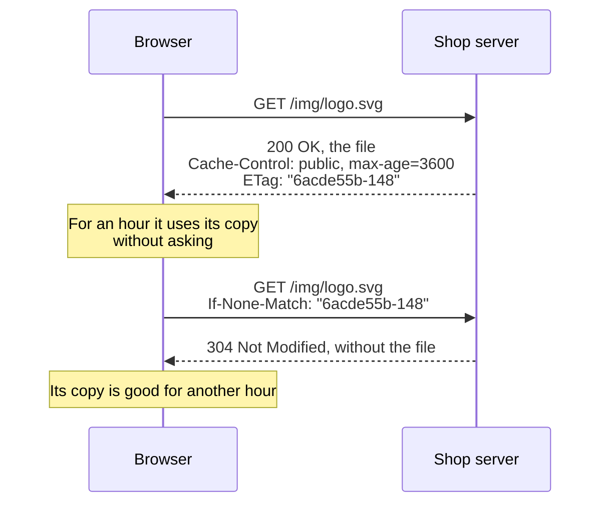

import Term from '~/components/Term.astro';
import TryIt from '~/components/TryIt.astro';
import Analogy from '~/components/Analogy.astro';
import SelfCheck from '~/components/SelfCheck.astro';
import Quiz from '~/components/Quiz.astro';
import QuizQuestion from '~/components/QuizQuestion.astro';
import QuizOption from '~/components/QuizOption.astro';

## The problem

Imagine Ana changes the shop's logo at 10:00. Luis opens the website on his phone and sees the new one. Ana, who had the website open on her laptop, reloads and still sees the old one. And a customer who came in at 9:30 will see the old one until 10:30. Nobody has broken anything: the shop's server told browsers they could keep the images for an hour, and they did as they were told.

Now, the opposite problem. This site's stylesheet weighs about 80 KB, 17 KB compressed. If every page you visit downloaded it again, every click would pay for the download and for the round trips you saw in [“From URL to page”](/en/phase-0/what-happens-when-you-type-a-url/). Keeping a copy avoids that.

That's what a <Term id="cache">cache</Term> is: a trade-off between speed and freshness. The server sets it with a few <Term id="header">headers</Term>, which you'll learn to read and write here.

## The analogy

<Analogy>

Think of the gym's schedule stuck on your fridge door. At the bottom, the gym has printed “valid until Sunday.” Until Sunday you look at it without calling anyone: that's **freshness**.

On Monday you don't throw it away: you call. “I have version 7, is it still good?” If it hasn't changed, they say “yes, 7 still stands” and send you nothing new: that's **validation**. If it has changed, they send you version 8.

And if the gym changes the schedule on Wednesday, it can't walk into your kitchen and tear the paper down. Until Sunday you'll keep looking at the old one. That's the hard part: **invalidation**.

<div slot="limits">

- Calling seems free. In HTTP, asking costs a round trip: “still good” saves the download, not the wait.
- Your fridge has a single sheet of paper. On the internet there are copies in several places at once, like your browser and a CDN, and each one expires on its own.
- The server doesn't understand “has anything changed on Tuesdays?”: it compares your version tag with its own, character by character, and answers yes or no.

</div>

</Analogy>

## How it really works

### Copies are kept in two kinds of cache

- **The browser cache** is private: it only serves you. It keeps copies in memory and on disk.
- **Shared caches** sit between browsers and the server, and serve many people at once. The most common one is a <Term id="cdn">CDN</Term>, like the Cloudflare one in front of this site.

Both obey the same response headers, and the main one is `Cache-Control`.

### Freshness: max-age says how long a copy is good for

These are the headers that matter in a real response from the shop's server, which you'll request in “Try it”:

```http
HTTP/1.1 200 OK
Content-Type: image/svg+xml
Last-Modified: Tue, 13 Oct 2026 08:01:31 GMT
ETag: "6acde55b-148"
Cache-Control: public, max-age=3600
```

`max-age=3600` means “this copy is good for 3600 seconds,” one hour. Meanwhile, the copy is **fresh** and the browser uses it without asking anyone: not a single request, not a byte, not a round trip. It's the same idea as the <Term id="ttl">TTL</Term> of a DNS response, which you saw in [“What is DNS?”](/en/phase-0/what-is-dns/)

Once the hour is up, the copy is **stale**, but it isn't thrown away: it's still useful if the server confirms it hasn't changed.

### Validation: the ETag and the 304

To confirm that, the server gave two clues in its response. The **<Term id="etag">ETag</Term>** is a tag for that version of the file, `"6acde55b-148"`. When the copy goes stale, the browser sends it back in a conditional request:

```http
GET /img/logo.svg HTTP/1.1
Host: localhost:8080
If-None-Match: "6acde55b-148"
```

`If-None-Match` means “send it to me only if your version isn't this one.” If the tag matches, the server answers `304 Not Modified`, with no content: “the one you have is still good.” If it doesn't match, it answers with a `200` with the new file and its new ETag. That question is called <Term id="revalidation">revalidation</Term>.



Each server makes its ETag in its own way. nginx joins two hexadecimal numbers: the file's modification time and its size (`148` is 328 bytes). The browser doesn't care: it just keeps it and sends it back as is.

The other clue, `Last-Modified`, works the same way with a date: the browser sends it back in `If-Modified-Since`. It counts in seconds, so two changes in the same second can't be told apart; if both arrive, the standard says to look at the ETag.

### The Cache-Control directives

`Cache-Control` carries one or more directives separated by commas. The most common ones:

| Directive | What it tells caches |
|---|---|
| `max-age=3600` | The copy is fresh for 3600 seconds |
| `no-cache` | Keep it, but ask the server before every use |
| `no-store` | Don't keep it anywhere |
| `private` | Only the user's browser may keep it, not a shared cache |
| `public` | A shared cache, like a CDN, may keep it too |
| `must-revalidate` | Once it's stale, don't use it without asking, not even if the server doesn't answer |
| `immutable` | While it's fresh, don't ask, even if the user reloads |

Watch out for the names. **`no-cache` doesn't mean “don't keep it”**: it means “keep it, but always ask,” and with an ETag each question usually ends in an empty 304. The one that forbids keeping it is `no-store`, the one for sensitive data.

`private` and `public` say who may keep it. A page that says “Hi, Ana” and shows her orders has to be, at the very least, `private`: if a CDN kept it, it would hand it to the next person who asked for it. `private` doesn't protect it inside the browser: on a shared computer, the copy is still there for the next person. If what it shows is sensitive, `no-store`.

### This site: the HTML always asks, the hashed files don't

This site uses two opposite strategies at once.

**The HTML pages** carry `Cache-Control: public, max-age=0, must-revalidate`: they go stale as soon as they arrive, so the browser asks every time. Since they have no ETag, there's no version to compare, and the page travels in full on every visit. It weighs little, the home page about 10 KB compressed, and in return you always see the latest version.

**The files in `/_astro/`**, the styles, the JavaScript and the fonts, have a name like `common.xUsh8mTP.css`. That `xUsh8mTP` is a piece of a <Term id="hash">hash</Term> of its content, calculated when the site is built. If the CSS changes, its name changes, and the new HTML points to the new name: a name never changes its content. That's why they can be kept for a year without asking, as `_headers` says, the Cloudflare configuration you saw in [lesson 4](/en/phase-2/http-headers/):

```
/_astro/*
  Cache-Control: public, max-age=31536000, immutable
```

31,536,000 seconds is 365 days. Together, the two rules give the best of each: the HTML is always the latest, and it points to files that hardly ever need to be downloaded. This is called *cache busting*: instead of invalidating the old copy, you change the name and nobody asks for it again.

### CDNs keep copies for everyone

When the CDN server closest to you has a fresh copy, it gives it to you without asking the origin server, which may be on another continent. Two headers give it away:

- **`Age`**, from the standard: how many seconds that copy has been in the shared cache.
- **`cf-cache-status`**, Cloudflare's own: `HIT` if the copy came from its cache, `MISS` if it didn't have it and had to ask the origin for it, `DYNAMIC` if that response isn't kept.

A CDN reads `Cache-Control` like your browser does, on top of the rules you configure in its dashboard, with two differences: it keeps nothing `private`, and if there's an `s-maxage`, it uses that time instead of `max-age`.

Because of those rules, this site's HTML comes out with `cf-cache-status: HIT` even though it says `max-age=0`: Cloudflare hosts the site and keeps its files on its own terms. The `max-age=0` is for your browser.

### Invalidating is the hard part

<Term id="cache-invalidation">Invalidation</Term> is Ana's problem: the logo has changed, but the fresh copies are already handed out, and the server can't go and tell a browser “forget what I gave you.” It only answers when it's asked, and while the copy is fresh, nobody asks.

There are three ways out, each with its price:

1. **A short `max-age`, or `no-cache`.** Old copies don't last long, but browsers ask more often, and every question is a round trip.
2. **Changing the name.** `logo-2.svg` is another address, with no old copies. It's what this site does, and it requires that the HTML linking to it isn't kept for long.
3. **Purging the CDN.** CDNs have a button to delete their copies. But it only deletes theirs: the browsers' copies stay there until they go stale.

In Phase 3 you'll write the server yourself, and it'll be your code that puts `Cache-Control` on each response, calculates its ETag and answers the 304s.

## Try it

The goal: find out what your browser keeps from this site and why, get a real 304 and see how the shop's server makes its ETags.

### In your terminal: this site's cache

The outputs are from a Mac with curl 8.7.1, on October 13, 2026. On Linux and WSL they're the same.

<TryIt
  title="1. The rules for the page"
  cmd={`curl -sI https://backenddesdecero.com/en/ | grep -iE 'cache-control|etag'`}
  output={`cache-control: public, max-age=0, must-revalidate`}
>

`curl -sI` asks for the headers only, and `grep -iE` keeps the lines with `cache-control` or `etag`, ignoring case. One comes out: the page goes stale instantly (`max-age=0`) and has no ETag to ask “has it changed?” with.

</TryIt>

<TryIt
  title="2. The files the page links to"
  cmd={`curl -s https://backenddesdecero.com/en/ | grep -o '/_astro/[^"]*\\.css'`}
  output={`/_astro/print.ehPL0gv-.css
/_astro/common.xUsh8mTP.css`}
>

Now you ask for the whole page, and `grep -o` pulls out the names of its stylesheets. **Your names may be different:** if we've changed the styles since then, they'll have another hash. Use yours in the next steps.

</TryIt>

<TryIt
  title="3. The rules for a hashed file"
  cmd={`curl -sI https://backenddesdecero.com/_astro/common.xUsh8mTP.css | grep -iE 'cache-control|etag'`}
  output={`cache-control: public, max-age=31536000, immutable
etag: "6ef0c6c77b665a281104009081fe9adf"`}
>

A year, `immutable` and an ETag. If you get a 404, that name no longer exists: go back to step 2 and copy yours.

</TryIt>

<TryIt
  title="4. A real 304"
  cmd={`curl -s -o /dev/null -w '%{http_code}, %{size_download} bytes\\n' https://backenddesdecero.com/_astro/common.xUsh8mTP.css
curl -s -o /dev/null -w '%{http_code}, %{size_download} bytes\\n' -H 'If-None-Match: "6ef0c6c77b665a281104009081fe9adf"' https://backenddesdecero.com/_astro/common.xUsh8mTP.css`}
  output={`200, 81317 bytes
304, 0 bytes`}
>

`-o /dev/null` throws the content away and `-w` writes the <Term id="status-code">status code</Term> and the bytes downloaded. The first request gets the 81 KB of CSS uncompressed, because `curl` doesn't ask for compression ([lesson 4](/en/phase-2/http-headers/)). The second one sends the ETag in `If-None-Match`, as your browser would with a stale copy, and gets a 304 with zero bytes.

Copy the ETag with its double quotes, inside the single ones. If you get `200` both times, your ETag doesn't match character by character.

</TryIt>

<TryIt
  title="5. A copy served by the CDN"
  cmd={`curl -sI https://example.com | grep -iE '^(age|cf-cache-status)'`}
  output={`age: 13651
cf-cache-status: HIT`}
>

example.com is behind Cloudflare. `HIT` says the response came from its cache, and `age`, that the copy has been there for 13651 seconds, almost four hours. **Your numbers will be different:** they depend on which Cloudflare server you get. If you get `MISS` with no `age`, that server didn't have a copy: run the command again and you'll see a `HIT`.

</TryIt>

### In the browser: what Chrome keeps

This exercise has no output to copy: you look at it in <Term id="devtools">DevTools</Term>, which you saw in [the phase introduction](/en/phase-2/).

1. Open `https://backenddesdecero.com/en/`, open DevTools and go to the **Network** tab. Reload the page.
2. Look at the **Size** column. The first row, the page, has traveled in full, as step 1 said. The files in `/_astro/` say **(memory cache)**: they weren't even requested.
3. Quit the browser completely, open it again and go back to the site with the Network tab open. Now they say **(disk cache)**: the copy in memory went away when you closed it, but the one on disk is still there.
4. Check the **Disable cache** box, at the top of the Network tab, and reload: everything travels again, as on a first visit. It only works while DevTools is open; uncheck it when you're done.

If you click a row from `/_astro/`, the **Headers** tab shows the `cache-control` from step 3. In Firefox, the column you want is **Transferred**, which says “cached”, and the box is called **Disable Cache**.

### On your server: the shop's logo

Now you're the server. Log in to your VM with `multipass shell course`, or open Ubuntu in WSL. The shop's configuration is already installed from [the phase introduction](/en/phase-2/) and answers on port 8080. The outputs are from Ubuntu 24.04 with nginx 1.24.0 and curl 8.5.0; your dates and ETags will be different. If you don't have the VM, read the outputs: they come from a real server with the same configuration.

<TryIt
  title="6. Before the image exists"
  cmd="curl -I localhost:8080/img/logo.svg"
  output={`HTTP/1.1 404 Not Found
Server: nginx/1.24.0 (Ubuntu)
Date: Tue, 13 Oct 2026 08:01:29 GMT
Content-Type: text/html; charset=utf-8
Content-Length: 162
Connection: keep-alive`}
>

The images folder doesn't exist yet: 404. Notice what's missing: the `Cache-Control` from `/img/`. nginx only adds it to successful responses, and that's what you want (you'll see why in “Common mistakes”).

</TryIt>

<TryIt
  title="7. Upload the logo and request it"
  cmd={`sudo mkdir -p /var/www/shop/img
sudo curl -so /var/www/shop/img/logo.svg https://backenddesdecero.com/favicon.svg
curl -I localhost:8080/img/logo.svg`}
  output={`HTTP/1.1 200 OK
Server: nginx/1.24.0 (Ubuntu)
Date: Tue, 13 Oct 2026 08:01:31 GMT
Content-Type: image/svg+xml
Content-Length: 328
Last-Modified: Tue, 13 Oct 2026 08:01:31 GMT
Connection: keep-alive
ETag: "6acde55b-148"
Cache-Control: public, max-age=3600
Accept-Ranges: bytes`}
>

The shop's logo is, for now, this site's icon: `curl -o` saves it in the folder nginx serves. Now all three pieces are there: `Last-Modified` and `ETag`, which nginx adds on its own, and `Cache-Control`, which the configuration adds.

If you get `Permission denied`, or a 404 instead of the 200, you're missing a `sudo`: `/var/www` belongs to root, and `curl -s` fails without saying anything.

</TryIt>

<TryIt
  title="8. Ask with the ETag"
  cmd={`curl -I -H 'If-None-Match: "6acde55b-148"' localhost:8080/img/logo.svg`}
  output={`HTTP/1.1 304 Not Modified
Server: nginx/1.24.0 (Ubuntu)
Date: Tue, 13 Oct 2026 08:01:34 GMT
Last-Modified: Tue, 13 Oct 2026 08:01:31 GMT
Connection: keep-alive
ETag: "6acde55b-148"
Cache-Control: public, max-age=3600`}
>

**Use the ETag from your step 7**, with its quotes. The 304 has no `Content-Type` or `Content-Length`: there's no content. And it carries `Cache-Control` again, because it renews the copy's freshness: another hour.

</TryIt>

<TryIt
  title="9. Change the logo and ask again"
  cmd={`sudo touch /var/www/shop/img/logo.svg
curl -I -H 'If-None-Match: "6acde55b-148"' localhost:8080/img/logo.svg`}
  output={`HTTP/1.1 200 OK
Server: nginx/1.24.0 (Ubuntu)
Date: Tue, 13 Oct 2026 08:01:37 GMT
Content-Type: image/svg+xml
Content-Length: 328
Last-Modified: Tue, 13 Oct 2026 08:01:37 GMT
Connection: keep-alive
ETag: "6acde561-148"
Cache-Control: public, max-age=3600
Accept-Ranges: bytes`}
>

`touch` changes the file's modification time, as if Ana had uploaded it again. nginx's ETag comes from that time, so it no longer matches: 200 and a new ETag. The server knows it has changed, but a browser that kept it ten minutes ago won't ask for another fifty: that's Ana's problem.

</TryIt>

And now, the challenge. Write the commands yourself:

<SelfCheck question="Challenge: make browsers ask about the images every time they use them, without losing the 304. Then put the configuration back as it was.">

Replace `public, max-age=3600` with `no-cache` in the `/img/` line. Open the configuration with `sudo nano /etc/nginx/sites-available/shop`, edit the line, save and exit, and apply the change:

```sh
sudo nginx -t && sudo systemctl reload nginx
curl -I localhost:8080/img/logo.svg
```

The response carries `Cache-Control: no-cache` (if you still get the old one, repeat the `curl`: nginx takes a moment to reload), and the ETag is still there, so every question will end in a 304. With `no-store`, on the other hand, the browser wouldn't keep anything: no copy and no ETag to send.

To put it back as it was, write `public, max-age=3600` again and repeat the `nginx -t` and the `reload`. If `nginx -t` gives an error, you've dropped a quote or the `;` at the end of the line.

</SelfCheck>

## You have already seen it

- **The hard reload,** <kbd>Cmd</kbd> + <kbd>Shift</kbd> + <kbd>R</kbd> on a Mac or <kbd>Ctrl</kbd> + <kbd>Shift</kbd> + <kbd>R</kbd> on Windows and Linux, requests everything again without looking at the cache. Chrome's normal reload only requests the page again, as you saw in DevTools.
- **“Try clearing your cache,”** the advice of every tech support team, is invalidation done by hand: since the server can't delete your old copy, they ask you to delete it yourself.

And if you code:

- Vite and Astro put a hash in the names of the files they generate, and so does webpack, if you ask it to with `[contenthash]`: that's how they can be kept for a year.
- `fetch(url, { cache: 'no-store' })` asks for a response without looking at the browser cache and without keeping it.

## Common mistakes

- **Using `no-cache` so that nothing is kept.** `no-cache` keeps and asks. For sensitive data, `no-store`.
- **Letting a shared cache keep personal pages.** At Christmas 2015, a configuration mistake in Steam's cache could show other people pages from about 34,000 users with an active <Term id="session">session</Term>, with their address, their purchases or their email. Valve explained it in its [official note](https://store.steampowered.com/oldnews/19852). Anything personal goes with `private` or `no-store`.
- **Caching errors.** A 404 kept for an hour is still there after you fix it. In nginx, `add_header` only goes on successful responses, unless you add `always`: use it only with headers that must also go on errors.
- **Thinking that without `Cache-Control` nothing is kept.** If a response carries `Last-Modified` and nothing else, the browser may decide on its own how long to keep it. If you don't want surprises, say it yourself.

## Summary

- `Cache-Control` decides who keeps a response (`private`, `public`, `no-store`) and how long it's good for (`max-age`). While it's fresh, the copy is used without asking; `no-cache` forces the browser to always ask.
- A stale copy is revalidated: the browser sends its `ETag` in `If-None-Match` (or the date in `If-Modified-Since`) and, if it hasn't changed, the server answers `304` with no content.
- Files with a hash in the name can be kept for a year with `immutable`, because if they change, their name changes. This site does it with `/_astro/`, and its HTML is always asked about.
- CDNs are shared caches (`Age`, `cf-cache-status`). Invalidating is the hard part: the server can't tell browsers their copy is no longer good.

## Did you get it?

<Quiz>

<QuizQuestion
  question="Ana uploads a new logo with the same name. Half an hour later, some customers still see the old one, and the server sends Cache-Control: public, max-age=3600. What’s happening?"
  review="Freshness: max-age says how long a copy is good for"
>

<QuizOption text="Their browsers kept the copy less than an hour ago and don’t ask." correct>

Each browser counts the hour from when it kept its copy, and until then it doesn't ask.

</QuizOption>

<QuizOption text="nginx is still serving a copy of the old logo that it kept in memory when it started.">

nginx reads the file from disk: in step 9, right after you changed it, it gave a new ETag. The old copies are in the browsers.

</QuizOption>

<QuizOption text="Images stay in the browser cache until the user clears it by hand.">

A copy is good for as long as `max-age` says. When it goes stale, the browser asks and gets the new logo.

</QuizOption>

</QuizQuestion>

<QuizQuestion
  question="Your online bank shows your transactions, and it doesn’t want them left on the disk of a shared computer. Which header should it send?"
  review="The Cache-Control directives"
>

<QuizOption text="Cache-Control: no-cache, which stops the page from being kept.">

`no-cache` lets the copy be kept: it only forces the browser to ask before using it.

</QuizOption>

<QuizOption text="Cache-Control: private, which stops it from being kept on the user’s computer.">

It's the other way around: `private` lets the user's browser keep it and only forbids shared caches, like a CDN, from doing so.

</QuizOption>

<QuizOption text="Cache-Control: no-store." correct>

`no-store` is the only one that forbids keeping the response anywhere, the browser included.

</QuizOption>

</QuizQuestion>

<QuizQuestion
  question="You ask the shop for the logo with If-None-Match and your copy’s ETag, and the response starts with HTTP/1.1 304 Not Modified. What does it mean?"
  review="Validation: the ETag and the 304"
>

<QuizOption text="That the file with that version no longer exists on the server and you have to request it again.">

A file that doesn't exist gives a 404. The 304 says the opposite: the version with that ETag is the one the server has now.

</QuizOption>

<QuizOption text="That the version with that ETag is still the current one, so it doesn’t send the content." correct>

You asked “send it to me only if your version isn't this one.” It is, so the server answers with no content and your copy is still good.

</QuizOption>

<QuizOption text="That the stored copy was used without talking to the server at all.">

The 304 is a response from the server: there was a round trip. What it saves is the content, not the trip.

</QuizOption>

</QuizQuestion>

<QuizQuestion
  question="This site’s files in /_astro/ can be kept for a year without asking. If we change the CSS tomorrow, why will nobody see the old one?"
  review="This site: the HTML always asks, the hashed files don't"
>

<QuizOption text="Because when the site is published, Cloudflare deletes the old copies from browsers too.">

Cloudflare can only delete its own copies. The browsers' copies stay there until they go stale.

</QuizOption>

<QuizOption text="Because immutable makes the browser check once a day whether the file has changed.">

`immutable` says the opposite: while the copy is fresh, don't ask, even if the user reloads.

</QuizOption>

<QuizOption text="Because the new CSS will have another name, and the page, which is always requested, will link to it." correct>

The name carries a piece of the content's hash. The old copy stays in the cache, but nobody asks for it anymore.

</QuizOption>

</QuizQuestion>

<QuizQuestion
  question="The shop, behind a CDN, is going to show each customer’s items at /cart. Which Cache-Control do you give that page?"
  review="The Cache-Control directives"
>

<QuizOption text="private, no-cache: only the browser keeps it, and it asks before using it." correct>

`private` stops the CDN from handing it to someone else, and `no-cache` makes the browser ask before using its copy.

</QuizOption>

<QuizOption text="public, max-age=600: the CDN already keeps a separate copy for each customer on its own.">

A CDN doesn't tell customers apart on its own: with `public`, one customer's copy can go to the next. Something like that happened to Steam in 2015.

</QuizOption>

<QuizOption text="None: without the Cache-Control header, neither the CDN nor the browser keeps anything.">

Without `Cache-Control`, caches can decide on their own, for example based on `Last-Modified`.

</QuizOption>

</QuizQuestion>

<QuizQuestion
  question="A response carries age: 1800 and cf-cache-status: HIT. What does it tell you?"
  review="CDNs keep copies for everyone"
>

<QuizOption text="That the server took 1800 milliseconds to answer, but the request got through fine.">

`Age` counts the seconds that copy has been in a shared cache, and `HIT` says it came from there.

</QuizOption>

<QuizOption text="That it came from Cloudflare’s cache, where that copy had been for half an hour." correct>

`HIT` says Cloudflare had it, and `age`, for how long: 1800 seconds. The origin server never even heard about your request.

</QuizOption>

<QuizOption text="That your browser had kept that copy for half an hour.">

Those headers are added by the shared cache, the CDN, not by your browser's cache.

</QuizOption>

</QuizQuestion>

</Quiz>

## Further reading

- [HTTP caching, on MDN](https://developer.mozilla.org/en-US/docs/Web/HTTP/Guides/Caching): the full guide, with more directives and cases.
- [Prevent unnecessary network requests with the HTTP Cache](https://web.dev/articles/http-cache), on web.dev: what to set for each kind of file.
- [Cloudflare cache responses](https://developers.cloudflare.com/cache/concepts/cache-responses/): every value of `cf-cache-status`.
- [RFC 9111](https://www.rfc-editor.org/rfc/rfc9111), the HTTP caching standard.
