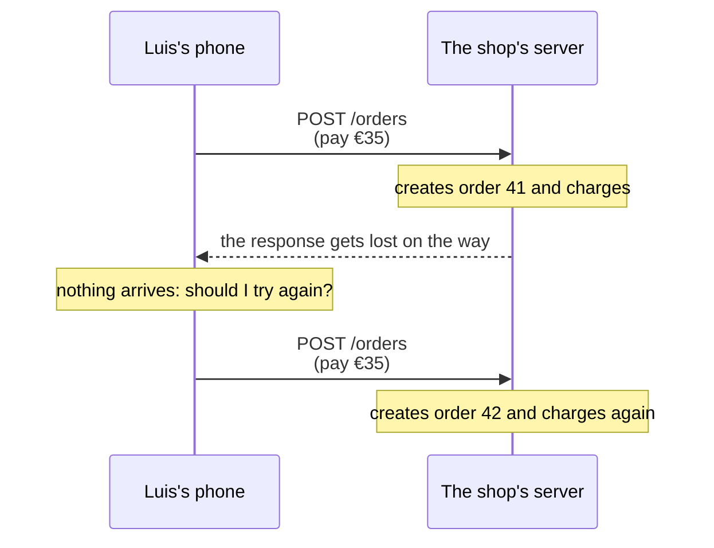

import Term from '~/components/Term.astro';
import TryIt from '~/components/TryIt.astro';
import Analogy from '~/components/Analogy.astro';
import SelfCheck from '~/components/SelfCheck.astro';
import Quiz from '~/components/Quiz.astro';
import QuizQuestion from '~/components/QuizQuestion.astro';
import QuizOption from '~/components/QuizOption.astro';

## The problem

Imagine Luis is paying for an order at the shop from the train. He taps “Pay”, the screen keeps loading and nothing happens. He taps it again. Does he get charged twice? It depends on how his phone talks to the server, and on what the server has promised.

Another case, a real one. A large government website suddenly lost its content. It wasn't an attack: Google's robot crawled it by following links, as it always does, and among them were links to delete pages. It followed them all. They were meant for the editors, but the site only protected them with a <Term id="cookie">cookie</Term> and with JavaScript, and the robot uses neither. [The Daily WTF](https://thedailywtf.com/articles/The_Spider_of_Doom) told the story in 2006.

Both have the same root: a request that gets repeated, or that someone other than you sends. HTTP solves it with the first word of every request, the method. In [Phase 0](/en/phase-0/what-is-a-protocol/) you only wrote `GET`; now you're on the side that answers, and you decide which methods you accept and what you reply to the rest.

## The analogy

<Analogy>

Think of a bank counter. You can ask for several things, and each one is requested with its own form:

- **Checking your balance.** You can ask ten times: the account doesn't change.
- **Making a deposit.** Each form you hand in is another deposit. If you hand it in twice, you deposit twice.
- **Changing your address to the one on the form.** If you hand it in twice, the address ends up the same.
- **Closing the account.** The second time, the clerk tells you “it's already closed.” The answer changes, but the account ends up the same: closed.

And if you try to make a deposit at the inquiries counter, the clerk doesn't accept it, but tells you what you can do there: “only inquiries here.” That's a `405` with its `Allow` <Term id="header">header</Term>.

<div slot="limits">

- The clerk looks at what you do. In HTTP, the method is a promise that whoever programmed the server keeps, or doesn't: nothing stops you from writing a server that deletes with a `GET`. That's what happened to the government website.
- A clerk understands what you want even if you bring the wrong form. A server doesn't guess what you meant: if the method is no good to it, it answers with an error.
- Some changes can be repeated (“my phone number is this one”) and others can't (“add €10 to it”). The same happens with `PATCH`, which you'll see later.

</div>

</Analogy>

## How it really works

### The method is the first word of the request

These two requests go to the same address, but they ask for different things:

```http
GET /products HTTP/1.1
Host: localhost:8080
```

```http
POST /products HTTP/1.1
Host: localhost:8080
Content-Type: application/json
Content-Length: 25

{"name":"Cap","price":15}
```

The first asks for the list of products. The second asks to create a new product, the cap, with the data that goes in the <Term id="request-body">request body</Term>, the one you saw in [lesson 1, “Request and response”](/en/phase-2/http-request-and-response/). The difference is set by the first word, the <Term id="http-method">method</Term>.

The path says **what you act on**, the resource, and the method says **what you do** with it. This is what the shop's full API could look like (today, its nginx only answers `GET /products`):

| Request | What it asks for |
|---|---|
| `GET /products` | The list of products |
| `POST /products` | Create a product with the data in the body; the server gives it a number |
| `GET /products/2` | One product: the mug |
| `PUT /products/2` | Replace the whole mug with what goes in the body |
| `PATCH /products/2` | Change only one part of the mug, like the price |
| `DELETE /products/2` | Delete the mug |

### What each method promises

Each method has a meaning fixed in the HTTP standard, <Term id="rfc">RFC</Term> 9110, except `PATCH`, which came later with its own RFC, 5789. These are the ones you'll use:

| Method | What for | Safe? | Idempotent? | Usually has a body? |
|---|---|---|---|---|
| `GET` | Read a resource | Yes | Yes | No |
| `HEAD` | The same as `GET`, but only the headers | Yes | Yes | No |
| `OPTIONS` | Ask what can be done with a resource | Yes | Yes | No |
| `POST` | Send data for the server to do something: create, pay, send a message | No | No | Yes |
| `PUT` | Replace a whole resource, or create it at a path you choose | No | Yes | Yes |
| `PATCH` | Change one part of a resource | No | Not always | Yes |
| `DELETE` | Delete a resource | No | Yes | No |

RFC 9110 defines two more, `CONNECT` and `TRACE`, which you won't use, and only requires accepting `GET` and `HEAD`. The “Safe?” and “Idempotent?” columns are its promises, and each one deserves a section.

### Safe: it only reads

Ask for `GET /products` a hundred times: the list stays the same. That's a <Term id="safe-method">safe method</Term>: one that doesn't ask for any change on the server.

Something does happen: each `GET` adds a line to the server's <Term id="log">log</Term>. But it isn't a change the client asked for.

**Why it matters:** many programs make `GET` requests without asking you.

- Search engine robots follow every link they find.
- Messaging apps request the page when you paste a link, to show the preview.
- Some email filters open the links in messages to check whether they're dangerous.
- The browser may request pages in advance when it thinks you're going to visit them.

They all trust that `GET` doesn't change anything. A link is always a `GET`, so a “Delete” link breaks that trust: it's the story of the government website.

### Idempotent: repeating it doesn't change the result

Now delete the mug twice. The first `DELETE /products/2` deletes it, and the server answers that everything went fine. The second finds nothing to delete, and answers `404`, “that doesn't exist.” The answers are different, but the shop ended up the same both times: without a mug.

A request is <Term id="idempotent">idempotent</Term> if making it once or ten times leaves the server the same. Notice that what's measured is the effect, not the answer. `PUT` is too: replacing the mug with the same data twice leaves it the same. And every safe method is, because they don't change anything.

`POST` isn't: each `POST /orders` creates a new order. And that's what can happen to Luis on the train:



**Why it matters:** networks fail. If the response doesn't arrive, the client doesn't know whether its request arrived or not. With an idempotent method it can repeat it without fear; with one that isn't, repeating it can do the same thing twice. That's why the standard asks programs not to automatically repeat a request that isn't idempotent.

If a `POST` has to be repeatable, like a payment, the client sends a unique key with it; if the server sees the same key twice, it returns the first result without charging again. That's how payment APIs like Stripe's do it.

### PUT replaces, PATCH changes a part

Now the mug looks like this: `{"id":2,"name":"Mug","price":8.5}`. Ana wants to raise its price to €9. There are three ways to ask for it, and they don't give the same result:

| Request | Body | How the mug ends up |
|---|---|---|
| `PUT /products/2` | `{"name":"Mug","price":9}` | `{"id":2,"name":"Mug","price":9}` |
| `PUT /products/2` | `{"price":9}` | `{"id":2,"price":9}`: it has lost its name |
| `PATCH /products/2` | `{"price":9}` | `{"id":2,"name":"Mug","price":9}` |

**`PUT` replaces the whole resource** with what you send. If you only send the price, the rest disappears. **`PATCH` only changes what you send** and leaves the rest as it was.

And is `PATCH` idempotent? “The price is 9” is: repeating it leaves 9. But “add one unit to the stock” isn't, and it can also be requested with `PATCH`. That's why the standard doesn't promise it.

### HEAD and OPTIONS: asking without requesting the content

`HEAD` is a `GET` without content: the server answers with the same headers, but without the body. It's for finding out whether something exists, how big it is (`Content-Length`) or what type it is, without downloading it. `curl -I` sends a `HEAD`.

`OPTIONS` asks: “what can I do with this?” The response should carry the `Allow` header, with the list of methods that resource accepts. A person almost never sends it: the browser sends it on its own, before certain requests to other websites. You'll see it in [lesson 6, “CORS”](/en/phase-2/what-is-cors/).

### The 405 and the Allow header

If a resource doesn't support a method, the server answers `405 Method Not Allowed`. It isn't a `404`: the resource exists.

The standard is clear: a `405` **must carry** the `Allow` header, with the methods it does accept. That way, whoever gets the error knows what they can do. But not every server complies:

| Server | Response to a `POST` | Has `Allow`? |
|---|---|---|
| backenddesdecero.com (Cloudflare) | `405` | No |
| nginx serving files, like the welcome page on your VM's port 80 | `405 Not Allowed` | No |
| nginx with the shop's configuration, on `/products` | `405 Not Allowed` | Yes: `Allow: GET, HEAD` |

The shop has it because its configuration adds it by hand, with `add_header Allow`. (`Not Allowed` is nginx's phrase; what counts is the number.)

## Try it

The goal: find out which methods each server accepts and which of the two follows the `Allow` rule. Then you'll make the shop's nginx break it, and you'll fix it.

### On your computer: the course's site

These three commands run on your computer. The outputs are from a Mac; on Linux and WSL they come out the same.

<TryIt
  title="1. Ask only for the headers"
  cmd="curl -sI https://backenddesdecero.com/en/"
  output={`HTTP/2 200
date: Tue, 13 Oct 2026 07:59:31 GMT
content-type: text/html
cf-cache-status: HIT
cache-control: public, max-age=0, must-revalidate
…
server: cloudflare
cf-ray: a49cce2d7cf3f40c-MAD
alt-svc: h3=":443"; ma=86400`}
>

`-I` sends a `HEAD`, and `-s` removes `curl`'s progress messages. The home page's headers arrive, but not a single line of HTML: the `200` says the page exists, without downloading it.

They come out in lowercase because `curl` speaks HTTP/2 with this site (you'll see it in [lesson 8](/en/phase-2/http2-vs-http3/)). We've removed two long Cloudflare headers (`…`); your dates and your `cf-ray` will be different.

</TryIt>

<TryIt
  title="2. Try to send it something"
  cmd="curl -si -X POST https://backenddesdecero.com/en/"
  output={`HTTP/2 405
date: Tue, 13 Oct 2026 07:59:31 GMT
content-length: 0
…
server: cloudflare
cf-ray: a49cce2dde61e55b-MAD
alt-svc: h3=":443"; ma=86400`}
>

`-X POST` changes the method, and `-i` shows the response headers before the content. Notice two things:

- The `405`: the site is static, it only serves files, and it has nothing to do with what you send it.
- What's missing: no `allow` header. This site doesn't follow the rule, and whoever gets the error doesn't know what's accepted.

If you get a `200`, you forgot the `-X POST`.

</TryIt>

Now, every method at once, with a `for` loop like the ones in [lesson 8 of Phase 1](/en/phase-1/bash-scripts/):

<TryIt
  title="3. Try every method"
  cmd={`for m in GET POST PUT PATCH DELETE OPTIONS; do
  curl -s -o /dev/null -w "$m %{http_code}\\n" -X $m https://backenddesdecero.com/en/
done`}
  output={`GET 200
POST 405
PUT 405
PATCH 405
DELETE 405
OPTIONS 405`}
>

`-o /dev/null` throws away the content, and `-w` writes, when it finishes, the method and the <Term id="status-code">status code</Term>. Paste the three lines at once.

Only `GET` works. Even `OPTIONS`, the method for asking what's accepted, gets a `405` that says nothing. And Cloudflare doesn't even check whether the file exists: `POST /does-not-exist` also gets a `405`, not a `404`.

</TryIt>

### On your VM: the shop's server

Log in to the VM with `multipass shell course`. You need the shop's configuration, which you install in [the introduction](/en/phase-2/). If you don't have the VM, read the outputs: they're from an Ubuntu 24.04 with nginx 1.24.0.

<TryIt
  title="4. The product list"
  cmd="curl -i localhost:8080/products"
  output={`HTTP/1.1 200 OK
Server: nginx/1.24.0 (Ubuntu)
Date: Tue, 13 Oct 2026 07:59:54 GMT
Content-Type: application/json
Content-Length: 109
Connection: keep-alive

[{"id":1,"name":"T-shirt","price":20},{"id":2,"name":"Mug","price":8.5},{"id":3,"name":"Hoodie","price":35}]`}
>

A `GET`: the three products, in <Term id="json">JSON</Term>, with `Content-Length: 109`. Here `curl` speaks HTTP/1.1, and the headers are capitalized.

If you get `Couldn't connect to server`, nginx isn't listening on port 8080: check that you installed the shop's configuration and that `systemctl is-active nginx` says `active`.

</TryIt>

<TryIt
  title="5. The same, with HEAD"
  cmd="curl -I localhost:8080/products"
  output={`HTTP/1.1 200 OK
Server: nginx/1.24.0 (Ubuntu)
Date: Tue, 13 Oct 2026 07:59:54 GMT
Content-Type: application/json
Content-Length: 109
Connection: keep-alive`}
>

The same headers, `Content-Length: 109` included, but without the list: it says how big it would be with a `GET`.

</TryIt>

<TryIt
  title="6. Try to create a product"
  cmd="curl -i -X POST localhost:8080/products"
  output={`HTTP/1.1 405 Not Allowed
Server: nginx/1.24.0 (Ubuntu)
Date: Tue, 13 Oct 2026 07:59:54 GMT
Content-Type: text/html; charset=utf-8
Content-Length: 166
Connection: keep-alive
Allow: GET, HEAD

<html>
<head><title>405 Not Allowed</title></head>
<body>
<center><h1>405 Not Allowed</h1></center>
<hr><center>nginx/1.24.0 (Ubuntu)</center>
</body>
</html>`}
>

The same `405` as on backenddesdecero.com, but this time with `Allow: GET, HEAD`: this resource can only be read. The HTML is nginx's error page, for browsers.

With `-X PUT`, `-X DELETE` or `-X OPTIONS` you get the same: this configuration doesn't handle `OPTIONS`, which isn't required, but its `405` already says what's accepted.

</TryIt>

### Break the rule and fix it

You're going to take away the shop's `Allow` header, to see that it's your configuration that sets it and not nginx. Open the file:

<TryIt title="7. Open the configuration" cmd="sudo nano /etc/nginx/sites-available/shop" />

Find the line with <kbd>Ctrl</kbd> + <kbd>W</kbd>, type `add_header Allow` and press Enter. Put a `#` in front of it to turn it into a comment, a line nginx doesn't read:

```nginx
    location = /products {
        if ($request_method !~ ^(GET|HEAD)$) {
            # add_header Allow "GET, HEAD" always;
            return 405;
        }
```

Save with <kbd>Ctrl</kbd> + <kbd>O</kbd> and <kbd>Enter</kbd>, and quit with <kbd>Ctrl</kbd> + <kbd>X</kbd>. Then check and apply the change:

<TryIt
  title="8. Check and reload"
  cmd="sudo nginx -t && sudo systemctl reload nginx"
  output={`nginx: the configuration file /etc/nginx/nginx.conf syntax is ok
nginx: configuration file /etc/nginx/nginx.conf test is successful`}
>

`nginx -t` checks the configuration, and `&&` only lets the `reload` through if the check went well. `reload` applies the change without cutting anyone off, and writes nothing if it works.

If you get `test failed`, open the file again and check that you only added the `#`.

</TryIt>

<TryIt
  title="9. The same POST, again"
  cmd="curl -i -X POST localhost:8080/products"
  output={`HTTP/1.1 405 Not Allowed
Server: nginx/1.24.0 (Ubuntu)
Date: Tue, 13 Oct 2026 07:59:59 GMT
Content-Type: text/html; charset=utf-8
Content-Length: 166
Connection: keep-alive

<html>
<head><title>405 Not Allowed</title></head>
<body>
<center><h1>405 Not Allowed</h1></center>
<hr><center>nginx/1.24.0 (Ubuntu)</center>
</body>
</html>`}
>

No `Allow`: your shop now answers like backenddesdecero.com. If it still shows up, repeat the command: right after the `reload`, nginx takes a moment to stop answering with the previous configuration.

</TryIt>

Now, leave it as it was: open the file again with `sudo nano /etc/nginx/sites-available/shop`, delete the `#`, save and repeat step 8. With step 6 you check that `Allow: GET, HEAD` is back.

<SelfCheck question="Challenge: the shop’s home page answers 200 OK to curl -i -X DELETE localhost:8080/. Did it delete anything? Why does it answer like that?">

It didn't delete anything. This is the response:

```
HTTP/1.1 200 OK
Server: nginx/1.24.0 (Ubuntu)
Date: Tue, 13 Oct 2026 07:59:54 GMT
Content-Type: text/plain; charset=utf-8
Content-Length: 89
Connection: keep-alive

Ana and Luis's shop. Try /products, /offers, /cart, /api/orders, /img/ and /maintenance.
```

Look for `location = /` in the configuration: it does `return 200` with the home page's text and doesn't look at the method, so it answers the same to all of them. `/products`, on the other hand, has the `if` that checks `$request_method`.

A program that sends that `DELETE` will believe it worked. The right thing would be a `405` with `Allow: GET, HEAD`, as on `/products`.

</SelfCheck>

## You have already seen it

- **Reloading after submitting a form.** The browser asks you whether you want to resubmit it: that page arrived with a `POST`, and repeating it can duplicate what you did.
- **In DevTools** ([how to open them](/en/phase-2/)). In the **Network** tab, click a request: under **Headers**, **Request Method** says its method. In Chrome, right-clicking the column titles lets you add the **Method** column; Firefox already shows it.

And if you code:

- `fetch(url)` makes a `GET` unless you tell it otherwise; for another method, `fetch(url, { method: 'DELETE' })`.
- An HTML form only sends `GET` and `POST`. That's why Rails or Laravel simulate `PUT` and `DELETE` with a hidden field, `_method`.
- TanStack Query (React Query) retries a failing query three times, but never a mutation: reading can be repeated, changing maybe not.

## Common mistakes

- **Changing things with `GET`.** A “Delete” link will be followed by any robot, preview or email filter. Whatever changes something goes with `POST`, `PUT`, `PATCH` or `DELETE`.
- **Thinking idempotent means “same response.”** The second `DELETE` can answer `404`, and it's still idempotent: what doesn't change is the server's state.
- **A `PUT` with only the fields that change.** The server replaces the whole resource and the others are lost. To change one part, `PATCH`.
- **Confusing “safe” with protected.** A safe method is one that only reads; it has nothing to do with protecting your data.
- **`curl -X HEAD`.** `curl` warns you (`Warning: Setting custom HTTP method to HEAD with -X/--request may not work the way you want. Consider using -I/--head instead.`) and, with HTTP/1.1, as on the VM, it sits waiting for content that isn't going to arrive. Use `curl -I`.
- **A `405` without `Allow`, or a `200` to everything.** If a resource doesn't support a method, answer `405` and say which ones it supports; a `200`, like the one in the challenge, makes people believe it worked.

## Summary

- The method says what you do with a resource: `GET` reads, `POST` sends data to create or do something, `PUT` replaces, `PATCH` changes a part and `DELETE` deletes.
- Safe means it only reads; idempotent, that repeating it leaves the server the same. `GET`, `HEAD`, `PUT` and `DELETE` can be repeated without fear; `POST` can't.
- `HEAD` brings the headers without the content, and `OPTIONS` asks which methods a resource accepts.
- A `405` must carry `Allow` with the accepted methods, even though not every server complies.
- In Phase 3 you'll write a server in code, and for each path and each method you'll decide what it does and what it answers.

## Did you get it?

<Quiz>

<QuizQuestion
  question="The shop’s contact form sends a POST /messages. Ana taps “Send” twice because the page doesn’t respond. If the server hasn’t planned for anything, what can happen?"
  review="Idempotent: repeating it doesn't change the result"
>

<QuizOption text="Nothing: the server sees it’s the same request and discards the second one.">

A server doesn't recognize repeated requests on its own. For that, the client has to send a unique key and the server has to check it.

</QuizOption>

<QuizOption text="The shop gets the message twice." correct>

`POST` isn't idempotent: each one asks for a new message. That's why payment APIs use a unique key that lets them recognize the repetition.

</QuizOption>

<QuizOption text="The browser blocks the second POST: it never sends a repeated one.">

The browser only warns you when you reload a page that came from a `POST`. If you tap a button twice, it sends both requests.

</QuizOption>

</QuizQuestion>

<QuizQuestion
  question="A notes website has, next to each note, a “Delete” link that goes to /notes/7/delete. What risk does it have?"
  review="Safe: it only reads"
>

<QuizOption text="A robot or a preview follows the link and deletes the note." correct>

A link is a `GET`, and robots, previews and some email filters make `GET` requests without asking, because they trust it doesn’t change anything.

</QuizOption>

<QuizOption text="None: search engine robots only read the text, they don’t follow links.">

Following links is exactly what they do: that's how they find pages. It's what happened to the government website in “The problem.”

</QuizOption>

<QuizOption text="None: the browser asks for confirmation before following a link that deletes.">

The browser doesn't know what the server does with a link: it follows it without asking. It only asks for confirmation when repeating a `POST`.

</QuizOption>

</QuizQuestion>

<QuizQuestion
  question="Your profile has a name, an email and a photo. You send PUT /profile with a body that only has the new email. If the server follows the standard, how does the profile end up?"
  review="PUT replaces, PATCH changes a part"
>

<QuizOption text="With its name, its photo and the new email: PUT only changes what you send.">

That's what `PATCH` does. `PUT` replaces the whole resource with what you send.

</QuizOption>

<QuizOption text="The same as before: PUT is only for creating resources, not for changing them.">

`PUT` replaces a resource if it exists, and creates it if it doesn't. Here the profile exists, so it replaces it.

</QuizOption>

<QuizOption text="With only the email: the name and the photo are lost." correct>

`PUT` replaces the whole profile with the body, and the body only has the email. To change only the email, `PATCH`.

</QuizOption>

</QuizQuestion>

<QuizQuestion
  question="An app sends DELETE /photos/7 twice. The first response says everything went fine and the second is a 404. Is DELETE idempotent?"
  review="Idempotent: repeating it doesn't change the result"
>

<QuizOption text="No: if it were, both responses would be the same.">

Idempotency is measured in the server's state, not in the response. Both times, the photo ends up deleted.

</QuizOption>

<QuizOption text="Yes: the photo ends up deleted all the same, even though the response changes." correct>

Deleting once or ten times leaves the same result. The `404` the second time only tells you there was nothing left to delete.

</QuizOption>

<QuizOption text="No: the second time it should be a 405, because it can’t be deleted anymore.">

`405` means the resource doesn't support that method. Here the resource no longer exists, and that's a `404`.

</QuizOption>

</QuizQuestion>

<QuizQuestion
  question="Your products API only allows reading. A program sends it a POST and gets a 405 without any other header. What is your response missing?"
  review="The 405 and the Allow header"
>

<QuizOption text="The Allow header, with the methods it does accept." correct>

The standard requires a `405` to carry `Allow`. Without it, the program doesn't know what it can do, as happened with backenddesdecero.com.

</QuizOption>

<QuizOption text="Nothing: Allow is optional, a courtesy each server decides on.">

With a `405`, RFC 9110 says the server must send it. Many servers don't send it, but that doesn't make it optional.

</QuizOption>

<QuizOption text="The right code: for a method that isn’t supported, the right answer is a 404.">

`404` says the resource doesn't exist, and here it does: what it doesn't support is that method. That's a `405`.

</QuizOption>

</QuizQuestion>

<QuizQuestion
  question="You want to know how big a 2 GB video on a server is without downloading it. What request do you make?"
  review="HEAD and OPTIONS: asking without requesting the content"
>

<QuizOption text="An OPTIONS: it asks the server for the file’s details.">

`OPTIONS` asks which methods a resource accepts, not how big it is.

</QuizOption>

<QuizOption text="A GET, cutting it off when the headers arrive: it’s the only method that brings them.">

`HEAD` brings the same headers as `GET`, without the content. There's no need to start downloading anything.

</QuizOption>

<QuizOption text="A HEAD, with curl -I, and look at its Content-Length." correct>

`HEAD` returns the headers a `GET` would give, without the body, and `Content-Length` says how many bytes it would take up.

</QuizOption>

</QuizQuestion>

</Quiz>

## Further reading

- [HTTP request methods](https://developer.mozilla.org/en-US/docs/Web/HTTP/Reference/Methods) (MDN): one page per method, with examples.
- [405 Method Not Allowed](https://developer.mozilla.org/en-US/docs/Web/HTTP/Reference/Status/405) (MDN): the code and its `Allow` header.
- [RFC 9110, section 9: Methods](https://www.rfc-editor.org/rfc/rfc9110.html#name-methods): where the methods are defined, what's safe and what's idempotent.
- [RFC 5789: PATCH](https://www.rfc-editor.org/rfc/rfc5789.html): the `PATCH` method and why it isn't promised to be idempotent.
- [Idempotent requests](https://docs.stripe.com/api/idempotent_requests) (Stripe): how a payments API lets you repeat a `POST` without charging twice.
