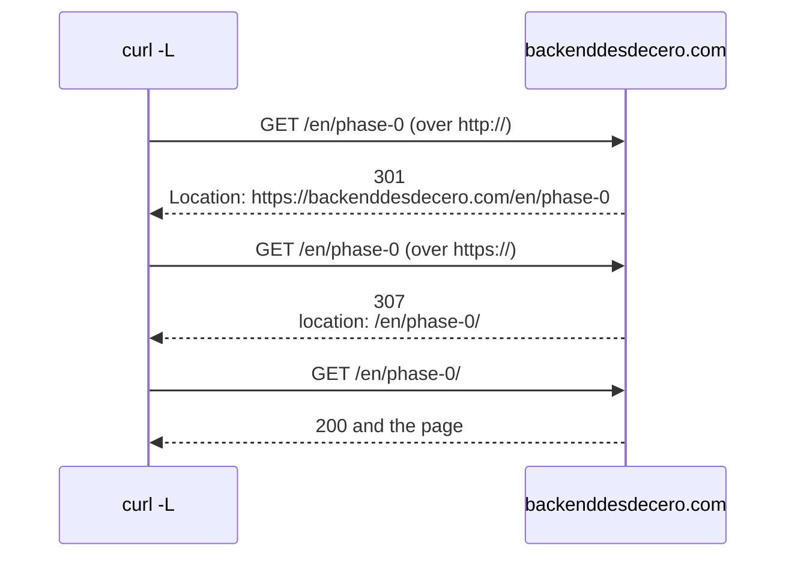

import Term from '~/components/Term.astro';
import TryIt from '~/components/TryIt.astro';
import Analogy from '~/components/Analogy.astro';
import SelfCheck from '~/components/SelfCheck.astro';
import Quiz from '~/components/Quiz.astro';
import QuizQuestion from '~/components/QuizQuestion.astro';
import QuizOption from '~/components/QuizOption.astro';

## The problem

Imagine a customer of Ana and Luis's shop orders a hoodie from the phone app. The app shows "Order placed!", but the order never arrives: there was no stock. The shop's <Term id="api">API</Term> had answered `200 OK`, with a text that said `{"error": "out of stock"}`.

The app didn't read the text: it saw a `200` and took the order as done. **Programs decide by the <Term id="status-code">status code</Term>**, not by what it says underneath. So do the browser, Google, caches and your own alerts.

In [Phase 0](/en/phase-0/what-is-a-protocol/) you saw `200`, `400` and `404`. In everyday use there are about twenty: this lesson tells you what each one promises.

## The analogy

<Analogy>

Imagine the counter of a government office. You hand in a form and the clerk gives it back with a stamp in one of four colors:

- **Green, "processed":** everything went well.
- **Blue, "that's done at counter 5":** it's not an error; you go to the other counter.
- **Orange, "a signature is missing":** the problem is yours. If you hand in the same thing, you'll get the same stamp.
- **Red, "the system is down":** the problem is the office's. If you come back later with the same paper, it may work.

The color is the first digit of the code, and the text of the stamp, the rest.

<div slot="limits">

- The clerk explains the stamp in words. A program only reads the number: the phrase that comes with the code is decoration, and in HTTP/2 it doesn't even travel.
- When they send you to counter 5, you walk there yourself. With a redirect, the browser goes on its own, without asking you.
- The clerk tells you why they won't serve you. A server sometimes has to keep it quiet: you'll see this with the `404` that hides things.

</div>

</Analogy>

## How it really works

### The first digit says whose problem it is

In [lesson 3 of Phase 1](/en/phase-1/pipes-and-redirection/) you counted the `200`, `301`, `404` and `500` codes in the practice log. The first digit puts each code in one of five families:

| Family | What it says | Whose problem is it? | Does repeating it help? |
|---|---|---|---|
| `1xx` | An early notice, which you'll almost never see | Nobody's | No need |
| `2xx` | Everything went well | Nobody's | No need |
| `3xx` | What you're looking for is somewhere else, or you already have it | Nobody's: there's one more step | The client takes that step on its own |
| `4xx` | <Term id="client">Client</Term> error | Whoever asks | No: the request has to change (or, with a `429`, you have to wait) |
| `5xx` | <Term id="server">Server</Term> error | The server's | Maybe, later |

The last column is the one that matters most. With a `4xx`, repeating the request will give the same error. With a `5xx`, trying again later may work, and that's why many programs retry on their own (which is why it matters whether the method is <Term id="idempotent">idempotent</Term>, as you saw in ["Methods"](/en/phase-2/http-methods/#idempotent-repeating-it-doesnt-change-the-result)).

The family matters so much that the standard puts it in writing: a client that gets a code it doesn't know, like a `499`, treats it as the `x00` of its family, here a `400`.

### The phrase is for humans

After the number comes a phrase, like `Not Found` in `404 Not Found`. It's for people, and no program should rely on it. nginx uses its own: `302 Moved Temporarily`, where the standard says `302 Found`. And in <Term id="http2">HTTP/2</Term> the phrase no longer travels: Cloudflare answers `HTTP/2 404`, just the number.

### The codes that matter

This is for looking up, not for memorizing. The examples are from the shop:

| Code | What it says | An example |
|---|---|---|
| `200 OK` | Here's what you asked for | `GET /products` returns the list |
| `201 Created` | I've created something new | `POST /api/orders` creates an order |
| `204 No Content` | Done, and there's nothing to tell | You remove something from the cart: the response has no <Term id="request-body">body</Term> |
| `301`, `302`, `307` and `308` | It's at another address | `/offers` leads to `/products` ([redirects](#the-code-and-the-location-header-redirects)) |
| `304 Not Modified` | What you already have stored is still good | You'll see it in ["Caching"](/en/phase-2/http-caching/#validation-the-etag-and-the-304) |
| `400 Bad Request` | Your request is badly formed | The body claims to be <Term id="json">JSON</Term> and it isn't |
| `401 Unauthorized` | I don't know who you are | You ask for your orders without having logged in |
| `403 Forbidden` | I know who you are, and you can't | A customer tries to get into the admin panel |
| `404 Not Found` | That doesn't exist (or I won't tell you) | `/products/999` |
| `405 Method Not Allowed` | It exists, but not with that method | `POST /products` (["Methods"](/en/phase-2/http-methods/)) |
| `409 Conflict` | It clashes with how things are | You sign up with an email that already has an account |
| `422 Unprocessable Content` | It's understood, but the data isn't valid | An order for `-3` hoodies |
| `429 Too Many Requests` | Too many requests: wait | A hundred passwords a minute (Phase 6) |
| `500 Internal Server Error` | I failed | A bug in the shop's program |
| `502 Bad Gateway` | The one behind me answered badly | The shop's program has crashed |
| `503 Service Unavailable` | I can't serve you right now | The shop is under maintenance |
| `504 Gateway Timeout` | The one behind me is taking too long | The shop's program is stuck |

Two pairs confuse almost everyone:

- **`400` vs `422`:** with a `400`, the server couldn't even read the request. With a `422`, it read it, and what it asks for doesn't make sense.
- **`502` and `504` vs `500`:** on many websites, in front of the program that answers there's another server, like nginx or Cloudflare, that passes the requests on to it. `500` says "I failed"; `502` and `504`, "the one behind me failed" (you'll set it up in Phase 8).

### 401 or 403: "I don't know who you are" or "you can't"

GitHub's API asks you to identify yourself before telling you who you are:

```sh
curl -si https://api.github.com/user
```

```text
HTTP/2 401 
content-type: application/json; charset=utf-8
server: github.com
…

{
  "message": "Requires authentication",
  "documentation_url": "https://docs.github.com/rest",
  "status": "401"
}
```

`Requires authentication`: you have to identify yourself first. That's the difference:

- **`401`: I don't know who you are.** You haven't logged in, or your identification has expired. If you identify yourself, it may work.
- **`403`: I know who you are, and you can't.** You've logged in, but your account doesn't have permission. Identifying yourself again changes nothing.

It's like a concert: without a wristband you don't get past the entrance (`401`), and with a regular wristband you don't get into the VIP area (`403`). The name of the `401`, *Unauthorized*, is misleading: it should be "Unauthenticated." You'll see it in Phase 6.

### The 404 also hides things

A `403` says "that exists, but it's not for you," and sometimes that's already too much. If a customer asks for `/api/orders/1044`, someone else's order, a `403` confirms that order 1044 exists, and they can try 1045. A `404` tells them nothing.

GitHub does this with private repositories: if you don't have access, it answers `404` and not `403`, and [its documentation](https://docs.github.com/en/rest/using-the-rest-api/troubleshooting-the-rest-api#404-not-found-for-an-existing-resource) explains it's so as not to confirm they exist. **If knowing that something exists already gives information away, answer `404`.**

### The 200 with an error inside

This is the shop's response from "The problem":

```http
HTTP/1.1 200 OK
Content-Type: application/json

{"error": "out of stock"}
```

The body says something failed, and the code, that everything is fine. The code wins:

- **The phone app** takes the order as done.
- **Your alerts don't go off.** In Phase 1 you found the failed payments by counting the `500` codes in the log. With `200` on everything, they'd be invisible.
- **A <Term id="cache">cache</Term>** can store that response as a good one and hand it out.
- **Google** can keep in its index a page that only says "not found." Its documentation calls it a [*soft 404*](https://developers.google.com/crawling/docs/troubleshooting/http-status-codes).

The right thing is a code that tells the truth and a body that gives the details: `409 Conflict` with `{"error": "out of stock"}`.

### The code and the Location header: redirects

Ask for this course's home page over `http://`, without the `s`:

```sh
curl -sI http://backenddesdecero.com
```

```text
HTTP/1.1 301 Moved Permanently
Date: Mon, 12 Oct 2026 18:35:32 GMT
Content-Type: text/html; charset=UTF-8
Connection: keep-alive
Location: https://backenddesdecero.com/
…
Server: cloudflare
…
```

We've cut some <Term id="header">headers</Term>. The server doesn't send the page, but a `301` and a `Location` header with the right address. That's a <Term id="redirect">redirect</Term>: a `3xx` code plus `Location`. The browser, or `curl -L`, makes a new request to that address on its own.

`Location` can carry a full address, like this one, or just a path, like `/en/phase-0/`, which the client completes with the site it's already on. One redirect can lead to another, and each hop costs a round trip (["From URL to page"](/en/phase-0/what-happens-when-you-type-a-url/)):



There are four redirects in daily use, and you choose with two questions:

| | For good | For now |
|---|---|---|
| **May turn a `POST` into a `GET`** | `301 Moved Permanently` | `302 Found` |
| **Keeps the method and the body** | `308 Permanent Redirect` | `307 Temporary Redirect` |

**For good or for now?** A `301` tells Google to use the new address in its results, and browsers can cache it and not ask again. A `302` says the opposite: the usual address is still the right one.

**Can the method change?** Years ago, browsers that followed a `301` or a `302` after sending a form changed the `POST` into a `GET`, and the data was lost. The standard ended up accepting it, and created `307` and `308` for when that mustn't happen. With a `GET`, the method of almost every page, both rows work the same.

## Try it

The goal: see which code each server answers with, find a broken link in the practice log and change one of the shop's redirects on your VM.

### This site's codes

In your computer's terminal. The outputs are from a Mac, on October 13, 2026.

<TryIt
  title="1. Three responses, three families"
  cmd={`curl -s -o /dev/null -w '%{http_code}\\n' https://backenddesdecero.com/en/phase-0/\ncurl -s -o /dev/null -w '%{http_code}\\n' https://backenddesdecero.com/en/phase-0\ncurl -s -o /dev/null -w '%{http_code}\\n' https://backenddesdecero.com/en/phase-0/does-not-exist`}
  output={`200
307
404`}
>

As in ["Methods"](/en/phase-2/http-methods/), `-o /dev/null` throws the body away and `-w` writes only the code. With the trailing slash, the page; without it, a redirect; with a made-up name, a `404`.

If you get `000`, `curl` couldn't connect: check your connection.

</TryIt>

<TryIt
  title="2. Follow the chain of redirects"
  cmd={`curl -sIL http://backenddesdecero.com/en/phase-0 | grep -i '^http\\|^location'`}
  output={`HTTP/1.1 301 Moved Permanently
Location: https://backenddesdecero.com/en/phase-0
HTTP/2 307 
location: /en/phase-0/
HTTP/2 200 `}
>

`-L` makes `curl` follow redirects, like the browser, and `-I` asks only for the headers. `grep -i` keeps the lines that start with `http` or with `location`, ignoring case; `\|` means "or".

It's the chain in the diagram. Notice that the first response comes over HTTP/1.1, with a phrase, and the others over HTTP/2, without one.

</TryIt>

### What the practice log tells you

Now, the Phase 1 practice log, in `~/backend-course/phase-1`. If you don't have it, download it there with `curl -O https://backenddesdecero.com/practicas/access.log`. It's the same for everyone, so your numbers will be these; on Linux and WSL, `uniq -c` puts more spaces in front.

<TryIt
  title="3. Count by family"
  cmd={`cd ~/backend-course/phase-1\ncut -d' ' -f9 access.log | cut -c1 | sort | uniq -c`}
  output={` 865 2
  19 3
  64 4
  26 5`}
>

The first `cut` keeps the code, as in Phase 1, and the second, with `-c1`, its first character: the family. Of the day's 90 errors, 64 were the fault of whoever was asking and 26, of the server.

</TryIt>

<TryIt
  title="4. Which pages have moved?"
  cmd={`grep '" 301 ' access.log | cut -d' ' -f7 | sort | uniq -c`}
  output={`   8 /about-us
  11 /shop`}
>

The 19 redirects come from two old addresses. The log doesn't keep the `Location` header, so it doesn't say where they led.

</TryIt>

<TryIt
  title="5. Who links to a product that doesn't exist?"
  cmd={`grep '" 404 ' access.log | cut -d' ' -f7 | sort | uniq -c | sort -rn | head -3\ngrep '/products/57 ' access.log | cut -d'"' -f4 | sort | uniq -c`}
  output={`   9 /products/57
   5 /prodcuts
   4 /contact
   5 -
   1 https://example.com/about
   1 https://example.com/blog
   1 https://example.com/products
   1 https://example.com/products/20`}
>

The first command counts which paths give `404`: the top one, `/products/57`. The second splits on the quotes and keeps the fourth piece, the page where the clicked link was. A `-` means there was no link: the visitor typed the address.

Four visits come from pages of the site itself. **Product 57 was deleted, but the links are still there.** They have to be removed and, if another product replaces it, `/products/57` should redirect to it with a `301`.

</TryIt>

### A redirect in the shop

The rest is done on your VM (`multipass shell course`), with the shop you installed in [the introduction](/en/phase-2/). If you don't have a VM, read the outputs: they're from an Ubuntu 24.04 with nginx 1.24.0.

<TryIt
  title="6. The /offers redirect"
  cmd={`curl -sI localhost:8080/offers`}
  output={`HTTP/1.1 301 Moved Permanently
Server: nginx/1.24.0 (Ubuntu)
Date: Tue, 13 Oct 2026 07:59:57 GMT
Content-Type: text/html
Content-Length: 178
Location: http://localhost:8080/products
Connection: keep-alive`}
>

The configuration says `return 301 /products;`, just the path, and nginx completes it with the name and the port you called. Your date will be different. If you get `Couldn't connect to server`, nginx isn't listening on 8080: go over the introduction again.

</TryIt>

<TryIt
  title="7. The shop under maintenance"
  cmd={`curl -si localhost:8080/maintenance`}
  output={`HTTP/1.1 503 Service Temporarily Unavailable
Server: nginx/1.24.0 (Ubuntu)
Date: Tue, 13 Oct 2026 07:59:57 GMT
Content-Type: text/html; charset=utf-8
Content-Length: 206
Connection: keep-alive
Retry-After: 120

<html>
<head><title>503 Service Temporarily Unavailable</title></head>
<body>
<center><h1>503 Service Temporarily Unavailable</h1></center>
<hr><center>nginx/1.24.0 (Ubuntu)</center>
</body>
</html>`}
>

A `503` with `Retry-After: 120`: "I can't serve you, come back in 120 seconds." That's the right answer for maintenance: Google understands it's temporary. With a `200`, it could keep the "under maintenance" page in its index.

</TryIt>

Now, the change. Ana wants `/offers` to lead to the products only during the fall campaign, and afterward it will have its own page again. With a `301`, browsers and Google would write `/offers` off: you need a temporary redirect.

Open the configuration with `sudo nano /etc/nginx/sites-available/shop`, as in ["Methods"](/en/phase-2/http-methods/). Find the line `return 301 /products;` with <kbd>Ctrl</kbd> + <kbd>W</kbd>, change `301` to `302`, save with <kbd>Ctrl</kbd> + <kbd>O</kbd> and <kbd>Enter</kbd>, and exit with <kbd>Ctrl</kbd> + <kbd>X</kbd>.

<TryIt
  title="8. Check and reload"
  cmd={`sudo nginx -t && sudo systemctl reload nginx`}
  output={`nginx: the configuration file /etc/nginx/nginx.conf syntax is ok
nginx: configuration file /etc/nginx/nginx.conf test is successful`}
>

`nginx -t` checks the configuration, and `&&` only reloads if it's fine. If you get `test failed`, nginx tells you which line has the typo.

</TryIt>

<TryIt
  title="9. Ask for /offers again"
  cmd={`curl -sI localhost:8080/offers | head -1`}
  output={`HTTP/1.1 302 Moved Temporarily`}
>

Now the redirect is temporary, with nginx's own phrase. If you still get `301`, check that you saved the file and repeat step 8.

**To undo it**, put `301` back and repeat step 8.

</TryIt>

<SelfCheck question="Challenge: in the end, the fall campaign is canceled: /offers is never coming back, and no other page replaces it. Which code would you use? Change it in the shop and check it.">

A `410 Gone`, "it's gone for good," or a `404`: there's nowhere to redirect to. The line ends up like this, with no path:

```nginx
return 410;
```

After `sudo nginx -t && sudo systemctl reload nginx`, `curl -sI localhost:8080/offers | head -1` answers `HTTP/1.1 410 Gone`. If `nginx -t` fails, check that the line ends in a semicolon.

When you're done, put `return 301 /products;` back and reload.

</SelfCheck>

## You have already seen it

- **The "Error 404" pages** of any website, and Cloudflare's with an "Error 502" or "Error 504": the server in front is telling you that the one behind didn't answer properly.
- **In <Term id="devtools">DevTools</Term>,** open the **Network** tab and go to `https://backenddesdecero.com/en/phase-0`, without the trailing slash. In the **Status** column you'll see two rows: `phase-0` with a `307` and `phase-0/` with a `200`. How to open DevTools is in [the introduction](/en/phase-2/).

And if you code:

- `fetch` follows redirects on its own, and `response.redirected` tells you whether there was one. `response.ok` is `true` with any code between `200` and `299`, including a `200` that carries an error inside.
- In Next.js, a redirect with `permanent: true` answers `308`, and without it, `307`: Next.js picks the ones that keep the method.

## Common mistakes

- **Using `301` for something temporary.** Browsers can cache it, and if you undo it later, some visitors will keep going to the new address without asking. If in doubt, start with `302` or `307`.
- **Answering `401` to someone who has already logged in and doesn't have permission.** Many apps, on a `401`, send you to the login screen: the user logs in again and gets another `401`, in a loop. The right answer is `403`.
- **Giving a `500` for a client error.** If someone sends broken JSON and your server fails while reading it, your alerts go off for someone else's error, and the client thinks retrying may help. Check what arrives and answer `400` or `422`.
- **A redirect that comes back to itself.** If `/a` leads to `/b` and `/b` to `/a`, Chrome gives up with `ERR_TOO_MANY_REDIRECTS`, and `curl -L`, after 50 hops, with `curl: (47) Maximum (50) redirects followed`. Follow the chain with `curl -sIL`, as in exercise 2.

## Summary

- The first digit says whose problem it is: `4xx` is the fault of whoever asks (repeating doesn't help) and `5xx` of the server (it may help later).
- Programs read the number, not the phrase or the body: a `200` with an error inside fools apps, alerts, caches and Google.
- `401` is "I don't know who you are" and `403`, "you can't." If confirming that something exists already gives information away, the answer is `404`.
- A redirect is a `3xx` with `Location`: `301` and `308` for good, `302` and `307` for now.
- In Phase 3 you'll write your own server, and you'll choose the code of each response.

## Did you get it?

<Quiz>

<QuizQuestion
  question="A shop’s API answers 200 to everything and, when something fails, says so with an error field in the body. You count the codes in yesterday’s log, a day with many failed payments. What do you see?"
  review="The 200 with an error inside"
>

<QuizOption text="Lots of 500s at the time of the failures: the server logs them even if it answers something else.">

The log records the code that was really sent, and it was `200`. The codes leave no trace of the failure.

</QuizOption>

<QuizOption text="Only 200s: going by the codes, the day looks perfect." correct>

The server answers `200` even when it fails, so counting codes finds nothing. With a `500` or a `409`, the failure would show up in the count.

</QuizOption>

<QuizOption text="Lots of 400s: the log spots the word error in the body and changes the code.">

The log doesn't read the body or change anything: it records the code as it went out. And that code was `200`.

</QuizOption>

</QuizQuestion>

<QuizQuestion
  question="Luis has logged in to the shop with his customer account and tries to open the admin panel. What should the server answer?"
  review="401 or 403: “I don’t know who you are” or “you can’t”"
>

<QuizOption text="403: it knows who he is, and his account doesn’t have permission." correct>

The server already knows who Luis is: the problem is what he's trying to do. Logging in again wouldn't change anything.

</QuizOption>

<QuizOption text="401: its name is “Unauthorized,” and Luis isn’t authorized to get in.">

The name is misleading: `401` means "I don't know who you are," and here the server knows. The app would send him to log in, and he'd get the same thing again.

</QuizOption>

<QuizOption text="400: the request asks for something that isn’t his, so it’s badly formed.">

`400` is for a request the server couldn't read. Luis's is well written: what fails is the permission.

</QuizOption>

</QuizQuestion>

<QuizQuestion
  question="In a shop, /api/orders/1044 answers 403 when someone who isn’t its owner asks for it, and 404 if the order doesn’t exist. What’s the problem?"
  review="The 404 also hides things"
>

<QuizOption text="None: always giving the most precise code never gives away too much.">

Here it does: by trying numbers, anyone can find out which orders exist. When existence itself is a piece of information, the answer is `404` in both cases.

</QuizOption>

<QuizOption text="That it should answer 401: the order isn’t theirs, so they’re not authorized.">

`401` means "I don't know who you are," and it wouldn't fix anything: it's still different from the `404`, and it still gives away which orders exist.

</QuizOption>

<QuizOption text="That the 403 confirms which orders exist, and you can go through the numbers." correct>

With two different responses, anyone can tell an order that exists from one that doesn't. With `404` in both cases, as GitHub does, they learn nothing.

</QuizOption>

</QuizQuestion>

<QuizQuestion
  question="For a two-week sale, /new-arrivals has to lead to /sale. Afterward, /new-arrivals goes back to normal. Which redirect do you use?"
  review="The code and the Location header: redirects"
>

<QuizOption text="301: it’s the normal redirect, and browsers don’t remember it.">

Browsers can remember a `301`. When the sales end, some visitors would keep going to `/sale` without asking.

</QuizOption>

<QuizOption text="302 or 307: the redirect is only for now." correct>

A temporary redirect says that `/new-arrivals` is still the real address. When you remove it, everything goes back to how it was.

</QuizOption>

<QuizOption text="308: it’s the temporary version of 301.">

`308` is permanent, like `301`. What changes is that it keeps the method. The temporary version that keeps the method is `307`.

</QuizOption>

</QuizQuestion>

<QuizQuestion
  question="Someone sends the shop’s API an order for -3 hoodies. The JSON is well written. What does the server answer?"
  review="The codes that matter"
>

<QuizOption text="422: it could read the request, but the data makes no sense." correct>

The server read the JSON: what isn't valid is the quantity. That's what `422` is for, with a body that says which field fails.

</QuizOption>

<QuizOption text="500: every order the server rejects is a server error.">

`500` says "I failed," and here the problem comes from whoever asks. Your alerts would go off, and the client would think retrying helps.

</QuizOption>

<QuizOption text="200 with the error in the body: with any other code, the app couldn’t read the message.">

With a `422`, the app can also read the error in the body. With a `200`, any program that looks at the code would take the order as done.

</QuizOption>

</QuizQuestion>

<QuizQuestion
  question="It’s three in the morning and the shop, which has nginx in front of its program, answers 502 to everything. What do you check first?"
  review="The codes that matter"
>

<QuizOption text="The clients’ requests: 5xx codes show up when someone asks for something badly formed.">

It's the other way around: the errors of whoever asks are the `4xx` codes. A `5xx` is on the server's side.

</QuizOption>

<QuizOption text="nginx’s redirects: a 502 is a redirect that points to a broken page.">

Redirects are the `3xx` family. `502` is a server error: the one in front didn't get a valid response from the one behind.

</QuizOption>

<QuizOption text="The shop’s program, behind nginx: it’s probably not answering." correct>

`502` is nginx saying "the one behind me answered badly, or not at all." The first thing is to see whether the shop's program is running.

</QuizOption>

</QuizQuestion>

</Quiz>

## Further reading

- [HTTP response status codes](https://developer.mozilla.org/en-US/docs/Web/HTTP/Reference/Status), on MDN: the full list, with one page per code.
- [RFC 9110, section 15](https://www.rfc-editor.org/rfc/rfc9110.html#name-status-codes): what the standard says about each code.
- [How HTTP status codes affect Google's crawlers](https://developers.google.com/crawling/docs/troubleshooting/http-status-codes): what Google does with each family and with *soft 404s*.
