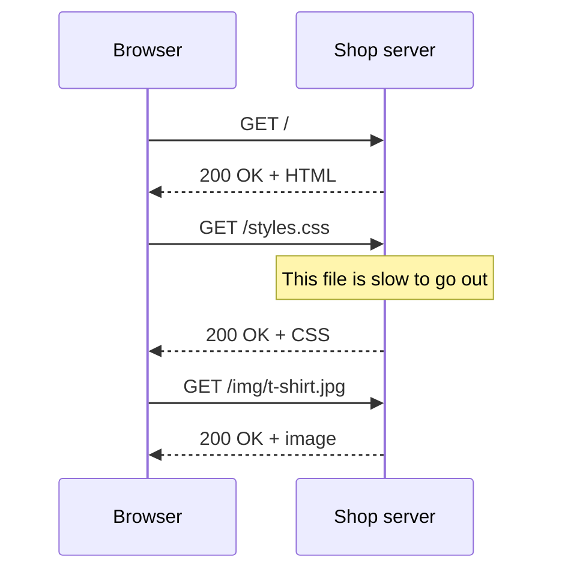
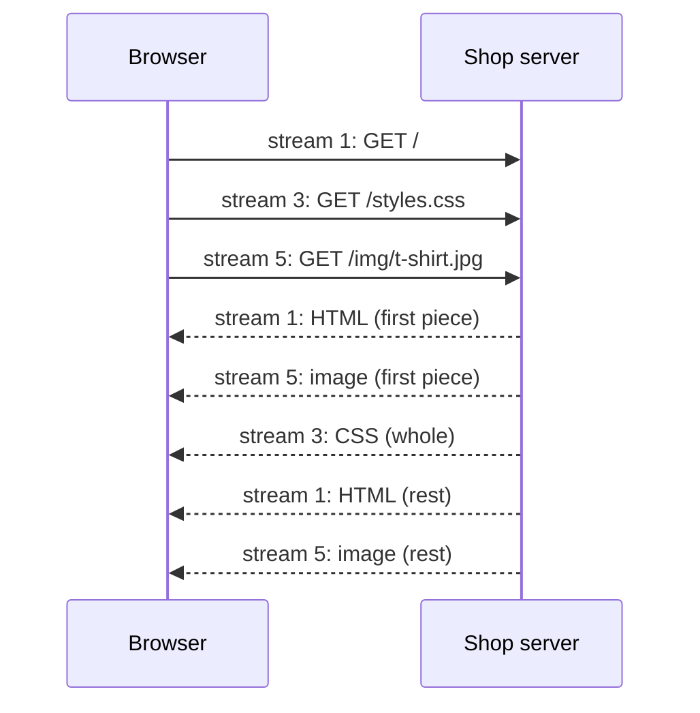

import Term from '~/components/Term.astro';
import TryIt from '~/components/TryIt.astro';
import Analogy from '~/components/Analogy.astro';
import Quiz from '~/components/Quiz.astro';
import QuizQuestion from '~/components/QuizQuestion.astro';
import QuizOption from '~/components/QuizOption.astro';

## The problem

Picture the home page of Ana and Luis's shop: the HTML, two stylesheets, five scripts and forty product photos. Almost fifty files, all from the same server. A customer opens it on their phone, on a train, with a signal that comes and goes.

With HTTP/1.1, their browser requests the files six at a time, and the rest wait their turn. With HTTP/2, it requests them all at once over a single connection, but every time a piece gets lost along the way, they all stop. And when the train pulls into a station and the phone switches from 4G to Wi-Fi, the connection breaks and a new one has to start.

Each version of HTTP was born to fix the bottleneck of the one before. The methods, codes and headers in this phase are the same in all three: what changes is **how they travel**.

## The analogy

<Analogy>

Imagine you're ordering food at a restaurant.

With **HTTP/1.1**, the waiter brings you one dish, and until it's on the table you can't ask for the next. To eat sooner, you call six waiters at once, and each one handles one dish.

With **HTTP/2**, you give the whole order to a single waiter, and the kitchen sends the dishes out as they're ready. But everything comes out through the same serving hatch, in strict order: if the third dish is dropped, the fourth and fifth wait, even if they're ready, until the third is made again.

With **HTTP/3**, each dish comes out through its own hatch: if one is dropped, only that one waits. And your order goes with a number, not with your table: if you move to the terrace, they keep bringing it to you.

<div slot="limits">

- In HTTP/2 and HTTP/3, each response travels in pieces, and the pieces of several responses are interleaved. At the restaurant, each dish arrives whole.
- Calling more waiters costs you nothing. Opening more connections does: each one pays for its own TCP and TLS handshake.
- In HTTP/3 there aren't really several hatches: everything travels over the same connection. What travels separately is the order of each response.

</div>

</Analogy>

## How it really works

### HTTP/1.1: one request at a time per connection

HTTP/1.1 dates from 1997, and it's the text version you typed by hand in [“What a protocol is”](/en/phase-0/what-is-a-protocol/). Its connection stays open for the next request (the `Connection: keep-alive` from Phase 0), so the second request doesn't repeat the handshakes.

But an HTTP/1.1 connection only carries **one request at a time**. The browser sends, waits for the whole response and only then sends the next one:



If one response is slow, everything behind it on that connection waits. That's <Term id="head-of-line-blocking">head-of-line blocking</Term>: the first thing in the queue gets stuck and holds up the rest, even if they're ready. In [“TCP vs UDP”](/en/phase-0/tcp-vs-udp/) you saw it inside TCP; here it happens one layer up, in HTTP.

The standard allows *pipelining*: sending several requests in a row without waiting. But the responses have to come back in the same order, so a slow one still holds up the rest, and some servers got it wrong. Chrome and Firefox never turned it on by default, and they ended up removing it: today no browser uses it.

So, in practice, **a browser opens up to six connections to each server** that speaks HTTP/1.1, each with its own TCP and TLS handshake. If the page needs fifty files, the rest queue up inside the browser: in the **Timing** tab of <Term id="devtools">DevTools</Term>, that time shows up as **Queueing** or **Stalled**.

### HTTP/2: many requests at once over a single connection

<Term id="http2">HTTP/2</Term> (2015) doesn't change what is said, but how it's written. Messages travel in binary, cut into **frames**, and each frame carries the number of the **stream** it belongs to. Each request, with its response, is a stream, and the ones the browser opens get odd numbers: 1, 3, 5…

With that, the browser can send all its requests in a row, and the server can answer them in whatever order it wants, interleaving pieces:



This is called <Term id="multiplexing">multiplexing</Term>: many conversations over the same channel, cut into pieces with a label on each piece. A slow response no longer holds up the rest, and **a single connection** per server is enough: one TCP handshake and one TLS handshake, instead of six.

HTTP/2 brings two more changes:

- **Compressed headers.** Every request repeats almost the same headers (`User-Agent`, `Accept`, the cookies). HTTP/2 sends what was already sent as a short number.
- **Pseudo-headers.** HTTP/1.1's first line, `GET / HTTP/1.1`, becomes fields like `:method` and `:path`, and `Host` becomes `:authority`. You saw them in [“The TCP/IP model”](/en/phase-0/tcp-ip-model/).

How do the browser and the server know they're going to speak HTTP/2? They agree on it inside the TLS handshake, with <Term id="alpn">ALPN</Term>, a TLS extension for choosing the application protocol. The client says what it can speak (`h2`, `http/1.1`) and the server chooses. It doesn't cost a single extra round trip. And **browsers only use HTTP/2 with HTTPS**: without TLS, they stay on HTTP/1.1.

One problem remains. All the streams travel over a single TCP connection, and TCP delivers bytes in order: if a <Term id="segment">segment</Term> is lost, it holds back everything that arrives after it, whatever stream it belongs to. Head-of-line blocking has moved down from HTTP to TCP. On a good network you barely notice; on a train, a single loss slows down the whole page.

### HTTP/3: QUIC over UDP

To remove that last bottleneck, TCP had to change, and TCP lives in the operating system of every computer and in the firewalls along the way: changing it across the whole internet would take decades. So a new transport was built on top of UDP, <Term id="quic">QUIC</Term>, and <Term id="http3">HTTP/3</Term> (2022) is HTTP over QUIC.

QUIC redoes what TCP did: acknowledge what was received, resend what was lost and put things in order. The difference is that **it orders each stream separately**. As you saw in [“TCP vs UDP”](/en/phase-0/tcp-vs-udp/), a loss only delays the stream it belonged to; the others keep arriving.

It brings two more advantages:

- **One less round trip to connect.** QUIC carries TLS 1.3 inside and does both handshakes, the transport one and the encryption one, in a single one. It's the round trip HTTP/3 saved in [“From URL to page”](/en/phase-0/what-happens-when-you-type-a-url/).
- **It survives a network change.** A TCP connection is identified by four values: the IP and the port of each end ([“IP, ports and sockets”](/en/phase-0/ip-ports-sockets/)). If your phone switches from Wi-Fi to 4G, your IP changes and the connection dies. QUIC identifies the connection with its own number, so it can carry on from the new address.

### How the browser finds out about HTTP/3

With HTTP/2 there was ALPN, but ALPN goes inside TLS, which runs over TCP. HTTP/3 runs over UDP: before connecting, the browser has nowhere to ask. So the first time it connects over TCP, as always, and the server tells it in a response header:

```http
alt-svc: h3=":443"; ma=86400
```

It reads like this: “I also speak HTTP/3 (`h3`) on port 443, over UDP; remember it for 86,400 seconds,” which is one day. *Alt-Svc* stands for *alternative service*. From then on, new connections to that server go over QUIC. There's a second, more recent way: a DNS record of type `HTTPS` that announces it before connecting.

If UDP is blocked, which happens on some company networks, QUIC never manages to connect and the browser carries on over TCP, with HTTP/2, without you noticing.

### What changes for the server (and what doesn't)

| | HTTP/1.1 | HTTP/2 | HTTP/3 |
|---|---|---|---|
| Year | 1997 | 2015 | 2022 |
| Format | Text | Binary, in frames | Binary, in frames |
| Connections per server | Up to six | One | One |
| Requests at once per connection | One | Many | Many |
| Transport | TCP (and TLS, with HTTPS) | TCP and TLS | QUIC, over UDP, with TLS inside |
| Head-of-line blocking | In HTTP and in TCP | Only in TCP | No, each stream separately |
| How it's chosen | By default | ALPN, in the TLS handshake | `alt-svc` or a DNS record |

**What doesn't change is the meaning.** All three share the same semantics standard, the RFC 9110 you saw in Phase 0. A `GET` is a `GET`, a `404` is a `404` and [`Cache-Control`](/en/phase-2/http-caching/) works the same in all three.

**What does change is the work of whoever receives the connections.** It's almost never your program: in front of it there's usually a web server like nginx, or a <Term id="cdn">CDN</Term>, that speaks HTTP/2 and HTTP/3 with browsers and passes the requests on to your application, often in HTTP/1.1. This website is served by Cloudflare, and it's Cloudflare that speaks HTTP/3 with you. And the shop's nginx, on your VM, listens on port 8080 without TLS: it speaks HTTP/1.1, and that's enough for it until you add HTTPS in Phase 8.

## Try it

The goal: find out which version of HTTP this website really uses with you, and see with your own eyes the difference between several connections and a single one.

Start by forcing `curl` to speak HTTP/1.1. The `-v` option shows the handshake, and `-o /dev/null` throws away the page, which we're not interested in:

<TryIt
  title="1. With HTTP/1.1"
  cmd="curl --http1.1 -sv -o /dev/null https://backenddesdecero.com/en/"
  output={`* Connected to backenddesdecero.com (2606:4700:3036::ac43:aba8) port 443
* ALPN: curl offers http/1.1
* (304) (OUT), TLS handshake, Client hello (1):
…
* ALPN: server accepted http/1.1
…
* using HTTP/1.x
> GET /en/ HTTP/1.1
> Host: backenddesdecero.com
> User-Agent: curl/8.7.1
> Accept: */*
>
* Request completely sent off
< HTTP/1.1 200 OK
< Date: Tue, 13 Oct 2026 07:59:31 GMT
< Content-Type: text/html
< Transfer-Encoding: chunked
< Connection: keep-alive
< CF-Cache-Status: HIT
…
< alt-svc: h3=":443"; ma=86400
<
{ [732 bytes data]
* Connection #0 to host backenddesdecero.com left intact`}
>

Look at the two `ALPN` lines. `curl` offers a single version, `http/1.1`, and the server accepts it. It all happens inside the TLS handshake, before HTTP begins.

The response brings two headers you'll miss in the next exercise: `Transfer-Encoding: chunked` (the content arrives in pieces, each with its size) and `Connection: keep-alive`. And at the end, `alt-svc`: the server announces HTTP/3.

We've cut part of the output, marked with `…`. The IP and the date will be different, and you may connect over IPv4. On Linux, the TLS lines start with `TLSv1.3` instead of `(304)`, and your version of `curl` may be different.

</TryIt>

<TryIt
  title="2. With HTTP/2"
  cmd="curl --http2 -sv -o /dev/null https://backenddesdecero.com/en/"
  output={`* Connected to backenddesdecero.com (2606:4700:3036::ac43:aba8) port 443
* ALPN: curl offers h2,http/1.1
…
* ALPN: server accepted h2
…
* using HTTP/2
* [HTTP/2] [1] OPENED stream for https://backenddesdecero.com/en/
* [HTTP/2] [1] [:method: GET]
* [HTTP/2] [1] [:scheme: https]
* [HTTP/2] [1] [:authority: backenddesdecero.com]
* [HTTP/2] [1] [:path: /en/]
* [HTTP/2] [1] [user-agent: curl/8.7.1]
* [HTTP/2] [1] [accept: */*]
> GET /en/ HTTP/2
> Host: backenddesdecero.com
> User-Agent: curl/8.7.1
> Accept: */*
>
* Request completely sent off
< HTTP/2 200
< date: Tue, 13 Oct 2026 07:59:31 GMT
< content-type: text/html
< cf-cache-status: HIT
…
< alt-svc: h3=":443"; ma=86400
<
{ [1360 bytes data]
* Connection #0 to host backenddesdecero.com left intact`}
>

Now `curl` offers `h2,http/1.1`, in order of preference, and the server chooses `h2`. Look at what changes:

- **`[1]`** is the stream number. The request is stream 1, the first one the client opens.
- **`HTTP/2 200`** has no `OK` phrase: it disappeared in HTTP/2, and the code is enough.
- **The headers are lowercase.** HTTP/2 requires it.
- **There's no `Connection` or `Transfer-Encoding` anymore.** The frames already say which stream each piece belongs to and where it ends, so those headers are unnecessary.

The `>` lines come out in HTTP/1.1 format, but that's not what travels: it's `curl` translating the frames so you can read them.

</TryIt>

Now, what really changes: requesting several pages at once. `--parallel` tells `curl` to request all the URLs at once, each `-o /dev/null` throws away one of the three pages and `-w` writes one line per request, with the version and the new connections it opened:

<TryIt
  title="3. Three pages at once, with HTTP/1.1"
  cmd={`curl --http1.1 --parallel -s -o /dev/null -o /dev/null -o /dev/null -w '%{url}  HTTP/%{http_version}  new connections: %{num_connects}\\n' https://backenddesdecero.com/en/ https://backenddesdecero.com/en/phase-0/ https://backenddesdecero.com/en/phase-1/`}
  output={`https://backenddesdecero.com/en/  HTTP/1.1  new connections: 1
https://backenddesdecero.com/en/phase-0/  HTTP/1.1  new connections: 1
https://backenddesdecero.com/en/phase-1/  HTTP/1.1  new connections: 1`}
>

Three requests at once, three connections, each with its own handshakes. It's what the browser does with HTTP/1.1. The lines come out in the order they finish, so yours may be different.

If you remove `--parallel`, `curl` requests the pages one after the other and you'll see `1`, `0` and `0`: the last two reuse the first one's connection thanks to `keep-alive`. Reusing is possible; what HTTP/1.1 can't do is carry two at once.

</TryIt>

<TryIt
  title="4. The same, with HTTP/2"
  cmd={`curl --http2 --parallel -s -o /dev/null -o /dev/null -o /dev/null -w '%{url}  HTTP/%{http_version}  new connections: %{num_connects}\\n' https://backenddesdecero.com/en/ https://backenddesdecero.com/en/phase-0/ https://backenddesdecero.com/en/phase-1/`}
  output={`https://backenddesdecero.com/en/  HTTP/2  new connections: 1
https://backenddesdecero.com/en/phase-0/  HTTP/2  new connections: 0
https://backenddesdecero.com/en/phase-1/  HTTP/2  new connections: 0`}
>

A single connection for all three: one request opens it (the one with the `1`), and the other two travel over it at the same time, each in its own stream. That's multiplexing. The order of the lines, again, may change.

</TryIt>

What about HTTP/3? `curl` has the `--http3` option, but only if it was built with QUIC support, and the ones on macOS and Ubuntu don't have it:

<TryIt
  title="5. HTTP/3 with curl, not yet"
  cmd="curl --http3 -sI https://backenddesdecero.com/en/"
  output={`curl: option --http3: the installed libcurl version doesn't support this
curl: try 'curl --help' or 'curl --manual' for more information`}
>

The installed libcurl doesn't support it (libcurl is the part of `curl` that talks to the network). The error comes from your `curl`, not from the website, and on Linux you get the same one.

</TryIt>

But you can see the announcement. `-I` requests only the headers and `grep -i` keeps the line you're looking for, ignoring case (you saw it in [lesson 3 of Phase 1](/en/phase-1/pipes-and-redirection/)). Compare this website with Wikipedia:

<TryIt
  title="6. Who announces HTTP/3?"
  cmd={`curl -sI https://backenddesdecero.com/en/ | grep -i alt-svc\ncurl -sI https://www.wikipedia.org/ | grep -i alt-svc`}
  output={`alt-svc: h3=":443"; ma=86400`}
>

Only one line comes out: the second command writes nothing, because Wikipedia doesn't announce HTTP/3, and your browser will talk to it over HTTP/2. Announcements can change: we checked in October 2026.

</TryIt>

To see HTTP/3 for real, use the browser. In Chrome, open DevTools (<kbd>F12</kbd>, or <kbd>Cmd</kbd> + <kbd>Option</kbd> + <kbd>I</kbd> on a Mac) and go to the **Network** tab. Right-click the column headers and turn on **Protocol**. Then go to `https://backenddesdecero.com/en/` in an incognito window, so you start with nothing saved:

1. **The first load.** The document comes out with `h2`: the browser didn't know anything yet. Some files that arrive later, like the fonts, may already come out with `h3`: as soon as it read the `alt-svc`, it opened a QUIC connection.
2. **Reload the page.** Now the document also comes out with `h3`. Files the browser had already saved may still say `h2`: they haven't traveled again.
3. **Visit other websites.** The big ones, like Google, almost always come out with `h3`. Many others, like Wikipedia, with `h2`.

We checked it with Chromium, the open-source base of Chrome, in October 2026. If everything comes out `h2` even after reloading, maybe your network blocks UDP. In Firefox, the column is also called **Protocol**, and it says `HTTP/2` or `HTTP/3`.

## You have already seen it

- **The Protocol column in DevTools,** with `h2` and `h3` on almost every website, already appeared in [“What a protocol is”](/en/phase-0/what-is-a-protocol/).
- **The `ALPN` lines in `curl -v`,** in [“The TCP/IP model”](/en/phase-0/tcp-ip-model/): they were HTTP/2 being chosen inside the TLS handshake.
- **The long Queueing or Stalled bars** in the **Timing** tab, on old websites with many files: they're requests waiting for one of HTTP/1.1's six connections.

And if you code:

- **Your development server** (Vite's, on `localhost:5173`, for example) shows up as `http/1.1` in the Protocol column: it runs without TLS, so there's no ALPN.
- **In the console,** `performance.getEntriesByType('navigation')[0].nextHopProtocol` returns the version the page arrived with: `h2` or `h3`.

## Common mistakes

- **“To move to HTTP/2 I have to change my API.”** Methods, codes and headers mean the same in all three versions. The change is made by whoever receives the connections, almost always nginx or a CDN.
- **“HTTP/3 is always faster.”** On a good network and with a nearby server, the difference is small. You notice it with faraway servers and on networks with losses, like a train's.
- **“I turned on HTTP/3 on the server and nobody uses it.”** Check two things: that the response carries `alt-svc` and that the firewall lets port 443 through for **UDP**, not only for TCP.
- **“More subdomains, more speed.”** That was true with HTTP/1.1, because of the six connections to each one. With HTTP/2, a single connection carries everything, and each extra domain adds DNS, TCP and TLS.

## Summary

- HTTP/1.1 carries one request at a time per connection, so browsers open up to six per server. *Pipelining* is in the standard, but browsers never turned it on.
- HTTP/2 sends binary frames and multiplexes many requests over a single TCP connection, chosen with ALPN inside TLS. It still has TCP's head-of-line blocking.
- HTTP/3 runs over QUIC, on UDP: each stream recovers separately, it connects with one less round trip and it survives a network change. It's announced with the `alt-svc` header.
- All three mean the same: methods, codes and headers don't change. What changes is the work of whoever receives the connections.
- In Phase 3 you'll write a server with Node's `http` module, which speaks HTTP/1.1: your code will read the method, the path and the headers the same way, whatever version the browser uses.

## Did you get it?

<Quiz>

<QuizQuestion
  question="An old website, with HTTP/1.1 only, loads 60 small files. In the Timing tab you see that almost all of them spend a long time “Stalled” before being sent. Why?"
  review="HTTP/1.1: one request at a time per connection"
>

<QuizOption text="Each file needs its own TCP and TLS handshake before being sent.">

Connections are reused with `keep-alive`, without repeating handshakes. The wait comes from none of them being free.

</QuizOption>

<QuizOption text="There are only six connections, and each one carries one request at a time." correct>

With HTTP/1.1, a connection can't carry two requests at once. With six connections, the other 54 files wait their turn inside the browser, and that's what “Stalled” measures.

</QuizOption>

<QuizOption text="The server can only handle one request at a time from each browser.">

The server handles the six connections at the same time. The queue is in the browser.

</QuizOption>

</QuizQuestion>

<QuizQuestion
  question="In curl -v you see “ALPN: curl offers h2,http/1.1” and, after that, “ALPN: server accepted http/1.1”. What happened?"
  review="HTTP/2: many requests at once over a single connection"
>

<QuizOption text="The server chose HTTP/1.1 and they’ll stick with it on this connection." correct>

`curl` offers both versions and the server chooses. It chose HTTP/1.1, and the request goes over the connection that's already open, with no extra trips.

</QuizOption>

<QuizOption text="The connection will be unencrypted, because HTTP/1.1 doesn’t use TLS.">

ALPN goes inside the TLS handshake: if it shows up, the connection is already encrypted. HTTP/1.1 is encrypted too when it's HTTPS.

</QuizOption>

<QuizOption text="curl will now open a second connection to try HTTP/2 again.">

There's no second attempt: the version is chosen once, in the handshake.

</QuizOption>

</QuizQuestion>

<QuizQuestion
  question="You’re on a train, with a bad signal, and you open a website with HTTP/2. A TCP segment with a piece of a photo is lost. What happens to the CSS arriving after it on the same connection?"
  review="HTTP/2: many requests at once over a single connection"
>

<QuizOption text="Nothing: in HTTP/2, each stream recovers separately from the others.">

That's what QUIC does, in HTTP/3. HTTP/2's streams travel over a single TCP connection, and TCP knows nothing about streams.

</QuizOption>

<QuizOption text="It’s lost, and the browser has to request it again.">

TCP resends the lost segment on its own, and the browser gets everything. The problem is how long it takes.

</QuizOption>

<QuizOption text="It waits too, until TCP recovers the lost segment." correct>

TCP delivers bytes in order, so it holds back everything that arrives after, whatever stream it belongs to. It's the head-of-line blocking that HTTP/3 removes.

</QuizOption>

</QuizQuestion>

<QuizQuestion
  question="You turn on HTTP/3 on your server and its responses already carry alt-svc: h3. But in DevTools everything still shows h2, and the firewall only lets TCP through to port 443. What’s going on?"
  review="How the browser finds out about HTTP/3"
>

<QuizOption text="QUIC runs over UDP, which doesn’t get through: the browser stays on TCP." correct>

The announcement arrives, but the UDP packets don't get past the firewall. The browser falls back to HTTP/2 without telling you. You also have to open port 443 for UDP.

</QuizOption>

<QuizOption text="HTTP/3 doesn’t use 443 but port 80, and that one has to be opened too.">

The announcement says `h3=":443"`: HTTP/3 uses port 443, but for UDP. Port 80 is the one for unencrypted HTTP.

</QuizOption>

<QuizOption text="HTTP/3 needs its own certificate, different from HTTP/2’s.">

QUIC uses the same TLS, with the same certificate. The problem is that no packet arrives over UDP.

</QuizOption>

</QuizQuestion>

<QuizQuestion
  question="Your CDN starts speaking HTTP/2 with browsers. What do you have to change in your API’s routes and responses?"
  review="What changes for the server (and what doesn't)"
>

<QuizOption text="The status codes, because HTTP/2 has its own list of codes.">

HTTP/2 uses the same codes as HTTP/1.1: a `404` is still a `404`. The only thing that disappears is the phrase, like `OK`.

</QuizOption>

<QuizOption text="The headers, which are replaced by pseudo-headers in HTTP/2.">

Pseudo-headers only replace the first line (method, path) and `Host`. All the other headers are still there, with the same meaning.

</QuizOption>

<QuizOption text="Nothing: all three versions mean the same." correct>

Methods, codes and headers share RFC 9110. What changes is how they travel, and the CDN takes care of that.

</QuizOption>

</QuizQuestion>

<QuizQuestion
  question="You’re walking down the street with a website open on your phone, and it switches from a café’s Wi-Fi to 4G. With which version can the same connection carry on?"
  review="HTTP/3: QUIC over UDP"
>

<QuizOption text="With any of them: the connection is with the website, not with your network.">

A TCP connection is identified by the IPs and ports of both ends. When you change networks, your IP changes, and the TCP connection dies.

</QuizOption>

<QuizOption text="With HTTP/3, because QUIC doesn’t identify the connection by your IP." correct>

QUIC gives the connection its own number, so it can carry on from your new address. With TCP you'd have to open another one.

</QuizOption>

<QuizOption text="With HTTP/2, because its connection doesn’t depend on your IP address.">

HTTP/2's connection is a TCP connection, and TCP identifies it by the IPs and ports: it dies as soon as your IP changes.

</QuizOption>

</QuizQuestion>

</Quiz>

## Further reading

- [Evolution of HTTP](https://developer.mozilla.org/en-US/docs/Web/HTTP/Guides/Evolution_of_HTTP) (MDN): the history of HTTP, version by version.
- [HTTP/3 explained](https://http3-explained.haxx.se/), by Daniel Stenberg, the author of `curl`: a short, free book about QUIC and HTTP/3.
- [RFC 9113 (HTTP/2)](https://www.rfc-editor.org/rfc/rfc9113) and [RFC 9114 (HTTP/3)](https://www.rfc-editor.org/rfc/rfc9114): the standards, for when you want the details.
