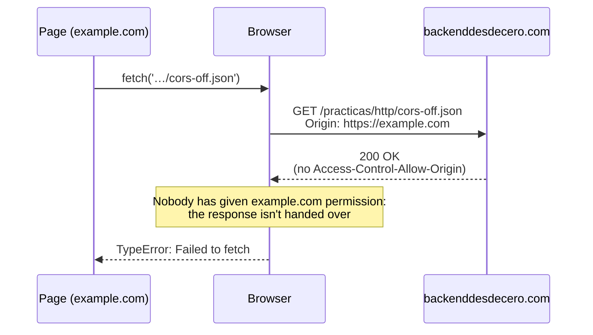
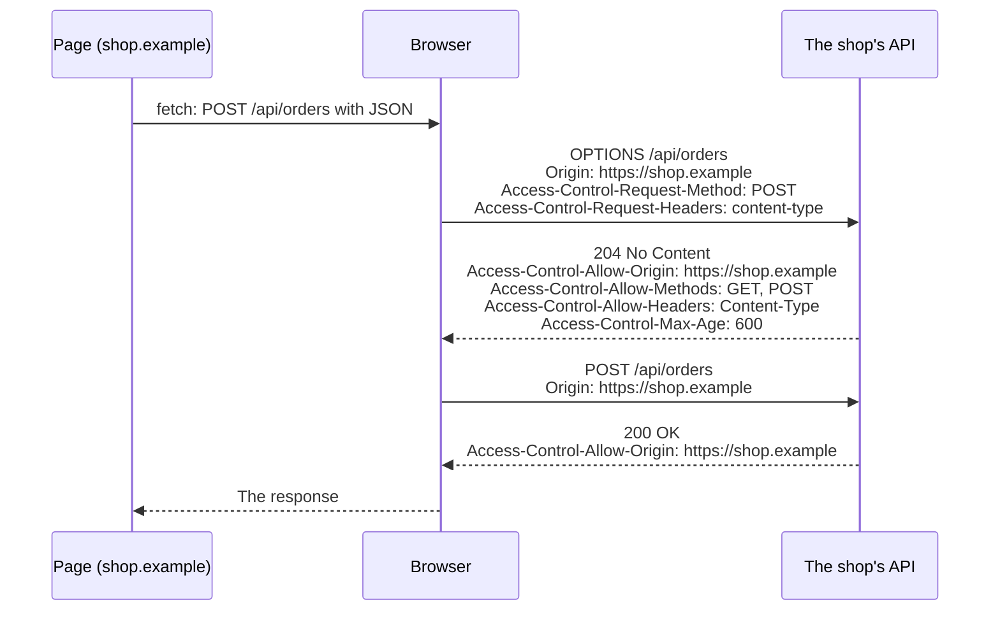

import Term from '~/components/Term.astro';
import TryIt from '~/components/TryIt.astro';
import Analogy from '~/components/Analogy.astro';
import SelfCheck from '~/components/SelfCheck.astro';
import Quiz from '~/components/Quiz.astro';
import QuizQuestion from '~/components/QuizQuestion.astro';
import QuizOption from '~/components/QuizOption.astro';
import CorsLab from '~/playgrounds/cors-lab/CorsLab';

## The problem

Imagine Luis, from the shop, launches the new website. The page lives at `https://shop.example`, and the orders come from an <Term id="api">API</Term> on another server, `https://api.shop.example`. Luis clicks “My orders” and nothing happens. In the browser console there's a red line:

```text
Access to fetch at 'https://api.shop.example/orders' from origin 'https://shop.example' has been blocked by CORS policy: No 'Access-Control-Allow-Origin' header is present on the requested resource.
```

Luis tries the same address with `curl` and it answers perfectly. He pastes it in the browser's address bar, and it works there too. So who's blocking it? **Not the server: the browser**, which has received the response and won't let the page read it.

Many of the fixes going around make it worse. Here you'll see why it happens and how to fix it: on the server.

## The analogy

<Analogy>

Imagine an assistant who runs errands and takes requests from anyone in your house, including guests you barely know. A guest asks them to go to your bank and bring back your statement. The assistant goes, shows your ID card and the bank hands over the envelope.

But before handing it over, the assistant looks at the stamp on the envelope: “May be delivered to…” If whoever made the request isn't on the stamp, the assistant keeps the envelope and tells the guest: “I can't give you this.”

The assistant is your browser; the guests, the pages you open; the bank, a server; the ID card, your <Term id="cookie">cookies</Term>; and the stamp, a response header called `Access-Control-Allow-Origin`.

<div slot="limits">

- **The errand gets done anyway.** If the request was “make a transfer,” the bank makes it: the assistant only refuses to hand over the answer. That's why CORS doesn't protect the server from requests it doesn't want.
- **For some unusual requests, the assistant calls the bank first** to ask whether it accepts them. If the bank says no, they don't go. That's the preflight request, which you'll see shortly.
- **Someone who goes to the bank on their own,** without the assistant, gets the envelope without anyone checking the stamp: the stamp only binds the assistant. That's what `curl` does.
- **The assistant doesn't always carry your ID card:** it depends on how the bank gave it to you and on whether the guest explicitly asks for it.

</div>

</Analogy>

## How it really works

### An origin is scheme, name and port

To the browser, every website has an <Term id="origin">origin</Term>: the scheme (`http` or `https`), the server's name and the <Term id="port">port</Term>. If any of the three changes, it's a different origin. Compared with `https://shop.example/products`:

| Address | Same origin? | Why |
|---|---|---|
| `https://shop.example/cart` | Yes | Only the path changes, and the path doesn't count |
| `http://shop.example/products` | No | Another scheme: `http` instead of `https` |
| `https://www.shop.example/` | No | Another name: the `www` counts too |
| `https://api.shop.example/orders` | No | Another name, even if it's the same company |
| `https://shop.example:8443/` | No | Another port: with no number, `https` uses 443 |

You saw each scheme's default port in [lesson 3 of Phase 0](/en/phase-0/what-is-a-protocol/), and ports in [lesson 5](/en/phase-0/ip-ports-sockets/).

### The browser lets you send, but not read

Imagine you have your bank's website open in one tab and, in another, some random page. That page can make your browser send requests to the bank: with a form, with an image that points to its address or with code.

And some of them carry your cookies, the ones from [lesson 5](/en/phase-2/cookies-httponly-secure-samesite/). A form or an image carries them depending on how the bank marked them (`SameSite`). A request made from the page's code (with `fetch`) only carries them to its own origin, unless the code explicitly asks for them with `credentials: 'include'`.

If that page could read the responses, it would read your balance with your session. To prevent that, there's the <Term id="same-origin-policy">same-origin policy</Term>: **a page's code can send requests to other origins, but not read their responses**.

### CORS: the server gives permission to read

Sometimes a server wants other origins to read its responses: the shop's API, for its page, or a public service, for anyone. That's what <Term id="cors">CORS</Term> is for. It works with two <Term id="header">headers</Term>:

1. On every request to another origin, the browser adds `Origin`, with the page's origin: `Origin: https://example.com`. The page's code can't change it.
2. The server answers and, if it wants to give permission, adds `Access-Control-Allow-Origin` with that origin, or with `*`, which means “anyone.”

The browser compares the two. If they match, it hands the response to the page. If not, or if the header isn't there, it hides it, writes the error in the console and the code gets `TypeError: Failed to fetch`. That's what you'll do in “Try it,” from `example.com`:



Look at the `200 OK`: **the request arrived, and the server answered**. If it had been a form that creates an order, the order would be created. CORS decides whether the page reads the response, not whether the request arrives.

A page from another site doing things in your name by taking advantage of your cookies is an attack with a name of its own: <Term id="csrf">CSRF</Term>. You'll see its defenses, like `SameSite` or a secret code in every form, in Phase 6.

### Non-simple requests ask for permission first

Look at the diagram again: the request went out without asking. The browser only does that with **simple** requests, the ones a website could already send with a form before CORS existed:

- the <Term id="http-method">method</Term> is `GET`, `HEAD` or `POST`;
- if it has content, it's from a form or plain text, not <Term id="json">JSON</Term>;
- and it carries no custom headers, like `Authorization`.

The rest (a `PUT`, a `DELETE`, a `POST` with JSON, any request with `Authorization`) could surprise an old server that never got them from another website. So the browser asks first with a <Term id="preflight">preflight request</Term>: a request with the `OPTIONS` method that says what's coming next. If the server doesn't authorize it, **the real request isn't sent**.

This is how it looks with the shop's API, the one you have in your VM:



`Access-Control-Max-Age: 600` lets the browser remember the permission for 600 seconds, without asking again (each browser also sets its own limit).

If the preflight request fails, Chrome says so in the message. This is what it writes when you try a `DELETE` from `example.com` to this very site, which doesn't give permission:

```text
Access to fetch at 'https://backenddesdecero.com/' from origin 'https://example.com' has been blocked by CORS policy: Response to preflight request doesn't pass access control check: No 'Access-Control-Allow-Origin' header is present on the requested resource.
```

“Response to preflight request doesn't pass access control check”: the `DELETE` never went out.

### With cookies, the permission names the origin

If the code asks to send cookies to another origin (`credentials: 'include'`), the server has to do two more things, or the browser hides the response:

- answer `Access-Control-Allow-Credentials: true`;
- and put the exact origin in `Access-Control-Allow-Origin`, never `*`.

The reason: `*` is meant for public data, which doesn't change depending on who asks for it. With cookies, the response carries one specific person's data, and the server has to say who it trusts with it.

### The browser enforces it, not the server

The server doesn't block anything: it answers and adds, or doesn't add, a few headers. It's the browser that reads them and decides, because it's the one running other people's code with your cookies.

`curl` doesn't run anyone's pages, and it only sends the cookies you give it. That's why **you'll never see a CORS error with `curl`**, and an address working with `curl` says nothing about whether it will work from a page. The same goes between servers: when your backend calls another API, there's no browser, and there's no CORS.

So the fix is on the server: make it answer with the right headers for the origins it trusts.

## Try it

The goal: find out who's really blocking, the server or the browser, and then open the shop's API to a new page. For practice, there are two files on this site: `cors-on.json`, which gives permission to any origin, and `cors-off.json`, which gives it to nobody.

### In the browser

Open `https://example.com` in Chrome and open <Term id="devtools">DevTools</Term>, as in [the phase introduction](/en/phase-2/#before-you-start-devtools). Go to the **Console** tab. Whatever you type there runs as if it were the page's code, with the origin `https://example.com`.

The first time you paste something, Chrome may ask you to type `allow pasting`. It's a protection against scams that ask you to paste code into the console: only do it with code you understand, like this.

<TryIt
  title="1. A file that gives permission"
  lang="js"
  cmd={`await fetch('https://backenddesdecero.com/practicas/http/cors-on.json').then(r => r.json())`}
  output={`{cors: 'on', message: 'Any origin can read this file from JavaScript: its response carries Access-Control-Allow-Origin: *'}`}
>

Word by word:

- `fetch('…')` requests that address, just as the page's code would.
- `.then(r => r.json())`: when the response (`r`) arrives, read its content as JSON.
- `await` waits for everything to finish, and the console shows the result.

The console shows the file's content as an object, on one line (the triangle on the left expands it). The page has read a file from another origin, because its response carries `Access-Control-Allow-Origin: *`. If you get an error, check that you're in the `example.com` tab.

</TryIt>

<TryIt
  title="2. A file that doesn't give permission"
  lang="js"
  cmd={`await fetch('https://backenddesdecero.com/practicas/http/cors-off.json').then(r => r.json())`}
  output={`Access to fetch at 'https://backenddesdecero.com/practicas/http/cors-off.json' from origin 'https://example.com' has been blocked by CORS policy: No 'Access-Control-Allow-Origin' header is present on the requested resource.`}
>

The same line, with another file. There's the error: access from `https://example.com` has been blocked because the resource doesn't carry the `Access-Control-Allow-Origin` header. Two more red lines come out: the one for the failed request, with `net::ERR_FAILED`, and `TypeError: Failed to fetch`, which is what the code gets.

In Firefox the message is different, but it names the same header.

</TryIt>

Now open the **Network** tab and repeat step 2. The request to `cors-off.json` is in the list: it left the browser. In the status column, Chrome writes `CORS error`: it's not a code from the server, but the browser's decision.

### In the lab

The lab shows what DevTools doesn't let you see in full: every step between the page, the browser and the server, with their headers. Start with “The usual error”, what you just caused, and notice that the server receives the `GET` before the browser says no. Then try “A POST with JSON”, where the real request isn't even sent, and “The preflight approved”, which is what the shop's API does in the VM. Under “The request” and “The server” you can change every detail.

<CorsLab client:visible lang="en" />

### In the terminal

What if you ask the server directly, with no browser?

<TryIt
  title="3. The same file, with curl"
  cmd="curl https://backenddesdecero.com/practicas/http/cors-off.json"
  output={`{
  "cors": "off",
  "message": "Only backenddesdecero.com can read this file from JavaScript: its response carries no Access-Control-Allow-Origin"
}`}
>

The whole file, with no errors. The server gives the same response to the browser and to `curl`; the difference is that `curl` doesn't apply the same-origin policy.

</TryIt>

<TryIt
  title="4. Look for the permission in the headers"
  cmd={`curl -sI https://backenddesdecero.com/practicas/http/cors-on.json | grep -i access-control
curl -sI https://backenddesdecero.com/practicas/http/cors-off.json | grep -i access-control`}
  output="access-control-allow-origin: *"
>

`-I` asks for the headers only, `-s` removes `curl`'s progress messages, and `grep -i` keeps the lines with `access-control`, ignoring case ([lesson 2 of Phase 1](/en/phase-1/linux-file-commands/)). Only one line comes out, the first file's: that absence in the second one is the whole error from step 2. It's in lowercase because `curl` speaks HTTP/2 with this site ([lesson 8](/en/phase-2/http2-vs-http3/)).

</TryIt>

### In the VM: the shop's API

Now, from the server's side. Log in to the VM with `multipass shell course`. We assume you installed the shop in [the phase introduction](/en/phase-2/#before-you-start-the-shops-server): if `curl localhost:8080` doesn't answer `Ana and Luis's shop…`, go back there. Without a VM, read the outputs: they're from an Ubuntu 24.04 with nginx 1.24.0.

<TryIt
  title="5. The API, as its page sees it"
  cmd="curl -i -H 'Origin: https://shop.example' localhost:8080/api/orders"
  output={`HTTP/1.1 200 OK
Server: nginx/1.24.0 (Ubuntu)
Date: Tue, 13 Oct 2026 08:00:09 GMT
Content-Type: application/json
Content-Length: 14
Connection: keep-alive
Access-Control-Allow-Origin: https://shop.example
Vary: Origin

{"orders":[]}`}
>

`-H` adds a header, here the `Origin` the browser would add on the shop's page, and `-i` shows the response headers. Look at `Access-Control-Allow-Origin: https://shop.example`: the permission, with the exact origin. `Vary: Origin` warns <Term id="cache">caches</Term> that the response may change depending on the `Origin`. Your date will be different.

</TryIt>

<TryIt
  title="6. An order from another origin"
  cmd={`curl -i -H 'Origin: https://other.example' -d 'product=1' localhost:8080/api/orders
sudo tail -n 1 /var/log/nginx/access.log`}
  output={`HTTP/1.1 200 OK
Server: nginx/1.24.0 (Ubuntu)
Date: Tue, 13 Oct 2026 08:00:09 GMT
Content-Type: application/json
Content-Length: 14
Connection: keep-alive
Access-Control-Allow-Origin: https://shop.example
Vary: Origin

{"orders":[]}
::1 - - [13/Oct/2026:08:00:09 +0000] "POST /api/orders HTTP/1.1" 200 14 "-" "curl/8.5.0"`}
>

You pretend to be `https://other.example`. With `-d`, `curl` sends a `POST` with form data, like an HTML form: a simple request. nginx handles it and writes it in its log, the last line (`::1` is `localhost`).

The permission is for `shop.example`: a browser on `other.example` would hide the response, but the order would already be in the log. That's the gap CSRF takes advantage of.

</TryIt>

<TryIt
  title="7. The preflight request"
  cmd="curl -i -X OPTIONS -H 'Origin: https://shop.example' -H 'Access-Control-Request-Method: POST' -H 'Access-Control-Request-Headers: Content-Type' localhost:8080/api/orders"
  output={`HTTP/1.1 204 No Content
Server: nginx/1.24.0 (Ubuntu)
Date: Tue, 13 Oct 2026 08:00:09 GMT
Connection: keep-alive
Access-Control-Allow-Origin: https://shop.example
Access-Control-Allow-Methods: GET, POST
Access-Control-Allow-Headers: Content-Type
Access-Control-Max-Age: 600
Vary: Origin`}
>

It's the question the browser would ask before a `POST` with JSON: “From `https://shop.example`, may I send a `POST` with the `Content-Type` header?” nginx answers with a `204` (no content) and four permissions: the origin, the methods, the headers and how long the answer is valid. They're the lines in the configuration's `if ($request_method = OPTIONS)` block.

</TryIt>

Now, the fix. Imagine Luis also publishes the page at `https://www.shop.example`, and the error shows up from there: the `www` counts. Open the configuration with `sudo nano /etc/nginx/sites-available/shop` (the editor from [lesson 2 of Phase 1](/en/phase-1/linux-file-commands/)). Find the two lines with `Access-Control-Allow-Origin` (<kbd>Ctrl</kbd> + <kbd>W</kbd> searches) and, in both, change `https://shop.example` to `https://www.shop.example`. Save and exit.

<TryIt
  title="8. Check and reload"
  cmd="sudo nginx -t && sudo systemctl reload nginx"
  output={`nginx: the configuration file /etc/nginx/nginx.conf syntax is ok
nginx: configuration file /etc/nginx/nginx.conf test is successful`}
>

It's step 3 of the introduction. If `nginx -t` gives an error with a line number, look at that line: most likely, a deleted quotation mark.

</TryIt>

<TryIt
  title="9. The new origin, with permission"
  cmd="curl -i -H 'Origin: https://www.shop.example' localhost:8080/api/orders"
  output={`HTTP/1.1 200 OK
Server: nginx/1.24.0 (Ubuntu)
Date: Tue, 13 Oct 2026 08:00:10 GMT
Content-Type: application/json
Content-Length: 14
Connection: keep-alive
Access-Control-Allow-Origin: https://www.shop.example
Vary: Origin

{"orders":[]}`}
>

The permission now names the new origin: the `www` page could read the response. If the old one still comes out, wait a second and repeat it: `reload` takes a moment.

To leave it as it was, make the change the other way around in both lines and repeat step 8.

</TryIt>

<SelfCheck question="Challenge: Luis wants the API to serve both pages, with and without www. Is it enough to put both origins in Access-Control-Allow-Origin, separated by a comma?">

No. The header accepts a single origin (or `*`): with two, the browser considers it invalid and hides the response. What you do is compare each request's `Origin` with a list and return the one that matches, with `Vary: Origin` so caches don't mix up the responses. You'll do it in your server's code in Phase 3.

</SelfCheck>

## You have already seen it

- **Fonts from Google Fonts** load on websites all over the world. Fonts are requested in CORS mode (the `crossorigin` from [lesson 9 of Phase 0](/en/phase-0/what-happens-when-you-type-a-url/)), and that's why `fonts.gstatic.com` answers with `access-control-allow-origin: *`.
- **Images from other websites** show up on any page: displaying them is allowed. Reading their content from code is not.

And if you code:

- `localhost:5173` and `localhost:3000` are different origins, because the port changes. That's why your frontend in development runs into CORS when it calls your backend. Vite's `server.proxy` avoids it: the browser asks its own origin, and Vite forwards the request to the backend.
- A `fetch` with `Content-Type: application/json` or with `Authorization` triggers a preflight request: in the **Network** tab you'll see another row with the same address and the type `preflight`.
- In axios, `credentials: 'include'` is called `withCredentials: true`.

## Common mistakes

- **“CORS protects my server.”** It protects the person using the browser from other pages reading their data. A simple request arrives even if the response is hidden, and `curl` doesn't even notice. What you don't want is stopped on the server (Phase 6).
- **Adding `Access-Control-Allow-Origin` to the request,** in the `fetch`. It's a response header: on the request it does nothing, and since it's a custom header, it triggers a preflight request.
- **`mode: 'no-cors'` in the `fetch`.** The error goes away, but the response arrives opaque: no status, no headers and no content to read. It only silences the warning.
- **Turning off the browser's security or installing an extension that “removes CORS.”** Your users won't have it, and while you do, any page you visit could read your data from other websites.
- **Putting `*` everywhere, or sending back any `Origin` as is.** `*` is fine for public data without cookies. Sending back whatever `Origin` arrives, with `Access-Control-Allow-Credentials: true`, is the same as turning the protection off: always compare with a list.
- **A real error disguised as CORS.** If your API fails with a `500` or a `404` without the CORS headers, the console only shows the CORS error. In nginx it happens with `add_header` without `always`, which doesn't add the header to error responses. Check the <Term id="status-code">status code</Term> with `curl` before touching anything.

## Summary

- An origin is scheme, name and port. If any of the three changes, it's a different origin.
- The same-origin policy lets a page send requests to other origins, but not read their responses.
- CORS is the permission the server gives with `Access-Control-Allow-Origin`, and the browser checks it. A simple request arrives even if the response is hidden; the rest ask first with `OPTIONS`, and without permission they aren't sent.
- With cookies, the permission has to name the exact origin, never `*`, and carry `Access-Control-Allow-Credentials: true`.
- The error comes from the browser, never from `curl`, and it's fixed on the server.

## Did you get it?

<Quiz>

<QuizQuestion
  question="The shop’s page is at https://shop.example and its API at https://shop.example:8443. Does the page need CORS to read the API?"
  review="An origin is scheme, name and port"
>

<QuizOption text="No: to be a different origin, the server’s name has to change.">

The origin is three things: scheme, name and port. Here the port changes: the default 443 versus 8443.

</QuizOption>

<QuizOption text="Yes: the port is different, so it’s a different origin." correct>

Scheme, name and port have to match. With no number, `https` uses 443, and the API is on 8443: it has to give permission with `Access-Control-Allow-Origin`.

</QuizOption>

<QuizOption text="No: the port is only part of the origin in unencrypted HTTP.">

The port counts just the same with `https`. 443 isn't written because it's the default; 8443 has to be.

</QuizOption>

</QuizQuestion>

<QuizQuestion
  question="A page from another website submits a form to the shop’s /api/orders, with a normal POST. The API doesn’t give that origin CORS permission. What happens to the order?"
  review="The browser lets you send, but not read"
>

<QuizOption text="It’s created: the request arrives; the page doesn’t read the response." correct>

A form is a simple request: the browser sends it without asking. CORS decides whether a page's code reads the response, not whether the request arrives. Stopping those requests is the job of the defenses against CSRF.

</QuizOption>

<QuizOption text="It isn’t created: without CORS permission, the browser doesn’t send the request.">

That happens with requests that need a preflight request. A form `POST` is simple: it goes out without asking anyone.

</QuizOption>

<QuizOption text="It isn’t created: the server rejects the request with a CORS error.">

The server doesn't give CORS errors: it answers and adds, or doesn't add, a few headers. The browser is the one that decides, and by then the server has already handled the request.

</QuizOption>

</QuizQuestion>

<QuizQuestion
  question="Your page makes a fetch with the DELETE method to an API on another origin. The API answers the OPTIONS with a 405 and no CORS headers. Does the DELETE reach the server?"
  review="Non-simple requests ask for permission first"
>

<QuizOption text="Yes: the browser sends it, and then hides the response.">

That happens with simple requests. A `DELETE` isn't one: the browser asks first with `OPTIONS` and waits for permission.

</QuizOption>

<QuizOption text="Yes: the OPTIONS and the DELETE go out at the same time, and the browser only looks at the responses.">

They go out one after the other: the `DELETE` waits for the response to the `OPTIONS`, which exists to ask before sending.

</QuizOption>

<QuizOption text="No: if the preflight request fails, the real request isn’t sent." correct>

Without permission, the browser doesn't send the `DELETE`, and Chrome says so: `Response to preflight request doesn't pass access control check`.

</QuizOption>

</QuizQuestion>

<QuizQuestion
  question="Luis tries his API with curl and it answers fine, but the CORS error shows up from the page. What does he conclude?"
  review="The browser enforces it, not the server"
>

<QuizOption text="That the permission is missing, and the server has to add it." correct>

`curl` doesn't apply the same-origin policy, so it works with or without permission. The browser does apply it, and the fix is for the server to answer with `Access-Control-Allow-Origin`.

</QuizOption>

<QuizOption text="That the problem is his browser, and it will work in another one.">

Every browser hides responses without permission, and only the server can add the missing header.

</QuizOption>

<QuizOption text="That the server tells curl apart from the browser, and only blocks the browser.">

The server gives the same response to both, as you saw in step 3 of “Try it.”

</QuizOption>

</QuizQuestion>

<QuizQuestion
  question="The API answers Access-Control-Allow-Origin: *, and the page makes a fetch with credentials: 'include' so its cookie goes along. What happens?"
  review="With cookies, the permission names the origin"
>

<QuizOption text="It works: the asterisk allows any origin, with or without cookies.">

With cookies, the asterisk isn't valid: the browser requires the exact origin and `Access-Control-Allow-Credentials: true`.

</QuizOption>

<QuizOption text="The browser doesn’t send the request, because cookies are never sent with an asterisk.">

The browser doesn't know about the asterisk until the response arrives. If the request is simple, it goes out, with the cookie if its `SameSite` allows it; what the browser does is hide the response.

</QuizOption>

<QuizOption text="The browser hides the response: with cookies, the asterisk isn’t valid." correct>

With cookies, the response belongs to one specific person: the server has to name the exact origin and answer `Access-Control-Allow-Credentials: true`.

</QuizOption>

</QuizQuestion>

<QuizQuestion
  question="To get rid of the error, someone adds mode: 'no-cors' to the fetch. The error goes away. Can they read the response now?"
  review="Common mistakes"
>

<QuizOption text="Yes: no-cors asks the browser not to apply CORS to that request.">

`no-cors` doesn't turn anything off: it tells the browser that the page is fine with not reading the response. That's why there's no error.

</QuizOption>

<QuizOption text="No: the response arrives opaque; the error has only been silenced." correct>

With `no-cors`, the code gets an opaque response: no status, no headers and no content. The real fix is for the server to give permission.

</QuizOption>

<QuizOption text="Yes, as long as the server answers with a 200.">

With `no-cors`, the page doesn't even see that `200`: the response arrives opaque.

</QuizOption>

</QuizQuestion>

</Quiz>

## Further reading

- [CORS on MDN](https://developer.mozilla.org/en-US/docs/Web/HTTP/Guides/CORS): the complete guide, with every header.
- [CORS errors on MDN](https://developer.mozilla.org/en-US/docs/Web/HTTP/Guides/CORS/Errors): each error message, with its cause.
- [Same-origin policy on MDN](https://developer.mozilla.org/en-US/docs/Web/Security/Defenses/Same-origin_policy): what can be embedded, sent and read.
- [The CORS protocol in the Fetch standard](https://fetch.spec.whatwg.org/#http-cors-protocol): the exact rules browsers follow.
