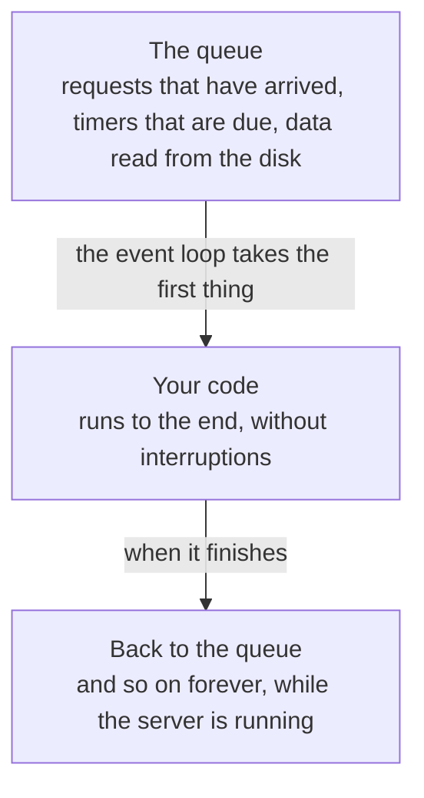
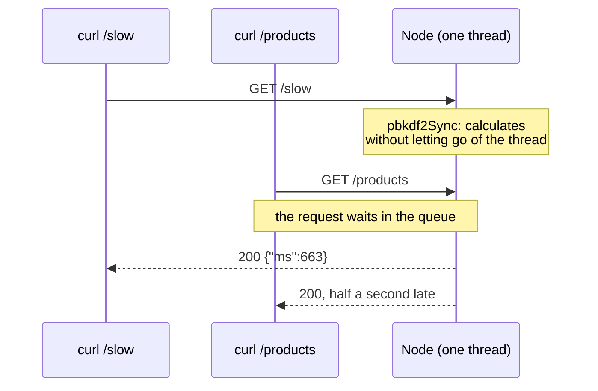
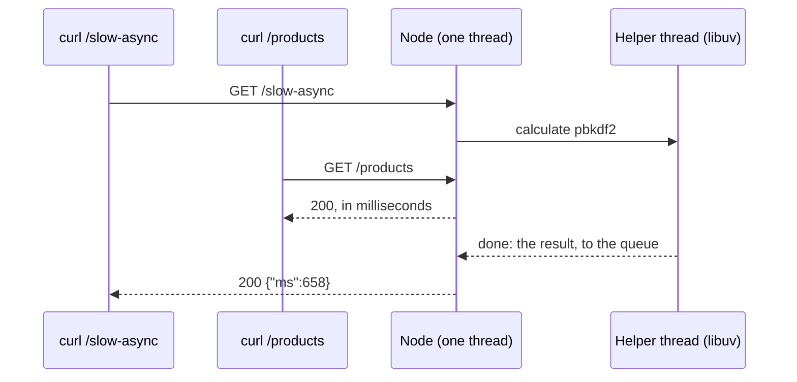

import Term from '~/components/Term.astro';
import TryIt from '~/components/TryIt.astro';
import Analogy from '~/components/Analogy.astro';
import SelfCheck from '~/components/SelfCheck.astro';
import Quiz from '~/components/Quiz.astro';
import QuizQuestion from '~/components/QuizQuestion.astro';
import QuizOption from '~/components/QuizOption.astro';
import ProjectCode from '~/components/ProjectCode.astro';

## The problem

Imagine Luis asks for a new route in the shop's API: a report with the year's sales. Calculating it takes a second and a half, and Luis is fine with that, because only he uses it.

But while Luis asks for it, Ana reloads the shop on her phone, and the product list, which used to take 3 milliseconds, takes more than a second. The same happens to everyone who is shopping. The server hasn't crashed: it's busy with the report and can't do anything else.

In this lesson you'll cause that jam in your API, measure it with `curl` and clear it. To understand it, you need to know how Node.js splits up its time.

## The analogy

<Analogy>

Think of a restaurant with a single waiter. He takes the order at table 1, carries the slip to the kitchen and, while they cook, goes to table 2. He doesn't stand there waiting for the dish: when the kitchen rings the bell, he picks it up and serves it. That way he alone serves twenty tables, because almost all the time is spent waiting for the kitchen, not working himself.

Now table 3 asks him to peel six pounds of potatoes himself. While he peels, he takes no orders, serves no dishes and collects no bills: every table waits because of one.

The waiter is Node.js's thread, the kitchen is the operating system, and peeling potatoes is a long calculation.

<div slot="limits">

- A waiter can leave the potatoes half peeled. Node never interrupts a piece of code: it runs it to the end.
- The waiter serves whoever he likes. The event loop follows a fixed order: promises before timers, as you'll see.
- A restaurant hires another waiter and that's it. Node can also use more threads, but you have to ask for them: your JavaScript, by default, runs on one.

</div>

</Analogy>

## How it really works

### A single thread for your code

In [Phase 1](/en/phase-1/linux-processes-and-signals/) you saw that a running program is a <Term id="process">process</Term>. Inside a process, one or more <Term id="thread">threads</Term> work: lines of work that the processor runs instruction by instruction. With four threads, a process can do four things at once, each on one core of the processor (today's have several).

Your server is a process, and **all your JavaScript runs on a single thread**: the routes, the <Term id="middleware">middleware</Term>, the validation and the logs. Many servers in other languages, like the classic Java or PHP ones, handle each request on its own thread or process. Node doesn't: one thread serves everyone, one thing at a time.

How can one thread cope with thousands of clients? With the <Term id="event-loop">event loop</Term>, which always repeats the same thing:



Each request isn't a single piece of code. If your route does `await` ([lesson 2](/en/phase-3/javascript-for-backend/#waiting-for-what-takes-time-promises-async-and-await)), it splits in two: what comes before the `await` is one piece, and what comes after is another that will enter the queue when its <Term id="promise">promise</Term> is fulfilled. Between the two, the thread is free for other things.

### Waiting doesn't block

When your code asks the network, the disk or, from Phase 5, a database for something, Node doesn't sit there watching. It hands the job to a library written in C that it carries inside, **libuv**, and carries on with the queue. libuv works in two ways:

- **The network:** it asks the operating system to let it know when data arrives. Waiting on a thousand connections ties up no thread.
- **Everything else** (reading files, compressing, some cryptography operations): it does it in a small team of **four helper threads**, the *thread pool*. When they finish, they leave the result in the queue.

A web server spends almost all its time waiting: for the client, for the database, for another API. That's why one thread is enough: while it waits, it serves others, like the waiter who doesn't stay in the kitchen.

### Calculating does block

Calculating is something else: it's work for the thread itself, and nobody else can do it for it. While it calculates, it takes nothing from the queue. That's called <Term id="blocking">blocking code</Term>.

Examples from a real server: checking a password, which is slow to calculate on purpose (Phase 6), resizing an image, going through a list of millions of items, or converting <Term id="json">JSON</Term> text of many megabytes with `JSON.parse`.

To see it, this lesson's API has two routes with the same expensive calculation. They need two imports at the top of `src/app.ts`:

<ProjectCode file="shop-api/09-event-loop/src/app.ts" region="import-crypto" />

- From `node:crypto`, Node's cryptography <Term id="module">module</Term>, come `pbkdf2Sync` and `pbkdf2`: two versions of the same function.
- From `node:util` comes `promisify`, which turns an old-style function, one that lets you know it has finished by calling another function, into one that returns a promise, the kind `await` understands.

And the two routes, which go after `app.get('/orders/:id', …)`:

<ProjectCode file="shop-api/09-event-loop/src/app.ts" region="slow" />

Piece by piece:

- `pbkdf2` turns a password into a <Term id="hash">hash</Term>, repeating the operation many times so that guessing passwords is slow. It takes the password, a “salt” (Phase 6), the rounds, the bytes of the result and the algorithm.
- `ROUNDS = 3_000_000`: three million rounds. The `_` only separate the thousands to make it easier to read; JavaScript ignores them.
- `promisify(pbkdf2)` creates `pbkdf2Async`, the version of `pbkdf2` that returns a promise.
- `performance.now()` gives the milliseconds the program has been running: the one at the end minus the one at the start is how long it took, and `Math.round` rounds it.
- **`/slow`** calls `pbkdf2Sync`. *Sync* is short for “synchronous”: it returns nothing until it's done, and it does the work on your thread.
- **`/slow-async`** does `await pbkdf2Async(…)`. The calculation is the same, but one of libuv's helper threads does it, and yours stays free meanwhile.

Both answer with how long the calculation took, `{"ms": …}`. What changes is what happens to everyone else meanwhile:





### The order: your code, promises and timers

There isn't just one queue: there are several, with priorities. `examples/order.ts` shows it in four lines. Before running it, guess in what order they come out:

<ProjectCode file="shop-api/09-event-loop/examples/order.ts" />

- `console.log` writes a line in the terminal.
- `setTimeout(function, 0)` schedules a timer: “run this function in 0 milliseconds.”
- `Promise.resolve().then(function)` creates a promise that is already fulfilled and tells it what to do with it.

<TryIt
  title="The order of things"
  cmd="node examples/order.ts"
  output={`1. The program starts
2. The code ends, from top to bottom
3. The promise that is already resolved
4. The timer, even though it is 0 ms`}
>

Run it from the project folder. If you get `Cannot find module`, check that you're in `shop-api` (with `pwd`) and that the file is in `examples/`.

</TryIt>

Neither the timer nor the promise runs where it's written. The rules:

1. **First, the current piece of code, all of it**, from top to bottom: messages 1 and 2.
2. **Then, every promise that is already fulfilled.** This queue is emptied every time a piece of code finishes, before looking at anything else: number 3.
3. **After that, everything else**, in turns of the loop: timers that are due, requests that have arrived, files that have been read. Number 4.

So `setTimeout(…, 0)` doesn't mean “now,” but “as soon as the loop gets to the timers.” And if a piece of code takes a second, the 0 ms timer takes a second.

### How not to block the server

If a route has to do an expensive calculation, there are four ways out, from the simplest to the most complete:

| What to do | When | How |
|---|---|---|
| Use the asynchronous version | If Node has one: cryptography, files, compression | `pbkdf2` instead of `pbkdf2Sync`, `readFile` instead of `readFileSync` |
| Split the work into pieces | A very long loop in your own code | Process a thousand items, give the turn back to the loop (`setImmediate`) and carry on |
| Move it to another thread | A heavy calculation of yours: an image, a report | `worker_threads`, a Node module that runs your JavaScript on another thread |
| Move it to another service | Long jobs that don't have to answer right away | A job queue and another process that does them (Phase 9) |

`Sync` functions aren't bad in themselves. At startup, before accepting requests, reading the configuration with `readFileSync` makes nobody wait. The problem is using them inside a route.

### Why it matters with many users

Do the math with a route that blocks for a second and a half, like Luis's report. If ten people ask for it at once, the tenth waits fifteen seconds. And not only them: any other request that arrives in the meantime waits too.

A bigger computer doesn't fix it: your JavaScript runs on one thread, and a thread uses a single core of the processor. The asynchronous version does make use of more cores, because the helper threads calculate at the same time on other cores. Spreading the work across several Node processes is Phase 9.

## Try it

The goal: measure how long the product list waits while another request calculates, find out why your log doesn't see it, and make it stop waiting.

Add the two imports and the two slow routes to your `src/app.ts`, create the `examples` folder with `order.ts` and start the server as in [lesson 8](/en/phase-3/node-errors-and-logging/), with `npm start`. If you get stuck, download this lesson's folder from `~/backend-course/phase-3` and compare it with yours:

```sh
cd ~/backend-course/phase-3
curl -O https://backenddesdecero.com/practicas/shop-api/09-event-loop.tar.gz
tar -xzf 09-event-loop.tar.gz
```

And inside it, `npm install`. The outputs are from Node 26.11.1 on Linux. **Your times will be different**: they depend on your processor and on how busy it is. Look at the proportions, not at the exact numbers.

### The two routes, separately

With the server running in one terminal, open another.

<TryIt
  title="1. A slow request, on its own"
  cmd="curl -w '\n' localhost:3000/slow"
  output={`{"ms":666}`}
>

`-w '\n'` adds a line break at the end, as in [lesson 7](/en/phase-3/zod-validation/). Less than a second. On your computer it may be half a second or two; if it goes over five, lower `ROUNDS` to a million so you don't wait so long.

</TryIt>

<TryIt
  title="2. The product list, on its own"
  cmd={`curl -s -o /dev/null -w "products: %{time_total} s\\n" localhost:3000/products`}
  output={`products: 0.000780 s`}
>

`-o /dev/null` throws away the list, which you don't care about right now, and `-w` writes, when it finishes, how long the whole request took, in seconds (`%{time_total}`), and the line break. Less than a millisecond: that's the baseline.

</TryIt>

### The two at once

Now, the slow one and the list at almost the same time. Paste the whole block:

<TryIt
  title="3. The list, while /slow calculates"
  cmd={`( curl -s -o /dev/null -w "slow:     %{time_total} s\\n" localhost:3000/slow &
  sleep 0.2
  curl -s -o /dev/null -w "products: %{time_total} s\\n" localhost:3000/products
  wait )`}
  output={`slow:     0.663501 s
products: 0.463793 s`}
>

- `&` starts the first `curl` in the background, as in [Phase 1](/en/phase-1/linux-processes-and-signals/#foreground-and-background): you don't wait for it to finish.
- `sleep 0.2` waits two tenths of a second, so that `/slow` arrives first.
- `wait` waits for what's in the background to finish.
- The parentheses group the commands, so the shell doesn't write its job notices (`[1] 4321`, `done`).

The list, which took less than a millisecond, has taken almost half a second: what `/slow` still had left when it arrived. The two lines may come out in the other order: they finish almost at the same time.

</TryIt>

### What the log doesn't see

Look at the server's terminal. Among its JSON lines, the ones from [lesson 8](/en/phase-3/node-errors-and-logging/), are the ones for these two requests:

<TryIt
  title="4. The log of the two requests"
  cmd="npm start"
  output={`…
{"level":30,"time":1791890318972,"pid":101,"hostname":"laptop","requestId":"7e553f91-cd6e-47ee-82f5-6e348e7884dc","method":"GET","path":"/slow","status":200,"ms":663,"msg":"request"}
{"level":30,"time":1791890318973,"pid":101,"hostname":"laptop","requestId":"2337d7c1-1ed8-4701-aaad-47dac126939d","method":"GET","path":"/products","status":200,"ms":0,"msg":"request"}`}
>

Don't run it again: it's the terminal where it's already running. Your `time`, `pid`, `hostname` and `requestId` will be different.

</TryIt>

Look at the `"ms":0` for `/products`. For the server, the list took less than a millisecond; for the client, almost half a second. Both are telling the truth: the `requestLog` middleware starts counting when the request leaves the queue, and the wait came before. **A blocked server doesn't see it in its own times**: you have to measure from the outside, as you've just done with `curl`. You'll see it in Phase 10, with metrics.

### Now, without blocking

<TryIt
  title="5. The list, while /slow-async calculates"
  cmd={`( curl -s -o /dev/null -w "slow-async: %{time_total} s\\n" localhost:3000/slow-async &
  sleep 0.2
  curl -s -o /dev/null -w "products:   %{time_total} s\\n" localhost:3000/products
  wait )`}
  output={`products:   0.001002 s
slow-async: 0.658673 s`}
>

The list comes out first, in a millisecond, even though it arrived later: the calculation is on a helper thread, and yours has served it without waiting. If `products` still takes as long as the slow one, check that you're calling `/slow-async` and that its route uses `await pbkdf2Async`, not `pbkdf2Sync`.

</TryIt>

<SelfCheck question="Challenge: send two /slow at once, and then two /slow-async at once. How long does each one take? Why?">

The two `/slow`, in the background and without the `sleep`:

```sh
( curl -s -o /dev/null -w "slow A: %{time_total} s\n" localhost:3000/slow &
  curl -s -o /dev/null -w "slow B: %{time_total} s\n" localhost:3000/slow &
  wait )
```

```
slow B: 0.690596 s
slow A: 1.360801 s
```

And the same with `/slow-async`, calling them `async A` and `async B`:

```
async A: 0.674652 s
async B: 0.675149 s
```

The two `/slow` go in single file: the one that arrives second waits for the other to finish and takes twice as long. The two `/slow-async` calculate at the same time, each on a helper thread, and take as long as a single one. With five at once, the fifth would wait: there are four helper threads.

</SelfCheck>

## You have already seen it

- **A frozen tab.** When the browser warns that “the page isn't responding,” it's the same thing: the page's JavaScript runs on one thread with its event loop, and something has blocked it.
- **In DevTools** ([how to open them](/en/phase-2/#before-you-start-devtools)). The **Performance** tab records what a page does and marks with a red triangle the tasks longer than 50 milliseconds: pieces of code that have blocked the thread.
- **In your terminal.** `sleep 60` leaves you without a prompt until it finishes, and `sleep 60 &` gives it back right away: blocking or not blocking, in [Phase 1](/en/phase-1/linux-processes-and-signals/#foreground-and-background).
- **In HTTP/1.1.** A slow response held up the ones behind it: [head-of-line blocking](/en/phase-2/http2-vs-http3/), the same idea.

## Common mistakes

- **`Sync` functions inside a route.** `readFileSync` or `pbkdf2Sync` block the thread while they last: in a route, use the asynchronous version.
- **Believing that `async` sends the work to another thread.** An `async` function runs on the same thread. If there's a one-second calculation inside, it blocks for a second, with or without `await` on other lines.
- **Trusting the server's own times.** Your log doesn't see what a request waits in the queue. Measure from the client.
- **Forgetting that reading JSON is calculating too.** A `JSON.parse` of 50 MB blocks the whole server: limit the size of what you accept.

## Summary

- All your JavaScript runs on a single thread: the event loop runs a piece of code to the end and takes the next thing from the queue.
- Waiting for the network or the disk doesn't block: libuv does it, and the thread stays free. Calculating does, and while it lasts, every request waits.
- First comes the current code, then the fulfilled promises and then the timers: `setTimeout(…, 0)` isn't “now.”
- To avoid blocking: the asynchronous version, splitting the work, `worker_threads` or another service.
- Your log doesn't see the blocking: measure it from the outside, with several requests at once.

### What you've built in this phase

Maybe you started the phase without ever having programmed, and you finish it with a real API for Ana and Luis's shop, the one that replaces the fake `/api/orders` of Phase 2's nginx:

- routes to see the products and the orders, all of them or one by one, and to create them: first with `node:http` and then with Hono;
- middleware that logs each request, opens CORS to the shop and answers `401` to anyone who adds products without Ana's token;
- validation with Zod: a `422` that says which field fails and why, and a `400` if the request can't even be read;
- errors that don't slip out: a `404` or a `500` in JSON, without the stack trace and with an id to find it in the log;
- logs in JSON, configuration in environment variables and, now, what makes an API slow and how to measure it.

Up to here, you decided what each route was called and what it answered. In Phase 4, “API design,” you design it for others: routes that are understood without asking you, pagination, versions and a written contract with OpenAPI.

## Did you get it?

<Quiz>

<QuizQuestion
  question="The shop has a /report route that goes through a million orders and takes two seconds. While Luis asks for it, what happens to the customers who ask for /products?"
  review="Calculating does block"
>

<QuizOption text="Nothing: Node handles each request on its own thread, so they run in parallel.">

That's what other servers do, like many Java or PHP ones. Node runs all your JavaScript on a single thread, and while it goes through the orders it serves nothing else.

</QuizOption>

<QuizOption text="They wait for the report to finish, and then they get their list." correct>

The calculation ties up the only thread your code has. Their requests wait in the queue until the report finishes.

</QuizOption>

<QuizOption text="They get a 503 error right away: the server turns down requests while it’s busy.">

The server doesn't turn anything down: it can't even do that, because it's calculating. The requests wait in the queue and are served when it finishes.

</QuizOption>

</QuizQuestion>

<QuizQuestion
  question="A program writes A, schedules a 0 ms setTimeout that writes B, creates an already fulfilled promise that writes C and, at the end, writes D. In what order do they come out?"
  review="The order: your code, promises and timers"
>

<QuizOption text="A, D, C, B." correct>

First the whole current code (A and D), then the fulfilled promises (C) and, on the next turn of the loop, the timers (B).

</QuizOption>

<QuizOption text="A, B, C, D: a 0 ms timer runs on the spot.">

`setTimeout(…, 0)` doesn't run anything on the spot: it schedules the function for when the loop gets to the timers, after the current code.

</QuizOption>

<QuizOption text="A, D, B, C: the timer was scheduled before the promise, so it goes first.">

The order in which they're written doesn't decide: the promise queue is emptied before looking at the timers, even if these were scheduled earlier.

</QuizOption>

</QuizQuestion>

<QuizQuestion
  question="To make /slow stop blocking, someone turns its function into async, but inside it still calls pbkdf2Sync. Does it stop blocking?"
  review="How not to block the server"
>

<QuizOption text="Yes: an async function runs on another thread.">

`async` doesn't change thread. It only makes the function return a promise and lets you use `await` inside; the code stays on the usual thread.

</QuizOption>

<QuizOption text="Yes, as long as there’s some await in the function, on any line.">

An `await` frees the thread while it waits for its promise, but `pbkdf2Sync` doesn't wait for anything: it calculates, and ties up the thread until it finishes.

</QuizOption>

<QuizOption text="No: pbkdf2Sync is still calculating on your code’s thread." correct>

What blocks is `pbkdf2Sync`, not the function around it. The fix is the asynchronous version, `pbkdf2`, which calculates on a helper thread.

</QuizOption>

</QuizQuestion>

<QuizQuestion
  question="While someone was asking for /slow, your log says a request to /products took 1 ms, but the client who made it complains that it took a second. Who is right?"
  review="What the log doesn't see"
>

<QuizOption text="Both: the log only measures from when the request leaves the queue." correct>

The wait in the queue happens before the middleware starts counting. For the server it was 1 ms; for the client, a second. That's why you measure from the outside.

</QuizOption>

<QuizOption text="The log: if the server took 1 ms, the missing second is the client’s network.">

On `localhost` there's no slow network. The request spent that second waiting inside the server, in a queue the log doesn't see.

</QuizOption>

<QuizOption text="The client: the log is wrong, because the middleware is counting another request’s time.">

The middleware counts its own request's time correctly, from when it starts handling it. What it doesn't see is what it waited before.

</QuizOption>

</QuizQuestion>

<QuizQuestion
  question="A route asks another API for data with await fetch(…), and that API takes three seconds to answer. Meanwhile, can your server handle other requests?"
  review="Waiting doesn't block"
>

<QuizOption text="No: until the response arrives, the thread is stopped waiting for it.">

The thread doesn't wait: the `await` splits the route in two, and the second part enters the queue when the response arrives. Meanwhile, the thread is free.

</QuizOption>

<QuizOption text="Yes: while it waits for the network, the thread serves others." correct>

Waiting for the network doesn't tie up the thread: libuv asks the operating system to let it know when the data arrives.

</QuizOption>

<QuizOption text="Only with several threads: one thread can’t wait and serve at the same time.">

It can, and that's the idea of the event loop: the waiting is done by the operating system, not by your thread. That's why a single thread serves thousands of connections.

</QuizOption>

</QuizQuestion>

<QuizQuestion
  question="Ten people ask at once for a route that blocks for one second. You’re offered a computer with twice the cores. What gets better?"
  review="Why it matters with many users"
>

<QuizOption text="The tenth person waits half as long: Node spreads the requests across the cores.">

Node doesn't spread your JavaScript across cores: it runs on one thread, and a thread uses one core. To use more, you need several processes (Phase 9).

</QuizOption>

<QuizOption text="Nothing, and the asynchronous version wouldn’t help either: Node never uses more than one core.">

libuv's helper threads do calculate on other cores. With the asynchronous version, several requests calculate at the same time, as in the challenge.

</QuizOption>

<QuizOption text="Almost nothing: the route still blocks the only thread your code has." correct>

As long as the route blocks, the ten go in single file through the same thread, however many cores there are. What makes things better is to stop blocking.

</QuizOption>

</QuizQuestion>

</Quiz>

## Further reading

- [The Node.js Event Loop](https://nodejs.org/learn/asynchronous-work/event-loop-timers-and-nexttick) (Node.js): the phases of the loop, one by one, with `setImmediate` and `process.nextTick`.
- [Don't Block the Event Loop (or the Worker Pool)](https://nodejs.org/learn/asynchronous-work/dont-block-the-event-loop) (Node.js): what blocks, including regular expressions and large JSON, and how to avoid it.
- [JavaScript execution model](https://developer.mozilla.org/en-US/docs/Web/JavaScript/Reference/Execution_model) (MDN): the same model in the browser, with its task queues.
- [What the heck is the event loop anyway?](https://www.youtube.com/watch?v=8aGhZQkoFbQ) (Philip Roberts, JSConf EU 2014): a talk that draws the event loop step by step.
