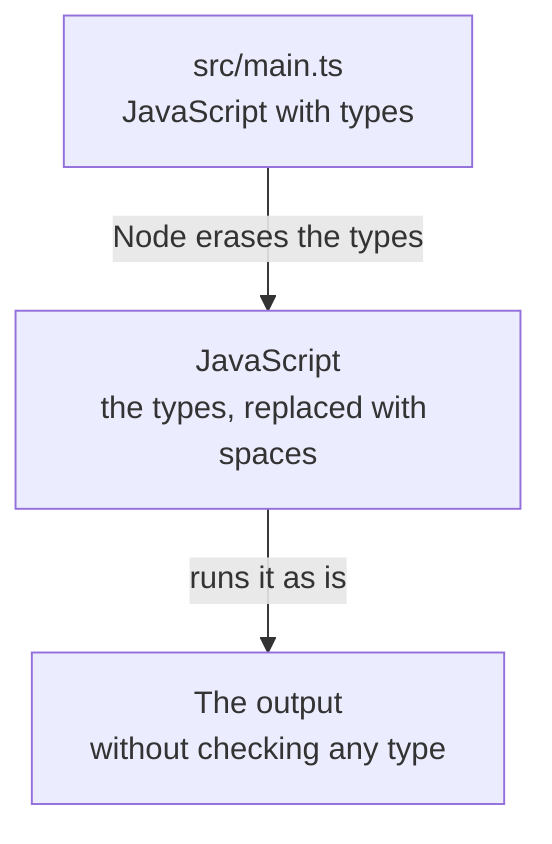

import Term from '~/components/Term.astro';
import TryIt from '~/components/TryIt.astro';
import Analogy from '~/components/Analogy.astro';
import SelfCheck from '~/components/SelfCheck.astro';
import ProjectCode from '~/components/ProjectCode.astro';
import Quiz from '~/components/Quiz.astro';
import QuizQuestion from '~/components/QuizQuestion.astro';
import QuizOption from '~/components/QuizOption.astro';

## The problem

Imagine the shop's API stores the mug's price as text, `'8.5'`, instead of as a number, `8.5`: someone typed it by hand into a <Term id="json">JSON</Term> file. Two mugs, `'8.5' * 2`, give `17`, and everything seems fine. But with €2 of shipping, `'8.5' + 2` gives `8.52`: <Term id="javascript">JavaScript</Term> has glued them together as text.

JavaScript doesn't complain: it decides on the fly what to do with each piece of data. You find out when a customer sees a total of €8.52 in their cart. And a server receives data from many places: the bigger it grows, the easier it is for one piece to arrive with the wrong shape.

<Term id="typescript">TypeScript</Term> lets you write down what shape each piece of data has, and a program checks all your code against that description **before running it**. In this lesson you move the shop's code to TypeScript and see which mistakes it catches, and which it doesn't.

## The analogy

<Analogy>

Think of a government form. Each box says what goes in it: “Date (mm/dd/yyyy),” “Amount in euros.” Those instructions are the types.

Before you hand it in, the clerk at the counter checks the whole thing and marks it in red: “you've put letters where a number goes.” That checker is tsc, TypeScript's checker, and its red pen is your editor's underline.

Then the form gets processed. Whoever processes it no longer reads the instructions on the boxes, only what you wrote: that's Node.

<div slot="limits">

- The clerk only checks the form you fill in. The papers that come to you from outside, like the JSON a client sends you, nobody checks against those boxes: that's done when you receive them, in [lesson 7, “Validation”](/en/phase-3/zod-validation/).
- A form that hasn't been checked doesn't get processed. A `.ts` file with type errors does: Node runs it anyway, with the mistake inside.
- Someone else designs the boxes on the form. You write the types yourself, and if you write them wrong, the checker compares against the wrong model.

</div>

</Analogy>

## How it really works

### A type says what kind of data goes where

This is JavaScript from [lesson 2, “JavaScript”](/en/phase-3/javascript-for-backend/), with something new: a colon and a word after each name.

```ts
const price: number = 8.5;
const name: string = 'Mug';
const available: boolean = true;
```

`: number` is an **annotation**: it says that `price` is a number. `string` is text, and `boolean` is a yes or a no (`true` or `false`). Each one is a <Term id="type">type</Term>: the kind of data that can go in a place.

You don't need to annotate everything: in `const price = 8.5`, TypeScript works out on its own that it's a number (**inference**). You write types where it can't guess them: in the shape of your data and in what each function receives.

### An interface describes an object: the product

The shop's products are <Term id="object">objects</Term> with three pieces of data. This is their type, at the top of `src/products.ts`:

<ProjectCode file="shop-api/03-typescript/src/products.ts" region="product" />

- `interface Product` gives a name to a shape: every `Product` has a numeric `id`, a `name` that is text and a numeric `price`. With it, the mug with the price `'8.5'` is no longer a valid product.
- `export` is new: it lets other files use `Product`. Each file is a <Term id="module">module</Term>, and another file can only bring in with `import` what this one exports, just as you brought in `readFile` from Node in [lesson 1, “Node.js”](/en/phase-3/what-is-node-js/). Here, `src/main.ts` will bring it in.

### type, unions and literal types: an order's status

An order at the shop is pending, paid or shipped. Nothing else:

<ProjectCode file="shop-api/03-typescript/src/products.ts" region="order" />

- `type OrderStatus = …` also gives a name to a type.
- `'pending' | 'paid' | 'shipped'` is a **union**: the bar `|` reads as “or.” Each option is a **literal type**, one specific value: only those three values are allowed.
- `status: OrderStatus` uses it inside `Order`. With `'cancelled'`, the checker warns you.

`interface` and `type` can both describe an object, but only `type` can name a union. In this course, `interface` is for objects and `type` for everything else.

A shape can also be written without a name, right where it's used: `{ productId: number; quantity: number }` is “an object with those two pieces of data.” You'll see it like that from [lesson 4, “HTTP server”](/en/phase-3/node-http-server/) onward.

### Functions with types, and the undefined you can't forget

The rest of the file is the data and two <Term id="function">functions</Term>, now with types, also exported:

<ProjectCode file="shop-api/03-typescript/src/products.ts" region="functions" />

- `Product[]` is an <Term id="array">array</Term> of products: the square brackets say “a list of.”
- `findProduct(id: number)` only accepts a number.
- `products.find(…)` goes through the list and returns the first product that meets the condition: here, that its `id` is the one you're looking for. If none meets it, it returns `undefined`, “no value.”
- `: Product | undefined`, after the parenthesis, is what the function **returns**: a product, or `undefined`.
- `total` receives a product and a quantity, and returns a number.

### Using the types: the main program

`src/main.ts` creates an order and works out what it costs:

<ProjectCode file="shop-api/03-typescript/src/main.ts" region="find" />

- The `import` brings in three pieces that `products.ts` exports. `./` means “in this same folder,” and the `.ts` extension is written out because Node looks for the file exactly as named. `type Order` signals that `Order` is only a type.
- `const order: Order` forces the object to have the four pieces of data, with their types.
- `product` has no annotation: TypeScript works out that it's `Product | undefined`. In VS Code, hover over it and it shows you.
- `if (product === undefined)` checks whether it wasn't found. In the `else`, TypeScript already knows it's a `Product` and lets you read `product.name`: it has **narrowed** the type.

If you delete the `if`, the checker complains: `'product' is possibly 'undefined'`. Without TypeScript, you'd find out when someone asked for a product that doesn't exist: `TypeError: Cannot read properties of undefined (reading 'name')`. On a server, a `500` error.

### unknown and any: what comes from outside

The end of `main.ts` receives a product in JSON, the way a client would send it in a request:

<ProjectCode file="shop-api/03-typescript/src/main.ts" region="from-outside" />

TypeScript can't know what the text that `JSON.parse` reads will contain. For what you don't know, there are two types:

| Type | What it means | What it lets you do |
|---|---|---|
| `any` | “Anything: don't check a thing” | Everything, with no warnings: it switches TypeScript off for that data |
| `unknown` | “I don't know what it is” | Nothing, until you check what it is |

`JSON.parse` returns `any`, and that's why the code annotates `data: unknown`. The `if` condition checks the data in three steps, joined with `&&` (“and”):

1. `typeof data === 'object'`: it's an object, not a number or a piece of text.
2. `data !== null`: it isn't `null`, the “empty” value. This is needed because, due to a JavaScript quirk, `typeof null` is also `'object'`.
3. `'name' in data`: it has a piece of data called `name`.

Inside the `if`, TypeScript now lets you use `data.name`, and `String(…)` turns it into text, whatever it is.

### Node erases the types when it runs

Node 26, the course's version, runs a `.ts` file with no options and no warnings. But it knows nothing about types: before running, it **erases** them. This example, `examples/type-error.ts`, has a mistake on purpose:

<ProjectCode file="shop-api/03-typescript/examples/type-error.ts" />

And this is what Node really runs, taken from `stripTypeScriptTypes`, its function for erasing types:

```js
                                                  

// The price is text, not a number: tsc marks it as an error, but Node runs it anyway.
const mug          = { id: 2, name: 'Mug', price: '8.5' };
console.log(mug.price * 2);
```

The `import type` line has been left blank (you can't see it above, because it's the first one) and the `: Product` turned into spaces. That way every line and every column stays in place, and an error points to the same spot in your file. What's left is JavaScript, which doesn't know the price was supposed to be a number.



**When it runs, no types are left.** An order that arrives with `"quantity": "lots"` gets in anyway, even if your `interface` says `number`: the data in a request is checked when it's received, with code. It's the golden rule from [Phase 0](/en/phase-0/what-is-the-backend/), “never trust the client,” and [lesson 7, “Validation”](/en/phase-3/zod-validation/), puts it into practice.

### tsc --noEmit: the checker, separately

What does the checking is `tsc`, the TypeScript compiler. Compiling is translating a program into another language, and `tsc` was born to translate `.ts` into `.js`. Here Node already erases the types, so you only use it to check:

- `tsc --noEmit` checks the whole project without writing any file (*no emit*). If everything is fine, it says nothing.
- **The editor** does the same check while you type: VS Code underlines each error in red and, when you hover over it, tells you what's wrong.

You'll install TypeScript 7, which came out in July 2026: the same language, with the compiler rewritten in Go, another programming language. In Microsoft's measurements, on large projects, it checks about ten times faster.

### The tsconfig.json: the checker's rules

`tsc` reads its rules from `tsconfig.json`, in the project folder:

<ProjectCode file="shop-api/03-typescript/tsconfig.json" />

It's JSON with one exception: it allows comments, the lines that start with `//`. What matters, piece by piece:

- `strict: true` turns on all the strict checks, like the one for `undefined`.
- `noEmit` is the `--noEmit`, already written here.
- `allowImportingTsExtensions` accepts `import` lines with `.ts`.
- `erasableSyntaxOnly` warns you if you use something Node can't erase (the next section).
- `verbatimModuleSyntax` requires `type` when you import a type: when it runs, `Order` doesn't exist, and Node would fail looking for it.
- `types: ["node"]` loads Node's types, from the `@types/node` package.
- `exclude` leaves out `examples`, which has mistakes on purpose.

The rest (`target`, `module`, `skipLibCheck`) says you're aiming at the most modern JavaScript and at Node's modules, and not to check the types of the installed packages.

### What Node can't erase

Almost all of TypeScript can be erased without changing what the program does. A few pieces can't, because they generate code. The best known is `enum`, a list of named values that creates a real object. Node doesn't accept them.

You don't need them: a union of literal types, like `OrderStatus`, does the same and is erased without a trace.

## Try it

The goal: move the shop to TypeScript and see which mistakes the checker catches before anything runs. It all happens in your terminal, in `~/backend-course/phase-3/shop-api`. If you get stuck, download this lesson's folder and compare it with yours:

```sh
cd ~/backend-course/phase-3
curl -O https://backenddesdecero.com/practicas/shop-api/03-typescript.tar.gz
tar -xzf 03-typescript.tar.gz
```

The outputs are from Node 26.11.1. Your times will be different.

### Set up the project

<TryIt
  title="1. Install TypeScript"
  cmd="npm install --save-dev typescript@7.0.2 @types/node@26.6.4"
  output={`added 4 packages, and audited 5 packages in 3s

found 0 vulnerabilities`}
>

Two <Term id="package">packages</Term>, with their exact version, as in [lesson 1](/en/phase-3/what-is-node-js/): `typescript`, which brings `tsc`, and `@types/node`, Node's types. `--save-dev` records them as development dependencies: they're needed to write the code, not to run it. The other two “packages” are their dependencies.

</TryIt>

Now create `tsconfig.json`, `src/products.ts` and `src/main.ts` with what you've seen in “How it really works.” The code moves to the `src/` folder (from *source*, “source code”), and the files from [lesson 2](/en/phase-3/javascript-for-backend/) aren't needed anymore: you can delete them.

<TryIt
  title="2. Add the project's commands"
  cmd={`npm pkg set scripts.start="node src/main.ts"
npm pkg set scripts.test="node --test"
npm pkg set scripts.check="tsc --noEmit"
npm pkg get scripts`}
  output={`{
  "test": "node --test",
  "start": "node src/main.ts",
  "check": "tsc --noEmit"
}`}
>

`npm pkg set` changes `package.json` without opening it, as in [lesson 1](/en/phase-3/what-is-node-js/), and `npm pkg get scripts` shows you how they ended up. Three named commands: `npm start` runs the program, `npm test` runs the tests (you'll use them from [lesson 4](/en/phase-3/node-http-server/)) and `npm run check` checks the types. `start` and `test` are names npm knows; for any other, like `check`, you write `npm run`.

If one is missing, or comes out cut short, run its line again with the quotes: without them, the terminal splits `node --test` at the space. Your `package.json` will have a few more fields, from `npm init -y`; the one in the downloadable folder is this:

</TryIt>

<ProjectCode file="shop-api/03-typescript/package.json" />

<TryIt
  title="3. Run the program"
  cmd="node src/main.ts"
  output={`Order 1: 3 × Mug = 25.5 €
A product has arrived: Cap`}
>

Node runs the `.ts` file directly: no compiling first. `npm start` does the same.

If you get `ERR_MODULE_NOT_FOUND`, check that the `import` in `main.ts` ends in `products.ts`, with its extension.

</TryIt>

<TryIt
  title="4. Check the types"
  cmd="npx tsc --noEmit"
>

`npx` runs a program installed in the project, here `tsc`. Nothing comes out: in the terminal, silence is a good sign. `npm run check` does the same.

</TryIt>

### Error 1: a status that doesn't exist

In `src/main.ts`, change `'pending'` to `'cancelled'` and save. If you have the folder open in VS Code, you'll see the red underline before running anything. Now run it and check:

<TryIt
  title="5. Node runs it, tsc catches it"
  cmd={`node src/main.ts
npx tsc --noEmit`}
  output={`Order 1: 3 × Mug = 25.5 €
A product has arrived: Cap
src/main.ts:3:58 - error TS2322: Type '"cancelled"' is not assignable to type 'OrderStatus'.

3 const order: Order = { id: 1, productId: 2, quantity: 3, status: 'cancelled' };
                                                           ~~~~~~

  src/products.ts:16:3 - The expected type comes from property 'status' which is declared here on type 'Order'
    16   status: OrderStatus;
         ~~~~~~


Found 1 error in src/main.ts:3`}
>

Node runs the program as if nothing were wrong. `tsc` doesn't: `'cancelled'` doesn't fit in `OrderStatus` (“is not assignable”), and underneath it tells you where the rule comes from, the `status` field of `Order`.

`3:58` is the line and the column: if your file has one line more or less, they change. Put `'pending'` back.

</TryIt>

### Error 2: a price as text

Create the `examples` folder with two files: `type-error.ts`, the one from “Node erases the types when it runs,” and its own `tsconfig.json`, which inherits the rules of the main one (`extends`) and only checks this folder:

<ProjectCode file="shop-api/03-typescript/examples/tsconfig.json" />

<TryIt
  title="6. The price of two mugs"
  cmd={`node examples/type-error.ts
npx tsc -p examples`}
  output={`17
examples/type-error.ts:4:44 - error TS2322: Type 'string' is not assignable to type 'number'.

4 const mug: Product = { id: 2, name: 'Mug', price: '8.5' };
                                             ~~~~~

  src/products.ts:6:3 - The expected type comes from property 'price' which is declared here on type 'Product'
    6   price: number;
        ~~~~~


Found 1 error in examples/type-error.ts:4`}
>

`17` is right by chance: with `*`, JavaScript turns the text into a number. With a `+`, as in “The problem,” you'd get `8.52`. `tsc` doesn't wait to see the result: text doesn't fit where a number goes.

`-p examples` (from *project*) tells `tsc` which `tsconfig.json` to use: the one in the `examples` folder.

</TryIt>

### Error 3: an enum

Create `src/status.ts` with an `enum`, like the ones in many tutorials:

```ts
enum Status {
  Pending,
  Paid,
}
console.log(Status.Paid);
```

<TryIt
  title="7. What Node can't erase"
  cmd="node src/status.ts"
  output={`node:internal/modules/run_main:111
    triggerUncaughtException(
    ^

file:///Users/ana/backend-course/phase-3/shop-api/src/status.ts:1
  > enum Status {
      Pending,
      Paid,
  > }
    console.log(Status.Paid);

SyntaxError [ERR_UNSUPPORTED_TYPESCRIPT_SYNTAX]: TypeScript enum is not supported in strip-only mode
    at parseTypeScript (node:internal/modules/typescript:57:40)
    …
    at afterResolve (node:internal/modules/esm/loader:614:52) {
  code: 'ERR_UNSUPPORTED_TYPESCRIPT_SYNTAX'
}

Node.js v26.11.1`}
>

This time Node does stop: `enum` isn't supported in *strip-only* mode, the mode that only erases types. The lines with `>` point at the guilty piece. We've removed eight `at …` lines, which say where Node was passing through on the inside.

On Linux and WSL, the path starts with `/home/ana`.

</TryIt>

<TryIt
  title="8. tsc would have told you before"
  cmd="npx tsc --noEmit"
  output={`src/status.ts:1:6 - error TS1294: This syntax is not allowed when 'erasableSyntaxOnly' is enabled.

1 enum Status {
       ~~~~~~


Found 1 error in src/status.ts:1`}
>

The editor would have marked it while you were typing. Delete the file with `rm src/status.ts`, and `npx tsc --noEmit` goes back to silence.

</TryIt>

<SelfCheck question="Challenge: in src/main.ts, delete the if (typeof data …) line and its closing brace, }. What does npx tsc --noEmit say? And if you also change unknown to any?">

With `unknown`, `tsc` doesn't let you read `data.name` without first checking what it is:

```
src/main.ts:16:48 - error TS18046: 'data' is of type 'unknown'.

16   console.log(`A product has arrived: ${String(data.name)}`);
                                                  ~~~~


Found 1 error in src/main.ts:16
```

With `any`, silence: not because the code is right, but because you've switched the check off. If the JSON didn't bring `name`, nobody would warn you. Leave `main.ts` as it was.

</SelfCheck>

## You have already seen it

- **“Hello, undefined” or a total of “€NaN”** in an email or on a website: a piece of data that was missing, or of another type, and nobody checked it.
- **VS Code's suggestions**, even in `.js` files: under the hood, the editor uses TypeScript to know what each object has.
- **This very site.** Every change to its code goes through an automatic type check before it's published. So does every folder of the `shop-api` project, with `npm run check`.

## Common mistakes

- **Believing types are checked when the code runs.** Node erases them. What arrives in a request has to be checked with code ([lesson 7, “Validation”](/en/phase-3/zod-validation/)).
- **Using `any` to make the checker shut up.** The warning goes away, not the mistake. For what you don't know, use `unknown`, and check it.
- **Copying an `enum` from a tutorial.** Node answers `ERR_UNSUPPORTED_TYPESCRIPT_SYNTAX`. Use a union: `'pending' | 'paid'`.
- **Importing without `.ts` or without `type`.** Without the extension, Node gives `ERR_MODULE_NOT_FOUND`. Without `type`, `does not provide an export named 'Order'`: when it runs, that type no longer exists.

## Summary

- A type says what kind of data goes where. You annotate it with `:`, name it with `interface` or `type`, and a union of literals (`'pending' | 'paid'`) limits the possible values.
- `Product | undefined` forces you to count on something not existing, and `unknown` forces you to check what comes from outside. `any` switches the check off.
- Node runs `.ts` files by erasing the types: it doesn't compile or check anything, and it only accepts syntax that can be erased.
- What does the checking is `tsc --noEmit`, and your editor while you type. When the code runs, no types are left: the data in a request is validated with code.

## Did you get it?

<Quiz>

<QuizQuestion
  question="You write const cap: Product = { id: 4, name: 'Cap', price: '15' }. VS Code underlines it in red, but you run node src/main.ts anyway. What happens?"
  review="Node erases the types when it runs"
>

<QuizOption text="Node refuses to run it until you fix the type.">

Node doesn't look at the types: it erases them and runs what's left. It only stops at syntax it can't erase, like `enum`.

</QuizOption>

<QuizOption text="It runs, and the price is still text." correct>

Node erases `: Product` and runs the JavaScript that's left, with `'15'` inside. The mistake will show up, if it does, when something does math with that price.

</QuizOption>

<QuizOption text="Node turns '15' into the number 15, because the type says number.">

Types don’t convert anything: they disappear before the code runs. The text is still text.

</QuizOption>

</QuizQuestion>

<QuizQuestion
  question='Your API stores each order it receives in a variable of type Order. A client sends a JSON with "quantity": "lots". What does TypeScript do?'
  review="Node erases the types when it runs"
>

<QuizOption text="Nothing: when the code runs there are no types, and that data has to be checked when it’s received." correct>

Types only exist while you write and check the code. What arrives in a request is validated with code, as [lesson 7](/en/phase-3/zod-validation/) will do.

</QuizOption>

<QuizOption text="It answers the client with an error on its own, without you writing anything.">

TypeScript doesn't answer anyone: when the server is running, the `interface` no longer exists. Your code has to send the error response.

</QuizOption>

<QuizOption text="tsc catches it in npm run check, because it also checks the data the server receives.">

`tsc` only reads your code, before it runs. It never sees the requests that arrive later.

</QuizOption>

</QuizQuestion>

<QuizQuestion
  question="You read a JSON with JSON.parse and you don’t know what it contains. What type do you give the result?"
  review="unknown and any: what comes from outside"
>

<QuizOption text="any: that way TypeScript warns you if the data doesn’t fit.">

With `any`, TypeScript doesn't warn you about anything: it switches the check off for that data.

</QuizOption>

<QuizOption text="Product: that way TypeScript checks that it really is one.">

TypeScript believes you without checking anything, because when the code runs there are no types. If the JSON brings something else, the error shows up later and further away.

</QuizOption>

<QuizOption text="unknown: it doesn’t let you use it until you check what it is." correct>

With `unknown`, every use needs a check first, like the `if` in `main.ts`. It's the honest choice: you don't know what it is.

</QuizOption>

</QuizQuestion>

<QuizQuestion
  question="You copy enum Status { Pending, Paid } from a tutorial and Node answers ERR_UNSUPPORTED_TYPESCRIPT_SYNTAX. Why?"
  review="What Node can't erase"
>

<QuizOption text="Because enum generates code, and Node only knows how to erase types." correct>

An `enum` isn't just an annotation: it generates code. Node only erases, so it rejects it. A union of literals does the same and can be erased.

</QuizOption>

<QuizOption text="Because your Node is old: Node 26 already runs enums.">

The lesson's error comes from Node 26.11.1. Node only erases types, and an `enum` can't be erased without changing the program.

</QuizOption>

<QuizOption text="Because you need to run tsc --noEmit first: then Node understands it.">

`--noEmit` doesn't write any file, and Node doesn't use `tsc` for anything. `tsc` would only have warned you sooner.

</QuizOption>

</QuizQuestion>

<QuizQuestion
  question="You want an order’s payment method to be only 'card' or 'transfer'. How do you write it?"
  review="type, unions and literal types: an order's status"
>

<QuizOption text="method: string, and a comment saying which values are allowed.">

Nobody checks comments, and `string` accepts any text, `'cash'` included.

</QuizOption>

<QuizOption text="With an enum: a union of text values doesn’t stop you from writing another value.">

A union of literals does stop it: `'cash'` doesn't fit in `'card' | 'transfer'`. And Node doesn't run `enum`s.

</QuizOption>

<QuizOption text="type PaymentMethod = 'card' | 'transfer', and method: PaymentMethod." correct>

A union of literal types: only those two values. Like `OrderStatus`, it's erased when the code runs, without a trace.

</QuizOption>

</QuizQuestion>

<QuizQuestion
  question="A teammate deletes the if (product === undefined) from main.ts because “that product always exists,” and tsc complains. What is it telling you?"
  review="Functions with types, and the undefined you can't forget"
>

<QuizOption text="That there’s a syntax error and Node won’t be able to run the file.">

Node would run it without a problem as long as the product exists. The failure would come the day it doesn't.

</QuizOption>

<QuizOption text="That findProduct may not find anything, and you don’t check for it." correct>

The type `Product | undefined` says the search can fail. Without the check, an id that doesn't exist ends in `Cannot read properties of undefined`.

</QuizOption>

<QuizOption text="Nothing important: it’s a style warning you can ignore.">

It's a real error: `tsc` ends with a failure, and on a server that case would be a `500`.

</QuizOption>

</QuizQuestion>

</Quiz>

## Further reading

- [TypeScript for the New Programmer](https://www.typescriptlang.org/docs/handbook/typescript-from-scratch.html) (official documentation): TypeScript for people who are just starting to program.
- [Everyday Types](https://www.typescriptlang.org/docs/handbook/2/everyday-types.html) (official documentation): everyday types, unions and literal types included.
- [Modules: TypeScript](https://nodejs.org/api/typescript.html) (Node.js): how Node runs `.ts` files and which syntax it doesn't accept.
- [erasableSyntaxOnly](https://www.typescriptlang.org/tsconfig/#erasableSyntaxOnly) (official documentation): the rule that warns you about what Node can't erase.
- [A 10x Faster TypeScript](https://devblogs.microsoft.com/typescript/typescript-native-port/) (Microsoft): the announcement of the compiler rewritten in Go.
