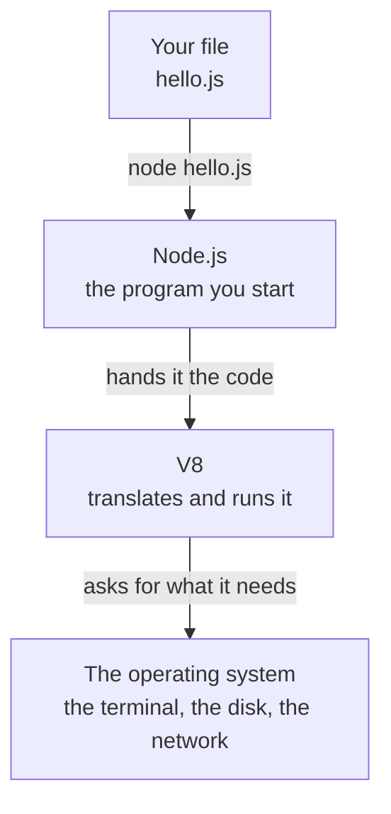

import { FileTree } from '@astrojs/starlight/components';
import Term from '~/components/Term.astro';
import TryIt from '~/components/TryIt.astro';
import Analogy from '~/components/Analogy.astro';
import SelfCheck from '~/components/SelfCheck.astro';
import ProjectCode from '~/components/ProjectCode.astro';
import Quiz from '~/components/Quiz.astro';
import QuizQuestion from '~/components/QuizQuestion.astro';
import QuizOption from '~/components/QuizOption.astro';

## The problem

In Phase 2, the nginx of Ana and Luis's shop answered `/api/orders` with a response written by hand in its configuration. Always the same one, whatever you asked for. A real shop needs a program that reads the order, checks the products, works out the total and answers: a <Term id="backend">backend</Term>, and someone has to write it.

In which language? One is already in every browser: <Term id="javascript">JavaScript</Term>. But JavaScript was born to live inside a web page, and it's locked in there on purpose. A page can't read the files on your disk or sit listening on a <Term id="port">port</Term>. And luckily so: if it could, any website could steal your documents.

A server needs exactly what the browser forbids. Node.js takes JavaScript out of the browser and lets it work with your computer.

## The analogy

<Analogy>

Think of a car engine. All it knows is how to turn, and what you get depends on where you mount it. In a car it moves the wheels, and you have a steering wheel and headlights. Mount the same engine in a motorboat and it moves a propeller: there are no wheels or headlights, but there's a rudder.

The engine is V8, the program inside Chrome that runs JavaScript. The car is the browser, which gives it the web page to work with. The motorboat is Node.js: the same engine, mounted with other parts, the ones a server needs.

<div slot="limits">

- An engine doesn't know where it has been mounted, and neither does your code: it doesn't find out it's in Node until it uses a part that doesn't exist there, like the web page. Then it fails.
- Not every car has this engine: Firefox and Safari run JavaScript with other ones. The language is the same in all of them.
- Node isn't just V8 with parts bolted on: it has its own way of waiting for the disk and the network without stopping, the most important thing in a server ([lesson 9](/en/phase-3/node-event-loop/)).

</div>

</Analogy>

## How it really works

### JavaScript needs a program to run it

JavaScript is a programming language: text with instructions that the computer doesn't understand as it is. It needs a program that translates it into processor instructions and runs it. In Chrome, that program is V8.

In 2009, Ryan Dahl took V8, pulled it out of the browser and put it in a program you start from the terminal: Node.js. You give it a JavaScript file and it runs it:



V8 plus what Node puts around it make up a <Term id="runtime">runtime</Term>: the program that runs a language and gives it access to what's outside. The browser is one for web pages, and Node.js is one for programs on a computer or a server.

### What Node.js adds and what it lacks

The language is the same in both places: `2 + 3` gives `5` in Chrome and in Node. What changes is what's around it:

| | In the browser | In Node.js |
|---|---|---|
| The web page (`document`, `window`) | Yes | No: there's no page |
| Reading and writing files on the disk | No | Yes |
| Listening on a port, being a server | No | Yes |
| Environment variables, the process itself | No | Yes, in `process` |
| Where `console.log` writes | The DevTools console | The terminal |

A running Node program is a <Term id="process">process</Term>, like the ones in [lesson 5 of Phase 1](/en/phase-1/linux-processes-and-signals/): it has its PID and you stop it with <kbd>Ctrl</kbd> + <kbd>C</kbd>. From the code, what it knows about itself is in `process`: `process.version` is its Node version, and `process.env`, its [environment variables](/en/phase-1/environment-variables/).

### The REPL: JavaScript line by line

If you type `node` and nothing else, Node lets you write JavaScript line by line: it reads each line, runs it, shows you the result and waits again. That's why it's called the <Term id="repl">REPL</Term>: read, evaluate, print, and loop back to the start.

It's for trying out single things. When you leave with `.exit`, Node remembers the lines in a history, like the shell (<kbd>↑</kbd>), but there's no program left that you can run again: that goes in a file.

### A program is a `.js` file

The `hello.js` you wrote in [the introduction](/en/phase-3/) is already a program: a text file with JavaScript. `node hello.js` runs it from top to bottom and finishes: the process ends and the prompt comes back. A server, on the other hand, stays running, waiting for requests ([lesson 4](/en/phase-3/node-http-server/)).

### Modules: code in pieces

The second program does something a web page can't: read a file from the disk. It reads this one, with the shop's products in <Term id="json">JSON</Term>:

<ProjectCode file="shop-api/01-node/products.json" />

And this is the program:

<ProjectCode file="shop-api/01-node/read-products.js" />

Piece by piece:

- `import { readFile } from 'node:fs/promises'` brings in a piece from somewhere else: the <Term id="function">function</Term> `readFile`. It comes from `fs` (*file system*), and the `node:` prefix says it's Node's own, built in.
- `const text = await readFile('products.json', 'utf8')` reads the file as text (`'utf8'` says how its letters are stored, accents and `€` included) and keeps it under a name, `text`. `await` waits for the disk to answer ([lesson 2](/en/phase-3/javascript-for-backend/)).
- `JSON.parse(text)` turns that text into data the program can go through: a list of products. `products.length` says how many it has.
- `for (const product of products) { … }` repeats what's between the braces once for each product. Inside, `product.name` and `product.price` are its data, put into the text with `${…}`, as in `hello.js`.

Each code file is a <Term id="module">module</Term>: it can offer pieces to others, which bring them in with `import`. The pieces come from Node (`node:fs/promises`), from other files of yours ([lesson 3](/en/phase-3/typescript-with-node/)) or from code written by other people, with npm.

### TypeScript too

Node 26 also runs `.ts` files, written in <Term id="typescript">TypeScript</Term>: JavaScript with notes about the type of each piece of data, which Node erases before running it. What you gain with them is in [lesson 3](/en/phase-3/typescript-with-node/).

### npm: other people's code

Node comes with <Term id="npm">npm</Term>, its <Term id="package-manager">package manager</Term> (it's usually read as *Node Package Manager*, although officially it isn't an acronym). It's two things:

- **A catalog** on the internet, the npm registry, with millions of <Term id="package">packages</Term>: code someone has published with a name and a version for others to use.
- **A command**, `npm`, that downloads them into your project and notes down which ones you use.

There's an important difference from apt, the one in [lesson 6 of Phase 1](/en/phase-1/systemd-services-and-apt/): its catalog is prepared and signed by Ubuntu. **On npm, anyone can publish a package, and nobody reviews it first.** That's its strength and its risk.

### package.json: the project's ID card

An npm project is a folder with a `package.json` file. `npm init -y` creates one. This is the one in this lesson's folder:

<ProjectCode file="shop-api/01-node/package.json" />

Piece by piece:

- `name` and `version`: the project's name and its version.
- `"private": true`: npm refuses to publish it, even if someone types `npm publish` by mistake.
- `"type": "module"`: the `.js` files in this folder use `import`. With `"commonjs"`, Node expects the old system, `require`, the one in old tutorials.
- `engines`: which Node versions it works with. Here, 24 and later.
- `scripts`: named commands. `npm test` runs `node --test`, which runs the tests in each step's `test/` folder ([lesson 4](/en/phase-3/node-http-server/)).

### node_modules and the lockfile

When you install a package, npm does three things:

1. It downloads it into the `node_modules` folder, along with the packages it needs.
2. It notes it down in `package.json`, under `dependencies`, with the version you want.
3. It writes in `package-lock.json`, the *lockfile*, the exact version of everything it has installed, where it came from and its <Term id="hash">hash</Term>, the file's fingerprint.

<FileTree>

- shop-api/
  - node_modules/ what npm downloads: not saved in Git
    - picocolors/
  - .npmrc
  - hello.js
  - package-lock.json the lockfile: the exact versions
  - package.json the project's ID card
  - products.json
  - read-products.js

</FileTree>

Thanks to the lockfile, your project installs the same way everywhere: `npm install`, with no package name, downloads exactly what it says, with its hash checked. That's why `package.json` and the lockfile are saved in Git, and `node_modules` goes in `.gitignore` (you saw it in [“Environment variables”](/en/phase-1/environment-variables/)): it's created again with one command.

### Versions and the `^`

In `1.1.1`, the first number changes when something stops working as before, the second when something is added and the third when a bug is fixed. Without any configuration, npm writes `"^1.1.1"`: “1.1.1 or any later one that starts with 1.” The lockfile holds back the jump, but an `npm update` or a deleted lockfile installs the latest 1.x, maybe published an hour ago.

### The .npmrc: three lines against the 2025 attacks

In 2025, npm suffered several serious attacks. Two of them:

- **September: chalk and debug.** An email impersonating npm support led the maintainer of 18 packages, chalk and debug among them, to type his password and his verification code into a fake website. The attackers published versions that redirected cryptocurrency payments, in packages with more than 2 billion downloads a week between them. Most were pulled within a few hours ([Aikido](https://www.aikido.dev/blog/npm-debug-and-chalk-packages-compromised)).
- **September and November: Shai-Hulud.** A worm: code that ran when a package was installed, stole the npm, GitHub and cloud keys it found on the computer and, with the npm one, published infected versions of its victim's packages. It infected more than 500 in September and came back in November ([CISA](https://www.cisa.gov/news-events/alerts/2025/09/23/widespread-supply-chain-compromise-impacting-npm-ecosystem)).

This is the project's `.npmrc`, npm's configuration for this folder:

<ProjectCode file="shop-api/01-node/.npmrc" />

Piece by piece:

- The lines with `#` are comments.
- `min-release-age=7`: npm only installs versions published at least 7 days ago. Bad ones are usually pulled within hours or days: by the time they'd reach you, they're gone.
- `ignore-scripts=true`: a package can bring a command that npm runs when installing it, with your permissions. That's how Shai-Hulud got in. With this line, npm runs none of them. Your `npm test` and `npm start` still work.
- `save-exact=true`: npm writes `"1.1.1"`, without `^`. The version only changes when you decide.

It has a price: an urgent fix also waits a week, and the few packages that need their install command don't work (none in this course). This site's repository does the first two with pnpm, its package manager.

## Try it

The goal: turn your folder into an npm project, with a second program that reads from the disk and an `.npmrc` that installs packages carefully. Along the way you'll break a program and fix it.

Work in the folder from [the introduction](/en/phase-3/), `~/backend-course/phase-3/shop-api`, where your `hello.js` already is. The outputs are from Node 26.11.1 and npm 11.20.0 on Linux, with a Mac's paths (on Linux and WSL they start with `/home/ana`); your versions, times and numbers may be different.

<TryIt
  title="1. Open the REPL"
  cmd="node"
  output={`Welcome to Node.js v26.11.1.
Type ".help" for more information.
> 2 + 3
5
> "hello".toUpperCase()
'HELLO'
> process.platform
'linux'
> window
Uncaught ReferenceError: window is not defined
> document
Uncaught ReferenceError: document is not defined
> .exit`}
>

Type each line after the `>` and press Enter. `toUpperCase()` turns text into capital letters, and `process.platform` says which system Node is running on: on your Mac, `'darwin'`; on Linux and WSL, `'linux'`.

`window` and `document`, the browser's window and page, don't exist here (*is not defined*). `.exit` closes the REPL.

</TryIt>

Create `products.json` and `read-products.js` in your folder, with the code above, the same way you created `hello.js`.

<TryIt
  title="2. Read a file from the disk"
  cmd={`cd ~/backend-course/phase-3/shop-api
node read-products.js`}
  output={`The shop has 3 products:
- T-shirt: 20 €
- Mug: 8.5 €
- Hoodie: 35 €`}
>

If you get `ENOENT: no such file or directory, open 'products.json'`, Node can't find `products.json` in the folder you start the program from: it's a relative path, like the ones in [lesson 1 of Phase 1](/en/phase-1/basic-terminal-commands/). Check with `ls` that you saved it in `shop-api`, with that name.

</TryIt>

<TryIt
  title="3. Create the npm project"
  cmd="npm init -y"
  output={`Wrote to /Users/ana/backend-course/phase-3/shop-api/package.json:

{
  "name": "shop-api",
  "version": "1.0.0",
  "description": "",
  "main": "hello.js",
  "scripts": {
    "test": "echo \\"Error: no test specified\\" && exit 1"
  },
  "keywords": [],
  "author": "",
  "license": "ISC",
  "type": "commonjs"
}`}
>

`-y` accepts the default answers without asking. Fields like `description` or `license` only matter if you publish the package. It isn't the same as the `package.json` in the lesson's folder, and that's fine: what matters now is the last line, `"type": "commonjs"`.

</TryIt>

<TryIt
  title="4. Read the products again"
  cmd="node read-products.js"
  output={`(node:52) Warning: Failed to load the ES module: /Users/ana/backend-course/phase-3/shop-api/read-products.js. Make sure to set "type": "module" in the nearest package.json file or use the .mjs extension.
(Use \`node --trace-warnings ...\` to show where the warning was created)
/Users/ana/backend-course/phase-3/shop-api/read-products.js:2
import { readFile } from 'node:fs/promises';
^^^^^^

SyntaxError: Cannot use import statement outside a module
    at wrapSafe (node:internal/modules/cjs/loader:1900:18)
    …

Node.js v26.11.1`}
>

The same program, and now it fails. Without `package.json`, Node saw the `import` and understood it was a module. Now `package.json` tells it `"commonjs"`, the old system, which doesn't know `import`.

The warning on the first line gives the fix: `"type": "module"`. We've removed the lines after `wrapSafe`, which say in which part of Node the error was raised. Your process number, the `52`, will be different.

</TryIt>

<TryIt
  title="5. Fix it"
  cmd={`npm pkg set type=module
node read-products.js`}
  output={`The shop has 3 products:
- T-shirt: 20 €
- Mug: 8.5 €
- Hoodie: 35 €`}
>

`npm pkg set` changes a field of `package.json` without opening it. `npm` writes nothing if it goes well.

</TryIt>

Before installing anything, create the `.npmrc` file in the folder, with the lines of the `.npmrc` above. Then install picocolors, a small package that colors the terminal's text, with its exact version:

<TryIt
  title="6. Install a package"
  cmd="npm install picocolors@1.1.1"
  output={`added 1 package, and audited 2 packages in 392ms

found 0 vulnerabilities`}
>

*added 1 package* is picocolors, which doesn't need any others. *audited 2 packages* counts your project and it: npm looks for known security flaws, and there are none (*0 vulnerabilities*).

</TryIt>

<TryIt
  title="7. See what has changed"
  cmd={`ls node_modules
grep -A2 '"dependencies"' package.json`}
  output={`picocolors
  "dependencies": {
    "picocolors": "1.1.1"
  }`}
>

`grep -A2` shows the line it looks for and the two after it. The version has no `^`, because of `save-exact`. If you see `"^1.1.1"`, npm hasn't read your `.npmrc`: check its name, with the dot, and that it's in `shop-api`. In `package-lock.json` you'll see the version, where it came from (`resolved`) and its hash (`integrity`).

</TryIt>

<SelfCheck question="Challenge: delete node_modules with rm -rf node_modules. Does read-products.js still work? How do you get picocolors back with a short command, without typing its name or its version?">

`read-products.js` still works: it only uses `node:fs/promises`, which comes with Node. To get picocolors back, `npm install`, with nothing else, which reads the lockfile:

```
added 1 package, and audited 2 packages in 338ms

found 0 vulnerabilities
```

That's why `node_modules` isn't saved in Git: with the lockfile, it's created again exactly the same.

</SelfCheck>

To finish, remove picocolors: the `01-node` folder doesn't use it.

<TryIt
  title="8. Uninstall it"
  cmd="npm uninstall picocolors"
  output={`removed 1 package, and audited 1 package in 130ms

found 0 vulnerabilities`}
>

npm deletes it from `node_modules`, from `package.json` and from the lockfile. The `node_modules` folder stays, with no packages.

</TryIt>

If something doesn't add up, download this lesson's folder and compare it with yours: from `~/backend-course/phase-3`, `curl -O https://backenddesdecero.com/practicas/shop-api/01-node.tar.gz`, `tar -xzf 01-node.tar.gz` and, inside, `npm install` and `npm test`.

## You have already seen it

- **This website.** Its pages are generated by Astro, a Node program, before they're published.
- **VS Code.** It's built with Electron, which has Chromium and Node.js inside: that's why an editor can read your files with JavaScript.
- **`npm run dev`.** If you've ever started a website on your computer with this command, you were using Node and npm: `dev` is one of the `scripts` in its `package.json`.

## Common mistakes

- **Typing `node hello.js` inside the REPL.** The REPL only understands JavaScript, and answers `Uncaught SyntaxError: Unexpected identifier 'hello'`. Leave with `.exit` and type it in the terminal.
- **Using `window` or `document` in Node** (`is not defined`): it's code meant for a web page.
- **`Cannot use import statement outside a module`.** `"type": "module"` is missing from `package.json`.
- **Saving `node_modules` in Git, or deleting the lockfile to “fix” something.** The first fills the repository with other people's code; the second loses the exact versions.
- **Asking for a version less than 7 days old.** The `.npmrc` answers `No matching version found for typescript@7.1.0-dev.20261013.1 with a date before 10/6/2026, 10:51:50 AM.`: it exists, but it's too new. Ask for an earlier one, or wait.

## Summary

- Node.js runs JavaScript outside the browser with V8, Chrome's engine, and adds files, network and processes, but not the page (`window`, `document`).
- `node` alone opens the REPL, to try single lines; `node file.js` runs a program. Each file is a module, and `import` brings in pieces from others.
- npm installs packages from a catalog where anyone can publish. `package.json` says what your project uses, `node_modules` holds it and the lockfile pins the exact versions.
- The project's `.npmrc` waits 7 days for every new version, runs no commands when installing and saves exact versions: what the 2025 attacks taught.

## Did you get it?

<Quiz>

<QuizQuestion
  question="You copy a line that uses document.querySelector from a frontend tutorial and run it with node. What happens?"
  review="What Node.js adds and what it lacks"
>

<QuizOption text="It fails: in Node there’s no web page, so document doesn’t exist." correct>

`document` is the page the browser gives JavaScript. Node runs the same language, but without a page: it answers `document is not defined`.

</QuizOption>

<QuizOption text="It works: Node uses Chrome’s engine, so it brings everything Chrome has.">

Node uses V8, the engine, but not the rest of the browser. The page, `window` and `document` are parts of Chrome, not of V8.

</QuizOption>

<QuizOption text="Node opens a browser window so it can run it.">

Node doesn't open any browser. It's a terminal program, and it can't do what needs a page.

</QuizOption>

</QuizQuestion>

<QuizQuestion
  question="A colleague deletes their project’s node_modules folder to free up space. What have they lost?"
  review="node_modules and the lockfile"
>

<QuizOption text="Their packages’ versions: they’ll have to find them out and install them one by one.">

The exact versions are in the lockfile, not in `node_modules`. With `npm install`, npm reads them from there.

</QuizOption>

<QuizOption text="Nothing they can’t get back: npm install downloads it again exactly the same." correct>

`node_modules` is a copy of what the lockfile says. That's why it isn't saved in Git: it's created again with one command.

</QuizOption>

<QuizOption text="Their code: the project’s programs are stored inside node_modules.">

`node_modules` only has the downloaded packages. Your files, like `hello.js`, are outside it, in the project's folder.

</QuizOption>

</QuizQuestion>

<QuizQuestion
  question="Yesterday, someone published a new version of a package you use, with malicious code. Today you install the package in a project with this lesson’s .npmrc. What happens?"
  review="The .npmrc: three lines against the 2025 attacks"
>

<QuizOption text="npm detects it as malicious and rejects it: it reviews every package before installing it.">

npm doesn't review packages' code: anyone publishes and nobody looks at it first. The `.npmrc` doesn't detect anything, it only waits.

</QuizOption>

<QuizOption text="It gets installed, but it does no harm: ignore-scripts stops its code from running.">

`ignore-scripts` only prevents the commands that run when installing. The package's code runs anyway when your program uses it, as happened with chalk.

</QuizOption>

<QuizOption text="npm installs the previous version: the new one is less than 7 days old." correct>

`min-release-age=7` makes npm ignore versions less than a week old. Malicious ones are usually pulled before they're 7 days old.

</QuizOption>

</QuizQuestion>

<QuizQuestion
  question="Ana installs a package and her package.json says 1.1.1. Luis installs it on his computer, without .npmrc, and his says ^1.1.1. What’s the difference?"
  review="Versions and the ^"
>

<QuizOption text="None: the ^ is only an npm mark for stable versions.">

The `^` changes what npm accepts: “this one or any later one that starts with 1.” Without it, only that one.

</QuizOption>

<QuizOption text="Luis’s accepts later versions, like a 1.2.0; Ana’s, only 1.1.1." correct>

With the `^`, an update can install a newer 1.x without anyone deciding it. `save-exact` prevents that.

</QuizOption>

<QuizOption text="Ana’s can never be updated: an exact version stays frozen forever.">

She can install another version whenever she wants, with `npm install` and the new version. The difference is that she decides, not npm.

</QuizOption>

</QuizQuestion>

<QuizQuestion
  question="Before using it in your program, you want to check what 'shop'.length gives. What do you do?"
  review="The REPL: JavaScript line by line"
>

<QuizOption text="Type it in the terminal as it is: the shell understands JavaScript too.">

The shell only understands its own commands: it would look for a program called `shop.length` and wouldn't find it. JavaScript is understood by Node.

</QuizOption>

<QuizOption text="Create a project with npm init first: Node only runs code inside one.">

Node runs any file or line, whether there's a project or not: in Try it, `read-products.js` worked before `package.json` existed.

</QuizOption>

<QuizOption text="Open the REPL with node, type the line and see what it gives." correct>

That's what the REPL is for: it runs each line on the spot and shows you the result, without creating any file. Here, `4`.

</QuizOption>

</QuizQuestion>

<QuizQuestion
  question="A program starts with import { readFile } from 'node:fs/promises'. Where does readFile come from?"
  review="Modules: code in pieces"
>

<QuizOption text="From Node, which has it built in: the node: prefix says so." correct>

`node:fs/promises` is one of the modules that come with Node. There's nothing to install.

</QuizOption>

<QuizOption text="From an npm package called fs, which you have to install first.">

With the `node:` prefix, it isn't looked up on npm or in `node_modules`: it's a Node module, which you already have.

</QuizOption>

<QuizOption text="From the browser, which is the one that knows how to read files from the disk.">

It's the other way around: the browser doesn't let you read files from the disk. That's one of the things Node adds.

</QuizOption>

</QuizQuestion>

</Quiz>

## Further reading

- [Introduction to Node.js](https://nodejs.org/en/learn/getting-started/introduction-to-nodejs): the official guide.
- [Differences between Node.js and the browser](https://nodejs.org/en/learn/getting-started/differences-between-nodejs-and-the-browser).
- [JavaScript modules](https://developer.mozilla.org/en-US/docs/Web/JavaScript/Guide/Modules) (MDN): `import` and `export`, with examples.
- [package.json](https://docs.npmjs.com/cli/configuring-npm/package-json) and [package-lock.json](https://docs.npmjs.com/cli/configuring-npm/package-lock-json) (npm): all their fields.
- [Our plan for a more secure npm supply chain](https://github.blog/security/supply-chain-security/our-plan-for-a-more-secure-npm-supply-chain/) (GitHub): what npm changed after Shai-Hulud.
