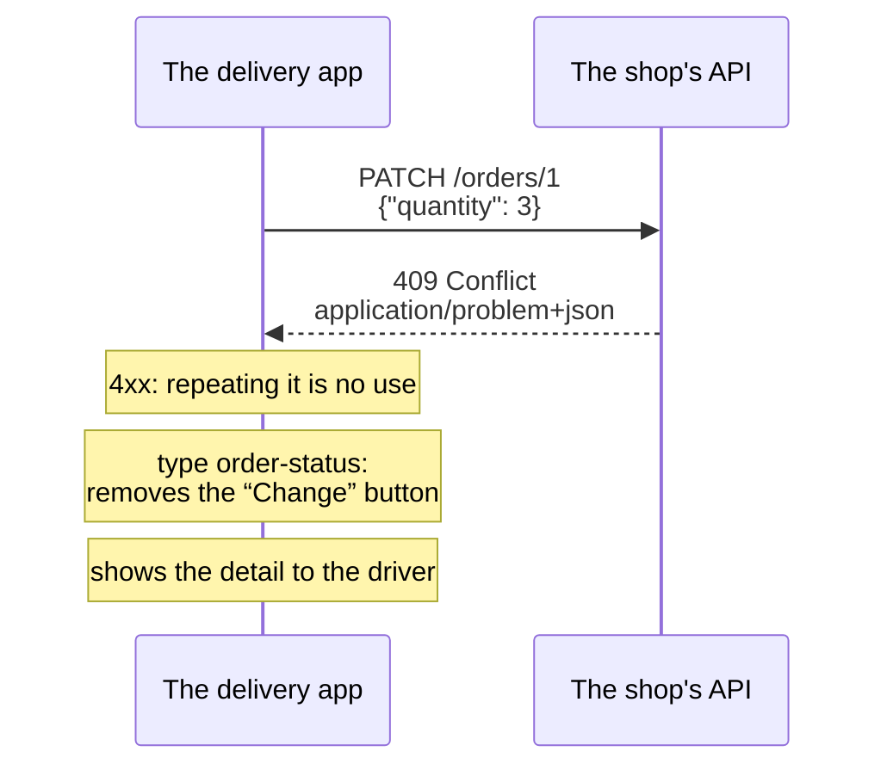

import Term from '~/components/Term.astro';
import TryIt from '~/components/TryIt.astro';
import Analogy from '~/components/Analogy.astro';
import ProjectCode from '~/components/ProjectCode.astro';
import Quiz from '~/components/Quiz.astro';
import QuizQuestion from '~/components/QuizQuestion.astro';
import QuizOption from '~/components/QuizOption.astro';

## The problem

Imagine the delivery company already uses the shop's <Term id="api">API</Term>. Its programmer, Marta, wants the drivers' app to explain every failure well. She asks for things that don't exist, sends bad data, and one day she gets a server failure. This is what the shop answers her, the way you left it in lesson 1, “REST”:

```text
{"error":"No such order"}
{"error":"The data is not valid","details":[{"field":"productId","problem":"Must be a number"},{"field":"quantity","problem":"At least 1"}]}
{"error":"The request cannot be read","detail":"Malformed JSON in request body"}
{"error":"Internal server error","requestId":"124a1f2d-c497-4d40-aafa-12c13ed5ee3e"}
```

Four errors, four shapes: `details` in one, `detail` in another, `requestId` in the last. Marta has to write a case for each shape and guess the ones she hasn't seen yet. And every API invents its own: GitHub answers `{"message": "Not Found", "documentation_url": "…", "status": "404"}`.

An API that others use needs **a single shape for all its errors**, and better still if it's a standard programs already know. It exists, and it's called Problem Details.

## The analogy

<Analogy>

Think of the notice the courier leaves you when they can't deliver a package. It's always the same printed card: a checked box with the reason (“not home,” “incomplete address”), a handwritten line (“the doorman wasn't there”) and the tracking number.

The box says what happened, and the post office does the same with every “not home”: it tries again tomorrow. The note tells your case. And if you complain, you give the tracking number, and with it they find your package.

<div slot="limits">

- The notice is read by a person. An API error is read first by a program, which decides by the box and not by the note.
- The boxes on the notice are always the same; each API invents its own problem types.
- The tracking number is always there; in an API error, the identifier of the case is optional.

</div>

</Analogy>

## How it really works

The outputs are from Node 26.11.1, with this lesson's project.

### An error with five fields

This is the shop's `409 Conflict` when you try to change the quantity of a cancelled order, without the other headers and with line breaks:

```http
HTTP/1.1 409 Conflict
content-type: application/problem+json

{
  "type": "https://shop.example/problems/order-status",
  "title": "The order's status doesn't allow it",
  "status": 409,
  "detail": "The order is cancelled: it can no longer be changed"
}
```

It's a <Term id="problem-details">Problem Details</Term>, the shape defined by <Term id="rfc">RFC</Term> 9457, “Problem Details for HTTP APIs” (2023). It replaces RFC 7807, from 2016: you'll see both numbers in documentation and libraries. It defines five fields, all optional:

| Field | What it says | Changes from one time to the next |
|---|---|---|
| `type` | What kind of problem it is, with a URI | No: it's its name |
| `title` | The summary of that kind, for a person | No |
| `status` | The <Term id="status-code">status code</Term>, repeated in the body | No |
| `detail` | What happened this time, for a person | Yes |
| `instance` | Which of the times: an identifier for this case | Yes |

URI is the general name for addresses like <Term id="url">URLs</Term>. Some only name something, without leading anywhere, like the `urn:uuid:…` you'll see in the `500`.

The body is <Term id="json">JSON</Term>, but it goes as `application/problem+json`, its own <Term id="mime-type">content type</Term>. That way the client knows from the <Term id="header">header</Term>, before reading the body, that it's an error with this shape.

### The type is for programs; the detail, for people

Marta's program doesn't read sentences: it compares `type`. If it's `…/order-status`, it removes the “Change” button from that order. The RFC puts it this way: the client uses `type` as the problem's identifier, and **shouldn't extract information from `detail`**.

`detail` changes with each case: the day you word it differently, a program that looked for “cancelled” will break without warning. A piece of data the client needs goes in a field of its own, an extension (further down).

`title` is fixed for each `type`, and it's what an app shows if it doesn't know the type. `status` has to match the response's code: it also goes in the body in case the JSON is saved without the headers.

### problem(): every error goes through here

The project has a new file, `src/problems.ts`, with everything that writes errors. It starts like this:

<ProjectCode file="shop-api/11-api-errors/src/problems.ts" region="problem" />

Word by word:

- **`interface Problem`** describes the five fields, like the `interface`s in [lesson 3 of Phase 3](/en/phase-3/typescript-with-node/). The `?` after a name makes it optional: `detail` and `instance` may be missing.
- **`errors`** isn't in the RFC: it's an extension of the shop's.
- **`ContentfulStatusCode`** is a Hono type: the codes that can carry a body. A `204` can't, and TypeScript won't let you use it here.
- **`problem(c, data, headers)`** answers with `c.json` and passes it the headers: its `Content-Type` replaces the `application/json` that `c.json` would set, and `headers` adds the error's own, like the `Allow` of a `405`.

If every error goes through one function, every error has the same shape: nobody writes them by hand in a route.

### about:blank, when the code already says it all

A `404` is “doesn't exist,” and the code already says so: it doesn't need a type of its own. For these cases, the RFC reserves a special `type`, `about:blank`, which means “nothing more than the code,” and asks for the `title` to be the code's phrase, like `Not Found`:

<ProjectCode file="shop-api/11-api-errors/src/problems.ts" region="http-problem" />

- **`STATUS_CODES`** is a Node object with each code's phrase: `STATUS_CODES[404]` is `'Not Found'`. `?? 'Error'` puts `'Error'` if a code didn't have one.
- **`detail`** tells the case: “No such order”. The `title` keeps the standard's phrase; the RFC allows translating it for an API in another language, but here there's no need.

`httpProblem` answers the `404`s (also the one for a <Term id="route">route</Term> that doesn't exist, in `app.notFound`), the `401` of `adminOnly`, the `405` and the `400` for a body that can't be read.

### A type of your own when the client has to tell them apart

A `409` isn't enough for Marta's app to know what to do: it may be a cancelled order, one out of stock or one paid twice. That's where a `type` of the shop's own is needed:

<ProjectCode file="shop-api/11-api-errors/src/problems.ts" region="types" />

- **`problemType('order-status')`** returns `https://shop.example/problems/order-status`: under the shop's domain, it doesn't clash with anyone's types. It doesn't have to open, but the RFC encourages it to lead to a page that explains the problem.
- **`invalidData`** is validation's `422`, with its type, a fixed `title` and the list of `errors`.

And in `src/app.ts`, the orders' `409`. Two routes use it: changing an order that is no longer `pending` and cancelling one that is `shipped`. The `title` is always the same; the `detail`, each case's own:

<ProjectCode file="shop-api/11-api-errors/src/app.ts" region="conflict" />

### Validation errors, with each field

The RFC lets you add fields of your own, the **extensions**. The shop adds `errors`, a list with each field that fails: what a form needs to mark each box in red. The `validate` <Term id="middleware">middleware</Term> from [lesson 7 of Phase 3](/en/phase-3/zod-validation/) changes two lines:

<ProjectCode file="shop-api/11-api-errors/src/middleware/validate.ts" region="validate" />

Each Zod problem becomes `{ field, problem }`, as before, and `invalidData` sends them all at once.

A product that doesn't exist, which the route checks after the <Term id="schema">schema</Term>, uses the same type, with its field:

<ProjectCode file="shop-api/11-api-errors/src/app.ts" region="orders" />

For the client, a mistyped piece of data and a product that doesn't exist are the same thing: a value that isn't valid, in a field. **A single type, and a single way to read it.**

Each API chooses the extension's name; the shop's, `errors`, is the one the RFC's example uses too. And the RFC adds a rule that protects everyone: **a client ignores the extensions it doesn't know**, so adding one tomorrow doesn't break anybody.

### What never goes in an error

Anyone can cause an error with `curl`, and whatever you put in it is also read by whoever is looking for a weak spot:

- **The <Term id="stack-trace">stack trace</Term> or the message of an unexpected error:** they say which folders, libraries and versions you use ([lesson 8 of Phase 3](/en/phase-3/node-errors-and-logging/#a-500-that-gives-nothing-away)).
- **The database query or its error.** PostgreSQL, in Phase 5, fails with messages like `duplicate key value violates unique constraint "users_email_key"`: the name of a table and of an internal rule.
- **Other people's data**, or hints about it. “That email already has an account” confirms to anyone who is a customer of the shop: you'll see it in Phase 6.

The RFC asks for it too: `detail` helps the client fix their request, not debug your server. The shop's `500` follows the rule:

<ProjectCode file="shop-api/11-api-errors/src/app.ts" region="errors" />

- **The `400`** no longer copies Hono's message: a library writes it, and it may change in the next version.
- **The `500`** uses `about:blank` and the code's `title`. The `detail` doesn't say what failed: it says what to do.
- **`instance`** carries the request id from [lesson 8 of Phase 3](/en/phase-3/node-errors-and-logging/#an-id-for-every-request), written as `urn:uuid:…`: that's how a random id of this kind, a UUID, becomes a URI. The same id is in the <Term id="log">log</Term>, next to the stack trace.

### 4xx or 5xx: the contract with the client

In [lesson 3 of Phase 2](/en/phase-2/http-status-codes/#the-first-digit-says-whose-problem-it-is) you saw that the first digit says whose problem it is. For an API, that's a **contract**: other people's programs decide with it.

| What the client gets | What it does |
|---|---|
| A `4xx` | It doesn't repeat the request as is: it would fail the same way. It fixes it, or shows the `detail` to the person |
| A `5xx` | It can retry later, if repeating doesn't duplicate anything ([idempotent](/en/phase-2/http-methods/#idempotent-repeating-it-doesnt-change-the-result)). To the person, a general message and the `instance` |
| A `type` it doesn't know | It goes by the code and shows the `title` |

This is how Marta's app uses the `409`:



That's why, once the API is published, **a `type` doesn't change**: other programs depend on it. Changing a code or a `type` breaks your clients; adding a field or an extension doesn't. You'll see it in depth in lesson 4, “[Versioning](/en/phase-4/api-versioning/).”

## Try it

The goal: make all of the shop's errors have the same shape, and check it with a single `jq` filter that reads them all.

You work in your `shop-api` in `~/backend-course/phase-3`, as you left it in lesson 1. There's nothing to install. The changes:

1. Create `src/problems.ts`: three `import`s (`STATUS_CODES` from `'node:http'`, and with `import type`, `Context` from `'hono'` and `ContentfulStatusCode` from `'hono/utils/http-status'`) and below them, the three parts above.
2. In `src/middleware/`, `validate.ts` imports `invalidData` from `'../problems.ts'` and changes as you've seen. `admin-only.ts` imports `httpProblem` and answers its `401` with it, with `WWW-Authenticate` in `headers`.
3. In `src/app.ts`, import `httpProblem`, `invalidData`, `problem` and `problemType` from `'./problems.ts'` and add `type Context` to the Hono `import`. Replace each `c.json({ error: … })` with the function that fits, `onError` included. The `405` also uses `httpProblem`, with the list of methods in `Allow`.

If you get stuck, download this lesson's folder and compare it with yours: from `~/backend-course/phase-3`, `curl -O https://backenddesdecero.com/practicas/shop-api/11-api-errors.tar.gz` and `tar -xzf 11-api-errors.tar.gz`. Its `test/problems.test.ts` checks the shape of each error: `npm test` should end with `pass 23` and `fail 0`.

Start the server with `npm start --silent | tee shop.log`, as in [lesson 8 of Phase 3](/en/phase-3/node-errors-and-logging/), and open another terminal in the same folder. Your ids and dates will be different.

<TryIt
  title="1. A route that doesn't exist"
  cmd="curl -i localhost:3000/offers"
  output={`HTTP/1.1 404 Not Found
content-type: application/problem+json
vary: Origin
x-request-id: 2457cde4-e6a3-459e-8c84-6422680783aa
content-length: 80
Date: Tue, 13 Oct 2026 15:39:26 GMT
Connection: keep-alive
Keep-Alive: timeout=5

{"type":"about:blank","title":"Not Found","status":404,"detail":"No such route"}`}
>

Look at `content-type: application/problem+json` and at the `about:blank`: the code says it all, and `detail` adds the case.

If you get `{"error":"No such route"}`, the server doesn't have your changes: stop it with <kbd>Ctrl</kbd> + <kbd>C</kbd> and start it again.

</TryIt>

<TryIt
  title="2. An order with two wrong fields"
  cmd={`curl -i --json '{"productId":"one","quantity":0}' localhost:3000/orders`}
  output={`HTTP/1.1 422 Unprocessable Entity
content-type: application/problem+json
vary: Origin
x-request-id: 90e5d662-1fd1-464b-b7ba-0939dd6bdb6c
content-length: 265
Date: Tue, 13 Oct 2026 15:39:26 GMT
Connection: keep-alive
Keep-Alive: timeout=5

{"type":"https://shop.example/problems/invalid-data","title":"The data is not valid","status":422,"detail":"See \\"errors\\" for what is wrong with each field.","errors":[{"field":"productId","problem":"Must be a number"},{"field":"quantity","problem":"At least 1"}]}`}
>

A single `422` with both problems in `errors`: the product isn't a number and the quantity is less than 1. The `\"` is how JSON writes a quotation mark inside a text.

</TryIt>

Now, read it like a program. `jq` ([lesson 8 of Phase 3](/en/phase-3/node-errors-and-logging/)) pulls out each field of the list:

<TryIt
  title="3. The errors, field by field"
  cmd={`curl -s --json '{"productId":"one","quantity":0}' localhost:3000/orders | jq -r '.errors[] | "\\(.field): \\(.problem)"'`}
  output={`productId: Must be a number
quantity: At least 1`}
>

`.errors[]` goes through the list, and `"\(.field): \(.problem)"` writes each item as text, with its two values. That's how Marta's app would mark each box of its form.

</TryIt>

<TryIt
  title="4. A product that doesn't exist"
  cmd={`curl -w '\\n' --json '{"productId":99,"quantity":1}' localhost:3000/orders`}
  output={`{"type":"https://shop.example/problems/invalid-data","title":"The data is not valid","status":422,"detail":"See \\"errors\\" for what is wrong with each field.","errors":[{"field":"productId","problem":"No such product"}]}`}
>

The same `type` as in step 2, even though this time the route detects it and not the schema: the filter from step 3 reads it too.

</TryIt>

<TryIt
  title="5. An order that can no longer be changed"
  cmd={`curl -w '\\n' --json '{"productId":1,"quantity":2}' localhost:3000/orders
curl -w '\\n' -X POST localhost:3000/orders/1/cancellation
curl -i -X PATCH --json '{"quantity":3}' localhost:3000/orders/1`}
  output={`{"id":1,"productId":1,"quantity":2,"status":"pending"}
{"id":1,"productId":1,"quantity":2,"status":"cancelled"}
HTTP/1.1 409 Conflict
content-type: application/problem+json
vary: Origin
x-request-id: d56cba15-9c2c-4c55-bcb2-a67d7276541f
content-length: 175
Date: Tue, 13 Oct 2026 15:39:26 GMT
Connection: keep-alive
Keep-Alive: timeout=5

{"type":"https://shop.example/problems/order-status","title":"The order's status doesn't allow it","status":409,"detail":"The order is cancelled: it can no longer be changed"}`}
>

You create order 1, cancel it and try to change its quantity: `409` with the shop's own type. If the order comes out with another `id`, you already had orders: use that number in the other two commands.

</TryIt>

<TryIt
  title="6. The usual HTTP errors"
  cmd={`curl -w '\\n' -X PUT localhost:3000/orders/1
curl -w '\\n' --json '{"productId":1,"quan' localhost:3000/orders
curl -w '\\n' --json '{"name":"Cap","price":15}' localhost:3000/products`}
  output={`{"type":"about:blank","title":"Method Not Allowed","status":405,"detail":"This route does not accept PUT"}
{"type":"about:blank","title":"Bad Request","status":400,"detail":"The request cannot be read"}
{"type":"about:blank","title":"Unauthorized","status":401,"detail":"A valid token is required"}`}
>

A method the route doesn't have, a cut-off body and a new product without a token: three `about:blank`, each one with its code's phrase. With `-i` you'd see the `Allow` of the `405` and the `WWW-Authenticate` of the `401`.

</TryIt>

<TryIt
  title="7. One filter for all of them"
  cmd={`for route in /offers /products/99 /products/abc /orders/1/cancellation; do
  curl -s localhost:3000$route | jq -c '{status, type, title}'
done`}
  output={`{"status":404,"type":"about:blank","title":"Not Found"}
{"status":404,"type":"about:blank","title":"Not Found"}
{"status":422,"type":"https://shop.example/problems/invalid-data","title":"The data is not valid"}
{"status":405,"type":"about:blank","title":"Method Not Allowed"}`}
>

`for` repeats the command inside with each value of `route`, as in the scripts of [lesson 8 of Phase 1](/en/phase-1/bash-scripts/#for-repeating-the-same-thing-with-each-item). `{status, type, title}` keeps those three fields, and `-c` writes each result on one line. Four different errors, a single filter: in lesson 1 you would have needed one per shape.

</TryIt>

### The 500 and its instance

The shop no longer has any route that fails on purpose: a public API wouldn't have one. To see the `500`, add a **test route** just for a moment, at the end of `src/app.ts`:

```ts title="src/app.ts (at the end, only for this test)"
// Only to try the 500: delete it afterwards.
app.get('/error-test', () => {
  throw new Error('Something failed on purpose');
});
```

`throw` throws an error the route doesn't catch, like `/error` in Phase 3, and `onError` picks it up. Stop the server with <kbd>Ctrl</kbd> + <kbd>C</kbd> and start it again with `npm start --silent | tee shop.log`.

<TryIt
  title="8. A server failure"
  cmd="curl -i localhost:3000/error-test"
  output={`HTTP/1.1 500 Internal Server Error
content-type: application/problem+json
vary: Origin
x-request-id: b240577b-83f7-4785-a8a6-f634a1ef893b
content-length: 221
Date: Tue, 13 Oct 2026 15:39:29 GMT
Connection: keep-alive
Keep-Alive: timeout=5

{"type":"about:blank","title":"Internal Server Error","status":500,"detail":"Something failed on the server. If it happens again, tell us the value of instance.","instance":"urn:uuid:b240577b-83f7-4785-a8a6-f634a1ef893b"}`}
>

Not a trace of “Something failed on purpose” or of the stack trace. The client only knows the failure is the server's, and has a number to report it with: the one in `instance`, the same as `x-request-id`.

</TryIt>

<TryIt
  title="9. From the instance to the failing line"
  cmd={`grep b240577b shop.log | jq -r 'select(.err) | .err.stack'`}
  output={`Error: Something failed on purpose
    at file:///Users/ana/backend-course/phase-3/shop-api/src/app.ts:148:9
    at dispatch (file:///Users/ana/backend-course/phase-3/shop-api/node_modules/hono/dist/compose.js:35:17)
    at file:///Users/ana/backend-course/phase-3/shop-api/node_modules/hono/dist/compose.js:35:40
    at cors (file:///Users/ana/backend-course/phase-3/shop-api/node_modules/hono/dist/middleware/cors/index.js:103:9)
    at async dispatch (file:///Users/ana/backend-course/phase-3/shop-api/node_modules/hono/dist/compose.js:35:11)
    at async requestLog (file:///Users/ana/backend-course/phase-3/shop-api/src/middleware/request-log.ts:7:3)
    at async dispatch (file:///Users/ana/backend-course/phase-3/shop-api/node_modules/hono/dist/compose.js:35:11)
    at async requestId (file:///Users/ana/backend-course/phase-3/shop-api/node_modules/hono/dist/middleware/request-id/request-id.js:30:3)
    at async dispatch (file:///Users/ana/backend-course/phase-3/shop-api/node_modules/hono/dist/compose.js:35:11)
    at async file:///Users/ana/backend-course/phase-3/shop-api/node_modules/hono/dist/hono-base.js:287:21`}
>

Use your id, not the one here. `grep` finds the lines of that request, and `select(.err)` keeps the one from `log.error`. The stack trace says where the `throw` is: `src/app.ts:148:9` (in your file, the line may be another one). What the client doesn't see, you have in full.

</TryIt>

You've seen the `500`: **delete the `/error-test` route** from `src/app.ts` and restart the server. `curl -i localhost:3000/error-test` should now answer with the `404` from step 1.

## You have already seen it

- **Forms that, when you submit them, mark several fields in red at once** usually get from the server a list like `errors`. In [DevTools](/en/phase-2/#before-you-start-devtools), on the **Network** tab, you'll see that response: a `400` or a `422` with the fields.
- **“Something went wrong. Reference code: 7F3A…”** is an `instance`, or something playing its part: the number support looks up in their log.

## Common mistakes

- **One error format per route** (each route's own, Hono's for a broken body, the one from `notFound`…). Make them all go through one function, like `problem`.
- **Making the client read `detail`.** It's for people and changes from one case to another. What a program needs goes in `type` or in an extension.
- **Sending it as `application/json`.** The body is the same, but the client doesn't know, before reading it, that it's a Problem Details.
- **A `status` in the body that doesn't match the response's,** or a `200` with an error inside ([lesson 3 of Phase 2](/en/phase-2/http-status-codes/#the-200-with-an-error-inside)). The client will do what the response's code says.

## Summary

- An API that others use answers all its errors with the same shape, so that a single piece of client code reads them. Problem Details (RFC 9457) is the standard one: `type`, `title`, `status`, `detail` and `instance`, as `application/problem+json`.
- Programs decide by the code and the `type`; people read `title` and `detail`. `about:blank` when the code says it all; a type of your own when the client has to tell problems apart.
- Extensions, like `errors`, add data; a client ignores the ones it doesn't know.
- An error never shows the stack trace, the database or other people's data. The `500` carries only an `instance` to find it in the log.

## Did you get it?

<Quiz>

<QuizQuestion
  question="The delivery company’s program looks for the word “cancelled” in the detail to know whether an order can be changed. Next week you rewrite that text. What should it check instead?"
  review="The type is for programs; the detail, for people"
>

<QuizOption text="The status: the 409 already says the order is cancelled.">

A `409` may be a cancelled order, a shipped one or any other conflict. It needs the `type`.

</QuizOption>

<QuizOption text="The type: it’s the problem’s name and doesn’t depend on the text." correct>

The `type` is the problem's name for programs. The `detail` is for people, and its wording can change at any time.

</QuizOption>

<QuizOption text="Nothing: the RFC forbids changing the detail’s text once it’s published.">

It's the other way around: `detail` changes from one case to another, and the RFC asks clients not to extract information from it.

</QuizOption>

</QuizQuestion>

<QuizQuestion
  question="A teammate wants to put the error’s message, without the stack trace, in the 500’s detail: “that way the client knows what happened.” What do you answer?"
  review="What never goes in an error"
>

<QuizOption text="Yes: the detail is exactly for explaining what failed on the server.">

The RFC says `detail` helps the client fix their request, not debug the server. In a `500`, the client has nothing to fix.

</QuizOption>

<QuizOption text="Yes: without the stack trace, the message alone reveals nothing about the server.">

A message can reveal a lot: PostgreSQL's names tables and internal rules. The message and the stack trace go to the log.

</QuizOption>

<QuizOption text="No: the message goes to the log; the instance is enough for the client." correct>

With the `instance` you find the whole error in the log, stack trace included. And nobody outside sees how your server is built.

</QuizOption>

</QuizQuestion>

<QuizQuestion
  question="The mobile app wants to show a special notice when a product runs out of stock, different from other conflicts. How do you answer it?"
  review="A type of your own when the client has to tell them apart"
>

<QuizOption text="With a 409 and a type of its own, like …/problems/out-of-stock." correct>

The code says the problem's family, and the `type`, which one it is. The app compares the `type`; a client that doesn't know it goes by the `409`.

</QuizOption>

<QuizOption text="With a code of your own, like a 499, so it can’t be mistaken for anything.">

A code the client doesn't know is treated as the `x00` of its family, here a `400`, and besides, it isn't a standard. HTTP sets the codes; you set the types.

</QuizOption>

<QuizOption text="With about:blank and “Out of stock” in the detail, which the app recognizes.">

`about:blank` means “nothing more than the code,” and forces the app to read the `detail`, which is for people and can change.

</QuizOption>

</QuizQuestion>

<QuizQuestion
  question="A Problem Details body is already JSON. What’s the point of sending it as application/problem+json and not as application/json?"
  review="An error with five fields"
>

<QuizOption text="So the browser shows it as an error, with its own page.">

The browser doesn't do anything special with this type. The one who takes advantage of it is the client's code.

</QuizOption>

<QuizOption text="So the client knows from the header that it’s an error with this shape." correct>

The client knows before reading the body, and can always pass it through the same code.

</QuizOption>

<QuizOption text="So only libraries that know RFC 9457 can read it.">

It's normal JSON: `jq` and any JSON reader can read it. The content type only warns about the shape it has.

</QuizOption>

</QuizQuestion>

<QuizQuestion
  question="You add a new extension to all of the shop’s errors, help, with a link. The delivery app knows nothing about it. What happens to it?"
  review="Validation errors, with each field"
>

<QuizOption text="It stops working: a Problem Details only allows the RFC’s five fields.">

The RFC allows extensions, like `errors`, and asks clients to ignore the ones they don't know.

</QuizOption>

<QuizOption text="It stops working until you publish a new type for each problem.">

The `type` doesn't change because you add a field. Changing it, on the other hand, would break the app.

</QuizOption>

<QuizOption text="Nothing: a client ignores the extensions it doesn’t know." correct>

It's a rule of the RFC: that's why adding an extension doesn't break anybody. Changing a `type` or a code does.

</QuizOption>

</QuizQuestion>

<QuizQuestion
  question="The delivery app gets a 422 when creating an order and, another day, a 500 when reading an order with GET. Which one should it retry on its own, later?"
  review="4xx or 5xx: the contract with the client"
>

<QuizOption text="Both: if it retries enough times, one of them will end up working.">

A `422` says the data isn't valid: the same request will always fail the same way. It has to be fixed.

</QuizOption>

<QuizOption text="The 500: it may work later, and a GET can be repeated without fear." correct>

A `5xx` is a server failure, which may fix itself. And a `GET` doesn't change anything, so repeating it doesn't duplicate any order.

</QuizOption>

<QuizOption text="The 422: it’s a minor error, and a 500 means the server no longer works.">

A `500` says that request failed on the server, not that the server no longer works. And the `422` will fail the same way until the client changes the data.

</QuizOption>

</QuizQuestion>

</Quiz>

## Further reading

- [RFC 9457, Problem Details for HTTP APIs](https://www.rfc-editor.org/rfc/rfc9457.html): short and readable, with examples of each field and of extensions, and a section, “[Security Considerations](https://www.rfc-editor.org/rfc/rfc9457.html#name-security-considerations),” on what not to show in an error.
- [Error Handling Cheat Sheet](https://cheatsheetseries.owasp.org/cheatsheets/Error_Handling_Cheat_Sheet.html) (OWASP): how to answer errors without giving an attacker hints.
- [Error handling](https://hono.dev/docs/api/hono#error-handling) (Hono): `notFound` and `onError`.
