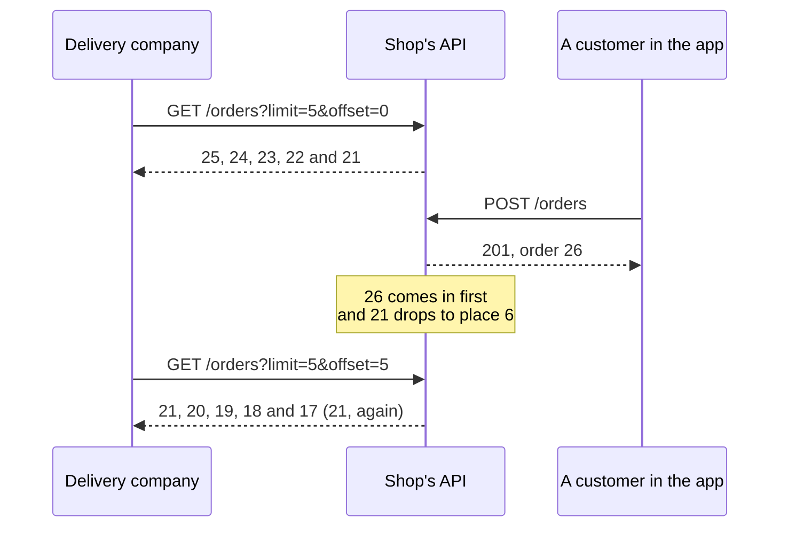

import Term from '~/components/Term.astro';
import TryIt from '~/components/TryIt.astro';
import Analogy from '~/components/Analogy.astro';
import SelfCheck from '~/components/SelfCheck.astro';
import ProjectCode from '~/components/ProjectCode.astro';
import Quiz from '~/components/Quiz.astro';
import QuizQuestion from '~/components/QuizQuestion.astro';
import QuizOption from '~/components/QuizOption.astro';

## The problem

Imagine the shop has 40,000 orders. The phone app shows the ten latest, and asks for `GET /orders`. The API from the previous lesson sends it all 40,000: about 2.4 MB of <Term id="json">JSON</Term>, with four fields per order. The phone throws away 39,990, and the server prepared them all.

The solution is to **paginate**: return the list in pieces. But the most intuitive way has a catch. The delivery company from the [introduction](/en/phase-4/) reads the paid orders every morning, 50 at a time. If a new order is paid while it reads the first page, the second one starts with an order it already had. And if one from the first page leaves the list, the second page skips another one: a parcel left undelivered.

## The analogy

<Analogy>

Think of the shop's mailbox: a stack of letters, with the new ones on top. Luis reads the five on top, notes down “I've done five” and goes to lunch.

While he eats, a letter arrives. When he comes back, he sets aside the five on top and carries on. But the new one is among them, so the first letter he reads is one he had already read. And if someone had taken one of the letters he'd read, he'd have skipped another without noticing.

Ana makes a different note: “the last one was the print shop's.” When she comes back, she looks for that letter and carries on with the one below it, however many arrive on top. “I've done five” is an offset; “the print shop's” is a cursor.

<div slot="limits">

- Ana recognizes her letter at a glance. A server needs each item to have a unique place in the order, like the id.
- With “I've done five,” Luis can jump to letter 40. With a cursor you can't jump to page 8: you can only carry on from where you were.

</div>

</Analogy>

## How it really works

### A long list is requested in pages

<Term id="pagination">Pagination</Term> has two parts: the client says how many items it wants and from where, in the <Term id="query-string">query string</Term> ([Phase 2](/en/phase-2/http-request-and-response/#the-query-string-data-in-the-url-itself)), and the response tells it how to ask for the next ones.

In the shop, how many goes in `?limit=`: 10 by default, and 50 at most. **The maximum is set by the server, not the client**: without it, `?limit=1000000` would be the whole list again. GitHub does the same with its `per_page`: 30 by default and 100 at most.

### The offset: “skip the first 20”

The offset counts positions. `?limit=10&offset=20` means “skip the first 20 and give me 10”: page 3. Many APIs call it `offset` too, or use `page` and `per_page`: the same, counted another way.

In the project, the function is in a new file:

<ProjectCode file="shop-api/12-pagination/src/pagination.ts" region="page-by-offset" />

- `list.slice(start, end)` copies the items from position `start` up to `end`, not included. Positions start at 0.
- `condition ? a : b` is `a` if the condition is true and `b` if it isn't. `next` is where the next page starts, or `undefined` if there are no more (`hasMore`).

### If the list changes, the offset gets it wrong

The offset counts positions, and positions move. Orders go from newest to oldest, so a new one comes in first and pushes all the others down one place:



The other way around, if an order from the first page leaves the list (it's cancelled, and the company only asks for the pending ones), everything moves up one place. The first one of the next page moves to place 5, already read, and nobody sees it.

**With an offset, what comes in ahead repeats and what leaves ahead gets skipped.** And the server can't warn anyone: it doesn't remember who was reading what.

### The cursor: “give me the ones after this one”

A <Term id="cursor">cursor</Term> doesn't count positions: it points at an item. In the shop, the cursor carries the id of the page's last order, and the next page is the ones with a lower id:

<ProjectCode file="shop-api/12-pagination/src/pagination.ts" region="page-by-cursor" />

- `after?: number` is optional: the first page has no cursor.
- `filter` keeps only the orders with a lower id ([lesson 2 of Phase 3](/en/phase-3/javascript-for-backend/#choosing-and-transforming-a-list-filter-and-map)), and `slice(0, limit)` takes the first ones.
- `page.at(-1)` is the last one on the page. The `!` tells TypeScript it won't be `undefined`: if `hasMore` is true, the page isn't empty.

Order 26 arriving doesn't change which orders have an id lower than 21, and neither does order 24 being cancelled. **The cursor keeps a value, not a position**, and it works even if the order it points at is no longer in the list.

### The cursor is opaque, not secret

The client gets a text like `MjM`, not the number 23:

<ProjectCode file="shop-api/12-pagination/src/pagination.ts" region="cursor" />

- `Buffer.from(String(id))` turns the id into bytes ([lesson 4 of Phase 3](/en/phase-3/node-http-server/#the-body-arrives-in-chunks)), and `toString('base64url')` writes them with letters, numbers, `-` and `_`, which travel well in a URL.
- `readCursor` goes back the other way. If the text wasn't a cursor, the result is `NaN` (“not a number”) or `0`.

Base64url doesn't encrypt anything: `node -p "Buffer.from('MjM', 'base64url').toString()"` writes `23`. Its purpose is to make the cursor **opaque**: the client doesn't interpret it, it only sends it back, and the server can change what it carries without breaking anyone. GitHub's, decoded, start with `cursor:v2:`: they even carry a version.

Since it comes from outside, it's validated ([lesson 7 of Phase 3](/en/phase-3/zod-validation/)), in `src/schemas.ts`:

<ProjectCode file="shop-api/12-pagination/src/schemas.ts" region="cursor-schema" />

`.transform(readCursor)` turns the text into the id, and `.pipe(…)` checks that id with another schema: a whole number greater than 0. `?cursor=hello` ends in a `422`.

### Offset or cursor: what you gain and what you lose

| | Offset | Cursor |
|---|---|---|
| If the list changes between two pages | Repeats or skips items | Carries on right after the last one |
| Jumping to page 8 | Yes: `offset=70` | No: only the next one (and the previous one, if the API gives it) |
| “Page 3 of 12” | Can be calculated | There's no page number |
| With millions of rows in a database | Slow: it reads and throws away every row it skips | Fast: it goes straight to the cursor |

You'll see the last row in Phase 5: with `offset=100000`, the <Term id="database">database</Term> goes through 100,000 rows and throws them away. With a cursor, it jumps to the id with an index, like a book's.

**The offset is for lists that hardly change and where you want to jump between pages**, like a catalog. For the ones that grow while they're being read, like orders or messages, the cursor.

### The Link header says where the next page is

What's missing is telling the client how to ask for the next page. GitHub does it with a <Term id="header">header</Term>, the `link` you saw in the [introduction](/en/phase-4/#4-what-the-headers-say). Ask again for the two most recent open issues of Node.js, now with their title:

<TryIt
  title="GitHub's first page and its Link header"
  cmd={`curl -sI 'https://api.github.com/repos/nodejs/node/issues?per_page=2' | grep -i '^link'
curl -s 'https://api.github.com/repos/nodejs/node/issues?per_page=2' | jq -c '.[] | {number, title}'`}
  output={`link: <https://api.github.com/repositories/27193779/issues?per_page=2&after=Y3Vyc29yOnYyOpLPAAABoTU4rEjPAAAAAVuCfJw%3D&page=2>; rel="next"
{"number":66705,"title":"test: deflake test-net-autoselectfamily-local-port"}
{"number":66704,"title":"tools: update OpenSSL on the selected branch"}`}
>

`jq` ([lesson 8 of Phase 3](/en/phase-3/node-errors-and-logging/)) takes the number and the title out of each issue. Notice `after=`: GitHub's cursor. Issues change every day, so your numbers and cursors will be different. If you get `API rate limit exceeded`, you've used up the 60 requests per hour GitHub gives without an account: wait.

</TryIt>

The `Link` header is defined by [RFC 8288](https://www.rfc-editor.org/rfc/rfc8288): a URL between `<` and `>`, and in `rel`, its relation to this response. `next` is the next one; there are also `prev`, `first` and `last`. Copy the URL from your `link` and request it:

<TryIt
  title="Follow GitHub's link"
  cmd={`curl -si 'https://api.github.com/repositories/27193779/issues?per_page=2&after=Y3Vyc29yOnYyOpLPAAABoTU4rEjPAAAAAVuCfJw%3D&page=2' | grep -i '^link'
curl -s 'https://api.github.com/repositories/27193779/issues?per_page=2&after=Y3Vyc29yOnYyOpLPAAABoTU4rEjPAAAAAVuCfJw%3D&page=2' | jq -c '.[] | {number, title}'`}
  output={`link: <https://api.github.com/repositories/27193779/issues?per_page=2&after=Y3Vyc29yOnYyOpLPAAABoTSeNVDPAAAAAVtgJ8I%3D&page=3>; rel="next", <https://api.github.com/repositories/27193779/issues?per_page=2&page=1&before=Y3Vyc29yOnYyOpLPAAABoTUSnhjPAAAAAVt5sXQ%3D>; rel="prev"
{"number":66702,"title":"stream: trim webstreams sink wrappers and BYOB transfers"}
{"number":66700,"title":"deps: V8: cherry-pick 99f317d69ac7"}`}
>

Two links, separated by a comma: `next`, with a new cursor, and `prev`, with `before=`. 66703 and 66701 are missing: they're closed, and this list only brings the open ones.

</TryIt>

The client doesn't build the URL: it follows it. If GitHub changes its cursors, whoever follows `next` doesn't notice. The shop also returns the whole URL:

<ProjectCode file="shop-api/12-pagination/src/pagination.ts" region="link" />

`new URL(currentUrl)` separates the parts of the URL, as in [lesson 4 of Phase 3](/en/phase-3/node-http-server/), and `searchParams.set` changes or adds a parameter without touching the others: if the request carried a filter, so does the link.

Other APIs say it in the body: [Stripe](https://docs.stripe.com/api/pagination) sends `has_more`, and the client asks for the next page with the id of the last item in `starting_after`. The shop uses `Link` so that `GET /orders` keeps returning a list.

### The route, with both ways

To have something to paginate, `src/data.ts` creates 25 sample orders at startup:

<ProjectCode file="shop-api/12-pagination/src/data.ts" region="sample-orders" />

- `for (let number = 1; number <= 25; number++)` repeats the block with `number` from 1 to 25: it starts at 1, keeps going while it's 25 or less and adds 1 each time.
- `%` is the remainder of the division: `(number % 3) + 1` gives products 1, 2 and 3 in turn.
- `toSorted` sorts a copy of the list. Its function compares two orders: if `b.id - a.id` is positive, `b` goes first. The result: highest id first.

And the route uses one way or the other depending on what arrives:

<ProjectCode file="shop-api/12-pagination/src/app.ts" region="list-orders" />

- `validate('query', orderListSchema)` checks the query string, with the middleware from [lesson 7 of Phase 3](/en/phase-3/zod-validation/#a-middleware-validates-before-the-route-runs).
- First it filters by status, if asked to, and then it paginates: the filter decides the list, and the page, the piece.
- `c.header('Link', …)` adds the header if there's a next page. `c.req.url` is the request's whole URL.

The offset is only there to compare: a real API would pick one way.

### Filtering and sorting in the query string

Filtering and sorting go in the query string too. This is what `GET /orders` accepts:

<ProjectCode file="shop-api/12-pagination/src/schemas.ts" region="order-list" />

- `.default(10)`: if `limit` doesn't arrive, it's 10. `.max(50)` is the maximum.
- `status` only admits the four that exist. Any other value gives a `422`: ignoring it would return all of them, and the client would think they're what it asked for.
- `.refine(…)` is a rule about two fields: cursor or offset, not both. `path` says which field gets the blame in `errors` (lesson 2).

Products are sorted by price, and with a minus in front, `-price`, from highest to lowest: the habit of many APIs, like [JSON:API](https://jsonapi.org/format/#fetching-sorting) (`sort=-created`).

<ProjectCode file="shop-api/12-pagination/src/app.ts" region="filter-and-sort" />

`a.price - b.price` puts the cheapest first; `b.price - a.price`, the most expensive. In `src/schemas.ts`, `filterSchema` only admits those two sort orders:

<ProjectCode file="shop-api/12-pagination/src/schemas.ts" region="params" mark={[8, 9]} />

### Sorting, and the cursor that carries the sort order

Orders are paginated by id, which is unique and doesn't change. To paginate products by price, the cursor would carry the price of the last one. And if two cost €20, “the ones over 20” skips the second. **The cursor carries the value it's sorted by and, to break ties, the id**: “after €20, number 7.”

### The total has a cost

“Page 3 of 1,200” requires counting everything that matches the filter, and with a lot of data, counting means going through all of it on every page. That's why many APIs don't give the total: GitHub doesn't give it in this list, and Stripe only says `has_more`. In the shop, if `Link` arrives, there's more; if not, you're done.

## Try it

The goal: go through the orders in pages, make the offset repeat an order and check that the cursor doesn't.

### Prepare the project

You're still in `~/backend-course/phase-3/shop-api`, with the code from lesson 2. Write the changes:

1. Create `src/pagination.ts`, with the line `import type { Order } from './data.ts';` and, below it, the four blocks of that file you've seen.
2. In `src/data.ts`, add the sample orders and `ordersNewestFirst` at the end.
3. In `src/schemas.ts`, import `readCursor` from `./pagination.ts`, add `sort` to `filterSchema` and, at the end, `cursorSchema` and `orderListSchema`.
4. In `src/app.ts`, import `ordersNewestFirst` instead of `orders`, `orderListSchema` and the three functions from `./pagination.ts`, and change the `GET /products` and `GET /orders` routes.

The tests come in this lesson's folder: from `~/backend-course/phase-3`, `curl -O https://backenddesdecero.com/practicas/shop-api/12-pagination.tar.gz` and `tar -xzf 12-pagination.tar.gz`. If you get stuck, compare your code with the folder's. Then, in your project:

<TryIt
  title="1. The pagination tests"
  cmd={`cp ../12-pagination/test/pagination.test.ts test/
npm test -- test/pagination.test.ts`}
  output={`> shop-api@1.0.0 test
> node --env-file=test/.env --test test/pagination.test.ts

✔ with nothing: the 10 newest first, and a Link to the next page (10.482444ms)
✔ the cursor is opaque: the id in base64url, which the server knows how to read (0.149624ms)
✔ following Link goes through the 25 orders, without repeating or skipping any (3.270495ms)
✔ the status filter is kept in the link to the next page (1.34304ms)
✔ with offset, the link carries the next offset (0.941124ms)
✔ what is not valid in the query string: 422, with each field (3.24562ms)
✔ the products, sorted by price both ways and filtered (0.910915ms)
✔ with offset, an order that arrives between two pages makes one show up twice (1.507331ms)
✔ with a cursor, the order that arrives between two pages does not change the next one (0.98229ms)
ℹ tests 9
ℹ suites 0
ℹ pass 9
ℹ fail 0
ℹ cancelled 0
ℹ skipped 0
ℹ todo 0
ℹ duration_ms 231.062343`}
>

`--` tells npm that what comes after it is for the script: that way `node --test` runs only the new file. If you get `does not provide an export named`, an `export` is missing; if you get `is not defined`, an `import`. The outputs are from Node 26.11.1 and `curl` 8.14.1, on Linux; your times, request ids and dates will be different.

</TryIt>

### Go through the orders

Start the server with `npm run dev` and open another terminal.

<TryIt
  title="2. The first page"
  cmd={`curl -i 'localhost:3000/orders?limit=3'`}
  output={`HTTP/1.1 200 OK
content-type: application/json
link: <http://localhost:3000/orders?limit=3&cursor=MjM>; rel="next"
vary: Origin
x-request-id: 355c1ae4-170b-4ad7-a69f-609560745d7d
content-length: 169
Date: Tue, 13 Oct 2026 15:38:56 GMT
Connection: keep-alive
Keep-Alive: timeout=5

[{"id":25,"productId":2,"quantity":2,"status":"pending"},{"id":24,"productId":1,"quantity":1,"status":"pending"},{"id":23,"productId":3,"quantity":4,"status":"pending"}]`}
>

From 25 to 23, and in `link`, the next page: `cursor=MjM`, order 23. The quotes are needed: without them, the shell takes the `?` and the `&` for something else. If you get the whole list without `link`, the server is still running the old route: check whether `npm run dev` has restarted.

</TryIt>

<TryIt
  title="3. Follow the link"
  cmd={`curl -i 'localhost:3000/orders?limit=3&cursor=MjM'`}
  output={`HTTP/1.1 200 OK
content-type: application/json
link: <http://localhost:3000/orders?limit=3&cursor=MjA>; rel="next"
vary: Origin
x-request-id: df5ac3e3-f7c7-413a-8509-43cefd4e4d0e
content-length: 166
Date: Tue, 13 Oct 2026 15:38:56 GMT
Connection: keep-alive
Keep-Alive: timeout=5

[{"id":22,"productId":2,"quantity":3,"status":"pending"},{"id":21,"productId":1,"quantity":2,"status":"pending"},{"id":20,"productId":3,"quantity":1,"status":"paid"}]`}
>

Right after 23, 22, and a new `link` with the cursor of order 20. A filter is kept in the link:

```sh
curl -si 'localhost:3000/orders?status=shipped&limit=5' | grep -i '^link'
```

```
link: <http://localhost:3000/orders?status=shipped&limit=5&cursor=OA>; rel="next"
```

</TryIt>

### Make the offset repeat an order

Now, the trap from the diagram. If you've created orders, your ids will be different: to go back to the 25 sample orders, stop the server with <kbd>Ctrl</kbd> + <kbd>C</kbd> and start it again.

<TryIt
  title="4. A page, a new order and the next page"
  cmd={`curl -s 'localhost:3000/orders?limit=5&offset=0' | jq -c 'map(.id)'
curl -s --json '{"productId":1,"quantity":1}' localhost:3000/orders | jq .id
curl -s 'localhost:3000/orders?limit=5&offset=5' | jq -c 'map(.id)'`}
  output={`[25,24,23,22,21]
26
[21,20,19,18,17]`}
>

`map(.id)` takes each order's id, and `.id`, the new order's. Look at 21: it's the last one on the first page and the first one on the second. The delivery company would prepare its parcel twice.

</TryIt>

### And check that the cursor doesn't

<TryIt
  title="5. The same, with the cursor"
  cmd={`curl -s 'localhost:3000/orders?limit=5' | jq -c 'map(.id)'
curl -si 'localhost:3000/orders?limit=5' | grep -i '^link'
curl -s --json '{"productId":1,"quantity":1}' localhost:3000/orders | jq .id
curl -s 'localhost:3000/orders?limit=5&cursor=MjI' | jq -c 'map(.id)'`}
  output={`[26,25,24,23,22]
link: <http://localhost:3000/orders?limit=5&cursor=MjI>; rel="next"
27
[21,20,19,18,17]`}
>

The first page starts with order 26 from the previous step. Order 27 arrives, and the next page carries on right after 22. Order 27 isn't lost: it will show up in the next read.

</TryIt>

### Filters, sorting and values that aren't valid

<TryIt
  title="6. A limit and a cursor that aren't valid"
  cmd={`curl -i 'localhost:3000/orders?limit=500&cursor=hello'`}
  output={`HTTP/1.1 422 Unprocessable Entity
content-type: application/problem+json
vary: Origin
x-request-id: eafae9be-e4d6-4235-bd5e-fe1f59ccc546
content-length: 266
Date: Tue, 13 Oct 2026 15:39:01 GMT
Connection: keep-alive
Keep-Alive: timeout=5

{"type":"https://shop.example/problems/invalid-data","title":"The data is not valid","status":422,"detail":"See \\"errors\\" for what is wrong with each field.","errors":[{"field":"limit","problem":"At most 50"},{"field":"cursor","problem":"The cursor is not valid"}]}`}
>

The error from lesson 2, with one problem per field. With `?cursor=MjI&offset=10`, the problem is `Use cursor or offset, not both`.

</TryIt>

<TryIt
  title="7. The products, sorted"
  cmd={`curl -w '\\n' 'localhost:3000/products?sort=-price'
curl -w '\\n' 'localhost:3000/products?sort=price&max=30'
curl -w '\\n' 'localhost:3000/products?sort=name'`}
  output={`[{"id":3,"name":"Hoodie","price":35},{"id":1,"name":"T-shirt","price":20},{"id":2,"name":"Mug","price":8.5}]
[{"id":2,"name":"Mug","price":8.5},{"id":1,"name":"T-shirt","price":20}]
{"type":"https://shop.example/problems/invalid-data","title":"The data is not valid","status":422,"detail":"See \\"errors\\" for what is wrong with each field.","errors":[{"field":"sort","problem":"Must be price or -price"}]}`}
>

From highest to lowest; from lowest to highest, without the ones over €30; and a sort order the API can't do, with a `422` that says which ones it can.

</TryIt>

<SelfCheck question="Challenge: make the offset skip an order. Ask for the pending orders 2 at a time and, between the first page and the second, cancel one from the first. Then repeat it with the cursor.">

Restart the server. The pending ones are 21 to 25, and you cancel with `POST /orders/:id/cancellation` (lesson 1):

```sh
curl -s 'localhost:3000/orders?status=pending&limit=2&offset=0' | jq -c 'map(.id)'
curl -s -X POST localhost:3000/orders/24/cancellation | jq -c '{id, status}'
curl -s 'localhost:3000/orders?status=pending&limit=2&offset=2' | jq -c 'map(.id)'
```

```
[25,24]
{"id":24,"status":"cancelled"}
[22,21]
```

What about 23? When 24 was cancelled, it moved up to place 2, already read. With the cursor, on the same list (now 25, 23, 22 and 21):

```sh
curl -s 'localhost:3000/orders?status=pending&limit=2' | jq -c 'map(.id)'
curl -si 'localhost:3000/orders?status=pending&limit=2' | grep -i '^link'
curl -s -X POST localhost:3000/orders/25/cancellation | jq -c '{id, status}'
curl -s 'localhost:3000/orders?status=pending&limit=2&cursor=MjM' | jq -c 'map(.id)'
```

```
[25,23]
link: <http://localhost:3000/orders?status=pending&limit=2&cursor=MjM>; rel="next"
{"id":25,"status":"cancelled"}
[22,21]
```

The cursor points at 23, and what comes after 23 is still 22. With `offset=2`, only 21 would have come out.

</SelfCheck>

## You have already seen it

- **Google's results** have numbered pages: on the second one, the URL carries `start=10`, an offset.
- **Social networks' infinite scroll** asks for more when you reach the end, without page numbers: the list changes every second, and the usual thing is a cursor. You'll see it as you scroll down, in the **Network** tab of DevTools ([how to open them](/en/phase-2/#before-you-start-devtools)).
- **An online shop's filters**, like size or “sort by price,” change the query string: if you share the URL, the other person sees the same list.

## Common mistakes

- **Not setting a maximum limit.** `?limit=1000000` is the whole list again.
- **Paginating with an offset a list that changes while it's being read**, like orders or messages: use a cursor.
- **Making up the cursor in the client.** Follow `Link`, or send back the cursor the API gives you as it is: it's opaque and its format can change.
- **A cursor with a value that repeats**, like the price, without the id to break ties: items get skipped.
- **Ignoring a filter or a sort order you don't understand.** The client believes the list is the one it asked for: better a `422` that says what's accepted.

## Summary

- An API returns its lists in pages, with a limit the client asks for and a maximum the server sets.
- The offset counts positions: it lets you jump to any page, but if the list changes, it repeats or skips items, and with millions of rows it's slow.
- The cursor points at the last item read and carries on right after it even if the list changes. It's opaque: the client sends it back without interpreting it.
- The `Link` header (RFC 8288) gives the next page's URL with `rel="next"`; when it doesn't arrive, you've finished.
- Filters and sorting go in the query string, validated. To paginate a sorted list, the cursor carries the value it's sorted by and the id.

## Did you get it?

<Quiz>

<QuizQuestion
  question="The delivery company reads the paid orders 50 at a time, with an offset. While it reads the first page, one of those orders becomes shipped and leaves the list. What happens to the second page?"
  review="If the list changes, the offset gets it wrong"
>

<QuizOption text="It skips an order, which the company never sees." correct>

Everything moves up one place: the first one on the second page moves to the last place on the first, already read.

</QuizOption>

<QuizOption text="It repeats the last order from the first page.">

An order repeats when something comes in ahead and pushes the list down. Here one leaves and the list moves up: one gets lost.

</QuizOption>

<QuizOption text="Nothing: the server remembers which orders it has already sent to each client.">

The server remembers nothing between requests: it gets `offset=50` and counts 50 positions in the list as it is at that moment.

</QuizOption>

</QuizQuestion>

<QuizQuestion
  question="A big shop’s catalog changes once a month, and the website wants buttons to jump to any page: 1, 2, 3… 40. Which pagination fits?"
  review="Offset or cursor: what you gain and what you lose"
>

<QuizOption text="A cursor: it’s better than an offset in every case.">

A cursor doesn't let you jump to page 8, only carry on: for numbered buttons, it doesn't work.

</QuizOption>

<QuizOption text="An offset: it lets you jump to any page, and the catalog hardly changes." correct>

The offset only gets it wrong if the list changes between two pages. In an almost fixed catalog, being able to jump is worth more.

</QuizOption>

<QuizOption text="Neither: for that, the API has to send the whole catalog and the website splits it into pages.">

That's the problem from the start: sending everything to show a piece.

</QuizOption>

</QuizQuestion>

<QuizQuestion
  question="You write a program that goes through a repository’s issues with GitHub’s API. How does it ask for the next page?"
  review="The Link header says where the next page is"
>

<QuizOption text="It decodes the cursor in after=, adds the number of issues on the page and builds the URL.">

The cursor is opaque: what it carries inside is GitHub's business, and GitHub can change it whenever it wants.

</QuizOption>

<QuizOption text="It reads the next field in the response body.">

On GitHub, the body is only the list: the next page goes in a header.

</QuizOption>

<QuizOption text='It requests the URL in rel="next" of the Link header, as it is, until it stops arriving.' correct>

That's where the whole URL goes, with its cursor. Without `next`, you've reached the end.

</QuizOption>

</QuizQuestion>

<QuizQuestion
  question="Someone sends GET /orders?limit=100000 to this lesson’s API. What does it answer?"
  review="A long list is requested in pages"
>

<QuizOption text="A 422 that says “At most 50” in the limit field." correct>

The schema has `.max(50)`. The maximum is set by the server: otherwise, anyone could ask for the whole list.

</QuizOption>

<QuizOption text="All the orders there are: the client knows how many it needs.">

Without a cap, it would be the whole list again: the problem from the start.

</QuizOption>

<QuizOption text="The first 50, with a 200: the server cuts the limit down without warning.">

This API validates `limit` like any other data and answers `422`: that way the client knows it wouldn't get what it asked for.

</QuizOption>

</QuizQuestion>

<QuizQuestion
  question="You paginate the products by price with a cursor that only carries the last one’s price: “the ones that cost more than 20.” Two cost €20, and the page ends on the first of them. What happens?"
  review="Sorting, and the cursor that carries the sort order"
>

<QuizOption text="The second one shows up twice: at the end of one page and at the start of the next.">

“More than 20” leaves out both €20 products, including the one that hasn't been read: it doesn't show up at all.

</QuizOption>

<QuizOption text="The second €20 product doesn’t show up on any page." correct>

The cursor can't tell apart two products with the same price. With the price and the id, the second one does show up.

</QuizOption>

<QuizOption text="Nothing: a cursor never skips items, whatever the list is sorted by.">

The cursor has to point at a unique place in the order, and a price isn't one: you need the id to break ties.

</QuizOption>

</QuizQuestion>

<QuizQuestion
  question="The app wants to show “1,248 orders” above the list, and the shop already has millions. What do you take into account?"
  review="The total has a cost"
>

<QuizOption text="That the total comes for free: to get the page, the server already knows how many there are.">

With a cursor, getting 10 orders means reading 10. Knowing how many match the filter requires counting them all.

</QuizOption>

<QuizOption text="That it always has to be sent: without the total, the client doesn’t know when to stop.">

The client knows it has finished when `Link` with `rel="next"` doesn't arrive, without counting anything.

</QuizOption>

<QuizOption text="That counting them on every page means going through all of them." correct>

Counting means going through everything that matches the filter, on every page. That's why many APIs, like GitHub or Stripe, don't give it.

</QuizOption>

</QuizQuestion>

</Quiz>

## Further reading

- [Using pagination in the REST API](https://docs.github.com/en/rest/using-the-rest-api/using-pagination-in-the-rest-api) (GitHub): its `Link` header and `per_page`.
- [RFC 8288: Web Linking](https://www.rfc-editor.org/rfc/rfc8288): the `Link` header and its relations.
- [Link](https://developer.mozilla.org/en-US/docs/Web/HTTP/Reference/Headers/Link) (MDN): the header, with examples.
- [Pagination](https://docs.stripe.com/api/pagination) (Stripe): another API with a cursor, with `starting_after` in the request and `has_more` in the body.
- [Evolving API Pagination at Slack](https://slack.engineering/evolving-api-pagination-at-slack/) (Slack): why it moved from page numbers to cursors.
