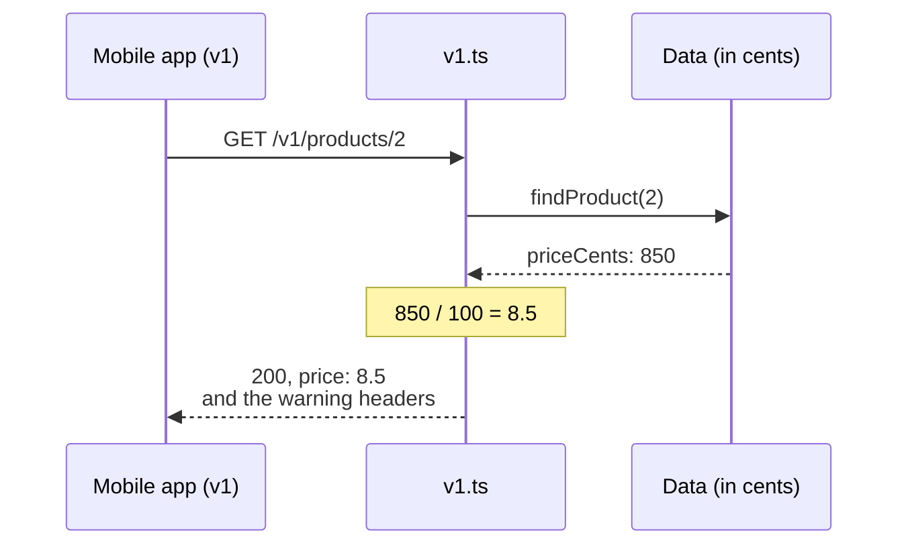

import Term from '~/components/Term.astro';
import TryIt from '~/components/TryIt.astro';
import Analogy from '~/components/Analogy.astro';
import Quiz from '~/components/Quiz.astro';
import QuizQuestion from '~/components/QuizQuestion.astro';
import QuizOption from '~/components/QuizOption.astro';
import ProjectCode from '~/components/ProjectCode.astro';

## The problem

Luis wants to store prices in cents, 850 instead of 8.5, because with decimals, money calculations end up off by a cent (you'll see it in lesson 6). Imagine that one Friday he changes the three prices in `src/data.ts` and deploys the server.

On Saturday, the shop's mobile app shows the mug at **€850**, and nobody has touched the app. The server answers `200`, TypeScript didn't complain, and the JSON has the same shape as yesterday: `{"id":2,"name":"Mug","price":850}`.

What changed is the promise: the app and the delivery company have been reading `price` as euros for months. Once other programs use your <Term id="api">API</Term>, any change can break them. In this lesson you learn to change it without them noticing.

## The analogy

<Analogy>

Think of a shop that moves. It doesn't close the old store the day the new one opens: for a few months both stay open, and in the old one's window there's a sign: “We're moving. From April 13, at 5 New Street.” Whoever walks in buys as always and leaves knowing where to go.

To put a new product on the shelf, nobody moves. **Moving is for what doesn't fit in the usual store.**

<div slot="limits">

- An API's two stores share the warehouse: the old one reads the same data as the new one and only translates what changed.
- An API's clients are programs and don't read signs: the warning headers work if someone looks at them, and you also have to warn the people who maintain those programs.

</div>

</Analogy>

## How it really works

### A change breaks if a client that worked stops working

A <Term id="breaking-change">breaking change</Term> is one that makes a <Term id="client">client</Term> that worked fail, without anyone touching it. The €850 mug is the worst kind: nothing throws an error, the data comes out wrong. The typical cases:

| Change | Does it break? | Why |
|---|---|---|
| Adding a field to the response (`stock`) | No | Whoever doesn't know it ignores it |
| Adding an optional parameter (`?sort=price`, from lesson 3) | No | Whoever doesn't send it gets the usual |
| Adding a route (`POST /orders/17/cancellation`, from lesson 1) | No | Nobody was calling it before |
| Removing or renaming a field (`price` → `priceCents`) | Yes | The client looks for `price` and it isn't there |
| Changing a field's type or unit (euros → cents) | Yes | The client reads a number that means something else |
| Making a piece of data that was optional required | Yes | The usual requests get a `422` |
| Validating more strictly (from 10 units per order to 5) | Yes | An order of 7 that was valid no longer is |
| Changing a status code or a URL | Yes | The client checks for the `200` or calls the old URL |

The underlying rule: **adding almost never breaks; removing or changing almost always does**. GitHub publishes a similar list in [the documentation of its versions](https://docs.github.com/en/rest/about-the-rest-api/api-versions).

### The gray area: a new value in a closed list

In lesson 1, orders gained the `cancelled` status. GitHub counts a new value as an additive change, but if the delivery app only knows `pending`, `paid` and `shipped`, and crashes with any other, it did break that app. That's why a good client is a **tolerant reader**: it ignores the fields it doesn't know and treats an unknown status as “other.”

### First: change by adding

Almost everything can be changed without breaking anything. The API could add `priceCents` **next to** `price`: old clients read `price`, new ones read `priceCents`, and nobody notices. What breaks is removing `price`.

You need a new version when the change can't be made by adding:

- you want to **remove** something, like `price`, so nobody uses it anymore;
- what the client **sends** changes: creating a product asks for `priceCents`, and `?max=10` becomes `?maxCents=1000`;
- the **meaning** of something that already exists changes.

<Term id="versioning">Versioning</Term> is that: giving each form of the API a number so the old one and the new one live side by side, and each client uses its own. The shop wants to remove `price` and change what clients send, so it will have two versions: `v1`, in euros, and `v2`, in cents.

### Two versions at once, on the same data

Copying all the code for the new version forces you to make every fix twice. In the project, the data and the routes are `v2`'s, and `v1` is a **thin layer that translates** only what changed. This is how it answers the mobile app, which still speaks `v1`:



In `src/app.ts`, each version hangs from its prefix:

<ProjectCode file="shop-api/13-versioning/src/app.ts" region="versions" />

- `app.route('/v1', v1)` mounts `v1`'s routes under `/v1`: its `/products` answers at `/v1/products`. The same with `v2`.
- The root, `/`, says which versions there are and when the old one is retired. Routes without a version, like `/products`, give `404`.

In `src/v1.ts`, the first thing is the pieces that translate:

<ProjectCode file="shop-api/13-versioning/src/v1.ts" region="translate" />

- `productV1` receives a product in cents and returns another <Term id="object">object</Term> with the old shape: `price`, in euros.
- The two <Term id="schema">schemas</Term> ([Phase 3](/en/phase-3/zod-validation/)) say what `v1` accepts when creating a product and in the <Term id="query-string">query string</Term>: euros. `filterSchema.shape.sort` reuses `v2`'s rule for `?sort=`, which doesn't change.

The routes that read products are the ones from lesson 3, but before filtering and sorting they pass each product through `productV1`:

<ProjectCode file="shop-api/13-versioning/src/v1.ts" region="read-v1" />

And the one that creates a product, the only one that writes:

<ProjectCode file="shop-api/13-versioning/src/v1.ts" region="create-v1" />

- `Math.round(price * 100)` goes from euros to cents and rounds, because `8.29 * 100` gives `828.9999999999999` (lesson 6 tells you why).
- `v1.route('/', v2)` is the key: whatever `v1` doesn't define (the orders, deleting a product) is handled by `v2`'s routes. Hono tries them in the order they were added: `v1`'s first.

### In the URL or in a header?

The version can travel in three places:

| Where | Example | Who uses it |
|---|---|---|
| In the URL | `GET /v2/products` | The shop, and most public APIs |
| In a <Term id="header">header</Term> | `X-GitHub-Api-Version: 2026-03-10` | GitHub; Stripe, with `Stripe-Version` |
| In the query string | `GET /products?version=2` | Few: it gets lost when links are copied |

**Almost everyone chooses the URL because you can see it**: in `curl`, in the browser, in the logs and in DevTools. The <Term id="framework">framework</Term> routes it with a prefix, and <Term id="cache">caches</Term> store each version separately, because they're different URLs.

With a header, each product has a single URL forever. In exchange, the version can't be seen, and the response has to carry `Vary` with that header's name, so a cache doesn't give one client another client's version ([lesson 4 of Phase 2](/en/phase-2/http-headers/#the-server-chooses-based-on-what-you-ask-for)).

GitHub uses the header, with dates as names. If you don't send it, it chooses for you:

<TryIt
  title="The version GitHub chooses if you say nothing"
  cmd="curl -sI https://api.github.com/repos/nodejs/node | grep -i version"
  output={`x-github-api-version-selected: 2022-11-28`}
>

`-sI` asks only for the headers, and `grep -i version` keeps the lines that say `version`. Without the header, GitHub uses `2022-11-28`; the new one is `2026-03-10`, and the previous one lasts at least 24 more months. Output from October 13, 2026: if GitHub changes the default version, you'll see another date.

</TryIt>

### Warn before switching off: Deprecation, Sunset and Link

An old version isn't switched off from one day to the next: first it's declared <Term id="deprecation">deprecated</Term>, and it keeps working for a while. `v1` announces it in every response:

<ProjectCode file="shop-api/13-versioning/src/v1.ts" region="warnings" />

- `v1.use(…)` is a <Term id="middleware">middleware</Term> ([lesson 6 of Phase 3](/en/phase-3/what-is-middleware/)) for all of `v1`'s routes, including the ones `v2` handles. It calls `next()` and, when the response comes back, adds three headers to it.
- **`Deprecation`** says since when it's deprecated. It's defined by [RFC 9745](https://www.rfc-editor.org/rfc/rfc9745), from 2025: an `@` and the seconds since January 1, 1970, in universal time. `getTime()` gives milliseconds: that's why it's divided by 1000.
- **`Sunset`** says when it will stop working. It's defined by [RFC 8594](https://www.rfc-editor.org/rfc/rfc8594), with the date format of `Date` or `Expires`, the one `toUTCString()` writes. RFC 9745 forbids it from being earlier than the `Deprecation` date.
- **`Link`**, with `rel="successor-version"`, says where the same thing is in the new version: lesson 3's `Link` header, with another relation. `replace(/^\/v1/, '/v2')` changes the `/v1` at the start of the path to `/v2` (what goes between slashes is a pattern, and `^` means “at the start”).
- `{ append: true }` adds the `Link` without deleting any that was already there, like the next page's.

Declaring something deprecated changes nothing else: according to RFC 9745, the response works the same as without the header. It's a warning, not an error.

### After the date: see who's left and switch off

Before April 13, look at who's still calling `v1`: the log from [lesson 8 of Phase 3](/en/phase-3/node-errors-and-logging/) records each path, and `grep '"path":"/v1/' shop.log` tells you. Write to whoever is left.

When the date arrives, RFC 8594 doesn't set what happens: a `4xx` error, a `3xx` redirect or no response at all. The clearest is its example, `410 Gone`: “this existed and is no longer here,” different from the `404` of what never existed ([lesson 3 of Phase 2](/en/phase-2/http-status-codes/)).

## Try it

The goal: move prices to cents **without the mobile app, which still reads euros, noticing anything**, and check that `v1` warns that it's being retired. You start from your project from lesson 3 in `~/backend-course/phase-3/shop-api`. Also download this lesson's folder, which brings the tests and helps you compare if you get stuck: from `~/backend-course/phase-3`, `curl -O https://backenddesdecero.com/practicas/shop-api/13-versioning.tar.gz` and `tar -xzf 13-versioning.tar.gz`.

### The shortcut: cents in the same field

First, the change from “The problem,” to see what catches it. In `src/data.ts`, change the three prices: `20` to `2000`, `8.5` to `850` and `35` to `3500`. Run the tests:

<TryIt
  title="1. The tests, with the shortcut"
  cmd="npm test | tail -n 35"
  output={`ℹ tests 32
ℹ suites 0
ℹ pass 31
ℹ fail 1
ℹ cancelled 0
ℹ skipped 0
ℹ todo 0
ℹ duration_ms 1092.922465

✖ failing tests:

test at test/pagination.test.ts:84:1
✖ the products, sorted by price both ways and filtered (1.370873ms)
  AssertionError [ERR_ASSERTION]: Expected values to be strictly deep-equal:
  + actual - expected
  
    [
  +   850,
  +   2000,
  +   3500
  -   8.5,
  -   20,
  -   35
    ]
  
      at TestContext.<anonymous> (file:///Users/ana/backend-course/phase-3/shop-api/test/pagination.test.ts:87:10)
      at async Test.run (node:internal/test_runner/test:1409:7)
      at async Test.processPendingSubtests (node:internal/test_runner/test:974:7) {
    generatedMessage: true,
    code: 'ERR_ASSERTION',
    actual: [ 850, 2000, 3500 ],
    expected: [ 8.5, 20, 35 ],
    operator: 'deepStrictEqual',
    diff: 'simple'
  }`}
>

`tail -n 35` keeps the last 35 lines. The test that sorts by price fails: it expected `8.5, 20, 35` (the lines with `-`) and gets `850, 2000, 3500` (the ones with `+`). It reads `price` as euros, just like the app. `npm run check` doesn't complain: 850 is still a number.

This lesson's outputs are from Node 26.11.1 and `curl` 8.14.1, on Linux; your times and dates will be different. If you see `tests 0`, you're missing the `test/` folder from lesson 3's download.

</TryIt>

Undo the change: put back `20`, `8.5` and `35`.

### Version 2: cents with their own name

1. Create `src/v2.ts`. Move into it, from `src/app.ts`, the `/products` and `/orders` routes, the `statusDoesNotAllow` and `notAllowed` functions and the `import`s they use, and change `app.` to `v2.`.
2. In `src/data.ts`, change `price` to `priceCents` in `Product`, in the three products (`2000`, `850` and `3500`) and in `createProduct`:

<ProjectCode file="shop-api/13-versioning/src/data.ts" region="product" />

3. In `src/schemas.ts`, the new product asks for whole cents, with `.int(…)`, and the filter is now called `maxCents`. The name rule moves out to a constant with `export`, `nameSchema`, because `v1` uses it too (in the download, right before the product).

<ProjectCode file="shop-api/13-versioning/src/schemas.ts" region="product" />

<ProjectCode file="shop-api/13-versioning/src/schemas.ts" region="params" />

4. In `src/v2.ts`, the product routes use the new names. This is how the file starts, after the `import`s, and this is how the create route ends up:

<ProjectCode file="shop-api/13-versioning/src/v2.ts" region="list-products" />

<ProjectCode file="shop-api/13-versioning/src/v2.ts" region="create-product" />

`c.req.path` is the request's path, with its prefix: `/v2/products` or `/v1/products`. Change the `Location` of `POST /orders` the same way: `c.req.path`, a slash and `order.id`.

`npm run check` guides you: every `price` left over comes out like this (your file and your line will be different):

```
src/v2.ts(32,45): error TS2339: Property 'price' does not exist on type 'Product'.
```

### Version 1, on top of version 2

Create `src/v1.ts` with these `import`s and, below them, the four pieces from “How it really works,” in order: warnings, translate, read and create.

<ProjectCode file="shop-api/13-versioning/src/v1.ts" region="import" />

In `src/app.ts` the `import`s change, and the routes make room for the versions part; the rest (`requestId`, the log, CORS and the errors) stays the same:

<ProjectCode file="shop-api/13-versioning/src/app.ts" region="import" />

Lesson 3's tests call `/products` without a version, which is now a `404`. Copy the ones from the download and run them:

<TryIt
  title="2. The tests of both versions"
  cmd={`cp ../13-versioning/test/*.test.ts test/
npm test | tail -n 17`}
  output={`✔ the root says which versions there are and when version 1 is retired (7.706782ms)
✔ v2: the price, in whole cents (1.342706ms)
✔ v1 stays as it was: the price, in euros (1.747956ms)
✔ v1 warns that it is deprecated, when it is retired and where version 2 is (0.940916ms)
✔ v2 does not carry those warnings (0.452333ms)
✔ a product created with v1, in euros, reads in v2 in cents (2.541789ms)
✔ in v2, the price in euros is no longer valid: it is a breaking change (1.397707ms)
✔ v1's orders are v2's, with the warnings and without losing the next page's Link (1.125582ms)
✔ without a version, the routes no longer exist: 404 (0.743582ms)
ℹ tests 41
ℹ suites 0
ℹ pass 41
ℹ fail 0
ℹ cancelled 0
ℹ skipped 0
ℹ todo 0
ℹ duration_ms 540.725558`}
>

The nine from `test/versioning.test.ts`, and `fail 0` out of 41. If any fails, it comes out with `✖`, what it expected and what it got: compare your code with the download's.

</TryIt>

### Call both versions

Start the server with `npm run dev` and open another terminal for `curl`.

<TryIt
  title="3. The root: which versions there are"
  cmd="curl -s localhost:3000/ | jq"
  output={`{
  "name": "API for Ana and Luis's shop",
  "versions": [
    {
      "version": "v2",
      "url": "/v2",
      "status": "current"
    },
    {
      "version": "v1",
      "url": "/v1",
      "status": "deprecated",
      "sunset": "2027-04-13T00:00:00.000Z"
    }
  ]
}`}
>

`jq` ([lesson 8 of Phase 3](/en/phase-3/node-errors-and-logging/)) lays the JSON out in lines. `v1` is deprecated and has a retirement date.

</TryIt>

<TryIt
  title="4. The mug, in v1"
  cmd="curl -i localhost:3000/v1/products/2"
  output={`HTTP/1.1 200 OK
content-type: application/json
deprecation: @1791849600
link: </v2/products/2>; rel="successor-version"
sunset: Tue, 13 Apr 2027 00:00:00 GMT
vary: Origin
x-request-id: 455e55de-f5af-41ef-ab4a-7e41d5a840de
content-length: 33
Date: Tue, 13 Oct 2026 15:39:31 GMT
Connection: keep-alive
Keep-Alive: timeout=5

{"id":2,"name":"Mug","price":8.5}`}
>

A `200` and the mug at €8.50: the app notices nothing. But the three warnings come along: deprecated since `@1791849600`, switched off on April 13, 2027, and the same mug at `/v2/products/2`. `date -u -r 1791849600` on the Mac (`date -u -d @1791849600` on Linux and WSL) translates the number: `Tue Oct 13 00:00:00 UTC 2026`. Your `x-request-id` and your date will be different.

</TryIt>

<TryIt
  title="5. The same mug, in v2 and without a version"
  cmd={`curl -w '\\n' localhost:3000/v2/products/2
curl -w '\\n' localhost:3000/products/2`}
  output={`{"id":2,"name":"Mug","priceCents":850}
{"type":"about:blank","title":"Not Found","status":404,"detail":"No such route"}`}
>

In `v2`, `priceCents: 850`, without warnings. Without a version, a `404` in lesson 2's format.

</TryIt>

Now create a product through `v1`, in euros, and read it through `v2`. First, save your token in a terminal variable: `TOKEN=` and, right after it, the value of `ADMIN_TOKEN` from your `.env`.

<TryIt
  title="6. A cap created in euros, read in cents"
  cmd={`curl -i -w '\\n' -H "Authorization: Bearer $TOKEN" --json '{"name":"Cap","price":8.29}' localhost:3000/v1/products
curl -w '\\n' localhost:3000/v2/products/4`}
  output={`HTTP/1.1 201 Created
content-type: application/json
deprecation: @1791849600
link: </v2/products>; rel="successor-version"
location: /v1/products/4
sunset: Tue, 13 Apr 2027 00:00:00 GMT
vary: Origin
x-request-id: af720d9c-e37d-48c8-88bb-383072eddb33
content-length: 34
Date: Tue, 13 Oct 2026 15:39:31 GMT
Connection: keep-alive
Keep-Alive: timeout=5

{"id":4,"name":"Cap","price":8.29}
{"id":4,"name":"Cap","priceCents":829}`}
>

A single product, from both versions: €8.29 in `v1` and 829 cents in `v2`. The double quotes let the terminal replace `$TOKEN` with its value; if you get a `401`, the variable is empty or the token doesn't match.

</TryIt>

<TryIt
  title="7. The old filter, in both versions"
  cmd={`curl -w '\\n' 'localhost:3000/v1/products?max=10'
curl -w '\\n' 'localhost:3000/v2/products?maxCents=1000'
curl -w '\\n' 'localhost:3000/v2/products?max=10'`}
  output={`[{"id":2,"name":"Mug","price":8.5},{"id":4,"name":"Cap","price":8.29}]
[{"id":2,"name":"Mug","priceCents":850},{"id":4,"name":"Cap","priceCents":829}]
[{"id":1,"name":"T-shirt","priceCents":2000},{"id":2,"name":"Mug","priceCents":850},{"id":3,"name":"Hoodie","priceCents":3500},{"id":4,"name":"Cap","priceCents":829}]`}
>

The first two give the same thing, each in its own language. The third, `?max=10` in `v2`, returns **all four products**, without an error: Zod drops whatever isn't in the schema, and `v2`'s doesn't know `max`. Moving to another version isn't changing `/v1` to `/v2` in the URL: you have to change every name.

</TryIt>

<TryIt
  title="8. A list of orders from v1"
  cmd={`curl -sI 'localhost:3000/v1/orders?limit=2' | grep -iE '^(http|deprecation|sunset|link)'`}
  output={`HTTP/1.1 200 OK
deprecation: @1791849600
link: <http://localhost:3000/v1/orders?limit=2&cursor=MjQ>; rel="next", </v2/orders>; rel="successor-version"
sunset: Tue, 13 Apr 2027 00:00:00 GMT`}
>

The orders are handled by `v2`, through `v1.route('/', v2)`, with `v1`'s warnings. Thanks to `{ append: true }`, the `Link` carries two links separated by a comma: the next page, in `v1`, and the successor version.

</TryIt>


## You have already seen it

- **“Update the app to keep using it.”** Often, the server is about to switch off the API version your old app uses.
- **In URLs.** In DevTools' **Network** tab ([how to open them](/en/phase-2/#before-you-start-devtools)) you'll see requests to `/api/v1/…` or `/v3/…`.
- **In npm packages.** The `4` in `hono@4.13.13` changes when something breaks ([lesson 1 of Phase 3](/en/phase-3/what-is-node-js/)). APIs usually use only that number, or a date, almost never `v2.3.1`: the client only cares about when something breaks.

## Common mistakes

- **Changing the meaning without changing the name.** Cents in the same `price` don't throw any error: they give prices a hundred times higher.
- **Releasing a version for every change.** Whatever can be added is added in the current version.
- **Copying all the code for the new version.** The copies drift apart with every fix: let the old one translate on top of the new one.
- **Setting `Sunset` and not checking who's left.** Before switching off, look at the log and write to whoever is still on the old one.
- **Sending the old parameters to the new version.** `?max=10` in `v2` doesn't give an error: it's silently ignored.

## Summary

- A change breaks if a client that worked stops working: removing or renaming a field, changing its type or unit, requiring something new.
- First, change by adding. A new version is for removing something, or for changing what the client sends or what something means.
- Both versions live side by side on the same data: the old one translates only what changed.
- Almost every API puts the version in the URL (`/v2/`): you can see it, and caches don't mix versions.
- The old one warns with `Deprecation` (since when it's deprecated), `Sunset` (when it's switched off) and `Link` with `rel="successor-version"` (where the new one is).

## Did you get it?

<Quiz>

<QuizQuestion
  question="The delivery company reads each order’s status. You want to add a new field to the response, carrier. Do you need a v3?"
  review="A change breaks if a client that worked stops working"
>

<QuizOption text="Yes: any change in the shape of the response needs a new version.">

Adding a field doesn't make anyone fail: whoever doesn't know it ignores it.

</QuizOption>

<QuizOption text="No: a new field doesn’t break whoever doesn’t know it." correct>

It's an additive change: the delivery company ignores `carrier` until it wants to use it.

</QuizOption>

<QuizOption text="No, as long as the response carries the Deprecation header.">

`Deprecation` announces that something is going to be retired. Adding retires nothing: no warning is needed.

</QuizOption>

</QuizQuestion>

<QuizQuestion
  question="The delivery company asks for its orders with ?limit=30. Luis lowers limit’s maximum from 50 to 20, without changing the version. Does it break the company?"
  review="A change breaks if a client that worked stops working"
>

<QuizOption text="Yes: the same request it sends every day now gets a 422." correct>

Validating more strictly breaks: requests that worked stop working, even though the parameters are the same.

</QuizOption>

<QuizOption text="No: the parameters are the same, only a rule changes.">

The shape not changing isn't enough: the company asked for 30 yesterday without a problem and today gets an error.

</QuizOption>

<QuizOption text="No: the 422 explains what’s wrong, so the client fixes itself.">

A good error helps whoever reads it, but the request fails all the same: a program doesn't change its code by reading a message.

</QuizOption>

</QuizQuestion>

<QuizQuestion
  question="The API gives each order’s delivery time in days, in the deliveryTime field. A coworker switches it to hours without renaming it: from 2 to 48. npm run check gives no errors. What does the mobile app show?"
  review="A change breaks if a client that worked stops working"
>

<QuizOption text="An error when reading the response, because the number isn’t the usual one.">

For the app, `48` is a number just like `2`, and it reads it without a problem. That's why the failure can't be seen.

</QuizOption>

<QuizOption text="Nothing odd: if the change broke something, TypeScript would have flagged it.">

For TypeScript, both are `number`: it doesn't know whether they're days or hours. And it doesn't see the app's code.

</QuizOption>

<QuizOption text="A delivery time of 48 days, without any error." correct>

It's the worst breaking change, like the €850 mug: the same shape, another meaning. A new name, `deliveryTimeHours`, would have avoided it.

</QuizOption>

</QuizQuestion>

<QuizQuestion
  question="Your API puts the version in a header, Shop-Version, and a CDN stores the responses. What do you have to watch out for?"
  review="In the URL or in a header?"
>

<QuizOption text="Nothing: a CDN compares all of the request’s headers before handing out a copy.">

A cache stores by URL. It only looks at a header if the response asks it to with `Vary`.

</QuizOption>

<QuizOption text="That the response carries Vary: Shop-Version." correct>

The URL is the same for both versions. `Vary` tells the cache to store one copy for each value of the header.

</QuizOption>

<QuizOption text="That the CDN lets the header through, because it rejects the ones it doesn’t know.">

A cache doesn't reject a header it doesn't know: it passes it on to the server. The problem is the copy it stores.

</QuizOption>

</QuizQuestion>

<QuizQuestion
  question="A v1 response comes with Deprecation: @1791849600 and Sunset: Tue, 13 Apr 2027 00:00:00 GMT. What does it mean for whoever uses it today?"
  review="Warn before switching off: Deprecation, Sunset and Link"
>

<QuizOption text="That v1 no longer works and the response is only a warning.">

Declaring something deprecated changes nothing: the response is a `200` with its usual data, as RFC 9745 says.

</QuizOption>

<QuizOption text="That v1 will be switched off on October 13, 2026, the Deprecation date.">

`Deprecation` is since when it's deprecated, not when it's switched off. The switch-off is the `Sunset` date.

</QuizOption>

<QuizOption text="That it keeps working the same, until April 13, 2027." correct>

`Deprecation` says it's already deprecated, and `Sunset`, when it's switched off. Until then there's time to move to `v2`.

</QuizOption>

</QuizQuestion>

<QuizQuestion
  question="v1 has to keep giving prices in euros. How does the project do it without maintaining two shops?"
  review="Two versions at once, on the same data"
>

<QuizOption text="v1 reads the same data as v2 and only translates the price." correct>

`productV1` divides by 100 when reading, and `Math.round(price * 100)` multiplies when creating. `v2` handles everything else.

</QuizOption>

<QuizOption text="It copies v2’s routes into v1 and changes priceCents to price.">

They would be two copies that drift apart with every fix. `v1` only defines the routes that carry a price.

</QuizOption>

<QuizOption text="It stores each product twice: in euros for v1 and in cents for v2.">

You'd have to keep both copies the same. There's a single piece of data, in cents, and `v1` translates it when answering.

</QuizOption>

</QuizQuestion>

</Quiz>

## Further reading

- [RFC 9745: The Deprecation HTTP Response Header Field](https://www.rfc-editor.org/rfc/rfc9745): the `Deprecation` header and `rel="deprecation"`, to link to a page that explains the retirement.
- [RFC 8594: The Sunset HTTP Header Field](https://www.rfc-editor.org/rfc/rfc8594): the `Sunset` header and what can happen after the date.
- [API versions](https://docs.github.com/en/rest/about-the-rest-api/api-versions) (GitHub): which changes break and how long each version lasts.
- [Versioning](https://docs.stripe.com/api/versioning) (Stripe): versions with a date in a header, with the `/v1/` in the URL.
