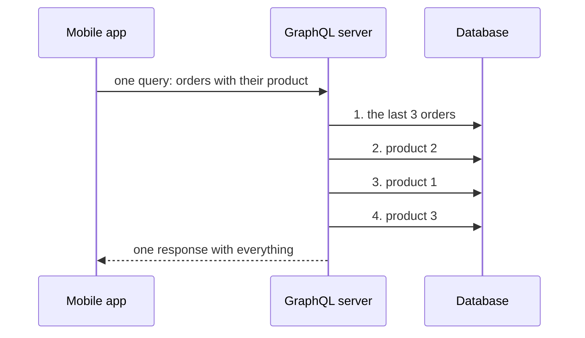

import Term from '~/components/Term.astro';
import TryIt from '~/components/TryIt.astro';
import Analogy from '~/components/Analogy.astro';
import SelfCheck from '~/components/SelfCheck.astro';
import Quiz from '~/components/Quiz.astro';
import QuizQuestion from '~/components/QuizQuestion.astro';
import QuizOption from '~/components/QuizOption.astro';

## The problem

The shop's mobile app, the one from the [introduction to this phase](/en/phase-4/), has a screen, “My orders,” with the last three orders and the name of each one's product. With your API, the app has to do this:

```sh
curl -w '\n' 'localhost:3000/v2/orders?limit=3'
curl -w '\n' localhost:3000/v2/products/2
curl -w '\n' localhost:3000/v2/products/1
curl -w '\n' localhost:3000/v2/products/3
```

```
[{"id":25,"productId":2,"quantity":2,"status":"pending","createdAt":"2026-10-08T09:00:00.000Z"},{"id":24,"productId":1,"quantity":1,"status":"pending","createdAt":"2026-10-08T02:00:00.000Z"},{"id":23,"productId":3,"quantity":4,"status":"pending","createdAt":"2026-10-07T19:00:00.000Z"}]
{"id":2,"name":"Mug","priceCents":850}
{"id":1,"name":"T-shirt","priceCents":2000}
{"id":3,"name":"Hoodie","priceCents":3500}
```

These are real outputs from the project of lesson 8, with Node 26. Four requests for one screen, each with its trip over the phone's network and its <Term id="latency">latency</Term>; with twenty orders, twenty-one. And the price travels even though the screen doesn't show it.

The agency that builds the app asks you for a custom route, `/v2/my-orders-with-products`. Next week, the delivery company will want another one. One route for every screen of every client never ends.

Facebook ran into this problem in 2012, with its app, and [invented GraphQL](https://engineering.fb.com/2015/09/14/core-infra/graphql-a-data-query-language/). Google had a different one, between its own services, and that's where [gRPC](https://grpc.io/blog/principles/) came from. In this lesson you'll see when each one is worth it.

## The analogy

<Analogy>

In a restaurant with a menu, each dish arrives the way the kitchen designed it. If you want the chicken from dish 3 and the salad from dish 5, you order both dishes, and you're left with the fries from one and the rice from the other. That's REST: each address returns a fixed dish.

Now imagine a kitchen that gives you a sheet with everything it has, and you tick what you want: “chicken, salad.” They bring it to you on a single plate. That's GraphQL.

And between the kitchen and the bakery that makes their bread there's an intercom with orders in code, on preprinted sheets both of them have: “P-12, forty.” Fast, but no customer uses it. That's gRPC.

<div slot="limits">

- In the restaurant, a sheet with everything ticked gets noticed. In GraphQL, a query that asks for thousands of pieces of data fits in three lines, and the server has to put limits on it.
- The fixed menu lets you have dishes prepared in advance: that's HTTP caching, and GraphQL loses it.
- gRPC's preprinted sheets are a file that code is generated from. If they change, both sides need the new version.

</div>

</Analogy>

## How it really works

### GraphQL: a single address and a query with the fields you want

This query goes to `https://countries.trevorblades.com/graphql`, a public API of countries that doesn't ask for an account:

```graphql
{
  country(code: "ES") {
    name
    capital
    currency
  }
}
```

And it answers:

```json
{"data":{"country":{"capital":"Madrid","currency":"EUR","name":"Spain"}}}
```

`country(code: "ES")` is what you ask for: a country, with its code as an argument. Inside the braces, the fields you want from it, and only those three arrive, inside `data` and with the shape of the query.

**<Term id="graphql">GraphQL</Term> is a language for asking an API for data: the client writes which fields it wants, and the server answers with that same shape.** Every query goes to the same URL, almost always with `POST`, and the query travels in the <Term id="request-body">body</Term>, inside a <Term id="json">JSON</Term>: `{"query": "…"}`. It's no longer the URL that says what you're asking for, but the body.

How do you know which fields exist? The server publishes a <Term id="schema">schema</Term> with its types: a `Country` has `name`, `capital` or `languages`, and `languages` is a list of `Language`. Each query is checked against it before it runs, as Zod did in [Phase 3](/en/phase-3/zod-validation/). And you can ask the schema what it has: that's how editors autocomplete.

### What it solves: over-fetching and under-fetching

A REST API decides what each address returns, and that fails in two ways:

- **Over-fetching:** data you don't use arrives, like the price on the “My orders” screen.
- **Under-fetching:** one response isn't enough, and you have to make another for each thing that's missing, like the four requests in “The problem.”

If the shop had GraphQL, the app would write this query:

```graphql
{
  orders(limit: 3) {
    id
    quantity
    product {
      name
    }
  }
}
```

`product` goes inside each order, and the server takes care of putting them together. A single trip, and from the product, only the name. If tomorrow the delivery company wants another combination, it writes another query, and you don't add any route.

### What GraphQL costs

What GraphQL saves the client, the server pays for:

- **HTTP caching stops working.** The caches and CDNs of [Phase 2](/en/phase-2/http-caching/#cdns-keep-copies-for-everyone) kept one copy per URL. Here everything goes to the same URL, and with `POST`, which in practice isn't stored. You need a cache that reads the body, like the one you'll see in “Try it.”
- **Errors arrive with a `200`.** A badly written query usually gets `200 OK` and, instead of `data`, an `errors` list. It's Phase 2's [“200 with an error inside”](/en/phase-2/http-status-codes/#the-200-with-an-error-inside): an alarm that counts errors by their code doesn't see it, and the client has to look at the body.
- **A query can cost a huge amount.** A country has its continent, the continent its countries, each country its continent… In a few lines you can ask for thousands of pieces of data. That's why GraphQL servers limit the depth and the cost of each query.
- **More pieces to maintain:** the schema, one function per field that fetches its data and a library that ties it all together. With one or two clients, it's not worth it.

And there's a hidden cost, the **N+1 problem**. For the shop's query, the server fetches the orders once and, after that, the product of each order, one by one:



One lookup for the orders, plus N, one per order: N+1. With the data in memory, as today, it costs nothing. With a <Term id="database">database</Term>, each lookup is a trip: a hundred orders, a hundred and one queries, the trips of “The problem” hidden inside the server. It's fixed by grouping the lookups (the DataLoader library does it) or by asking for everything in a single query, as you'll see in Phase 5.

### gRPC: calling a function of another service

In a big company, services call each other thousands of times per second: the orders service asks the stock one, the payments one asks the fraud one. Nobody reads JSON there. That's what **<Term id="grpc">gRPC</Term> is for: one service calls a function of another as if it were in its own code.** RPC is *Remote Procedure Call*.

It all starts in a `.proto` file. This is the order from lesson 6 with a service on top:

```proto
syntax = "proto3";

package shop;

import "order.proto";

service Orders {
  rpc GetOrder (OrderRequest) returns (Order);
  rpc FollowOrder (OrderRequest) returns (stream Order);
}

message OrderRequest {
  uint32 id = 1;
}
```

Word by word:

- `import "order.proto"` brings in the `Order` message from lesson 6.
- `service Orders` groups the functions the service offers.
- `rpc GetOrder (OrderRequest) returns (Order)` is a function: it receives an `OrderRequest` and returns an `Order`. It does the same as `GET /v2/orders/7`, with a function name instead of a URL.
- `stream Order` returns many, one after another, while the connection stays open, like Server-Sent Events in lesson 8.
- `message OrderRequest` is the input data: an id, with its field number.

What else gRPC does:

- **It generates the code.** A tool, `protoc`, reads the `.proto` and writes code in each language: on the client, a <Term id="function">function</Term> `getOrder` you call like any other; on the server, the slot where you write what it does. The bytes and the network take care of themselves.
- **The `.proto` is the contract, and it's mandatory.** With OpenAPI, in lesson 5, the contract was a help; here, without it, neither side understands the other's bytes.
- **It goes in Protobuf over HTTP/2:** bytes instead of text, and many calls at once over a single connection, with [HTTP/2 multiplexing](/en/phase-2/http2-vs-http3/#http2-many-requests-at-once-over-a-single-connection).
- **It has its own codes.** The HTTP response is a `200` even if the call fails; the real result (`OK`, `NOT_FOUND`, `UNAVAILABLE`…) arrives in some <Term id="header">headers</Term> at the end of the response.

And for a public API? A browser can't make a gRPC call: it doesn't let JavaScript handle HTTP/2 at that level. You need gRPC-Web, a variant the browser can send, and an intermediary that translates it. You can't try it by hand with `curl` either, and whoever calls you needs your `.proto`. Between your own services, none of that matters; for the delivery company, it's a wall.

### Which one to choose

| | REST | GraphQL | gRPC |
|---|---|---|---|
| What travels | JSON, with one URL per resource | A query and JSON, always to the same URL | Protobuf, in binary |
| Who chooses the fields | The server | The client | The `.proto`, for both |
| Contract | Optional (OpenAPI) | The schema, mandatory | The `.proto`, mandatory |
| HTTP caching | Yes | No, without a cache of its own | No |
| From the browser and with `curl` | Yes | Yes | No, without an intermediary |
| Errors | Status codes | `errors`, often with `200` | Its own codes, with `200` |
| Where it fits | Public APIs | Your own apps with many different screens | Between your own services |

And with the other ways of talking in this phase:

| You need… | Use |
|---|---|
| Anyone to use your API without knowing you | REST, documented with OpenAPI |
| Your apps to ask for different combinations of the same data | GraphQL |
| Your services to call each other, many times and fast | gRPC |
| To notify another server when something happens | A webhook (lesson 7) |
| To send the browser what's happening | Server-Sent Events (lesson 8) |
| To talk both ways, like in a chat | WebSockets (lesson 8) |

They don't exclude each other. Many companies use gRPC internally, REST externally and GraphQL for their own apps.

### Why REST is still the norm for a public API

Whoever uses a public API is a stranger, and REST is what asks the least of them:

- **Any tool understands it:** `curl`, the browser or any language, without generating code.
- **It makes use of what HTTP already has:** caching by URL and CDNs, <Term id="status-code">status codes</Term> any alarm understands, and limits per route (Phase 6).
- **It doesn't force you to defend yourself from strangers' expensive queries,** which with GraphQL would be your problem.

GitHub offers both: its REST API, the one in this phase, without an account, and a GraphQL one that [asks for a token](https://docs.github.com/en/graphql/guides/forming-calls-with-graphql#authenticating-with-graphql).

## Try it

The goal: find out what a GraphQL API answers when you get it right, when you make a mistake and when you ask for something that doesn't exist, and compare it with GitHub's REST API. You only need `curl` and `jq`, the one from [lesson 8 of Phase 3](/en/phase-3/node-errors-and-logging/). The outputs are from a Mac, on October 13, 2026.

<TryIt
  title="1. Your first query"
  cmd={`API=https://countries.trevorblades.com/graphql
curl -s -w '\\n' --json '{"query": "{ country(code: \\"ES\\") { name capital currency } }"}' $API`}
  output={`{"data":{"country":{"capital":"Madrid","currency":"EUR","name":"Spain"}}}`}
>

Word by word:

- `API=…` saves the address in a terminal variable, and `$API` uses it. It lasts as long as you don't close that terminal.
- `--json`, from [lesson 1 of Phase 2](/en/phase-2/http-request-and-response/), sends the body with `POST` and `Content-Type: application/json`.
- The body is `{"query": "…"}`, with the query inside as text. The quotes of `"ES"` have a `\` in front because they go inside another text in quotes.

Notice that this API returns the fields in alphabetical order, not in the order of your query. It doesn't matter: a program looks them up by name. If you see `option --json: is unknown`, your `curl` is older than 2022: update it, or change `--json` to `-H 'Content-Type: application/json' -d`.

</TryIt>

<TryIt
  title="2. Data inside data"
  cmd={`curl -s --json '{"query": "{ country(code: \\"ES\\") { name continent { name } languages { native } } }"}' $API | jq`}
  output={`{
  "data": {
    "country": {
      "continent": {
        "name": "Europe"
      },
      "languages": [
        {
          "native": "Español"
        },
        {
          "native": "Euskara"
        },
        {
          "native": "Català"
        },
        {
          "native": "Galego"
        },
        {
          "native": "Occitan"
        }
      ],
      "name": "Spain"
    }
  }
}`}
>

`continent` is another object, and `languages`, a list; from each one you ask for its own fields. `jq` on its own only spreads the response over several lines so it can be read.

If you see `curl: (2) no URL specified`, `$API` is empty: you're in another terminal. Type the first line of step 1 again.

</TryIt>

<TryIt
  title="3. A badly written query and a country that doesn't exist"
  cmd={`curl -s -w '\\n%{http_code}\\n' --json '{"query": "{ country(code: \\"ES\\") { nmae } }"}' $API
curl -s -w '\\n%{http_code}\\n' --json '{"query": "{ country(code: \\"XX\\") { name } }"}' $API`}
  output={`{"errors":[{"message":"Cannot query field \\"nmae\\" on type \\"Country\\". Did you mean \\"name\\"?","locations":[{"line":3,"column":5}],"extensions":{"code":"GRAPHQL_VALIDATION_FAILED"}}]}
200
{"data":{"country":null}}
200`}
>

`-w '\n%{http_code}\n'` writes the status code below the body. **Both are `200`.**

- In the first one, there's no `data`: the field `nmae` (with the letters swapped) isn't in the schema, and the query didn't even run. `locations` counts the lines of the query as the service rewrites it.
- In the second one, there's no error: the country `XX` doesn't exist, and `country` is `null`. In REST it would be a `404`.

</TryIt>

<TryIt
  title="4. The same error, with the new specification"
  cmd={`curl -s -w '\\n%{http_code}\\n' -H 'Accept: application/graphql-response+json' --json '{"query": "{ country(code: \\"ES\\") { nmae } }"}' $API`}
  output={`{"errors":[{"message":"Cannot query field \\"nmae\\" on type \\"Country\\". Did you mean \\"name\\"?","locations":[{"line":3,"column":5}],"extensions":{"code":"GRAPHQL_VALIDATION_FAILED"}}]}
400`}
>

Now, `400`. [GraphQL over HTTP](https://http-spec.graphql.org/draft/), a specification still in draft, defines the format `application/graphql-response+json` and, with it, a `4xx` for a badly written query (it recommends `422`). This API only uses it if the client asks for it in `Accept`, so as not to break old clients.

</TryIt>

<TryIt
  title="5. This API's cache"
  cmd={`curl -si --json '{"query": "{ country(code: \\"ES\\") { name capital currency } }"}' $API | grep -i -e '^cache-control' -e '^x-cache' -e '^x-powered-by'`}
  output={`cache-control: public, s-maxage=2628000, stale-while-revalidate=2628000
x-powered-by: Stellate
x-cache: HIT`}
>

`-i` adds the headers, and `grep` keeps three. Stellate is a cache made for GraphQL: it reads the body of each `POST` and stores the response to each query. `x-cache: HIT` says this one came from there, and `s-maxage`, that it's stored for 2,628,000 seconds, a month: countries hardly change.

The headers may come out in another order, depending on which cache server answers you, and with `x-cache: MISS` if it wasn't stored there yet.

</TryIt>

<TryIt
  title="6. The same, with REST: a GitHub repository"
  cmd={`curl -s -o node.json -w '%{size_download} bytes\\n' https://api.github.com/repos/nodejs/node
jq 'keys | length' node.json
jq '{name, description, stargazers_count}' node.json`}
  output={`6618 bytes
86
{
  "name": "node",
  "description": "Node.js JavaScript runtime ✨🐢🚀✨",
  "stargazers_count": 122372
}`}
>

`-o node.json` saves the response in a file, and `-w` says how big it is. `jq 'keys | length'` counts its fields, and the last `jq` takes out three.

GitHub's REST API decides what it sends you: 86 fields and 6,618 bytes for three pieces of data, and `jq` filters when everything has already arrived. Your numbers will be different: the repository changes every day. If you get a few hundred bytes and `null`, look inside `node.json`: `API rate limit exceeded` means you've used up the 60 requests per hour GitHub gives without an account.

</TryIt>

<SelfCheck question="Challenge: get, in a single query, the name, the phone prefix and the continent of Japan (code JP). You don’t know what the fields are called: ask the schema.">

You ask the schema with a special query, `__type`, that returns the fields of a type:

```sh
curl -s --json '{"query": "{ __type(name: \"Country\") { fields { name } } }"}' $API | jq -c '[.data.__type.fields[].name]'
```

```
["awsRegion","capital","code","continent","currencies","currency","emoji","emojiU","languages","name","native","phone","phones","states","subdivisions"]
```

The prefix is `phone`, and the continent, `continent`, which is an object: ask for its `name`.

```sh
curl -s --json '{"query": "{ country(code: \"JP\") { name phone continent { name } } }"}' $API | jq -c
```

```
{"data":{"country":{"phone":"81","continent":{"name":"Asia"},"name":"Japan"}}}
```

One request, and only what you asked for.

</SelfCheck>

## You have already seen it

- **In DevTools, on a website that uses GraphQL** ([how to open them](/en/phase-2/#before-you-start-devtools)), the **Network** tab fills up with `POST` requests to the same URL, often `/graphql`. To know what each one asks for, open it and look at its body under **Payload**.
- **You won't see gRPC in the browser:** it lives between servers. If you come across a `.proto` file, you already know how to read it.

## Common mistakes

- **Looking only at the status code in GraphQL.** A `200` can bring `errors`. Look at the body, or ask for `application/graphql-response+json` if the server understands it.
- **Opening GraphQL to the public without limits.** Without a cap on depth and cost, a single query can bring your server down.
- **Building the query by pasting in what the user types.** Use GraphQL variables, which travel separately (`"variables": {"code": "ES"}`). You'll see the danger of pasting texts together in Phase 6.
- **Believing REST doesn't let you choose fields.** A route can accept `?fields=name,price`, and many APIs do.

## Summary

- GraphQL: one URL, a query with the fields you want and a response with that shape. It solves over-fetching and under-fetching.
- The server pays for it: no HTTP caching, errors with `200`, queries you have to limit and the N+1 problem.
- gRPC: one service calls functions of another, described in a `.proto`, with Protobuf over HTTP/2 and generated code. It's for your own services, not for the browser.
- REST is still the norm for a public API: anyone understands it and it makes use of everything HTTP already has.

### What you've built in this phase

You started the phase with an API only your website used, and you finish it with one that others use without asking you:

- routes that can be guessed and errors with Problem Details;
- pages with a cursor, filters and sorting;
- `/v1/` and `/v2/` at the same time, with a farewell date for the old one;
- a contract, `openapi.json`, with its page at `/docs`;
- dates in ISO 8601 and money in cents;
- a signed webhook, orders that aren't duplicated and their status live.

But if you stop the server, everything disappears: the orders live in the program's memory. In Phase 5 you save them in PostgreSQL, and the N+1 problem shows up for real, with its solution.

## Did you get it?

<Quiz>

<QuizQuestion
  question="The delivery company, your API’s only client, only reads orders page by page, and it works well for them. Someone proposes moving the API to GraphQL “because it’s more modern.” What do you tell them?"
  review="Why REST is still the norm for a public API"
>

<QuizOption text="Yes: with GraphQL, HTTP caching works better.">

It's the other way around: everything goes with `POST` to the same URL, and HTTP caching stops working.

</QuizOption>

<QuizOption text="It’s not worth it: with a single client that’s well served, it only adds work." correct>

GraphQL pays off with many clients that ask for different things. For one that already has what it needs, it solves nothing, and it adds a schema, limits and a cache of its own for you.

</QuizOption>

<QuizOption text="Yes: GraphQL is faster than REST in any API, whatever clients it has.">

GraphQL only saves trips when REST forced you to make several, and that's not the case here.

</QuizOption>

</QuizQuestion>

<QuizQuestion
  question="Your program sends a GraphQL query and gets a 200 with no data and with an errors list that says “Cannot query field price on type Product”. What happened?"
  review="What GraphQL costs"
>

<QuizOption text="It went fine: the 200 says it worked, and errors is just a warning.">

In GraphQL, the `200` doesn't say the query worked. Without `data` and with `errors`, nothing has run.

</QuizOption>

<QuizOption text="The price field exists, but it’s empty, and GraphQL warns you this way.">

An empty field arrives inside `data` with `null`, like the country `XX` in “Try it.” “Cannot query field” means the schema doesn't have it.

</QuizOption>

<QuizOption text="The schema has no price field: the query didn’t even run." correct>

The server checks each query against the schema before running it, as in step 3 of “Try it.” Maybe the field is called `priceCents`.

</QuizOption>

</QuizQuestion>

<QuizQuestion
  question="A GraphQL query asks for 50 orders and, for each one, its product. The data is in a database, and the server doesn’t group the lookups. How many queries does it make to the database?"
  review="What GraphQL costs"
>

<QuizOption text="51: one for the orders and one for each product." correct>

It's the N+1 problem: the server resolves `product` once per order, and each time it goes to the database.

</QuizOption>

<QuizOption text="One: GraphQL joins the two parts into a single query to the database.">

GraphQL knows nothing about your database: it calls each field's function, and each one looks things up on its own.

</QuizOption>

<QuizOption text="Two: one for the orders and another for all the products.">

That's what you get when you group the lookups, for example with DataLoader. Without grouping, each product is a lookup.

</QuizOption>

</QuizQuestion>

<QuizQuestion
  question="The delivery company wants to call your API from its website, with JavaScript in the browser. Can you offer it only gRPC?"
  review="gRPC: calling a function of another service"
>

<QuizOption text="Yes: gRPC goes over HTTP/2, and browsers speak HTTP/2.">

The browser uses HTTP/2 internally, but it doesn't let JavaScript handle it at the level gRPC needs.

</QuizOption>

<QuizOption text="Not without an intermediary: the browser can’t make gRPC calls." correct>

It would need gRPC-Web and an intermediary that translates it to gRPC. For an outside client, REST is what asks the least of them.

</QuizOption>

<QuizOption text="Yes, if you send them the .proto file so they can generate their website’s code.">

The `.proto` is needed, but it's not enough: the browser still can't make the call.

</QuizOption>

</QuizQuestion>

<QuizQuestion
  question="You put a CDN configured as in Phase 2 in front of your GraphQL API. Which responses does it store?"
  review="What GraphQL costs"
>

<QuizOption text="None: they’re POST requests to the same URL, and the CDN doesn’t look at the body." correct>

A CDN keeps copies of `GET` requests by URL. To store GraphQL queries you need a cache that reads the body, like Stellate in step 5.

</QuizOption>

<QuizOption text="A copy of each different query, because each one has its own body.">

A regular CDN doesn't store responses to `POST`, nor does it look at the body to tell them apart.

</QuizOption>

<QuizOption text="Only those of small queries, which fit in its memory.">

Size doesn't matter: they're `POST` requests, and the CDN can't tell them apart by URL.

</QuizOption>

</QuizQuestion>

<QuizQuestion
  question="You want the payment gateway, from another company, to notify you as soon as a payment is completed. What fits?"
  review="Which one to choose"
>

<QuizOption text="gRPC: it’s the fastest way to talk between servers.">

gRPC fits between your own services, which share the `.proto`. And what matters here isn't speed, but that the gateway is the one calling you.

</QuizOption>

<QuizOption text="GraphQL: you ask the gateway for the payments you want with a query.">

That way you're the one asking, every so often, whether there are new payments: it's *polling*, the problem webhooks solve.

</QuizOption>

<QuizOption text="A webhook: the gateway calls an address of yours when something happens." correct>

It's lesson 7: the outside server notifies you, with a signature so you know it's them.

</QuizOption>

</QuizQuestion>

</Quiz>

## Further reading

- [Introduction to GraphQL](https://graphql.org/learn/): queries, schemas and variables, with examples.
- [GraphQL over HTTP](https://http-spec.graphql.org/draft/) (draft): how GraphQL travels over HTTP, and when to answer `200` or `4xx`.
- [DataLoader](https://github.com/graphql/dataloader): the library that groups lookups to avoid the N+1 problem.
- [Introduction to gRPC](https://grpc.io/docs/what-is-grpc/introduction/): services, `.proto` and generated code.
- [Countries](https://github.com/trevorblades/countries): the code of the countries API from “Try it.”
