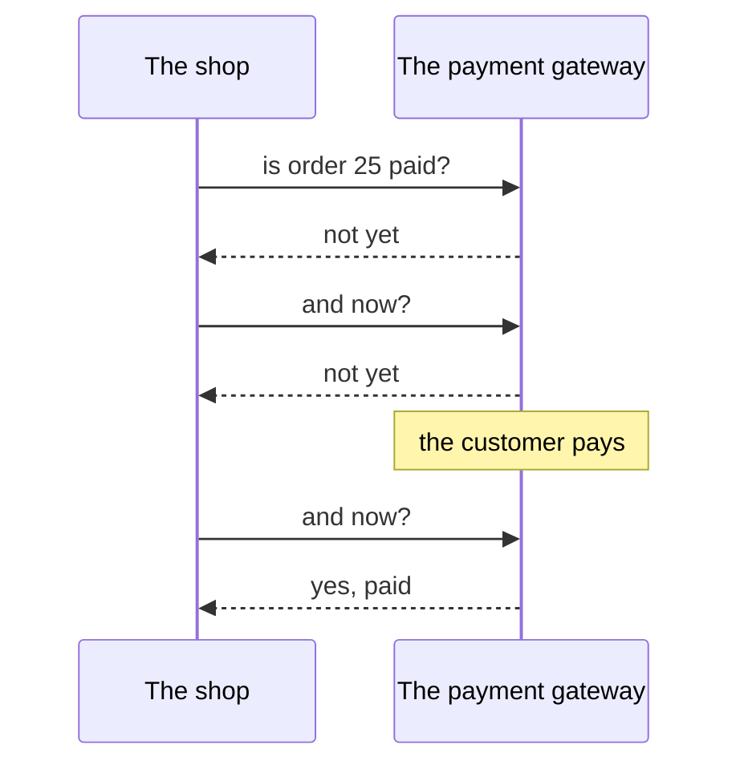
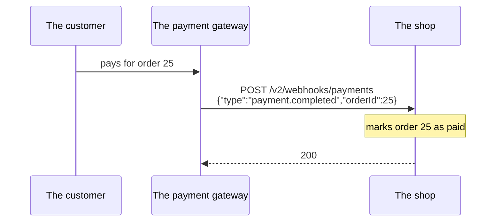
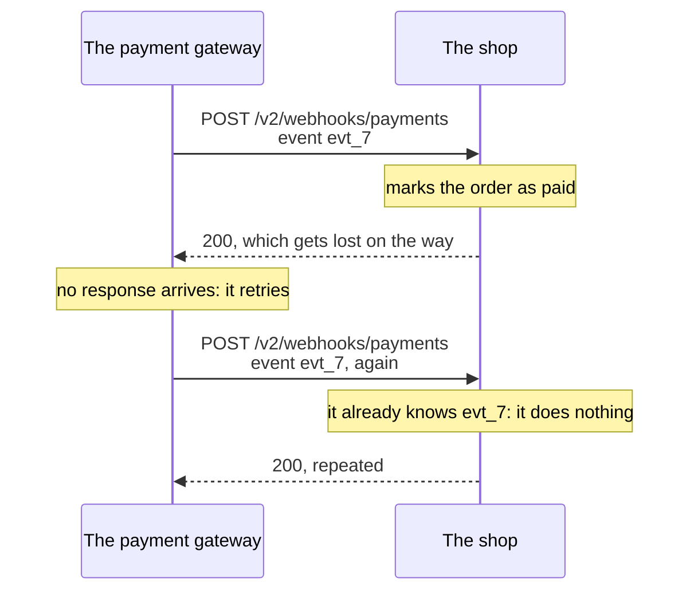

import Term from '~/components/Term.astro';
import TryIt from '~/components/TryIt.astro';
import Analogy from '~/components/Analogy.astro';
import SelfCheck from '~/components/SelfCheck.astro';
import Quiz from '~/components/Quiz.astro';
import QuizQuestion from '~/components/QuizQuestion.astro';
import QuizOption from '~/components/QuizOption.astro';
import ProjectCode from '~/components/ProjectCode.astro';

## The problem

A customer pays for order 25 at the shop. Not in your API, but at the payment gateway: the company that takes card payments for the shop, like Stripe or PayPal. How does the shop find out it can now prepare the package?

It could ask every minute: with 50 pending orders, 72,000 questions a day, almost all of them to hear “not yet.” The usual way is the opposite: the gateway calls the shop when someone pays. But as soon as the shop opens an address for that, `POST /v2/webhooks/payments`, two questions come up:

- **Who is calling?** Anyone with `curl` can write “order 25 is paid” and walk away with a free hoodie.
- **How many times?** If the shop's response gets lost, the gateway sends the notification again: the same payment arrives twice.

You already know the second one: Luis's repeated `POST` on the train, from the [methods lesson of Phase 2](/en/phase-2/http-methods/#idempotent-repeating-it-doesnt-change-the-result). Today you solve it in both directions.

## The analogy

<Analogy>

Luis makes things to order. Instead of calling the bank every hour to ask whether a customer has paid, he asks the bank to send him a letter when the money comes in.

So that nobody can pretend to be the bank, they agree on a secret word that is never written down. At the bottom of each letter, the bank puts a code calculated from that word and the text. Luis does the math again: if someone changed the amount, it doesn't add up.

And each letter carries a reference number: if the post office delivers the same one twice, Luis doesn't send another package.

<div slot="limits">

- Nobody calculates a code like that in their head; a computer does it in microseconds: that's the HMAC.
- A letter rarely arrives twice. A webhook is repeated on purpose: whoever sends it keeps trying until they get a “received.”
- A letter takes days. A webhook arrives in less than a second, and whoever sends it only waits a few seconds.

</div>

</Analogy>

## How it really works

### Asking every minute or being told

This is what asking every so often looks like:



That's <Term id="polling">polling</Term>: it works, but it wastes requests and finds out late. A <Term id="webhook">webhook</Term> turns it around: the shop gives the gateway a URL of its own, and the gateway makes a `POST` to it when something happens.



The gateway is the <Term id="client">client</Term>, and the shop, the <Term id="server">server</Term>. There's nothing new in HTTP: a `POST` with JSON, one per event, right when it happens.

The price: the shop needs a URL the gateway can reach from the internet, and a real one can't reach your `localhost`. That's why, here, the gateway is a fake program on your computer.

What it sends is called an **event**: something that happened, with a name and its own id. Its shape, in `src/schemas.ts`:

<ProjectCode file="shop-api/16-webhooks/src/schemas.ts" region="payment-event" />

- `id` is the event's id, not the order's: it will be used to recognize repeated ones.
- `z.literal('payment.completed')` only accepts that exact text. `ackSchema` is what the shop answers.

### The signature: an HMAC of the body with a secret

Anyone can reach that URL. Before believing a notification, the shop needs to know it comes from the gateway and that nobody changed it. Webhooks solve it with a <Term id="secret">secret</Term> only the two sides know. See what is done with it in the <Term id="repl">REPL</Term> (type `node` in the terminal):

<TryIt
  title="In the REPL: the same body, another body and another secret"
  lang="js"
  cmd={`const { createHmac } = await import('node:crypto')
const secret = 'the-shop-and-gateway-secret'
createHmac('sha256', secret).update('{"orderId":25}').digest('hex')
createHmac('sha256', secret).update('{"orderId":26}').digest('hex')
createHmac('sha256', 'another-secret').update('{"orderId":25}').digest('hex')
createHmac('sha256', secret).update('{"orderId":25}').digest('hex')`}
  output={`undefined
undefined
'c8e8c2fb491c47848464cbf4bfae2e3130af28804f919f1ba12e4994235f4a2e'
'00fa80805b54783b8455349c5378b40db6ccb800dab420cd71f223a56465bc14'
'35a9d400d0eea560a810ba29bd738d384a761ace7cd12c679492be8fdd20792c'
'c8e8c2fb491c47848464cbf4bfae2e3130af28804f919f1ba12e4994235f4a2e'`}
>

`createHmac` comes in `node:crypto`, Node's cryptography <Term id="module">module</Term>. Compare the four long lines:

- The first and the last are the same: the same body with the same secret always gives the same result, on your computer too.
- The second changes one character of the body, `26` instead of `25`, and looks nothing like it. Neither does the third, with another secret.

The outputs in this lesson are from Node 26.

</TryIt>

That's an <Term id="hmac">HMAC</Term>: a <Term id="hash">hash</Term>, like the ones in the [Git lesson of Phase 1](/en/phase-1/git-internals/#the-hash-the-fingerprint-of-the-data), calculated with the message and a secret together. **Whoever has the secret can sign any body; whoever doesn't, can't**, even if they know the formula and have seen a thousand signed notifications.

This is how it's signed, in a new file, `src/signature.ts`, which the shop and the fake gateway will use:

<ProjectCode file="shop-api/16-webhooks/src/signature.ts" region="sign" />

- `createHmac('sha256', secret)` sets up the calculation with the SHA-256 formula; `.update(body)` gives it the text, and `.digest('hex')`, the result in hexadecimal: 64 characters.
- It starts with `sha256=`, the formula used. The signature travels in the `X-Signature` <Term id="header">header</Term>; GitHub signs the same way, in `X-Hub-Signature-256`.

Unlike the <Term id="digital-signature">digital signature</Term> from [Phase 0](/en/phase-0/tls-and-https/#two-keys-public-key-cryptography), here the same secret signs and checks. That's why it lives only at the gateway and on your server, in the `WEBHOOK_SECRET` <Term id="environment-variable">environment variable</Term>, which `src/config.ts` requires at startup. A real gateway gives it to you when you register your URL (in Stripe it starts with `whsec_`).

### Checking the signature: the body as it is, in constant time

Checking is doing the math again and comparing, in the same file:

<ProjectCode file="shop-api/16-webhooks/src/signature.ts" region="check" />

- `signature: string | undefined`: the header may be missing, and then it isn't valid.
- `Buffer.from` turns each text into bytes, the `Buffer` from [lesson 4 of Phase 3](/en/phase-3/node-http-server/).
- `timingSafeEqual` takes the same time whether it matches or not. With `===`, the comparison stops at the first different character: the more it gets right, the longer it takes. By timing thousands of attempts, someone could guess the signature character by character.
- It only compares bytes of the same size: that's why the lengths are checked first.

A new <Term id="middleware">middleware</Term> uses it, `src/middleware/verify-signature.ts`:

<ProjectCode file="shop-api/16-webhooks/src/middleware/verify-signature.ts" region="verify-signature" />

Look at `c.req.text()`: it reads the <Term id="request-body">body</Term> as text, exactly as it arrived. **The signature is checked on the original body, never on the JSON read and written again.** `JSON.stringify` rewrites it without the original's spaces, and one extra character changes the signature.

If it doesn't match, `400`, with the shape from lesson 2, “Errors.” Not `401`: a `401` promises a `WWW-Authenticate` header that says how to identify yourself ([lesson 6 of Phase 3](/en/phase-3/what-is-middleware/#a-guard-that-answers-401)), and a signature has no scheme like that. Stripe's example also answers `400`.

The route, in `src/contract.ts`, puts the middleware in front, like `adminOnly` in lesson 5, “OpenAPI”:

<ProjectCode file="shop-api/16-webhooks/src/contract.ts" region="receive-payment" />

`middleware: [verifySignature]` goes before <Term id="validation">validation</Term>: without a good signature, `400`, without checking whether the JSON matches the <Term id="schema">schema</Term>.

### Answer quickly and leave the work for later

Whoever sends a webhook doesn't wait long. GitHub gives 10 seconds: without a `2xx` in time, the notification has failed. Stripe retries it for up to three days. The code that answers, in `src/v2.ts`:

<ProjectCode file="shop-api/16-webhooks/src/v2.ts" region="receive-payment" />

- If the order doesn't exist, `422`, like any data that isn't valid.
- If it's pending, it becomes `paid`. A cancelled one stays cancelled.

An email or an invoice would go to a queue, for later (Phase 9). **First “received”; the work, afterwards.**

### Notifications repeat: process each event once

Payment gateways promise that each notification arrives **at least once**, not exactly once. It's enough for your `200` to get lost:



To recognize it, the shop writes down the id of each processed event, in `src/data.ts`:

<ProjectCode file="shop-api/16-webhooks/src/data.ts" region="processed-events" />

A `Set` is a collection with no duplicates: `has` asks whether a value is in it, and `add` adds it. If the route already knows the id, it answers `repeated: true` without touching anything.

And it answers `200`: with an error, the gateway would think the notification didn't arrive and would send it again. The `Set` lives in memory, like the orders: it's forgotten on restart, and in Phase 5 it will go to the database.

### Idempotency-Key: a POST you can repeat

Now, the other way around. The phone app creates an order, the response gets lost in a tunnel and the app retries. `POST` isn't <Term id="idempotent">idempotent</Term>: the shop would create two orders.

The solution is the same as with the events. The app generates a unique value per order, usually a UUID (a random id, like the `evt_…` ones), and sends it in the `Idempotency-Key` header, the <Term id="idempotency-key">idempotency key</Term>. If it retries, it repeats the key.

```http
POST /v2/orders HTTP/1.1
Content-Type: application/json
Idempotency-Key: 5f0c8a2e-luis-order

{"productId":2,"quantity":1}
```

**It isn't a standard.** It's described in an IETF draft that expired in April 2026 without becoming an <Term id="rfc">RFC</Term>. But it's common practice: Stripe and other payment APIs have used it for years.

The middleware, `src/middleware/idempotency.ts`, stores what was answered to each key:

<ProjectCode file="shop-api/16-webhooks/src/middleware/idempotency.ts" region="stored" />

A `Map` stores key → value pairs, like a dictionary: `get` reads and `set` stores. For each key, the request's body and what was answered: status code, body and `Location`. When a request arrives, its key is looked up:

<ProjectCode file="shop-api/16-webhooks/src/middleware/idempotency.ts" region="idempotency-replay" />

- Without a key, everything goes on as always.
- **The same key with another body** is a client error: `422`, what the draft proposes.
- **The same key with the same body** is a retry: the stored response comes back, with `Idempotent-Replayed: true`, a name from Stripe, not from the draft.

`c.header` and `c.body` build it on this request's response, which already carries its own `X-Request-Id`: it's another request, with its own id in the <Term id="log">log</Term>. Only what was stored is repeated from the first one.

If the key is new, the request goes on, and on the way back the response is stored:

<ProjectCode file="shop-api/16-webhooks/src/middleware/idempotency.ts" region="idempotency-store" />

- `c.res.clone()` copies the response before reading it: a body is a <Term id="stream">stream</Term>, which can only be read once.
- Only what went well is stored (`ok`, a `2xx`): if it failed, the client can fix it and retry with the same key.
- `as ContentfulStatusCode` promises TypeScript that it's a status code with a body, which is what `c.body` asks for ([lesson 2](/en/phase-4/api-errors-problem-details/)). Here it's true: it's the `201`.

The route that creates orders, in `src/contract.ts`, adds the middleware and declares the header:

<ProjectCode file="shop-api/16-webhooks/src/contract.ts" region="create-order" />

## Try it

The goal: for the shop to find out about payments without being fooled. For it to accept the good notification, reject the tampered and the fake ones, and not count the repeated one twice. And for a retried order not to be duplicated.

### Write the code

You start from your project from lesson 6, “Serialization”:

1. Create `src/signature.ts`, `src/middleware/verify-signature.ts` and `src/middleware/idempotency.ts`. The last one starts by importing, with `import type`, `MiddlewareHandler` from `'hono'` and `ContentfulStatusCode` from `'hono/utils/http-status'`, and `problem` and `problemType` from `'../problems.ts'`.
2. Change `src/config.ts` (`WEBHOOK_SECRET`, with its message), `src/schemas.ts`, `src/data.ts`, `src/contract.ts` (the two routes and their `import` lines) and `src/v2.ts` (the webhook route, the `import` of `processedEvents` and, at the end, the `405` for `/webhooks/payments`, like the others).
3. Add `WEBHOOK_SECRET` to your `.env.example`:

<ProjectCode file="shop-api/16-webhooks/.env.example" />

The fake gateway and the new tests come in this lesson's folder. Download it and copy what's missing:

```sh
cd ~/backend-course/phase-3
curl -O https://backenddesdecero.com/practicas/shop-api/16-webhooks.tar.gz
tar -xzf 16-webhooks.tar.gz
cd shop-api
mkdir -p scripts
cp ../16-webhooks/scripts/payment-gateway.ts scripts/
cp ../16-webhooks/test/webhooks.test.ts ../16-webhooks/test/openapi.test.ts ../16-webhooks/test/.env test/
```

`mkdir -p` creates `scripts` if it doesn't exist, and `test/.env` brings a secret for the tests. If you get stuck, compare your code with `16-webhooks`. Add the `gateway` script to `package.json` (the highlighted line):

<ProjectCode file="shop-api/16-webhooks/package.json" mark={14} />

This is what `scripts/payment-gateway.ts` does:

<ProjectCode file="shop-api/16-webhooks/scripts/payment-gateway.ts" region="send" />

- `randomUUID()` gives the event a random id, and `sign` is the shop's function: both sides calculate the same way.
- `fetch` sends the request ([lesson 2 of Phase 3](/en/phase-3/javascript-for-backend/)). `→` is what it sends, and `←`, what it gets back.
- `--tamper` changes the order **after** signing, as someone on the way would. `--repeat` sends the same event twice.

### Start without a secret

<TryIt
  title="1. The server requires the secret"
  cmd="npm start"
  output={`> shop-api@1.0.0 start
> node --env-file-if-exists=.env src/server.ts

Configuration: WEBHOOK_SECRET: WEBHOOK_SECRET is missing`}
>

Your `.env` doesn't have `WEBHOOK_SECRET` yet, and `config.ts` won't let the server start without it. Better this way than finding out with the first payment.

</TryIt>

<TryIt
  title="2. A long secret"
  cmd="openssl rand -hex 24"
  output={`d79121847931c34ba344a4a2553bdc4783733bd950d011fc`}
>

Yours will be different. Add a `WEBHOOK_SECRET=` line to your `.env` with it after the `=`. Don't make it your `ADMIN_TOKEN`: if one leaks, the other stays safe.

</TryIt>

Start the server with `npm run dev` and leave that terminal open. Open another one in the project's folder.

### A payment, a trick and a repetition

Sample orders 21 to 25 are pending.

<TryIt
  title="3. The gateway reports the payment for order 23"
  cmd={`npm run gateway -- 23
curl -w '\\n' localhost:3000/v2/orders/23`}
  output={`> shop-api@1.0.0 gateway
> node --env-file-if-exists=.env scripts/payment-gateway.ts 23

→ POST /v2/webhooks/payments {"id":"evt_dde8a1b2-999a-43d1-a0b1-7ad90c176b0c","type":"payment.completed","orderId":23}
← 200 {"received":"evt_dde8a1b2-999a-43d1-a0b1-7ad90c176b0c","repeated":false}
{"id":23,"productId":3,"quantity":4,"status":"paid","createdAt":"2026-10-07T19:00:00.000Z"}`}
>

What goes after `--` reaches `payment-gateway.ts`, not `npm`. The shop answers `200` with `repeated: false`, and order 23 is now `paid`. Your event id will be different.

If you get `fetch failed` with `ECONNREFUSED`, the server isn't running: check the other terminal. If you get `400` with `invalid-signature`, check `signature.ts` and `verify-signature.ts`: the signature is calculated on `c.req.text()` and has `sha256=` in front.

</TryIt>

<TryIt
  title="4. Someone changes the notification on the way"
  cmd={`npm run gateway -- 24 --tamper
curl -w '\\n' localhost:3000/v2/orders/25`}
  output={`> shop-api@1.0.0 gateway
> node --env-file-if-exists=.env scripts/payment-gateway.ts 24 --tamper

→ POST /v2/webhooks/payments {"id":"evt_d00cdfd1-cae7-4381-8a49-b69d69eae8b9","type":"payment.completed","orderId":25}
← 400 {"type":"https://shop.example/problems/invalid-signature","title":"The signature is not valid","status":400,"detail":"The X-Signature header does not match this body"}
{"id":25,"productId":2,"quantity":2,"status":"pending","createdAt":"2026-10-08T09:00:00.000Z"}`}
>

Order 24 was paid, but the body that arrives says `25`. The signature is the original body's and doesn't match: `400`, and order 25 stays `pending`.

</TryIt>

<TryIt
  title="5. The same notification, twice"
  cmd="npm run gateway -- 24 --repeat"
  output={`> shop-api@1.0.0 gateway
> node --env-file-if-exists=.env scripts/payment-gateway.ts 24 --repeat

→ POST /v2/webhooks/payments {"id":"evt_778b57d0-1a63-4d46-a0e0-96949386a5b5","type":"payment.completed","orderId":24}
← 200 {"received":"evt_778b57d0-1a63-4d46-a0e0-96949386a5b5","repeated":false}
→ POST /v2/webhooks/payments {"id":"evt_778b57d0-1a63-4d46-a0e0-96949386a5b5","type":"payment.completed","orderId":24}
← 200 {"received":"evt_778b57d0-1a63-4d46-a0e0-96949386a5b5","repeated":true}`}
>

Two `200` responses with the same id, and `repeated: true` in the second: two acknowledgements, a single payment processed.

</TryIt>

<TryIt
  title="6. A fake notification, without a signature"
  cmd={`curl -i --json '{"id":"evt_fake","type":"payment.completed","orderId":25}' localhost:3000/v2/webhooks/payments`}
  output={`HTTP/1.1 400 Bad Request
content-type: application/problem+json
vary: Origin
x-request-id: 793547ca-9fd8-47de-88c0-484673d3375b
content-length: 167
Date: Tue, 13 Oct 2026 15:39:04 GMT
Connection: keep-alive
Keep-Alive: timeout=5

{"type":"https://shop.example/problems/invalid-signature","title":"The signature is not valid","status":400,"detail":"The X-Signature header does not match this body"}`}
>

The JSON is perfect, but without `X-Signature` it doesn't get past the middleware: no free hoodie. Your `x-request-id` and your date will be different.

</TryIt>

### An order that is retried

Now you're the phone app, and the network fails right when you create an order. Send the same request twice:

<TryIt
  title="7. The same POST with the same key, twice"
  cmd={`curl -i -w '\\n' -H 'Idempotency-Key: 5f0c8a2e-luis-order' --json '{"productId":2,"quantity":1}' localhost:3000/v2/orders
curl -i -H 'Idempotency-Key: 5f0c8a2e-luis-order' --json '{"productId":2,"quantity":1}' localhost:3000/v2/orders`}
  output={`HTTP/1.1 201 Created
content-type: application/json
location: /v2/orders/26
vary: Origin
x-request-id: 30ee8e06-328c-4055-9d64-f3ef3bb9b0f5
content-length: 94
Date: Tue, 13 Oct 2026 15:39:04 GMT
Connection: keep-alive
Keep-Alive: timeout=5

{"id":26,"productId":2,"quantity":1,"status":"pending","createdAt":"2026-10-13T15:39:04.175Z"}
HTTP/1.1 201 Created
content-type: application/json
idempotent-replayed: true
location: /v2/orders/26
vary: Origin
x-request-id: 1b5eb0c9-53fc-424b-a226-1d139b9e4fcd
content-length: 94
Date: Tue, 13 Oct 2026 15:39:04 GMT
Connection: keep-alive
Keep-Alive: timeout=5

{"id":26,"productId":2,"quantity":1,"status":"pending","createdAt":"2026-10-13T15:39:04.175Z"}`}
>

`-H` adds the header. Both responses are the same `201` with the same order 26, `createdAt` included. The second one carries `idempotent-replayed: true`, because it's the stored response, and its own `x-request-id`. Your ids and your dates will be different.

</TryIt>

<TryIt
  title="8. The same key with other data"
  cmd={`curl -w '\\n' -H 'Idempotency-Key: 5f0c8a2e-luis-order' --json '{"productId":2,"quantity":3}' localhost:3000/v2/orders
curl -w '\\n' 'localhost:3000/v2/orders?limit=2'`}
  output={`{"type":"https://shop.example/problems/reused-key","title":"That key was already used with other data","status":422,"detail":"Use a new Idempotency-Key for each different operation"}
[{"id":26,"productId":2,"quantity":1,"status":"pending","createdAt":"2026-10-13T15:39:04.175Z"},{"id":25,"productId":2,"quantity":2,"status":"pending","createdAt":"2026-10-08T09:00:00.000Z"}]`}
>

Three mugs instead of one, with the same key: `422`. And the list confirms that the newest order is 26, and there's only one.

</TryIt>

To finish, `npm test` should end with `fail 0`: the new tests do the same as you, and a bit more.

<SelfCheck question="Challenge: sign a notification by hand, without the gateway, with openssl and curl, and pay for order 25 with it. What does that tell you about your WEBHOOK_SECRET?">

`openssl dgst -sha256 -hmac` calculates the same HMAC as `createHmac`. Put your secret in place of the example one:

```sh
SECRET=d79121847931c34ba344a4a2553bdc4783733bd950d011fc
BODY='{"id":"evt_by_hand","type":"payment.completed","orderId":25}'
SIGNATURE=$(printf '%s' "$BODY" | openssl dgst -sha256 -hmac "$SECRET" | awk '{print $NF}')
curl -w '\n' -H "X-Signature: sha256=$SIGNATURE" --json "$BODY" localhost:3000/v2/webhooks/payments
curl -w '\n' localhost:3000/v2/orders/25
```

```text
{"received":"evt_by_hand","repeated":false}
{"id":25,"productId":2,"quantity":2,"status":"paid","createdAt":"2026-10-08T09:00:00.000Z"}
```

`printf '%s'` doesn't add the final line break, which would change the signature. `awk '{print $NF}'` keeps the last word: OpenSSL 3, the one on Linux, puts `SHA2-256(stdin)=` in front; LibreSSL, the one on macOS, doesn't.

**With the secret, anyone can be the gateway.** That's why it goes in `.env`, never in Git, and if it leaks, it's changed on both sides.

</SelfCheck>

## You have already seen it

- **“We're confirming your payment…”** That page, after you pay in an online shop, is usually waiting for the gateway's webhook.
- **“Don't refresh the page or press back.”** That warning exists because repeating the request could charge you twice. With an idempotency key, nothing is duplicated.
- **The deployment of this site.** In the [Git lesson of Phase 1](/en/phase-1/git-internals/#coming-up-a-push-that-deploys), GitHub “tells Cloudflare that `main` has changed”: that notification is a webhook. Every repository has a **Webhooks** section in its settings.

## Common mistakes

- **Checking the signature on the JSON written again.** A different space changes the signature: use the body exactly as it arrived.
- **Comparing signatures with `===`.** Use `timingSafeEqual`.
- **Answering a repeated notification with an error, or taking too long to answer.** The gateway considers it failed and sends it again. A repeated one gets `200`, and the long work comes later.
- **Idempotency keys that never expire.** This shop keeps them forever; Stripe may delete them after 24 hours: a retry arrives within minutes.
- **Keys that belong to nobody.** Here, whoever repeats another client's key gets the response stored for that other client. With users, the key is stored together with who sent it.
- **Forgetting simultaneous requests.** Two requests with the same key at the same time may both see it as new and create two orders. The draft proposes a `409` for the second one while the first is still going.

## Summary

- A webhook is a `POST` another service makes to your server when something happens. It arrives right away, without polling, but it needs a URL open to the internet.
- The HMAC signature is a hash of the body with a secret only the two sides know. It's checked on the body exactly as it arrived, with `timingSafeEqual`; if it doesn't match, `400`.
- Notifications arrive at least once: write down each event's id and answer `200` to the repeated ones too, without processing them. Answer quickly; the long work, afterwards.
- With `Idempotency-Key`, the same key and the same body return the stored response; another body, `422`. It's common practice, but only an IETF draft.

## Did you get it?

<Quiz>

<QuizQuestion
  question="The shop wants to know when the delivery company delivers each package. Right now it asks every five minutes about each order on its way. What do you suggest?"
  review="Asking every minute or being told"
>

<QuizOption text="Have the delivery company call a URL of the shop’s when it delivers: a webhook." correct>

One request per delivery, right when it happens, instead of thousands of questions that almost always hear “not yet.”

</QuizOption>

<QuizOption text="Ask every ten seconds: that way it finds out sooner and the problem goes away.">

It multiplies the requests by thirty, almost all of them for nothing, and it still finds out late, just less late.

</QuizOption>

<QuizOption text="Nothing else: a server can’t receive requests from another company, only from its customers.">

A server receives requests from whoever reaches its URL. In a webhook, the other company acts as the client and the shop, as the server.

</QuizOption>

</QuizQuestion>

<QuizQuestion
  question="To check the signature, your code reads the body with JSON.parse, writes it again with JSON.stringify and calculates the HMAC of that. The gateway sends a JSON with a space after each colon. What happens?"
  review="Checking the signature: the body as it is, in constant time"
>

<QuizOption text="Nothing: the JSON is the same, so the signature is too.">

The data is the same, but the text isn't: `JSON.stringify` removes the spaces, and the signature is calculated on the text.

</QuizOption>

<QuizOption text="The signature doesn’t match: 400 for a legitimate notification." correct>

The gateway signed the text with spaces, and you calculate the one without them. That's why the body is checked exactly as it arrived.

</QuizOption>

<QuizOption text="The signature matches: HMAC ignores the spaces in the JSON.">

HMAC doesn't know what JSON is: it works with bytes, and a space is a byte. In the REPL you saw that one different character gives another signature.

</QuizOption>

</QuizQuestion>

<QuizQuestion
  question="The shop’s code is public on GitHub, src/signature.ts included. Can someone who reads it send fake payment notifications that pass the check?"
  review="The signature: an HMAC of the body with a secret"
>

<QuizOption text="No, as long as they don’t have the WEBHOOK_SECRET." correct>

The code says how the signature is calculated, but the calculation needs the secret, which is in `.env`, outside Git.

</QuizOption>

<QuizOption text="Yes: knowing it’s HMAC-SHA256, they can calculate the signature of any body.">

Knowing the formula isn't enough: without the secret it can't be calculated. You saw it in the REPL with `another-secret`.

</QuizOption>

<QuizOption text="Yes, if they get hold of a signed notification: with a good signature they can sign other bodies.">

Each signature is only valid for its body. You checked it with `--tamper`: another body's good signature gives `400`.

</QuizOption>

</QuizQuestion>

<QuizQuestion
  question="The shop already processed event evt_7, but its 200 got lost, so the gateway sends evt_7 again. What should the shop answer?"
  review="Notifications repeat: process each event once"
>

<QuizOption text="A 409, so the gateway knows that event was already processed.">

The gateway doesn't read the reason: for it, anything that isn't `2xx` is a failure, and it would keep retrying.

</QuizOption>

<QuizOption text="A 422: an event already processed is no longer valid.">

The event is still valid: the same one, properly signed. And with a `422`, the gateway would keep sending it again.

</QuizOption>

<QuizOption text="A 200, without processing it again." correct>

For the gateway, `200` means “received,” and it stops trying. The shop recognizes the id and doesn't touch the order.

</QuizOption>

</QuizQuestion>

<QuizQuestion
  question="Luis’s app sends POST /v2/orders with Idempotency-Key: abc. No response arrives, and it retries with the same key and the same body. What does it get the second time?"
  review="Idempotency-Key: a POST you can repeat"
>

<QuizOption text="A new order: POST isn’t idempotent, whatever key it carries.">

By itself it isn't, but the server recognizes the key and creates nothing: the key makes the `POST` repeatable.

</QuizOption>

<QuizOption text="The same 201 and the same order, with Idempotent-Replayed: true." correct>

It's the stored response from the first time: the order was created only once, and Luis finally gets it.

</QuizOption>

<QuizOption text="A 422, because that key had already been used.">

The `422` is for a key reused with another body. With the same body it's a retry: it gets the stored response.

</QuizOption>

</QuizQuestion>

<QuizQuestion
  question="Your API has thousands of clients, each with its own token, and you keep the Idempotency-Key values in a single list, without recording who sent each one. What’s the problem?"
  review="Common mistakes"
>

<QuizOption text="None: each client makes up its keys at random, and they never match.">

The client chooses them, and nothing forces it to do so at random. A careless or malicious one can use someone else's.

</QuizOption>

<QuizOption text="That the list takes up too much space: the keys should be kept on the client, not on the server.">

If only the client kept them, the server wouldn't recognize a retry. So that the list doesn't grow forever, they expire.

</QuizOption>

<QuizOption text="That whoever repeats another client’s key gets the response stored for that other client." correct>

With the same body, they would get another person's order. That's why the key is stored together with who sent it.

</QuizOption>

</QuizQuestion>

</Quiz>

## Further reading

- [Validating webhook deliveries](https://docs.github.com/en/webhooks/using-webhooks/validating-webhook-deliveries) (GitHub): the same `sha256=` signature, in several languages.
- [Receive Stripe events in your webhook endpoint](https://docs.stripe.com/webhooks) and [Idempotent requests](https://docs.stripe.com/api/idempotent_requests) (Stripe): signatures, retries, repeated events and `Idempotency-Key` in a payments API.
- [The Idempotency-Key HTTP Header Field](https://datatracker.ietf.org/doc/draft-ietf-httpapi-idempotency-key-header/) (IETF): the draft, with its `400`, `409` and `422` codes.
- [RFC 2104: HMAC](https://www.rfc-editor.org/rfc/rfc2104.html): the definition of HMAC.
- [createHmac](https://nodejs.org/api/crypto.html#cryptocreatehmacalgorithm-key-options) and [timingSafeEqual](https://nodejs.org/api/crypto.html#cryptotimingsafeequala-b) (Node.js).
