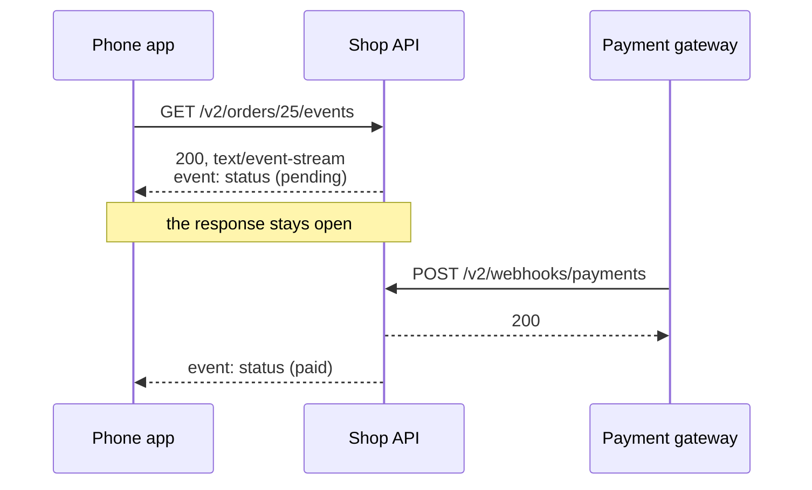
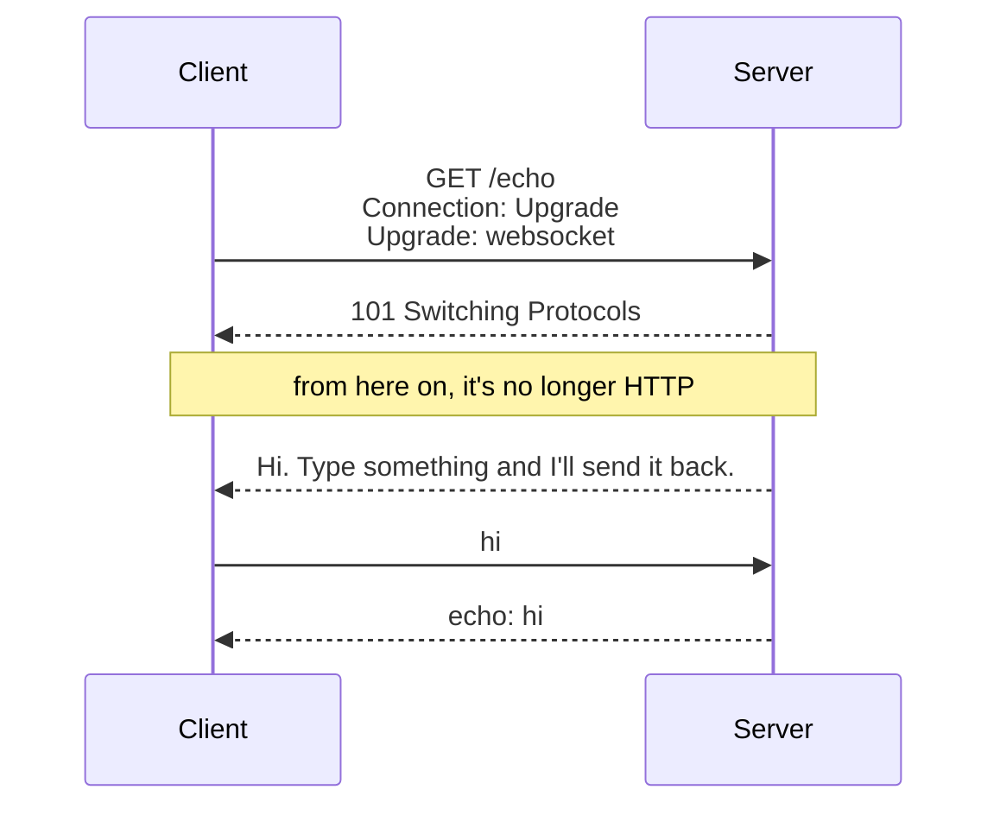

import Term from '~/components/Term.astro';
import TryIt from '~/components/TryIt.astro';
import Analogy from '~/components/Analogy.astro';
import SelfCheck from '~/components/SelfCheck.astro';
import Quiz from '~/components/Quiz.astro';
import QuizQuestion from '~/components/QuizQuestion.astro';
import QuizOption from '~/components/QuizOption.astro';
import ProjectCode from '~/components/ProjectCode.astro';

## The problem

A customer pays for her order from the shop's app. The payment gateway notifies the shop with the [webhook from lesson 7](/en/phase-4/webhooks-idempotency/), and the order changes to `paid` on the server. But the phone still says “pending”: nobody has told it.

The usual way out is for the app to ask every 2 seconds: `GET /v2/orders/25`, and again, and again. That's 30 requests per minute for each open screen: with a thousand customers watching their orders, 30,000 per minute, almost all of them to hear “nothing new.”

And a webhook won't do: the phone is behind a router with <Term id="nat">NAT</Term> ([Phase 0](/en/phase-0/ip-ports-sockets/#how-your-private-ip-address-gets-out-to-the-internet-nat)), with no address to call. The app has to open the connection, and the server has to use it to send the news. Here you'll see two ways of doing it.

## The analogy

<Analogy>

You've ordered a coffee in a crowded café. You can walk up to the counter every minute and ask “Is mine ready?” Almost every time, they say no. You can stay at the counter until they hand it to you. Or they give you **a pager**, that gadget that buzzes when your order is ready, and you sit down.

The pager only goes one way. To talk to the counter (“Can I have it with oat milk?” “We're out. Is soy OK?”) you'd need **an open phone call**. The pager is Server-Sent Events; the call, a WebSocket.

<div slot="limits">

- The pager buzzes once and you hand it back; through a Server-Sent Events response, many notifications arrive.
- Outside the café, the pager loses its signal; the browser, on the other hand, reconnects on its own.
- On a call, if you both talk at once you can't understand each other; over a WebSocket, both sides send at the same time without stepping on each other.

</div>

</Analogy>

## How it really works

### Asking every few seconds: polling and long polling

Asking over and over is <Term id="polling">*polling*</Term>, as in lesson 7. It works with any server, but it costs **requests that bring nothing** and **delay**: if you ask every 10 seconds, you find out, on average, 5 seconds late.

In *long polling*, the server holds on to the request until there's a change, or until a limit, like 30 seconds, and the client asks again. There are fewer empty requests, but each notification still costs a full request, with its <Term id="header">headers</Term>.

SSE and WebSockets turn it around: **the client opens a connection once, and the server writes through it when it has something.**

### Server-Sent Events: a response that doesn't end

<Term id="sse">Server-Sent Events</Term> (SSE) is normal HTTP with one difference: the response doesn't end. The server sends the headers, writes an event and leaves the connection open; with each change, it writes another one. This is how this lesson's API answers (you'll do it in “Try it”):

```
HTTP/1.1 200 OK
cache-control: no-cache
connection: keep-alive
content-type: text/event-stream
transfer-encoding: chunked

event: status
data: {"id":25,"productId":2,"quantity":2,"status":"pending","createdAt":"2026-10-08T09:00:00.000Z"}

event: status
data: {"id":25,"productId":2,"quantity":2,"status":"paid","createdAt":"2026-10-08T09:00:00.000Z"}
```

Look at the headers:

- **`content-type: text/event-stream`**: the body is a list of events that keeps arriving.
- **`cache-control: no-cache`**: no <Term id="cache">cache</Term> may reuse it without asking the server first ([lesson 7 of Phase 2](/en/phase-2/http-caching/)).
- **`transfer-encoding: chunked`** and no `content-length`: the server doesn't know how long the body will be, and sends it in pieces, like a <Term id="stream">stream</Term>.

This is how the webhook's news reaches the app:



### The format: lines of text and a blank line

Each event is a few `field: value` lines, and **a blank line closes it**. The fields:

| Field | What it's for |
|---|---|
| `data:` | The content of the event. It's text: here, the order in JSON |
| `event:` | A name for the event. Without it, the event is called `message` |
| `id:` | An identifier. When reconnecting, the browser sends the last one in the `Last-Event-ID` header |

In the browser, events are read with `EventSource`, which **reconnects on its own** if the connection drops: Chrome tries every 3 seconds. The shop doesn't use `id:`: each connection starts with the current status, and that's enough.

### Notifying each change with an EventEmitter

The events route has to find out about the changes made by two others: the payment webhook and the cancellation. It needs a notice board, and Node comes with one, the `EventEmitter`. In `src/data.ts`:

<ProjectCode file="shop-api/17-realtime/src/data.ts" region="notifications" />

Word by word:

- **`new EventEmitter<{ change: [Order] }>()`** creates the board. Between `<` and `>`, for TypeScript: there's one notice, `change`, and it carries an order.
- **`.emit('change', order)`** posts a notice: it calls all the <Term id="function">functions</Term> subscribed to `change`, with that order. **`.on`** subscribes a function, and **`.off`** removes it.
- **`setMaxListeners(0)`** removes the warning Node gives with more than 10 functions subscribed (`MaxListenersExceededWarning`), which usually gives away a forgotten `.off`. Here each open connection subscribes one.
- **`changeStatus`** is the only door for changing a status: it changes it and posts the notice. In `src/v2.ts`, the cancellation and the webhook no longer write `order.status = …`; they call it instead: a change made by hand would go unseen.

### The route that follows an order

Its definition in `src/contract.ts`, like the ones from lesson 5, introduces a new type of response, `text/event-stream`:

<ProjectCode file="shop-api/17-realtime/src/contract.ts" region="follow-order" />

And the route, in `src/v2.ts`:

<ProjectCode file="shop-api/17-realtime/src/v2.ts" region="follow-order" />

Word by word:

- **The `404` comes before starting.** Once the first line, `200 OK`, has gone out, the status code can no longer change.
- **`streamSSE(c, async (stream) => { … })`**, from `hono/streaming`, sets the SSE headers and gives you `stream`, the open response, which lasts as long as that function takes to finish.
- **`stream.writeSSE({ event, data })`** writes the `event:` and `data:` lines and the blank line. `JSON.stringify` turns the order into text ([lesson 2 of Phase 3](/en/phase-3/javascript-for-backend/#json-data-turned-into-text)).
- **`notify`** subscribes to the board and only writes if the order that changes is this connection's.
- **`await new Promise<void>((left) => stream.onAbort(left))`**: a <Term id="promise">promise</Term> that's fulfilled when the client leaves. Meanwhile, the function doesn't finish and the response stays open, without blocking the server: it's the same old [event loop](/en/phase-3/node-event-loop/).
- **`.off('change', notify)`** removes the function from the board when the client leaves. Without this line, each closed connection would leave its function behind, and memory would grow without end.

At the end of the file, `v2.all('/orders/:id/events', …)` answers `405` to any other method.

### WebSockets: the connection switches protocols

A chat, a game or a document two people edit at once need both directions. That's what <Term id="websocket">WebSocket</Term> is for, another <Term id="protocol">protocol</Term>, which starts as an HTTP request:



- **The client asks to switch** with `Upgrade: websocket` and `Sec-WebSocket-Key`, a random text.
- **The server accepts with `101 Switching Protocols`** and `Sec-WebSocket-Accept`, a <Term id="hash">hash</Term> of that key: it proves it really speaks WebSocket. It isn't security: anyone can calculate it.
- **From then on, the same <Term id="tcp">TCP</Term> connection carries messages**, not requests: each side sends whenever it wants, with no HTTP methods, status codes or headers.

Addresses start with `ws://`, or with `wss://` with <Term id="tls">TLS</Term>, like `http://` and `https://`.

### The echo, on the same port as the API

The shop's echo sends back whatever you send it. The WebSocket work is done by `ws`, the most widely used <Term id="package">package</Term> for that in Node. First, the startup, `src/server.ts`, with what's new highlighted:

<ProjectCode file="shop-api/17-realtime/src/server.ts" mark={[2, 9, 12]} />

- **`new WebSocketServer({ noServer: true })`** sets up `ws` without opening another <Term id="port">port</Term>: connections arrive through 3000, like the API.
- **`websocket: { server: webSockets }`** tells `serve` to use `ws` when a route accepts the `Upgrade`.

The echo is in a new file, `src/echo.ts`:

<ProjectCode file="shop-api/17-realtime/src/echo.ts" />

- **`upgradeWebSocket`**, from `@hono/node-server`, turns a route into a door to WebSocket, with a function for each event.
- **`onOpen`** is called when the connection opens: the server says hello without anyone asking.
- **`onMessage`**, with each message: `event.data` is its content, and `ws.send` replies.

And the route, in `src/app.ts`, with `import { echo } from './echo.ts';` at the top:

<ProjectCode file="shop-api/17-realtime/src/app.ts" region="echo" />

If the request carries `Upgrade: websocket`, `echo` takes it; if not, the next function answers `426 Upgrade Required` with the header `Upgrade: websocket`: only WebSocket is spoken here.

### What a WebSocket costs

- **Everything HTTP gives you stays at the door.** Without status codes or Problem Details, you make up the format of the messages and of the errors yourself.
- **Reconnecting is up to you.** `EventSource` comes back on its own; the browser's `WebSocket` doesn't.
- **Each connection lives on one server.** With several, the notification has to reach the one holding that client's connection: a scaling problem, for [Phase 9](/en/phase-9/horizontal-scaling/#redis-pubsub-one-channel-for-all-the-copies).

SSE has a limit too: with HTTP/1.1, the browser opens at most 6 connections to each domain, counting all tabs, and each `EventSource` takes one. With [HTTP/2](/en/phase-2/http2-vs-http3/) they share a single one.

### Which one to use for what

| | Who talks | Use it for |
|---|---|---|
| Polling | The client asks every so often | Slow changes, or a server you can't touch |
| Server-Sent Events | The server, through an open response | Statuses, notifications, progress, an AI's answers word by word |
| WebSocket | Both, whenever they want | Chats, games, editing together |
| Webhook (lesson 7) | One server calls another | Notifications between servers, like the payment gateway's |

If only the server talks, **SSE is usually enough**, and it's simpler: it's HTTP and it reconnects on its own. AI model APIs send their answers piece by piece with SSE (Phase 11).

## Try it

The goal: watch an order go from `pending` to `paid` without asking again, in the terminal and in the browser, and talk to the echo. You start from your project from lesson 7, in `~/backend-course/phase-3/shop-api`. If you get stuck, compare it with this lesson's folder: from `~/backend-course/phase-3`, `curl -O https://backenddesdecero.com/practicas/shop-api/17-realtime.tar.gz`, `tar -xzf 17-realtime.tar.gz` and, inside it, `npm install`.

### Install ws and write the code

<TryIt
  title="Install ws and its types"
  cmd={`npm install ws@8.22.0
npm install --save-dev @types/ws@8.18.2`}
  output={`added 1 package, and audited 38 packages in 782ms

6 packages are looking for funding
  run \`npm fund\` for details

found 0 vulnerabilities

added 1 package, and audited 39 packages in 809ms

6 packages are looking for funding
  run \`npm fund\` for details

found 0 vulnerabilities`}
>

`@types/ws` brings the <Term id="type">types</Term> for `ws`, with `--save-dev`, as in [lesson 3 of Phase 3](/en/phase-3/typescript-with-node/). This lesson's outputs come from Node 26; your times, ids and dates will be different.

</TryIt>

Then, write the code from “How it really works”:

1. In `src/data.ts`, `import { EventEmitter } from 'node:events';` at the top, and the board and `changeStatus` after `processedEvents`.
2. In `src/v2.ts`, `import { streamSSE } from 'hono/streaming';`, and `changeStatus`, `orderChanges` and `type Order` in the `import` from `./data.ts`. Change the two lines that wrote `order.status` and add the route and its `405`.
3. The route in `src/contract.ts`, `src/echo.ts`, its route in `src/app.ts` and the new `src/server.ts`.

If you downloaded this lesson's folder, copy its `test/` into yours and `npm test` will check your code. Start the server with `npm run dev`.

### Follow an order with curl

You'll use three terminals: the server's, one to follow the order and another to change it. In the second one:

<TryIt
  title="1. Follow order 25 (and don't close the terminal)"
  cmd="curl -N -i localhost:3000/v2/orders/25/events"
  output={`HTTP/1.1 200 OK
cache-control: no-cache
connection: keep-alive
content-type: text/event-stream
transfer-encoding: chunked
vary: Origin
x-request-id: 12e52baf-027c-4966-9956-838f69c108a7
Date: Tue, 13 Oct 2026 15:39:20 GMT

event: status
data: {"id":25,"productId":2,"quantity":2,"status":"pending","createdAt":"2026-10-08T09:00:00.000Z"}

event: status
data: {"id":25,"productId":2,"quantity":2,"status":"paid","createdAt":"2026-10-08T09:00:00.000Z"}

event: status
data: {"id":25,"productId":2,"quantity":2,"status":"cancelled","createdAt":"2026-10-08T09:00:00.000Z"}`}
>

At first you'll see the headers and the first event, `pending`, and `curl` keeps waiting: the response hasn't finished. The other two events arrive with steps 2 and 3.

`-N` makes `curl` write each piece as soon as it arrives; without it, it may hold on to them and show you the events late.

</TryIt>

<TryIt
  title="2. In the third terminal: the gateway pays for the order"
  cmd="npm run gateway -- 25"
  output={`> shop-api@1.0.0 gateway
> node --env-file-if-exists=.env scripts/payment-gateway.ts 25

→ POST /v2/webhooks/payments {"id":"evt_b1099330-fee2-4009-b4b8-3616420d60d9","type":"payment.completed","orderId":25}
← 200 {"received":"evt_b1099330-fee2-4009-b4b8-3616420d60d9","repeated":false}`}
>

Lesson 7's fake payment gateway sends its signed webhook, and in the second terminal the `paid` event appears without `curl` having asked anything.

If the gateway gets its `200` but the event doesn't appear, check that the webhook calls `changeStatus` and doesn't change `order.status` by hand.

</TryIt>

<TryIt
  title="3. Cancel the order"
  cmd="curl -i -X POST localhost:3000/v2/orders/25/cancellation"
  output={`HTTP/1.1 200 OK
content-type: application/json
vary: Origin
x-request-id: 2d6c0776-955e-4504-a672-77149ac0723e
content-length: 96
Date: Tue, 13 Oct 2026 15:39:27 GMT
Connection: keep-alive
Keep-Alive: timeout=5

{"id":25,"productId":2,"quantity":2,"status":"cancelled","createdAt":"2026-10-08T09:00:00.000Z"}`}
>

And in the second terminal, the `cancelled` event. Close `curl` with <kbd>Ctrl</kbd> + <kbd>C</kbd>. Notice: this response has `content-length: 96` and ends; the SSE one had no length.

</TryIt>

In the server's terminal, the [log](/en/phase-3/node-errors-and-logging/) records the first request with `"ms":4`, even though it lasted several seconds: `streamSSE` hands over the response right away, with the events still to be written, and the log records it then.

<SelfCheck question="Challenge: follow order 3, which is shipped, and try to cancel it. What does the cancellation answer, and what shows up in curl’s terminal?">

```sh
curl -N localhost:3000/v2/orders/3/events          # in one terminal
curl -w '\n' -X POST localhost:3000/v2/orders/3/cancellation   # in another
```

```
{"type":"https://shop.example/problems/order-status","title":"The order's status doesn't allow it","status":409,"detail":"The order is already shipped: it cannot be cancelled"}
```

`409`: a shipped order can't be cancelled. And `curl` receives nothing after the first event, `shipped`: nobody has called `changeStatus`.

</SelfCheck>

### Follow an order from the browser

Open `http://localhost:3000/` in Chrome and, in DevTools ([how to open it](/en/phase-2/#before-you-start-devtools)), the **Console** tab. It has to be a page from `http://localhost:3000`: the API's <Term id="cors">CORS</Term> only lets `https://shop.example` read. If Chrome asks you to type `allow pasting`, do it, as in the [CORS lesson](/en/phase-2/what-is-cors/).

<TryIt
  title="In the console: follow order 24"
  lang="js"
  cmd={`const source = new EventSource('/v2/orders/24/events')
source.addEventListener('status', (event) => console.log(event.data))`}
  output={`{"id":24,"productId":1,"quantity":1,"status":"pending","createdAt":"2026-10-08T02:00:00.000Z"}`}
>

`new EventSource('…')` opens the connection, and `addEventListener('status', …)` subscribes a function to the `status` events; `event.data` is the text of its `data:` line.

Paste the two lines together: with the first one alone, the first event may arrive before the second one subscribes the function. The `undefined` the console writes doesn't matter.

Now, in the terminal, `npm run gateway -- 24`: the `paid` order appears in the console.

</TryIt>

Now stop the server with <kbd>Ctrl</kbd> + <kbd>C</kbd>. Red errors appear in the console, `net::ERR_CONNECTION_REFUSED`, every 3 seconds: it's `EventSource` trying to come back. Start it again with `npm run dev` and, a few seconds later, a new event arrives without touching the console.

But it says `pending`: the data was in memory and was lost when the server stopped (the database arrives in Phase 5). Reconnection works; the server sends the status it has now.

### Talk to the echo

First, the HTTP request from the beginning. `curl` doesn't speak WebSocket, but it shows the response:

<TryIt
  title="1. Ask to switch protocols"
  cmd={`curl -i -H 'Connection: Upgrade' -H 'Upgrade: websocket' \\
  -H 'Sec-WebSocket-Version: 13' -H 'Sec-WebSocket-Key: dGhlIHNhbXBsZSBub25jZQ==' \\
  localhost:3000/echo`}
  output={`HTTP/1.1 101 Switching Protocols
Upgrade: websocket
Connection: Upgrade
Sec-WebSocket-Accept: s3pPLMBiTxaQ9kYGzzhZRbK+xOo=
vary: Origin

�)Hi. Type something and I'll send it back.`}
>

The `\` at the end of a line continues the command on the next one. The key is the one from the standard's example (RFC 6455), and `s3pPLMBiTxaQ9kYGzzhZRbK+xOo=` is the answer the standard gives for it.

The last line is no longer HTTP: it's the echo's greeting, a WebSocket message, with its header in front: two characters your terminal may draw differently. `curl` keeps waiting: close it with <kbd>Ctrl</kbd> + <kbd>C</kbd>.

In the log, this request shows up with `"status":200`: the log sees the response Hono prepares, but the `101` is written by `ws` directly on the connection.

</TryIt>

<TryIt
  title="2. Without asking to switch"
  cmd="curl -i localhost:3000/echo"
  output={`HTTP/1.1 426 Upgrade Required
content-type: application/problem+json
upgrade: websocket
vary: Origin
x-request-id: 0c3047cb-1b75-4e70-819b-3167728eeea2
content-length: 106
Date: Tue, 13 Oct 2026 15:39:47 GMT
Connection: keep-alive
Keep-Alive: timeout=5

{"type":"about:blank","title":"Upgrade Required","status":426,"detail":"This route only speaks WebSocket"}`}
>

A normal `GET` gets a `426`, in Problem Details like any error from the API, and `upgrade: websocket` says which protocol is needed.

</TryIt>

To really talk you need a WebSocket client, and Node 26 comes with the same one as the browser:

<TryIt
  title="3. A WebSocket client with Node"
  cmd={`node -e '
const ws = new WebSocket("ws://localhost:3000/echo");
ws.onopen = () => ws.send("hi");
ws.onmessage = (event) => console.log(event.data);
setTimeout(() => ws.close(), 1000);
'`}
  output={`Hi. Type something and I'll send it back.
echo: hi`}
>

`node -e` runs the code between the quotes: when the connection opens (`onopen`) it sends `hi`, writes each message that arrives (`onmessage`) and closes after one second (`setTimeout`).

Two messages arrive: the greeting, which the server sends without anyone asking, and the echo of `hi`: both directions, over a single connection.

</TryIt>

## You have already seen it

- **An AI that writes its answer word by word**, the delivery driver moving on the map or a chat's “is typing…”: changes that arrive without reloading.
- **In DevTools' Network tab**, a request that stays “pending” for a long time may be a connection left open on purpose. `EventSource` ones have the **EventStream** tab, and WebSocket ones, **Messages**, with what goes out and what comes in.

## Common mistakes

- **Listening with `onmessage` when the events have a name.** It only receives the ones without `event:`; the shop's events need `addEventListener('status', …)`.
- **Forgetting `.off` when the client leaves.** The functions of closed connections pile up, and memory grows until it brings the server down.
- **Checking for errors after starting the stream.** With the `200` already sent, a `404` comes too late.
- **A proxy that holds on to the response.** nginx, by default, gathers it before passing it on, and the events arrive all at once. For SSE it's turned off with `proxy_buffering off` ([Phase 8](/en/phase-8/nginx-reverse-proxy/)).

## Summary

- Asking every few seconds (polling) wastes requests and arrives late. Better for the client to open a connection and the server to write through it.
- Server-Sent Events is an HTTP response that doesn't end: `text/event-stream`, events made of `event:` and `data:` lines closed by a blank line, and `EventSource`, which reconnects on its own.
- The shop's route sends the current status, subscribes to an `EventEmitter` and unsubscribes with `.off` when the client leaves.
- WebSocket starts with `Upgrade` and a `101 Switching Protocols`; after that, both sides send messages whenever they want.
- If only the server talks, SSE; if both talk, WebSocket; between servers, webhooks.

## Did you get it?

<Quiz>

<QuizQuestion
  question="The app wants to show an order’s status as soon as it changes, and the phone has nothing to say to the server. What would you use?"
  review="Which one to use for what"
>

<QuizOption text="A WebSocket: it’s the only way for the server to send something without being asked.">

Server-Sent Events does it too, and it's what the shop uses. A WebSocket adds the opposite direction, which isn't needed here.

</QuizOption>

<QuizOption text="Server-Sent Events: only the server talks." correct>

An open response through which the changes arrive, with the usual HTTP and `EventSource`'s reconnection.

</QuizOption>

<QuizOption text="A webhook to the phone, like the one the payment gateway sends to the shop.">

A webhook calls a public address, and the phone, behind a router with NAT, doesn't have one: the connection has to be opened by the phone.

</QuizOption>

</QuizQuestion>

<QuizQuestion
  question="In the console of http://localhost:3000 you follow order 24 with an EventSource and source.onmessage = (e) => console.log(e.data). Nothing shows up, not even when the order changes. Why?"
  review="The format: lines of text and a blank line"
>

<QuizOption text="Because onmessage has to be set before creating the EventSource, and now it’s too late.">

A function subscribed later receives the events that arrive from then on, and the changes arrived later.

</QuizOption>

<QuizOption text="Because the API’s CORS only lets https://shop.example read, and it blocks the response.">

The page and the API have the same origin, `http://localhost:3000`, and CORS only comes into play between different origins.

</QuizOption>

<QuizOption text="Because onmessage only receives events without a name, and these are called status." correct>

An event with `event: status` only reaches whoever listens to `status`, with `addEventListener('status', …)`.

</QuizOption>

</QuizQuestion>

<QuizQuestion
  question="Someone deletes the line orderChanges.off('change', notify) from the events route. Everything seems to work. What happens over time?"
  review="The route that follows an order"
>

<QuizOption text="Each closed connection leaves its function subscribed, and memory keeps growing." correct>

The board keeps calling functions of clients that are already gone, and never lets them go.

</QuizOption>

<QuizOption text="Nothing: when the client leaves, Node removes that connection’s functions from the EventEmitter.">

The `EventEmitter` knows nothing about connections: it keeps each function until someone removes it with `.off`.

</QuizOption>

<QuizOption text="Clients stop receiving events, because each function can only be subscribed once.">

Connected clients keep receiving their events. What piles up are the functions of the ones that are no longer there.

</QuizOption>

</QuizQuestion>

<QuizQuestion
  question="You type curl -i localhost:3000/echo, with no other headers. What does the shop answer?"
  review="The echo, on the same port as the API"
>

<QuizOption text="101 Switching Protocols: the /echo route always switches to WebSocket.">

The switch only happens if the request asks for it, with `Upgrade: websocket`. Without that header, `echo` passes the request on to the next function.

</QuizOption>

<QuizOption text="426 Upgrade Required, with the header Upgrade: websocket." correct>

The route says only WebSocket is spoken there, and the header, which protocol to ask for.

</QuizOption>

<QuizOption text="404: for HTTP, /echo doesn’t exist; it only exists for ws:// addresses.">

`ws://localhost:3000/echo` and `http://localhost:3000/echo` reach the same route, through the same port.

</QuizOption>

</QuizQuestion>

<QuizQuestion
  question="In the server’s log, the connection to /echo shows up with status 200, but curl received a 101. What happened?"
  review="Talk to the echo"
>

<QuizOption text="The server sends a 200 first and then the 101, and each program shows one.">

A single response goes out through that connection, the `101`. After that there are only WebSocket messages.

</QuizOption>

<QuizOption text="curl writes 101 on its own when it sees it asked for Upgrade; the server answered 200.">

`curl` shows what arrives over the network. `Upgrade` and `Sec-WebSocket-Accept` were sent by the server.

</QuizOption>

<QuizOption text="The log sees Hono’s response; the 101 is written by ws on the connection." correct>

The `101` doesn't go through the log, which only knows what it sees. What really arrived is what `curl` says.

</QuizOption>

</QuizQuestion>

<QuizQuestion
  question="You have the console following order 24, which is paid, and you restart the server. What do you see in the console?"
  review="Follow an order from the browser"
>

<QuizOption text="Nothing more: an EventSource that’s cut off doesn’t reconnect, you have to reload the page.">

That's what happens to a `WebSocket`. `EventSource` retries on its own, every 3 seconds in Chrome.

</QuizOption>

<QuizOption text="Some connection errors and, when the server comes back, the order as pending." correct>

`EventSource` reconnects and the route sends the current status: pending, because the data was in memory and was lost when the server stopped.

</QuizOption>

<QuizOption text="Some errors and, when it comes back, the order paid again: the browser asks the server for the last event it received.">

The browser only sends the last event's `id:` if the events carry one, and the shop's don't. Besides, the server has forgotten the payment.

</QuizOption>

</QuizQuestion>

</Quiz>

## Further reading

- [Using server-sent events](https://developer.mozilla.org/en-US/docs/Web/API/Server-sent_events/Using_server-sent_events) (MDN): the format, `EventSource` and reconnection.
- [The WebSocket API](https://developer.mozilla.org/en-US/docs/Web/API/WebSockets_API) (MDN): the browser's client.
- [Server-sent events](https://html.spec.whatwg.org/multipage/server-sent-events.html) (WHATWG): the standard, inside HTML's.
- [RFC 6455: The WebSocket Protocol](https://www.rfc-editor.org/rfc/rfc6455): the protocol switch and the example key.
- [Streaming Helper](https://hono.dev/docs/helpers/streaming) and [WebSocket Helper](https://hono.dev/docs/helpers/websocket) (Hono): `streamSSE` and `upgradeWebSocket`.
