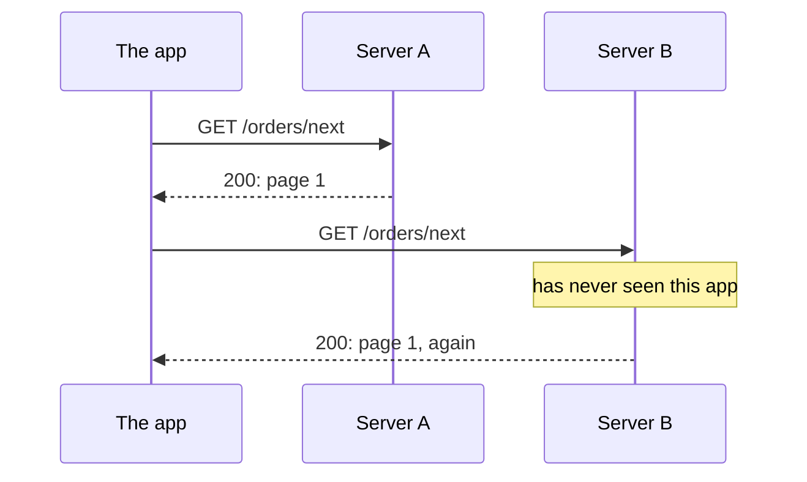

import { FileTree } from '@astrojs/starlight/components';
import Term from '~/components/Term.astro';
import TryIt from '~/components/TryIt.astro';
import Analogy from '~/components/Analogy.astro';
import SelfCheck from '~/components/SelfCheck.astro';
import ProjectCode from '~/components/ProjectCode.astro';
import Quiz from '~/components/Quiz.astro';
import QuizQuestion from '~/components/QuizQuestion.astro';
import QuizOption from '~/components/QuizOption.astro';

## The problem

Ana and Luis's shop is going to have a phone app, and someone else is building it. Their first question is: “How do I cancel an order?” Imagine the API had grown as needs came up, one route at a time:

```
GET  /getProducts.json
POST /createOrder
GET  /order?id=17
POST /orders/17/change
GET  /cancelOrder?id=17
```

Each route follows its own rule, so none of them tells you what the next one will look like: you have to ask. And the cancel one is dangerous: it's a `GET`, and a link preview in a chat would already cancel the order ([Phase 2](/en/phase-2/http-methods/#safe-it-only-reads)).

In this lesson you design the API so that someone who doesn't know you understands it after seeing two routes. That's what REST is for: the conventions almost every public API follows.

## The analogy

<Analogy>

Think of a warehouse. Each shelf has a sign, “Orders,” and each box, its number: “Orders / 17.” At the counter there are only four forms, the same ones for everything: “Show me,” “Store this new one,” “Change this” and “Remove this.” You pick one and write the label: “Show me: Orders / 17.”

With the labels and the four forms you know how to ask for anything, without a manual for each box. And since each form carries everything needed, any clerk can help you, even one who has never seen you before.

The labels are the resources' URLs; the forms, HTTP's methods; and being helped by anyone means the server doesn't keep state.

<div slot="limits">

- An API, besides the box, answers with a code that says what happened: created, doesn't exist, can't be done.
- Some actions aren't boxes, like “cancel order 17.” REST turns them into a new box: “the cancellation of order 17.”
- The clerk doesn't remember you, but the warehouse does keep the boxes: “stateless” is about the conversation, not about the data.

</div>

</Analogy>

## How it really works

### The files in this lesson

You're still in your project, `~/backend-course/phase-3/shop-api`. Since other people will now use it, the API loses what was only there for learning: the `/error` route from [lesson 8](/en/phase-3/node-errors-and-logging/), the slow routes from [lesson 9](/en/phase-3/node-event-loop/) (with their `node:crypto` and `node:util` imports) and the `examples` folder. These files change:

<FileTree>

- src/
  - app.ts changes
  - data.ts changes
  - schemas.ts changes
- test/
  - errors.test.ts changes
  - rest.test.ts new
  - event-loop.test.ts deleted

</FileTree>

Download this lesson's folder to copy its tests and, if you get stuck, to compare:

```sh
cd ~/backend-course/phase-3
curl -O https://backenddesdecero.com/practicas/shop-api/10-rest.tar.gz
tar -xzf 10-rest.tar.gz
rm -r shop-api/examples shop-api/test/event-loop.test.ts
cp -r 10-rest/test shop-api/
```

`rm -r` deletes the `examples` folder and the test of the slow routes, which no longer exist ([Phase 1](/en/phase-1/linux-file-commands/)).

### A resource is a noun with its address

These are the shop's URLs at the end of the lesson:

| URL | What it is |
|---|---|
| `/products` | The collection: all the products |
| `/products/2` | One item in the collection: the mug |
| `/orders` | All the orders |
| `/orders/17` | Order 17 |
| `/orders/17/cancellation` | The cancellation of order 17 |

They all name **things**, never actions. Each one is a <Term id="resource">resource</Term>: something the API talks about that has its own URL. What you get when you ask for it, `{"id":2,"name":"Mug","price":8.5}`, isn't the mug, but a **representation** of it in <Term id="json">JSON</Term>.

Collections go in the plural, and an item is the collection plus its id: `/orders/17`, “number 17 of the orders.” Each combination of method and URL, like `GET /orders` or `POST /orders`, is an <Term id="endpoint">endpoint</Term>: a <Term id="route">route</Term> in your code, seen from the outside.

**Nest one level at most.** `/orders/17/cancellation` hangs from the order because it doesn't exist without it. But order 17 lives at `/orders/17`, not at `/customers/5/orders/17`: each thing has a single address. Nest when the child's id only makes sense inside the parent, as on GitHub, where each repository has its own *issue* number 1: `/repos/nodejs/node/issues/1`.

### The methods are the verbs

The URL says **what** you act on, and the <Term id="http-method">method</Term>, **what you do**, as you saw in [lesson 2 of Phase 2](/en/phase-2/http-methods/). You already had reading (`GET`) and creating (`POST`). The shop gets three new actions:

| Endpoint | What it does |
|---|---|
| `DELETE /products/2` | Delete a product (only Ana, with her token) |
| `PATCH /orders/17` | Change an order's quantity |
| `POST /orders/17/cancellation` | Cancel an order |

Deleting goes in `src/app.ts`, after `app.post('/products', …)`:

<ProjectCode file="shop-api/10-rest/src/app.ts" region="delete" />

- **`app.delete(…)`** creates a route for `DELETE`. It first goes through `adminOnly`, the guard from [lesson 6 of Phase 3](/en/phase-3/what-is-middleware/#a-guard-that-answers-401), and through the id's validation.
- **`deleteProduct(…)`** is in `data.ts` and returns `false` if the product didn't exist: then, `404`.
- **`c.body(null, 204)`** answers `204 No Content`: done, and nothing to tell. `null` means “no body.”

Changing the quantity uses `PATCH`, which changes only part of the resource ([PUT replaces, PATCH changes a part](/en/phase-2/http-methods/#put-replaces-patch-changes-a-part)). It goes after `app.post('/orders', …)`:

<ProjectCode file="shop-api/10-rest/src/app.ts" region="change-order" />

- **Two `validate` in a row:** first the id in the URL, then the body ([lesson 7 of Phase 3](/en/phase-3/zod-validation/)). If either fails, `422`, and the route doesn't even run.
- **`order.status !== 'pending'`**: an order that is paid, shipped or cancelled can no longer be changed: `409 Conflict`, with the status in the message.
- **`order.quantity = …`** changes the stored order, and the response is the whole order, with `200`: the client sees how it ended up without asking for it again.

The body is checked with a new schema, in `src/schemas.ts`, below the one for orders:

<ProjectCode file="shop-api/10-rest/src/schemas.ts" region="order-change" />

`orderSchema.shape.quantity` reuses the quantity rule (a whole number from 1 to 10). And the schema only has `quantity`: **the client doesn't write the status**. It changes because of what happens (a payment, a shipment, a cancellation), and Zod drops any other field.

Add `deleteProduct` and `orderChangeSchema` to the imports in `app.ts`, next to the ones you already had.

### Each response, its status code

A client that doesn't know you decides what to do based on the <Term id="status-code">status code</Term>, so each action always answers the same way ([lesson 3 of Phase 2](/en/phase-2/http-status-codes/#the-codes-that-matter)):

| Action | If it works | If not |
|---|---|---|
| Read (`GET`) | `200` and the resource | `404` if it doesn't exist |
| Create (`POST /orders`) | `201` and the new resource, with its URL in `Location` | `422` if the data isn't valid |
| Change (`PATCH`) | `200` and the resource as it ended up | `404`, `422` or `409` |
| Cancel (`POST …/cancellation`) | `200` and the order | `404` or `409` |
| Delete (`DELETE`) | `204`, without a body | `401` without a token, `404` |

Notice two pairs:

- **`422` versus `409`.** With `{"quantity":0}`, the data isn't valid: `422`. With `{"quantity":3}` on a cancelled order, the data is fine, but it clashes with the resource's state: `409`. After a `409`, the same request may work if the state changes; after a `422`, never.
- **`404` versus `405`.** A route that doesn't exist is a `404`; a method the route doesn't have, a `405` with `Allow` ([Phase 2](/en/phase-2/http-methods/#the-405-and-the-allow-header)). Their lists change:

<ProjectCode file="shop-api/10-rest/src/app.ts" region="not-allowed" />

`notAllowed` keeps the body in a <Term id="variable">variable</Term> so it isn't repeated, and the lines still go after all the routes ([lesson 5 of Phase 3](/en/phase-3/express-hono-fastify/#a-wrong-method-hono-answers-404)).

### An action that doesn't fit: turn it into a resource

Cancelling isn't creating, reading, changing or deleting. The temptation is a verb in the URL, `/cancelOrder`. REST's way out is to name the action as a thing, **the cancellation** of the order, and create it with a `POST`:

<ProjectCode file="shop-api/10-rest/src/app.ts" region="cancel" />

- **A shipped order can't be cancelled:** `409`. A pending or paid one becomes `'cancelled'`.
- **Cancelling twice leaves the order the same,** cancelled, so the second time isn't an error.
- **It answers `200` with the order, not `201`**: the cancellation doesn't have its own URL to read later. What changed is the order, and that's what it returns.

GitHub does something similar to [lock an *issue*](https://docs.github.com/en/rest/issues/issues): `PUT /repos/{owner}/{repo}/issues/{issue_number}/lock` locks it, and a `DELETE` to the same URL unlocks it.

The new status goes in `src/data.ts`:

<ProjectCode file="shop-api/10-rest/src/data.ts" region="status" />

**A cancelled order isn't deleted:** it's still at `/orders/17`, and whoever looks it up knows what happened to it. A `404` wouldn't tell them anything.

### A URL doesn't change owners

Deleting a product has a catch. Until now, a new product got “how many there are + 1” as its id. If you delete 3 from `[1, 2, 3]` and create a cap, two products are left, and the cap gets… 3. The app that saved a link to `/products/3`, the hoodie, would now show a cap. That's why `createProduct` changes, in `src/data.ts`:

<ProjectCode file="shop-api/10-rest/src/data.ts" region="delete-product" />

- **`lastProductId`** starts at 3, the last id that exists, and `createProduct` adds one to it each time. It's a `let` because it changes, and it only goes up: even if you delete, it doesn't repeat.
- **`deleteProduct`** looks for the product's position with `findIndex`, which gives `-1` if it isn't there, and `splice(position, 1)` removes the element at that position.

**A URL always points to the same thing.** If the thing disappears, the URL gives `404`; it never becomes something else.

### Stateless: each request makes sense on its own

Imagine an API that remembers which page of orders it showed you, and gives you the next one with `GET /orders/next`. It works until the shop runs two copies of the server that share the requests between them (Phase 9):



The solution is for the request to carry what's needed: either of the two understands `GET /orders?page=2`. That's a <Term id="stateless">stateless</Term> API: **the server remembers nothing from one request to the next.**

Yours already is. Ana sends her token in `Authorization` with every request, and `adminOnly` checks it every time: the server doesn't remember that she “already identified herself.” It does keep the orders, the state of the resources; not the state of the conversation.

In exchange for sending a little more with each request, you get:

- **Any copy of the server can answer**, so you can add more when needed (Phase 9).
- **An idempotent request can be repeated** without fear: it doesn't depend on what happened before.
- **Caches work** ([Phase 2](/en/phase-2/http-caching/)): the same URL means the same thing for everyone.

### How to name URLs

There's no naming standard, but there are habits almost every public API follows:

| Better | Worse | Why |
|---|---|---|
| `POST /orders` | `POST /createOrder` | The method already says the verb |
| `/orders/17` | `/order?id=17` | The id identifies the resource: it goes in the path. The <Term id="query-string">query string</Term> filters a list, like `?max=10` |
| `/payment-methods` | `/paymentMethods` | Always lowercase: in the path, `/Orders` and `/orders` can be different. To separate words, the hyphen is the most common (*kebab-case*) |
| `/products/2` | `/products/2.json` | The format is requested with [the `Accept` header](/en/phase-2/http-headers/#the-server-chooses-based-on-what-you-ask-for), not in the URL |

And no accented letters: a route like `/café` would travel encoded as `/caf%C3%A9`.

### What REST meant, and what it means today

<Term id="rest">REST</Term> was born in the doctoral thesis of Roy Fielding, one of the authors of HTTP, in 2000. It isn't a standard or a tool, but a list of constraints that, according to him, explained the web's success. You've already seen three: statelessness, responses that can be cached and a **uniform interface**, the same way of asking for everything.

The part of that interface almost nobody follows is **hypermedia**: each response carrying links to what you can do next, like a web page. In 2008, Fielding complained about APIs that called themselves REST without it.

| | What Fielding described | What's called REST today |
|---|---|---|
| Resources, methods and codes | Yes | Yes |
| Stateless | Yes | Yes, almost always |
| Links in every response | Mandatory | Few APIs include them |

Whoever asks you for “a REST API” almost always wants the second column, the one the shop follows.

## Try it

The goal: take an order through its whole life, check that the API says no when it should, and compare your design with GitHub's.

Write the changes above and start the server. The outputs are from Node 26.11.1 and `curl` 8.14.1, on Linux; your dates and your `x-request-id` values will be different.

<TryIt
  title="1. Start the API"
  cmd="npm start"
  output={`> shop-api@1.0.0 start
> node --env-file-if-exists=.env src/server.ts

{"level":30,"time":1791905956996,"pid":53,"hostname":"laptop","msg":"The shop is listening on http://localhost:3000"}`}
>

Your computer's name will show up in `hostname`. If you get `does not provide an export named`, check the imports in `app.ts`. Open another terminal for the rest.

</TryIt>

### An order's life

<TryIt
  title="2. Create an order"
  cmd={`curl -i --json '{"productId":2,"quantity":1}' localhost:3000/orders`}
  output={`HTTP/1.1 201 Created
content-type: application/json
location: /orders/1
vary: Origin
x-request-id: 0bf60221-f3ef-46e9-ba8d-bcc68fd7d949
content-length: 54
Date: Tue, 13 Oct 2026 15:39:18 GMT
Connection: keep-alive
Keep-Alive: timeout=5

{"id":1,"productId":2,"quantity":1,"status":"pending"}`}
>

`201`, and in `location`, the new resource's URL. If your number is different, use it in the next steps.

</TryIt>

<TryIt
  title="3. Change the quantity"
  cmd={`curl -i -X PATCH --json '{"quantity":3}' localhost:3000/orders/1`}
  output={`HTTP/1.1 200 OK
content-type: application/json
vary: Origin
x-request-id: d0a81c0c-73b0-40ad-8620-5713cb0a8def
content-length: 54
Date: Tue, 13 Oct 2026 15:39:18 GMT
Connection: keep-alive
Keep-Alive: timeout=5

{"id":1,"productId":2,"quantity":3,"status":"pending"}`}
>

`-X PATCH` changes the method `--json` would use (`POST`) and keeps the body. The whole order comes back. If you get a `405`, your `app.all('/orders/:id', …)` is before the `app.patch`: move it to the end.

</TryIt>

<TryIt
  title="4. Cancel it, twice"
  cmd={`curl -i -w '\\n' -X POST localhost:3000/orders/1/cancellation
curl -w '\\n' -X POST localhost:3000/orders/1/cancellation`}
  output={`HTTP/1.1 200 OK
content-type: application/json
vary: Origin
x-request-id: a312ef72-57e6-4ba1-a27e-62abd624d0b7
content-length: 56
Date: Tue, 13 Oct 2026 15:39:18 GMT
Connection: keep-alive
Keep-Alive: timeout=5

{"id":1,"productId":2,"quantity":3,"status":"cancelled"}
{"id":1,"productId":2,"quantity":3,"status":"cancelled"}`}
>

A `POST` without a body: the URL says it all. The second time (without `-i`, only the body) it answers the same: repeating it changes nothing.

</TryIt>

<TryIt
  title="5. Try to change it again"
  cmd={`curl -i -X PATCH --json '{"quantity":2}' localhost:3000/orders/1`}
  output={`HTTP/1.1 409 Conflict
content-type: application/json
vary: Origin
x-request-id: 94d6f5d4-80ef-4435-af98-a15ed2c48c88
content-length: 63
Date: Tue, 13 Oct 2026 15:39:18 GMT
Connection: keep-alive
Keep-Alive: timeout=5

{"error":"The order is cancelled: it can no longer be changed"}`}
>

The request from step 3, with valid data, and now a `409`: it clashes with the order's state.

</TryIt>

<TryIt
  title="6. Read the cancellation"
  cmd="curl -i localhost:3000/orders/1/cancellation"
  output={`HTTP/1.1 405 Method Not Allowed
allow: POST
content-type: application/json
vary: Origin
x-request-id: 5a0822c1-cf80-4fb7-b058-1a8957a99bc3
content-length: 30
Date: Tue, 13 Oct 2026 15:39:18 GMT
Connection: keep-alive
Keep-Alive: timeout=5

{"error":"Method not allowed"}`}
>

The route exists, but only for `POST`: `405`, and `allow` says so. If you get a `404`, the `/orders/:id/cancellation` line is missing from the `app.all` lines.

</TryIt>

### Deleting without repeating ids

Deleting asks for Ana's token, the one in your `.env` ([lesson 8 of Phase 3](/en/phase-3/node-errors-and-logging/)). Save it in a shell variable ([Phase 1](/en/phase-1/environment-variables/)), with yours instead of this one:

<TryIt
  title="7. Delete the hoodie"
  cmd={`TOKEN=674679605d58a679d6cd63f7d69113497cfba8acd7383e43
curl -i -X DELETE -H "Authorization: Bearer $TOKEN" localhost:3000/products/3`}
  output={`HTTP/1.1 204 No Content
vary: Origin
x-request-id: 4d7915c5-c968-424e-b641-2258514f66a9
Date: Tue, 13 Oct 2026 15:39:18 GMT
Connection: keep-alive
Keep-Alive: timeout=5`}
>

`204` and nothing else: no `content-type` and no body. Repeat the `curl` and you'll see a `404`. If you get a `401`, the token isn't the one in your `.env`, or `TOKEN` is empty: a shell variable only exists in the terminal where you created it.

</TryIt>

<TryIt
  title="8. Create a product and look at its id"
  cmd={`curl -i -w '\\n' -H "Authorization: Bearer $TOKEN" --json '{"name":"Cap","price":15}' localhost:3000/products
curl -w '\\n' localhost:3000/products`}
  output={`HTTP/1.1 201 Created
content-type: application/json
location: /products/4
vary: Origin
x-request-id: e720ef30-4b5e-4c09-8032-c2b2b1d58926
content-length: 32
Date: Tue, 13 Oct 2026 15:39:18 GMT
Connection: keep-alive
Keep-Alive: timeout=5

{"id":4,"name":"Cap","price":15}
[{"id":1,"name":"T-shirt","price":20},{"id":2,"name":"Mug","price":8.5},{"id":4,"name":"Cap","price":15}]`}
>

The cap is 4, not 3, even though there are only three products: `/products/3` is still the deleted hoodie, and it gives `404`.

</TryIt>

<TryIt
  title="9. Run the tests"
  cmd="npm test"
  output={`> shop-api@1.0.0 test
> node --env-file=test/.env --test

✔ an unexpected error: 500 without details, with the request id (30.377253ms)
✔ a route that does not exist: 404 in JSON (0.928832ms)
✔ a body that is not JSON: 400, in JSON too (3.170913ms)
✔ the token comes from the environment variable (4.938743ms)
✔ without ADMIN_TOKEN, the server does not start and says why (329.694531ms)
✔ each request writes a JSON line with its id (196.502412ms)
✔ creating an order: 201, with its URL in Location, and it shows up in the list (104.409156ms)
✔ DELETE /products/:id without a token: 401 (1.904497ms)
✔ DELETE /products/:id: 204 without a body; afterwards, 404 (4.482078ms)
✔ after a delete, a new product does not repeat the id of another one (8.282614ms)
✔ PATCH /orders/:id changes the quantity and returns the whole order (4.040328ms)
✔ PATCH with an invalid quantity: 422; to an order that does not exist: 404 (2.765663ms)
✔ PATCH to an order already paid: 409, and the order does not change (2.587997ms)
✔ POST /orders/:id/cancellation: the order is cancelled, even if repeated (2.594747ms)
✔ cancelling a shipped order: 409; one that does not exist: 404 (3.702162ms)
✔ a method the route does not have: 405, with the ones it has in Allow (5.710285ms)
ℹ tests 16
ℹ suites 0
ℹ pass 16
ℹ fail 0
ℹ cancelled 0
ℹ skipped 0
ℹ todo 0
ℹ duration_ms 934.41754`}
>

Sixteen tests and `fail 0`; your timings will be different. If you get a failure on `/slow`, you haven't deleted `test/event-loop.test.ts`.

</TryIt>

### Compare with GitHub

Ask GitHub's API for the Node.js repository and keep a few fields with `jq` ([lesson 8 of Phase 3](/en/phase-3/node-errors-and-logging/)). This output is from a Mac, with `curl` 8.7.1:

<TryIt
  title="10. A GitHub resource"
  cmd={`curl -s https://api.github.com/repos/nodejs/node | jq '{full_name, description, url, issues_url, pulls_url}'`}
  output={`{
  "full_name": "nodejs/node",
  "description": "Node.js JavaScript runtime ✨🐢🚀✨",
  "url": "https://api.github.com/repos/nodejs/node",
  "issues_url": "https://api.github.com/repos/nodejs/node/issues{/number}",
  "pulls_url": "https://api.github.com/repos/nodejs/node/pulls{/number}"
}`}
>

Look at the URLs: plural nouns, in lowercase, and the *issues* nested under their repository. The response also carries links to related things, a bit of what Fielding asked for; `{/number}` is the slot for the *issue*'s number. Captured on October 13, 2026: the description may change.

</TryIt>

<SelfCheck question="Challenge: redesign the five routes from “The problem” with what you’ve seen. Which one becomes a new resource?">

| Before | After |
|---|---|
| `GET /getProducts.json` | `GET /products` |
| `POST /createOrder` | `POST /orders` |
| `GET /order?id=17` | `GET /orders/17` |
| `POST /orders/17/change` | `PATCH /orders/17` |
| `GET /cancelOrder?id=17` | `POST /orders/17/cancellation` |

The last one becomes a resource, “the cancellation,” and stops being a `GET`: a link no longer triggers it.

</SelfCheck>

## You have already seen it

- **In the browser's address bar.** `github.com/nodejs/node/issues/1` is a resource URL for people: the repository, its collection of *issues* and one of them.
- **In DevTools** ([how to open them](/en/phase-2/#before-you-start-devtools)). In the **Network** tab of any website, filter by *Fetch/XHR*: you'll see the requests to its API, many of them in this style.

## Common mistakes

- **Verbs in the URL** (`/createOrder`, `/deleteProduct`). The method is already the verb. If an action doesn't fit, turn it into a resource.
- **A `GET` that changes something**, like `GET /cancelOrder?id=17`. Any bot or preview that follows the link runs it.
- **A `200` with the error inside.** If the order can't be changed, it's a `409`, not a `200` with `{"ok":false}` ([Phase 2](/en/phase-2/http-status-codes/#the-200-with-an-error-inside)).
- **Letting the client write the status.** With `PATCH {"status":"shipped"}` anyone could ship an order without paying for it.

## Summary

- A REST API names resources with plural nouns: the collection (`/orders`) and each item with its id (`/orders/17`), a single address per thing.
- The method is the verb, and each action always answers with its code: `201` with `Location` when creating, `200` when reading or changing, `204` when deleting; `409` if it clashes with the state, `422` if the data isn't valid.
- An action that doesn't fit a method becomes a resource: `POST /orders/17/cancellation`.
- Stateless: each request carries what's needed, and that's why any copy of the server can answer it.
- Fielding described REST in 2000, with links in every response; today, REST means resources, methods, codes and JSON.

## Did you get it?

<Quiz>

<QuizQuestion
  question="The delivery company has to let the shop know it has delivered order 17. What endpoint do you give it?"
  review="An action that doesn't fit: turn it into a resource"
>

<QuizOption text="GET /orders/17/deliver, so they can try it from the browser.">

A `GET` shouldn't change anything: a bot or a preview would request it by accident.

</QuizOption>

<QuizOption text="POST /orders/17/delivery." correct>

Delivering doesn't fit any method: it becomes a resource, “the order's delivery,” and it's created with `POST`, like the cancellation.

</QuizOption>

<QuizOption text="POST /markDelivered?id=17: an action is named with a verb.">

In REST, the verb is the method. The URL names a thing, and the id goes in the path, not in the query string.

</QuizOption>

</QuizQuestion>

<QuizQuestion
  question={`The app sends PATCH /orders/5 with {"quantity":2}, but order 5 is already paid. What does the API answer?`}
  review="Each response, its status code"
>

<QuizOption text="409 Conflict." correct>

The data is valid, but it clashes with the order's state. If it were pending, the same request would work.

</QuizOption>

<QuizOption text="422, because that quantity can’t be accepted.">

`422` is for data that's never valid, like `{"quantity":0}`. A `2` is a correct quantity.

</QuizOption>

<QuizOption text="403, because the client has lost permission to touch that order.">

`403` is about who you are and what you're allowed to do. Here nobody can change the order, whoever they are.

</QuizOption>

</QuizQuestion>

<QuizQuestion
  question="Ana deletes a product from the app and gets a 204 without a body. The app shows “Error: empty response”. Where’s the bug?"
  review="Each response, its status code"
>

<QuizOption text={`In the API: every response has to carry a JSON, even if it’s {"ok":true}.`}>

`204 No Content` says exactly that: done, without a body. An `{"ok":true}` adds nothing to the code.

</QuizOption>

<QuizOption text="In the API: 204 means it didn’t find anything to delete.">

If there were nothing to delete, it would be a `404`. The `204` is the delete that worked.

</QuizOption>

<QuizOption text="In the app: with a 204 it shouldn’t expect a body; the product is deleted." correct>

The code already says it went well: the app has to look at it before looking for a JSON that isn't there.

</QuizOption>

</QuizQuestion>

<QuizQuestion
  question="An API notes in memory who has done POST /login, so it doesn’t ask them for the token every time. Since there are two copies of the server, it sometimes gives a 401 to someone who just logged in. Why?"
  review="Stateless: each request makes sense on its own"
>

<QuizOption text="Because two servers can’t handle the same URL: each one needs its own.">

Several copies of the same server handle the same URLs: it's normal when a website grows.

</QuizOption>

<QuizOption text="Because the request sometimes reaches the copy that didn’t see the login." correct>

That copy remembers nothing: the API has state. If the token travels with every request, as in the shop, any copy can check it by itself.

</QuizOption>

<QuizOption text="Because one of the copies is down, and a server that’s down answers 401.">

A server that's down doesn't answer, or an intermediary answers for it, with a `502` or a `503`. The `401` (“I don't know who you are”) comes from the copy that didn't see the login.

</QuizOption>

</QuizQuestion>

<QuizQuestion
  question="In an API that gives each new product the id “how many there are + 1,” you delete 1 from [1, 2, 3] and create another one. What id does it get?"
  review="A URL doesn't change owners"
>

<QuizOption text="3, which already belongs to another product: two with the same id." correct>

Two products are left, so “how many there are + 1” gives 3, an id that already exists: `/products/3` would point to two things. With the project's counter, which only goes up, it would get 4.

</QuizOption>

<QuizOption text="1, the gap that was left free.">

That API doesn't look for gaps: it counts. And reusing an id is exactly what you have to avoid: a saved link to `/products/1` would show another product.

</QuizOption>

<QuizOption text="4, because the count includes the deleted products.">

The list no longer has the deleted product: the count gives 2, and the new one gets 3.

</QuizOption>

</QuizQuestion>

<QuizQuestion
  question="A colleague says the shop’s API isn’t “really” REST, because its responses don’t carry links. Is he right?"
  review="What REST meant, and what it means today"
>

<QuizOption text="No: REST only requires the responses to be JSON.">

REST doesn't require any format: Fielding described it for the whole web, with HTML and images. JSON is today's habit.

</QuizOption>

<QuizOption text="No: REST is an IETF standard, and in it links are optional.">

REST isn't a standard: it's a style Fielding described in his thesis, and in it links weren't optional.

</QuizOption>

<QuizOption text="According to Fielding, yes; according to today’s usage, no." correct>

Fielding asked for hypermedia: links in every response. Today, REST is the name for resources, methods, codes and JSON, and the shop does that.

</QuizOption>

</QuizQuestion>

</Quiz>

## Further reading

- [Representational State Transfer (REST)](https://ics.uci.edu/~fielding/pubs/dissertation/rest_arch_style.htm) (Roy Fielding, 2000): chapter 5 of the thesis, where REST was born.
- [REST APIs must be hypertext-driven](https://roy.gbiv.com/untangled/2008/rest-apis-must-be-hypertext-driven) (Roy Fielding, 2008): his complaint about REST APIs without links.
- [Richardson Maturity Model](https://martinfowler.com/articles/richardsonMaturityModel.html) (Martin Fowler): the steps up to REST, from “everything with `POST`” to hypermedia.
- [Web API design best practices](https://learn.microsoft.com/en-us/azure/architecture/best-practices/api-design) (Microsoft): resources, methods, codes and names.
