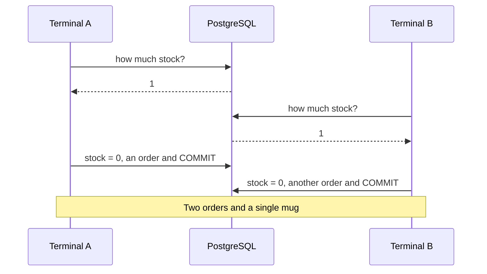

import Term from '~/components/Term.astro';
import TryIt from '~/components/TryIt.astro';
import Analogy from '~/components/Analogy.astro';
import SelfCheck from '~/components/SelfCheck.astro';
import ProjectCode from '~/components/ProjectCode.astro';
import Quiz from '~/components/Quiz.astro';
import QuizQuestion from '~/components/QuizQuestion.astro';
import QuizOption from '~/components/QuizOption.astro';

## The problem

Picture Friday night. There's one mug left in the warehouse, and two people press “Buy” in the same second. Since [lesson 6, “Migrations”](/en/phase-5/database-migrations/), every product has its `stock`, but your API still doesn't touch it when it sells.

Selling is two steps: take a mug from the stock and save the order. They can go wrong in two ways:

- **Halfway.** The server takes the mug and crashes before saving the order. The stock says there's one less, and there's no order to explain it.
- **Two at once.** Both buyers read “1 left,” and both buy. Two orders, one mug, and someone gets an apology email.

The [introduction to this phase](/en/phase-5/) promised that the database solves both. Here you see how, and where it doesn't do it on its own.

## The analogy

<Analogy>

In a corner store, the last mug is on the shelf. Ana and Luis see it from the door at the same time: “There's one left!” But seeing isn't taking. They both head for it, and whoever gets there first takes it; the other finds the gap. **Taking is checking and removing in a single move.**

And at the register, the purchase is all or nothing. If the card fails, the mug goes back on the shelf: nobody leaves with the mug without paying, or pays without a mug.

<div slot="limits">

- In the store, seeing the gap is instant. In PostgreSQL, whoever arrives second to take it **waits** for the first one to finish, and if the first one takes long, everyone waits with them.
- In the database, what you read can be stale an instant later, and nothing warns you: that's the bug in this lesson.
- The store has nothing like durability: what PostgreSQL has confirmed survives a power outage.

</div>

</Analogy>

## How it really works

The sessions in this lesson use your project's `shop` database, just as lesson 7 left it: the Mug is product 2, with the migration's starting stock, 10. The outputs are from PostgreSQL 18.6. The order numbers are past 100,000: PostgreSQL doesn't reuse the ones from the orders you deleted. Yours will be different.

### BEGIN and COMMIT: several commands as one

Lesson 6's migration runner already used transactions. Now, by hand: open `psql -d shop`, sell a mug and change your mind:

```
shop=> BEGIN;
BEGIN
shop=*> UPDATE products SET stock = stock - 1 WHERE id = 2;
UPDATE 1
shop=*> INSERT INTO orders (product_id, quantity, status, created_at) VALUES (2, 1, 'pending', now());
INSERT 0 1
shop=*> SELECT stock FROM products WHERE id = 2;
 stock
-------
     9
(1 row)

shop=*> ROLLBACK;
ROLLBACK
shop=> SELECT stock FROM products WHERE id = 2;
 stock
-------
    10
(1 row)
```

Word by word:

- `BEGIN` opens a <Term id="transaction">transaction</Term>. The <Term id="prompt">prompt</Term> changes to `shop=*>`: the `*` reminds you that you're inside and that nothing is saved yet.
- Inside, your transaction sees its own changes: the `SELECT` says 9. `now()` is the current time.
- `ROLLBACK` undoes everything since the `BEGIN`. The stock goes back to 10, and the order never existed.
- `COMMIT` would have saved both things at once.

Without `BEGIN`, each command on its own is its own transaction and is committed by itself when it finishes: that's why [lesson 1's `UPDATE` without `WHERE`](/en/phase-5/what-is-sql/#the-classic-mistake-an-update-or-a-delete-without-where) had no undo. This is the safety net that lesson promised you.

### If one command fails, the whole transaction fails

Now someone asks for 100 mugs, and there are only 10:

```
shop=> BEGIN;
BEGIN
shop=*> INSERT INTO orders (product_id, quantity, status, created_at) VALUES (2, 100, 'pending', now());
INSERT 0 1
shop=*> UPDATE products SET stock = stock - 100 WHERE id = 2;
ERROR:  new row for relation "products" violates check constraint "stock_not_negative"
DETAIL:  Failing row contains (2, Mug, 850, -90).
shop=!> SELECT stock FROM products WHERE id = 2;
ERROR:  current transaction is aborted, commands ignored until end of transaction block
shop=!> COMMIT;
ROLLBACK
shop=> SELECT count(*) FROM orders WHERE quantity = 100;
 count
-------
     0
(1 row)
```

- The `UPDATE` would leave the stock at −90, and lesson 6's <Term id="constraint">constraint</Term> `stock_not_negative` forbids it.
- From that error on, the transaction is broken (`shop=!>`): PostgreSQL ignores everything until you end it.
- You ask it for `COMMIT` and it answers `ROLLBACK`. The `INSERT`, which had worked, is undone too.

### ACID, letter by letter

What you just saw has a name: **<Term id="acid">ACID</Term>**, the four guarantees of a transaction.

| Letter | What it guarantees | In the shop |
|---|---|---|
| A, atomicity | All or nothing | The stock and the order go together: the `ROLLBACK` undid both |
| C, consistency | When it ends, every rule of the tables holds | The stock's `CHECK` brought down the whole transaction |
| I, isolation | Transactions running at once don't see each other halfway | Another buyer doesn't see your 9 until your `COMMIT` |
| D, durability | What's committed survives a power outage | When `COMMIT` answers, the order is already on disk |

The trick behind durability: before answering `COMMIT`, PostgreSQL writes the changes down in a journal on disk (the *WAL*, *write-ahead log*). After a power outage, it reads it again: what was committed comes back, and what was halfway disappears.

The I has fine print, and to see it you need two buyers.

### Two buyers, one mug: the race condition

Two terminals with `psql -d shop`, **A** and **B**, are two buyers. This is how buying goes if you read the stock and then write the new value:



This really happened, in this order, after leaving a single mug with `UPDATE products SET stock = 1 WHERE id = 2;`:

1. **A** opens its transaction and reads the stock:

   ```
   shop=> BEGIN;
   BEGIN
   shop=*> SELECT stock FROM products WHERE id = 2;
    stock
   -------
        1
   (1 row)
   ```

2. **B** does the same, and also reads 1.
3. **A** sees there's one left, sells it and saves its order, 100029:

   ```
   shop=*> UPDATE products SET stock = 0 WHERE id = 2;
   UPDATE 1
   shop=*> INSERT INTO orders (product_id, quantity, status, created_at) VALUES (2, 1, 'pending', now()) RETURNING id;
      id
   --------
    100029
   (1 row)

   INSERT 0 1
   ```

4. **B** looks again, and still sees 1: A hasn't committed. That's isolation.

   ```
   shop=*> SELECT stock FROM products WHERE id = 2;
    stock
   -------
        1
   (1 row)
   ```

5. **A** commits with `COMMIT`.
6. **B** decides with what it read: it sells, saves order 100030 and commits.

   ```
   shop=*> UPDATE products SET stock = 0 WHERE id = 2;
   UPDATE 1
   shop=*> INSERT INTO orders (product_id, quantity, status, created_at) VALUES (2, 1, 'pending', now()) RETURNING id;
      id
   --------
    100030
   (1 row)

   INSERT 0 1
   shop=*> COMMIT;
   COMMIT
   ```

`RETURNING id` makes the `INSERT` answer with the new order's id. Two orders, 100029 and 100030, and a single mug.

It's a **<Term id="race-condition">race condition</Term>**: the result depends on who gets to each step first. If B had read after A's `COMMIT`, it would have seen 0. And notice: **both were in a transaction, and it didn't help**. B decided with data that was already stale.

### Fix 1: check and take in the same command

It's the move of taking the mug from the shelf:

```sql
UPDATE products SET stock = stock - 1 WHERE id = 2 AND stock >= 1;
```

- `stock = stock - 1` subtracts from the value the row has **at that moment**, not from the one you read before.
- `AND stock >= 1` is the check: if there's none left, the row doesn't meet the `WHERE` and doesn't change.
- The answer says who won: `UPDATE 1`, sold; `UPDATE 0`, there was none left.

The same race, with this `UPDATE` and the stock back at 1:

1. **A** opens its transaction and takes the mug:

   ```
   shop=> BEGIN;
   BEGIN
   shop=*> UPDATE products SET stock = stock - 1 WHERE id = 2 AND stock >= 1;
   UPDATE 1
   ```

2. **B** opens its own and types the same `UPDATE`. **It doesn't answer**: the prompt doesn't come back, B is waiting.

   ```
   shop=> BEGIN;
   BEGIN
   shop=*> UPDATE products SET stock = stock - 1 WHERE id = 2 AND stock >= 1;
   ```

3. **A** saves its order, 100031, and commits with `COMMIT`.
4. At that very instant, **B** gets its answer: `UPDATE 0`. No mug left. B runs `ROLLBACK`, and the API would answer `409`.

Why does B wait? **When a transaction changes a row, PostgreSQL locks it until that transaction ends.** B's `UPDATE` queues up. When A commits, PostgreSQL looks at B's `WHERE` again with the new row: stock 0 doesn't meet `stock >= 1`.

### Fix 2: SELECT … FOR UPDATE, read and hold on to the row

Sometimes your code has to read before deciding, because the decision depends on several things. Then you read with `FOR UPDATE`, which locks the row from the moment you read it:

1. **A** reads with `FOR UPDATE` and sees 1:

   ```
   shop=> BEGIN;
   BEGIN
   shop=*> SELECT stock FROM products WHERE id = 2 FOR UPDATE;
    stock
   -------
        1
   (1 row)
   ```

2. **B** types the same read, and is left waiting.
3. **A** sets the stock to 0, saves order 100032 and commits.
4. **B** finally gets its answer, now with the right data:

   ```
    stock
   -------
        0
   (1 row)
   ```

   It sees there's none left and runs `ROLLBACK`.

B has waited for A's **entire** transaction. That's why there must be nothing slow between a `FOR UPDATE` and its `COMMIT`. The conditional `UPDATE` locks for less time, and it's what the shop uses to sell. It uses `FOR UPDATE` only when it has to read before deciding, like when changing an order's quantity.

### Isolation levels: how much each transaction sees

Why did B read 1 in the first race? Because of the **<Term id="isolation-level">isolation level</Term>**. PostgreSQL tells you which one it uses:

```
shop=> SHOW transaction_isolation;
 transaction_isolation
-----------------------
 read committed
(1 row)
```

| Level | What each command sees | In the mug race |
|---|---|---|
| Read Committed, PostgreSQL's default | What was committed before **that command** starts | B reads 1 and sells: you need one of the fixes |
| Repeatable Read | What was committed before **the transaction** starts | B can't change a row that A changed: error |
| Serializable | The same, and the result is as if they ran one after the other | The same, and it also detects subtler overlaps |

With Serializable, the first race no longer oversells. With the stock at 1, both terminals start with `BEGIN ISOLATION LEVEL SERIALIZABLE;` and read 1. A sells, saves order 100033 and commits. Then B tries the same:

```
shop=*> UPDATE products SET stock = 0 WHERE id = 2;
ERROR:  could not serialize access due to concurrent update
shop=!> ROLLBACK;
ROLLBACK
```

B can't write over a row that another transaction changed after B started. **That error isn't a failure: it's the signal to try again.** B runs `ROLLBACK` and starts over; now it reads 0, and doesn't sell.

That's its price: your code has to recognize the error (code `40001`) and repeat the whole transaction. It pays off when the rule covers many rows and doesn't fit in a `WHERE`, like “today's orders don't go over a limit.” For the stock, Read Committed with the conditional `UPDATE` is enough.

### In Node, a transaction needs a single client from the pool

The <Term id="connection-pool">pool</Term> from [lesson 5](/en/phase-5/node-postgres/) has several open connections, and each `pool.query` uses whichever is free. If you sent `BEGIN`, the `UPDATE` and `COMMIT` with `pool.query`, **each one could go through a different connection**, and the `UPDATE` would end up outside the transaction. A transaction lives in one connection.

The shop solves it once, in `src/db.ts`:

<ProjectCode file="shop-api/22-transactions/src/db.ts" region="in-transaction" />

It's what [the migration runner](/en/phase-5/database-migrations/#the-runner-piece-by-piece) did, now in a function for any transaction:

- `pool.connect()` asks for a connection, the `client`, and `finally` gives it back with `release()`, whether something fails or not.
- `fn` is a function passed to it: the work to do inside. It gets the `client` (of type `PoolClient`, from `pg`), and all its queries go through it.
- If `fn` throws an error, the `catch` runs `ROLLBACK` and throws it again, so it goes on its way like any error.
- `<T>` says that `inTransaction` returns the same thing `fn` returns.

And this is how `createOrder` sells, in `src/data.ts`:

<ProjectCode file="shop-api/22-transactions/src/data.ts" region="take-stock" />

- The `UPDATE` is the one from fix 1, with parameters: `$1`, the product, and `$2`, the quantity.
- `rowCount` is how many rows it changed, the number in `UPDATE 1`.
- If it's 0, a `SELECT` finds out why: if the product exists, there isn't enough left (`left` says how much there is); if not, `not-found`.
- Then comes the usual `INSERT`, now with `client.query`.

`createOrder` no longer returns just an order, but an `OrderResult`: the order or the reason it failed. The route in `src/v2.ts` translates each case:

<ProjectCode file="shop-api/22-transactions/src/v2.ts" region="create-order" />

With no stock, a `409 Conflict`: the request is well written, but it clashes with the state of the shop. Its own `type`, `out-of-stock`, tells it apart from the other `409`s, as in [Phase 4's lesson on errors](/en/phase-4/api-errors-problem-details/#a-type-of-your-own-when-the-client-has-to-tell-them-apart). `src/contract.ts` documents it.

Cancelling gives the stock back (`cancelOrder`), with the same trick: in a transaction, the `UPDATE` of the status carries `WHERE status IN ('pending', 'paid')`. If two cancellations arrive at once, the second no longer finds the order, and the mugs go back only once.

The webhook pays with the same trick: `changeStatus(order.id, 'paid', 'pending')` only changes the order if it is still pending, in the same `UPDATE`. Without that condition, a cancellation that arrived just before would leave it paid again, and cancelling it once more would give the mugs back twice.

Changing the quantity of a pending order (`changeQuantity`) also moves the stock: if you ask for more, it takes the extra ones with the same conditional `UPDATE` (if there aren't enough left, `409` with “You ask for 2 more and 1 are left”); if you ask for fewer, it gives them back. It has to read the order before deciding, so it uses fix 2: it reads it with `FOR UPDATE`, and nobody pays or cancels it in the meantime.

## Try it

The goal: sell the last mug twice, and then check that your API no longer can.

### The race, in two terminals

Open two terminals with `psql -d shop`, leave the stock at 1 and repeat the first race, step by step, until you have two orders for the same mug. Then repeat it with the conditional `UPDATE` and watch B wait for your `COMMIT` in A.

If a terminal stays at `shop=*>`, it has a transaction open: end it with `COMMIT` or `ROLLBACK`, or the other one may be left waiting.

<SelfCheck question="Challenge: the stock is 3. A and B ask for 2 mugs each, with the conditional UPDATE (stock - 2 and stock >= 2), and A commits first. What does B get, and how much stock is left?">

B waits for A's `COMMIT`, and then:

```
shop=*> UPDATE products SET stock = stock - 2 WHERE id = 2 AND stock >= 2;
UPDATE 0
shop=*> SELECT stock FROM products WHERE id = 2;
 stock
-------
     1
(1 row)
```

There's one mug left, and B asked for two: `1 >= 2` isn't true. In the API, it would be a `409` with “You ask for 2 and 1 are left”.

</SelfCheck>

### Update your project

Start from your project from [lesson 7, “Indexes”](/en/phase-5/database-indexes-explain/). Write these changes, or copy them from this lesson's folder (below):

1. In `src/db.ts`, `inTransaction`, with `type PoolClient` in the `import` from `'pg'`.
2. In `src/data.ts`, the `import` of `inTransaction`, the new `createOrder`, `cancelOrder` and `changeQuantity`, and `changeStatus` with its `from`.
3. In `src/v2.ts`, the route that creates orders; the one that cancels calls `cancelOrder`, and the one that changes the quantity answers `409` if there isn't enough stock; the webhook pays only a pending order (`'pending'`, the third argument of `changeStatus`). In `src/contract.ts`, the `409` of `createOrder` and the description of the `409` of `changeOrder`.

The race example and the new tests come in this lesson's folder:

```sh
cd ~/backend-course/phase-3
curl -O https://backenddesdecero.com/practicas/shop-api/22-transactions.tar.gz
tar -xzf 22-transactions.tar.gz
cd shop-api
cp ../22-transactions/examples/race.ts examples/
cp ../22-transactions/test/transactions.test.ts test/
```

### The race, in Node

`examples/race.ts` does the same as your two terminals, with ten buyers at once. First, the way that fails:

<ProjectCode file="shop-api/22-transactions/examples/race.ts" region="wrong" />

It reads, waits 50 ms (what a server busy with other things would take) and writes the value it worked out. And the right way, fix 1:

<ProjectCode file="shop-api/22-transactions/examples/race.ts" region="right" />

The example creates a test mug with stock 1 and launches the ten buyers with `Promise.all`: it starts all the promises at once and waits for all of them to finish ([promises, in Phase 3](/en/phase-3/javascript-for-backend/#waiting-for-what-takes-time-promises-async-and-await)).

<TryIt
  title="Ten buyers, one mug"
  cmd="node --env-file=.env examples/race.ts"
  output={`Wrong: there was 1 mug left and 10 sold. Stock: 0
Right: there was 1 mug left and 1 sold. Stock: 0`}
>

Ten mugs sold, and there was only one; the stock says 0 as if nothing happened. With the conditional `UPDATE`, one. The output is from Node 26.11.1. If you get `ECONNREFUSED`, PostgreSQL isn't running; if you get `column "stock" does not exist`, you're missing lesson 6's migration.

</TryIt>

### Your API answers 409

Start your API with `npm run dev` and, in another terminal, leave a single mug and order it twice:

<TryIt
  title="The last mug, twice"
  cmd={`psql -d shop -c "UPDATE products SET stock = 1 WHERE id = 2;"
curl -s -w '\\n' --json '{"productId":2,"quantity":1}' localhost:3000/v2/orders
curl -s -w '\\n' --json '{"productId":2,"quantity":1}' localhost:3000/v2/orders`}
  output={`UPDATE 1
{"id":100034,"productId":2,"quantity":1,"status":"pending","createdAt":"2026-10-13T23:50:57.947Z"}
{"type":"https://shop.example/problems/out-of-stock","title":"Not enough stock left","status":409,"detail":"You ask for 1 and 0 are left"}`}
>

The first one gets the mug; the second gets a `409` with the `type` `out-of-stock`. `--json` sends the body as JSON. On Linux, `psql` asks you for the password first. Your order number and your date will be different.

</TryIt>

<TryIt
  title="Cancelling gives the mug back"
  cmd={`curl -s -w '\\n' -X POST localhost:3000/v2/orders/100034/cancellation
psql -d shop -c "SELECT stock FROM products WHERE id = 2;"`}
  output={`{"id":100034,"productId":2,"quantity":1,"status":"cancelled","createdAt":"2026-10-13T23:50:57.947Z"}
 stock
-------
     1
(1 row)`}
>

Use your order's number. The mug goes back to the stock. If you cancel again, the response is the same, and the stock stays at 1.

</TryIt>

### The tests

<TryIt
  title="This lesson's tests"
  cmd="npm test -- test/transactions.test.ts"
  output={`> shop-api@1.0.0 test
> node --env-file=test/.env --test --test-concurrency=1 test/transactions.test.ts

✔ 20 orders at once for a product with stock 5: 5 go through, 15 get 409, and the stock ends at 0 (139.428999ms)
✔ without enough stock: 409, with its own type and what is left in detail (3.537195ms)
✔ an order takes its quantity from the stock; cancelling it gives it back, only once (11.840541ms)
✔ an error halfway through the transaction leaves the stock as it was (2.812239ms)
✔ inTransaction: if the function throws an error, nothing it did is saved (2.360158ms)
✔ asking for more units of a pending order takes the difference from the stock (7.816805ms)
✔ asking for more units than are left: 409, with what is left, and neither the order nor the stock changes (33.105506ms)
✔ asking for fewer units gives the difference back to the stock (11.969374ms)
✔ changing the quantity and then cancelling leaves the stock as it was before the order (8.048679ms)
✔ changing the quantity and cancelling at the same time: the stock ends as before the orders (53.693849ms)
✔ an order that is no longer pending: 409, and neither the order nor the stock changes (5.275398ms)
✔ paying and cancelling at the same time: a cancelled order does not go back to paid, and the stock comes back only once (76.214268ms)
✔ paying and changing the quantity at the same time: the order ends paid with the final quantity, and the stock adds up (29.190103ms)
✔ examples/race.ts: reading and writing separately oversells; with a conditional UPDATE, it does not (300.142589ms)
✔ the contract documents the 409 of POST /orders (8.749094ms)
ℹ tests 15
ℹ suites 0
ℹ pass 15
ℹ fail 0
ℹ cancelled 0
ℹ skipped 0
ℹ todo 0
ℹ duration_ms 1408.596565`}
>

What goes after `--` reaches `node --test`: only this file; without it, `npm test` runs them all. The outputs are from Node 26.11.1; your times will be different.

</TryIt>

## You have already seen it

- **A transfer at your bank**: the money leaves your account and enters the other one, or nothing happens.
- **Choosing a seat at a concert**: it stays “reserved for 10 minutes” while you pay. It's the idea behind `FOR UPDATE`, but stored in a column: a 10-minute lock would keep everyone waiting.

## Common mistakes

- **Reading and writing in two commands.** Reading the stock and then writing the calculated value oversells, even inside a transaction. Check and take in the same `UPDATE`.
- **`pool.query('BEGIN')`.** Each query can go through another connection. Ask for a client with `pool.connect()`.
- **Forgetting `release()`.** The connection doesn't go back to the pool and, when they run out, your API hangs.
- **Long transactions.** Calling the payment gateway with rows locked: everyone else queues.
- **Using Serializable without retrying.** The `could not serialize access` error reaches the client as a `500`, when retrying was enough.

## Summary

- A transaction (`BEGIN` … `COMMIT`) saves all its commands or none; `ROLLBACK`, or an error inside, undoes them all.
- ACID: atomicity (all or nothing), consistency (the rules hold), isolation (they don't see each other halfway) and durability (what's committed survives).
- A transaction alone doesn't prevent a race condition: reading in one command and writing in another lets you decide with stale data.
- Check and change it in the same command (`UPDATE … WHERE stock >= 1`), or lock the row when you read it with `SELECT … FOR UPDATE`.
- PostgreSQL uses Read Committed by default. Serializable protects more, at the cost of retrying the transactions it rejects. In Node, each transaction goes through a single client from the pool.

## Did you get it?

<Quiz>

<QuizQuestion
  question="Your server crashes right after the stock UPDATE and before the order INSERT, inside a transaction. When it starts again, what’s in the database?"
  review="ACID, letter by letter"
>

<QuizOption text="The stock lowered and no order: what an UPDATE changes is saved as soon as it finishes.">

That's what happens with a command on its own. Inside a transaction, without `COMMIT` it doesn't count: on restart, it disappears.

</QuizOption>

<QuizOption text="The stock as it was and no order." correct>

Without `COMMIT`, nothing from the transaction stays: atomicity. And since PostgreSQL reads its journal again on startup, what was committed before is still there: durability.

</QuizOption>

<QuizOption text="Both things: on startup, PostgreSQL finishes the transactions that were left halfway.">

The `INSERT` never arrived, and PostgreSQL can't guess it. Uncommitted transactions are thrown away.

</QuizOption>

</QuizQuestion>

<QuizQuestion
  question="Some code reads the stock with SELECT and, if it’s greater than 0, changes it with an UPDATE to the value it read minus 1, all between BEGIN and COMMIT, with the default isolation level. Does it hold up with two buyers at once?"
  review="Two buyers, one mug: the race condition"
>

<QuizOption text="No: both can read 1 before either writes, and both sell." correct>

With Read Committed, a transaction doesn't stop another from reading the same row. Each one decides with what it read, even if it's already stale.

</QuizOption>

<QuizOption text="Yes: inside a transaction, nobody else can read that row until the COMMIT.">

The others read the value committed before. A normal `SELECT` doesn't lock anything; that's what `FOR UPDATE` is for.

</QuizOption>

<QuizOption text="Yes: at COMMIT, PostgreSQL detects that someone else changed the row, and rejects the second one.">

Repeatable Read and Serializable do something like that, with an error. With Read Committed, the default, both are committed.

</QuizOption>

</QuizQuestion>

<QuizQuestion
  question="With the conditional UPDATE, B sends it while A has taken the last mug but hasn’t committed yet. What happens to B?"
  review="Fix 1: check and take in the same command"
>

<QuizOption text="It gets an error right away: PostgreSQL doesn’t let anyone touch a row someone else is changing.">

It does let B touch it, but later: whoever finds a locked row waits for it to be released, without failing.

</QuizOption>

<QuizOption text="It subtracts from the stock it saw when it started, and the stock ends at −1.">

`stock = stock - 1` uses the row's value when changing it, not one read before. And the `stock_not_negative` rule wouldn't let a −1 through.

</QuizOption>

<QuizOption text="It waits for A to finish, and then answers UPDATE 0." correct>

When A commits, PostgreSQL looks at B's `WHERE` again with the new row. The stock is 0, it doesn't meet `stock >= 1`, and nothing changes.

</QuizOption>

</QuizQuestion>

<QuizQuestion
  question="In the API, someone writes await pool.query('BEGIN'), then the UPDATE and the INSERT with pool.query, and at the end await pool.query('COMMIT'). What goes wrong?"
  review="In Node, a transaction needs a single client from the pool"
>

<QuizOption text="Nothing: the pool remembers there was a BEGIN and sends everything else through the same connection.">

The pool knows nothing about transactions: each `pool.query` takes whichever connection is free.

</QuizOption>

<QuizOption text="Each query can go through another connection, outside the transaction." correct>

A transaction lives in one connection. That's why `inTransaction` asks for one with `pool.connect()` and sends everything through it.

</QuizOption>

<QuizOption text="pool.query doesn’t accept BEGIN: it fails with a syntax error.">

`BEGIN` is valid SQL, and `pool.query` sends it. That's why the bug is treacherous: it gives no error at all.

</QuizOption>

</QuizQuestion>

<QuizQuestion
  question="Your API uses Serializable, and a purchase gets could not serialize access due to concurrent update. What should it do?"
  review="Isolation levels: how much each transaction sees"
>

<QuizOption text="ROLLBACK, and repeat the whole transaction from the BEGIN." correct>

The error warns that another transaction got there first. When it's repeated, it reads the new data and decides correctly.

</QuizOption>

<QuizOption text="Repeat only the UPDATE that failed, inside the same transaction.">

After an error, the transaction is broken (`shop=!>`): everything else is ignored until the `ROLLBACK`. And what it read before is already stale.

</QuizOption>

<QuizOption text="Answer 500: the error means the database has a problem.">

With Serializable, that error is normal and expected: it's how the race is avoided. Repeating is enough.

</QuizOption>

</QuizQuestion>

<QuizQuestion
  question="A shop reads the product with SELECT … FOR UPDATE and, inside the same transaction, charges through the payment gateway, which takes 3 seconds. It’s Black Friday. What happens?"
  review="Fix 2: SELECT … FOR UPDATE, read and hold on to the row"
>

<QuizOption text="Nothing: FOR UPDATE only locks the row during the SELECT.">

The lock lasts until the transaction ends, with its `COMMIT` or its `ROLLBACK`: the 3 seconds of the charge included.

</QuizOption>

<QuizOption text="The other buyers read a stale stock and oversell.">

`FOR UPDATE` prevents that: the others don't read, they wait. The problem is a different one: how long they wait.

</QuizOption>

<QuizOption text="Each purchase waits for the charges ahead of it to finish." correct>

The row is locked during the whole charge, and the queue grows 3 seconds at a time. The slow part goes outside the transaction, which should be short.

</QuizOption>

</QuizQuestion>

</Quiz>

## Further reading

- [Transactions](https://www.postgresql.org/docs/18/tutorial-transactions.html) (PostgreSQL tutorial).
- [Transaction isolation](https://www.postgresql.org/docs/18/transaction-iso.html) (PostgreSQL documentation): what each level sees.
- [Explicit locking](https://www.postgresql.org/docs/18/explicit-locking.html) (PostgreSQL documentation): `FOR UPDATE` and the rest.
- [Write-ahead logging (WAL)](https://www.postgresql.org/docs/18/wal-intro.html) (PostgreSQL documentation): durability.
- [Transactions in node-postgres](https://node-postgres.com/features/transactions): why you need a client from the pool.
