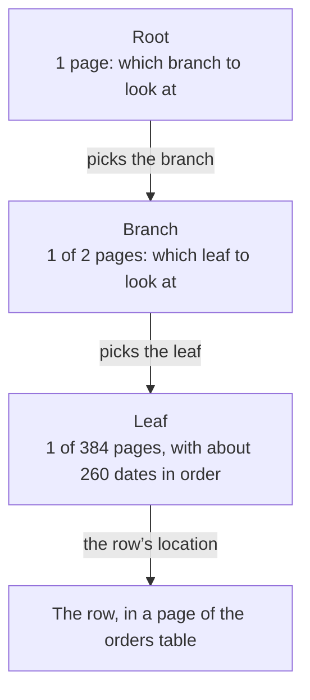

import Term from '~/components/Term.astro';
import TryIt from '~/components/TryIt.astro';
import Analogy from '~/components/Analogy.astro';
import ProjectCode from '~/components/ProjectCode.astro';
import Quiz from '~/components/Quiz.astro';
import QuizQuestion from '~/components/QuizQuestion.astro';
import QuizOption from '~/components/QuizOption.astro';
import SqlPlayground from '~/playgrounds/sql-playground/SqlPlayground';

## The problem

Imagine the shop already has 100,000 orders. The phone app asks for the ten newest, `GET /v2/orders`, and your API, the one from [lesson 6, “Migrations”](/en/phase-5/database-migrations/), asks PostgreSQL for **all of them** to keep ten in Node, as in Phase 4.

Cutting in SQL, with `LIMIT 10`, fixes the trip: only ten rows leave the <Term id="database">database</Term>. But inside, PostgreSQL still reads the 100,000 orders to find out which are the newest. On every request, and with twice the orders, twice the work.

Here you see what PostgreSQL does inside, with `EXPLAIN ANALYZE`, and you give it a direct path: an index.

## The analogy

<Analogy>

You look up “photosynthesis” in a 600-page biology book. Without an index, you leaf through the whole thing. With one, you go to the back: the words are in alphabetical order, each with its pages. You find “photosynthesis, p. 212” and open it there.

The index isn’t the book: it’s a separate, sorted list that points to where each thing is.

<div slot="limits">

- A book’s index is written once. A database’s is kept up to date with every row that comes in, changes or goes.
- A table can have several indexes, one for each way of searching, and each one takes up disk space.
- To read half the book, the index saves nothing. PostgreSQL doesn’t use it either if it’s going to read a large part of the table.

</div>

</Analogy>

## How it really works

The outputs are from PostgreSQL 18.6, with the 100,000 orders you’ll generate in [Try it](#try-it). The times change on every run: what matters is how many times bigger one is than another.

### An index is a separate, sorted list

This is the lesson’s index, in a new <Term id="migration">migration</Term>, `003-orders-index.sql`:

<ProjectCode file="shop-api/21-indexes/db/migrations/003-orders-index.sql" region="index" />

- `CREATE INDEX orders_by_date` creates an index with that name.
- `ON orders (created_at DESC, id DESC)` gives the table and the columns, in order: from the newest order to the oldest and, with the same date, the higher id first.

In the table, rows go wherever there’s room, in no useful order. The <Term id="database-index">index</Term> keeps each date with its id separately, sorted, along with the location of its row in the table.

You already had indexes: every <Term id="primary-key">primary key</Term> and every `UNIQUE` column comes with one, which PostgreSQL creates on its own to check right away whether a value already exists. The one for `orders` is called `orders_pkey`, and that’s why `WHERE id = 50000` was already fast.

### Inside, a B-tree

The index is a <Term id="b-tree">B-tree</Term>, stored in 8 kB pages:

- **The leaves**, at the bottom, have the entries in order, hundreds per page, and each one knows which is the next.
- **The branches**, above, say which leaf to look at for each range of dates.
- **The root**, at the top, says which branch to look at.

This is `orders_by_date` with 100,025 orders, and the path to one of them:



Three pages of the index and one of the table, instead of the 736 of the whole table. And in the leaf, the next orders are right beside it, already in order.

**Each level multiplies what fits by hundreds**: if the table grew a hundred times, the path would still be three or four pages. And the tree is *balanced*: all the leaves are the same distance from the root.

### EXPLAIN: the plan, before running

To find out which path PostgreSQL takes, put `EXPLAIN` in front of the query. This is the first page of the orders list, **without an index**:

```sql
EXPLAIN SELECT * FROM orders ORDER BY created_at DESC, id DESC LIMIT 10;
```

```
                                QUERY PLAN
---------------------------------------------------------------------------
 Limit  (cost=3897.75..3897.78 rows=10 width=27)
   ->  Sort  (cost=3897.75..4147.82 rows=100025 width=27)
         Sort Key: created_at DESC, id DESC
         ->  Seq Scan on orders  (cost=0.00..1736.25 rows=100025 width=27)
(4 rows)
```

It’s the <Term id="query-plan">query plan</Term>: the steps PostgreSQL has chosen, without running anything. Each line with `cost` is a step, and **it’s read from the bottom up**: each one passes its rows to the one above.

- `Seq Scan on orders` (*sequential scan*): reading the whole table, row by row.
- `Sort` sorts by the columns in `Sort Key`, and `Limit` keeps the first ten.
- `rows=100025`: how many rows it **thinks** will go through the step. `width=27`: how many bytes each one takes up.
- `cost=0.00..1736.25`: what it estimates it will cost, up to the first row and up to the last. They aren’t milliseconds, but a unit of its own for comparing plans.

PostgreSQL works out several plans and picks the cheapest, based on the table’s statistics: how many rows it has and what its values are like.

### EXPLAIN ANALYZE: the plan, run

With `EXPLAIN ANALYZE` in front of the same query, PostgreSQL really runs it and notes down what happened in each step:

```
                                                         QUERY PLAN
-----------------------------------------------------------------------------------------------------------------------------
 Limit  (cost=3897.75..3897.78 rows=10 width=27) (actual time=12.474..12.482 rows=10.00 loops=1)
   Buffers: shared hit=742
   ->  Sort  (cost=3897.75..4147.82 rows=100025 width=27) (actual time=12.473..12.474 rows=10.00 loops=1)
         Sort Key: created_at DESC, id DESC
         Sort Method: top-N heapsort  Memory: 26kB
         Buffers: shared hit=742
         ->  Seq Scan on orders  (cost=0.00..1736.25 rows=100025 width=27) (actual time=0.003..4.158 rows=100025.00 loops=1)
               Buffers: shared hit=736
 Planning:
   Buffers: shared hit=89
 Planning Time: 0.197 ms
 Execution Time: 12.504 ms
(12 rows)
```

- `actual time=0.003..4.158`: real milliseconds, up to the first row and up to the last.
- `rows=100025.00`: the real rows. If they look little like the estimated ones, the statistics are often out of date: `ANALYZE orders` brings them up to date.
- `loops=1`: the times the step was done.
- `top-N heapsort`: it keeps the first ten while it reads, without sorting the 100,000. But it reads them all.
- `Buffers: shared hit=736`: 8 kB pages read; `hit`, the ones that were already in memory, and `read`, the ones brought from disk. 736 are the whole table. PostgreSQL 18 shows it without being asked.
- `Planning Time` and `Execution Time`: how long it took to plan and to run.

**`EXPLAIN ANALYZE` runs the query**: with a `DELETE`, it deletes. To see the plan of something that changes data, plain `EXPLAIN`.

### With the index: four pages instead of 742

The same query, with `orders_by_date` created:

```
                                                                QUERY PLAN
------------------------------------------------------------------------------------------------------------------------------------------
 Limit  (cost=0.42..0.89 rows=10 width=27) (actual time=0.039..0.042 rows=10.00 loops=1)
   Buffers: shared hit=1 read=3
   ->  Index Scan using orders_by_date on orders  (cost=0.42..4756.48 rows=100025 width=27) (actual time=0.037..0.038 rows=10.00 loops=1)
         Index Searches: 1
         Buffers: shared hit=1 read=3
 Planning:
   Buffers: shared hit=108 read=1
 Planning Time: 0.406 ms
 Execution Time: 0.058 ms
(9 rows)
```

- `Index Scan using orders_by_date`: it goes down the tree to the newest order and carries on along the leaves. There’s no `Sort`: the index is already in order.
- `rows=10.00`: it reads ten entries and stops. `Index Searches: 1`: it went down the tree once.
- `Buffers: shared hit=1 read=3`: four pages, three of the index and one of the table.

| | Without an index | With an index |
|---|---|---|
| Steps | `Seq Scan`, `Sort` and `Limit` | `Index Scan` and `Limit` |
| Rows read | 100,025 | 10 |
| Pages (`Buffers`) | 742 | 4 |
| Time | Over ten milliseconds | Hundredths of a millisecond |

**Hundreds of times less time.** And without an index the work grows with the table; with one, it hardly changes.

### Multicolumn indexes: the order matters

A phone book is sorted by last name and, after that, by first name. You quickly find “García, Ana” and all the Garcías. But the Anas are spread all over the book.

A composite index, of several columns, works the same way: **one on `(a, b)` is good for searching or sorting by `a`, or by `a` and `b`; not by `b` alone.** That’s why the shop’s is on `(created_at DESC, id DESC)`, the order of the list’s `ORDER BY`.

To choose the order: in front, the columns you compare with `=`; behind, the one you sort by or search by ranges. For “the pending ones, from newest to oldest,” `(status, created_at)`: it goes straight to the pending ones, which are already by date.

### What an index costs

- **Every write.** Every `INSERT` adds an entry to each index of the table, and so does an `UPDATE` that changes a column of the index. With five indexes, an order is written in six places.
- **Disk.** In `psql`, `\di+ orders*` lists the indexes whose names start with `orders`, with their size, and `\dt+ orders`, the table:

```
                                            List of indexes
 Schema |      Name      | Type  | Owner | Table  | Persistence | Access method |  Size   | Description
--------+----------------+-------+-------+--------+-------------+---------------+---------+-------------
 public | orders_by_date | index | shop  | orders | permanent   | btree         | 3104 kB |
 public | orders_pkey    | index | shop  | orders | permanent   | btree         | 2208 kB |
(2 rows)

                                    List of tables
 Schema |  Name  | Type  | Owner | Persistence | Access method |  Size   | Description
--------+--------+-------+-------+-------------+---------------+---------+-------------
 public | orders | table | shop  | permanent   | heap          | 5928 kB |
(1 row)
```

The new index (`btree`, the B-tree) takes up 3 MB, more than half the table. That’s why **you don’t put an index on every column**, but one for each query that needs it, checking with `EXPLAIN ANALYZE` that it uses it.

### Cursor pagination, now in SQL

In [lesson 3 of Phase 4](/en/phase-4/api-pagination/), the <Term id="cursor">cursor</Term> carried the id of the last order, and the primary key’s index was enough. But “newest first” goes by date, and the id only says in which order the rows came in: the 100,000 generated orders are older than the sample ones, with higher ids. So the cursor carries [the value of the sort order and, to break ties, the id](/en/phase-4/api-pagination/#sorting-and-the-cursor-that-carries-the-sort-order):

<ProjectCode file="shop-api/21-indexes/src/pagination.ts" region="cursor-query" />

- `${ORDER}`: the order’s columns, as in `data.ts`.
- `(created_at, id) < ($1, $2)` compares the two pairs the way a dictionary sorts words: first the date and, if it’s the same, the id. They’re the orders behind the cursor. `$1` and `$2` are parameters, as in [lesson 5, “Node and PostgreSQL”](/en/phase-5/node-postgres/#a-query-with-1-the-value-travels-separately).
- `$3::text IS NULL OR status = $3`: the optional filter by status. Without a status, `$3` is `NULL` and the condition is always met. `::text` tells PostgreSQL that `$3` is text: with `IS NULL` alone, it wouldn’t know.
- `ORDER BY created_at DESC, id DESC`: the index’s order. PostgreSQL goes down to the cursor and reads only the page.
- `LIMIT $4`: one more than fits; if it arrives, there’s another page.

It’s *keyset pagination*. Since the cursor is [opaque](/en/phase-4/api-pagination/#the-cursor-is-opaque-not-secret), no client changes its code. But a cursor saved from before, which only carries the id, now gets a `422`, in `/v1` too. According to [Phase 4](/en/phase-4/api-versioning/#a-change-breaks-if-a-client-that-worked-stops-working), **that breaks**, although only for whoever was halfway through the list when you deployed: they have to go back to the first page. So as not to break even that, the server would accept both formats for a while.

Page 9001, with an offset and with the cursor of order 90000:

```sql
EXPLAIN ANALYZE SELECT * FROM orders
ORDER BY created_at DESC, id DESC LIMIT 10 OFFSET 90000;
```

```
                                                                  QUERY PLAN
----------------------------------------------------------------------------------------------------------------------------------------------
 Limit  (cost=4279.80..4280.28 rows=10 width=27) (actual time=14.108..14.117 rows=10.00 loops=1)
   Buffers: shared hit=665 read=344
   ->  Index Scan using orders_by_date on orders  (cost=0.42..4756.48 rows=100025 width=27) (actual time=0.008..10.974 rows=90010.00 loops=1)
         Index Searches: 1
         Buffers: shared hit=665 read=344
 Planning:
   Buffers: shared hit=109
 Planning Time: 0.274 ms
 Execution Time: 14.135 ms
(9 rows)
```

```sql
EXPLAIN ANALYZE SELECT * FROM orders
WHERE (created_at, id) < ('2026-07-30 21:25:00+00', 90000)
ORDER BY created_at DESC, id DESC LIMIT 10;
```

```
                                                               QUERY PLAN
----------------------------------------------------------------------------------------------------------------------------------------
 Limit  (cost=0.42..2.10 rows=10 width=27) (actual time=0.038..0.042 rows=10.00 loops=1)
   Buffers: shared hit=3 read=1
   ->  Index Scan using orders_by_date on orders  (cost=0.42..1659.79 rows=9864 width=27) (actual time=0.037..0.037 rows=10.00 loops=1)
         Index Cond: (ROW(created_at, id) < ROW('2026-07-30 21:25:00+00'::timestamp with time zone, 90000))
         Index Searches: 1
         Buffers: shared hit=3 read=1
 Planning:
   Buffers: shared hit=108
 Planning Time: 0.249 ms
 Execution Time: 0.063 ms
(10 rows)
```

Both use the index and give the same orders, from 90001 to 90010. But look at `rows`:

- **With `OFFSET`, 90,010.** PostgreSQL can’t skip rows without counting them: it reads 90,000 entries and throws them away. Over a thousand pages.
- **With the cursor, 10.** `Index Cond` says that the tree itself resolves the condition: it goes straight down to order 90000. Four pages.

The offset takes longer the further away the page is; the cursor, the same on the first page as on the last.

### In production: CREATE INDEX CONCURRENTLY

While `CREATE INDEX` builds the index, the table can be read but not written. With 100,000 rows it’s less than a second; with a hundred million, it can be minutes without being able to save an order.

`CREATE INDEX CONCURRENTLY` builds it without blocking writes. It takes longer, if it fails it leaves an invalid index that you have to drop, and it can’t go inside a <Term id="transaction">transaction</Term>:

```
shop=> BEGIN;
BEGIN
shop=*> CREATE INDEX CONCURRENTLY orders_quantity ON orders (quantity);
ERROR:  CREATE INDEX CONCURRENTLY cannot run inside a transaction block
shop=!> ROLLBACK;
ROLLBACK
```

You’ll see the prompt’s `*` and `!` in [lesson 8, “Transactions”](/en/phase-5/acid-transactions/#if-one-command-fails-the-whole-transaction-fails). Your migration runner [puts each one in a transaction](/en/phase-5/database-migrations/#each-migration-all-or-nothing), so it would have to learn that exception. In the shop it isn’t needed; in production, it’s the norm.

## Try it

The goal: time the orders list without an index and with one, in the browser and in your database, leave the API paginating in SQL and pit the offset against the cursor.

### Before and after, in the browser

This playground generates 50,000 orders, times the first page, creates the index and times it again. Press “Run”:

<SqlPlayground client:visible lang="en" rows={9} query={`INSERT INTO orders (product_id, quantity, status, created_at)
SELECT n % 3 + 1, n % 4 + 1, 'shipped',
  timestamptz '2026-10-01 09:00:00+00' - n * interval '1 minute'
FROM generate_series(1, 50000) AS n;
ANALYZE orders;
EXPLAIN ANALYZE SELECT * FROM orders ORDER BY created_at DESC, id DESC LIMIT 10;
CREATE INDEX orders_by_date ON orders (created_at DESC, id DESC);
EXPLAIN ANALYZE SELECT * FROM orders ORDER BY created_at DESC, id DESC LIMIT 10;`} />

What’s new is in the `INSERT`:

- `INSERT INTO orders (…) SELECT …`: the rows don’t come from a `VALUES`, but from a `SELECT`, one for each row it returns.
- `generate_series(1, 50000) AS n`: a function that returns the numbers from 1 to 50,000, in a column `n`.
- `n % 3 + 1`: `%` is the remainder of dividing by 3 (0, 1 or 2); with `+ 1`, products 1 to 3, in turns.
- `timestamptz '…' - n * interval '1 minute'`: each order, one minute before the previous one.
- `ANALYZE orders`: brings the statistics up to date.

Look at the two plans: `Seq Scan` and `Sort` before, `Index Scan` after. It’s PostgreSQL 18.3 in the browser: the times change, not the shape of the plan.

Now press “Reset data”, put `ORDER BY quantity DESC` in both queries and run: both plans come out with `Seq Scan`, because the index doesn’t have `quantity`. Without resetting, the `CREATE INDEX` would fail: the index already exists.

### In your database: a hundred thousand orders

You’re still in `~/backend-course/phase-3/shop-api`, with the code from lesson 6. Download this lesson’s folder: from `~/backend-course/phase-3`, `curl -O https://backenddesdecero.com/practicas/shop-api/21-indexes.tar.gz` and `tar -xzf 21-indexes.tar.gz`.

Copy the script that generates the orders, `cp ../21-indexes/scripts/many-orders.ts scripts/`, and add to `"scripts"` in `package.json` the line `"db:many-orders": "node --env-file-if-exists=.env scripts/many-orders.ts"`. It’s the playground’s `INSERT`, with 100,000, all inside PostgreSQL:

<ProjectCode file="shop-api/21-indexes/scripts/many-orders.ts" region="generate" />

<TryIt
  title="1. A hundred thousand orders"
  cmd="npm run db:many-orders"
  output={`> shop-api@1.0.0 db:many-orders
> node --env-file-if-exists=.env scripts/many-orders.ts

There are now 100025 orders`}
>

The 100,000 new ones and the 25 sample ones; if you created others with the API, you’ll get more. If you get `relation "orders" does not exist`, you’re missing `npm run db:migrate`.

</TryIt>

Open `psql -d shop` and time the first page:

<TryIt
  title="2. Without an index"
  lang="sql"
  cmd="EXPLAIN ANALYZE SELECT * FROM orders ORDER BY created_at DESC, id DESC LIMIT 10;"
>

You get the plan from [“EXPLAIN ANALYZE: the plan, run”](#explain-analyze-the-plan-run), with your times: `Seq Scan` with `rows=100025.00`, `Sort` and about 740 pages in `Buffers`. If you see `Index Scan`, you already have the index: check whether `db/migrations/` has the `003`.

</TryIt>

Copy the migration, `cp ../21-indexes/db/migrations/003-orders-index.sql db/migrations/`, and apply it:

<TryIt
  title="3. The index migration"
  cmd="npm run db:migrate"
  output={`> shop-api@1.0.0 db:migrate
> node --env-file-if-exists=.env scripts/migrate.ts

Applied: 003-orders-index.sql`}
>

Only the `003`: the others are already in the `migrations` table.

</TryIt>

<TryIt
  title="4. With an index"
  lang="sql"
  cmd="EXPLAIN ANALYZE SELECT * FROM orders ORDER BY created_at DESC, id DESC LIMIT 10;"
>

You get the plan from [“With the index: four pages instead of 742”](#with-the-index-four-pages-instead-of-742): `Index Scan`, ten rows and four pages. If you run it again, `read=3` becomes `hit=4`: the pages are already in memory.

</TryIt>

### The API, paginating in SQL

Now the code. Copy it from the folder or write the changes yourself:

1. `src/pagination.ts`: the cursor carries the date and the id, and `pageByCursor` and `pageByOffset` query PostgreSQL instead of cutting a list.
2. `src/data.ts`: it exports `ORDER`, `OrderRow` and `toOrder`, and deletes `ordersNewestFirst`. When an order is created, `date_trunc('milliseconds', now())` saves the time with milliseconds, as the API gives it, so that the cursor points to exactly that order.
3. `src/schemas.ts`: the cursor’s schema checks the date and the id.
4. `src/v2.ts`: the orders route calls both functions with `await`.

Copy the tests, `cp ../21-indexes/test/*.test.ts test/`, and run the new one:

<TryIt
  title="5. The index tests"
  cmd="npm test -- test/indexes.test.ts"
  output={`> shop-api@1.0.0 test
> node --env-file=test/.env --test --test-concurrency=1 test/indexes.test.ts

✔ migration 003 creates the index for the orders list: by date and by id, highest first (63.628085ms)
✔ by cursor every order is seen exactly once, even if new ones arrive between two pages (43.795553ms)
✔ an old cursor, which only carried the id, is no longer valid: 422 (1.990177ms)
✔ with 100,000 orders, the list uses the index; without it, it reads the whole table (633.318292ms)
ℹ tests 4
ℹ suites 0
ℹ pass 4
ℹ fail 0
ℹ cancelled 0
ℹ skipped 0
ℹ todo 0
ℹ duration_ms 1046.430073`}
>

The last one does the same as you, in `shop_test`. If the first one fails, the `003` is missing from `db/migrations/`. Outputs from Node 26.11.1; your times will be different. Run the whole `npm test` too.

</TryIt>

Start the server with `npm run dev` and, in another terminal, ask for a page of two:

<TryIt
  title="6. The new cursor"
  cmd="curl -i 'localhost:3000/v2/orders?limit=2'"
  output={`HTTP/1.1 200 OK
content-type: application/json
link: <http://localhost:3000/v2/orders?limit=2&cursor=WyIyMDI2LTEwLTA4VDAyOjAwOjAwLjAwMFoiLDI0XQ>; rel="next"
vary: Origin
x-request-id: 6c87f496-ffac-4e81-bde7-57fae8c7bded
content-length: 191
Date: Tue, 13 Oct 2026 23:47:54 GMT
Connection: keep-alive
Keep-Alive: timeout=5

[{"id":25,"productId":2,"quantity":2,"status":"pending","createdAt":"2026-10-08T09:00:00.000Z"},{"id":24,"productId":1,"quantity":1,"status":"pending","createdAt":"2026-10-08T02:00:00.000Z"}]`}
>

The cursor in `link` is longer. `node -p "Buffer.from('WyIyMDI2LTEwLTA4VDAyOjAwOjAwLjAwMFoiLDI0XQ', 'base64url').toString()"` decodes it: `["2026-10-08T02:00:00.000Z",24]`, the date and the id of order 24. Your `x-request-id` and your date will be different.

</TryIt>

### Offset versus cursor

With 50,000 orders and the index, page 4501 with `OFFSET 45000` and with the cursor of order 45000:

<SqlPlayground client:visible lang="en" rows={9} query={`INSERT INTO orders (product_id, quantity, status, created_at)
SELECT n % 3 + 1, n % 4 + 1, 'shipped',
  timestamptz '2026-10-01 09:00:00+00' - n * interval '1 minute'
FROM generate_series(1, 50000) AS n;
CREATE INDEX orders_by_date ON orders (created_at DESC, id DESC);
ANALYZE orders;
EXPLAIN ANALYZE SELECT * FROM orders
ORDER BY created_at DESC, id DESC LIMIT 10 OFFSET 45000;
EXPLAIN ANALYZE SELECT * FROM orders
WHERE (created_at, id) < ('2026-08-31 03:25:00+00', 45000)
ORDER BY created_at DESC, id DESC LIMIT 10;`} />

Look at `rows` in the `Index Scan`: 45,010 with the offset and 10 with the cursor. Press “Reset data”, change `OFFSET 45000` to `OFFSET 100` and run: 110.

In `psql`, with your 100,000, try the two from “Cursor pagination, now in SQL”: `rows=90010.00` and `rows=10.00`.

When you’re done, remove the generated orders, the ones before the first sample one:

<TryIt
  title="7. Back to 25 orders"
  lang="sql"
  cmd="DELETE FROM orders WHERE created_at < '2026-10-01 09:00:00+00';"
  output="DELETE 100000"
>

The index stays. If you get another number, you ran the script more than once.

</TryIt>

## You have already seen it

- **Your phone’s contacts**, sorted by name: you go straight to the letter.
- **The [table in Phase 4](/en/phase-4/api-pagination/#offset-or-cursor-what-you-gain-and-what-you-lose)** said that the offset “reads and throws away” rows. Now you’ve measured it.

## Common mistakes

- **An index on every column, just in case.** They slow down writes and take up disk space. Add the ones a query needs.
- **A composite index in the wrong order.** `(created_at, status)` is no good for searching by `status`: the first column rules.
- **`EXPLAIN ANALYZE` with an `UPDATE` or a `DELETE`.** It really runs it. Use plain `EXPLAIN`.
- **Measuring with a small table.** With 25 rows, PostgreSQL reads the table even if there’s an index, and it’s right to: it’s one page.
- **`CREATE INDEX` on a big table in production.** It blocks writes: `CONCURRENTLY`.

## Summary

- An index is a sorted copy of some columns, with the location of each row. It’s a B-tree: any value is a few pages away, even with millions of rows.
- `EXPLAIN` shows the plan; `EXPLAIN ANALYZE` runs it and notes down rows, times and pages. It’s read from the bottom up: `Seq Scan` reads the whole table, `Index Scan` goes through the index.
- In a composite index, the first column rules.
- Every index is paid for on every write and in disk space: one for each query that needs it.
- With an index in the same order, the cursor `(created_at, id) < ($1, $2)` reads only the page; `OFFSET` reads and throws away everything it skips.

## Did you get it?

<Quiz>

<QuizQuestion
  question="Looking up a customer by their email is slow. EXPLAIN ANALYZE says Seq Scan on customers, with rows=2000000 in the scan and a single row at the end. What fixes it?"
  review="Inside, a B-tree"
>

<QuizOption text="An index on the email column." correct>

PostgreSQL will go down the tree to that email in a few pages, without reading two million rows.

</QuizOption>

<QuizOption text="Adding LIMIT 1: with it, PostgreSQL goes straight to the row.">

`LIMIT` doesn’t know where the row is: without an index, PostgreSQL keeps going through the table until it finds it.

</QuizOption>

<QuizOption text="Nothing: in a table of two million, any search takes that long.">

With an index, searching among two million costs a few pages, almost the same as among a thousand.

</QuizOption>

</QuizQuestion>

<QuizQuestion
  question="An app asks for messages 20 at a time, and it’s on page 2001: OFFSET 40000. The plan says Index Scan, with rows=40020.00 in that step. What does it mean?"
  review="Cursor pagination, now in SQL"
>

<QuizOption text="That rows is an estimate: in reality it only read the 20 on the page.">

The `rows` next to `actual time` is real: it read 40,020 entries. The estimate is the one in the first parentheses.

</QuizOption>

<QuizOption text="That it uses the index, so that page already comes out as fast as possible.">

It goes through it from the start. With a cursor, the same index gives it by reading 20 rows.

</QuizOption>

<QuizOption text="That it read 40,000 index entries to throw them away and keep 20." correct>

`OFFSET` can’t skip rows without counting them. The further away the page is, the more it reads and throws away.

</QuizOption>

</QuizQuestion>

<QuizQuestion
  question="Luis wants the pending orders, from newest to oldest, with an index. Which one?"
  review="Multicolumn indexes: the order matters"
>

<QuizOption text="On (created_at, status): the order of the columns doesn’t matter.">

With the date in front, the pending ones are spread all over the index, like the Anas in the phone book.

</QuizOption>

<QuizOption text="On (status, created_at): in front the one compared with =, behind the one for the order." correct>

The index goes straight to the pending ones, and there they’re already sorted by date: no going through, no sorting.

</QuizOption>

<QuizOption text="Two indexes, one on status and another on created_at: they’re the same as one with both.">

Each one is sorted by its column: neither has the pending ones in date order.

</QuizOption>

</QuizQuestion>

<QuizQuestion
  question="An events table gets thousands of INSERTs per second and has nine indexes. Writes are slow. Why?"
  review="What an index costs"
>

<QuizOption text="Indexes only affect reads: the problem has to be something else.">

Each new row also has to go into each index. They affect writes, and a lot.

</QuizOption>

<QuizOption text="PostgreSQL rebuilds each whole index on every INSERT.">

It adds an entry in its place in the tree, without rebuilding it. But it’s nine per row.

</QuizOption>

<QuizOption text="Each INSERT also writes to the nine indexes." correct>

Ten writes per event. Indexes that no query uses are unnecessary.

</QuizOption>

</QuizQuestion>

<QuizQuestion
  question="You want to see how PostgreSQL would do DELETE FROM orders WHERE status = 'cancelled', without deleting anything. What do you write in front?"
  review="EXPLAIN ANALYZE: the plan, run"
>

<QuizOption text="EXPLAIN: it shows the plan without running the command." correct>

Plain `EXPLAIN` doesn’t touch the data. With `ANALYZE`, the `DELETE` would run.

</QuizOption>

<QuizOption text="EXPLAIN ANALYZE: it only measures, it doesn’t change the data.">

`ANALYZE` really runs the command to measure it: it would delete the cancelled orders.

</QuizOption>

<QuizOption text="Nothing: EXPLAIN only works with SELECT.">

`EXPLAIN` also works with `INSERT`, `UPDATE` and `DELETE`.

</QuizOption>

</QuizQuestion>

<QuizQuestion
  question="The orders table goes from 100,000 to 10 million rows. What happens to looking up an order by its index?"
  review="Inside, a B-tree"
>

<QuizOption text="It takes a hundred times longer: the index is also a hundred times bigger.">

It takes up a hundred times more space, but the path grows in levels, and each level multiplies by hundreds.

</QuizOption>

<QuizOption text="Almost nothing: the tree gains one level at most, one more page." correct>

That’s why a B-tree can handle huge tables: the work of a search barely grows with them.

</QuizOption>

<QuizOption text="It stops using the index: with tables that big, PostgreSQL goes through them whole.">

It’s the other way around: the bigger the table, the more the index pays off for finding a few rows.

</QuizOption>

</QuizQuestion>

</Quiz>

## Further reading

- [Indexes](https://www.postgresql.org/docs/18/indexes.html) (PostgreSQL documentation): the types, composite ones and when they’re used.
- [Using EXPLAIN](https://www.postgresql.org/docs/18/using-explain.html) (PostgreSQL documentation): every line of a plan.
- [Use The Index, Luke](https://use-the-index-luke.com/) (Markus Winand): a free book about indexes.
- [No offset](https://use-the-index-luke.com/no-offset) (Markus Winand): why keyset pagination wins.
