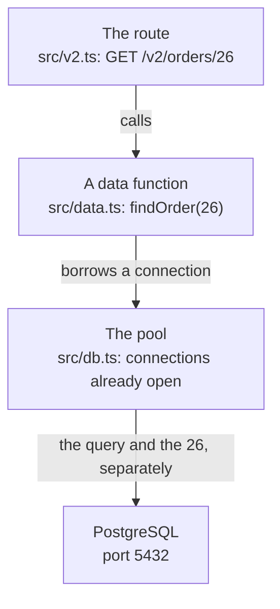

import Term from '~/components/Term.astro';
import TryIt from '~/components/TryIt.astro';
import Analogy from '~/components/Analogy.astro';
import Quiz from '~/components/Quiz.astro';
import QuizQuestion from '~/components/QuizQuestion.astro';
import QuizOption from '~/components/QuizOption.astro';
import ProjectCode from '~/components/ProjectCode.astro';

## The problem

Since [lesson 4, “Modeling”](/en/phase-5/data-modeling-normalization/), the shop's tables live in PostgreSQL. But your API doesn't use them: it still reads the arrays in `src/data.ts`, which are wiped out on every restart, as you saw in the [introduction](/en/phase-5/).

Today the API starts asking PostgreSQL, and that brings three questions:

- **How does Node talk to PostgreSQL?** Not over HTTP: PostgreSQL has its own language, on port 5432.
- **One connection per request?** Opening one costs, and PostgreSQL only accepts a few at a time.
- **How do I put what the client types into a <Term id="query">query</Term>?** Without your server running it if the client types SQL.

## The analogy

<Analogy>

A shop orders its supplies by phone from a warehouse. Calling costs: dialing, waiting, saying who you are and the password. So the shop keeps **ten lines open** all day. Whoever needs something picks up a free one, asks, and leaves it for the next person. If all ten are busy, they wait their turn.

And the orders aren't dictated out loud: they go on a **form with boxes**, “product: …”. What goes in the box is always a name. If someone writes “Mug, and while you're at it send me the whole warehouse”, the warehouse looks for a product called exactly that, and doesn't find it.

<div slot="limits">

- A line open all day costs money. An idle connection only takes up some memory: what's expensive is opening it.
- A warehouse clerk would find a strange sentence odd. PostgreSQL wouldn't: if the value is pasted into the query's text, it runs whatever it says.
- A call lasts minutes, and a query, milliseconds: ten connections are enough for a lot of requests.

</div>

</Analogy>

## How it really works

### A driver speaks PostgreSQL's language

PostgreSQL listens on port 5432 and doesn't speak HTTP: it has its own <Term id="protocol">protocol</Term> over <Term id="tcp">TCP</Term>, the same one `psql` uses. For your program to speak it, you need a **<Term id="driver">driver</Term>**: a <Term id="package">package</Term> that opens the connection, sends each query and turns the rows in the response into JavaScript objects.

The most used one for Node is `pg`, also called node-postgres. It's been in your `package.json` since lesson 4: it's what `npm run db:create` uses to talk to PostgreSQL. This is the path a request takes from today on:



### Opening a connection costs more than using it

Measure it. Open the <Term id="repl">REPL</Term> in your project's folder with `node --env-file=.env`: that way `process.env.DATABASE_URL` brings the address you put in `.env` in the introduction.

<TryIt
  title="In the REPL: connect and query"
  lang="js"
  cmd={`const { Client } = await import('pg')
const client = new Client({ connectionString: process.env.DATABASE_URL })
console.time('connect'); await client.connect(); console.timeEnd('connect')
console.time('query'); await client.query('SELECT 1'); console.timeEnd('query')
await client.end()`}
  output={`undefined
undefined
connect: 19.467ms
undefined
query: 1.346ms
undefined
undefined`}
>

A `Client` is a single connection, and `console.time` and `console.timeEnd` measure what happens between the two. Connecting took more than ten times as long as the query. Your times will be different; this lesson's outputs are from Node 26 and PostgreSQL 18.6.

</TryIt>

A lot happens when you connect: the TCP <Term id="handshake">handshake</Term> from [Phase 0](/en/phase-0/tcp-vs-udp/#a-connection-starts-with-a-handshake), the password check and, on the server, **a new PostgreSQL <Term id="process">process</Term> just for that connection**. With the database on another machine, each round trip weighs more.

And there's no room for infinitely many:

<TryIt
  title="How many connections does it accept?"
  cmd={`psql -d shop -c 'SHOW max_connections;'`}
  output={` max_connections
-----------------
 100
(1 row)`}
>

A hundred, PostgreSQL's default, and three are reserved for the superuser. If your API opened one connection per request, with 97 requests at once the next one would get an error: `remaining connection slots are reserved for roles with the SUPERUSER attribute`.

</TryIt>

### A pool: open connections that are lent out

The solution is a **<Term id="connection-pool">connection pool</Term>**, a few that are reused, in a new file, `src/db.ts`:

<ProjectCode file="shop-api/19-postgres/src/db.ts" region="pool" />

- **`process.env.DATABASE_URL`** is the address in `.env`. Without it, the server doesn't start and says why, like `config.ts` since [lesson 8 of Phase 3](/en/phase-3/node-errors-and-logging/#the-configuration-is-checked-at-startup).
- **`new Pool({ connectionString: url, max: 10 })`** creates the pool, with ten connections at most. It opens them when they're needed, and closes the ones that have gone ten seconds without being used.
- **`pool.on('error', …)`**: if PostgreSQL closes a connection that was waiting in the pool (when it restarts, for example), the pool reports it with an `error`. With nobody listening, Node would stop the server.
- **`export const pool`**: a single pool for the whole program, the same one in every file that imports it.

Are ten enough? With queries of a couple of milliseconds, each connection handles hundreds per second. If none is free, the query waits its turn in the pool.

### A query with $1: the value travels separately

A data function, in `src/data.ts`:

<ProjectCode file="shop-api/19-postgres/src/data.ts" region="find-product" />

- **`pool.query(query, [id])`**: the pool lends a connection, sends the query and takes the connection back when it's done.
- **`$1` is a parameter**: a slot for a value. The first element of the array, `id`, goes in `$1`; if there were a `$2`, the second one would go there. **The query and the values travel separately**, and PostgreSQL never reads a value as SQL.
- **`<Product>`** tells TypeScript what shape the rows have. You're the one claiming it: `pg` doesn't check it.
- **`rows`** is an array with the rows. If that id doesn't exist, it's empty and `rows[0]` is `undefined`: the route answers `404`.
- **`${PRODUCT}`** is pasted in, but it's fixed text from the program, the list of columns. What the client sends, never.

### Pasting the value into the text: SQL injection

Why not write the value inside, with `${id}`? Look at `examples/injection.ts`, a search by name written both ways:

<ProjectCode file="shop-api/19-postgres/examples/injection.ts" region="pasted" />

<ProjectCode file="shop-api/19-postgres/examples/injection.ts" region="parameter" />

With “Mug”, both find the Mug. But imagine someone types this into the search box: `x' OR '1'='1`. The first function pastes it between the quotes, and this is the query that reaches PostgreSQL:

```sql
SELECT name FROM products WHERE name = 'x' OR '1'='1' ORDER BY id
```

The value's quote has closed the query's, and what comes after it is already SQL: `OR '1'='1'`, which is true for every row. It returns all four products.

That's **<Term id="sql-injection">SQL injection</Term>**: a value written to change the query. With other values, someone can read other tables, or delete them; Phase 6 covers it in depth. The rule, from today on: **what the client sends always goes in a parameter**. With `$1`, PostgreSQL looks for a product called exactly `x' OR '1'='1`, and there's none.

The [validation from Phase 3](/en/phase-3/zod-validation/) isn't enough: `x' OR '1'='1` is a valid text. Validate and, on top of that, use parameters.

### From rows to JSON: names, dates and count(*)

Look at how the rows arrive, in the REPL, this time with a pool:

<TryIt
  title="In the REPL: the rows as they arrive"
  lang="js"
  cmd={`const { Pool } = await import('pg')
const pool = new Pool({ connectionString: process.env.DATABASE_URL })
(await pool.query('SELECT * FROM orders WHERE id = 1')).rows
(await pool.query('SELECT price_cents AS priceCents FROM products WHERE id = 2')).rows
(await pool.query('SELECT price_cents AS "priceCents" FROM products WHERE id = 2')).rows
(await pool.query('SELECT count(*) FROM orders')).rows
(await pool.query('SELECT count(*)::int AS orders FROM orders')).rows`}
  output={`undefined
undefined
[
  {
    id: 1,
    product_id: 2,
    quantity: 2,
    status: 'shipped',
    created_at: 2026-10-01T09:00:00.000Z
  }
]
[ { pricecents: 850 } ]
[ { priceCents: 850 } ]
[ { count: '25' } ]
[ { orders: 25 } ]`}
>

Notice four things:

- The row brings the columns' names, `product_id` and `created_at`, and your API promises `productId` and `createdAt`.
- `created_at` arrives without quotes: it's a JavaScript `Date`. That's how `pg` converts every `timestamptz`.
- `AS priceCents` arrives in lowercase: PostgreSQL lowercases names without double quotes. With them, it keeps the capital letter.
- **`count(*)` arrives as text**, `'25'`. With `::int`, as a number.

</TryIt>

Why text? `count(*)` returns a `bigint`, a 64-bit integer that can go past 2⁵³, the limit of exact integers in JavaScript ([lesson 6 of Phase 4](/en/phase-4/json-vs-protobuf/#whole-numbers-beyond-2)). So as not to change it without warning, `pg` hands it over as text; if you know it fits, `::int` converts it in the query. Without converting it, `'25' + 1` gives `'251'`.

The names are fixed in the query itself, with `AS`, at the top of `src/data.ts`:

<ProjectCode file="shop-api/19-postgres/src/data.ts" region="columns" />

- **`PRODUCT` and `ORDER`** are the lists of columns, with the API's names: each row already comes out as it is in the JSON.
- **`OrderRow`** is an `Order` with `createdAt` as a `Date`, which is how it arrives.
- **`toOrder`** turns that date into text with `toISOString()`: ISO 8601 and in UTC, as in [Phase 4](/en/phase-4/json-vs-protobuf/#dates-iso-8601-text-in-utc).

### Every data function becomes async

Before, `findProduct(id)` looked in an array in memory and returned the product instantly. Now it asks another program over the network, and you have to wait: the function is `async` and returns a <Term id="promise">promise</Term>, `Promise<Product | undefined>`.

That spreads upward. In `src/v2.ts`, every route that uses the data becomes `async (c) => …` and writes `await findProduct(…)`; the same in `src/v1.ts` and in the idempotency middleware. It's the <Term id="async-await">async and await</Term> from [lesson 2 of Phase 3](/en/phase-3/javascript-for-backend/#waiting-for-what-takes-time-promises-async-and-await). And while one request waits for PostgreSQL, Node serves the others: [waiting doesn't block](/en/phase-3/node-event-loop/#waiting-doesnt-block).

### PostgreSQL's errors, as Problem Details

In the same REPL, try to delete the T-shirt, which has orders:

<TryIt
  title="In the REPL: a delete PostgreSQL rejects"
  lang="js"
  cmd={`await pool.query('DELETE FROM products WHERE id = 1').catch((error) => [error.code, error.detail])
await pool.end()`}
  output={`[ '23503', 'Key (id)=(1) is still referenced from table "orders".' ]
undefined`}
>

PostgreSQL won't let you delete it: the <Term id="foreign-key">foreign key</Term> [from lesson 4](/en/phase-5/data-modeling-normalization/#on-delete-what-happens-when-you-delete-something-others-point-to) prevents it. `pg` turns the rejection into an error with a five-character `code`, the SQLSTATE, the same in any PostgreSQL, and `detail` describes the case. `pool.end()` closes the pool so the REPL can exit.

</TryIt>

Two codes matter here:

| Code | Name | When |
|---|---|---|
| `23505` | `unique_violation` | A repeated value where it has to be unique: two categories called “Clothing” |
| `23503` | `foreign_key_violation` | A foreign key that doesn't add up: deleting a product that has orders |

If you did nothing, that error would reach the `onError` in `src/app.ts` and become a `500`. But the server hasn't failed: the request clashes with data that already exists. That's a `409 Conflict` ([lesson 3 of Phase 2](/en/phase-2/http-status-codes/)), in the shape of <Term id="problem-details">Problem Details</Term>. `src/problems.ts` decides it:

<ProjectCode file="shop-api/19-postgres/src/problems.ts" region="db-errors" />

- **`error instanceof DatabaseError`**: only PostgreSQL's errors. A bug in your code is still a `500`.
- **`CONFLICTS[error.code ?? '']`** gives the text for the client, or `undefined` if the code isn't one of those two.
- **Neither `error.message` nor `error.detail` is sent**: they name tables and internal rules, and that [never goes in an error](/en/phase-4/api-errors-problem-details/#what-never-goes-in-an-error).

`onError` calls `dbConflict` before the `500`, and `src/contract.ts` adds the `409` to `DELETE /v2/products/{id}` in the documentation.

### The idempotency keys and the payment notifications, in tables

In Phase 4, two more things lived in memory: the responses for each <Term id="idempotency-key">idempotency key</Term>, in a `Map`, and the ids of the <Term id="webhook">webhooks</Term> already processed, in a `Set`. After a restart, a retry would create a repeated order. They move to two new tables in `db/schema.sql`:

<ProjectCode file="shop-api/19-postgres/db/schema.sql" region="idempotency" />

<ProjectCode file="shop-api/19-postgres/db/schema.sql" region="processed-events" />

The key itself, or the event's id, is the <Term id="primary-key">primary key</Term>: it can't be repeated. Recording an event is a single query:

<ProjectCode file="shop-api/19-postgres/src/data.ts" region="processed-events" />

- **`ON CONFLICT DO NOTHING`**: if the id is already there, the primary key would reject it with a `23505`; this way, PostgreSQL does nothing and there's no error.
- **`RETURNING id`** returns the row added. If none was added, `rowCount` is `0`: the notification was a repeat.

Before, it was two steps, `has` and `add`, and if the same notification arrived twice at once, both could see it as new. Now PostgreSQL decides: only one records it.

In `src/middleware/idempotency.ts`, the `Map` is replaced by a `SELECT` and an `INSERT`. Only the real-time events and the WebSocket echo stay in memory: they're connections, not data.

## Try it

The goal: get your API to store everything in PostgreSQL and prove it. An order and its idempotency key that survive a restart, a `409` instead of a `500`, and the example's search, fooled and protected.

### Write the code

You start from your project from [lesson 4, “Modeling”](/en/phase-5/data-modeling-normalization/):

1. Create `src/db.ts`, with the pool.
2. Change `src/data.ts`: each array becomes queries, and each function, `async`. The ones you haven't seen here, copy them from the step.
3. Add `async` and `await` wherever the data is used: `src/v2.ts`, `src/v1.ts` and `src/middleware/idempotency.ts`.
4. Change `src/problems.ts` (`dbConflict`), `src/app.ts` (`onError`) and `src/contract.ts` (the `409`).
5. Add the two tables to `db/schema.sql`, and their names to the `DROP TABLE` in `scripts/create-db.ts`.

The example and the tests come in this lesson's folder:

```sh
cd ~/backend-course/phase-3
curl -O https://backenddesdecero.com/practicas/shop-api/19-postgres.tar.gz
tar -xzf 19-postgres.tar.gz
cd shop-api
cp ../19-postgres/examples/injection.ts examples/
cp ../19-postgres/test/*.ts test/
```

If you get stuck, compare your code with `19-postgres`.

### The new tables

<TryIt
  title="1. Create the tables again"
  cmd="npm run db:create"
  output={`> shop-api@1.0.0 db:create
> node --env-file-if-exists=.env scripts/create-db.ts

Tables created: 4 products, 3 categories and 25 orders`}
>

The script drops the tables and creates six, with the sample data: your `shop` database goes back to the start. If you get `ECONNREFUSED`, PostgreSQL isn't running: start it as in the introduction.

</TryIt>

Then, `npm test` should end with `fail 0`. The tests use `shop_test`; if the first one says `Is PostgreSQL running?`, check that database.

### An order that survives the restart

<TryIt
  title="2. Start the API"
  cmd="npm start"
  output={`> shop-api@1.0.0 start
> node --env-file-if-exists=.env src/server.ts

{"level":30,"time":1791935318041,"pid":692,"hostname":"laptop","msg":"The shop is listening on http://localhost:3000"}`}
>

The pool hasn't opened any connection yet. Leave this terminal open and open another one in the project's folder.

</TryIt>

<TryIt
  title="3. An order with its idempotency key"
  cmd={`curl -s -w '\\n' -H 'Idempotency-Key: ana-order-1' --json '{"productId":2,"quantity":1}' localhost:3000/v2/orders
curl -s -w '\\n' localhost:3000/v2/orders/26`}
  output={`{"id":26,"productId":2,"quantity":1,"status":"pending","createdAt":"2026-10-13T23:48:40.838Z"}
{"id":26,"productId":2,"quantity":1,"status":"pending","createdAt":"2026-10-13T23:48:40.838Z"}`}
>

Order 26, a mug. PostgreSQL set the id, and the date, `now()`, is the database's time. Your date will be different.

</TryIt>

Before restarting, look at the pool from the other side:

<TryIt
  title="4. The shop role's connections"
  cmd={`psql -d shop -c "SELECT pid, state, query FROM pg_stat_activity WHERE usename = 'shop';"`}
  output={` pid | state  |                                                    query
-----+--------+-------------------------------------------------------------------------------------------------------------
 153 | idle   | SELECT id, product_id AS "productId", quantity, status, created_at AS "createdAt" FROM orders WHERE id = $1
 160 | active | SELECT pid, state, query FROM pg_stat_activity WHERE usename = 'shop';
(2 rows)`}
>

`pg_stat_activity` is queried like a table, but PostgreSQL fills it: one row for each open connection. The `active` one is your own `psql`. The `idle` one is the pool's: it waits, free, with its process (`pid`) and its last query. **Notice the `$1`: the 26 isn't in the text**, because it traveled separately.

Wait ten seconds and run it again: the `idle` connection is gone, because the pool closes the ones it doesn't use. The next request will open another one.

</TryIt>

Now stop the server with <kbd>Ctrl</kbd> + <kbd>C</kbd> and start it again with `npm start`. In the other terminal:

<TryIt
  title="5. After the restart"
  cmd={`curl -s -w '\\n' localhost:3000/v2/orders/26
curl -s -i -H 'Idempotency-Key: ana-order-1' --json '{"productId":2,"quantity":1}' localhost:3000/v2/orders`}
  output={`{"id":26,"productId":2,"quantity":1,"status":"pending","createdAt":"2026-10-13T23:48:40.838Z"}
HTTP/1.1 201 Created
content-type: application/json
idempotent-replayed: true
location: /v2/orders/26
vary: Origin
x-request-id: 04afebc6-e7c2-48c4-8a88-f8fc08a25bf0
content-length: 94
Date: Tue, 13 Oct 2026 23:48:46 GMT
Connection: keep-alive
Keep-Alive: timeout=5

{"id":26,"productId":2,"quantity":1,"status":"pending","createdAt":"2026-10-13T23:48:40.838Z"}`}
>

In the introduction, you got a `404` here. Now **order 26 is still there**. And the retry with the same key returns the stored response, with `idempotent-replayed: true`, even though another process stored it.

</TryIt>

<TryIt
  title="6. The same, from psql"
  cmd={`psql -d shop -c "SELECT * FROM orders WHERE id = 26;" -c "SELECT key, status, location FROM idempotency_keys;"`}
  output={` id | product_id | quantity | status  |          created_at
----+------------+----------+---------+------------------------------
 26 |          2 |        1 | pending | 2026-10-13 23:48:40.83836+00
(1 row)

     key     | status |   location
-------------+--------+---------------
 ana-order-1 |    201 | /v2/orders/26
(1 row)`}
>

Your API and `psql` see the same data. Each `-c` is one command. PostgreSQL stores microseconds; the API cuts them down to milliseconds.

</TryIt>

### A 409 instead of a 500

Deleting needs the token from your `.env`. Put yours instead of this one:

<TryIt
  title="7. Delete the T-shirt, which has orders"
  cmd={`TOKEN=6bb3a19879dcf82e36c2e623dff47255dfb115160d44ae38
curl -s -i -w '\\n' -X DELETE -H "Authorization: Bearer $TOKEN" localhost:3000/v2/products/1`}
  output={`HTTP/1.1 409 Conflict
content-type: application/problem+json
vary: Origin
x-request-id: a65f7555-6ccd-4975-be8a-23f9129b255e
content-length: 147
Date: Tue, 13 Oct 2026 23:48:46 GMT
Connection: keep-alive
Keep-Alive: timeout=5

{"type":"about:blank","title":"Conflict","status":409,"detail":"Other data depends on this: a product with orders, for example, cannot be deleted"}`}
>

PostgreSQL's `23503`, turned into a `409` with Problem Details, with no table names. If you get a `500`, check that `onError` calls `dbConflict`.

</TryIt>

### Fool the search

<TryIt
  title="8. Pasting the value and with a parameter"
  cmd="node --env-file=.env examples/injection.ts"
  output={`
Searching for: Mug
  The query: SELECT name FROM products WHERE name = 'Mug' ORDER BY id
  Pasting the text, it finds: [ 'Mug' ]
  With a parameter, it finds: [ 'Mug' ]

Searching for: x' OR '1'='1
  The query: SELECT name FROM products WHERE name = 'x' OR '1'='1' ORDER BY id
  Pasting the text, it finds: [ 'T-shirt', 'Mug', 'Hoodie', 'Cap' ]
  With a parameter, it finds: []`}
>

With the crafted value, pasting brings out the whole table; with the parameter, nothing.

</TryIt>

## You have already seen it

- **A form that breaks with an apostrophe.** If a website has ever given you a strange error when you typed “O'Donnell”, maybe it was pasting your text into the SQL: the apostrophe closes the query's quote.
- **Little Bobby Tables.** The [xkcd 327](https://xkcd.com/327/) comic is the best-known joke about SQL injection: a kid named `Robert'); DROP TABLE Students;--`.

## Common mistakes

- **Pasting what the client sends into the SQL**, with `${…}` or with `+`. It goes in a parameter, `$1`, even if it's already validated.
- **Putting a column name or a `DESC` in a parameter.** A parameter is always a value, never a piece of SQL. Whatever changes the query's shape is chosen from a fixed list, like the `SORT` list of `listProducts`, in `src/data.ts`.
- **Opening a connection, or creating a pool, on every request.** A single pool per program, created at startup.
- **Forgetting the `await`.** Without it, `product` is a promise, never `undefined`. `npm run check` usually catches it.
- **Using `count(*)` without converting it.** It arrives as text: `::int`, if you know it fits.
- **Sending PostgreSQL's message to the client.** It tells how your tables are built: your own text for the client, and the full error, to the log.

## Summary

- Node talks to PostgreSQL through a driver, `pg`. Opening a connection costs much more than using it, and only a few fit: a pool keeps them open and lends them out.
- What the client sends always goes in a parameter (`$1`), separate from the query. Pasting it into the text allows SQL injection.
- The rows arrive with the columns' names, which `AS "priceCents"` changes. A `timestamptz` arrives as a `Date`, and `count(*)`, as text.
- Every function that queries the database is `async`, and so is whoever calls it.
- A `23505` or a `23503` is a conflict with the data, not a server failure: `409`. The idempotency keys and the processed notifications, in tables, survive a restart.

## Did you get it?

<Quiz>

<QuizQuestion
  question="An API opens a connection to PostgreSQL at the start of every request and closes it when it answers. With little traffic it works fine, but on sale day many requests fail. What’s the most likely cause?"
  review="Opening a connection costs more than using it"
>

<QuizOption text="PostgreSQL has run out of disk, because it stores every open connection.">

Connections aren't stored on disk: each one is a process that takes up some memory. The limit is on the number, `max_connections`.

</QuizOption>

<QuizOption text="More connections pile up than PostgreSQL accepts." correct>

With about a hundred requests at once you reach the `max_connections` limit, and the next ones get an error. A pool limits the connections and reuses them.

</QuizOption>

<QuizOption text="Nothing to do with connections: opening one costs the same as running a query.">

In the REPL, connecting took more than ten times as long as the query, because of the handshake, the password and the new process.

</QuizOption>

</QuizQuestion>

<QuizQuestion
  question="A colleague searches for products by name by pasting what arrives in ?name= into the SQL. They say there’s no danger, because Zod checks that it’s a text under 50 characters. Are they right?"
  review="Pasting the value into the text: SQL injection"
>

<QuizOption text="No: a valid text can carry a quote with SQL after it." correct>

`x' OR '1'='1` is a short, valid text, and it returned the whole table. The value goes in a parameter, `$1`, and PostgreSQL treats it as a name.

</QuizOption>

<QuizOption text="Yes: if Zod only lets text through, that text can’t carry SQL.">

SQL is text. What turns it into a command is pasting it into the query, not its type.

</QuizOption>

<QuizOption text="Yes, because it’s a SELECT: an injection only does harm in an INSERT, an UPDATE or a DELETE.">

The example was a `SELECT` and showed products it shouldn't have. With another value it can read any table the role can reach.

</QuizOption>

</QuizQuestion>

<QuizQuestion
  question="A route returns the total number of orders with SELECT count(*) AS total FROM orders, and in the JSON the total arrives in quotes, as text. Why?"
  review="From rows to JSON: names, dates and count(*)"
>

<QuizOption text="Because PostgreSQL stores every number as text, and pg returns them as they are.">

In the REPL, `quantity` arrived as `2`, a number. `integer` columns arrive as numbers.

</QuizOption>

<QuizOption text="Because an await is missing: without it, the result arrives as text.">

Without `await` you'd get a promise, not a text, and there'd be no `rows` to read.

</QuizOption>

<QuizOption text="Because count(*) is a bigint, and pg hands it over as text so as not to change it." correct>

A `bigint` can go past the limit of JavaScript's exact integers. With `count(*)::int`, it arrives as a number.

</QuizOption>

</QuizQuestion>

<QuizQuestion
  question="A client tries to delete the Mug, which has orders. What should the API answer?"
  review="PostgreSQL's errors, as Problem Details"
>

<QuizOption text="A 409 with Problem Details: the request clashes with data that already exists." correct>

The server works fine; it's the state of the data that prevents deleting it. The `detail` explains it without naming tables.

</QuizOption>

<QuizOption text="A 500 with PostgreSQL’s message, so the client knows which rule it broke.">

A `500` says the server has failed, and that's not the case. And PostgreSQL's message shows tables and internal rules.

</QuizOption>

<QuizOption text="A 404, because the product couldn’t be deleted.">

A `404` says the product doesn't exist, and it does: the API still returns it with `GET`.

</QuizOption>

</QuizQuestion>

<QuizQuestion
  question="You change findProduct so it queries PostgreSQL, but in the route you write const product = findProduct(id), without await. Someone asks for a product that doesn’t exist. What happens?"
  review="Every data function becomes async"
>

<QuizOption text="Nothing different: Node waits for the database anyway, and await only helps read the code.">

Without `await`, the route doesn't wait: it works with the promise, not with the product.

</QuizOption>

<QuizOption text="product is a promise, never undefined, so the if for the 404 isn’t met." correct>

A promise always counts as true in an `if`. `npm run check` usually warns you as soon as you use `product` as a product: the type doesn't match.

</QuizOption>

<QuizOption text="The server freezes until the answer arrives, without serving anyone else.">

Without `await` nothing is waited for. And with it, nothing freezes either: while it waits for PostgreSQL, Node serves other requests.

</QuizOption>

</QuizQuestion>

<QuizQuestion
  question="The phone app creates an order with an Idempotency-Key. Right after that, the API restarts with a new version, and the app retries with the same key and the same body. What does it get?"
  review="The idempotency keys and the payment notifications, in tables"
>

<QuizOption text="A new order: when it restarts, the server forgets the keys it had seen.">

That happened in Phase 4, with the `Map` in memory. Now the key is in `idempotency_keys`.

</QuizOption>

<QuizOption text="A 422, because the key was stored by a process that no longer exists.">

The key doesn't belong to a process, but to the database. The `422` is for the same key with a different body.

</QuizOption>

<QuizOption text="The same 201 and the same order, with Idempotent-Replayed: true." correct>

The stored response is still in PostgreSQL, and the new server finds it. You saw it in step 5 of “Try it.”

</QuizOption>

</QuizQuestion>

</Quiz>

## Further reading

- [node-postgres](https://node-postgres.com/): the documentation for `pg`, with [Pooling](https://node-postgres.com/features/pooling) and [Queries](https://node-postgres.com/features/queries), the parameters.
- [PostgreSQL Error Codes](https://www.postgresql.org/docs/18/errcodes-appendix.html) (PostgreSQL): every SQLSTATE, like `23505` and `23503`.
- [max_connections](https://www.postgresql.org/docs/18/runtime-config-connection.html) (PostgreSQL): how many connections the server accepts.
- [SQL Injection Prevention Cheat Sheet](https://cheatsheetseries.owasp.org/cheatsheets/SQL_Injection_Prevention_Cheat_Sheet.html) (OWASP): how SQL injection is prevented, with parameters first.
