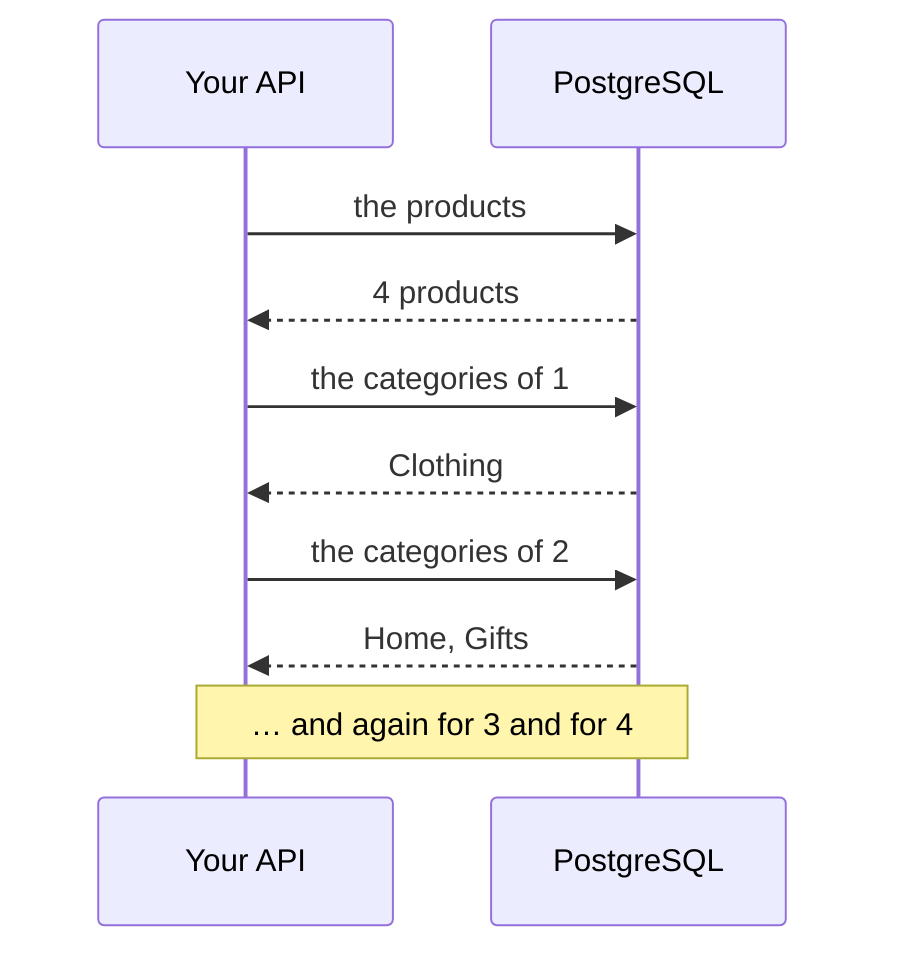

import Term from '~/components/Term.astro';
import TryIt from '~/components/TryIt.astro';
import Analogy from '~/components/Analogy.astro';
import SelfCheck from '~/components/SelfCheck.astro';
import ProjectCode from '~/components/ProjectCode.astro';
import Quiz from '~/components/Quiz.astro';
import QuizQuestion from '~/components/QuizQuestion.astro';
import QuizOption from '~/components/QuizOption.astro';

## The problem

Ana wants the product list to say which categories each product is in: the Mug, in Home and Gifts. The categories live in another table, joined to the products by `product_categories`, as you saw in [lesson 4, “Modeling”](/en/phase-5/data-modeling-normalization/#many-to-many-an-intermediate-table).

The first thing anyone thinks of: ask for the products and, for each one, its categories. It works. With four products that's five <Term id="query">queries</Term>; with a thousand, a thousand and one. The list takes longer and longer, and no query is slow.

And another problem, a smaller one: since [lesson 5](/en/phase-5/node-postgres/), your SQL lives in strings. If you write `price_cent`, without the final “s”, TypeScript doesn't see it. You find out when someone calls that route.

An ORM fixes the second problem, but it makes it easier to fall into the first one, and it hides it.

## The analogy

<Analogy>

You travel to Japan without speaking Japanese. At the restaurant, an interpreter talks to the waiter for you. Comfortable.

Now you ask what allergens each dish on the menu has. A careless interpreter goes to the kitchen for the first one, comes back, goes for the second… Twenty dishes, twenty trips. An attentive one asks for the whole list at once. You don't hear the difference: you only notice it takes a while.

<div slot="limits">

- An ORM always translates the same request the same way: if it does it badly, it always does it badly. And you can ask it to repeat out loud what it says: its log.
- If the interpreter doesn't know how to say something, you're left without saying it. With an ORM, you can speak to PostgreSQL in SQL when you need to.

</div>

</Analogy>

## How it really works

The code is the one in this lesson's folder, `23-orm`, with drizzle-orm 0.45.3. The outputs are from Node 26 and PostgreSQL 18.6.

### From text with SQL to functions shaped like SQL

Until now, each data function gave `pg` a string with SQL. There are three ways of talking to the database:

| Tool | What you write | Who writes the SQL |
|---|---|---|
| The <Term id="driver">driver</Term>, `pg` (lesson 5) | The SQL, in a string | You |
| A query builder | Functions shaped like SQL: `select`, `from`, `where` | It does, almost word for word |
| An ORM | Which data you want, and with which relations | It does, and it decides how |

A **<Term id="query-builder">query builder</Term>** writes the query with TypeScript functions. An **<Term id="orm">ORM</Term>** also translates between the tables and your program's <Term id="object">objects</Term>, and knows how the tables relate to each other. Drizzle, the one the course uses, does both.

### The tables, described in TypeScript

Drizzle needs to know what your tables are like. You tell it in a new file, `src/schema.ts`:

<ProjectCode file="shop-api/23-orm/src/schema.ts" region="products" />

Word by word:

- `pgTable('products', {…})` describes PostgreSQL's `products` table. What it returns, `products`, is what you'll use in the queries.
- `integer()` and `text()` are the types; `.notNull()`, `.primaryKey()` and `.default(0)`, the rules of the `CREATE TABLE` from [lesson 4](/en/phase-5/data-modeling-normalization/#constraints-rules-that-postgresql-always-checks). `.generatedAlwaysAsIdentity()`, the `GENERATED ALWAYS AS IDENTITY` that numbers the `id`.
- `priceCents: integer('price_cents')` gives two names: `price_cents` in PostgreSQL and `priceCents` in TypeScript. Drizzle translates, and the `AS "priceCents"` from lesson 5 disappears. If they have the same name, like `name`, one is enough.
- `check(…)` are the `CHECK` constraints, with their names. `` sql`…` `` is a piece of SQL written by hand: it will come back at the end.

**This file doesn't create anything.** The tables still come from your <Term id="migration">migrations</Term>; `schema.ts` describes to Drizzle what already exists. If they don't match, Drizzle writes queries for other tables.

Drizzle is set up on top of the <Term id="connection-pool">pool</Term> you already have, in `src/db.ts`:

<ProjectCode file="shop-api/23-orm/src/db.ts" region="drizzle" />

`drizzle({ client: pool, schema })` uses the connections of `pg`'s pool, and `schema` gives it the tables.

### What you gain: TypeScript knows every column

A query with Drizzle, in `src/data.ts`:

<ProjectCode file="shop-api/23-orm/src/data.ts" region="find-order" />

- It reads like the SQL: `select` from `orders` where the `id` is equal (`eq`) to the one that arrives.
- `eq(orders.id, id)` becomes `"orders"."id" = $1`: the value still travels separately, as a parameter.
- `row` already has its type. TypeScript knows that `row.createdAt` is a date, without you promising it with `<OrderRow>`, as in [lesson 5](/en/phase-5/node-postgres/).

Check it by breaking something. In `listProducts`, change `products.priceCents` to `products.price_cents` and check the types:

<TryIt
  title="A column that doesn't exist"
  cmd="npm run check"
  output={`> shop-api@1.0.0 check
> tsc --noEmit

src/data.ts(82,64): error TS2551: Property 'price_cents' does not exist on type 'PgTableWithColumns<{ name: "products"; schema: undefined; columns: { id: PgColumn<{ name: "id"; tableName: "products"; dataType: "number"; columnType: "PgInteger"; data: number; driverParam: string | number; notNull: true; ... 7 more ...; generated: undefined; }, {}, {}>; name: PgColumn<...>; priceCents: PgColumn<.....'. Did you mean 'priceCents'?`}
>

The error arrives **before anything runs**, with the line and the column (yours may be different). The long part in the middle is how Drizzle describes the table: read the beginning and the end, “`price_cents` does not exist… Did you mean `priceCents`?” With the SQL in a string, only PostgreSQL would have said it, when it received the query. Undo the change.

</TryIt>

### What you don't see: the SQL that really runs

Drizzle writes the SQL for you, and you don't see it unless you ask for it with a log. `examples/n-plus-one.ts` sets up its own Drizzle, with a log that writes each query and counts them:

<ProjectCode file="shop-api/23-orm/examples/n-plus-one.ts" region="log" />

`logQuery` is a function Drizzle calls with each query before sending it; `queries++` adds one. To see all the queries of your API, `logger: true` when creating `db` is enough: Drizzle writes them in the terminal, with their parameters.

### The N+1 problem, counted in the log

The same example asks for the products with their categories in two ways. The first, the most direct:

<ProjectCode file="shop-api/23-orm/examples/n-plus-one.ts" region="n-plus-one" />

- The first query brings all the products.
- `for (const product of list)` goes through the list and, for each one, makes another query for its categories. `innerJoin` is the `INNER JOIN` from [lesson 2](/en/phase-5/sql-joins/).
- The `await` inside the loop waits for each answer before asking for the next one.

The second asks Drizzle for the products **with** their categories. For that, `schema.ts` tells it how the tables are joined:

<ProjectCode file="shop-api/23-orm/src/schema.ts" region="relations" />

`relations` doesn't change anything in the database: it tells Drizzle that a product has many (`many`) rows in `product_categories`, and each row, one (`one`) category, joined by those columns.

With that, the query:

<ProjectCode file="shop-api/23-orm/examples/n-plus-one.ts" region="one-query" />

`db.query.products.findMany` is Drizzle's ORM way: instead of writing the `JOIN`, you say what you want. `with` asks, for each product, for its rows in `product_categories` and, for each of them, its `category`.

<TryIt
  title="The two ways, with the log on"
  cmd="node --env-file=.env examples/n-plus-one.ts"
  output={`== With N+1
  SQL: select "id", "name", "price_cents", "stock" from "products" order by "products"."id" asc
  SQL: select "categories"."name" from "product_categories" inner join "categories" on "categories"."id" = "product_categories"."category_id" where "product_categories"."product_id" = $1 order by "categories"."id" asc
  SQL: select "categories"."name" from "product_categories" inner join "categories" on "categories"."id" = "product_categories"."category_id" where "product_categories"."product_id" = $1 order by "categories"."id" asc
  SQL: select "categories"."name" from "product_categories" inner join "categories" on "categories"."id" = "product_categories"."category_id" where "product_categories"."product_id" = $1 order by "categories"."id" asc
  SQL: select "categories"."name" from "product_categories" inner join "categories" on "categories"."id" = "product_categories"."category_id" where "product_categories"."product_id" = $1 order by "categories"."id" asc
Result: [{"name":"T-shirt","categories":["Clothing"]},{"name":"Mug","categories":["Home","Gifts"]},{"name":"Hoodie","categories":["Clothing"]},{"name":"Cap","categories":["Clothing","Gifts"]}]
Database queries: 5

== With one query
  SQL: select "products"."id", "products"."name", "products"."price_cents", "products"."stock", "products_categories"."data" as "categories" from "products" "products" left join lateral (select coalesce(json_agg(json_build_array("products_categories"."product_id", "products_categories"."category_id", "products_categories_category"."data") order by "products_categories"."category_id" asc), '[]'::json) as "data" from (select * from "product_categories" "products_categories" where "products_categories"."product_id" = "products"."id" order by "products_categories"."category_id" asc) "products_categories" left join lateral (select json_build_array("products_categories_category"."id", "products_categories_category"."name") as "data" from (select * from "categories" "products_categories_category" where "products_categories_category"."id" = "products_categories"."category_id" limit $1) "products_categories_category") "products_categories_category" on true) "products_categories" on true order by "products"."id" asc
Result: [{"name":"T-shirt","categories":["Clothing"]},{"name":"Mug","categories":["Home","Gifts"]},{"name":"Hoodie","categories":["Clothing"]},{"name":"Cap","categories":["Clothing","Gifts"]}]
Database queries: 1`}
>

Count the `SQL:` lines. In the first way, one with the products and four identical ones, one per product, with its id in `$1`: five. In the second, one. **The same result, with five queries or with one.** If you get `ECONNREFUSED`, PostgreSQL isn't running.

</TryIt>

This is the **<Term id="n-plus-one">N+1 problem</Term>**: one query for the list and N more, one per item.



Each query is a round trip, with its <Term id="latency">latency</Term>. If each trip takes 1 ms, a thousand products are a second spent just waiting.

And you fall into it without meaning to. In the ORMs that load relations when you touch them, like those of Ruby on Rails or Django, you don't even see the loop: reading `product.categories` looks like reading a piece of data, and it makes a query. Drizzle and Prisma don't load anything you don't ask for.

### A single query: a JOIN, or with

You already know the query that brings everything at once: a <Term id="join">JOIN</Term>, the [three-table one from lesson 2](/en/phase-5/sql-joins/#three-tables-the-products-and-their-categories). In `psql -d shop`:

```
shop=> SELECT p.id, p.name, c.name AS category
FROM products AS p
LEFT JOIN product_categories AS pc ON pc.product_id = p.id
LEFT JOIN categories AS c ON c.id = pc.category_id
ORDER BY p.id, c.id;
 id |  name   | category
----+---------+----------
  1 | T-shirt | Clothing
  2 | Mug     | Home
  2 | Mug     | Gifts
  3 | Hoodie  | Clothing
  4 | Cap     | Clothing
  4 | Cap     | Gifts
(6 rows)
```

With `LEFT JOIN`, a product without categories comes out too. Six rows for four products: the Mug and the Cap come out twice, and your code would have to put them together.

The SQL Drizzle writes with `with` is the long one in the log. You don't have to write it, but you do have to recognize it:

- `left join lateral (…)`: for each product, a <Term id="subquery">subquery</Term> with its rows from `product_categories`. *Lateral* means it can use the outer row, `"products"."id"`.
- `json_agg(…)` puts those rows together in a <Term id="json">JSON</Term> array, in a single column.

Result: one row per product, with its categories inside, in a single trip.

### Drizzle vs Prisma

Prisma is the other ORM widely used with TypeScript. This is how `products` would be described with it, in a `schema.prisma` file, in its own language (don't install it: it's for comparison):

```prisma
model Product {
  id         Int    @id @default(autoincrement())
  name       String
  priceCents Int    @map("price_cents")
  stock      Int    @default(0)

  @@map("products")
}
```

And a query, the products at €20 or less: `prisma.product.findMany({ where: { priceCents: { lte: 2000 } } })`.

| | Drizzle | Prisma 7 |
|---|---|---|
| The schema | In TypeScript (`src/schema.ts`) | In its own language (`schema.prisma`) |
| The queries | Shaped like SQL: `select().from().where()` | With objects: `findMany({ where: … })` |
| The types | TypeScript takes them from the schema right away | `prisma generate` writes a client into a folder of your project |
| The migrations | drizzle-kit generates the SQL | Prisma Migrate generates it and applies it (`prisma migrate dev`) |
| The relations | `with` | `include` |

Since version 7, Prisma no longer starts its old engine written in Rust: it connects to PostgreSQL with an adapter, `@prisma/adapter-pg`, which uses `pg` underneath. With `include` it doesn't do an N+1 either: it asks for each relation in one go.

The course uses Drizzle because its queries look like the SQL you've just learned, and what it writes is predictable. Prisma is a good choice if your team prefers not to think in SQL. Drizzle 1.0 is at the *release candidate* stage and changes, among other things, how relations are declared (`defineRelations`).

### drizzle-kit writes the migration; your runner applies it

The new filter, `GET /v2/products?category=gifts`, searches `product_categories` by `category_id`. The <Term id="primary-key">primary key</Term> starts with `product_id`, and doesn't help: it's the [order of the columns](/en/phase-5/database-indexes-explain/#multicolumn-indexes-the-order-matters) from lesson 7. An <Term id="database-index">index</Term> is needed:

<ProjectCode file="shop-api/23-orm/src/schema.ts" region="product-categories" />

`index('product_categories_by_category').on(table.categoryId)` describes the index. But `schema.ts` doesn't create anything: the migration is missing. That's where **drizzle-kit** comes in, Drizzle's tool for the schema. Its configuration, `drizzle.config.ts`:

<ProjectCode file="shop-api/23-orm/drizzle.config.ts" />

`schema` is your tables file and `out`, the folder it writes to. Each time it generates, it saves a snapshot of the schema in `drizzle/meta/`; the next time, it compares `schema.ts` with that snapshot and writes **only what has changed**.

For the index, it wrote this, which becomes your migration 004:

<ProjectCode file="shop-api/23-orm/db/migrations/004-categories-index.sql" region="index" />

Why not apply it with `drizzle-kit migrate`, its own command? For two reasons:

- **Your database already has its history** in the `migrations` table, from 001 to 003. drizzle-kit records its own in another one, `__drizzle_migrations`, and two lists of the same history end up saying different things.
- **drizzle-kit sees your tables, not your data.** It doesn't know that the products that were already there needed a starting stock: you still decide the [steps from lesson 6](/en/phase-5/database-migrations/#adding-stock-to-a-table-that-already-has-rows).

So drizzle-kit writes the draft, you read it, and your runner applies it, like the others.

### When SQL is still the best tool

The stock `UPDATE` from [lesson 8](/en/phase-5/acid-transactions/#fix-1-check-and-take-in-the-same-command), with Drizzle:

<ProjectCode file="shop-api/23-orm/src/data.ts" region="take-stock" />

- `db.transaction(async (tx) => …)` is your `inTransaction` from lesson 8, a <Term id="transaction">transaction</Term>: everything that goes through `tx` goes through the same client from the pool, between `BEGIN` and `COMMIT` or `ROLLBACK`.
- `gte` is `>=`: the check `stock >= quantity`, in the same `WHERE`.
- Drizzle has no function for “the stock minus the quantity”: it goes in SQL, `` sql`${products.stock} - ${quantity}` ``.

**What goes in `${…}` inside `` sql`…` `` travels as a parameter**, not pasted into the text: it doesn't open the door to <Term id="sql-injection">SQL injection</Term>. And the important thing from lesson 8, checking and taking in the same command, stays in sight.

SQL also wins at what the ORM can't say, like the cursor comparison, `(created_at, id) < (…)`, in `src/pagination.ts`, and in the reports with `GROUP BY` and subqueries from [lesson 3](/en/phase-5/sql-group-by/). The ORM, for everyday things; SQL, where SQL is what matters.

## Try it

The goal: count the queries yourself, and have your API give the categories with a single one.

### Update your project

You start from your project from [lesson 8, “Transactions”](/en/phase-5/acid-transactions/), in `~/backend-course/phase-3/shop-api`. Install Drizzle and drizzle-kit:

<TryIt
  title="1. Install Drizzle"
  cmd={`npm install drizzle-orm@0.45.3
npm install --save-dev drizzle-kit@0.31.11`}
  output={`added 1 package, and audited 54 packages in 6s

6 packages are looking for funding
  run \`npm fund\` for details

found 0 vulnerabilities
npm warn deprecated @esbuild-kit/core-utils@3.3.2: Merged into tsx: https://tsx.hirok.io
npm warn deprecated @esbuild-kit/esm-loader@2.6.5: Merged into tsx: https://tsx.hirok.io

added 15 packages, and audited 69 packages in 9s

8 packages are looking for funding
  run \`npm fund\` for details

4 moderate severity vulnerabilities

To address all issues (including breaking changes), run:
  npm audit fix --force

Run \`npm audit\` for details.`}
>

`drizzle-kit` goes in `--save-dev`: the server doesn't use it. Your number of packages may vary. The `deprecated` warnings and the 4 `vulnerabilities` come from an old esbuild inside drizzle-kit, and they affect a development server that drizzle-kit doesn't start. **Don't run `npm audit fix --force`:** it would replace drizzle-kit with the old 0.18.1.

</TryIt>

Then, write the changes, or copy them from this lesson's folder (below):

1. Create `src/schema.ts`, still **without** the index line, and `drizzle.config.ts`. In `package.json`, add `"db:generate": "drizzle-kit generate"`.
2. In `src/db.ts`, create `db` and delete `inTransaction`, which is now `db.transaction()`.
3. Move `src/data.ts`, `src/pagination.ts` and `src/middleware/idempotency.ts` to Drizzle; whatever you haven't seen here, copy it from the step.
4. In `src/problems.ts`, PostgreSQL's error arrives inside Drizzle's, in `cause`. In `src/schemas.ts`, `categories` and the `category` filter.

The example and the tests come in the folder:

```sh
cd ~/backend-course/phase-3
curl -O https://backenddesdecero.com/practicas/shop-api/23-orm.tar.gz
tar -xzf 23-orm.tar.gz
cd shop-api
cp ../23-orm/examples/n-plus-one.ts examples/
cp ../23-orm/test/*.ts test/
```

### Count the queries

Run `node --env-file=.env examples/n-plus-one.ts`, as above, and count the `SQL:` lines of each way yourself. Then, add a fifth product in `psql -d shop`:

```sql
INSERT INTO products (name, price_cents) VALUES ('Pin', 200);
```

<SelfCheck question="Challenge: with five products, run the example again. How many queries does each way make?">

```
== With N+1
Database queries: 6
== With one query
Database queries: 1
```

The first grows with each product; the second doesn't. Delete it afterwards with `DELETE FROM products WHERE name = 'Pin';`.

</SelfCheck>

### The categories, in your API

Start your API with `npm run dev` and, in another terminal:

<TryIt
  title="2. The products, with their categories"
  cmd={`curl -s -w '\\n' localhost:3000/v2/products
curl -s -w '\\n' 'localhost:3000/v2/products?category=gifts'
curl -s -w '\\n' localhost:3000/v1/products/2`}
  output={`[{"id":1,"name":"T-shirt","priceCents":2000,"stock":40,"categories":["Clothing"]},{"id":2,"name":"Mug","priceCents":850,"stock":60,"categories":["Home","Gifts"]},{"id":3,"name":"Hoodie","priceCents":3500,"stock":25,"categories":["Clothing"]},{"id":4,"name":"Cap","priceCents":1500,"stock":15,"categories":["Clothing","Gifts"]}]
[{"id":2,"name":"Mug","priceCents":850,"stock":60,"categories":["Home","Gifts"]},{"id":4,"name":"Cap","priceCents":1500,"stock":15,"categories":["Clothing","Gifts"]}]
{"id":2,"name":"Mug","price":8.5}`}
>

`/v2` brings `categories`, a new field: it doesn't break anyone ([lesson 4 of Phase 4](/en/phase-4/api-versioning/)). `?category=gifts` leaves the Mug and the Cap, regardless of capital letters, and `/v1` doesn't change. Your stock may be different.

</TryIt>

### Generate the index migration

First, the starting snapshot: what you already have, without the index.

<TryIt
  title="3. The starting snapshot"
  cmd="npm run db:generate -- --name=base"
  output={`> shop-api@1.0.0 db:generate
> drizzle-kit generate --name=base

No config path provided, using default 'drizzle.config.ts'
Reading config file '/Users/ana/backend-course/phase-3/shop-api/drizzle.config.ts'
6 tables
categories 2 columns 0 indexes 0 fks
idempotency_keys 6 columns 0 indexes 0 fks
orders 5 columns 1 indexes 1 fks
processed_events 2 columns 0 indexes 0 fks
product_categories 2 columns 0 indexes 2 fks
products 4 columns 0 indexes 0 fks

[✓] Your SQL migration file ➜ drizzle/0000_base.sql 🚀`}
>

With no previous snapshot, drizzle-kit writes all the tables in `drizzle/0000_base.sql`. **That file is never applied:** your tables already exist, and it's only there for comparing. `fks` are the <Term id="foreign-key">foreign keys</Term>.

</TryIt>

Now add the index line to `schema.ts` and generate again:

<TryIt
  title="4. Only what has changed"
  cmd="npm run db:generate -- --name=categories-index"
  output={`> shop-api@1.0.0 db:generate
> drizzle-kit generate --name=categories-index

No config path provided, using default 'drizzle.config.ts'
Reading config file '/Users/ana/backend-course/phase-3/shop-api/drizzle.config.ts'
6 tables
categories 2 columns 0 indexes 0 fks
idempotency_keys 6 columns 0 indexes 0 fks
orders 5 columns 1 indexes 1 fks
processed_events 2 columns 0 indexes 0 fks
product_categories 2 columns 1 indexes 2 fks
products 4 columns 0 indexes 0 fks

[✓] Your SQL migration file ➜ drizzle/0001_categories-index.sql 🚀`}
>

Now `product_categories` has `1 indexes`, and `drizzle/0001_categories-index.sql` is the `CREATE INDEX` from above. If you get `No schema changes`, you didn't save `schema.ts`.

</TryIt>

<TryIt
  title="5. Your runner applies it"
  cmd={`cp drizzle/0001_categories-index.sql db/migrations/004-categories-index.sql
npm run db:migrate`}
  output={`> shop-api@1.0.0 db:migrate
> node --env-file-if-exists=.env scripts/migrate.ts

Applied: 004-categories-index.sql`}
>

Only 004 was missing. With `psql -d shop -c '\d product_categories'`, you'll see the index under `Indexes`.

</TryIt>

### The tests

<TryIt
  title="6. This lesson's tests"
  cmd="npm test -- test/orm.test.ts"
  output={`> shop-api@1.0.0 test
> node --env-file=test/.env --test --test-concurrency=1 test/orm.test.ts

✔ v2 shows the categories of each product, in the list and one by one (131.388255ms)
✔ a new product starts without categories and without stock (8.87415ms)
✔ ?category= filters, whatever the capital letters, and combines with the other filters (18.56151ms)
✔ an odd value in ?category= is only a value: it does not change the query (4.162421ms)
✔ v1 does not change: no categories and no category filter (18.336991ms)
✔ the contract documents the categories and the filter (15.134668ms)
✔ examples/n-plus-one.ts: N+1 queries versus a single one, with the same result (755.396624ms)
✔ migration 004, which drizzle-kit generated, creates the index by category (4.463315ms)
✔ drizzle-kit sees no pending changes: src/schema.ts and its migrations are up to date (1084.9514ms)
ℹ tests 9
ℹ suites 0
ℹ pass 9
ℹ fail 0
ℹ cancelled 0
ℹ skipped 0
ℹ todo 0
ℹ duration_ms 3092.403209`}
>

The last test runs `drizzle-kit generate` and expects `No schema changes`: if you change `schema.ts` without generating the migration, it fails. Your times will be different.

</TryIt>

## You have already seen it

- **A website that takes longer the longer the list is**, even though each item is small: very often it's an N+1.
- **In the Network tab of [DevTools](/en/phase-2/#before-you-start-devtools)**, a page that makes a request to the API for each product in the list: the same problem, between the browser and the server.

## Common mistakes

- **An `await` with a query inside a `for`.** That's the N+1. Ask for the relation with `with`, or with a `JOIN`.
- **Changing `schema.ts` without a migration.** Drizzle asks for a column your database doesn't have, and PostgreSQL answers `column … does not exist` in the middle of a request.
- **Applying what drizzle-kit generates without reading it.** When you rename a column, it asks whether it's a rename or a new column; if you answer wrong, it deletes the old one with its data.
- **Believing everything in the ORM is safe from injection.** `` sql`…` `` uses parameters, but `sql.raw()` pastes the text as is: never with something the client sends.

## Summary

- A query builder writes the SQL with functions; an ORM also knows the relations. Drizzle does both.
- You gain: TypeScript knows every column. You lose: the SQL that runs is out of sight. Turn on the log.
- The N+1 problem is one query for each item in a list. It's fixed with a `JOIN` or by asking for the relation in one go (`with` in Drizzle, `include` in Prisma).
- drizzle-kit generates the migration by comparing `schema.ts` with its last snapshot; you read it, and your runner applies it.
- What the ORM can't say goes in `` sql`…` ``, and its values are still parameters.

## Did you get it?

<Quiz>

<QuizQuestion
  question="A shop’s product page was quick with 50 products, and now, with 2,000, it takes 3 seconds. In the log, each query takes about 1 ms. What’s the most likely cause?"
  review="The N+1 problem, counted in the log"
>

<QuizOption text="An index is missing: each query goes through the whole table.">

Without an index, each query would be slow, and they take 1 ms. The problem isn't how long each one takes, but how many there are.

</QuizOption>

<QuizOption text="An N+1: about 2,000 queries, one per product." correct>

Two thousand trips of 1 ms, one after another, add up to about 2 seconds of waiting. With `with` or a `JOIN`, it would be one query.

</QuizOption>

<QuizOption text="The pool runs out of connections: ten aren’t enough for 2,000 products.">

The loop makes the queries one after another, with `await`: it uses one connection at a time. The pool doesn't run out.

</QuizOption>

</QuizQuestion>

<QuizQuestion
  question="With Drizzle, you write products.price_cents instead of products.priceCents. When do you find out?"
  review="What you gain: TypeScript knows every column"
>

<QuizOption text="When checking the types, before anything runs." correct>

`products` has the properties that `schema.ts` says, and `price_cents` isn't one of them: `npm run check` (and your editor) flags it.

</QuizOption>

<QuizOption text="When PostgreSQL receives the query and answers column does not exist.">

That happened with the SQL in a string, in lesson 5. With Drizzle, `npm run check` and your editor warn you earlier, while you type.

</QuizOption>

<QuizOption text="Never: Drizzle turns price_cents into priceCents on its own.">

Drizzle translates between the two names you put in `schema.ts`, but it doesn't guess properties that don't exist.

</QuizOption>

</QuizQuestion>

<QuizQuestion
  question="You add discount: integer() to products in schema.ts and start the API, without doing anything else. What happens when you ask for the product list?"
  review="The tables, described in TypeScript"
>

<QuizOption text="Drizzle adds the column to the table when it starts.">

`schema.ts` doesn't create anything: it describes what already exists. Changes to tables come with a migration.

</QuizOption>

<QuizOption text="Nothing: Drizzle skips the columns the table doesn’t have.">

Drizzle doesn't look at the real table: it asks for the columns in `schema.ts`, `discount` included.

</QuizOption>

<QuizOption text="PostgreSQL says the column doesn’t exist." correct>

The migration is missing: Drizzle asks for `discount`, and the table doesn't have it. `npm run db:generate` would write the `ALTER TABLE`, and your runner would apply it.

</QuizOption>

</QuizQuestion>

<QuizQuestion
  question="In the stock UPDATE, the quantity the client sends goes inside sql`${products.stock} - ${quantity}`. Can someone slip SQL in through there?"
  review="When SQL is still the best tool"
>

<QuizOption text="Yes: sql`…` is SQL written by hand, and it pastes the values into the text.">

That's what `sql.raw()` does. Inside `` sql`…` ``, each `${…}` travels separately, like `$1`.

</QuizOption>

<QuizOption text="No: the value travels as a parameter, separately from the SQL." correct>

`` sql`…` `` turns each value into a parameter, like `pool.query` with `$1`. PostgreSQL never reads it as SQL.

</QuizOption>

<QuizOption text="No, but only because Zod checks first that it’s a number; without that check, yes.">

Zod helps, but it isn't what protects you here: even if a string arrived, it would go as a parameter, never as SQL.

</QuizOption>

</QuizQuestion>

<QuizQuestion
  question="Your team uses Prisma. You add a field to schema.prisma, and your editor doesn’t find it in the client. What’s missing?"
  review="Drizzle vs Prisma"
>

<QuizOption text="Nothing: Prisma reads schema.prisma each time it’s used, and the editor takes a while to notice.">

Prisma's client is code generated from `schema.prisma`. Until you generate it again, it's still the old one.

</QuizOption>

<QuizOption text="Restarting PostgreSQL, which is what stores the client’s types.">

PostgreSQL knows nothing about TypeScript. The types are in the code Prisma writes in your project.

</QuizOption>

<QuizOption text="Running prisma generate, which writes the client again." correct>

That's the difference from Drizzle: there, TypeScript takes the types from `schema.ts` right away; in Prisma, from a generated client.

</QuizOption>

</QuizQuestion>

<QuizQuestion
  question="drizzle-kit has just generated the index migration. Why does the shop apply it with its runner and not with drizzle-kit migrate?"
  review="drizzle-kit writes the migration; your runner applies it"
>

<QuizOption text="Because your runner already keeps the history, and drizzle-kit would keep another one." correct>

Migrations 001 to 003 are recorded in the `migrations` table. With two records of the same history, each would believe something different.

</QuizOption>

<QuizOption text="Because drizzle-kit only knows how to generate migrations, not apply them.">

drizzle-kit has its `migrate` command. The shop doesn't use it because it already has its own record.

</QuizOption>

<QuizOption text="Because the SQL drizzle-kit generates only works on an empty database.">

The `CREATE INDEX` it generated works on any database with that table, empty or not, like yours.

</QuizOption>

</QuizQuestion>

</Quiz>

## Further reading

- [Drizzle ORM](https://orm.drizzle.team/docs/overview) (official documentation): the schema, the queries and transactions.
- [Drizzle relations, from 0.45 to 1.0](https://orm.drizzle.team/docs/relations-v1-v2): `relations`, the one in this lesson, next to `defineRelations`, with `findMany` and `with`.
- [drizzle-kit generate](https://orm.drizzle.team/docs/drizzle-kit-generate): how it compares the schema with its snapshots.
- [Upgrade to Prisma 7](https://www.prisma.io/docs/guides/upgrade-prisma-orm/v7) (Prisma documentation): the client without Rust, the adapters and `prisma generate`.
- [LATERAL subqueries](https://www.postgresql.org/docs/18/queries-table-expressions.html#QUERIES-LATERAL) (PostgreSQL documentation): what Drizzle uses to bring the relations.
- [Eager loading associations](https://guides.rubyonrails.org/active_record_querying.html#eager-loading-associations) (Ruby on Rails guide): the N+1 in another ORM, and how it avoids it.
