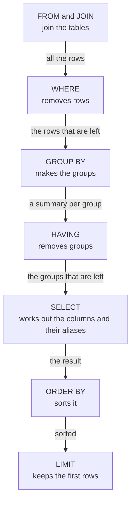

import Term from '~/components/Term.astro';
import TryIt from '~/components/TryIt.astro';
import Analogy from '~/components/Analogy.astro';
import SelfCheck from '~/components/SelfCheck.astro';
import Quiz from '~/components/Quiz.astro';
import QuizQuestion from '~/components/QuizQuestion.astro';
import QuizOption from '~/components/QuizOption.astro';
import SqlPlayground from '~/playgrounds/sql-playground/SqlPlayground';

## The problem

It's Sunday and Ana wants the week's report: how much each product has brought in, which was the best day and which orders were bigger than usual. With what you know from lessons [1](/en/phase-5/what-is-sql/) and [2](/en/phase-5/sql-joins/), a `SELECT` gives her the 25 orders with their product, and she adds them up with a calculator.

With 25 orders, that's doable. With 40,000, it isn't. And doing the math on the shop's <Term id="server">server</Term> doesn't fix anything either: it would ask the <Term id="database">database</Term> for the 40,000 rows, which would travel over the network, just to keep three numbers.

What Ana needs is for **the database to summarize**: to do the math where the data is and return only the result, three rows instead of 40,000.

## The analogy

<Analogy>

Think of the week's box of receipts. To find out how much you've sold of each product, you first set aside the voided receipts. Then you sort the rest into piles, one per product, and add up each pile. At the end, maybe you throw out the small piles.

That's the whole lesson: setting receipts aside is `WHERE`, making piles is `GROUP BY`, adding up each pile is `SUM` and throwing out piles is `HAVING`. And the order matters: you can't throw out a pile for its total before you add it up.

<div slot="limits">

- You can look inside a pile. The database returns a single row per pile, so you can only ask for what's the same across the whole pile, or a summary of it.
- The database doesn't really make piles: it can sort the rows or keep a running count per group, whichever is faster. The result is the same.

</div>

</Analogy>

## How it really works

You can try each query in the playground in [Try it](#try-it) or in `psql`. The outputs are from PostgreSQL 18.6, with the data from `shop.sql` freshly loaded.

### An aggregate function sums up many rows into one

```sql
SELECT COUNT(*), SUM(quantity), MIN(quantity), MAX(quantity), AVG(quantity)
FROM orders;
```

```
 count | sum | min | max |        avg
-------+-----+-----+-----+--------------------
    25 |  62 |   1 |   4 | 2.4800000000000000
(1 row)
```

A single row, even though `orders` has 25. Each of those five is an <Term id="aggregate">aggregate function</Term>: it takes all the rows and returns one value.

- `COUNT(*)` counts rows: 25 orders.
- `SUM(quantity)` adds up the column: 62 units sold.
- `MIN` and `MAX` give the smallest and the largest value: nobody has ordered fewer than 1 or more than 4. They work with dates too: `MAX(created_at)` is the most recent order.
- `AVG(quantity)` gives the average: 2.48 units per order.

Look at the average: `2.4800000000000000`. `AVG` returns a `numeric`, PostgreSQL's type for exact decimals, and writes it with 16 decimal places. To show it, round it with `round`:

```sql
SELECT round(AVG(quantity), 2) AS average
FROM orders;
```

```
 average
---------
    2.48
(1 row)
```

`round(value, 2)` leaves two decimal places; without the `2`, it rounds to a whole number. `AS average` gives the column a name.

### GROUP BY makes a summary for each group

How many orders are there in each status?

```sql
SELECT status, COUNT(*)
FROM orders
GROUP BY status
ORDER BY status;
```

```
 status  | count
---------+-------
 paid    |     8
 pending |     5
 shipped |    12
(3 rows)
```

`GROUP BY status` splits the rows into groups, one for each different value of `status`, and `COUNT(*)` counts each group separately. One row comes out per group, and 8 + 5 + 12 are the 25 orders.

With a <Term id="join">JOIN</Term> from [lesson 2](/en/phase-5/sql-joins/) you can summarize data from two tables. How much each product has brought in, in units and in money:

```sql
SELECT p.name, SUM(o.quantity) AS units,
       SUM(o.quantity * p.price_cents) AS revenue_cents
FROM orders AS o
JOIN products AS p ON p.id = o.product_id
GROUP BY p.id, p.name
ORDER BY revenue_cents DESC;
```

```
  name   | units | revenue_cents
---------+-------+---------------
 Hoodie  |    20 |         70000
 T-shirt |    20 |         40000
 Mug     |    22 |         18700
(3 rows)
```

Word by word:

- `FROM orders AS o JOIN products AS p ON …` joins each order with its product: 25 rows, each with its quantity and its price.
- `o.quantity * p.price_cents` multiplies in each row: what that order brought in. `SUM(…)` adds up those amounts inside each group. Money goes in whole cents, as in [Phase 4](/en/phase-4/json-vs-protobuf/#money-in-whole-cents): 70000 is €700.
- `GROUP BY p.id, p.name` makes one group per product. It groups by the `id`, which is unique (two products could have the same name), and also by the name, so it can show it.
- `ORDER BY revenue_cents DESC` puts the one that brings in the most first.

The Mug sells the most units and brings in the least money. The Cap doesn't show up: it has no orders, and the `JOIN` doesn't pair it with anything.

### What you select has to be grouped or summarized

Ask for the status next to each product, but group only by product:

```sql
SELECT product_id, status, SUM(quantity)
FROM orders
GROUP BY product_id;
```

```
ERROR:  column "orders.status" must appear in the GROUP BY clause or be used in an aggregate function
LINE 1: SELECT product_id, status, SUM(quantity)
                           ^
```

The `^` points at where the problem is. Product 1's group has shipped, paid and pending orders: which one would it write in its single row? PostgreSQL doesn't pick one at random: it refuses.

**Every column in the `SELECT` has to be in the `GROUP BY` or inside an aggregate.** Here, either you add `status` to the `GROUP BY` (one group for each pair of product and status) or you take it out of the `SELECT`.

There's one exception: if you group by a table's <Term id="primary-key">primary key</Term>, PostgreSQL lets you use its other columns, because each `id` has a single name. In this lesson, the name goes in the `GROUP BY` anyway, so you can see it.

### COUNT(*) counts rows; COUNT(column), values

To get the Cap to show up, you need the [`LEFT JOIN` from lesson 2](/en/phase-5/sql-joins/#left-join-also-keeps-the-rows-without-a-match). And there, `COUNT` has a trap:

```sql
SELECT p.name, COUNT(*) AS rows, COUNT(o.id) AS orders
FROM products AS p
LEFT JOIN orders AS o ON o.product_id = p.id
GROUP BY p.id, p.name
ORDER BY p.id;
```

```
  name   | rows | orders
---------+------+--------
 T-shirt |    8 |      8
 Mug     |    9 |      9
 Hoodie  |    8 |      8
 Cap     |    1 |      0
(4 rows)
```

The Cap has 1 row and 0 orders. The `LEFT JOIN` gives it a row with the `orders` columns empty, in `NULL`, and `COUNT(*)` counts rows. **`COUNT(column)` only counts the values that aren't `NULL`**, and in that row `o.id` is.

The other aggregates skip `NULL`s too: the average of 3, 5 and a `NULL` is 4, not 2.67.

### WHERE filters rows; HAVING, groups

Which products have sold more than 16 units, not counting the pending orders?

```sql
SELECT p.name, SUM(o.quantity) AS units
FROM orders AS o
JOIN products AS p ON p.id = o.product_id
WHERE o.status <> 'pending'
GROUP BY p.id, p.name
HAVING SUM(o.quantity) > 16
ORDER BY p.name;
```

```
  name   | units
---------+-------
 Mug     |    17
 T-shirt |    17
(2 rows)
```

Two filters, at two moments:

- `WHERE o.status <> 'pending'` removes rows **before** grouping: the pending orders don't reach any group.
- `HAVING SUM(o.quantity) > 16` removes groups **after**: the Hoodie, with 16, is left out.

`HAVING` exists because `WHERE` can't use a summary:

```sql
SELECT product_id, SUM(quantity)
FROM orders
WHERE SUM(quantity) > 16
GROUP BY product_id;
```

```
ERROR:  aggregate functions are not allowed in WHERE
LINE 3: WHERE SUM(quantity) > 16
              ^
```

When `WHERE` runs, there are no groups to add up yet.

### A query doesn't run in the order it's written

You write `SELECT` first, but PostgreSQL works it out almost at the end. This is the order of each part:



Inside, PostgreSQL may work in a different way (you'll see it in [lesson 7, “Indexes”](/en/phase-5/database-indexes-explain/#explain-the-plan-before-running)), but the result is always that of this order. With it, the earlier errors make sense: `WHERE` comes before `GROUP BY` and can't add up groups; `HAVING` comes after, and can. And one more, very common: using a `SELECT` alias in `WHERE`.

```sql
SELECT name, price_cents / 100.0 AS euros
FROM products
WHERE euros > 10;
```

```
ERROR:  column "euros" does not exist
LINE 3: WHERE euros > 10;
              ^
```

`euros` is born in the `SELECT`, which comes after the `WHERE`: when `WHERE` looks for it, it doesn't exist. Compare with the table's column instead, `WHERE price_cents > 1000`. `ORDER BY` comes after the `SELECT` and can use the alias: that's why `ORDER BY revenue_cents` worked.

By the way, `/ 100.0` divides with decimals. Between two whole numbers, `850 / 100` gives `8`: PostgreSQL drops the decimals.

### The best day, counted in UTC

For the best day, group by the day of `created_at`:

```sql
SELECT (o.created_at AT TIME ZONE 'UTC')::date AS day,
       SUM(o.quantity * p.price_cents) AS revenue_cents
FROM orders AS o
JOIN products AS p ON p.id = o.product_id
GROUP BY (o.created_at AT TIME ZONE 'UTC')::date
ORDER BY revenue_cents DESC
LIMIT 3;
```

```
    day     | revenue_cents
------------+---------------
 2026-10-07 |         20550
 2026-10-04 |         20250
 2026-10-01 |         20200
(3 rows)
```

- `o.created_at AT TIME ZONE 'UTC'` gives the date and time a clock in UTC showed at that instant.
- `::date` changes the type of that value to `date`, a day with no time: `2026-10-07`. `::` is PostgreSQL's way of converting a value to another type.
- The `GROUP BY` repeats the whole expression. PostgreSQL also accepts `GROUP BY day`, even though the alias is born later: it's a convenience of its own, not standard SQL, and other databases, like SQL Server, reject it.

Why UTC? `created_at` is a `timestamptz`: it stores an instant, not a day. Which day it was depends on the clock you look at. The order placed at 1:00 UTC on October 6 was placed at 9:00 p.m. on the 5th in New York. With `'America/New_York'`, the same query gives:

```
    day     | revenue_cents
------------+---------------
 2026-10-05 |         26350
 2026-10-07 |         22550
 2026-10-01 |         20200
(3 rows)
```

The best day is now the 5th, and the 7th drops to second place, with a different figure.

Without `AT TIME ZONE`, `::date` uses the connection's time zone. Your `shop` role's is UTC because you set it in the [introduction](/en/phase-5/#the-shop-role), but a freshly installed PostgreSQL on a Mac uses the computer's. **Always say which time zone you count the days in.** The shop counts in UTC, just as it has sent its dates since [Phase 4](/en/phase-4/json-vs-protobuf/#dates-iso-8601-text-in-utc).

### A subquery in WHERE compares each row with a summary

Which orders have more units than the average? The direct way fails:

```sql
SELECT id, product_id, quantity
FROM orders
WHERE quantity > AVG(quantity);
```

```
ERROR:  aggregate functions are not allowed in WHERE
LINE 3: WHERE quantity > AVG(quantity);
                         ^
```

It's the error from before. But you can work out the average in another query and use its result:

```sql
SELECT id, product_id, quantity
FROM orders
WHERE quantity > (SELECT AVG(quantity) FROM orders)
ORDER BY id;
```

```
 id | product_id | quantity
----+------------+----------
  2 |          3 |        3
  3 |          1 |        4
  6 |          1 |        3
  7 |          2 |        4
 10 |          2 |        3
 11 |          3 |        4
 14 |          3 |        3
 15 |          1 |        4
 18 |          1 |        3
 19 |          2 |        4
 22 |          2 |        3
 23 |          3 |        4
(12 rows)
```

`(SELECT AVG(quantity) FROM orders)` is a <Term id="subquery">subquery</Term>: a query in parentheses inside another one. PostgreSQL solves it, gets 2.48, and the outer one compares each order with that number. The ones with 3 and 4 units come out.

Here the subquery returns a single value, because `>` compares with one. If it returns a list, you use `IN` (“is in”): “the orders of any product in category 1, Clothing.”

```sql
SELECT COUNT(*)
FROM orders
WHERE product_id IN (SELECT product_id FROM product_categories WHERE category_id = 1);
```

```
 count
-------
    16
(1 row)
```

The subquery gives the Clothing products: 1, 3 and 4. `IN` keeps the orders whose `product_id` is in that list: 8 for the T-shirt, 8 for the Hoodie and none for the Cap.

### A subquery in FROM is an intermediate table

How many units does each product sell on average? You have to add up per product and then take the average of those sums. An aggregate inside another doesn't work:

```sql
SELECT AVG(SUM(quantity))
FROM orders
GROUP BY product_id;
```

```
ERROR:  aggregate function calls cannot be nested
LINE 1: SELECT AVG(SUM(quantity))
                   ^
```

The solution: the query that adds up per product goes in the `FROM`, and the outer one reads it as if it were a table:

```sql
SELECT round(AVG(units), 1) AS average
FROM (
  SELECT product_id, SUM(quantity) AS units
  FROM orders
  GROUP BY product_id
) AS per_product;
```

```
 average
---------
    20.7
(1 row)
```

- The subquery gives one row per product, with its units: 20, 22 and 20.
- `AS per_product` gives that intermediate table a name.
- `round(AVG(units), 1)` takes the average of the three sums, with one decimal place. Without `round`, `20.6666666666666667`.

The Cap doesn't count: with no orders, it has no row in the subquery, and the average is of three products, not four.

## Try it

The goal: put together Ana's report yourself. How much each product brings in, which was the best day and which orders are bigger than usual. Each query goes in the playground, the PostgreSQL in your browser, and in `psql`: open `psql -d shop`, [as in the introduction](/en/phase-5/#connect-with-psql), and type them after the `shop=>` prompt. If you changed data in lesson 1, [load `shop.sql` again](/en/phase-5/#before-you-start-the-shops-data); in the playground, press “Reset data”.

### Sales per product

<SqlPlayground client:visible lang="en" rows={6} query={`SELECT p.name, SUM(o.quantity) AS units,
       SUM(o.quantity * p.price_cents) AS revenue_cents
FROM orders AS o
JOIN products AS p ON p.id = o.product_id
GROUP BY p.id, p.name
ORDER BY revenue_cents DESC;`} />

Press “Run” and check that the Hoodie comes out first, with 70000. Then change it:

- Add `WHERE o.status = 'shipped'` right before the `GROUP BY`: only what has already left the warehouse.
- Change the first `SUM` to `AVG`: the average units per order, with its 16 decimal places. Fix them with `round`.
- Add `o.status` to the `SELECT` without touching the `GROUP BY`, and read the error.

<TryIt
  title="1. Sales per product, in psql"
  lang="sql"
  cmd={`SELECT p.name, SUM(o.quantity) AS units,
       SUM(o.quantity * p.price_cents) AS revenue_cents
FROM orders AS o
JOIN products AS p ON p.id = o.product_id
GROUP BY p.id, p.name
ORDER BY revenue_cents DESC;`}
  output={`  name   | units | revenue_cents
---------+-------+---------------
 Hoodie  |    20 |         70000
 T-shirt |    20 |         40000
 Mug     |    22 |         18700
(3 rows)`}
>

`psql` doesn't run anything until the `;` arrives, so you can type it over several lines. If you get `relation "orders" does not exist`, you haven't loaded the shop's data: go back to the [introduction](/en/phase-5/#before-you-start-the-shops-data). The outputs are from PostgreSQL 18.6; if yours answers in another language, you'll see the same numbers with the messages translated.

</TryIt>

### The best day

<TryIt
  title="2. The day the most money came in"
  lang="sql"
  cmd={`SELECT (o.created_at AT TIME ZONE 'UTC')::date AS day,
       SUM(o.quantity * p.price_cents) AS revenue_cents
FROM orders AS o
JOIN products AS p ON p.id = o.product_id
GROUP BY (o.created_at AT TIME ZONE 'UTC')::date
ORDER BY revenue_cents DESC
LIMIT 1;`}
  output={`    day     | revenue_cents
------------+---------------
 2026-10-07 |         20550
(1 row)`}
>

October 7, with €205.50. Change `'UTC'` to `'America/New_York'` on both lines: the best day becomes October 5, with `26350`. If you change it on only one, you get `column "o.created_at" must appear in the GROUP BY clause`: the `SELECT` and the `GROUP BY` have to carry the same expression.

</TryIt>

### Orders above the average

<SqlPlayground client:visible lang="en" rows={4} query={`SELECT id, product_id, quantity
FROM orders
WHERE quantity > (SELECT AVG(quantity) FROM orders)
ORDER BY id;`} />

You get 12. Now change `AVG` to `MAX`: no order is bigger than the biggest one, and you get `(0 rows)`. Change `>` to `=` as well and you'll have the shop's biggest orders.

<TryIt
  title="3. Orders above the average, in psql"
  lang="sql"
  cmd={`SELECT id, product_id, quantity
FROM orders
WHERE quantity > (SELECT AVG(quantity) FROM orders)
ORDER BY id;`}
  output={` id | product_id | quantity
----+------------+----------
  2 |          3 |        3
  3 |          1 |        4
  6 |          1 |        3
  7 |          2 |        4
 10 |          2 |        3
 11 |          3 |        4
 14 |          3 |        3
 15 |          1 |        4
 18 |          1 |        3
 19 |          2 |        4
 22 |          2 |        3
 23 |          3 |        4
(12 rows)`}
>

They all have 3 or 4 units: the average is 2.48. If you've changed orders, the average and the list will be different.

</TryIt>

<SelfCheck question="Challenge: on which day were the most mugs sold, in units? The Mug is product 2. Count the days in UTC.">

First `WHERE` keeps only the mugs; then, one group per day:

```sql
SELECT (created_at AT TIME ZONE 'UTC')::date AS day, SUM(quantity) AS mugs
FROM orders
WHERE product_id = 2
GROUP BY (created_at AT TIME ZONE 'UTC')::date
ORDER BY mugs DESC
LIMIT 1;
```

```
    day     | mugs
------------+------
 2026-10-04 |    5
(1 row)
```

October 4, with 5 mugs. It's not a `HAVING`: the filter is by product, a column of each row, so it goes in `WHERE`.

</SelfCheck>

## You have already seen it

- **Pivot tables in Excel or Google Sheets**: you choose which column to group by and what to summarize (sum, count, average). It's a `GROUP BY` with the mouse.
- **The spending summary in your banking app**: how much on groceries and how much on transportation this month. A `WHERE` on dates, a `GROUP BY` on category and a `SUM`.
- **“Page 3 of 1,200”**, from [Phase 4](/en/phase-4/api-pagination/#the-total-has-a-cost): that total is a `COUNT(*)`, and that's why it has a cost: to count, the database goes through every row that matches the filter.

## Common mistakes

- **Putting a column in the `SELECT` that's neither in the `GROUP BY` nor inside an aggregate.** Group it or summarize it.
- **Filtering a summary with `WHERE`.** Rows are filtered with `WHERE`; groups, with `HAVING`.
- **Counting with `COUNT(*)` after a `LEFT JOIN`.** What has nothing comes out with 1: count a column of the table on the right, like `COUNT(o.id)`.
- **Using a `SELECT` alias in `WHERE`.** It doesn't exist yet: repeat the operation or compare with the column.
- **Grouping by day without saying the time zone.** The same report gives different numbers on your computer and on the server.
- **Dividing two whole numbers**: `850 / 100` gives `8`. Use `100.0`.
- **Working out past sales with today's price**, as this lesson does. If the Hoodie's price goes up tomorrow, last week's sales change. A real shop stores in each order the price it was sold at ([lesson 4](/en/phase-5/data-modeling-normalization/#denormalizing-copying-on-purpose)).

## Summary

- An aggregate function (`COUNT`, `SUM`, `AVG`, `MIN`, `MAX`) sums up many rows into one value. `COUNT(*)` counts rows; `COUNT(column)` and the others skip `NULL`s.
- `GROUP BY` makes a summary per group. Every column in the `SELECT` has to be grouped or summarized.
- `WHERE` removes rows before grouping and `HAVING` removes groups after.
- The real order is `FROM`, `WHERE`, `GROUP BY`, `HAVING`, `SELECT`, `ORDER BY` and `LIMIT`: that's why `WHERE` sees neither the aggregates nor the aliases.
- A subquery is a query inside another one: in `WHERE`, to compare with a summary; in `FROM`, to summarize a summary.

## Did you get it?

<Quiz>

<QuizQuestion
  question="You write SELECT status, product_id, COUNT(*) FROM orders GROUP BY status; What happens?"
  review="What you select has to be grouped or summarized"
>

<QuizOption text="One row comes out per status, with the product_id of any one of its orders.">

PostgreSQL doesn't pick at random: in each status there are orders for several products, and it wouldn't know which one to put. Other databases, like SQLite or MySQL with certain settings, do, and give results nobody asked for.

</QuizOption>

<QuizOption text="An error: product_id has to be in the GROUP BY or inside an aggregate." correct>

There's one group per status and one row per group. For `product_id` there are several values in each group: group by it too, or take it out.

</QuizOption>

<QuizOption text="One row comes out per order: GROUP BY only groups if every column in the SELECT is an aggregate.">

`GROUP BY` always makes one row per group. The rule is just the opposite: the columns that aren't aggregates have to be in the `GROUP BY`.

</QuizOption>

</QuizQuestion>

<QuizQuestion
  question="You want the products with more than 10 orders. Where does COUNT(*) > 10 go?"
  review="WHERE filters rows; HAVING, groups"
>

<QuizOption text="In WHERE: it’s the place for all of a query’s filters.">

`WHERE` filters rows before grouping, when there's nothing to count yet. With an aggregate, PostgreSQL answers `aggregate functions are not allowed in WHERE`.

</QuizOption>

<QuizOption text="In WHERE or in HAVING, it doesn’t matter: they’re two names for the same filter.">

They filter at different moments: `WHERE`, each row before the groups; `HAVING`, each group after summarizing it.

</QuizOption>

<QuizOption text="In HAVING, after the GROUP BY." correct>

Counting orders per product requires having made the groups. `HAVING` is applied right after, and that's why it can use `COUNT(*)`.

</QuizOption>

</QuizQuestion>

<QuizQuestion
  question="You list the products with their number of orders, with LEFT JOIN and COUNT(*). The Cap, which has none, comes out with 1. Why?"
  review="COUNT(*) counts rows; COUNT(column), values"
>

<QuizOption text="The LEFT JOIN gives it a row with NULL, and COUNT(*) counts rows, not orders." correct>

With `COUNT(o.id)` you get 0: counting a column skips the `NULL`s.

</QuizOption>

<QuizOption text="COUNT(*) skips NULLs and COUNT(column) doesn’t, so you have to use COUNT(*).">

It's the other way around: `COUNT(*)` counts every row, including the one with `NULL`, and `COUNT(column)` skips them.

</QuizOption>

<QuizOption text="It’s a PostgreSQL bug: COUNT can never return 0.">

`COUNT` returns 0 when there's nothing to count: `COUNT(o.id)` gives 0 for the Cap.

</QuizOption>

</QuizQuestion>

<QuizQuestion
  question='You write SELECT name, price_cents * 1.21 AS with_tax FROM products WHERE with_tax > 2000; and get column "with_tax" does not exist. Why?'
  review="A query doesn't run in the order it's written"
>

<QuizOption text="Because an alias only changes the column’s title in the output, and can’t be used anywhere else.">

`ORDER BY with_tax` would work: it comes after the `SELECT`, when the alias already exists.

</QuizOption>

<QuizOption text="Because WHERE runs before the SELECT, and the alias doesn’t exist yet." correct>

The order is `FROM`, `WHERE`, …, `SELECT`. Repeat the operation in the `WHERE` or compare with the table's column.

</QuizOption>

<QuizOption text="Because aliases don’t allow operations: you have to create a with_tax column in the table.">

An alias can name any operation, like `revenue_cents` in this lesson. The only problem is the moment it's used.

</QuizOption>

</QuizQuestion>

<QuizQuestion
  question="Ana gets the best day with created_at::date, without AT TIME ZONE. Her laptop counts in New York time and the server in UTC, and with the same data they give her different days. Why?"
  review="The best day, counted in UTC"
>

<QuizOption text="Because ::date uses each connection’s time zone, and an instant falls on another day." correct>

An order at 1:00 UTC is still the day before in New York. With `AT TIME ZONE 'UTC'`, both count the same way.

</QuizOption>

<QuizOption text="Because a timestamptz stores New York time, and the server converts it to UTC wrong.">

A `timestamptz` stores an instant, not any city's time. Both read the same instant; what changes is the clock they use to decide the day.

</QuizOption>

<QuizOption text="Because the server has another version of PostgreSQL, and each version counts days its own way.">

The version doesn't change this. `::date` without a time zone depends on the connection's time zone: with the same time zone, any PostgreSQL gives the same day.

</QuizOption>

</QuizQuestion>

<QuizQuestion
  question="You want the products whose price is above the average price. How do you write it?"
  review="A subquery in WHERE compares each row with a summary"
>

<QuizOption text="WHERE price_cents > AVG(price_cents)">

`WHERE` doesn't allow aggregates: it runs before there's any summary, and PostgreSQL answers with an error.

</QuizOption>

<QuizOption text="With two queries from the server: SQL can’t compare a row with a summary.">

SQL can: a subquery works out the average inside the same query, with no round trips.

</QuizOption>

<QuizOption text="WHERE price_cents > (SELECT AVG(price_cents) FROM products)" correct>

The subquery gives a single value, 1,962.5, and the outer one compares each product with it: the T-shirt and the Hoodie come out.

</QuizOption>

</QuizQuestion>

</Quiz>

## Further reading

- [Aggregate Functions](https://www.postgresql.org/docs/18/tutorial-agg.html) (PostgreSQL): the official tutorial on aggregates, `GROUP BY` and `HAVING`.
- [Aggregate Functions](https://www.postgresql.org/docs/18/functions-aggregate.html) (PostgreSQL): every aggregate function, with what each one does with `NULL`s.
- [The GROUP BY and HAVING Clauses](https://www.postgresql.org/docs/18/queries-table-expressions.html#QUERIES-GROUP) (PostgreSQL): the exact rules, with the primary key exception.
- [Subquery Expressions](https://www.postgresql.org/docs/18/functions-subquery.html) (PostgreSQL): `IN`, `EXISTS` and the other ways of using a subquery.
- [AT TIME ZONE](https://www.postgresql.org/docs/18/functions-datetime.html#FUNCTIONS-DATETIME-ZONECONVERT) (PostgreSQL): how it converts dates between time zones.
