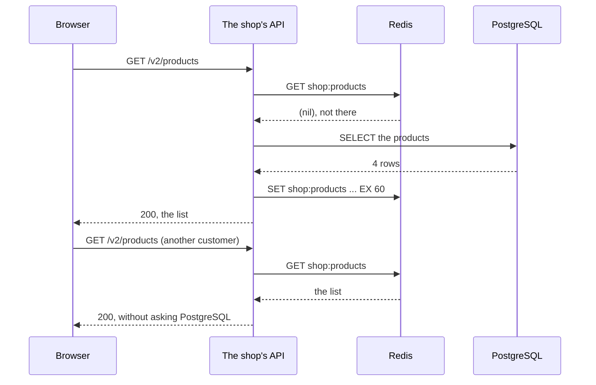

import Term from '~/components/Term.astro';
import TryIt from '~/components/TryIt.astro';
import Analogy from '~/components/Analogy.astro';
import SelfCheck from '~/components/SelfCheck.astro';
import Quiz from '~/components/Quiz.astro';
import QuizQuestion from '~/components/QuizQuestion.astro';
import QuizOption from '~/components/QuizOption.astro';
import SqlPlayground from '~/playgrounds/sql-playground/SqlPlayground';

## The problem

Imagine the first day of the shop's sale. The home page asks for the product list hundreds of times per second, and each time the same <Term id="query">query</Term> goes to PostgreSQL to get the same answer: four products that haven't changed since yesterday.

On top of that, Ana wants to sell new things, and each one has its own data: the T-shirt, sizes and color; the mug, its capacity and whether it's dishwasher safe. One column for every piece of data some product might have?

If you ask on a forum, someone will answer without hesitation: “PostgreSQL doesn't scale. Switch to NoSQL: Redis and MongoDB.” Here you'll see what's behind that word, and how part of this can be solved without leaving PostgreSQL.

## The analogy

<Analogy>

Think of a corner store. The **ledger** has one line per sale, always with the same columns: date, product, quantity. The price of each product is on another sheet, the catalog's: each piece of data, in one place only.

Next to the register there's a **blackboard**: “Mug: 3 left.” You read it at a glance, and it's wiped every night. If someone wipes it by mistake, nothing happens: the truth is in the ledger.

And in a cabinet, a **folder per customer**, with a photocopy of each receipt: product, price and quantity. You open one and you have it all. But if a product changes its name, you have to correct it in every folder.

The ledger is a relational database, the blackboard is Redis and the folders are MongoDB.

<div slot="limits">

- The blackboard isn't always wiped: Redis can copy its data to disk, as you'll see.
- The ledger isn't slow: with an <Term id="database-index">index</Term>, PostgreSQL finds one row among millions in milliseconds.
- MongoDB can cross folders, and PostgreSQL can keep folders in a column: the borders aren't that clear.

</div>

</Analogy>

## How it really works

### “NoSQL” is a label, not a technology

**<Term id="nosql">NoSQL</Term> groups together the databases that don't store data in related tables and aren't queried with <Term id="sql">SQL</Term>.** The name became popular in 2009, as the title of a meetup, and was later read as “not only SQL.” It says what they aren't, not what they are:

| Family | How it stores data | Examples | What it's chosen for |
|---|---|---|---|
| Key-value | Each value with a name | Redis, Valkey | Caches, sessions, counters |
| Documents | JSON-like documents, each one complete | MongoDB | Data with a varying shape that's read whole |
| Wide columns | Rows spread across many machines | Cassandra, ScyllaDB | Writing a huge amount, nonstop |
| Graphs | Nodes and the relationships between them | Neo4j | Networks: your friends' friends |

Many give up the <Term id="join">JOIN</Term> or <Term id="transaction">transactions</Term> to be faster or to spread across machines. But the border has blurred: MongoDB has transactions, and PostgreSQL stores documents.

So the useful question isn't “SQL or NoSQL?” but **what shape your data has and how you're going to read it**.

### Redis stores each piece of data with a name

Redis is a <Term id="key-value-store">key-value store</Term>: it stores each value with a name, its key, like a dictionary. You use it from `redis-cli`, its terminal, like `psql` with PostgreSQL. This is how the API stores the product list:

<TryIt
  title="The product list, in Redis"
  cmd="redis-cli"
  output={`127.0.0.1:6379> SET shop:products '[{"id":1,"name":"T-shirt","priceCents":2000},{"id":2,"name":"Mug","priceCents":850},{"id":3,"name":"Hoodie","priceCents":3500},{"id":4,"name":"Cap","priceCents":1500}]'
OK
127.0.0.1:6379> GET shop:products
"[{\\"id\\":1,\\"name\\":\\"T-shirt\\",\\"priceCents\\":2000},{\\"id\\":2,\\"name\\":\\"Mug\\",\\"priceCents\\":850},{\\"id\\":3,\\"name\\":\\"Hoodie\\",\\"priceCents\\":3500},{\\"id\\":4,\\"name\\":\\"Cap\\",\\"priceCents\\":1500}]"
127.0.0.1:6379> EXPIRE shop:products 60
(integer) 1
127.0.0.1:6379> TTL shop:products
(integer) 60
127.0.0.1:6379> TTL shop:products
(integer) 40
127.0.0.1:6379> TTL shop:products
(integer) -2
127.0.0.1:6379> GET shop:products
(nil)`}
>

Each command goes after the `>`. Between the `60` and the `40`, 20 seconds went by, and before the `-2`, another 41. How to open `redis-cli` is in [Try it](#try-it). The outputs are from Redis 8.10.

</TryIt>

Word by word:

- `SET key value` stores the value with that name. `shop:products` is the key (the `:` is a convention for grouping names). The value is the API's <Term id="json">JSON</Term>, as text: Redis doesn't look inside.
- `GET key` returns the value. The `\"` are the text's quotation marks, written that way by `redis-cli`.
- `EXPIRE key 60` gives it an expiry: in 60 seconds, Redis deletes it. `(integer) 1` means “done.”
- `TTL key` says how many seconds it has left. `-2` means it no longer exists; `-1`, that it exists and doesn't expire.
- `(nil)` is “there's nothing with that name.”

Usually you do both in one go: `SET shop:products '…' EX 60`.

**Redis keeps everything in the computer's memory**, not on disk, and answers in much less than a millisecond. In exchange, you ask it by name: there's no `WHERE` and no `JOIN`.

### A cache in front of PostgreSQL

With Redis, the product list becomes a <Term id="cache">cache</Term>: the API looks in Redis first and, if it isn't there, asks PostgreSQL and leaves a copy there that expires.



During that minute, everything comes from Redis: PostgreSQL runs one query per minute instead of thousands.

The price is that of any cache, as with [HTTP caching](/en/phase-2/http-caching/): if Ana changes a price, the API may give the old one for 60 seconds. To avoid that, the API deletes the key when a product changes (`DEL shop:products`). That's <Term id="cache-invalidation">cache invalidation</Term>, and you'll build it in Phase 9.

### If Redis dies suddenly, it loses the latest writes

What's in memory dies with the program. A <Term id="session">session</Term> in Redis, and a power outage (`docker kill`, like the `kill -9` from [Phase 1](/en/phase-1/linux-processes-and-signals/)):

<TryIt
  title="Redis, shut down suddenly"
  cmd={`docker exec -it redis redis-cli SET session:7f3a9c ana EX 3600
docker exec -it redis redis-cli GET session:7f3a9c
docker kill redis
docker start redis
docker exec -it redis redis-cli GET session:7f3a9c`}
  output={`OK
"ana"
redis
redis
(nil)`}
>

Ana's session is gone: she'd have to log in again. `redis` is the container from [Try it](#try-it) (Docker is Phase 7). If you get `"ana"`, Redis already had a copy with the session on disk: repeat with a new container (`docker rm -f redis` and the `docker run` from Try it).

</TryIt>

By default, Redis copies its data to disk every so often (every hour if something has changed, sooner if a lot has changed) and when it's shut down in an orderly way: with `docker restart redis`, the session is still there. A power outage loses what was written since the last copy. You can tune it:

- **The copies (RDB):** more often, or none at all.
- **The change log (AOF):** with `appendonly yes`, Redis writes down every change in a file and saves it every second. A power outage loses one second at most.

**In a cache, losing everything doesn't matter**: it's refilled from PostgreSQL. Losing the sessions makes people log in again. Orders: never only in Redis.

### MongoDB stores each order whole

MongoDB is a <Term id="document-database">document database</Term>: each order is a JSON-like document, with the product inside. Its terminal is `mongosh`:

<TryIt
  title="Two orders, in MongoDB"
  cmd="mongosh --quiet"
  output={`test> use shop
switched to db shop
shop> db.orders.insertOne({ product: { id: 2, name: "Mug", priceCents: 850 }, quantity: 2, status: "pending" })
{
  acknowledged: true,
  insertedId: ObjectId('6acec23c83346fa9c8bab291')
}
shop> db.orders.insertOne({ product: { id: 2, name: "Mug", priceCents: 850 }, quantty: 3, status: "paid", gift: true })
{
  acknowledged: true,
  insertedId: ObjectId('6acec23c83346fa9c8bab292')
}
shop> db.orders.find()
[
  {
    _id: ObjectId('6acec23c83346fa9c8bab291'),
    product: { id: 2, name: 'Mug', priceCents: 850 },
    quantity: 2,
    status: 'pending'
  },
  {
    _id: ObjectId('6acec23c83346fa9c8bab292'),
    product: { id: 2, name: 'Mug', priceCents: 850 },
    quantty: 3,
    status: 'paid',
    gift: true
  }
]
shop> db.orders.countDocuments({ quantity: { $gte: 1 } })
1`}
>

`--quiet` removes the welcome message. The outputs are from MongoDB 9.0 and mongosh 2.12. Your `ObjectId` values will be different: they carry the time they were created.

</TryIt>

Word by word:

- `use shop` chooses the `shop` database, which is created automatically when you store something.
- `db.orders` is the `orders` **collection**: the equivalent of a <Term id="table">table</Term>, but without columns.
- `insertOne({ … })` stores a document, with the product inside: its name and its price, copied. Reading an order is a single read, with no `JOIN`. MongoDB fills in `_id`.
- `find()` returns all the documents.
- `countDocuments({ quantity: { $gte: 1 } })` counts the ones whose `quantity` is greater than or equal to 1 (`$gte`, *greater than or equal*).

Look at the second order: a new field, `gift`, and a typo, `quantty`. **MongoDB stores both without complaining: it has no fixed <Term id="database-schema">schema</Term>.** And the count says `1`: when you search by `quantity`, that order doesn't exist. PostgreSQL would have stopped it at the door:

```
ERROR:  column "quantty" of relation "orders" does not exist
LINE 1: INSERT INTO orders (product_id, quantty, status, created_at)...
                                        ^
```

### No schema doesn't mean no rules

Just because the database doesn't check the shape doesn't mean your data has none. It costs three things.

**The schema moves into your code.** Every program that writes has to validate the fields, as with Zod in [Phase 3](/en/phase-3/zod-validation/). MongoDB can validate documents if you ask it to (`$jsonSchema`), but by default it doesn't.

**The copies are kept up to date by hand.** The mug's name is copied into every order. If the shop changes it, every copy has to change:

<TryIt
  title="The mug changes its name"
  lang="js"
  cmd={`db.orders.updateMany({ "product.id": 2 }, { $set: { "product.name": "Ceramic mug" } })`}
  output={`{
  acknowledged: true,
  insertedId: null,
  matchedCount: 2,
  modifiedCount: 2,
  upsertedCount: 0
}`}
>

In the same `mongosh` session. `updateMany` changes the documents that match the filter, those for product 2. `$set` says which field to change, and `"product.name"` goes into the document inside. Two copies; with a million orders, a million.

</TryIt>

In PostgreSQL, the name is in a single row, and the orders read it with a `JOIN` ([lesson 2](/en/phase-5/sql-joins/)). `UPDATE products SET name = 'Ceramic mug' WHERE id = 2;` answers `UPDATE 1`, however many orders there are. It's “each piece of data in one place only,” the <Term id="normalization">normalization</Term> from [lesson 4](/en/phase-5/data-modeling-normalization/).

Copying isn't always a mistake: **the price should be copied into the order**, because it's what the customer paid ([denormalizing](/en/phase-5/data-modeling-normalization/#denormalizing-copying-on-purpose)). What you have to decide is what gets copied and who keeps the copies up to date.

**There's no `JOIN` by default.** “The orders with their product's category” needs `$lookup`, MongoDB's `JOIN`, inside `aggregate`; or two queries; or copying the category too.

### JSONB: documents inside PostgreSQL

Back to the T-shirt's sizes and the mug's capacity. PostgreSQL has a column type for that:

```sql
ALTER TABLE products ADD COLUMN attributes jsonb;
UPDATE products SET attributes = '{"color": "black", "sizes": ["S", "M", "L"]}'
WHERE name = 'T-shirt';
UPDATE products SET attributes = '{"dishwasher_safe": true, "capacity_ml": 350}'
WHERE name = 'Mug';
SELECT id, name, attributes FROM products ORDER BY id;
```

```
 id |  name   |                  attributes
----+---------+-----------------------------------------------
  1 | T-shirt | {"color": "black", "sizes": ["S", "M", "L"]}
  2 | Mug     | {"capacity_ml": 350, "dishwasher_safe": true}
  3 | Hoodie  |
  4 | Cap     |
(4 rows)
```

- `ADD COLUMN attributes jsonb` adds a column of type <Term id="jsonb">JSONB</Term>: each row can store a different JSON document. The other rows get `NULL`, the blanks for the Hoodie and the Cap.
- In the Mug, the keys have changed order: **JSONB doesn't store the text you wrote, it breaks it down** so it can search inside.
- PostgreSQL checks that it's valid JSON (`'{"color": black}'` gives `invalid input syntax for type json`), but not its shape.

To read inside, two arrows:

```sql
SELECT attributes -> 'color' AS json, attributes ->> 'color' AS text,
       attributes -> 'sizes' AS sizes
FROM products WHERE name = 'T-shirt';
```

```
  json   | text  |      sizes
---------+-------+-----------------
 "black" | black | ["S", "M", "L"]
(1 row)
```

- `->` takes out a field **as JSON**: `"black"`, with its quotation marks, or the list of sizes.
- `->>` takes it out **as text**: `black`. It's the one you use to compare it with text.

And to search, `@>`, “contains”:

```sql
SELECT name FROM products WHERE attributes @> '{"dishwasher_safe": true}';
```

```
 name
------
 Mug
(1 row)
```

`@>` returns the rows whose JSON contains that piece. With four products, PostgreSQL looks at them all; with a million, you'd create an index of a special kind, GIN, that notes down every key and every value in the JSON:

```sql
CREATE INDEX products_attributes_idx ON products USING GIN (attributes);
```

What always has the same shape (the name, the price) stays in columns, with their types and <Term id="constraint">constraints</Term>. **JSONB is for what varies from one row to another.**

### PostgreSQL by default, and when the others win

Almost every application has data that's related (customers, orders, payments) and needs transactions ([lesson 8](/en/phase-5/acid-transactions/)). PostgreSQL gives you that, and documents with JSONB. And every extra database is one more program to install, monitor and back up. **Start with PostgreSQL and add another when a specific problem calls for it:**

| Situation | What to use | Why |
|---|---|---|
| An answer that's requested thousands of times and can be a few seconds late | Redis, in front of PostgreSQL | Memory and expiry |
| Sessions, one-time codes, requests per minute from each client | Redis | Small data that expires on its own |
| A huge number of writes, nonstop, like the messages in a chat | Wide columns, like Cassandra or ScyllaDB | They spread the writes across many machines |
| Documents with no fixed shape, read whole and rarely combined with other data | MongoDB, or JSONB if everything else is already in PostgreSQL | Each document decides its shape |
| Customers, orders, payments, stock | PostgreSQL | Relationships, transactions and constraints |

A real case: [Discord](https://discord.com/blog/how-discord-stores-trillions-of-messages) stored its messages in MongoDB, moved to Cassandra as it grew and, later, to ScyllaDB, by then with trillions of messages. Almost no website reaches that scale.

Vector databases, which search by similarity of meaning, come in Phase 11, and there too PostgreSQL has its extension: pgvector.

## Try it

The goal: give the products attributes with no fixed shape, find the ones that are dishwasher safe and, after that, the black ones. At the end, if you want, Redis and MongoDB on your computer.

### JSONB in the playground

Press “Run”: you'll see the answer to each command.

<SqlPlayground client:visible lang="en" rows={10} query={`ALTER TABLE products ADD COLUMN attributes jsonb;
UPDATE products SET attributes = '{"color": "black", "sizes": ["S", "M", "L"]}'
WHERE name = 'T-shirt';
UPDATE products SET attributes = '{"dishwasher_safe": true, "capacity_ml": 350}'
WHERE name = 'Mug';
SELECT name, attributes ->> 'color' AS color, attributes -> 'sizes' AS sizes
FROM products ORDER BY id;
SELECT name FROM products WHERE attributes @> '{"dishwasher_safe": true}';`} />

If you run it twice, the first command fails: `column "attributes" of relation "products" already exists`. Press “Reset data”, or delete the first line.

<SelfCheck question="Challenge: give the Hoodie the color black and the sizes M, L and XL, and find all the black products.">

One more `UPDATE`, and `@>` with the color:

```sql
UPDATE products SET attributes = '{"color": "black", "sizes": ["M", "L", "XL"]}'
WHERE name = 'Hoodie';
SELECT name FROM products WHERE attributes @> '{"color": "black"}';
```

```
  name
---------
 T-shirt
 Hoodie
(2 rows)
```

If you tried `WHERE attributes -> 'color' = 'black'` and got `invalid input syntax for type json`, change the arrow: `WHERE attributes ->> 'color' = 'black'` also finds both.

</SelfCheck>

### The same in psql, without changing your database

Your `shop` database is the project's, and its schema only changes with <Term id="migration">migrations</Term> ([lesson 6](/en/phase-5/database-migrations/)). So the test goes in a transaction that you undo at the end with `ROLLBACK`. Open `psql -d shop` and type:

<TryIt
  title="JSONB in psql, undone at the end"
  lang="sql"
  cmd={`BEGIN;
ALTER TABLE products ADD COLUMN attributes jsonb;
UPDATE products SET attributes = '{"color": "black", "sizes": ["S", "M", "L"]}'
WHERE name = 'T-shirt';
UPDATE products SET attributes = '{"dishwasher_safe": true, "capacity_ml": 350}'
WHERE name = 'Mug';
SELECT name, attributes ->> 'color' AS color, attributes -> 'sizes' AS sizes
FROM products ORDER BY id;
SELECT name FROM products WHERE attributes @> '{"dishwasher_safe": true}';
CREATE INDEX products_attributes_idx ON products USING GIN (attributes);
ROLLBACK;`}
  output={`BEGIN
ALTER TABLE
UPDATE 1
UPDATE 1
  name   | color |      sizes
---------+-------+-----------------
 T-shirt | black | ["S", "M", "L"]
 Mug     |       |
 Hoodie  |       |
 Cap     |       |
(4 rows)

 name
------
 Mug
(1 row)

CREATE INDEX
ROLLBACK`}
>

`psql` leaves blank what the playground writes as `NULL`. With the `ROLLBACK`, the column, the attributes and the index disappear: check it with `\d products`. The outputs are from PostgreSQL 18.6. If you get `UPDATE 2`, you have two products with that name (you probably created them with the API): no problem. If you get `current transaction is aborted`, an earlier command failed: type `ROLLBACK;` and start again.

</TryIt>

### Redis and MongoDB on your computer (optional)

You don't need them to follow the course. To repeat this lesson's outputs, the cleanest way is Docker (Phase 7): each one lives in its own container and is deleted with one command.

<TryIt
  title="Redis and MongoDB, with Docker"
  cmd={`docker run -d --name redis redis:8
docker exec -it redis redis-cli PING
docker run -d --name mongo mongo:9
docker exec -it mongo mongosh --quiet --eval 'db.version()'`}
  output={`ba405caf36a7f871c776d3f3ba66d1393ca71d44d6598f0e77e4a273f95b0a00
PONG
2a97dc5f435b3d743bb97f40462351d55081cd599f02e0a1e29bde7741516b17
9.0.2`}
>

`docker run -d` starts the container and prints its number, which will be different for you; the first time, it downloads the image first. `PONG` is Redis's answer to `PING`: it's alive. To get in, `docker exec -it redis redis-cli` and `docker exec -it mongo mongosh --quiet`. When you're done, `docker rm -f redis mongo` deletes them along with their data.

</TryIt>

Without Docker, you can install them:

- **On macOS, with Homebrew:** `brew install redis` and `brew services start redis`; MongoDB, with `brew tap mongodb/brew`, `brew install mongodb-community` and `brew services start mongodb-community`.
- **On Ubuntu and WSL:** `sudo apt install redis-server` (Redis 7 on Ubuntu 24.04: these commands work the same). MongoDB isn't in Ubuntu's catalog: [its manual](https://www.mongodb.com/docs/manual/tutorial/install-mongodb-on-ubuntu/) explains how to add its repository.

## You have already seen it

- **A website that asks you to log in again** after a while without using it: your [session](/en/phase-2/cookies-httponly-secure-samesite/#a-session-the-number-in-the-cookie-the-data-on-the-server) has expired. Many websites store them like this, in a key-value store.
- **The browser's `localStorage`** is a key-value store: you can see it in DevTools ([how to open it](/en/phase-2/#before-you-start-devtools)), **Application** tab.
- **The idempotency keys** from [Phase 4](/en/phase-4/webhooks-idempotency/), which Stripe can delete after 24 hours: a typical job for Redis.

## Common mistakes

- **Choosing MongoDB “so you don't have a schema.”** The schema ends up scattered across the code.
- **Keeping in Redis the only copy of something that can't be lost**, like the orders.
- **A cache with no expiry, and no deleting the key when the data changes**: old prices for hours.
- **Putting in JSONB what always has the same shape**, like the price: you lose the types and the constraints.
- **Adding a database “just in case.”** Each one has to be installed, monitored and backed up.

## Summary

- NoSQL is a label for the databases without related tables or SQL: key-value, documents, wide columns and graphs.
- Redis stores each value with a name, in memory, with an expiry (`EXPIRE`, `TTL`): a cache or sessions. If it dies suddenly, it loses what was written since its last copy on disk.
- MongoDB stores complete documents with no fixed schema: reading an order is one read, but typos get in, copies are changed by hand and there's no `JOIN` by default.
- JSONB stores JSON inside PostgreSQL: `->` takes out JSON, `->>` takes out text, `@>` searches for what it contains, and a GIN index speeds it up.
- PostgreSQL is the default choice. Another database is added when a specific problem calls for it.

## Did you get it?

<Quiz>

<QuizQuestion
  question="The API stores the product list in Redis with EX 60. Ana raises the mug’s price in PostgreSQL and, for a while, the website keeps showing the old price. Why?"
  review="A cache in front of PostgreSQL"
>

<QuizOption text="Because PostgreSQL takes up to a minute to save an UPDATE.">

PostgreSQL saves the change as soon as it answers. The old price comes from the copy in Redis, which hasn't found out.

</QuizOption>

<QuizOption text="Because the copy in Redis doesn’t know the price has changed, and it’s valid until it expires." correct>

The cache is a copy: it's served as is until it expires or the API deletes the key.

</QuizOption>

<QuizOption text="Because Redis reads its data from disk, and the disk lags behind the memory.">

Redis always reads from memory; the disk only helps it recover when it starts. The delay comes from the expiry.

</QuizOption>

</QuizQuestion>

<QuizQuestion
  question="A server keeps the product cache and the users’ sessions in Redis, with the default configuration. The power goes out. What happens when it comes back?"
  review="If Redis dies suddenly, it loses the latest writes"
>

<QuizOption text="Nothing: Redis writes every change to disk before answering.">

By default, Redis copies its data every so often, not on every change. The change log (`appendonly yes`) has to be turned on.

</QuizOption>

<QuizOption text="Everything is lost: Redis never stores anything on disk, only in memory.">

By default it does copy its data to disk every so often and when it's shut down in an orderly way, and it loads it again when it starts.

</QuizOption>

<QuizOption text="The latest writes are lost: the cache is refilled and some people log in again." correct>

What came after the last copy is lost. The cache is rebuilt from PostgreSQL; whoever loses their session logs in again.

</QuizOption>

</QuizQuestion>

<QuizQuestion
  question="In MongoDB, someone saves an order with the field quantty instead of quantity. What happens?"
  review="MongoDB stores each order whole"
>

<QuizOption text="It’s saved as is, and searches by quantity don’t find it." correct>

MongoDB has no fixed schema: any field goes. The order exists, but it has no `quantity`.

</QuizOption>

<QuizOption text="It gives an error, like PostgreSQL with a column that doesn’t exist.">

The collection has no columns to check. It would only validate the shape if you had asked it for a `$jsonSchema`.

</QuizOption>

<QuizOption text="It’s saved without that field: MongoDB drops the fields it doesn’t know.">

MongoDB doesn't know the fields in advance: it stores `quantty` like any other.

</QuizOption>

</QuizQuestion>

<QuizQuestion
  question="The shop is going to sell books (author, pages) and sneakers (size, material), on top of what it already has. Where do you store that data?"
  review="JSONB: documents inside PostgreSQL"
>

<QuizOption text="In MongoDB: PostgreSQL can’t store data that changes from one product to another.">

PostgreSQL stores JSON with the `jsonb` type, and searches inside with `->>` and `@>`.

</QuizOption>

<QuizOption text="In a JSONB column in products, with the name and the price in their usual columns." correct>

What they all have stays in columns, with types and constraints; what changes from one product to another, in `attributes`.

</QuizOption>

<QuizOption text="In one column for each attribute of any product: it’s the only way to search by them.">

With JSONB you can search too: `attributes @> '{"material": "leather"}'`, and a GIN index makes it fast.

</QuizOption>

</QuizQuestion>

<QuizQuestion
  question="You write SELECT name FROM products WHERE attributes -> 'color' = 'black'; and PostgreSQL answers invalid input syntax for type json. What’s going on?"
  review="JSONB: documents inside PostgreSQL"
>

<QuizOption text="JSONB doesn’t let you filter by what’s inside the JSON, only store it.">

It does: with `->>` to compare with text, or with `@>` to search for a piece of JSON.

</QuizOption>

<QuizOption text="The GIN index on the attributes column is missing.">

An index makes searches faster, but it doesn't change which queries are valid or their result.

</QuizOption>

<QuizOption text="-> gives JSON, and 'black', without double quotation marks, isn’t valid JSON." correct>

`->` gives `"black"`, with quotation marks, and compares it with another JSON value. To compare with text, `->>`.

</QuizOption>

</QuizQuestion>

<QuizQuestion
  question="You’re starting a new online shop: customers, products, orders and payments. Someone on the team suggests a database. Which one do you choose to start with?"
  review="PostgreSQL by default, and when the others win"
>

<QuizOption text="PostgreSQL: the data is related and payments need transactions." correct>

It's the shape of data that relational databases exist for. If one day a list is requested thousands of times, Redis goes in front.

</QuizOption>

<QuizOption text="MongoDB: a relational database can’t handle more than a few thousand users.">

PostgreSQL serves millions of users at many companies. What usually limits it is the design of the tables and the indexes.

</QuizOption>

<QuizOption text="Redis for everything: it’s in memory, so it’s the fastest for any data.">

Redis only searches by name, doesn't combine data and can lose the latest writes if it's shut down suddenly: for orders and payments, no.

</QuizOption>

</QuizQuestion>

</Quiz>

## Further reading

- [JSON Types](https://www.postgresql.org/docs/18/datatype-json.html) and [JSON Functions and Operators](https://www.postgresql.org/docs/18/functions-json.html) (PostgreSQL): `jsonb` and its operators.
- [Redis persistence](https://redis.io/docs/latest/operate/oss_and_stack/management/persistence/) (Redis): RDB and AOF, and what each one loses.
- [Data Modeling](https://www.mongodb.com/docs/manual/data-modeling/) (MongoDB): when to put one piece of data inside another.
- [How Discord Stores Trillions of Messages](https://discord.com/blog/how-discord-stores-trillions-of-messages) (Discord): from MongoDB to Cassandra and to ScyllaDB.
- [NoSQL](https://en.wikipedia.org/wiki/NoSQL) (Wikipedia): the origin of the name and the families.
