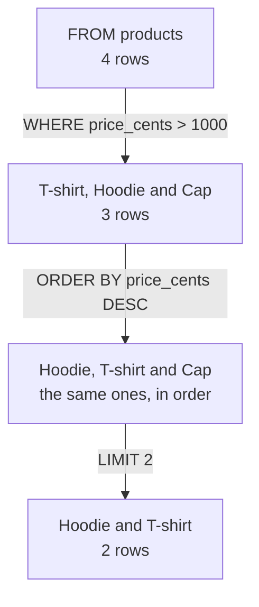

import Term from '~/components/Term.astro';
import TryIt from '~/components/TryIt.astro';
import Analogy from '~/components/Analogy.astro';
import SelfCheck from '~/components/SelfCheck.astro';
import Quiz from '~/components/Quiz.astro';
import QuizQuestion from '~/components/QuizQuestion.astro';
import QuizOption from '~/components/QuizOption.astro';
import SqlPlayground from '~/playgrounds/sql-playground/SqlPlayground';

## The problem

Luis packs the shop's parcels every morning. He wants to know which orders are still pending, from oldest to newest. In a spreadsheet he'd put a filter on the “status” column and sort by date, with a couple of clicks.

Since the [introduction](/en/phase-5/), the shop's data lives in PostgreSQL. A <Term id="database">database</Term> has no buttons: you ask it in writing, in a language it understands. That language is **<Term id="sql">SQL</Term>**, and it's the same one your server will use when someone asks for `GET /v2/orders?status=pending`.

Writing has a risk a click doesn't. With one line of SQL you can change one order or all 40,000 at once, and PostgreSQL doesn't ask if you're sure. In this lesson you learn to read data, to change it and to avoid that scare.

## The analogy

<Analogy>

Think of a city hall's records office. You don't go in and search the shelves: you fill in a slip at the counter. “From the orders box, I want the number and the date. Only the pending ones. From oldest to newest. Five at most.”

The archivist knows where each box is and the shortest way to it. You say **what** you want, not **how** to find it, and she hands you a photocopy with just that. SQL is that slip, and PostgreSQL, the archivist.

<div slot="limits">

- An archivist understands “Pending” even if it's capitalized. PostgreSQL compares letter by letter: `'Pending'` and `'pending'` are different texts, and it doesn't warn you that it found nothing.
- With SQL you can also write “throw out everything in this box.” Nobody asks if you're sure, and there's no trash can.
- The answer to a `SELECT` is always a table, even if it holds a single value.

</div>

</Analogy>

## How it really works

You can try every query in this section in the playground in [Try it](#try-it), or in `psql` (open `psql -d shop`, as in the introduction). The outputs are from PostgreSQL 18.6, with the data from `shop.sql` freshly loaded.

### A table is a spreadsheet with rules

This is the shop's `products` table:

```sql
SELECT * FROM products;
```

```
 id |  name   | price_cents
----+---------+-------------
  1 | T-shirt |        2000
  2 | Mug     |         850
  3 | Hoodie  |        3500
  4 | Cap     |        1500
(4 rows)
```

A <Term id="table">table</Term> stores one kind of thing, like the products. Each **row** is one of those things (the Mug), and each **column**, a piece of data they all have (its name). So far, a spreadsheet.

The difference is the rules. **Each column has a type, and PostgreSQL won't let you put in another one.** In a spreadsheet you can write “free” in the price column; here, you can't. These are the types you'll see in the shop:

| Type | What it stores | In the shop |
|---|---|---|
| `integer` | A whole number | `id`, `price_cents`, `quantity` |
| `text` | Text, of any length | `name`, `status` |
| `timestamptz` | An instant: date and time, which PostgreSQL writes in a time zone | `created_at`, when an order was placed |

Prices are in cents: €8.50 is `850`. Your project has stored them that way since [lesson 4 of Phase 4](/en/phase-4/api-versioning/): `v2` returns them in `priceCents`, and `v1` still turns them into euros, in `price`. Decimals aren't always exact in a computer ([lesson 2 of Phase 3](/en/phase-3/javascript-for-backend/#values-text-numbers-and-true-or-false)), and a whole number is.

The shop has four tables: `products`, `orders`, `categories` and `product_categories`. This lesson uses the first two. This is how the 25 orders start:

| id | product_id | quantity | status | created_at |
|---|---|---|---|---|
| 1 | 2 | 2 | shipped | 2026-10-01 09:00:00+00 |
| 2 | 3 | 3 | shipped | 2026-10-01 16:00:00+00 |
| 3 | 1 | 4 | shipped | 2026-10-01 23:00:00+00 |

`product_id` says which product each order is for: order 1 is for the Mug, product 2. You'll see how to put the two tables together in [lesson 2, “JOIN”](/en/phase-5/sql-joins/).

### SELECT and FROM: which columns and from which table

A <Term id="query">query</Term> is a command written in SQL. The shortest one asks for some columns of a table:

```sql
SELECT name, price_cents FROM products;
```

```
  name   | price_cents
---------+-------------
 T-shirt |        2000
 Mug     |         850
 Hoodie  |        3500
 Cap     |        1500
(4 rows)
```

Word by word:

- `SELECT` says which columns you want, separated by commas. With `*`, all of them.
- `FROM products` says from which table.
- `;` ends the command. In `psql` it's required: without it, `psql` thinks you haven't finished and waits for more lines.
- `(4 rows)` is added by `psql`: how many rows the answer brings.

SQL's words go in capitals by convention, to tell them apart from the names; `select` works too. Table and column names go in lowercase with `_` between words, because PostgreSQL turns names that aren't in quotes into lowercase.

### WHERE: only the rows that meet a condition

For Luis's pending orders, a filter is missing:

```sql
SELECT id, quantity, status FROM orders WHERE status = 'pending';
```

```
 id | quantity | status
----+----------+---------
 21 |        2 | pending
 22 |        3 | pending
 23 |        4 | pending
 24 |        1 | pending
 25 |        2 | pending
(5 rows)
```

- `WHERE` goes after `FROM` and carries a condition. PostgreSQL looks at each row and keeps the ones that meet it.
- `=` compares, with a single sign (in JavaScript it was three, `===`). Not equal is `<>`, and there are also `<`, `>`, `<=` and `>=`.
- `'pending'` is text, and **text goes in single quotes**. Numbers, without quotes: `quantity >= 3`.

Double quotes exist, but they're for column and table names. If you use them for text, PostgreSQL looks for a column with that name:

```sql
SELECT * FROM products WHERE name = "Mug";
```

```
ERROR:  column "Mug" does not exist
LINE 1: SELECT * FROM products WHERE name = "Mug";
                                            ^
```

`ERROR:` says what failed (the column “Mug” doesn't exist), and the `^` points to where.

Dates can be compared too, written as text: `WHERE created_at >= '2026-10-08'` gives orders 24 and 25.

### AND and OR: several conditions

`AND` requires both conditions to be met; `OR`, at least one:

```sql
SELECT id, product_id, quantity FROM orders WHERE status = 'paid' AND quantity >= 3;
```

```
 id | product_id | quantity
----+------------+----------
 14 |          3 |        3
 15 |          1 |        4
 18 |          1 |        3
 19 |          2 |        4
(4 rows)
```

Paid, and 3 units or more. With `OR`, you'd get all the paid ones and, on top of that, all the ones of 3 or more, whatever their status.

If you mix the two, **`AND` goes before `OR`**, like multiplication before addition. Use parentheses so that what you mean wins: `WHERE status = 'paid' AND (product_id = 1 OR quantity >= 4)` means the paid orders that are for the T-shirt or have 4 units, and gives orders 15, 18 and 19.

### ORDER BY and LIMIT: in what order and how many

```sql
SELECT name, price_cents FROM products
WHERE price_cents > 1000
ORDER BY price_cents DESC
LIMIT 2;
```

```
  name   | price_cents
---------+-------------
 Hoodie  |        3500
 T-shirt |        2000
(2 rows)
```

A query can take up several lines: it ends at the `;`.

- `ORDER BY price_cents` sorts by that column, from lowest to highest. `DESC` (for *descending*) turns it around: from highest to lowest.
- `LIMIT 2` keeps the first two rows.

You can read it as a chain, where each step works with what the previous one leaves:



The parts are always written in this order: `SELECT`, `FROM`, `WHERE`, `ORDER BY` and `LIMIT`. The order in which PostgreSQL really runs them has some subtleties, which you'll see in [lesson 3, “GROUP BY”](/en/phase-5/sql-group-by/#a-query-doesnt-run-in-the-order-its-written).

**Without `ORDER BY`, the order of the rows isn't guaranteed.** Today they come out by id because nobody has touched the tables, but changing one row is enough for that to stop: you'll see it in [Try it](#change-one-order-and-then-all-of-them). A `LIMIT` without `ORDER BY` gives you any rows at all.

### NULL: the missing value

Imagine a customers table with a `phone` column, and someone who didn't give theirs. That cell doesn't hold a `0` or an empty text: it holds **`NULL`**, which means “unknown.”

`NULL` changes how comparisons work. Is one unknown phone equal to another unknown one? That's unknown too:

```sql
SELECT NULL = NULL AS equal, NULL IS NULL AS is_null;
```

```
 equal | is_null
-------+---------
       | t
(1 row)
```

- `AS equal` gives the column of the answer a name.
- `NULL = NULL` doesn't give true: it gives `NULL`, another “unknown.” `psql` writes it as a blank; the playground writes `NULL`.
- `NULL IS NULL` gives `t`, true (false is `f`). True or false is another type, `boolean`.

`WHERE` only keeps the rows whose condition is true, and “unknown” isn't true. That's why **`WHERE phone = NULL` never finds anything**, even if there are a hundred customers without a phone. You write `WHERE phone IS NULL`, and the opposite, `IS NOT NULL`.

In the shop, every column is required: none allows `NULL`. You'll see it when you add a product without a price, in the next section. And in [lesson 2, “JOIN”](/en/phase-5/sql-joins/#left-join-also-keeps-the-rows-without-a-match), `NULL`s will show up where you least expect them: in the Cap, which nobody has ever ordered.

### INSERT: adding a row

Ana wants to sell a tote bag for €12:

```sql
INSERT INTO products (name, price_cents) VALUES ('Bag', 1200);
```

```
INSERT 0 1
```

- `INSERT INTO products` says into which table.
- `(name, price_cents)` are the columns you're going to give, and `VALUES (…)`, their values, in the same order.
- You don't give the `id`: PostgreSQL puts in the next number. You'll see how in [lesson 2](/en/phase-5/sql-joins/#each-row-has-a-unique-number-the-primary-key).
- `INSERT 0 1` says that 1 row went in. The `0` is left over from old versions of PostgreSQL, and it's always 0.

Check it with `SELECT * FROM products WHERE name = 'Bag';`: it comes out with `id` 5.

If a required value is missing, the row doesn't go in:

```sql
INSERT INTO products (name) VALUES ('Keychain');
```

```
ERROR:  null value in column "price_cents" of relation "products" violates not-null constraint
DETAIL:  Failing row contains (6, Keychain, null).
```

The column you don't give is left as `NULL`, and the table says `NOT NULL`. `DETAIL:` shows the row that would have gone in. You'll design those rules of each column, the <Term id="constraint">constraints</Term>, in [lesson 4, “Modeling”](/en/phase-5/data-modeling-normalization/#constraints-rules-that-postgresql-always-checks).

Notice the `6` in `DETAIL`: the attempt used up that number even though it failed. The next product to go in will be 7. Ids don't have to be consecutive.

### UPDATE and DELETE: changing and deleting rows

The bag goes down to €10:

```sql
UPDATE products SET price_cents = 1000 WHERE name = 'Bag';
```

```
UPDATE 1
```

- `UPDATE products` says which table.
- `SET price_cents = 1000` says which column changes and to what value. Several go separated by commas.
- `WHERE name = 'Bag'` says **which rows**. It's the same `WHERE` as in `SELECT`.
- `UPDATE 1`: it changed 1 row. **Always look at that number**: it's how many rows you touched.

In the end, Ana doesn't sell it:

```sql
DELETE FROM products WHERE name = 'Bag';
```

```
DELETE 1
```

`DELETE FROM products` deletes whole rows, the ones that meet the `WHERE`. If you repeat it, the answer is `DELETE 0`: no row met the condition. It isn't an error; PostgreSQL is telling you it found nothing to delete.

### The classic mistake: an UPDATE or a DELETE without WHERE

The `WHERE` is optional. Without it, `SELECT` reads every row, and `UPDATE` and `DELETE` change or delete **all of them**.

Imagine Luis wants to cancel order 17 and, in a hurry, writes this:

```sql
UPDATE orders SET status = 'cancelled';
```

```
UPDATE 25
```

All 25 of the shop's orders, cancelled. PostgreSQL didn't ask anything, and in `psql` there's no undo: the change is saved as soon as the command finishes. With `DELETE FROM orders;` it would be worse: the orders would be gone. It's SQL's classic mistake, and it happens to people with years of experience too. Don't try it in `psql`: in [Try it](#try-it) you'll do it in the playground, which resets with a button.

Two habits prevent it:

1. **Write the `SELECT` first** with the `WHERE` you're going to use: `SELECT * FROM orders WHERE id = 17;`. If the rows you want to change come out, and only those, swap `SELECT *` for `UPDATE orders SET …` or for `DELETE`, without touching the `WHERE`.
2. **Write the `WHERE` before the rest.** In the playground and in many programs, <kbd>Ctrl</kbd> + <kbd>Enter</kbd> runs whatever is written, even if you haven't finished. If the command goes out half done, better that it's missing the `SET` than the `WHERE`: `UPDATE orders WHERE id = 17;` gives `ERROR:  syntax error at or near "WHERE"`, a syntax error, and changes nothing.

And read the number in the answer: if you expected `UPDATE 1` and get `UPDATE 25`, you know what happened. In [lesson 8, “Transactions”](/en/phase-5/acid-transactions/), you'll see one more safety net: make the change, look at the result and undo it if it wasn't what you wanted.

## Try it

The goal: put together Luis's list, find the biggest pending order and then break the data on purpose and fix it.

### Luis's list

This playground is a real PostgreSQL inside your browser, with the shop's data. The first time, it downloads about 5 MB. Press “Run”:

<SqlPlayground client:visible lang="en" rows={4} query={`SELECT id, product_id, quantity, created_at
FROM orders
WHERE status = 'pending'
ORDER BY created_at;`} />

Now change it: the paid ones instead of the pending ones, from newest to oldest (`DESC`), and only three (`LIMIT 3`). If you get an error, read the line with the `^`: it's almost always a comma or a quote.

The same query, in your terminal. Open `psql -d shop` and, at the `shop=>` prompt, type:

<TryIt
  title="Luis’s list, in psql"
  lang="sql"
  cmd={`SELECT id, product_id, quantity, created_at
FROM orders
WHERE status = 'pending'
ORDER BY created_at;`}
  output={` id | product_id | quantity |       created_at
----+------------+----------+------------------------
 21 |          1 |        2 | 2026-10-07 05:00:00+00
 22 |          2 |        3 | 2026-10-07 12:00:00+00
 23 |          3 |        4 | 2026-10-07 19:00:00+00
 24 |          1 |        1 | 2026-10-08 02:00:00+00
 25 |          2 |        2 | 2026-10-08 09:00:00+00
(5 rows)`}
>

Look at the end of `created_at`: `+00` is the time zone, UTC, the one you gave the `shop` role in the [introduction](/en/phase-5/#the-shop-role). If the first one shows something like `2026-10-07 01:00:00-04`, you're missing that setting: it's the same instant, in New York time. If you get `relation "orders" does not exist`, you haven't loaded `shop.sql`: go back to the [introduction](/en/phase-5/#before-you-start-the-shops-data). You leave `psql` with `\q`.

</TryIt>

<SelfCheck question="Challenge: which pending order has the most units? Write a query that returns only that one.">

Sort by `quantity` from highest to lowest and keep the first one:

```sql
SELECT id, quantity FROM orders
WHERE status = 'pending'
ORDER BY quantity DESC
LIMIT 1;
```

```
 id | quantity
----+----------
 23 |        4
(1 row)
```

Order 23, with 4 units. Without the `WHERE`, the paid and shipped ones would have competed too.

</SelfCheck>

### Change one order, and then all of them

Luis gets paid for order 21. First the `SELECT`, then the change, and then the `SELECT` again to check it. The playground runs the three commands in a row and shows the answer to each one:

<SqlPlayground client:visible lang="en" rows={3} query={`SELECT id, status FROM orders WHERE id = 21;
UPDATE orders SET status = 'paid' WHERE id = 21;
SELECT id, status FROM orders WHERE id = 21;`} />

Look at “Done: 1 row changed.”: it's `psql`'s `UPDATE 1`. Now delete `WHERE id = 21` from the `UPDATE` and run it again: “Done: 25 rows changed.”, and the last `SELECT` says `paid`, like the other 24. Press “Reset data” to go back to the shop as it was at the start. Your database doesn't have that button.

In `psql`, the same:

<TryIt
  title="Order 21, paid"
  lang="sql"
  cmd={`SELECT id, status FROM orders WHERE id = 21;
UPDATE orders SET status = 'paid' WHERE id = 21;
SELECT id, status FROM orders WHERE id = 21;`}
  output={` id | status
----+---------
 21 | pending
(1 row)

UPDATE 1
 id | status
----+--------
 21 | paid
(1 row)`}
>

Before and after the change. If you get `UPDATE 0`, no order has id 21: you deleted rows in another test.

Now type `SELECT id FROM orders;`, without `ORDER BY`: 21 comes out last, after 25. PostgreSQL stored the changed row at the end, and without `ORDER BY` it gives them as it has them stored.

Before lesson 2, go back to the starting data: load `shop.sql` again as in the introduction, which drops the four tables and creates them again.

</TryIt>

## You have already seen it

- **A spreadsheet's filters** are a `WHERE`, and “sort Z to A”, an `ORDER BY … DESC`. Google Sheets even has a function, `QUERY`, that's written almost like SQL: `=QUERY(A1:C10, "select A where C > 100")`.
- **The Phase 4 API**: `GET /v2/orders?status=pending&limit=5` is a `WHERE` and a `LIMIT`, and `GET /v2/products?sort=-price`, an `ORDER BY … DESC`. In [lesson 5, “Node and PostgreSQL”](/en/phase-5/node-postgres/), the API turns `status` and `sort` into SQL, and in [lesson 7, “Indexes”](/en/phase-5/database-indexes-explain/), `limit` too.
- **Your phone**: Android and iOS come with SQLite, a small database that keeps many apps' data in a file. It speaks SQL too.

## Common mistakes

- **An `UPDATE` or a `DELETE` without `WHERE`.** It changes or deletes every row. Write the `SELECT` first.
- **Text in double quotes.** `"Mug"` is the name of a column; the text is `'Mug'`.
- **Searching with `= NULL`.** It never finds anything: you write `IS NULL`.
- **Trusting the order without `ORDER BY`.** The rows can come out in any order, and a `LIMIT` without `ORDER BY` gives you any rows at all.
- **Capitals in the data.** `status = 'Pending'` gives `(0 rows)`, with no error: the data says `pending`.
- **Mixing `AND` and `OR` without parentheses.** `AND` goes first, and the condition ends up being a different one.

## Summary

- A table stores rows, one per thing, and columns, one per piece of data, each with its type: `integer`, `text`, `timestamptz`.
- `SELECT columns FROM table WHERE condition ORDER BY column LIMIT n` reads data, written in that order. Text goes in single quotes, and without `ORDER BY` there's no guaranteed order.
- `NULL` is “unknown”: comparing it with `=` gives `NULL`, and you search for it with `IS NULL`.
- `INSERT` adds rows, `UPDATE` changes them and `DELETE` deletes them. The answer says how many rows it touched: read it.
- Before an `UPDATE` or a `DELETE`, run the `SELECT` with the same `WHERE`.

## Did you get it?

<Quiz>

<QuizQuestion
  question='Luis writes SELECT * FROM orders WHERE status = "shipped"; and PostgreSQL replies ERROR: column "shipped" does not exist. What happened?'
  review="WHERE: only the rows that meet a condition"
>

<QuizOption text="The orders table doesn’t have a status column, and the error says so.">

The `status` column exists. The error is about another column, “shipped”, because PostgreSQL read that word as a name.

</QuizOption>

<QuizOption text="The text was in double quotes, which are for column names." correct>

With `"shipped"`, PostgreSQL looks for a column with that name. The text is written `'shipped'`.

</QuizOption>

<QuizOption text="There are no orders with the status shipped, and PostgreSQL warns about it with that error.">

When no row meets the condition, the answer is `(0 rows)`, with no error.

</QuizOption>

</QuizQuestion>

<QuizQuestion
  question="A customers table has 30 without a phone, with NULL in that column. SELECT * FROM customers WHERE phone = NULL; returns 0 rows. Why?"
  review="NULL: the missing value"
>

<QuizOption text="Comparing with NULL gives “unknown”, and WHERE only keeps the true rows." correct>

That's why you write `WHERE phone IS NULL`, which does give true for those 30 rows.

</QuizOption>

<QuizOption text="Because NULL is an empty text, and you’d have to search for phone = ''.">

`NULL` isn't an empty text or a zero: it's the absence of a value. `phone = ''` looks for something else, and doesn't find those rows either.

</QuizOption>

<QuizOption text="Because that query only finds rows if one has the word NULL written in the phone.">

`NULL` without quotes isn't a word: it's the value “unknown”. And `= NULL` finds nothing, whatever there is.

</QuizOption>

</QuizQuestion>

<QuizQuestion
  question="You want the cheapest product and write SELECT name FROM products LIMIT 1;. Does it work?"
  review="ORDER BY and LIMIT: in what order and how many"
>

<QuizOption text="Yes: rows always come out in the order they were added, and the first is the oldest.">

Without `ORDER BY`, the order isn't guaranteed: today it may match, and after a few changes, not.

</QuizOption>

<QuizOption text="Yes: LIMIT 1 returns the row with the smallest value.">

`LIMIT` only cuts: it keeps the first rows as they come, without looking at any value.

</QuizOption>

<QuizOption text="No: it gives you any product at all. You need ORDER BY price_cents before the LIMIT." correct>

First it sorts from cheapest to most expensive, and then `LIMIT 1` keeps the first one.

</QuizOption>

</QuizQuestion>

<QuizQuestion
  question="You have to cancel order 17. You write UPDATE orders SET status = 'cancelled'; and psql replies UPDATE 25. What happened?"
  review="The classic mistake: an UPDATE or a DELETE without WHERE"
>

<QuizOption text="PostgreSQL checked the 25 rows and changed only the one for order 17.">

The number is how many rows it changed. Without `WHERE`, nothing tells it which one is 17.

</QuizOption>

<QuizOption text="The WHERE was missing: you’ve cancelled all 25 orders." correct>

Without `WHERE`, `UPDATE` changes every row. With `WHERE id = 17`, the answer would have been `UPDATE 1`.

</QuizOption>

<QuizOption text="Nothing yet: psql saves the changes when you leave with \q.">

In `psql`, each command is saved as soon as it finishes: there's no step to confirm or undo, unless you ask for one with a transaction (lesson 8).

</QuizOption>

</QuizQuestion>

<QuizQuestion
  question="Luis wants the pending orders and also the paid ones. He writes WHERE status = 'pending' AND status = 'paid'. What does it return?"
  review="AND and OR: several conditions"
>

<QuizOption text="No rows: no order is in both statuses at once." correct>

`AND` requires both conditions in the same row. It needed `OR`: with it, each row only has to meet one.

</QuizOption>

<QuizOption text="The pending ones and the paid ones: AND puts the two groups together.">

`AND` doesn't put groups together: it asks each row to meet both conditions. Putting them together is what `OR` does.

</QuizOption>

<QuizOption text="An error: the same column can’t be compared twice in a WHERE.">

You can compare it as many times as you like. The query works, and answers `(0 rows)`.

</QuizOption>

</QuizQuestion>

<QuizQuestion
  question="You run DELETE FROM products WHERE name = 'Bag'; and psql replies DELETE 0. What does it mean?"
  review="UPDATE and DELETE: changing and deleting rows"
>

<QuizOption text="That it failed, and you have to repeat it until it says DELETE 1.">

If it had failed, you'd see `ERROR:`. Repeating it gives the same: there's no row that meets the condition.

</QuizOption>

<QuizOption text="That it deleted it: the 0 means everything went well, like a program’s exit code.">

That's the terminal's exit code. Here the number is how many rows it deleted: none.

</QuizOption>

<QuizOption text="That no row met the condition: there’s no product called Bag." correct>

It isn't an error. Maybe it was already deleted, or it has a different name (“bag”, lowercase, isn't “Bag”).

</QuizOption>

</QuizQuestion>

</Quiz>

## Further reading

- [PostgreSQL's SQL tutorial](https://www.postgresql.org/docs/18/tutorial-sql.html): the official chapter to get started, with `SELECT`, `INSERT`, `UPDATE` and `DELETE`.
- [SELECT](https://www.postgresql.org/docs/18/sql-select.html) (PostgreSQL documentation): everything it accepts, for when you want to go further.
- [Comparison operators and NULL](https://www.postgresql.org/docs/18/functions-comparison.html) (PostgreSQL documentation): the comparisons, and why `= NULL` doesn't work.
- [SQLBolt](https://sqlbolt.com/): short SQL exercises in the browser, one per idea.
