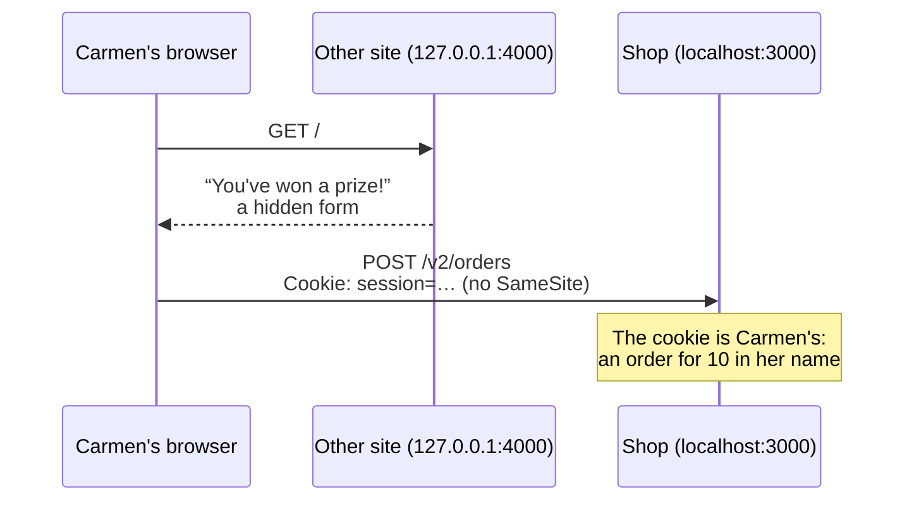
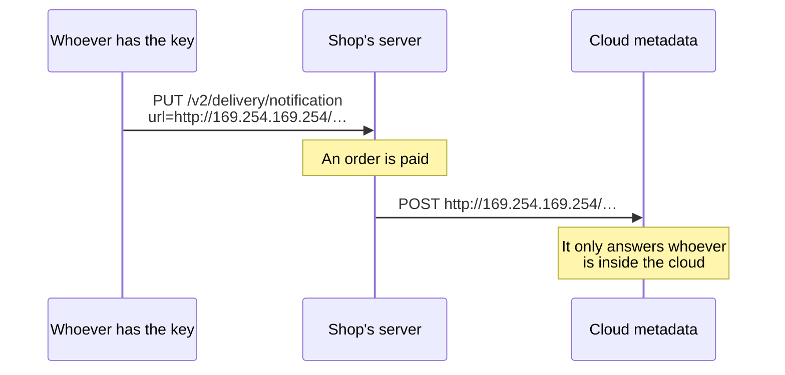

import Term from '~/components/Term.astro';
import TryIt from '~/components/TryIt.astro';
import Analogy from '~/components/Analogy.astro';
import SelfCheck from '~/components/SelfCheck.astro';
import ProjectCode from '~/components/ProjectCode.astro';
import Quiz from '~/components/Quiz.astro';
import QuizQuestion from '~/components/QuizQuestion.astro';
import QuizOption from '~/components/QuizOption.astro';

## The problem

Carmen is signed in to the shop. In another tab she opens a link from an email: “You've won a prize!” She clicks the button, and that page sends the shop an order for ten units. With her cookie. As far as the shop knows, Carmen ordered it.

At the same time, Fast Delivery wants the shop to notify it of every paid order, and gives it a URL. What if the URL is `http://localhost:5432`, the database? The one making the request is the shop's server, from the inside.

They're two attacks with similar names, and in both there's a request you didn't make:

- In **<Term id="csrf">CSRF</Term>**, your browser sends it, because another site asks it to.
- In **<Term id="ssrf">SSRF</Term>**, your server sends it, because someone gave it the address.

## The analogy

<Analogy>

You have an assistant who carries your membership card everywhere. A stranger hands them an envelope: “Take this to the club.” At the club they see your card and do what the envelope says. That's CSRF. The defense: the assistant doesn't show your card with other people's envelopes (`SameSite`), and the club asks, “Who gave you this?” (`Origin`).

Now it's the other way around. A visitor asks the club's receptionist to take a package “to this address”: the manager's office, where the visitor can't go and she can. That's SSRF. The defense: look at the address before leaving, go to that one and no other, and accept no detours on the way.

<div slot="limits">

- The assistant could read the envelope; the browser doesn't look at what the request does, only which site it goes to and which one it comes from.
- A street address doesn't change while you're on your way. An internet name can point somewhere else between when you check it and when you connect: that's why the server connects to the address it checked.

</div>

</Analogy>

## How it really works

### Another site, your browser and your cookie



The other site never sees the cookie, and doesn't need to: **the browser adds the shop's cookie on its own to every request that goes to the shop**, no matter who asks for it. That's how cookies have worked since [Phase 2](/en/phase-2/cookies-httponly-secure-samesite/).

<Term id="cors">CORS</Term> doesn't stop it. As you saw in the [CORS lesson](/en/phase-2/what-is-cors/#the-browser-lets-you-send-but-not-read), CORS decides whether the page reads the response, not whether the request arrives. And a form is a simple request: it goes out without asking.

The shop has two walls.

### First wall: SameSite=Lax

Since [lesson 2, “Sessions,”](/en/phase-6/sessions-and-cookies/) the session cookie carries `SameSite=Lax`: **the browser doesn't send it in a `POST` that comes from another site**. You saw it in the [cookies lesson in Phase 2](/en/phase-2/cookies-httponly-secure-samesite/#samesite-whether-it-travels-when-the-request-comes-from-another-website). The order arrives without a cookie, and the shop answers `401`.

For the browser, `127.0.0.1` and `localhost` are two different sites, even though both are your computer. That's why the practice “other site” is at `127.0.0.1:4000`.

Why isn't it enough? Because `SameSite` looks at the *site*, not the <Term id="origin">origin</Term>: `blog.shop.example` is the same site as `shop.example`, and if someone gets into the blog, the cookie travels. And because an old browser may not follow it.

### Second wall: where the request comes from

On every `POST`, the browser adds the `Origin` header with the origin of the page sending it. **A page's JavaScript can't change it.** The shop compares it with its list, in `src/middleware/session.ts`:

<ProjectCode file="shop-api/30-csrf-ssrf/src/middleware/session.ts" region="check-origin" />

- **`csrf({ origin: … })`**, from Hono, looks at the requests that change something (`POST`, `PUT`, `DELETE`…) and that a form could send: with no body, or with a form's. They pass if `Origin` is in `ALLOWED_ORIGINS`, or if `Sec-Fetch-Site`, another header the browser sets, says `same-origin`. If not, `403`.
- **`ALLOWED_ORIGINS`** comes from `.env`: `http://localhost:3000` on your computer; in production, `https://shop.example`.
- **Only with the cookie.** Without it there's no session to steal. And a program that uses `Authorization: Bearer` doesn't need `Origin`: the browser never sets that header on its own.

What about a `POST` with <Term id="json">JSON</Term>? It passes without looking at `Origin`, because another site can't send it without asking first (the <Term id="preflight">preflight</Term>), and the shop only gives permission to `https://shop.example`.

### What about CSRF tokens?

Before `SameSite`, and before browsers always sent `Origin`, the defense was a **CSRF token**: the server puts a random value in every form, in a hidden field, and requires it when the form comes back. The other site can't read it, because of the [same-origin policy](/en/phase-2/what-is-cors/).

It still works, and frameworks for sites with forms (Django, Rails, Laravel) come with it built in. OWASP asks you to use the protection your framework provides, and accepts the shop's under conditions the shop meets: no route changes anything with a `GET`, in production everything goes over HTTPS, and without `Sec-Fetch-Site`, `Origin` is checked.

### SSRF: the server visits the URL someone gives it

Now Fast Delivery wants a <Term id="webhook">webhook</Term>, like the payment gateway's in [Phase 4](/en/phase-4/webhooks-idempotency/), but the other way around: when an order becomes paid, the shop sends it a signed `POST`. The company gives the URL with `PUT /v2/delivery/notification`, and the shop saves it in a new table, `notifications`.

The problem: **whoever gives the URL decides where your server calls**. And your server reaches places nobody else reaches:



- **`localhost:5432`**: PostgreSQL, which only listens on the server itself.
- **The internal network**: other servers on <Term id="private-ip">private IPs</Term> (`10.…`, `192.168.…`), often without a password because “nobody can reach them from outside.”
- **`169.254.169.254`**: on AWS, Google Cloud and Azure, the **metadata service** answers there, and it gives the server its cloud credentials. That's how the Capital One breach began in 2019, with [the data of more than 100 million people](https://krebsonsecurity.com/2019/08/what-we-can-learn-from-the-capital-one-hack/).

The shop doesn't show what the URL answers, and even so: a `POST` to an internal service can do something, and the timings and errors reveal which ports are open.

The route only accepts the delivery API key, and before saving, it checks the URL:

<ProjectCode file="shop-api/30-csrf-ssrf/src/v2.ts" region="set-notification" />

- **`c.var.apiKey`**: the `notifications:configure` permission belongs to the `delivery` role, but the URL is the company's, not a person's with that role. Without the key, `403`.
- **`checkUrl`** returns the checked URL, or the reason to reject it, which goes in a `422`.

### Checking the URL, piece by piece

`src/safe-url.ts` does the check. First, the scheme:

<ProjectCode file="shop-api/30-csrf-ssrf/src/safe-url.ts" region="scheme" />

- **`new URL(text)`** reads it the way the request will: if it isn't a URL, it's out.
- **No user or password** inside (`https://ana:secret@…`).
- **Only `https://`**: the notification carries order data. `http://` only for the names in `NOTIFICATION_DEV_HOSTS`, on your computer.

Next, which addresses the name points to:

<ProjectCode file="shop-api/30-csrf-ssrf/src/safe-url.ts" region="addresses" />

- **`dnsResolver`** asks <Term id="dns">DNS</Term> for all the name's addresses (`lookup`, with `all: true`).
- **None can be in `FORBIDDEN`**. Looking at the name isn't enough: `127.0.0.1.nip.io` is a public name that points to `127.0.0.1`, and anyone can create another one.

The list is at the top of the file, in a Node `BlockList`:

<ProjectCode file="shop-api/30-csrf-ssrf/src/safe-url.ts" region="forbidden" />

They're the main ranges that aren't the internet: the server itself (`127.0.0.0/8`, `::1`), the private networks, `169.254.0.0/16` with the metadata, and their IPv6 equivalents. `/8` means “the first 8 bits fixed”: `127.0.0.0/8` goes from `127.0.0.0` to `127.255.255.255`.

### Connecting to the checked address

When sending the notification, the shop checks again, and connects to the address it has just checked:

<ProjectCode file="shop-api/30-csrf-ssrf/src/safe-url.ts" region="connect-to-checked" />

- **`lookup: withTheChecked`** replaces the DNS query `http.request` would make with the address already checked.
- **`timeout: TIMEOUT`**: if 5 seconds go by with nothing arriving, it's cut off. A server that doesn't answer doesn't leave the shop waiting.

Why not ask DNS again? Because of **DNS rebinding**. Whoever controls a name controls its answers, and its <Term id="ttl">TTL</Term> can be zero seconds. To the first question it answers with a public IP, and the check passes; to the second, the connection's, it answers `127.0.0.1`. If you checked one address and connected to another, the check would have been for nothing.

### No redirects, and with a cap

<ProjectCode file="shop-api/30-csrf-ssrf/src/safe-url.ts" region="response" />

- **A <Term id="redirect">redirect</Term> isn't followed.** The public URL could answer `302` with `Location: http://169.254.169.254/…`, and whoever followed it would get inside without checking anything.
- **The response is cut off at 64 KB:** one that never ends would keep the shop reading forever.

And the URL is checked twice: when it's saved, to tell the company about its mistake, and when each notification is sent, because the name that pointed to the internet yesterday may point somewhere else today.

## Try it

The goal: see with `curl` and in the browser how the shop rejects an order that comes from another site, and get it to reject URLs that point inside your computer.

You're attacking your own shop, on `localhost`: doing it against someone else's system, without permission, is a crime.

### Update your project

You start from your project from [lesson 6, “Injection”](/en/phase-6/sql-injection-xss/):

1. In `src/middleware/session.ts`, `checkOrigin`; in `src/app.ts`, `app.use(checkOrigin)` before `loadSession`, and the `403` message in `onError`.
2. Create `src/safe-url.ts` and `src/notifications.ts`. In `src/schema.ts`, the `notifications` table; in `src/permissions.ts`, `notifications:configure` for `delivery`; the route, in `src/contract.ts`, `src/schemas.ts` and `src/v2.ts`, and `notifyPayment` when an order becomes paid. Whatever you haven't seen here, copy it from the step.
3. The two new variables in `src/config.ts`, and in your `.env` (the marked lines). Without `ALLOWED_ORIGINS`, the shop won't start:

<ProjectCode file="shop-api/30-csrf-ssrf/.env.example" mark={[17, 18, 19, 20, 21, 22]} />

4. The `other-site` script in `package.json`:

<ProjectCode file="shop-api/30-csrf-ssrf/package.json" mark={21} />

The other site, the migration and the tests come in this lesson's folder, with a `test/.env` that already has `ALLOWED_ORIGINS`:

```sh
cd ~/backend-course/phase-3
curl -O https://backenddesdecero.com/practicas/shop-api/30-csrf-ssrf.tar.gz
tar -xzf 30-csrf-ssrf.tar.gz
cd shop-api
cp ../30-csrf-ssrf/scripts/other-site.ts scripts/
cp ../30-csrf-ssrf/db/migrations/010-notifications.sql db/migrations/
cp ../30-csrf-ssrf/test/*.ts ../30-csrf-ssrf/test/.env test/
```

<TryIt
  title="1. The notifications table"
  cmd={`npm run db:generate -- --name=notifications
npm run db:migrate`}
  output={`> shop-api@1.0.0 db:generate
> drizzle-kit generate --name=notifications

No config path provided, using default 'drizzle.config.ts'
Reading config file '/Users/ana/backend-course/phase-3/shop-api/drizzle.config.ts'
10 tables
api_keys 6 columns 0 indexes 0 fks
categories 2 columns 0 indexes 0 fks
idempotency_keys 6 columns 0 indexes 0 fks
notifications 4 columns 0 indexes 1 fks
orders 6 columns 2 indexes 2 fks
processed_events 2 columns 0 indexes 0 fks
product_categories 2 columns 1 indexes 2 fks
products 4 columns 0 indexes 0 fks
sessions 4 columns 0 indexes 1 fks
users 6 columns 1 indexes 0 fks

[✓] Your SQL migration file ➜ drizzle/0007_notifications.sql 🚀

> shop-api@1.0.0 db:migrate
> node --env-file-if-exists=.env scripts/migrate.ts

Applied: 010-notifications.sql`}
>

The first command saves drizzle-kit's snapshot, as in earlier lessons; the second applies the migration you copied. The outputs are from Node 26.11.1 and PostgreSQL 18; your ids, keys and times will be different.

</TryIt>

<TryIt
  title="2. This lesson’s tests"
  cmd="npm test -- test/csrf-ssrf.test.ts"
  output={`> shop-api@1.0.0 test
> node --env-file=test/.env --test --test-concurrency=1 test/csrf-ssrf.test.ts

✔ CSRF: another site's form with the session cookie: 403; from the shop, it passes (58.639731ms)
✔ CSRF: cancelling with the cookie and without Origin, 403; with Bearer, which the browser does not add on its own, yes (7.9437ms)
✔ CSRF: a POST with JSON and the cookie does pass: another site cannot send it without CORS asking (4.095665ms)
✔ scripts/other-site.ts: the page sends a form and a fetch to the shop (0.434697ms)
✔ SSRF: http, localhost, the cloud's metadata, a name that points to 127.0.0.1, ::1… rejected (5.200642ms)
✔ SSRF: a public address is accepted, and it is the one that will be connected to (0.532731ms)
✔ SSRF: a redirect is not followed (6.461131ms)
✔ a paid order's notification arrives signed at the delivery company's URL (7.055384ms)
✔ PUT /v2/delivery/notification: the delivery key saves a public URL; an internal one, 422 (7.451442ms)
ℹ tests 9
ℹ suites 0
ℹ pass 9
ℹ fail 0
ℹ cancelled 0
ℹ skipped 0
ℹ todo 0
ℹ duration_ms 647.541954`}
>

The SSRF tests don't leave your computer: they use a fake DNS that answers whatever each one asks for. If they fail with `Configuration: …`, the `test/.env` is missing.

</TryIt>

### Another site tries to buy: with curl

Start the shop with `npm start` and, in another terminal, sign in as Carmen:

<TryIt
  title="3. Carmen’s session"
  cmd={`curl -s -w '\\n' -c carmen.txt --json '{"email":"carmen@example.com","password":"carmen-practice-2026"}' localhost:3000/v2/session`}
  output={`{"id":5,"email":"carmen@example.com","role":"customer"}`}
>

If you get a `400`, check the password in the project's README.

</TryIt>

Now send the same thing the other site's form sends, with its `Origin`, and then with the shop's:

<TryIt
  title="4. The form, from outside and from inside"
  cmd={`curl -s -w '\\n' -b carmen.txt -H 'Origin: http://127.0.0.1:4000' -d 'productId=1&quantity=10' localhost:3000/v2/orders
curl -s -w '\\n' -b carmen.txt -H 'Origin: http://localhost:3000' -d 'productId=1&quantity=10' localhost:3000/v2/orders`}
  output={`{"type":"about:blank","title":"Forbidden","status":403,"detail":"The request comes from another site and uses your session: it is not accepted"}
{"type":"about:blank","title":"Unsupported Media Type","status":415,"detail":"The request cannot be read"}`}
>

`-d` sends the body the way a form does. From `127.0.0.1:4000`, with the cookie: `403`. With the shop's origin it gets past the wall, and the route answers `415` because it expects JSON. No new order.

</TryIt>

`curl` can write any `Origin` it wants because it isn't a browser. That doesn't matter: to use Carmen's session it needs her cookie, and CSRF is about the other site not having it.

From this lesson on, **a request with the cookie and no body needs `-H 'Origin: http://localhost:3000'`**, like signing out or cancelling an order. `POST`s with `--json` don't:

<TryIt
  title="5. Signing out with curl"
  cmd={`curl -s -w '\\n' -b carmen.txt -X DELETE localhost:3000/v2/session
curl -s -w '%{http_code}\\n' -b carmen.txt -c carmen.txt -H 'Origin: http://localhost:3000' -X DELETE localhost:3000/v2/session`}
  output={`{"type":"about:blank","title":"Forbidden","status":403,"detail":"The request comes from another site and uses your session: it is not accepted"}
204`}
>

Without `Origin`, the shop doesn't know where it comes from, and rejects it. With it, `204`.

</TryIt>

### Another site tries to buy: in the browser

<TryIt
  title="6. The other site"
  cmd="npm run other-site"
  output={`> shop-api@1.0.0 other-site
> node scripts/other-site.ts

The other site, at http://127.0.0.1:4000: it tries to place orders at http://localhost:3000`}
>

Leave it running in its own terminal; it stops with <kbd>Ctrl</kbd> + <kbd>C</kbd>. Its page, in `scripts/other-site.ts`, has two buttons: one sends a hidden form with `productId=1` and `quantity=10`; the other, a `fetch` with JSON and `credentials: 'include'`, which asks to carry the cookies.

</TryIt>

In Chrome, open `http://localhost:3000/v2/me`, open <Term id="devtools">DevTools</Term> and sign in as Carmen by typing in the **Console**, as in [lesson 2](/en/phase-6/sessions-and-cookies/):

```js
await fetch('/v2/session', { method: 'POST', headers: { 'Content-Type': 'application/json' }, body: JSON.stringify({ email: 'carmen@example.com', password: 'carmen-practice-2026' }) })
```

Reload: `/v2/me` says you're Carmen. Now open `http://127.0.0.1:4000`, with the **Network** tab open:

1. **The form.** The tab ends up at `localhost:3000/v2/orders` with a `401`: “Sign in, or identify yourself with your API key”. In **Network**, in that request's headers: `Origin: http://127.0.0.1:4000`, `Sec-Fetch-Site: cross-site`, and no `Cookie`. `SameSite` stopped it.
2. **The `fetch`.** Go back and click the other button. The page says `The browser has not sent it: TypeError: Failed to fetch`, and the console: `Access to fetch at 'http://localhost:3000/v2/orders' from origin 'http://127.0.0.1:4000' has been blocked by CORS policy: Response to preflight request doesn't pass access control check: No 'Access-Control-Allow-Origin' header is present on the requested resource.` Only the preflight went out; the `POST`, never.
3. **Carmen's orders.** At `http://localhost:3000/v2/orders`, the same ones as before.

We checked it with Chromium 153, driven by Playwright in Docker.

### URLs the shop won't visit

Save the Fast Delivery key from [lesson 3](/en/phase-6/what-is-jwt/) with `KEY=`, followed by yours, and try five URLs with a `for` loop from the [scripts lesson](/en/phase-1/bash-scripts/):

<TryIt
  title="7. Five trap URLs"
  cmd={`for url in http://localhost:5432/ https://localhost:5432/ https://169.254.169.254/latest/meta-data/ https://127.0.0.1.nip.io/notifications https://delivery.example/notifications; do
  curl -s -w '\\n' -X PUT -H "Authorization: Bearer $KEY" --json "{\\"url\\":\\"$url\\"}" localhost:3000/v2/delivery/notification
done`}
  output={`{"type":"https://shop.example/problems/invalid-data","title":"The data is not valid","status":422,"detail":"See \\"errors\\" for what is wrong with each field.","errors":[{"field":"url","problem":"It has to start with https://"}]}
{"type":"https://shop.example/problems/invalid-data","title":"The data is not valid","status":422,"detail":"See \\"errors\\" for what is wrong with each field.","errors":[{"field":"url","problem":"It points to an internal address (::1)"}]}
{"type":"https://shop.example/problems/invalid-data","title":"The data is not valid","status":422,"detail":"See \\"errors\\" for what is wrong with each field.","errors":[{"field":"url","problem":"It points to an internal address (169.254.169.254)"}]}
{"type":"https://shop.example/problems/invalid-data","title":"The data is not valid","status":422,"detail":"See \\"errors\\" for what is wrong with each field.","errors":[{"field":"url","problem":"It points to an internal address (127.0.0.1)"}]}
{"type":"https://shop.example/problems/invalid-data","title":"The data is not valid","status":422,"detail":"See \\"errors\\" for what is wrong with each field.","errors":[{"field":"url","problem":"delivery.example cannot be found"}]}`}
>

Five `422`s, each with its reason: `http`; `localhost`, which your computer resolves to `::1` (or to `127.0.0.1`); the metadata; the public name that points to `127.0.0.1`, the trap of looking only at the name; and a name that doesn't exist. The fourth really asks nip.io, a public DNS: without internet, or if your router blocks those answers, you get `127.0.0.1.nip.io cannot be found`. If they all give `401`, `KEY` is empty.

</TryIt>

### A real notification, on your computer

To receive a notification without leaving your computer, allow `127.0.0.1` in development only: in your `.env`, `NOTIFICATION_DEV_HOSTS=127.0.0.1`, and restart the shop. In one more terminal, listen with `nc -l 127.0.0.1 5000`, as in [Phase 2](/en/phase-2/http-request-and-response/). Then:

<TryIt
  title="8. Saving the URL and paying an order"
  cmd={`curl -s -w '\\n' -X PUT -H "Authorization: Bearer $KEY" --json '{"url":"http://127.0.0.1:5000/notifications"}' localhost:3000/v2/delivery/notification
npm run gateway -- 27`}
  output={`{"url":"http://127.0.0.1:5000/notifications","secret":"-_5VyWNhm0cyBQtaRmIf4Lh52h779mu8F-4xhnqdsSY"}

> shop-api@1.0.0 gateway
> node --env-file-if-exists=.env scripts/payment-gateway.ts 27

→ POST /v2/webhooks/payments {"id":"evt_9a9c1fee-8f3e-4e4c-9b2d-5233a483fad1","type":"payment.completed","orderId":27}
← 200 {"received":"evt_9a9c1fee-8f3e-4e4c-9b2d-5233a483fad1","repeated":false}`}
>

The shop saves the URL and returns the `secret` it will sign each notification with: Fast Delivery uses it to check the signature, like the shop with the gateway. Order 27 is Carmen's from [lesson 5](/en/phase-6/rbac-roles-permissions/), still pending; the gateway gets its `200` right away, without waiting for the notification.

</TryIt>

<TryIt
  title="9. What nc receives"
  cmd="nc -l 127.0.0.1 5000"
  output={`POST /notifications HTTP/1.1
Content-Type: application/json
X-Signature: sha256=69e97b492187d6b5c02f2297e7ce39c33d046c9f1d7b466ded512e23dd43f435
Host: 127.0.0.1:5000
Connection: keep-alive
Content-Length: 136

{"type":"order.paid","order":{"id":27,"productId":1,"quantity":2,"status":"paid","createdAt":"2026-10-14T04:50:35.248Z","customerId":5}}`}
>

The signed notification, in the `nc` terminal. `nc` doesn't answer anything, and five seconds later, in the shop's terminal:

```
{"level":40,"time":1791953539031,"pid":591,"hostname":"laptop","url":"http://127.0.0.1:5000/notifications","reason":"It could not be sent: it does not answer in time","msg":"notification not delivered"}
```

The `timeout`, for real. If `nc` gives an error on Linux, try `nc -l -p 5000`.

</TryIt>

Now make `nc` answer with a redirect to the metadata:

```sh
printf 'HTTP/1.1 302 Found\r\nLocation: http://169.254.169.254/latest/meta-data/\r\nContent-Length: 0\r\n\r\n' | nc -l 127.0.0.1 5000
```

<SelfCheck question="Challenge: sign in as Carmen, place another order with --json and pay for it with the gateway. What does the shop’s terminal say?">

The new order is 28 (yours may be another one): `npm run gateway -- 28`. `nc` receives the notification and answers the `302` right away, and the shop doesn't follow it:

```
{"level":40,"time":1791953542579,"pid":591,"hostname":"laptop","url":"http://127.0.0.1:5000/notifications","reason":"It answers 302, a redirect: it is not followed","msg":"notification not delivered"}
```

</SelfCheck>

When you're done, leave `NOTIFICATION_DEV_HOSTS=` empty in your `.env`, restart the shop and delete `carmen.txt`. The `nc` URL is still saved, and every payment will leave `notification not delivered` in the log: `It has to start with https://`, the check when sending.

## You have already seen it

- **“Page Expired”** when you send a form you left open for hours, on sites made with Laravel: a CSRF token that's no longer valid.
- **A link preview** in WhatsApp or Slack: a server visits the URL you paste. That's exactly what an SSRF takes advantage of, and that's why that server has to check it, like the shop.
- **“Import photo from a URL”**: the server downloads it for you.

## Common mistakes

- **Changing something with a `GET`.** `SameSite=Lax` lets links through, and a link makes a `GET`.
- **`SameSite=None` without needing it.** It removes the first wall.
- **Accepting a request with the cookie and no `Origin`.** There's no way to know where it comes from.
- **Checking the URL's name instead of its address.** `127.0.0.1.nip.io` doesn't contain `localhost`.
- **Checking the address and letting the request ask DNS again.** That's DNS rebinding.
- **Following redirects**, or waiting with no limit on time or size.

## Summary

- In a CSRF, another site makes your browser send a request with your cookie. CORS doesn't prevent it: the request arrives.
- `SameSite=Lax` doesn't send the cookie in a `POST` from another site, and the shop rejects with `403` whatever carries the cookie without an allowed `Origin`. The CSRF token is the long-standing answer, and it's still valid.
- In an SSRF, someone gives your server a URL that points to what only it can reach: `localhost`, the internal network or the cloud's metadata.
- A URL from someone else is checked like this: `https`, its resolved addresses outside the internal ranges, the connection to the checked address, no redirects, with a maximum time and size.

## Did you get it?

<Quiz>

<QuizQuestion
  question="A shop keeps the session in a cookie without SameSite and doesn’t look at the Origin header. Luis, its admin, opens a page in another tab with a hidden form that deletes a product with a POST. What happens?"
  review="Another site, your browser and your cookie"
>

<QuizOption text="Nothing: the other page doesn’t know Luis’s cookie, so it can’t send it.">

It doesn't need to know it: the browser adds the shop's cookie to any request that goes to the shop.

</QuizOption>

<QuizOption text="The product is deleted: the browser adds Luis’s cookie." correct>

As far as the shop knows, the request is Luis's. With `SameSite=Lax` the cookie wouldn't travel, and checking `Origin` would reject it.

</QuizOption>

<QuizOption text="Nothing: CORS stops a page from sending requests to another site.">

CORS decides whether the page reads the response. The form is a simple request, and it arrives.

</QuizOption>

</QuizQuestion>

<QuizQuestion
  question="The shop checks Origin on form POSTs and on those with no body, but not on POSTs with JSON. Why isn’t that a gap?"
  review="Second wall: where the request comes from"
>

<QuizOption text="Because a request with JSON never carries cookies, not even from the shop itself.">

It does carry them: in lesson 5, Carmen placed her order with `--json` and her cookie.

</QuizOption>

<QuizOption text="Because JSON is encrypted and a page from another site can’t write it.">

JSON is unencrypted text. What matters is who allows it to be sent.

</QuizOption>

<QuizOption text="Because another site doesn’t send JSON without a preflight, and the shop doesn’t approve it." correct>

A JSON `Content-Type` makes the browser ask first; without permission, the `POST` doesn't go out. You saw it with the `fetch` button.

</QuizOption>

</QuizQuestion>

<QuizQuestion
  question="From this lesson on, curl -b carmen.txt -X POST localhost:3000/v2/orders/30/cancellation answers 403, even though the order is Carmen’s. What’s going on?"
  review="Another site tries to buy: with curl"
>

<QuizOption text="It carries the cookie and doesn’t carry Origin: -H 'Origin: http://localhost:3000' is missing." correct>

With no body and with the cookie, the shop requires an allowed origin. The browser sets it on its own; with `curl`, you write it.

</QuizOption>

<QuizOption text="Cancelling needs a JSON body, and without it the shop answers 403.">

Cancelling has no body. The `403` is `checkOrigin`'s: its message says the request uses your session from another site.

</QuizOption>

<QuizOption text="From this lesson on, only the browser can use a session; curl has to use an API key.">

`curl` still uses the cookie: with `Origin` it passes, and you signed out that way.

</QuizOption>

</QuizQuestion>

<QuizQuestion
  question="A teammate suggests rejecting notification URLs that contain “localhost”, “127.0.0.1” or “169.254”. Is that enough?"
  review="Checking the URL, piece by piece"
>

<QuizOption text="Yes: an internal address always contains one of those.">

Any name can point to an internal address: `127.0.0.1.nip.io` doesn't contain `localhost`, and another name would contain none of them.

</QuizOption>

<QuizOption text="Yes, if https:// is required as well.">

`https://localhost:5432/` starts with `https://`. The scheme doesn't say where the request goes.

</QuizOption>

<QuizOption text="No: you have to check every address the name points to." correct>

What counts is the address it connects to, not the text of the URL.

</QuizOption>

</QuizQuestion>

<QuizQuestion
  question="Another API checks that a name’s addresses are public and then calls fetch(url), which asks DNS again. What risk does it run?"
  review="Connecting to the checked address"
>

<QuizOption text="None: a name always returns the same address.">

Whoever controls the name decides every answer, and with a TTL of zero, each question can get a different one.

</QuizOption>

<QuizOption text="That the second answer is 127.0.0.1, and the check is for nothing." correct>

That's DNS rebinding. That's why the shop connects to the address it checked, with its own `lookup`.

</QuizOption>

<QuizOption text="None, because the system keeps the first answer for a whole day.">

How long it's kept is decided by the TTL, which the name's owner sets: it can be zero.

</QuizOption>

</QuizQuestion>

<QuizQuestion
  question="The shop runs on a server in the cloud and doesn’t show what the notification URL answers. Someone gets it to send a POST to http://169.254.169.254/. Is it serious?"
  review="SSRF: the server visits the URL someone gives it"
>

<QuizOption text="Yes: there the cloud gives the server its credentials, and it can only be reached from inside." correct>

It's the metadata service. Even without seeing the response, the attacker uses your server as a door to what only it can reach.

</QuizOption>

<QuizOption text="No: if the shop doesn’t show the response, the attacker gets nothing.">

A request can do something without anyone reading the response, and the timings and errors reveal what's inside.

</QuizOption>

<QuizOption text="No: 169.254.169.254 doesn’t exist, and the request gets lost without reaching anywhere.">

It exists inside the cloud: every server reaches it, and so does the shop.

</QuizOption>

</QuizQuestion>

</Quiz>

## Further reading

- [Cross-Site Request Forgery Prevention Cheat Sheet](https://cheatsheetseries.owasp.org/cheatsheets/Cross-Site_Request_Forgery_Prevention_Cheat_Sheet.html) (OWASP): tokens, `SameSite`, `Origin` and `Sec-Fetch-Site`.
- [Server-Side Request Forgery Prevention Cheat Sheet](https://cheatsheetseries.owasp.org/cheatsheets/Server_Side_Request_Forgery_Prevention_Cheat_Sheet.html) (OWASP): allowlists, internal ranges and DNS rebinding.
- [CSRF Protection](https://hono.dev/docs/middleware/builtin/csrf) (Hono): the `csrf()` middleware.
- [Origin](https://developer.mozilla.org/en-US/docs/Web/HTTP/Reference/Headers/Origin) (MDN): the header the shop checks.
- [What We Can Learn from the Capital One Hack](https://krebsonsecurity.com/2019/08/what-we-can-learn-from-the-capital-one-hack/) (KrebsOnSecurity): a real SSRF against AWS's metadata.
