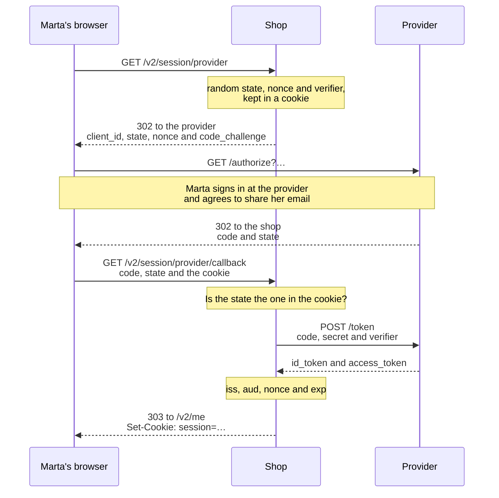

import Term from '~/components/Term.astro';
import TryIt from '~/components/TryIt.astro';
import Analogy from '~/components/Analogy.astro';
import Quiz from '~/components/Quiz.astro';
import QuizQuestion from '~/components/QuizQuestion.astro';
import QuizOption from '~/components/QuizOption.astro';
import ProjectCode from '~/components/ProjectCode.astro';

## The problem

Imagine a photo printing website that asks for your Google password to fetch your photos. With it, it can read your email, delete your files or change the password. And forever: the only way to take that away is to change your password. If the website suffers a data breach, your Google account goes with it.

The shop has the opposite problem. Marta doesn't want yet another password, and she wants to press “Sign in with Google.” **How does Google tell the shop who Marta is, without Marta giving it her password?**

Two standards solve it: OAuth 2.0 gives permissions, and OpenID Connect says who you are. You'll try them against a provider that plays Google on your computer.

## The analogy

<Analogy>

You miss work because you're sick. Your company doesn't examine you: the doctor gives you a stamped sick note, with your name and the date, and your company recognizes the health center's stamp.

“Sign in with Google” is that. The shop doesn't check Marta's password: Google checks it, and gives the shop a signed note.

<div slot="limits">

- You carry the sick note yourself, and you could change it. Here, the browser only carries a single-use pickup number, and the shop collects the note from the provider itself, with its own secret.
- A stamp can be copied; the provider's signature can't be made without its private key.
- A sick note doesn't give permissions. OAuth does: to see your photos, and not your email.

</div>

</Analogy>

## How it really works

### Four roles: who's who

<Term id="oauth">OAuth 2.0</Term> (RFC 6749, from 2012) hands out four roles. With the photo website and with the shop:

| Role | What it does | Photo website | In the shop |
|---|---|---|---|
| Resource owner | Gives the permission | You | Marta |
| Client | The application that asks for access | The photo website | The shop's API |
| Authorization server | Checks who you are and gives out the tokens | Google | Google, or the practice provider |
| Resource server | The API with the data | Google Photos | None |

Careful with “client”: here it's the shop, not the browser or a customer. And the authorization server that says who you are is called the **identity provider**, or just the provider.

### OAuth gives permissions; OpenID Connect says who you are

**OAuth is for giving permissions.** You go to Google's website, and Google asks you: “Do you let this website see your photos?” If you say yes, it gives the website an **access_token**: a token to call the Google Photos API, with a specific permission (the *scope*) and an expiry. The website never sees your password.

But an access_token doesn't say who you are: it's a key for an API, not an ID card.

**<Term id="openid-connect">OpenID Connect</Term> (2014) adds who you are, on top of OAuth.** If the website asks for the `openid` scope, the provider also gives it an **id_token**: a <Term id="jwt">JWT</Term>, like the ones in [lesson 3](/en/phase-6/what-is-jwt/), signed with the provider's <Term id="private-key">private key</Term>. It carries who issues it (`iss`), which website it's for (`aud`), until when it's valid (`exp`) and, above all, **`sub`**: the person's identifier at that provider, which never changes.

| | access_token (OAuth) | id_token (OpenID Connect) |
|---|---|---|
| Who it's for | An API | The website that asked for the sign-in |
| What it says | What can be done | Who has signed in, and for which website |
| Who uses it | The website sends it to the API, without reading it | The website checks it and reads it |

### The authorization code flow, step by step

For a website, RFC 9700 (2025), OAuth's security best practices, recommends **the authorization code flow with PKCE**.



1. Marta presses the button, and her browser asks the shop for `/v2/session/provider`.
2. The shop creates three random values, keeps them in a <Term id="cookie">cookie</Term> and answers with a <Term id="redirect">redirect</Term> to the provider ([lesson 3 of Phase 2](/en/phase-2/http-status-codes/#the-code-and-the-location-header-redirects)).
3. Marta signs in at the provider, with her password there, and agrees.
4. The provider sends the browser back to the shop's callback URL with a **`code`**: a single-use code that expires in minutes.
5. The shop checks the state and exchanges the code for the tokens in a direct request to the provider, <Term id="server">server</Term> to server.
6. It checks the id_token and opens a session, the one from [lesson 2](/en/phase-6/sessions-and-cookies/).

**Why a code, and not the token directly?** Whatever goes through the browser is in plain view: in the history, in the logs, in the extensions. The code alone is useless: exchanging it takes the shop's secret and the verifier. RFC 9700 advises against the old “implicit” flow, with the token in the URL.

### PKCE: the code is useless without the verifier

<Term id="pkce">PKCE</Term> (“pixie”) protects the code in case someone steals it along the way:

- Before sending the browser to the provider, the shop makes up a **verifier**: 32 random bytes.
- On the way there it only sends its SHA-256 <Term id="hash">hash</Term>, the `code_challenge`.
- When exchanging the code, it sends the verifier. The provider computes its hash and compares it with the challenge.

Whoever steals the code doesn't have the verifier, and can't get it from the challenge: a hash can't be undone. PKCE was born for phone apps, which can't keep a secret; RFC 9700 also recommends it to websites with a secret, like the shop.

### The state and the nonce: the way back, tied to whoever started it

Without a state, someone could start a sign-in with their own account, stop before coming back and send Marta the callback link with their code. Marta opens it and is signed in as the attacker: whatever she saves, her address or her card, ends up in the attacker's account. It's a <Term id="csrf">CSRF</Term> on sign-in ([lesson 7](/en/phase-6/csrf-ssrf/)).

**The state prevents it:** a random value the shop keeps in Marta's browser and the provider returns as is. If they don't match, this browser didn't start that way back. **The nonce** travels inside the id_token and ties it to this sign-in.

The shop creates them in `src/provider.ts`, with `openid-client`, by the author of `jose`:

<ProjectCode file="shop-api/27-oauth/src/provider.ts" region="outbound" />

- **`randomState()`, `randomNonce()` and `randomPKCECodeVerifier()`**: 32 random bytes each.
- **`buildAuthorizationUrl`** builds the URL to the provider. It read where `/authorize` is in `/.well-known/openid-configuration`, a <Term id="json">JSON</Term> document every provider publishes with its addresses.
- **`scope`**: `openid` turns OAuth into OpenID Connect.

The route that sends the browser to the provider, in `src/v2.ts`, keeps the three values in a cookie:

<ProjectCode file="shop-api/27-oauth/src/v2.ts" region="provider-start" />

- **`path`**: it only travels to the provider's two routes, for 10 minutes.
- **`sameSite: 'Lax'`, and not `Strict`**: the way back comes from the provider's website, and with `Strict` the browser wouldn't send the cookie ([Phase 2's cookies lesson](/en/phase-2/cookies-httponly-secure-samesite/#samesite-whether-it-travels-when-the-request-comes-from-another-website)).

The callback route reads the cookie and deletes it: each sign-in is finished only once. After that, step 5 is one function:

<ProjectCode file="shop-api/27-oauth/src/provider.ts" region="exchange-code" />

`authorizationCodeGrant` checks the state, exchanges the code with the secret and the verifier, and checks the id_token: `iss`, `aud`, the nonce and `exp`. If something fails, the route answers `400`, and the reason goes to the log.

What about the signature? This id_token doesn't go through the browser: it comes from the provider to the shop. With HTTPS, OpenID Connect allows trusting that connection instead of the signature, and `openid-client` only checks it if you ask it to.

### What the shop keeps: the sub

Migration 008:

<ProjectCode file="shop-api/27-oauth/db/migrations/008-provider.sql" region="provider-sub" />

**The shop recognizes Marta by her `sub`, not by her email,** which can change.

Who she is gets decided by `userFromProvider`, in `src/users.ts`:

<ProjectCode file="shop-api/27-oauth/src/users.ts" region="find-or-link" />

- **First, by `sub`.** If an account has it, that's the one.
- **If not, by email:** it's linked to the account with that email, recording the `sub` in it, **only if the provider says the email is verified**. If not, `409`.
- **If there's none,** it's created, without a password.

Why verified? Otherwise, anyone could create an account at the provider with `ana@shop.example` and get into Ana's. In 2023, websites were found that fell for this with Microsoft accounts ([nOAuth, by Descope](https://www.descope.com/blog/post/noauth)).

### From practice to Google

To use Google, the code doesn't change: the four variables in `.env` do.

1. In the Google Cloud console, you set up the consent screen (what Marta will see) and create an OAuth client ID for a web application.
2. You register the exact callback URL. Google rejects any other: nobody can ask for the code to go to their website.
3. The client ID and the secret it gives you go into `OIDC_CLIENT_ID` and `OIDC_CLIENT_SECRET`, [out of the code and out of Git](/en/phase-1/environment-variables/#keeping-secrets-out-of-the-code).
4. `OIDC_ISSUER=https://accounts.google.com`: the shop reads its `/.well-known/openid-configuration` and finds the rest.

Google accepts `http://localhost` for testing; in production, HTTPS. We haven't tried it with a Google account.

## Try it

The goal: sign in as Marta with you playing the browser, see what the shop keeps, and check that a changed state and a stolen code are useless.

You attack your own shop, on your own computer: doing it against someone else's system without permission is a crime.

### Update your project

You start from your project from [lesson 3](/en/phase-6/what-is-jwt/#write-the-code). Install the shop's library and, for development only, the provider's:

<TryIt
  title="1. Two packages"
  cmd={`npm install openid-client@6.8.8
npm install -D oauth2-mock-server@9.2.0`}
  output={`added 2 packages, and audited 73 packages in 810ms

11 packages are looking for funding
  run \`npm fund\` for details

4 moderate severity vulnerabilities

To address all issues (including breaking changes), run:
  npm audit fix --force

Run \`npm audit\` for details.

added 2 packages, and audited 75 packages in 1s

11 packages are looking for funding
  run \`npm fund\` for details

4 moderate severity vulnerabilities

To address all issues (including breaking changes), run:
  npm audit fix --force

Run \`npm audit\` for details.`}
>

`-D` records it in `devDependencies`: the practice provider never goes to production. The 4 *vulnerabilities* are drizzle-kit's, as in lesson 3. The outputs are from Node 26.11.1 and PostgreSQL 18.6; your codes, tokens and times will be different.

</TryIt>

Add the column in `src/schema.ts` (the marked lines):

<ProjectCode file="shop-api/27-oauth/src/schema.ts" region="users" mark={[9, 10]} />

Write `db/migrations/008-provider.sql` with the SQL above, and generate drizzle-kit's snapshot as in lesson 3:

<TryIt
  title="2. The migration"
  cmd={`npm run db:generate -- --name=provider
npm run db:migrate`}
  output={`> shop-api@1.0.0 db:generate
> drizzle-kit generate --name=provider

No config path provided, using default 'drizzle.config.ts'
Reading config file '/Users/ana/backend-course/phase-3/shop-api/drizzle.config.ts'
9 tables
api_keys 5 columns 0 indexes 0 fks
categories 2 columns 0 indexes 0 fks
idempotency_keys 6 columns 0 indexes 0 fks
orders 5 columns 1 indexes 1 fks
processed_events 2 columns 0 indexes 0 fks
product_categories 2 columns 1 indexes 2 fks
products 4 columns 0 indexes 0 fks
sessions 4 columns 0 indexes 1 fks
users 5 columns 1 indexes 0 fks

[✓] Your SQL migration file ➜ drizzle/0005_provider.sql 🚀

> shop-api@1.0.0 db:migrate
> node --env-file-if-exists=.env scripts/migrate.ts

Applied: 008-provider.sql`}
>

`users` now has 5 columns. If you get `No schema changes`, you didn't save `schema.ts`.

</TryIt>

Then:

1. Create `src/provider.ts`; add `userFromProvider` to `src/users.ts`, the routes to `src/contract.ts` and `src/v2.ts`, and the variables to `src/config.ts`. Whatever you haven't seen, copy it from the step.
2. Add the marked lines to your `.env`. The practice provider accepts any id and secret:

<ProjectCode file="shop-api/27-oauth/.env.example" mark={[15, 16, 17, 18]} />

3. Add the `provider` script to `package.json` (the marked line):

<ProjectCode file="shop-api/27-oauth/package.json" mark={20} />

The provider and the tests come in this lesson's folder; its `test/.env` brings the new variables:

```sh
cd ~/backend-course/phase-3
curl -O https://backenddesdecero.com/practicas/shop-api/27-oauth.tar.gz
tar -xzf 27-oauth.tar.gz
cd shop-api
cp ../27-oauth/scripts/provider.ts scripts/
cp ../27-oauth/test/*.ts ../27-oauth/test/.env test/
```

If you get stuck, compare with `27-oauth`. `npm test` should end with `fail 0`: the tests start their own provider.

### Start the practice provider

Open three terminals in the project folder. In the first one:

<TryIt
  title="3. The provider, on localhost:9000"
  cmd="npm run provider"
  output={`> shop-api@1.0.0 provider
> node scripts/provider.ts

Practice provider at http://localhost:9000
Its configuration: http://localhost:9000/.well-known/openid-configuration`}
>

It's `oauth2-mock-server`, a provider for testing: it doesn't ask for a password, accepts any shop and always says that whoever signs in is this Marta. Never use it outside your computer. It stops with <kbd>Ctrl</kbd> + <kbd>C</kbd>.

</TryIt>

<ProjectCode file="shop-api/27-oauth/scripts/provider.ts" region="person" />

In the second terminal, `npm start`. If it says `Configuration: OIDC_ISSUER: OIDC_ISSUER is missing, or it is not a URL`, the variables are missing from your `.env`.

### Be the browser, redirect by redirect

`curl` doesn't follow redirects unless you ask it to: that way you see each hop. In the third terminal:

<TryIt
  title="4. The way there"
  cmd="curl -s -i -c cookies.txt localhost:3000/v2/session/provider"
  output={`HTTP/1.1 302 Found
location: http://localhost:9000/authorize?redirect_uri=http%3A%2F%2Flocalhost%3A3000%2Fv2%2Fsession%2Fprovider%2Fcallback&scope=openid+email+profile&code_challenge=Ch9c9N8GdTZShksszI13sQVGixUft0MBv9zdfHgD4RI&code_challenge_method=S256&state=tG9PMk9P8rfqBoV9WX5LnTGKfShZD5EapZmoK4VYkf8&nonce=JlQCLmyIVu5ctyLCJlhPKBM2mpNaCkDqYRJViq8gUcc&client_id=shop&response_type=code
vary: Origin
x-request-id: f28ae64c-a2d0-4a87-9b9e-4bbd72f37ba2
set-cookie: provider=eyJzdGF0ZSI6InRHOVBNazlQOHJmcUJvVjlXWDVMblRHS2ZTaFpENUVhcFptb0s0VllrZjgiLCJub25jZSI6IkpsUUNMbXlJVnU1Y3R5TENKbGhQS0JNMm1wTmFDa0RxWVJKVmlxOGdVY2MiLCJ2ZXJpZmllciI6ImNXcThJdEQ1SWpqVTM0VUcwX3c4ZXBrTUNhdl9lNk9lczJYV0phWXJSOGsifQ; Max-Age=600; Path=/v2/session/provider; HttpOnly; Secure; SameSite=Lax
Date: Wed, 14 Oct 2026 04:47:05 GMT
Connection: keep-alive
Keep-Alive: timeout=5
Transfer-Encoding: chunked`}
>

A `302` with `location`, the provider's URL, and `set-cookie`, the three values in JSON and base64url: it starts with `eyJ`, like a JWT. If you get a `500`, the provider isn't running: in the server's terminal you'll see `ECONNREFUSED`.

</TryIt>

So you don't have to copy that URL by hand, start another sign-in and keep its URL in a shell <Term id="variable">variable</Term>:

<TryIt
  title="5. The URL to the provider, parameter by parameter"
  cmd={`START=$(curl -s -o /dev/null -w '%{redirect_url}' -c cookies.txt localhost:3000/v2/session/provider)
echo "$START" | tr '?&' '\\n\\n'`}
  output={`http://localhost:9000/authorize
redirect_uri=http%3A%2F%2Flocalhost%3A3000%2Fv2%2Fsession%2Fprovider%2Fcallback
scope=openid+email+profile
code_challenge=Zxf0ILrALW2nn_jfQTLZnoptcAGbRUpltxG9TuOsJQE
code_challenge_method=S256
state=tyEUmqHQGHOWPvWAA4W45S-XB3JXa1y3tqmmM2GHY6g
nonce=0dDNwbkW8OW8EsQS-QgtjyVViaeRrsUWTGNtrfZjiSM
client_id=shop
response_type=code`}
>

`-w '%{redirect_url}'` writes only the address in `location`, and `-o /dev/null` throws away the rest. `tr` changes `?` and `&` into line breaks ([Phase 1's pipes lesson](/en/phase-1/pipes-and-redirection/)).

`state`, `nonce` and `code_challenge` are different from the ones in step 4: each sign-in gets new ones, and the new cookie replaces the old one.

</TryIt>

Now, what the browser would do: go to the provider.

<TryIt
  title="6. At the provider"
  cmd={`CALLBACK=$(curl -s -o /dev/null -w '%{redirect_url}' "$START")
echo "$CALLBACK" | tr '?&' '\\n\\n'`}
  output={`http://localhost:3000/v2/session/provider/callback
code=dea35e6f-a945-46d7-87d3-b27cfd0efec1
state=tyEUmqHQGHOWPvWAA4W45S-XB3JXa1y3tqmmM2GHY6g`}
>

A real provider would show its sign-in page here. The practice one redirects to the shop right away, with a `code` and the `state` from step 5.

</TryIt>

In the provider's terminal:

```text
/authorize: Marta Ruiz signs in. Back to http://localhost:3000/v2/session/provider/callback
  with code=dea35e6f-a945-46d7-87d3-b27cfd0efec1 and state=tyEUmqHQGHOWPvWAA4W45S-XB3JXa1y3tqmmM2GHY6g
```

<TryIt
  title="7. The way back"
  cmd={`curl -s -i -b cookies.txt -c cookies.txt "$CALLBACK"`}
  output={`HTTP/1.1 303 See Other
location: /v2/me
vary: Origin
x-request-id: 582f3f27-6264-41b6-880f-1a24f05d1258
set-cookie: provider=; Max-Age=0; Path=/v2/session/provider; HttpOnly; Secure; SameSite=Lax
set-cookie: session=JLxhnpEfpHPRXXHjNUAaXVvTPYtx8VikfP0GJlxPMo4; Max-Age=604800; Path=/; HttpOnly; Secure; SameSite=Lax
Date: Wed, 14 Oct 2026 04:47:05 GMT
Connection: keep-alive
Keep-Alive: timeout=5
Transfer-Encoding: chunked`}
>

`-b cookies.txt` sends back the cookie from the way there. The shop has exchanged the code: a `/token` line shows up in the provider's terminal. Two `set-cookie`: the one from the way there, deleted with `Max-Age=0`, and the session one from [lesson 2](/en/phase-6/sessions-and-cookies/).

</TryIt>

<TryIt
  title="8. Who you are"
  cmd={`curl -s -w '\\n' -b cookies.txt localhost:3000/v2/me`}
  output={`{"type":"user","id":1,"email":"marta@example.com"}`}
>

**It's account 1, the one Marta created with a password in [lesson 1](/en/phase-6/how-to-store-passwords/#marta-signs-up):** her email is verified, and the shop has linked it. If your Marta has another id, it's the one she got.

</TryIt>

### Marta's row

<TryIt
  title="9. Marta's row"
  cmd={`psql -d shop -c 'SELECT id, email, provider_sub, password_hash IS NOT NULL AS has_password FROM users;'`}
  output={` id |       email       |    provider_sub     | has_password
----+-------------------+---------------------+--------------
  1 | marta@example.com | provider-marta-0001 | t
(1 row)`}
>

`provider_sub` has Marta's `sub`, and `has_password` is `t` (*true*): Marta gets into the same account both ways. If you have the practice accounts, you'll see more rows.

</TryIt>

### A changed state

Now you play the attacker: a way back with a state your browser didn't keep.

<TryIt
  title="10. Someone else’s state"
  cmd={`START=$(curl -s -o /dev/null -w '%{redirect_url}' -c cookies.txt localhost:3000/v2/session/provider)
CALLBACK=$(curl -s -o /dev/null -w '%{redirect_url}' "$START")
TAMPERED=$(echo "$CALLBACK" | sed 's/state=.*/state=from-another-browser/')
curl -s -w '\\n' -b cookies.txt -c cookies.txt "$TAMPERED"
curl -s -w '\\n' -b cookies.txt -c cookies.txt "$CALLBACK"`}
  output={`{"type":"https://shop.example/problems/provider-sign-in","title":"Could not sign in with the provider","status":400,"detail":"The provider's response is not valid, or this browser did not start it: start again"}
{"type":"https://shop.example/problems/provider-sign-in","title":"Could not sign in with the provider","status":400,"detail":"The provider's response is not valid, or this browser did not start it: start again"}`}
>

`sed` changes the state in the URL. **The tampered way back gets a `400`**, and the server's log says why: `unexpected "state" response parameter value`. The shop didn't even call the provider: there's no `/token` in its terminal.

What about the second one, with the right state? Also `400`: the first one deleted the cookie.

</TryIt>

### A stolen code, without the verifier

Now you play the shop, with PKCE by hand, and the code thief.

<TryIt
  title="11. The code, without its verifier"
  cmd={`V=$(openssl rand -base64 32 | tr '+/' '-_' | tr -d '=')
C=$(printf '%s' "$V" | openssl dgst -sha256 -binary | base64 | tr '+/' '-_' | tr -d '=')
REDIRECT_URI=http://localhost:3000/v2/session/provider/callback
CODE=$(curl -s -o /dev/null -w '%{redirect_url}' "localhost:9000/authorize?response_type=code&client_id=shop&scope=openid+email&redirect_uri=$REDIRECT_URI&state=1&nonce=n-0001&code_challenge=$C&code_challenge_method=S256" | sed 's/.*code=//; s/&.*//')
curl -s -w '\\n' -d grant_type=authorization_code -d client_id=shop -d redirect_uri=$REDIRECT_URI -d code=$CODE -d code_verifier=one-made-up-by-whoever-stole-the-code-0123456789 localhost:9000/token`}
  output={`{"type":"https://tools.ietf.org/html/rfc9110#section-15.5.1","title":"Bad Request","detail":"code_verifier provided does not match code_challenge"}`}
>

- **`V`** is the verifier: 32 random bytes, in base64url. **`C`**, its challenge: the SHA-256 of `V`, in base64url.
- **`CODE`**: you ask for a code with the challenge, and `sed` takes it out of the callback URL.
- **The last `curl`** does step 5 with the thief's verifier. `-d` sends each piece of data in the body of a `POST`.

The verifier doesn't match the challenge, and there are no tokens. A limit of the practice provider: with no verifier at all, it gives out the tokens. A real one requires it if the way there carried a challenge (RFC 7636).

</TryIt>

With the right verifier and a new code:

<TryIt
  title="12. Marta’s id_token"
  cmd={`CODE=$(curl -s -o /dev/null -w '%{redirect_url}' "localhost:9000/authorize?response_type=code&client_id=shop&scope=openid+email&redirect_uri=$REDIRECT_URI&state=1&nonce=n-0001&code_challenge=$C&code_challenge_method=S256" | sed 's/.*code=//; s/&.*//')
curl -s -o tokens.json -d grant_type=authorization_code -d client_id=shop -d redirect_uri=$REDIRECT_URI -d code=$CODE -d code_verifier=$V localhost:9000/token
node -p "JSON.parse(Buffer.from(require('./tokens.json').id_token.split('.')[1], 'base64url'))"`}
  output={`{
  iss: 'http://localhost:9000',
  iat: 1791953239,
  exp: 1791956839,
  nbf: 1791953229,
  sub: 'provider-marta-0001',
  aud: 'shop',
  nonce: 'n-0001',
  email: 'marta@example.com',
  email_verified: true,
  name: 'Marta Ruiz'
}`}
>

`tokens.json` keeps the response: the access_token, the id_token and a token to renew them. `node` decodes the second part of the id_token, as you did with `base64` in [lesson 3](/en/phase-6/what-is-jwt/#a-jwt-made-read-and-broken).

There's what the shop checks and uses: `iss`, `aud` (the shop's id), your `nonce`, `sub` and `email_verified`. `nbf` (*not before*) says from when it's valid. If you get `Cannot read properties of undefined`, look at the error in `tokens.json`: do steps 11 and 12 in the same terminal.

</TryIt>

## You have already seen it

- **“Sign in with Google,” “with Apple” or “with GitHub.”** It's this flow. The screen that asks you for permission is step 3, and what it asks for are the scopes.
- **The address bar.** When you press the button, you see `accounts.google.com/…` for a moment, with `client_id`, `redirect_uri` and `state`: the way there.
- **The apps with access to your account.** Your Google account lists the permissions you gave, and that's where you take them away.
- **DevTools' Network tab** ([Phase 2's introduction](/en/phase-2/#before-you-start-devtools)). With “Preserve log” on, each redirect in a sign-in is a row.

## Common mistakes

- **Using the access_token as proof of who someone is.** That's what the id_token is for, once checked.
- **Skipping the state, or always using the same one.** The attacker's way back gets in as if it were yours.
- **Recognizing people by email, or linking accounts with an unverified email.** Use the `sub`, and only link with `email_verified`.
- **Open callback URLs, or ones with wildcards.** The code would end up wherever the attacker says.
- **The client secret in the frontend or in Git.** It goes in the server's `.env`.

## Summary

- OAuth 2.0 gives a website limited permission, the access_token, without it seeing your password. OpenID Connect adds who you are: the id_token, a JWT signed by the provider.
- The code flow with PKCE: the browser only carries a single-use code, and the shop exchanges it for the tokens in a direct request.
- PKCE makes a stolen code useless; the state ties the way back to the browser that started it, and the nonce ties the id_token to that sign-in.
- The shop recognizes people by the `sub`, and links accounts by email only if it's verified.
- Moving to Google means changing the issuer, the client ID, the secret and the callback URL.

## Did you get it?

<Quiz>

<QuizQuestion
  question="A photo printing website asks for your Google password to import your photos, and promises not to keep it. What do you tell it?"
  review="OAuth gives permissions; OpenID Connect says who you are"
>

<QuizOption text="That’s fine, if the page uses HTTPS and the password doesn’t travel in plain text.">

HTTPS protects the password on its way to the website; afterwards, with your password, the website can do everything you can.

</QuizOption>

<QuizOption text="To use OAuth: you sign in at Google and give it permission for your photos only." correct>

The website never sees your password, gets a specific permission, and you take it away whenever you want.

</QuizOption>

<QuizOption text="That’s fine, if you change your Google password afterwards so it stops working for them.">

Until then it can read your email, or change the password before you do.

</QuizOption>

</QuizQuestion>

<QuizQuestion
  question="Luis has written his own provider callback and doesn’t check the state. What attack does that leave open?"
  review="The state and the nonce: the way back, tied to whoever started it"
>

<QuizOption text="A customer ending up in the attacker’s account through a link of theirs." correct>

Without a state, the shop doesn't know whether that browser started the way back. Whatever the customer saves there, the attacker sees.

</QuizOption>

<QuizOption text="Someone exchanging the code for the tokens without the PKCE verifier.">

PKCE prevents that, at the provider, with or without a state.

</QuizOption>

<QuizOption text="Someone forging the id_token’s signature and signing in as whoever they want.">

The id_token comes from the provider to the shop, without going through the browser: the attacker can't slip one in, whether there's a state or not.

</QuizOption>

</QuizQuestion>

<QuizQuestion
  question="A proxy writes full URLs to its log, and someone reads a callback code there before the shop uses it. What stops them from exchanging it for the tokens?"
  review="PKCE: the code is useless without the verifier"
>

<QuizOption text="The state: the provider rejects the code if the state from the way there doesn’t reach it.">

The provider doesn't check the state: it returns it as is. And the state was in the same URL as the code.

</QuizOption>

<QuizOption text="Nothing: with the code and the client ID, which is public, the provider hands over the tokens.">

Exchanging it takes the PKCE verifier and, for a website, the shop's secret.

</QuizOption>

<QuizOption text="The PKCE verifier: only its hash traveled in the URL, and without it there are no tokens." correct>

You saw it in step 11: a made-up verifier doesn't match the challenge.

</QuizOption>

</QuizQuestion>

<QuizQuestion
  question="A recipe app only wants to know who you are, not read your email or your photos. What does it ask the provider for?"
  review="OAuth gives permissions; OpenID Connect says who you are"
>

<QuizOption text="An access_token with permission to read your email, and it looks at whose address it is.">

It would be asking for a permission it doesn't need, and an access_token isn't proof of who you are.

</QuizOption>

<QuizOption text="The openid scope, and it reads the id_token after checking it." correct>

`openid` turns OAuth into OpenID Connect: the id_token says who you are, without giving access to anything.

</QuizOption>

<QuizOption text="Your password at the provider, which it checks by sending it to the provider over HTTPS.">

That's what OAuth came to avoid: the password is only typed on the provider's website.

</QuizOption>

</QuizQuestion>

<QuizQuestion
  question="Someone creates an account at a provider with the email ana@shop.example, without verifying it, and signs in to the shop with it. Ana already had an account. What does the shop do?"
  review="What the shop keeps: the sub"
>

<QuizOption text="Link it to Ana’s: the email is the same, so it’s the same person.">

Anyone can type in an unverified email: linking them would hand over Ana's account.

</QuizOption>

<QuizOption text="Let them into Ana’s: if the provider lets them in, the email is theirs.">

The provider has checked that account's password, not that the email belongs to whoever created it.

</QuizOption>

<QuizOption text="Not link it: without email_verified, it answers 409 and opens no session." correct>

Only a verified email shows that the person controls it.

</QuizOption>

</QuizQuestion>

<QuizQuestion
  question="Marta changes her email at the provider, from marta@example.com to marta.ruiz@example.com. What happens the next time she signs in to the shop with the provider?"
  review="What the shop keeps: the sub"
>

<QuizOption text="She gets into her same account: the shop looks her up by her sub first, which hasn’t changed." correct>

The `sub` doesn't change with the email: that's why the shop keeps it.

</QuizOption>

<QuizOption text="The shop creates a new account for her, because it recognizes each person by their email.">

The shop recognizes people by the `sub`. The email only counts the first time, to link an account.

</QuizOption>

<QuizOption text="She can’t get in until she also changes the email in the shop, because they no longer match.">

With the `sub`, the shop doesn't look at the email: it finds the account and opens the session.

</QuizOption>

</QuizQuestion>

</Quiz>

## Further reading

- [RFC 6749: The OAuth 2.0 Authorization Framework](https://www.rfc-editor.org/rfc/rfc6749.html).
- [RFC 9700: Best Current Practice for OAuth 2.0 Security](https://www.rfc-editor.org/rfc/rfc9700.html): why the code flow with PKCE.
- [RFC 7636: Proof Key for Code Exchange](https://www.rfc-editor.org/rfc/rfc7636.html).
- [OpenID Connect Core 1.0](https://openid.net/specs/openid-connect-core-1_0.html): the id_token.
- [OAuth 2.0 Cheat Sheet](https://cheatsheetseries.owasp.org/cheatsheets/OAuth2_Cheat_Sheet.html) (OWASP).
- [OpenID Connect at Google](https://developers.google.com/identity/openid-connect/openid-connect): how to register a website.
- [openid-client](https://github.com/panva/openid-client) and [oauth2-mock-server](https://github.com/axa-group/oauth2-mock-server): the lesson's libraries.
