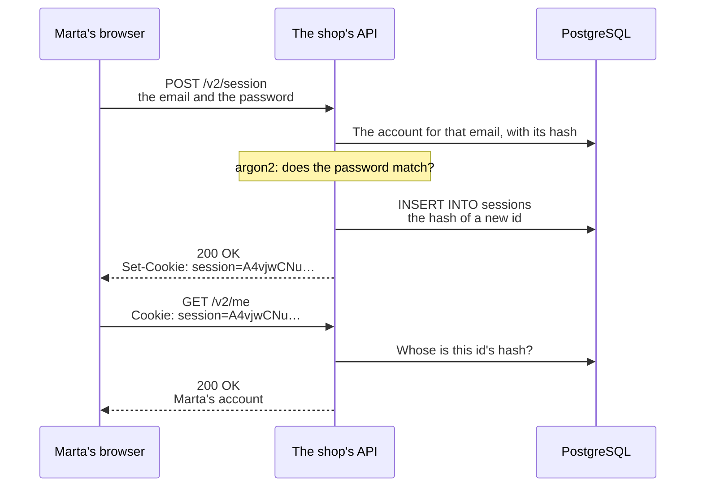

import Term from '~/components/Term.astro';
import TryIt from '~/components/TryIt.astro';
import Analogy from '~/components/Analogy.astro';
import SelfCheck from '~/components/SelfCheck.astro';
import Quiz from '~/components/Quiz.astro';
import QuizQuestion from '~/components/QuizQuestion.astro';
import QuizOption from '~/components/QuizOption.astro';
import ProjectCode from '~/components/ProjectCode.astro';

## The problem

In [lesson 1, “Passwords,”](/en/phase-6/how-to-store-passwords/) Marta created her account. Today she signs in: she types her email and her password once, and then makes ten more requests. How does the API know that all ten are Marta's?

HTTP doesn't remember anything from one request to the next ([lesson 5 of Phase 2](/en/phase-2/cookies-httponly-secure-samesite/)). Sending the password with each one would force the browser to keep it, and every request would pay the 20 ms of the <Term id="password-hashing">slow hash</Term>.

The answer is a <Term id="session">session</Term>, and it brings three questions:

- What does the browser keep, and what does the server keep?
- What happens if someone copies what the browser keeps?
- When Marta clicks “Sign out” on a library computer, is she really signed out?

## The analogy

<Analogy>

At the gate of a festival they ask for your ticket and your ID, just once, and put a wristband with a long code on you. At every bar they scan the code, and the festival's computer says whether it's valid and whose it is.

If you lose the wristband, they cancel the code at the entrance. Cutting it off isn't enough if someone took a photo of it. And it's valid until the last day of the festival.

<div slot="limits">

- Nobody takes your wristband off without you noticing. A cookie can be copied without you finding out, and the copy is worth the same as the original.
- At the bar they see your face. The server sees nobody: to it, whoever brings the id is Marta.
- The festival keeps the codes as they are; the shop, only their hash.

</div>

</Analogy>

## How it really works

### Signing in: the password once, and an id in return



There are two moments: signing in, once, and every request after that. The sign-in route, in `src/v2.ts`:

<ProjectCode file="shop-api/25-sessions/src/v2.ts" region="sign-in" />

- **`checkCredentials(email, password)`** finds the account and verifies the password with argon2, as in lesson 1.
- **If it doesn't match, a `400`** with <Term id="problem-details">Problem Details</Term>, the same one for any failure (more on why below).
- **`openSession(c, user.id)`** creates the session and sends its id in the <Term id="cookie">cookie</Term>.
- **The response is the account**, the id and the email: never the hash.

The password goes in the body of a `POST`, never in the URL, which ends up in logs and browser histories.

### A long, random id

<ProjectCode file="shop-api/25-sessions/src/sessions.ts" region="create-session" />

- **`randomBytes(32)`**: 32 bytes from the random generator meant for secrets, the one used to make keys. That's 256 bits: there are more possible ids than atoms on Earth.
- **`toString('base64url')`** writes those bytes as 43 letters, digits, `-` and `_`, which fit in a cookie as they are.
- **`db.insert(sessions)`** stores the id's hash, whose session it is and until when it's valid: `now()` plus a week. The id itself only goes out, to the cookie.

Why so long? In the [introduction](/en/phase-6/) you requested orders 1 to 25 in less than a second. If sessions were `1`, `2`, `3`…, they would be stolen just as easily. The time or `Math.random()` won't do either: they can be predicted.

### In the table, only its hash

The new table, in migration 006:

<ProjectCode file="shop-api/25-sessions/db/migrations/006-sessions.sql" region="sessions" />

- **`id_hash bytea`**: the 32 bytes of the id's SHA-256 <Term id="hash">hash</Term>, as the <Term id="primary-key">primary key</Term>.
- **`ON DELETE CASCADE`**: if an account is deleted, its sessions go with it.

**Why the hash and not the id?** Because the id works like a password: whoever has it gets in. Someone who took a copy of the table (a lost backup, a <Term id="sql-injection">SQL injection</Term> like the ones in [lesson 6](/en/phase-6/sql-injection-xss/)) with the ids in plain text would get into every account with an open session. With the hash, they wouldn't: a hash can't be undone.

And why SHA-256, if in [lesson 1](/en/phase-6/how-to-store-passwords/#sha-256-is-too-fast) a fast hash was a mistake? There, the danger was trying likely passwords, a list that exists. For a random id there's no list. And this hash is computed on every request: with argon2, each one would take 20 ms longer.

### Every request: from the cookie to the account

This <Term id="middleware">middleware</Term> runs on every route, in `src/middleware/session.ts`:

<ProjectCode file="shop-api/25-sessions/src/middleware/session.ts" region="load-session" />

- **`sessionId(c)`** looks for the id in the `session` cookie and, if it isn't there, in the `Authorization: Bearer …` header, for programs that don't keep cookies, like a phone app.
- **`sessionUser(id)`** finds out whose account that id's hash belongs to (see below).
- **`c.set('user', user)`** leaves the account in `c.var.user` for the routes (`src/env.ts` tells TypeScript what's there). Without a session, it does nothing: if a route needs one, `requireIdentity` decides.

A query on every request is the price of sessions. In [lesson 3, “JWT,”](/en/phase-6/what-is-jwt/) you'll see who skips it, and at what cost.

### The cookie: what each attribute stops

<ProjectCode file="shop-api/25-sessions/src/middleware/session.ts" region="cookie" />

You saw the attributes in the [Phase 2 lesson on cookies](/en/phase-2/cookies-httponly-secure-samesite/). What each one stops, here:

| Attribute | In the shop |
|---|---|
| `HttpOnly` | A script slipped into a page of the shop (<Term id="xss">XSS</Term>, [lesson 6](/en/phase-6/sql-injection-xss/)) can't read the id |
| `Secure` | The id only travels over <Term id="https">HTTPS</Term>: on a coffee shop's Wi-Fi, nobody reads it on the way |
| `SameSite=Lax` | Another site can't make your browser send a `POST` to the shop with your session: the <Term id="csrf">CSRF</Term> of [lesson 7](/en/phase-6/csrf-ssrf/) |
| `Path=/` | It's valid for the whole API |
| `Max-Age=604800` | The browser forgets it in a week, which is how long the session lasts |

And `Secure` without HTTPS, on your computer? Chrome, Firefox and `curl` treat `http://localhost` as secure. But `http://127.0.0.1:3000` is a different site for the browser, with its own cookies: there it wouldn't recognize you.

### Signing out is deleting the row

`closeSession` does two things: it deletes the row from the table (`deleteSession`) and asks the browser to forget the cookie (`deleteCookie`, which sends it again, empty and with `Max-Age=0`).

The one that matters is the first. **Deleting the cookie only deletes it from that browser:** a copy (from a malicious program, an extension, a `curl` file) is still valid as long as the row exists.

`DELETE /v2/session` answers `204` even if there's no session: the result is the same. And “sign out of all devices” is deleting all of an account's rows, something worth doing when someone changes their password.

### The server decides when it expires

`Max-Age` is a request to the browser, and a copy of the cookie has no reason to obey it. That's why the server checks `expires_at` on every request:

<ProjectCode file="shop-api/25-sessions/src/sessions.ts" region="find-session" />

- **The `select`** joins `sessions` with `users` (a <Term id="join">JOIN</Term>) and searches by the id's hash.
- **`row.expiresAt <= new Date()`**: if that time has already passed, it isn't valid, and it's deleted while we're at it.

A week is a choice. <Term id="owasp">OWASP</Term> also recommends closing it after a while without use: your bank throws you out in minutes; a social network, in months. The more an account is worth, the shorter the session.

### A new id every time you sign in

**Session fixation** is making the victim sign in with an id the attacker already knows. Many sites give every visitor a session, for the cart, and write the account into it when they sign in. If the id doesn't change, someone can get one, leave it in Marta's browser (on a shared computer) and wait: when Marta signs in, that id is her session.

`openSession` prevents it, in the cookie code: if the request already brought a session, it deletes it and creates another. **After signing in, always a new id.**

### The same error for an email that doesn't exist

<ProjectCode file="shop-api/25-sessions/src/users.ts" region="check-credentials" />

The login must not reveal which emails have an account (*user enumeration*). It takes two things:

- **The same response.** An email that doesn't exist and a wrong password get the same `400` with the same body: “The email or the password is not correct.”
- **The same time.** Without an account there would be no hash to verify, and the response would arrive 20 ms earlier. `DUMMY_HASH`, the hash of a password nobody knows, makes sure one is always verified.

Why does it matter? Being a customer of a shop is already personal data (think of a pharmacy), and whoever tries stolen passwords can skip the accounts that don't exist.

One caveat: `POST /v2/accounts` does say it, with its `409`. Big sites always answer the same and send an email; lesson 8, “Rate limiting,” will limit how many times you can ask.

### 400 when signing in, 401 afterwards, with WWW-Authenticate

<ProjectCode file="shop-api/25-sessions/src/middleware/session.ts" region="require-identity" />

- **`GET /v2/me` without a session: `401`.** The standard asks every `401` to say in `WWW-Authenticate` how to identify yourself ([lesson 6 of Phase 3](/en/phase-3/what-is-middleware/#a-guard-that-answers-401)). HTTP has no scheme for “send your cookie,” and many APIs with sessions skip the header. The shop sends it without lying: it accepts the same id as `Authorization: Bearer …`, so `Bearer realm="shop-api"` (`realm`, the name of the protected area) promises something true.
- **`POST /v2/session` with a wrong password: `400`.** A `401` would ask you to identify yourself, and this route is exactly where you do that. <Term id="oauth">OAuth 2.0</Term> answers the same to a wrong password, and so does the webhook signature in [Phase 4](/en/phase-4/webhooks-idempotency/#checking-the-signature-the-body-as-it-is-in-constant-time). Other APIs answer `401`: what matters is that it's the same for both failures.

### A second factor, when the password is not enough

A stolen password opens the account. Two-step <Term id="authentication">authentication</Term> also asks for something only the person has: a **TOTP** code, six digits an app computes every 30 seconds from a secret and the time, or a **passkey**, a key pair like the ones in [Phase 0](/en/phase-0/tls-and-https/#two-keys-public-key-cryptography) kept on your device, with nothing to type into a fake site. The session opens after the second step. The shop doesn't build it; [OWASP's guide](https://cheatsheetseries.owasp.org/cheatsheets/Multifactor_Authentication_Cheat_Sheet.html) explains how.

## Try it

The goal: sign in as Marta with `curl`, find her session in the table, and prove that after signing out a copy of the cookie no longer opens anything. Then, in the browser.

You're going to reuse a stolen cookie, your own, on `localhost`. Doing it with someone else's, on a system that isn't yours, is a crime.

### Write the code

You start from your project from lesson 1, “Passwords”:

1. In `src/schema.ts`, the `sessions` table. Generate its migration with `npm run db:generate -- --name=sessions` and save it as `db/migrations/006-sessions.sql`.
2. Create `src/sessions.ts`, `src/env.ts` and `src/middleware/session.ts`.
3. In `src/users.ts`, `checkCredentials`; in `src/schemas.ts`, `credentialsSchema`.
4. In `src/contract.ts`, the three routes; in `src/v2.ts`, their functions; in `src/app.ts`, `app.use(loadSession)`.

Whatever you haven't seen here, copy it from the step. The tests come in its folder:

```sh
cd ~/backend-course/phase-3
curl -O https://backenddesdecero.com/practicas/shop-api/25-sessions.tar.gz
tar -xzf 25-sessions.tar.gz
cd shop-api
cp ../25-sessions/test/*.ts test/
```

<TryIt
  title="1. The sessions table"
  cmd="npm run db:migrate"
  output={`> shop-api@1.0.0 db:migrate
> node --env-file-if-exists=.env scripts/migrate.ts

Applied: 006-sessions.sql`}
>

If you get `was not applied`, read the PostgreSQL error that comes after it.

</TryIt>

<TryIt
  title="2. This lesson's tests"
  cmd="npm test -- test/sessions.test.ts"
  output={`> shop-api@1.0.0 test
> node --env-file=test/.env --test --test-concurrency=1 test/sessions.test.ts

✔ signing in (with the email in other capitals): 200 with the account; /v2/me recognizes it (217.817444ms)
✔ the cookie: a long random id, HttpOnly, Secure, SameSite=Lax, Path=/ and a week (66.636666ms)
✔ in the table, only the SHA-256 of the id, and it expires in a week (72.655318ms)
✔ a wrong password and an email that does not exist: the same response, without a cookie (132.020073ms)
✔ an account without a password (from an identity provider) cannot get in with one (26.363945ms)
✔ /v2/me without a session, or with a made-up id: 401 with WWW-Authenticate (9.741385ms)
✔ signing out: 204, the cookie is deleted, and the old id is no longer valid even if kept (59.212743ms)
✔ an expired session is not valid, and it is deleted (76.591484ms)
✔ when signing in, a new id: the one the browser brought is deleted (session fixation) (174.231315ms)
ℹ tests 9
ℹ suites 0
ℹ pass 9
ℹ fail 0
ℹ cancelled 0
ℹ skipped 0
ℹ todo 0
ℹ duration_ms 3191.27171`}
>

One test for each idea in the lesson. The outputs are from Node 26 and PostgreSQL 18; your times, ids and dates will be different.

</TryIt>

### Sign in with curl

Start the API with `npm start` and open another terminal in the project folder. Marta signs in with the password you gave her in lesson 1:

<TryIt
  title="3. Signing in"
  cmd={`curl -s -i -w '\\n' -c cookies.txt --json '{"email":"marta@example.com","password":"a long sentence only I know"}' localhost:3000/v2/session`}
  output={`HTTP/1.1 200 OK
content-type: application/json
vary: Origin
x-request-id: a980cebd-8b89-4aa5-b7fb-ccbcd23ae050
set-cookie: session=A4vjwCNur4PcId04eQa48meWarqyfFZ33vHvmsUppUY; Max-Age=604800; Path=/; HttpOnly; Secure; SameSite=Lax
content-length: 36
Date: Wed, 14 Oct 2026 04:42:25 GMT
Connection: keep-alive
Keep-Alive: timeout=5

{"id":1,"email":"marta@example.com"}`}
>

Look at `set-cookie`: the id, 43 random characters, and the five attributes. `-c cookies.txt` saves the cookie in a file, as in Phase 2. If you get a `400`, check Marta's password.

</TryIt>

<TryIt
  title="4. What curl saved"
  cmd="cat cookies.txt"
  output={`# Netscape HTTP Cookie File
# https://curl.se/docs/http-cookies.html
# This file was generated by libcurl! Edit at your own risk.

#HttpOnly_localhost	FALSE	/	TRUE	1792557745	session	A4vjwCNur4PcId04eQa48meWarqyfFZ33vHvmsUppUY`}
>

`#HttpOnly_` in front of `localhost` isn't a comment: it marks the cookie as `HttpOnly`. The fourth column, `TRUE`, is `Secure`, and `1792557745` is the expiry: a week later, in seconds since 1970. **This file is an open session:** whoever has it is Marta.

</TryIt>

<TryIt
  title="5. Who am I? With and without the cookie"
  cmd={`curl -s -w '\\n' -b cookies.txt localhost:3000/v2/me
curl -s -i -w '\\n' localhost:3000/v2/me`}
  output={`{"id":1,"email":"marta@example.com"}
HTTP/1.1 401 Unauthorized
content-type: application/problem+json
vary: Origin
www-authenticate: Bearer realm="shop-api"
x-request-id: 65ada8e7-7d28-4cab-bdcb-98b6fa8f2bb7
content-length: 83
Date: Wed, 14 Oct 2026 04:42:25 GMT
Connection: keep-alive
Keep-Alive: timeout=5

{"type":"about:blank","title":"Unauthorized","status":401,"detail":"Sign in first"}`}
>

With `-b cookies.txt`, Marta's account. Without it, the `401` with its `www-authenticate`.

</TryIt>

### Find the session in the table

<TryIt
  title="6. The session's row"
  cmd={`psql -d shop -c "SELECT encode(id_hash, 'hex') AS id_hash, user_id, created_at, expires_at FROM sessions;"`}
  output={`                             id_hash                              | user_id |          created_at           |          expires_at
------------------------------------------------------------------+---------+-------------------------------+-------------------------------
 3aa9cb38a4213f73cbb1cdee83fb15118ab65dce5ea54bdfe7d53daaa6a2903a |       1 | 2026-10-14 04:42:25.024599+00 | 2026-10-21 04:42:25.024599+00
(1 row)`}
>

`encode(…, 'hex')` writes the bytes as text. The id from the cookie, `A4vjwCNu…`, isn't there. And `expires_at` is a week after `created_at`.

</TryIt>

Sure that hash is the id's? Compute it yourself:

<TryIt
  title="7. The id's SHA-256"
  cmd={`ID=$(grep session cookies.txt | cut -f7)
printf %s "$ID" | shasum -a 256`}
  output="3aa9cb38a4213f73cbb1cdee83fb15118ab65dce5ea54bdfe7d53daaa6a2903a  -"
>

`$(…)` stores in `ID` what the command inside writes: column 7 (`cut -f7`) of the cookie's line. `printf %s` writes it without a line break, which would change the hash. Out comes the one in the table: from the id you get to the hash, and from the hash there's no way back.

</TryIt>

<TryIt
  title="8. The same session, without a cookie"
  cmd={`curl -s -w '\\n' -H "Authorization: Bearer $ID" localhost:3000/v2/me`}
  output={`{"id":1,"email":"marta@example.com"}`}
>

What the `WWW-Authenticate` promised: the id in `Authorization` is worth the same as in the cookie.

</TryIt>

### An email that doesn't exist and a wrong password

<TryIt
  title="9. Two failures, one response"
  cmd={`curl -s -w ' %{http_code} %{time_total}s\\n' --json '{"email":"marta@example.com","password":"some other sentence"}' localhost:3000/v2/session
curl -s -w ' %{http_code} %{time_total}s\\n' --json '{"email":"nobody@example.com","password":"some other sentence"}' localhost:3000/v2/session`}
  output={`{"type":"https://shop.example/problems/invalid-credentials","title":"The email or the password is not correct","status":400,"detail":"Check both and try again"} 400 0.026844s
{"type":"https://shop.example/problems/invalid-credentials","title":"The email or the password is not correct","status":400,"detail":"Check both and try again"} 400 0.020785s`}
>

`%{time_total}` is how long the response took. The body and the code, identical; the times, similar. If you repeat it, they jump around, but neither of the two skips the hash.

</TryIt>

### Sign out, and come back with the copy

Before signing out, copy the cookie file, as whoever stole it from you would:

<TryIt
  title="10. Signing out and reusing the copy"
  cmd={`cp cookies.txt copy.txt
curl -s -i -b cookies.txt -c cookies.txt -X DELETE localhost:3000/v2/session
curl -s -w '\\n' -b copy.txt localhost:3000/v2/me`}
  output={`HTTP/1.1 204 No Content
vary: Origin
x-request-id: a62e8a69-4b01-401d-9580-be1d53171758
set-cookie: session=; Max-Age=0; Path=/; HttpOnly; Secure; SameSite=Lax
Date: Wed, 14 Oct 2026 04:42:36 GMT
Connection: keep-alive
Keep-Alive: timeout=5

{"type":"about:blank","title":"Unauthorized","status":401,"detail":"Sign in first"}`}
>

The `DELETE` deletes the row, and its `Max-Age=0` removes the cookie from `cookies.txt`. What matters is the last line: **the copy, which still has the id, gets a `401`**. If the route only deleted the cookie, the copy would still be Marta for a week.

</TryIt>

<SelfCheck question="Challenge: sign in again with -c cookies.txt, copy the file as before.txt and sign in a second time sending the cookie you already have (-b cookies.txt -c cookies.txt). Does the id change? What does /v2/me answer with before.txt?">

The id changes. With `grep session before.txt cookies.txt | cut -f7` you'll see two different ones, like these:

```
Q6owc_SNUa-YnjC27m2QywBufrhhzfikTIG25hfgq48
I9e8FctNBZN42wzRxLg8nuMlxdeHgiL8NZVmV7Hi7Mo
```

And `curl -s -o /dev/null -w '%{http_code}\n' -b before.txt localhost:3000/v2/me` gives `401` (with `cookies.txt`, `200`): `openSession` deleted the session the request brought. It's the defense against session fixation.

</SelfCheck>

When you're done, delete the files with `rm cookies.txt copy.txt before.txt`: they hold sessions, and they mustn't end up in Git.

### In the browser

Open Chrome at `http://localhost:3000/v2/me`: the `401`. Open <Term id="devtools">DevTools</Term> as in the [Phase 2 introduction](/en/phase-2/#before-you-start-devtools) and type or paste this into the **Console** (if Chrome doesn't let you paste, it tells you what to type first to allow it):

```js
await fetch('/v2/session', { method: 'POST', headers: { 'Content-Type': 'application/json' }, body: JSON.stringify({ email: 'marta@example.com', password: 'a long sentence only I know' }) })
```

The console shows a `Response` with `status: 200`. Now:

1. **The cookie.** In **Application** › **Cookies** › `http://localhost:3000`, the `session` row, with `HttpOnly` and `Secure` checked, `SameSite` set to `Lax` and an expiry a week from now.
2. **What JavaScript sees.** In the console, `document.cookie` gives `''`.
3. **Who you are.** Reload the tab: Marta's account.
4. **Signing out.** `await fetch('/v2/session', { method: 'DELETE' })` gives `status: 204`; the row disappears from **Cookies** when you refresh the list, and the tab goes back to the `401`.

We checked it with Chromium 153, driven by Playwright in Docker.

## You have already seen it

- **“Sign out of all devices”**, on Google or Netflix: all your sessions at once, one per browser or app; in the shop, all your rows in `sessions`.
- **“Your session has expired,”** on your bank's website, after a few minutes without touching it: an expiry for inactivity.
- **“The email or the password is not correct,”** without saying which of the two: on purpose.

## Common mistakes

- **Storing the id in plain text** in the table: store its hash.
- **Ids that can be guessed:** consecutive numbers, the time or `Math.random()`. Use `randomBytes(32)`.
- **Signing out by deleting only the cookie.** Delete the row.
- **Trusting `Max-Age`.** The server checks the expiry.
- **Keeping the id from before the login.** When someone signs in, delete the old one and create another.
- **Saying “that email doesn't exist,”** or answering sooner when it doesn't.
- **Keeping the id in `localStorage` or in the URL.** Any script reads [`localStorage`](/en/phase-2/cookies-httponly-secure-samesite/#cookies-or-localstorage), and the URL ends up in logs. It goes in an `HttpOnly` cookie.

## Summary

- Signing in is checking the password once and giving in return a random 32-byte id, in an `HttpOnly`, `Secure` and `SameSite=Lax` cookie.
- The table stores the id's SHA-256 hash, the account and the expiry: whoever takes it doesn't have a single session.
- Signing out is deleting the row, and the server checks the expiry: without the row, a copy of the cookie is useless.
- When someone signs in, always a new id (session fixation). And the same error, in the same time, for an email that doesn't exist and a wrong password.

## Did you get it?

<Quiz>

<QuizQuestion
  question="A colleague suggests storing each session’s id as it is in the table: “it’s random, it isn’t a password.” Months later, a backup of the database is lost. What can whoever finds it do?"
  review="In the table, only its hash"
>

<QuizOption text="Nothing: without each person’s password, an id opens no account.">

The id is the only thing the API asks for on each request: whoever has it gets in. You did it with `-b cookies.txt`.

</QuizOption>

<QuizOption text="Get into every account that has an open session." correct>

It's enough to put each id in a cookie. With the hash in the table they couldn't: from the hash there's no way back to the id.

</QuizOption>

<QuizOption text="See the ids, but not use them, because the cookie has HttpOnly.">

`HttpOnly` hides the cookie from the page's JavaScript, nothing more. Whoever has the id sends it with `curl`.

</QuizOption>

</QuizQuestion>

<QuizQuestion
  question="Passwords are stored with argon2, a slow hash. Why is the session id stored with SHA-256, which is fast?"
  review="In the table, only its hash"
>

<QuizOption text="Because the id is 256 random bits: there’s no list of likely ids to try." correct>

argon2's slowness holds back whoever tries likely passwords. A random id has no likely values, and a fast hash isn't noticed on each request.

</QuizOption>

<QuizOption text="Because SHA-256 is more secure than argon2.">

For passwords it's the other way around: SHA-256 is so fast that it allows trying billions per second, as you saw in lesson 1.

</QuizOption>

<QuizOption text="Because the server has to undo the hash to read the id that comes in the cookie.">

A hash can't be undone. The server computes the hash of the id that arrives and looks for that hash in the table.

</QuizOption>

</QuizQuestion>

<QuizQuestion
  question="Marta signs in to the shop from a library computer. When she leaves, she clicks “Sign out”, and the site only deletes the cookie from that browser. Someone had copied the cookie a while earlier. Is the copy any use to them?"
  review="Signing out is deleting the row"
>

<QuizOption text="No: when the cookie is deleted, the id stops existing.">

The id exists wherever there's a copy, and the row is still in the table: to the server, the session is open.

</QuizOption>

<QuizOption text="No: the browser tells the server when it deletes a cookie, and the server closes the session.">

Deleting a cookie happens only in the browser. The server finds out about a sign-out when it gets a request, like `DELETE /v2/session`.

</QuizOption>

<QuizOption text="Yes, until the session expires, because the row is still in the table." correct>

Really signing out is deleting the row: after the `DELETE`, your `copy.txt` got a `401`.

</QuizOption>

</QuizQuestion>

<QuizQuestion
  question="In another API, an email that doesn’t exist gets “There is no account with that email,” and a wrong password, “Incorrect password.” What’s the problem?"
  review="The same error for an email that doesn't exist"
>

<QuizOption text="Only the texts: with the same message in both cases, nothing could be learned anymore.">

The time also talks: without an account there's no hash to verify, and the response arrives sooner. That's why the shop always verifies one.

</QuizOption>

<QuizOption text="It tells anyone which emails have an account." correct>

Knowing that someone is a customer is already personal data, and whoever tries stolen passwords can skip the accounts that don't exist.

</QuizOption>

<QuizOption text="None: saying what failed doesn’t help an attacker, only someone who made a mistake.">

It helps the attacker: with a list of emails, they know which accounts to try passwords on.

</QuizOption>

</QuizQuestion>

<QuizQuestion
  question="A shop gives every visitor a session for the cart and, when they sign in, writes their account into that same session, without changing the id. What risk does it run?"
  review="A new id every time you sign in"
>

<QuizOption text="That someone leaves an id they already know in the victim’s browser." correct>

That's session fixation. With a new id when signing in, the attacker's stops working.

</QuizOption>

<QuizOption text="None: a random id can’t be guessed, so nobody else has it.">

Nobody guesses anything: the attacker already has the id and plants it on the victim. Being random doesn't help.

</QuizOption>

<QuizOption text="None if the cookie has HttpOnly, because nobody can touch the id.">

`HttpOnly` stops the cookie from being read with JavaScript, not someone from leaving theirs on a shared computer before you sign in.

</QuizOption>

</QuizQuestion>

<QuizQuestion
  question="Someone manages to slip a script into a page of the shop, and the script tries to read the session cookie with document.cookie. Which attribute stops it?"
  review="The cookie: what each attribute stops"
>

<QuizOption text="Secure, because it encrypts the cookie so only the server can read it.">

`Secure` doesn't encrypt the cookie: it makes it travel only over HTTPS. Inside the browser, without `HttpOnly`, the page would read it all the same.

</QuizOption>

<QuizOption text="SameSite=Lax, because the script comes from another site.">

The script runs inside the shop's page, not on another site. `SameSite` decides whether the cookie travels in requests that another site triggers.

</QuizOption>

<QuizOption text="HttpOnly: the page’s JavaScript can’t read the cookie." correct>

The cookie still travels, but `document.cookie` doesn't show it, as you saw in the browser.

</QuizOption>

</QuizQuestion>

</Quiz>

## Further reading

- [Session Management Cheat Sheet](https://cheatsheetseries.owasp.org/cheatsheets/Session_Management_Cheat_Sheet.html) (OWASP): the id, the cookie, expiry, signing out and fixation.
- [Authentication Cheat Sheet](https://cheatsheetseries.owasp.org/cheatsheets/Authentication_Cheat_Sheet.html) (OWASP): includes the error messages that don't reveal which accounts exist.
- [Multifactor Authentication Cheat Sheet](https://cheatsheetseries.owasp.org/cheatsheets/Multifactor_Authentication_Cheat_Sheet.html) (OWASP): TOTP, passkeys and other second factors.
- [Set-Cookie](https://developer.mozilla.org/en-US/docs/Web/HTTP/Reference/Headers/Set-Cookie) (MDN): every attribute of a cookie.
- [Cookie helper](https://hono.dev/docs/helpers/cookie) (Hono): `setCookie`, `getCookie` and `deleteCookie`.
