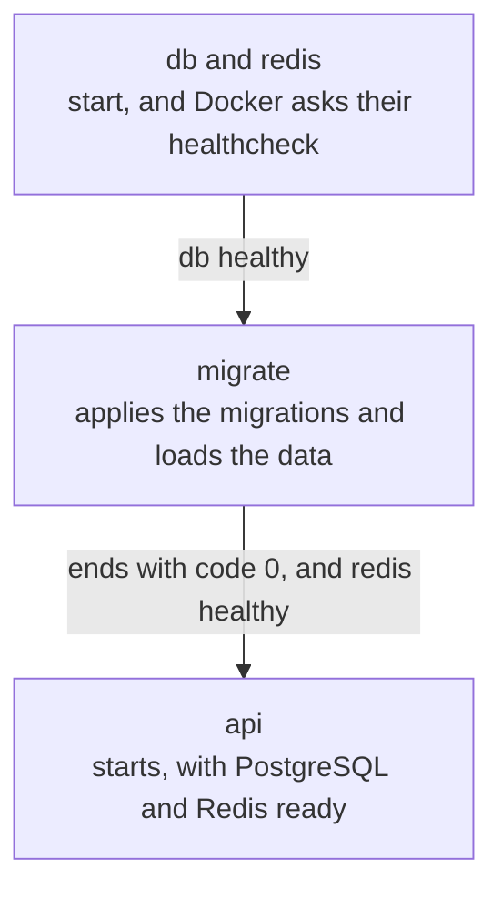

import Term from '~/components/Term.astro';
import TryIt from '~/components/TryIt.astro';
import Analogy from '~/components/Analogy.astro';
import ProjectCode from '~/components/ProjectCode.astro';
import Quiz from '~/components/Quiz.astro';
import QuizQuestion from '~/components/QuizQuestion.astro';
import QuizOption from '~/components/QuizOption.astro';

## The problem

Picture Luis joining the project and wanting the shop on his laptop. Ana sends him the commands from lessons [5](/en/phase-7/docker-volumes/) and [6](/en/phase-7/docker-networking/), more or less these:

```sh
docker network create shop
docker run -d --name db --network shop -v data:/var/lib/postgresql \
  -e POSTGRES_USER=shop -e POSTGRES_PASSWORD=YOUR-PASSWORD postgres:18
docker run -d --name api --network shop --env-file .env \
  -e DATABASE_URL=postgres://shop:YOUR-PASSWORD@db:5432/shop \
  -p 127.0.0.1:3000:3000 shop-api
```

The migrations and Redis are missing. The names have to match, the password goes in two places, and the order matters: if the API starts before PostgreSQL accepts connections, it fails. Luis gets one letter wrong and loses the afternoon.

**Docker Compose turns those commands into a file**, and the whole shop starts with `docker compose up`.

## The analogy

<Analogy>

Think about how a bakery opens in the morning. First the oven is turned on, and you wait for it to reach 200 degrees. Then the first batch is baked. Only then is the door opened. If someone skips the wait, the bread comes out raw.

The owner doesn't explain this to every new employee: she writes it on a sheet stuck to the wall. Whoever arrives follows the sheet, and the bakery opens the same way every day.

`compose.yaml` is that sheet. The oven at 200 degrees is PostgreSQL being healthy; the first batch, the migrations; opening the door, starting the API. `docker compose up` is following the sheet, and `docker compose down`, closing at the end of the day.

<div slot="limits">

- An employee notices if something smells odd. Compose only checks what the sheet says.
- The sheet says how to open, not what to do if the oven goes out at noon. Compose orders the startup; if PostgreSQL goes down later, the API keeps running and its `/health` answers `503`.
- Closing with `down -v` is closing and throwing out the stock: this project's database, not anyone else's.

</div>

</Analogy>

## How it really works

### One file instead of three commands

<Term id="docker-compose">Docker Compose</Term> is the part of Docker that starts several containers from a file. You installed it with Docker in the [introduction](/en/phase-7/), and `docker compose version` tells you which one you have.

The file is called `compose.yaml` and lives in the project's folder. It's written in **YAML**, a text format for data, like JSON but without braces: the indentation says what goes inside what, and `#` starts a comment. This is the shop's:

<ProjectCode file="shop-api/34-compose/compose.yaml" />

`compose.yaml` goes to Git, like the `Dockerfile`: it describes the shop, without a single secret.

### One project, four services

- **`name: shop`**: the project's name. Compose puts it in front of everything it creates: the containers are called `shop-db-1`, `shop-api-1`… (the number is the copy). Without `name`, it would use the folder's name.
- **`services`**: each service is one of the shop's programs, and each one runs in its own container. There are four: `db`, `redis`, `migrate` and `api`.
- **`image: postgres:18@sha256:…`**: the image that's downloaded. After the `@` comes its <Term id="image-digest">digest</Term>, which pins it byte for byte; [lesson 8](/en/phase-7/docker-registry/) explains it.
- **`build: .`**: instead of downloading an image, it builds one with this folder's `Dockerfile`, the one from [lesson 4](/en/phase-7/docker-multi-stage-build/). Compose calls it `shop-api`, like yours: it replaces it.
- **`command`**: changes the image's `CMD`. Redis starts without saving anything to disk; `migrate`, with the same image as the API, runs the two scripts from [Phase 5](/en/phase-5/database-migrations/) and ends.

`migrate` isn't a server but a task: it applies the missing migrations, loads the practice data and exits. It runs on every `up`, and migrations already applied aren't repeated. For that, the `Dockerfile` now also copies `db/` and those two scripts into the final image.

### The variables come from your .env

Each container's <Term id="environment-variable">environment variables</Term> are written in two ways:

- **`environment`**: a list of variables, like several `-e` in `docker run`.
- **`env_file: .env`**: all the ones in your `.env`, like `--env-file .env`. That's how the API gets its secrets from [Phase 6](/en/phase-6/rate-limiting-secrets/).

If a variable is in both, **`environment` wins**, as `-e` won in [lesson 6](/en/phase-7/docker-networking/). That's why your `.env` can keep the `localhost` `DATABASE_URL`, to start the API without Docker, while inside Compose the one with `db` applies.

And Compose uses `.env` for something else: **it reads it on its own**, if it's next to `compose.yaml`, and replaces each `${POSTGRES_PASSWORD}` in the file with its value. With `${POSTGRES_PASSWORD:?message}`, if it's missing, it stops and writes the message.

The PostgreSQL password is new, and you generate it with `openssl rand -hex 24`: 24 random bytes, written in hexadecimal, only with `0`–`9` and `a`–`f`. **Not with `-base64`**, like the Phase 6 secrets, because this one goes inside a URL, `postgres://shop:PASSWORD@db:5432/shop`, and base64 uses `/`, `+` and `=`, which mean something else in a URL.

The PostgreSQL image only uses `POSTGRES_USER`, `POSTGRES_DB` and `POSTGRES_PASSWORD` **the first time**, with the volume empty: it creates the `shop` user, its database and its password. After that, they're saved in the volume.

### Ports, volumes and a network you don't write

**`ports: '127.0.0.1:3000-3001:3000'`** <Term id="port-publishing">publishes</Term> the API's port 3000, only on your computer, as in lesson 6. On the left goes a range: each copy of the API takes a free port from it. With one copy, 3000 or 3001; with two, one each. With a single port, the second copy couldn't start.

`db` and `redis` don't publish anything: only the shop's containers see them. Your PostgreSQL from Phase 5 stays on 5432 without clashing.

**`volumes`** inside `db` mounts the `data` volume on the folder where PostgreSQL keeps its files, like `-v` in [lesson 5](/en/phase-7/docker-volumes/). The `volumes:` at the end declares that volume, and Compose calls it `shop_data`: a different one from lesson 5's `data`, and it starts empty.

**The <Term id="docker-network">network</Term> isn't written.** Compose creates `shop_default` and puts the four services on it, each with the service's name as its name on the network: the API reaches `db` and `redis` by their names, with Docker's DNS from lesson 6.

### Starting in order: depends_on and the healthchecks

`depends_on` says what a service depends on. Written on its own, Compose waits for the other container to **start**, but PostgreSQL takes a few seconds to accept connections. That's why each dependency carries a **condition**:

- **`service_healthy`**: waits for the other one to be healthy.
- **`service_completed_successfully`**: waits for the other one to end with exit code 0, without an error.

Healthy is decided by a <Term id="healthcheck">healthcheck</Term>: a command Docker runs inside the container, like the `HEALTHCHECK` from lesson 4. In `db` it's **`pg_isready -U shop -d shop`**, which asks PostgreSQL whether it accepts connections; in `redis`, **`redis-cli ping`**, which expects a `PONG`. `interval: 2s` asks every two seconds; `timeout: 5s` gives it five to answer, and after fifteen failures in a row (`retries: 15`), it marks it `unhealthy`.

The API already brings its own, the one from lesson 4, which asks `/health`. `migrate` uses that image, but it isn't the API: `disable: true` takes the healthcheck away.

This is how the startup goes:



If `migrate` fails, the API doesn't start: better stopped than serving with half-made tables.

### The everyday commands

They're all typed in the folder of `compose.yaml` and start with `docker compose`:

| Command | What it does |
|---|---|
| `up --build -d` | Builds the image if something changed, creates the network and the volume, and starts everything in order |
| `ps` | The project's containers; with `-a`, also the ones that ended, like `migrate` |
| `logs -f api` | The API's logs, and it keeps writing the new ones |
| `exec db psql -U shop` | Opens `psql` inside the PostgreSQL container |
| `port api 3000` | Which port on your computer the API's 3000 ended up on |
| `down` | Stops and deletes the containers and the network; the volume stays |
| `down -v` | The same, and it also deletes the volume: **the data** |

Word by word, the first one:

- **`up`**: creates whatever is missing and starts the services.
- **`--build`**: first builds the image of `build: .`. Without it, Compose uses the one it already has, even if you've changed the code.
- **`-d`**: in the background, like `docker run -d` in [lesson 1](/en/phase-7/docker-image-vs-container/). Without it, Compose mixes everyone's logs in your terminal, and <kbd>Ctrl</kbd> + <kbd>C</kbd> stops it all.

`exec` already gives you a terminal, without `-it`. And `down` doesn't delete the images: the next `up` takes seconds.

### Two copies of the API, a single count in Redis

In the [Phase 6 rate limiting lesson](/en/phase-6/rate-limiting-secrets/#in-memory-fine-for-a-single-server), the attempt limit kept its count in the server's memory. With two copies of the API, each one keeps its own: an attacker tries ten passwords on one and ten on the other.

The solution is a shared store: **Redis**, the <Term id="key-value-store">key-value store</Term> from [Phase 5](/en/phase-5/sql-vs-nosql/). It's a separate server that keeps the data in memory, and both copies ask the same one. The shop only uses it if `REDIS_URL` exists, and `compose.yaml` sets it:

<ProjectCode file="shop-api/34-compose/src/rate-limits.ts" region="chosen-store" />

Without `REDIS_URL`, as with `npm start`, everything stays as in Phase 6. The Redis store has the same two functions as the memory one, so the limiter doesn't change:

<ProjectCode file="shop-api/34-compose/src/redis-store.ts" region="redis-store" />

- **A sorted set** per key: each attempt is a member, with its instant as its score. Redis keeps them in order, so deleting the ones that left the window is a single command.
- **`multi()`** sends several commands together: Redis runs them one after the other, without another one sneaking in between.
- **`pExpire`**: the key expires on its own after 24 hours without attempts.

The last comment admits a gap: between checking and recording, the other copy can slip in an attempt. To slow down brute force, that's enough.

## Try it

The goal: start the whole shop with one command, prove that two copies of the API share the attempt limit, and see what each `down` deletes.

The outputs are from Docker Engine 29 and Compose 5.5 on a Mac, inside a virtual machine with Linux, like Docker Desktop's. We captured them with other names and other ports, swapped for the lesson's: nothing else changes. We've removed columns and adjusted spaces so they fit. Your IDs, times and passwords will be different.

### Update your project

You're working in `~/backend-course/phase-3/shop-api`, with the project from lesson 4. Download the step and copy what changes:

```sh
cd ~/backend-course/phase-3
curl -O https://backenddesdecero.com/practicas/shop-api/34-compose.tar.gz
tar -xzf 34-compose.tar.gz
cd shop-api
cp ../34-compose/compose.yaml ../34-compose/Dockerfile ../34-compose/.dockerignore ../34-compose/.env.example .
cp ../34-compose/src/redis-store.ts ../34-compose/src/rate-limits.ts ../34-compose/src/config.ts src/
cp ../34-compose/test/redis-store.test.ts ../34-compose/test/compose.test.ts test/
npm install redis@6.3.0
```

`compose.yaml` and `redis-store.ts` are new. `rate-limits.ts` chooses the store, `config.ts` reads `REDIS_URL`, the `Dockerfile` also copies `db/` and the two scripts, and `.dockerignore` leaves `compose.yaml` out.

If your PostgreSQL from Phase 5 is running, it can stay: Compose doesn't use your computer's 5432. If the API from lesson 6 is still running, delete it with `docker rm -f api`: it uses 3000.

### Start the shop

<TryIt
  title="1. A password for PostgreSQL"
  cmd="openssl rand -hex 24"
  output="40da6c92412f1e8054dd79a82184746507103bf5c7f906ab"
>

48 characters, only numbers and the letters `a` to `f`. Add a `POSTGRES_PASSWORD=` line with yours, which will be different, to your `.env`.

</TryIt>

<TryIt
  title="2. Everything, with one command"
  cmd="docker compose up --build -d"
  output={`…
[+] up 8/8
 ✔ Image shop-api            Built      0.5s
 ✔ Image shop-migrate        Built      0.5s
 ✔ Network shop_default      Created    0.0s
 ✔ Volume shop_data          Created    0.0s
 ✔ Container shop-redis-1    Healthy    3.3s
 ✔ Container shop-db-1       Healthy    3.3s
 ✔ Container shop-migrate-1  Exited     3.7s
 ✔ Container shop-api-1      Started    3.8s`}
>

Look at the order: `db` and `redis` reach `Healthy`, `migrate` ends (`Exited`), and only then does the API start. `shop-api` and `shop-migrate` come from the same `Dockerfile` and share all their layers. The first time, the build steps come first, as in lesson 4, along with the download of PostgreSQL and Redis: it takes a few minutes.

If it says `required variable POSTGRES_PASSWORD is missing a value`, your `.env` is missing the line from step 1.

</TryIt>

<TryIt
  title="3. Who's running?"
  cmd="docker compose ps"
  output={`NAME           SERVICE   STATUS                    PORTS
shop-api-1     api       Up 24 seconds (healthy)   127.0.0.1:3000->3000/tcp
shop-db-1      db        Up 27 seconds (healthy)   5432/tcp
shop-redis-1   redis     Up 27 seconds (healthy)   6379/tcp`}
>

All three, `healthy`. Only the API has an arrow in `PORTS`: published on 3000. **Yours may be on `3001`**: Docker takes turns with the ports in the range.

`migrate` doesn't show up because it has already ended; `docker compose ps -a` shows it with `Exited (0)`, without an error. If the API says `(health: starting)`, wait a few seconds.

</TryIt>

<TryIt
  title="4. Ask the shop"
  cmd={`docker compose port api 3000\ncurl -s localhost:3000/health`}
  output={`127.0.0.1:3000
{"status":"ok"}`}
>

If `port` says `3001`, use that port for the rest of the practice. `{"status":"ok"}`: the API talks to PostgreSQL by its name, `db`.

</TryIt>

<TryIt
  title="5. The API's logs"
  cmd="docker compose logs -f api"
  output={`api-1  | {"level":30,"time":1791955742924,"pid":1,"hostname":"025d78c222c4","msg":"The shop is listening on http://localhost:3000"}
api-1  | {"level":30,"time":1791955762372,"pid":1,"hostname":"025d78c222c4","requestId":"221cb67f-071b-46ad-a3d7-3203a563c0bd","method":"GET","path":"/health","status":200,"ms":7,"msg":"request"}
api-1  | {"level":30,"time":1791955766521,"pid":1,"hostname":"025d78c222c4","requestId":"84a92b92-d6de-49c1-a05e-722704935e6a","method":"GET","path":"/health","status":200,"ms":1,"msg":"request"}
api-1  | {"level":30,"time":1791955769715,"pid":1,"hostname":"025d78c222c4","requestId":"88387d13-d6a0-45f2-b792-55f448cbfcc4","method":"GET","path":"/v2/products","status":200,"ms":149,"msg":"request"}`}
>

Each line starts with the copy that writes it, `api-1`. The first one says `3000` even if you got `3001`: it's the port inside the container. The `/health` ones are the healthcheck and your `curl`; the last one, a `curl` to `/v2/products` from another terminal. `-f` (*follow*) stays waiting for new lines: <kbd>Ctrl</kbd> + <kbd>C</kbd> stops watching, and the API keeps going.

</TryIt>

<TryIt
  title="6. Inside PostgreSQL"
  cmd="docker compose exec db psql -U shop -c 'SELECT name, price_cents FROM products;'"
  output={`  name   | price_cents 
---------+-------------
 T-shirt |        2000
 Mug     |         850
 Hoodie  |        3500
 Cap     |        1500
(4 rows)`}
>

`exec db` runs `psql` in the `db` container, and `-c` hands it the query: the products `migrate` loaded. Without `-c`, you go into `psql`, and `\q` gets you out.

</TryIt>

### Two copies, a single limit

<TryIt
  title="7. A second copy of the API"
  cmd={`docker compose up -d --scale api=2\ndocker compose ps`}
  output={`…
NAME           SERVICE   STATUS                            PORTS
shop-api-1     api       Up 41 seconds (healthy)           127.0.0.1:3000->3000/tcp
shop-api-2     api       Up 3 seconds (health: starting)   127.0.0.1:3001->3000/tcp
shop-db-1      db        Up 45 seconds (healthy)           5432/tcp
shop-redis-1   redis     Up 44 seconds (healthy)           6379/tcp`}
>

**`--scale api=2`** asks for two `api` containers. The new one takes the other port in the range. We've cut the `up` lines.

</TryIt>

Now, ten wrong passwords for Ana, one to each copy in turn, as in Phase 6:

<TryIt
  title="8. Ten failures, shared out"
  cmd={`for i in {1..5}; do
  for port in 3000 3001; do
    printf '%s: ' $port
    curl -s -o /dev/null -D - --json '{"email":"ana@shop.example","password":"any password at all"}' localhost:$port/v2/session | grep -i '^ratelimit:'
  done
done`}
  output={`3000: ratelimit: "session-email";r=9;t=900, "session-ip";r=29;t=900
3001: ratelimit: "session-email";r=8;t=900, "session-ip";r=28;t=900
3000: ratelimit: "session-email";r=7;t=900, "session-ip";r=27;t=900
3001: ratelimit: "session-email";r=6;t=900, "session-ip";r=26;t=900
3000: ratelimit: "session-email";r=5;t=900, "session-ip";r=25;t=900
3001: ratelimit: "session-email";r=4;t=900, "session-ip";r=24;t=900
3000: ratelimit: "session-email";r=3;t=900, "session-ip";r=23;t=900
3001: ratelimit: "session-email";r=2;t=900, "session-ip";r=22;t=900
3000: ratelimit: "session-email";r=1;t=900, "session-ip";r=21;t=900
3001: ratelimit: "session-email";r=0;t=900, "session-ip";r=20;t=900`}
>

The inner loop alternates between the two ports, and `printf` writes which one. **Look at `r`**: it goes down one by one even though each request lands on a different copy. With the in-memory store, each copy would start its own count at 9.

</TryIt>

<TryIt
  title="9. The eleventh, on both"
  cmd={`curl -s -o /dev/null -w '%{http_code}\\n' --json '{"email":"ana@shop.example","password":"some other password"}' localhost:3000/v2/session
curl -s -o /dev/null -w '%{http_code}\\n' --json '{"email":"ana@shop.example","password":"some other password"}' localhost:3001/v2/session
docker compose exec redis redis-cli zcard limits:session-email:ana@shop.example`}
  output={`429
429
(integer) 10`}
>

`429` on both copies: neither lets in someone who has already failed ten times. `zcard` counts the members of the sorted set: the ten attempts, kept in Redis.

</TryIt>

### down and down -v

Create an account, and see what happens to it when you stop the shop:

<TryIt
  title="10. down: the data stays"
  cmd={`curl -s -w '\\n' --json '{"email":"marta@example.com","password":"a long sentence only I know"}' localhost:3000/v2/accounts
docker compose down
docker compose up -d
docker compose exec db psql -U shop -c "SELECT email FROM users WHERE email = 'marta@example.com';"`}
  output={`{"id":9,"email":"marta@example.com","role":"customer"}
[+] down 6/6
 ✔ Container shop-api-1      Removed   0.4s
 ✔ Container shop-api-2      Removed   0.4s
 ✔ Container shop-migrate-1  Removed   0.0s
 ✔ Container shop-redis-1    Removed   0.2s
 ✔ Container shop-db-1       Removed   0.1s
 ✔ Network shop_default      Removed   0.1s
…
       email       
-------------------
 marta@example.com
(1 row)`}
>

`down` deletes the five containers and the network, but **not the volume**: Marta is still there. Ana's attempts, on the other hand, have been forgotten: Redis doesn't save anything to disk. Your `id` may be different.

</TryIt>

<TryIt
  title="11. down -v: the data goes"
  cmd={`docker compose down -v
docker compose up -d
docker compose exec db psql -U shop -c "SELECT email FROM users WHERE email = 'marta@example.com';"`}
  output={`[+] down 6/6
 ✔ Container shop-api-1      Removed   0.2s
 ✔ Container shop-migrate-1  Removed   0.0s
 ✔ Container shop-redis-1    Removed   0.2s
 ✔ Container shop-db-1       Removed   0.1s
 ✔ Volume shop_data          Removed   0.0s
 ✔ Network shop_default      Removed   0.1s
…
 email 
-------
(0 rows)`}
>

The line `down` didn't have: **`Volume shop_data Removed`**. The next `up` creates an empty volume and `migrate` loads the practice data again, but Marta left with the volume.

</TryIt>

To finish, `docker compose down`. If you're not going back to the shop with Docker, `docker compose down -v` deletes its data too.

## You have already seen it

- **The `HEALTHCHECK` from lesson 4.** Compose uses it to know the API is ready, and `docker compose ps` shows it just like `docker ps`.
- **The network from lesson 6.** `shop_default` is the `shop` network you created by hand, with its DNS.
- **This course's CI.** Its tests wait for PostgreSQL with `pg_isready`, and with step 34 they run `docker compose up`, ask the API and finish with `docker compose down -v`.

## Common mistakes

- **Changing `POSTGRES_PASSWORD` when the volume already exists.** PostgreSQL kept the first one, and `migrate` ends with `password authentication failed for user "shop"`. The API stays in `Created`, without starting. Put the old password back or, if you don't care about the data, `docker compose down -v`.
- **`down -v` to “start clean.”** It deletes the project's database. To restart without losing anything, `docker compose down` and `up`.
- **Taking for granted that the API is on 3000.** With the range, it may get 3001: `docker compose port api 3000` tells you.
- **More copies than ports.** `--scale api=3` with a range of two leaves the third one in `Created`, with `all ports are allocated`.
- **Signing in with the practice provider.** Inside Compose it answers `500`: the API looks for the provider at `localhost:9000`, which inside its container is the API itself, and that address has to be the same for your browser and for the API. With email and password, it works.

## Summary

- `compose.yaml` describes the shop: each service with its image (downloaded or built), its variables, its ports and its volumes. `docker compose up` creates the network and starts it all.
- `environment` wins over `env_file`, and Compose replaces `${VARIABLE}` with the values in your `.env`: secrets never go in the file.
- `depends_on` with `service_healthy` waits for a healthcheck to say the service is ready; with `service_completed_successfully`, for a task like `migrate` to end well.
- `down` deletes containers and network; `down -v`, the volumes too, with the data.
- With Redis, two copies of the API keep a single count of attempts: the eleventh failure is `429` on both.

## Did you get it?

<Quiz>

<QuizQuestion
  question="On Monday you created several accounts in the Compose shop. On Tuesday you run docker compose down -v and then up -d. What happens to those accounts?"
  review="The everyday commands"
>

<QuizOption text="They’re still there: down -v only deletes the containers and the network.">

That's what `down` does without `-v`. With `-v`, Compose also deletes the `shop_data` volume, and the database with it.

</QuizOption>

<QuizOption text="They’re gone: they left with the volume." correct>

`-v` deletes the project's volumes. `migrate` loads the practice data again, not your accounts.

</QuizOption>

<QuizOption text="They come back on startup: migrate loads everything that was there again.">

`migrate` loads the practice data, always the same. What you created was only in the volume.

</QuizOption>

</QuizQuestion>

<QuizQuestion
  question="You change migrate’s depends_on to depends_on: [db], without a condition. Sometimes migrate fails right after starting. Why?"
  review="Starting in order: depends_on and the healthchecks"
>

<QuizOption text="Compose waits for db to start, not to accept connections." correct>

Without a condition, `depends_on` only orders the startup. That PostgreSQL is ready is what the healthcheck says.

</QuizOption>

<QuizOption text="Without a condition, Compose starts the services in any order.">

The order is kept: `db` starts first. What it doesn't do is wait for it to be healthy.

</QuizOption>

<QuizOption text="migrate needs db to publish 5432 to connect.">

Between containers on the same network, nothing needs publishing: `migrate` reaches `db` by its name.

</QuizOption>

</QuizQuestion>

<QuizQuestion
  question="You start the shop with docker compose up -d, and curl localhost:3000/health says Couldn’t connect to server. docker compose ps says the API is healthy. What do you look at?"
  review="Ports, volumes and a network you don't write"
>

<QuizOption text="Whether db publishes 5432: without it, the API doesn’t answer.">

The API is `healthy`: it talks to PostgreSQL. The problem is how you get in.

</QuizOption>

<QuizOption text="The API’s HOST: inside, it listens on 127.0.0.1, and that has to change.">

The `Dockerfile` sets `HOST=0.0.0.0`. With `127.0.0.1` inside, `curl` would say something else, `Empty reply from server` (lesson 6). What fails is the port on your side.

</QuizOption>

<QuizOption text="The port: with the 3000-3001 range, it may be on 3001." correct>

Each copy takes a free port from the range, and Docker takes turns with them. `docker compose port api 3000`, or the `PORTS` column, tells you which.

</QuizOption>

</QuizQuestion>

<QuizQuestion
  question="You generate POSTGRES_PASSWORD with openssl rand -base64 24 and get a/Xk3+9w… PostgreSQL starts, but migrate can’t connect. Why?"
  review="The variables come from your .env"
>

<QuizOption text="PostgreSQL doesn’t accept passwords with symbols.">

PostgreSQL accepts that password without trouble: it creates the user with it. What breaks is something else.

</QuizOption>

<QuizOption text="The password goes in DATABASE_URL, and the / splits the URL." correct>

In a URL, `/` separates the path, and `+` or `=` have their own meaning. With `-hex`, only numbers and letters come out.

</QuizOption>

<QuizOption text="Compose stops reading .env when a line has symbols like / or +.">

Compose reads the whole line and substitutes it as is: that's why the URL ends up with the `/` inside.

</QuizOption>

</QuizQuestion>

<QuizQuestion
  question="With --scale api=2 and no REDIS_URL, someone tries Ana’s passwords, and each request lands on a different copy. How many failures do they get before the first 429?"
  review="Two copies of the API, a single count in Redis"
>

<QuizOption text="Ten: both copies keep the count in the same database.">

The attempt count doesn't go in PostgreSQL: without Redis, it goes in each copy's memory.

</QuizOption>

<QuizOption text="Five: each copy counts half the limit.">

Each copy applies the whole limit, 10, without knowing anything about the other.

</QuizOption>

<QuizOption text="Twenty: each copy keeps its count in its own memory, ten and ten." correct>

It's the problem Redis solves: a separate store, the same for both, with a single count.

</QuizOption>

</QuizQuestion>

<QuizQuestion
  question="Your POSTGRES_PASSWORD has leaked: you generate another one, put it in .env and run docker compose up -d. migrate fails with password authentication failed. Why?"
  review="The variables come from your .env"
>

<QuizOption text="PostgreSQL saved the first one in the volume, and doesn’t change it." correct>

The image only uses `POSTGRES_PASSWORD` with the volume empty, and the `shop` user still has the old one. To change it, you change it in PostgreSQL (`ALTER ROLE`) and in `.env`, both sides, as in Phase 6.

</QuizOption>

<QuizOption text="Compose hasn’t read the new .env: that needs docker compose up --build.">

Compose reads `.env` on every `up`; `--build` only rebuilds the image. `migrate` is already using the new password, and that's why it fails.

</QuizOption>

<QuizOption text="The new password is too long for PostgreSQL.">

48 characters aren't a problem. The first one was just as long and worked.

</QuizOption>

</QuizQuestion>

</Quiz>

## Further reading

- [Docker Compose](https://docs.docker.com/compose/), from Docker's documentation: what it is and how to get started.
- [The services reference](https://docs.docker.com/reference/compose-file/services/): `image`, `build`, `environment`, `ports`, `depends_on`, `healthcheck` and the rest.
- [Control startup order](https://docs.docker.com/compose/how-tos/startup-order/): `depends_on` and its conditions.
- [Environment variables precedence](https://docs.docker.com/compose/how-tos/environment-variables/envvars-precedence/): who wins when a variable is in several places.
- [Redis sorted sets](https://redis.io/docs/latest/develop/data-types/sorted-sets/), from Redis's documentation: sorted sets.
