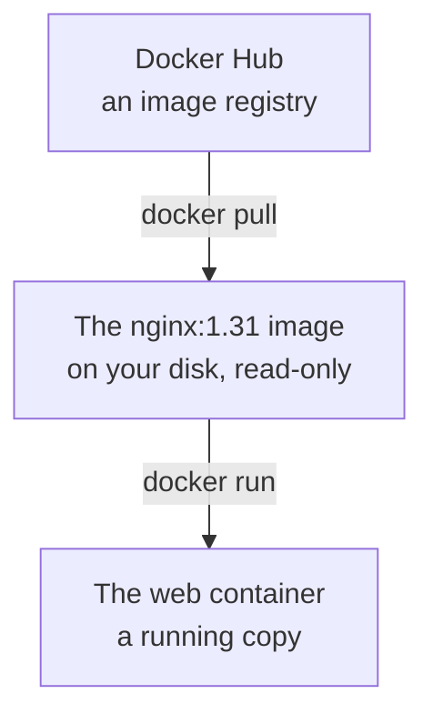

import Term from '~/components/Term.astro';
import TryIt from '~/components/TryIt.astro';
import Analogy from '~/components/Analogy.astro';
import SelfCheck from '~/components/SelfCheck.astro';
import Quiz from '~/components/Quiz.astro';
import QuizQuestion from '~/components/QuizQuestion.astro';
import QuizOption from '~/components/QuizOption.astro';

## The problem

In [lesson 6 of Phase 1](/en/phase-1/systemd-services-and-apt/) you installed nginx on your virtual machine: create it, `apt install`, `systemctl`… With Docker, the same nginx starts on your laptop with a single command, without installing it, and answers on `localhost:8080`.

Picture Ana doing it. She goes into the container and changes the home page to “Ana and Luis's Shop”. The next day she deletes it with `docker rm` and starts it again with the same command. The home page says “Welcome to nginx!” again: her change is gone.

Where was that change, and why wasn't it in what Docker downloaded? The answer is two words that get used all the time, and often mixed up: **image** and **container**.

## The analogy

<Analogy>

Think of a gym's sign-up form. The office keeps the original, and nobody writes on it. Everyone who comes in gets a photocopy and fills it in their own way.

Ana writes her name on hers; Luis's is still blank, and so is the original. If Ana throws away her photocopy, what she wrote goes with it. To start from scratch, she asks for another copy of the original, a clean one.

The image is the original; each container, a photocopy in use.

<div slot="limits">

- Docker doesn't photocopy the whole image: all the containers read the same files, and each one keeps only what it changes, separately. That's why one starts in a second, and ten don't take up ten times the space.
- A photocopy is still paper. A container also has a running program.
- Stopping a container isn't throwing away the photocopy: with `docker stop` it's kept, with whatever was written. Only `docker rm` throws it away.

</div>

</Analogy>

## How it really works

### The image is the template; the container, the running copy

This is how nginx reaches your computer and starts running:



An <Term id="image">image</Term> is a package with two things:

- **Files:** nginx itself, the libraries it uses and a minimal Debian with its usual folders (`/etc`, `/usr`, `/bin`). Everything nginx needs, except the operating system's kernel, which it shares with your machine, as you saw in [the introduction](/en/phase-7/).
- **Instructions:** which command to run when it starts (`nginx -g 'daemon off;'`), which port it listens on (80) and a few more details.

It's **read-only**: nothing that happens afterwards changes it. It's named with a name and a *tag*, separated by a colon: `nginx:1.31` is version 1.31 of nginx.

A <Term id="container">container</Term> is what comes out of `docker run`: the image's files, its own **writable layer** on top and a running program. When something writes a file inside, nginx or you, the change goes to that layer. The image isn't touched, and the other containers from the same image see nothing. How those layers stack up you'll see in [lesson 2](/en/phase-7/docker-layers/).

| | Image | Container |
|---|---|---|
| What it is | A template: files and instructions | A running copy, with its writable layer |
| Can you write to it? | No | Yes, in its layer |
| You get it with | `docker pull` | `docker run` |
| You list them with | `docker image ls` | `docker ps` |
| You delete them with | `docker image rm` | `docker rm` |

### Images come from a registry

Images are kept in a <Term id="registry">registry</Term>, a service you download them from, like an app store. The one Docker uses if you don't name another is **Docker Hub** (`hub.docker.com`). Lesson 8 explains them in depth.

Download the nginx image. You need Docker running, as in the introduction:

<TryIt
  title="Download the nginx image"
  cmd="docker pull nginx:1.31"
  output={`1.31: Pulling from library/nginx
b496ef725cba: Pull complete
95266651b1b5: Pull complete
74db6078a267: Pull complete
a0eaca4f4a89: Pull complete
848dbae53a0f: Pull complete
c6d8c112974b: Pull complete
58f461baacaf: Download complete
10ef391a6a66: Download complete
Digest: sha256:f9ea18bfa4fad859e1ed38259d711da7ccad2c3516e875cec3351a57c859f571
Status: Downloaded newer image for nginx:1.31
docker.io/library/nginx:1.31`}
>

Each line with a code is a part of the image, almost all of them layers (lesson 2). While it downloads, you'll see progress bars.

The last line is the full name: `docker.io` is Docker Hub; `library`, the official images; and `nginx:1.31`, the name and the tag. Without a tag, Docker uses `latest`, which isn't always the latest version (lesson 8).

If nginx has published a fix since then, your codes will be different. If you see `Cannot connect to the Docker daemon`, Docker isn't running: start it as in the introduction.

</TryIt>

If you don't download it first, `docker run` does it for you, as you saw with `hello-world`.

### `docker run`, word by word

This command creates an nginx container and starts it:

```sh
docker run -d --name web -p 127.0.0.1:8080:80 nginx:1.31
```

Word by word:

- `docker run`: creates a container from an image and starts it.
- `-d` (*detached*): leaves it in the background, like the `&` from [lesson 5 of Phase 1](/en/phase-1/linux-processes-and-signals/), and gives you back the prompt. Without `-d`, the terminal keeps showing what nginx writes, and <kbd>Ctrl</kbd> + <kbd>C</kbd> stops it.
- `--name web`: gives it a name. Without it, Docker makes one up at random.
- `-p 127.0.0.1:8080:80` (*publish*): joins your computer's <Term id="port">port</Term> 8080 to the container's port 80, where nginx listens. First the outside one, then the inside one. The `127.0.0.1:` makes it answer only your own computer: [lesson 6](/en/phase-7/docker-networking/) explains why.
- `nginx:1.31`: the image. Whatever you write after it replaces the start command the image comes with.

Three more options you'll use often:

- `--rm`: deletes the container as soon as it ends. Without it, every test leaves a stopped container behind that takes up its name and its space.
- `-e NAME=value` (from *environment*): creates an [environment variable](/en/phase-1/environment-variables/) inside. That's how almost every program is configured in Docker: PostgreSQL's password or your API's `DATABASE_URL`.
- `-it`: `-i` (*interactive*) lets you type to it, and `-t` (from *TTY*) gives it a terminal. You need them to use a shell inside.

<TryIt
  title="A variable, and the container deletes itself"
  cmd={`docker run --rm -e SHOP="Ana and Luis" nginx:1.31 printenv SHOP`}
  output="Ana and Luis"
>

`printenv SHOP` replaces nginx: it prints the variable and ends. When the program ends, the container ends, and `--rm` deletes it.

</TryIt>

### Seeing, reading and getting in: `ps`, `logs` and `exec`

With the container running, three commands tell you what's going on inside:

- `docker ps`: the running containers. With `-a` (*all*), the stopped ones too.
- `docker logs web`: what the program has written to its output, the normal one and the error one ([lesson 3 of Phase 1](/en/phase-1/pipes-and-redirection/)). With `-f` (*follow*) it stays waiting for new lines, like `journalctl -f`. <kbd>Ctrl</kbd> + <kbd>C</kbd> stops watching, and the container keeps going.
- `docker exec -it web sh`: starts another program inside a container that's already running, here `sh`, a <Term id="shell">shell</Term>. `exit` leaves it, and the container keeps going.

### Stopping, starting and deleting

| Command | What it does | What happens to the container's layer |
|---|---|---|
| `docker stop web` | Stops the program | It stays, with your changes |
| `docker start web` | Starts the same container again | It still has the earlier changes |
| `docker rm web` | Deletes the container | It disappears with it. If it's running, it refuses; with `-f` (*force*), it stops it and deletes it |
| `docker image ls` | Lists the images (`docker images` is its old name) | Nothing: images don't change |
| `docker image rm nginx:1.31` | Deletes an image | It refuses if any container uses it, even a stopped one |

That's the answer to Ana's problem: **what you change inside a container lives in its layer**. It survives `stop` and `start`, and goes away with `rm`. To keep something, either you put it in the image (lesson 3 teaches you to build them) or you keep it outside, in a volume ([lesson 5](/en/phase-7/docker-volumes/)).

### A container is a process

As you saw in [the introduction](/en/phase-7/), a container is a Linux <Term id="process">process</Term>, isolated from the others. Inside, the image's program has <Term id="pid">PID</Term> 1, the number of the first process, the one that was systemd on your virtual machine.

From outside, `docker top` shows a container's processes with their real number:

<TryIt
  title="nginx's processes, seen from outside"
  cmd="docker top web"
  output={`UID                 PID                 PPID                C                   STIME               TTY                 TIME                CMD
root                4163230             4163207             0                   01:35               ?                   00:00:00            nginx: master process nginx -g daemon off;
message+            4163285             4163230             0                   01:35               ?                   00:00:00            nginx: worker process
message+            4163286             4163230             0                   01:35               ?                   00:00:00            nginx: worker process
message+            4163287             4163230             0                   01:35               ?                   00:00:00            nginx: worker process
message+            4163288             4163230             0                   01:35               ?                   00:00:00            nginx: worker process`}
>

nginx's main process, the *master*, is 1 inside and 4163230 outside. The *workers*, which handle the requests, are its children: their `PPID`, the parent, is 4163230. Your numbers will be different, and how many *workers* there are depends on your processors.

`message+` and not `nginx`? To Linux, a user is a number ([lesson 4 of Phase 1](/en/phase-1/linux-users-and-permissions/)), and outside that number has another name, or none. On macOS and Windows, “outside” is Docker Desktop's virtual machine: `ps` in your terminal doesn't see them.

</TryIt>

### `docker stop`: first a signal, then SIGKILL

`docker stop` does what you learned in [lesson 5 of Phase 1](/en/phase-1/linux-processes-and-signals/): first `kill` and, if needed, `kill -9`. It sends a stop <Term id="signal">signal</Term> to PID 1, waits ten seconds and, if the process is still alive, sends it `SIGKILL`.

The stop signal is `SIGTERM`, unless the image asks for another one. nginx's asks for `SIGQUIT`, which to nginx means “finish the requests you have halfway done and exit”.

PID 1 has a special rule in Linux: **it ignores the signals it hasn't prepared for**, `SIGTERM` included, because if it goes down, the whole container goes down. A program that doesn't handle them takes ten seconds to stop:

<TryIt
  title="A container that doesn't handle the signal"
  cmd={`docker run -d --name sleepy nginx:1.31 sleep 1000\ntime docker stop sleepy\ndocker ps -a`}
  output={`9bcad290747d43f8a577c63fbdc3563f515b203c90dd47ed5dac988a41995e11
sleepy
docker stop sleepy  0.01s user 0.01s system 0% cpu 10.118 total
CONTAINER ID   IMAGE        COMMAND                  CREATED          STATUS                                PORTS     NAMES
9bcad290747d   nginx:1.31   "/docker-entrypoint.…"   10 seconds ago   Exited (137) Less than a second ago             sleepy`}
>

`sleep 1000` replaces nginx: it waits a thousand seconds, and it's PID 1. `time` measures how long a command takes: ten seconds, because `sleep` doesn't handle the signal and Docker ended up sending `SIGKILL`. In bash, `time` prints `real 0m10.118s`.

`Exited (137)` is the exit code: 128 plus 9, the number of `SIGKILL`, as in Phase 1. `docker ps -a` also shows your other containers. Delete this one with `docker rm sleepy`.

</TryIt>

In [lesson 3](/en/phase-7/dockerfile/) you'll see how to start your API so that it stops right away.

## Try it

The goal: run the nginx from [Phase 2](/en/phase-2/#before-you-start-the-shops-server) in a container, change its home page and find out what survives `docker stop` and what survives `docker rm`. You need the `nginx:1.31` image from the earlier step.

The outputs are from Docker Engine 29 on a Mac, inside a virtual machine with Linux, like Docker Desktop's. We captured them with another port and other names, replaced with the lesson's: nothing else changes. Your ids, times and durations will be different. On Linux and WSL, the outputs are the same.

<TryIt
  title="1. Start nginx in a container"
  cmd="docker run -d --name web -p 127.0.0.1:8080:80 nginx:1.31"
  output="21b142f2b696638731a72cbf7b3e9a860c2d9d9c11dc2e15d0d48060ff7ba162"
>

It's the container's id, its full number. If you see `port is already allocated`, another program is already using 8080: see “Common mistakes.”

</TryIt>

<TryIt
  title="2. Look at it and ask it"
  cmd={`docker ps\ncurl -sI localhost:8080\ncurl -s localhost:8080 | grep h1`}
  output={`CONTAINER ID   IMAGE        COMMAND                  CREATED          STATUS          PORTS                    NAMES
21b142f2b696   nginx:1.31   "/docker-entrypoint.…"   11 seconds ago   Up 11 seconds   127.0.0.1:8080->80/tcp   web
HTTP/1.1 200 OK
Server: nginx/1.31.6
Date: Wed, 14 Oct 2026 05:13:49 GMT
Content-Type: text/html
Content-Length: 896
Last-Modified: Tue, 15 Sep 2026 12:54:15 GMT
Connection: keep-alive
ETag: "6aa93ff7-380"
Accept-Ranges: bytes

<h1>Welcome to nginx!</h1>`}
>

In `docker ps`, look at `STATUS`, `Up` (running), and at `PORTS`, your computer's 8080 joined to the container's 80. The id is shown shortened, and `docker` accepts both.

The nginx from Phase 2 answers, in another version: `nginx/1.31.6`, instead of Ubuntu's 1.24.0.

</TryIt>

<TryIt
  title="3. Read its logs"
  cmd="docker logs web"
  output={`/docker-entrypoint.sh: /docker-entrypoint.d/ is not empty, will attempt to perform configuration
/docker-entrypoint.sh: Looking for shell scripts in /docker-entrypoint.d/
/docker-entrypoint.sh: Launching /docker-entrypoint.d/10-listen-on-ipv6-by-default.sh
10-listen-on-ipv6-by-default.sh: info: Getting the checksum of /etc/nginx/conf.d/default.conf
10-listen-on-ipv6-by-default.sh: info: Enabled listen on IPv6 in /etc/nginx/conf.d/default.conf
/docker-entrypoint.sh: Sourcing /docker-entrypoint.d/15-local-resolvers.envsh
/docker-entrypoint.sh: Launching /docker-entrypoint.d/20-envsubst-on-templates.sh
/docker-entrypoint.sh: Launching /docker-entrypoint.d/30-tune-worker-processes.sh
/docker-entrypoint.sh: Configuration complete; ready for start up
2026/10/14 05:13:38 [notice] 1#1: using the "epoll" event method
2026/10/14 05:13:38 [notice] 1#1: nginx/1.31.6
2026/10/14 05:13:38 [notice] 1#1: built by gcc 14.2.0 (Debian 14.2.0-19) 
2026/10/14 05:13:38 [notice] 1#1: OS: Linux 6.8.0-117-generic
2026/10/14 05:13:38 [notice] 1#1: getrlimit(RLIMIT_NOFILE): 1024:524288
2026/10/14 05:13:38 [notice] 1#1: start worker processes
2026/10/14 05:13:38 [notice] 1#1: start worker process 29
2026/10/14 05:13:38 [notice] 1#1: start worker process 30
2026/10/14 05:13:38 [notice] 1#1: start worker process 31
2026/10/14 05:13:38 [notice] 1#1: start worker process 32
172.17.0.1 - - [14/Oct/2026:05:13:49 +0000] "HEAD / HTTP/1.1" 200 0 "-" "curl/8.7.1" "-"
172.17.0.1 - - [14/Oct/2026:05:13:49 +0000] "GET / HTTP/1.1" 200 896 "-" "curl/8.7.1" "-"`}
>

Three parts:

- `/docker-entrypoint.sh`: a script in the image that prepares the configuration before starting nginx.
- `[notice]`: nginx starting up. `1#1` is PID 1. `OS: Linux`: even if you're on a Mac, nginx runs on Linux.
- Your two requests, `HEAD` and `GET`, in the format of Phase 1's `access.log`. They come from `172.17.0.1`, an address on Docker's network (lesson 6).

To see them live: `docker logs -f web` in another terminal, and repeat the `curl`.

</TryIt>

<TryIt
  title="4. Go in and change the home page"
  cmd="docker exec -it web sh"
  output={`# whoami
root
# cat /proc/1/cmdline; echo
nginx: master process nginx -g daemon off;
# echo "<h1>Ana and Luis's Shop</h1>" > /usr/share/nginx/html/index.html
# exit`}
>

You're now inside, with the `#` prompt. Type the commands one by one:

- `whoami`: inside the container you're `root`. [Lesson 4](/en/phase-7/docker-multi-stage-build/) changes that for your API.
- `cat /proc/1/cmdline`: Linux keeps each process's command in `/proc/<PID>/cmdline`, and 1 is nginx's *master*. The `echo` only adds the line break it's missing.
- `echo "…" > …/index.html`: replaces nginx's home page with a line of your own.
- `exit` takes you back to your terminal. The container keeps running.

</TryIt>

<TryIt
  title="5. Check the change"
  cmd="curl -s localhost:8080"
  output="<h1>Ana and Luis's Shop</h1>"
>

nginx serves the new home page. The change is in the container's layer: the `nginx:1.31` image knows nothing about it.

</TryIt>

<TryIt
  title="6. Stop it and start it again"
  cmd={`docker stop web\ndocker ps -a\ndocker start web\ncurl -s localhost:8080`}
  output={`web
CONTAINER ID   IMAGE        COMMAND                  CREATED          STATUS                      PORTS     NAMES
21b142f2b696   nginx:1.31   "/docker-entrypoint.…"   43 seconds ago   Exited (0) 12 seconds ago             web
web
<h1>Ana and Luis's Shop</h1>`}
>

Stopped, `docker ps` doesn't show it, but `docker ps -a` does: `Exited (0)`, it ended fine, with code 0. With no program running, `PORTS` is empty. When you start it, the home page is still yours: **`stop` and `start` keep the layer**.

</TryIt>

<TryIt
  title="7. Which signal did nginx get?"
  cmd="docker logs web 2>&1 | grep SIGQUIT"
  output="2026/10/14 05:14:08 [notice] 1#1: signal 3 (SIGQUIT) received, shutting down"
>

The one the nginx image asks for, `SIGQUIT` (number 3), to PID 1. The `2>&1` is needed because nginx writes these notices to the error output.

</TryIt>

<TryIt
  title="8. Delete it and start over"
  cmd={`docker rm web`}
  output={`Error response from daemon: cannot remove container "web": container is running: stop the container before removing or force remove`}
>

Docker doesn't delete a running container: “stop it first, or force the removal”.

</TryIt>

<TryIt
  title="9. Force the removal and start another one"
  cmd={`docker rm -f web\ndocker run -d --name web -p 127.0.0.1:8080:80 nginx:1.31\ncurl -s localhost:8080 | grep h1`}
  output={`web
68e450280dad4884e2f17864ecbdff5fc44a36d8ace1d20a88430e7baa8bdefe
<h1>Welcome to nginx!</h1>`}
>

This is what happened to Ana. The new container, with another id, is born from the image, which never changed: your home page went away with the previous one's layer.

</TryIt>

And now, the challenge. This time you write the commands:

<SelfCheck question="Challenge: with web running, start a second nginx, web2, on port 8081. Change the home page only in web and check that web2 still has nginx's. How many times has the image been downloaded?">

```sh
docker run -d --name web2 -p 127.0.0.1:8081:80 nginx:1.31
docker exec -it web sh
```

Inside `web`, the same `echo` from step 4, and `exit`. Then, `curl -s localhost:8080` shows your home page, and `curl -s localhost:8081 | grep h1`, `<h1>Welcome to nginx!</h1>`.

The image was downloaded only once. Both containers read its same files, and each one writes to its own layer: a change in one doesn't reach the other.

</SelfCheck>

To finish, clean up:

<TryIt
  title="10. Delete the containers; the image stays"
  cmd={`docker rm -f web web2\ndocker image ls nginx`}
  output={`web
web2
IMAGE        ID             DISK USAGE   CONTENT SIZE   EXTRA
nginx:1.31   f9ea18bfa4fa        261MB           65MB        `}
>

Deleting containers doesn't delete the image. `CONTENT SIZE`, 65 MB, is what was downloaded, compressed; `DISK USAGE`, what it takes up on your disk. In `EXTRA`, a `U` (*in use*) marks the images some container uses. If you want the space, `docker image rm nginx:1.31`: if you need it again, Docker downloads it again.

</TryIt>

## You have already seen it

- **The virtual machine from Phase 1.** `multipass launch 24.04` downloaded an Ubuntu image and created a machine from it. With the same image you could create ten.
- **nginx with systemd.** `systemctl start`, `stop` and `status`, and `journalctl -u nginx`, did the same as `docker start`, `stop`, `ps` and `logs`, for a program installed on the system.
- **`ps` and `kill`.** `docker ps` and `docker stop` are their relatives: a container is a process.
- **This course.** To test the guided projects, GitHub starts PostgreSQL in a `postgres:18` container, and throws it away when it's done.

## Common mistakes

- **Keeping something important inside a container.** `docker rm` takes it away. Only what can be lost goes inside; the rest, in the image (lesson 3) or in a volume ([lesson 5](/en/phase-7/docker-volumes/)).
- **The name is already in use.** `Conflict. The container name "/web" is already in use by container "68e45028…"`: a stopped container also takes up its name. Find it with `docker ps -a` and delete it, or use another name.
- **The port is already taken.** `Bind for 127.0.0.1:8080 failed: port is already allocated`: another container, or another program, is using that port. Change only the outside one, `-p 127.0.0.1:8081:80`: nginx stays on 80 inside. And watch out: Docker leaves behind the container it couldn't start (`Created` in `docker ps -a`); delete it before trying again.
- **Looking for tools that aren't there.** `docker exec web ps` answers `exec: "ps": executable file not found in $PATH`. An image brings what its program needs and little more: no `ps` and no `vim`. To see processes, `docker top`.
- **Dropping the `127.0.0.1:`.** With `-p 8080:80`, nginx answers anyone on your network. Lesson 6 explains it.

## Summary

- An image is a read-only template: files and instructions to start. It's downloaded from a registry, like Docker Hub, with `docker pull`.
- A container is a running copy of an image, with its own writable layer. From one image you can get as many as you want, and none of them changes it.
- `docker run` creates and starts; `ps`, `logs` and `exec` look inside; `stop`, `start` and `rm` stop, start and delete.
- What you change inside survives `stop` and `start`, and is lost with `rm`.
- A container is a process: its program is PID 1, and `docker stop` sends it its stop signal and, after ten seconds, `SIGKILL`.

## Did you get it?

<Quiz>

<QuizQuestion
  question="Ana starts three nginx:1.31 containers and changes the home page in one of them. Which home page do the other two serve?"
  review="The image is the template; the container, the running copy"
>

<QuizOption text="The new one: the change is saved in the nginx:1.31 image, and all three read it from there.">

The image is read-only: no container writes to it. The change goes to the writable layer of the container where it was made.

</QuizOption>

<QuizOption text="nginx’s: each container has its own writable layer." correct>

All three read the same files from the image, but each one keeps its changes in its own layer. What happens in one doesn't reach the others.

</QuizOption>

<QuizOption text="The new one, as soon as the other two are stopped and started again.">

`docker start` starts the same container, with its same layer. It doesn't copy anything from other containers.

</QuizOption>

</QuizQuestion>

<QuizQuestion
  question="You’ve broken nginx’s configuration inside your web container and want to go back to the original. What do you do?"
  review="Stopping, starting and deleting"
>

<QuizOption text="docker stop web and docker start web: when it starts, the container begins from scratch.">

`stop` and `start` keep the container's layer, so the broken configuration is still there.

</QuizOption>

<QuizOption text="docker pull nginx:1.31 again, to get the good files back.">

The image was never broken: your change is in the container's layer. Downloading it again doesn't touch any container.

</QuizOption>

<QuizOption text="Delete the container and create another one with docker run." correct>

The new container is born from the image, which is still untouched, with an empty layer: the configuration is back to the original.

</QuizOption>

</QuizQuestion>

<QuizQuestion
  question="You stop a container with docker stop, it takes ten seconds and docker ps -a says Exited (137). What happened?"
  review="docker stop: first a signal, then SIGKILL"
>

<QuizOption text="The program didn’t handle the stop signal, and Docker cut it off with SIGKILL." correct>

137 is 128 plus 9, the number of `SIGKILL`. Docker waited the ten seconds of courtesy and stopped it by force: if it was saving something, it was left halfway.

</QuizOption>

<QuizOption text="Nothing odd: 137 is the code every container stopped with docker stop ends with.">

A program that handles the signal ends with its own code, usually 0, like nginx's `Exited (0)`. 137 says `SIGKILL` had to be used.

</QuizOption>

<QuizOption text="The image is damaged, and you have to delete it and download it again.">

The image has nothing to do with it: the exit code is about the process that was running in the container and how it ended.

</QuizOption>

</QuizQuestion>

<QuizQuestion
  question="You start your API with docker run -d -p 127.0.0.1:3000:8080 my-api. Which port does the API have to listen on inside, and which one do you call with curl?"
  review="docker run, word by word"
>

<QuizOption text="Inside it listens on 3000, and you call localhost:8080.">

It's the other way around: in `-p`, your computer's port comes first and the container's second.

</QuizOption>

<QuizOption text="Inside it listens on 8080, and you call localhost:3000." correct>

`3000` is the outside one, the one you use from your computer, and `8080` the inside one, where the API has to listen for Docker to pass it the requests.

</QuizOption>

<QuizOption text="On 3000 both: -p makes the container use the same port as your computer.">

`-p` joins two ports that can be different. If the API listens on 3000 inside, Docker passes the requests to 8080, where there's nobody.

</QuizOption>

</QuizQuestion>

<QuizQuestion
  question="You delete your container with docker rm, and docker image ls still shows nginx:1.31. Is that a mistake?"
  review="Stopping, starting and deleting"
>

<QuizOption text="Yes: docker rm deletes the container and its image too.">

`docker rm` deletes containers, never images. The image stays so you can create other containers without downloading it again.

</QuizOption>

<QuizOption text="Yes: the image stays locked until you restart Docker.">

Nothing is locked: no container uses it, and `docker image rm nginx:1.31` would delete it right away.

</QuizOption>

<QuizOption text="No: image and container are different things, and each one is deleted with its own command." correct>

The container is deleted with `docker rm`, and the image with `docker image rm`. Throwing away the copies doesn't throw away the original.

</QuizOption>

</QuizQuestion>

<QuizQuestion
  question="Inside a running nginx container, you type ps and it answers executable file not found. Why?"
  review="Common mistakes"
>

<QuizOption text="The image doesn’t include ps: it carries what nginx needs and little more." correct>

An image brings its program and the bare essentials. To see a container's processes, `docker top` from outside, or `/proc` inside.

</QuizOption>

<QuizOption text="There are no processes to list in a container: it’s an image, not a program.">

A container is exactly that, a running process: nginx is PID 1, and its *workers*, its children.

</QuizOption>

<QuizOption text="There can only be one process inside a container, so ps is turned off.">

There can be several: nginx's *workers*, or the shell you open with `docker exec`. What's missing is the `ps` program.

</QuizOption>

</QuizQuestion>

</Quiz>

## Further reading

- [What is an image?](https://docs.docker.com/get-started/docker-concepts/the-basics/what-is-an-image/) and [What is a container?](https://docs.docker.com/get-started/docker-concepts/the-basics/what-is-a-container/), from Docker's documentation.
- The references for [`docker run`](https://docs.docker.com/reference/cli/docker/container/run/) and [`docker stop`](https://docs.docker.com/reference/cli/docker/container/stop/): all their options.
- [The official nginx image](https://hub.docker.com/_/nginx) on Docker Hub: its tags and how to serve your own pages.
