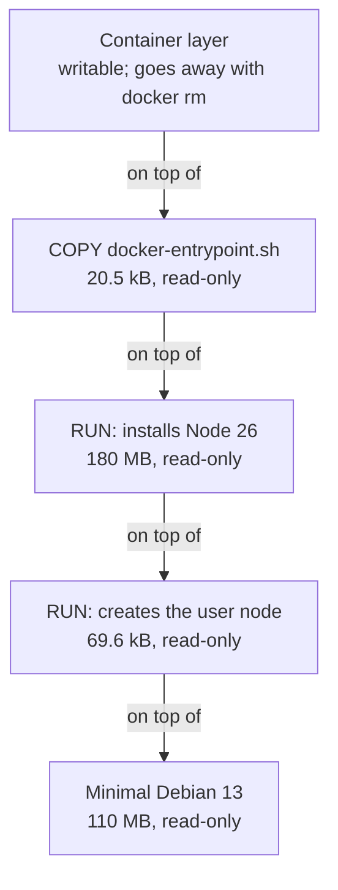

import Term from '~/components/Term.astro';
import TryIt from '~/components/TryIt.astro';
import Analogy from '~/components/Analogy.astro';
import SelfCheck from '~/components/SelfCheck.astro';
import Quiz from '~/components/Quiz.astro';
import QuizQuestion from '~/components/QuizQuestion.astro';
import QuizOption from '~/components/QuizOption.astro';
import DockerLayers from '~/playgrounds/docker-layers/DockerLayers';

## The problem

Imagine Ana puts the shop's API in an image. She changes a sentence in a file in `src/`, builds the image again and waits: Docker reinstalls the 161 MB of dependencies. With every change, all over again.

Luis has the same files and almost the same recipe: one more line, and a different order. His image rebuilds in a second and comes out the same as Ana's.

Why does the order make such a difference? Because Docker builds an image **in layers**, and keeps each layer to reuse it next time. Almost every rule of a good Dockerfile comes from that.

## The analogy

<Analogy>

Think of a bakery that makes layer cakes. At the bottom goes a store-bought sponge, then cream, then fruit, and on top the decoration. Each layer goes on top of the one before.

If the customer changes the decoration, the baker keeps the cake and redoes only the top layer. If they change the cream, the baker has to take off the fruit and the decoration, even though they haven't changed, because they're on top. That's why a good baker puts on top what customers change most often.

An image is that cake: the sponge is the base image, each layer of the cake is a layer of the image, and changing one means redoing the ones above it.

<div slot="limits">

- Two cakes need two sponges. Two images built on the same base store its layers only once.
- The baker sees what has changed. Docker doesn't look at what each step does: it compares the text of the instruction and the fingerprint of the files it copies.
- A layer on top can cover a file from a layer below, but not remove it: the image doesn't get smaller by deleting something in a later step.

</div>

</Analogy>

## How it really works

A <Term id="dockerfile">Dockerfile</Term> is the recipe of an image: a text file with one instruction per line, which Docker runs from top to bottom. You'll write the shop's in [lesson 3](/en/phase-7/dockerfile/).

### An image is a stack of layers

`node:26-slim` is the image your API will start from: Node 26 on a minimal Debian. `docker history` shows the steps it was built with:

<TryIt
  title="The steps of node:26-slim"
  cmd="docker history node:26-slim"
  output={`IMAGE          CREATED      CREATED BY                                      SIZE      COMMENT
193fe51b64e7   5 days ago   CMD ["node"]                                    0B        buildkit.dockerfile.v0
<missing>      5 days ago   ENTRYPOINT ["docker-entrypoint.sh"]             0B        buildkit.dockerfile.v0
<missing>      5 days ago   COPY docker-entrypoint.sh /usr/local/bin/ # …   20.5kB    buildkit.dockerfile.v0
<missing>      5 days ago   RUN /bin/sh -c ARCH= OPENSSL_ARCH= && dpkgAr…   180MB     buildkit.dockerfile.v0
<missing>      5 days ago   ENV NODE_VERSION=26.11.1                        0B        buildkit.dockerfile.v0
<missing>      5 days ago   RUN /bin/sh -c groupadd --gid 1000 node   &&…   69.6kB    buildkit.dockerfile.v0
<missing>      9 days ago   # debian.sh --arch 'arm64' out/ 'trixie' '@1…   110MB     debuerreotype 0.17`}
>

If you don't have the image, download it first with `docker pull node:26-slim`.

- **`CREATED BY`** is the instruction of each step, cut short with `…`. With `--no-trunc` (*no truncate*) it comes out whole.
- **`SIZE`** is what the step added, uncompressed.
- **`<missing>`** isn't an error: those steps were built on Docker's machines, and you only downloaded the result.

Your dates, IDs and sizes will be different: the image is updated often. On a PC you'll see `amd64` instead of `arm64`.

</TryIt>

You read it from the bottom up, in the order it was built:

| Step | What it does | Size |
|---|---|---|
| `# debian.sh … 'trixie'` | A minimal Debian 13 (“trixie”): the base | 110 MB |
| `RUN … groupadd … node` | Creates the <Term id="user">user</Term> `node` | 69.6 kB |
| `ENV NODE_VERSION=26.11.1` | Notes which version of Node it installs | 0 B |
| `RUN … dpkgArch …` | Downloads Node 26, checks its signature and installs it | 180 MB |
| `COPY docker-entrypoint.sh …` | Copies a startup script | 20.5 kB |
| `ENTRYPOINT` and `CMD ["node"]` | What to run when a container starts | 0 B |

Each step with a size is a <Term id="image-layer">layer</Term>: **a read-only bundle of files with what that step added, changed or deleted**. Seven steps and four layers, which add up to about 290 MB uncompressed. What gets downloaded is compressed: 88 MB, the `CONTENT SIZE` column of `docker image ls` you saw in [lesson 1](/en/phase-7/docker-image-vs-container/).

### Some instructions add no layer

Only the steps that touch files create a layer:

- **`RUN`** runs a command during the build, like `apt-get install`, and saves what changed on the disk.
- **`COPY`** copies files from your computer into the image.
- **`WORKDIR`** chooses the working folder and, if it doesn't exist, creates it: a layer of a few kB.

The others, like `ENV`, `CMD`, `ENTRYPOINT`, `EXPOSE` or `USER`, **only store data** in the image's record, a small configuration file: that's why they show `0B`. Even so, they count for the cache.

### The layers stack up, and the container writes in its own

When you start a container, Docker puts the layers one on top of another and adds the writable layer from lesson 1:



Inside, the program sees a single folder `/` with everything together. When it looks for a file, Docker searches from the top down and gives it the first one it finds. If the program changes a file from a lower layer, Docker first copies it to the container's layer and changes it there: the lower layers are never touched.

Deleting works the same way: the top layer gets a mark that says “this file is gone.” The file disappears from view, but **it still takes up space in the lower layer**.

### Several images share the same layers

A layer doesn't belong to one image: it's stored once, and each image that needs it points to it in its list. If you build three images on `node:26-slim`, its four layers are on your disk only once, and `docker pull` doesn't download the ones you already have.

### Each layer is named by its fingerprint

How does Docker know that two layers are the same? By their **fingerprint**: a SHA-256 <Term id="hash">hash</Term> of their content, the same idea as the hash that names each commit in [Git](/en/phase-1/git-internals/). The same bytes always give the same fingerprint, and one different byte gives a completely different one.

The whole image has one too, the *digest*:

<TryIt
  title="The fingerprint of node:26-slim"
  cmd="docker image ls --digests node:26-slim"
  output={`REPOSITORY   TAG       DIGEST                                                                    IMAGE ID       CREATED      SIZE
node         26-slim   sha256:193fe51b64e77981119c98c2002c9e32a70e2f006fb4d25068ce0558998917f0   193fe51b64e7   5 days ago   378MB`}
>

`--digests` adds the `DIGEST` column: `sha256:` and 64 characters. It's the fingerprint of the record that describes the image, which points to each layer by its fingerprint: if one byte of any layer changes, the *digest* changes. The `IMAGE ID` is its first 12 characters.

With `--digests`, the table goes back to its old format. Its `SIZE`, 378 MB, is what it takes up on your disk: the uncompressed layers plus the download, which Docker keeps too. Your *digest* will be different if your image is newer, not because of your processor.

</TryIt>

**Same content, same fingerprint, on any computer in the world.** A tag like `26-slim` may point to another image tomorrow; `node:26-slim@sha256:193f…` is always exactly this one. Lesson 8 uses it to pin versions.

### The build cache reuses what hasn't changed

When you build an image, Docker keeps each layer in its <Term id="build-cache">build cache</Term>. The next time, it goes through the Dockerfile from top to bottom and, at each step, asks itself two things:

1. Did I reuse the previous step?
2. Is this step the same as last time? For a `RUN`, an `ENV` or a `CMD`, the same means **the same text**. For a `COPY`, also **the same files**: Docker calculates the fingerprint of their content and compares it.

If both answers are yes, it reuses the stored layer: `CACHED`, zero seconds. **At the first step that changes, it runs it, and from there it also runs every step after it**, even if they don't use what changed. Each layer is built on top of the previous one: if the one below changes, the one above is no longer valid, like the layer of the cake.

Docker never looks at what a `RUN` does. If the text is the same, it reuses it, even if the command would give a different result today.

### Why package.json goes before the code

In a Node API, the slow step is `npm ci`: it installs exactly the versions in the *lockfile* `package-lock.json` (you saw it in [Phase 3](/en/phase-3/what-is-node-js/)). Its layer is the biggest one: 161 MB in the shop.

Compare the two possible orders:

| | Ana's order | Luis's order |
|---|---|---|
| First | `COPY . .`: copies everything | `COPY package*.json ./`: copies `package.json` and `package-lock.json` |
| Then | `RUN npm ci` | `RUN npm ci` |
| At the end | | `COPY . .`: copies the rest |
| You change a file in `src/` | What `COPY . .` copies changes, so `npm ci` runs again | `npm ci` is reused: its files haven't changed. Only the last `COPY` runs again |

The `*` in `package*.json` stands for any text, as in the terminal. The general rule: **what rarely changes, at the top; what you change often, at the bottom**. The dependencies change when you add one; the code, every day.

## Try it

The goal: find out how much time Luis's order saves you, first with the shop's Dockerfile in the lab and then with an image of your own, built for real.

### In the lab

The lab shows the shop's Dockerfile, the one from [lesson 3](/en/phase-7/dockerfile/), next to the layers it builds, with sizes and seconds from real builds. It follows Luis's order, but copies the files by name and, with them, `.npmrc`, npm's settings: lesson 3 explains why.

<DockerLayers client:visible lang="en" />

1. Press “Build”: the first time, with no cache, every step runs. Notice which one is slow.
2. Press “Change a file in src/” and then “Rebuild”. Which layers are reused?
3. Do the same with “Change package.json”. From which line does everything run again?
4. Switch “Order” to “wrong”, Ana's, build and repeat step 2. Compare the time.
5. Set “Multi-stage” to “yes”: you'll see which parts don't reach the final image. [Lesson 4](/en/phase-7/docker-multi-stage-build/) explains it.

### In your terminal: an image with two files

Now, the same idea with a small image. The outputs are from Docker Engine 29 on a Mac, inside a virtual machine with Linux; we captured them with another image name, changed to `hello`, and nothing else changes. Your IDs, fingerprints, sizes and times will be different.

Create the folder:

```sh
mkdir -p ~/backend-course/phase-7/hello
cd ~/backend-course/phase-7/hello
```

Inside it, create with your editor a file `hello.js` with this line:

```js
console.log("Hello from Ana and Luis's shop");
```

And another one, called `Dockerfile`, with no extension:

```dockerfile
FROM node:26-slim
RUN apt-get update && apt-get install -y --no-install-recommends curl
WORKDIR /app
COPY hello.js ./
CMD ["node", "hello.js"]
```

[Lesson 3](/en/phase-7/dockerfile/) explains each instruction. For now:

- **`FROM`** starts from `node:26-slim`, with its four layers.
- **`RUN`** installs `curl` with `apt`, as in [Phase 1](/en/phase-1/systemd-services-and-apt/). It plays the part of `npm ci`: it takes a while, and what it installs rarely changes.
- **`WORKDIR`** and **`COPY`** create `/app` and copy your file there.
- **`CMD`** says what to run at startup.

<TryIt
  title="1. Build the image"
  cmd="docker build --progress=plain -t hello ."
  output={`…
#5 [1/4] FROM docker.io/library/node:26-slim@sha256:193fe51b64e77981119c98c2002c9e32a70e2f006fb4d25068ce0558998917f0
#5 resolve docker.io/library/node:26-slim@sha256:193fe51b64e77981119c98c2002c9e32a70e2f006fb4d25068ce0558998917f0 0.0s done
#5 CACHED

#6 [2/4] RUN apt-get update && apt-get install -y --no-install-recommends curl
…
#6 DONE 4.9s

#7 [3/4] WORKDIR /app
#7 DONE 0.0s

#8 [4/4] COPY hello.js ./
#8 DONE 0.0s

#9 exporting to image
#9 exporting layers
#9 exporting layers 0.9s done
#9 exporting manifest sha256:5f9871a639843ec3a9ccded1e460c0a2e17214e96c7b6a62bf6008544f538f91 done
…
#9 naming to docker.io/library/hello:latest done
…`}
>

Word by word:

- **`docker build`** builds an image from the `Dockerfile` in a folder.
- **`--progress=plain`** writes each step on its own lines. Without it, Docker draws a summary that keeps rewriting itself and folds up when it finishes.
- **`-t hello`** (from *tag*) gives the image a name. With no tag, Docker adds `latest`.
- **`.`** is the current folder: its files are the only ones `COPY` can copy.

We've removed (`…`) the first lines, `[internal]`, which read the Dockerfile and your files, and the ones from `apt`. Look at `[2/4]`: step 2 of 4 took 4.9 seconds, and the others almost nothing. In `FROM`, the tag has turned into a *digest*. Note down the `exporting manifest sha256:5f98…`: it's the fingerprint of the record that describes your image.

If you get `"/hello.js": not found`, the file isn't in the folder or has another name: check with `ls`.

</TryIt>

<TryIt
  title="2. Build it again, without changing anything"
  cmd="docker build --progress=plain -t hello ."
  output={`…
#6 [2/4] RUN apt-get update && apt-get install -y --no-install-recommends curl
#6 CACHED

#7 [3/4] WORKDIR /app
#7 CACHED

#8 [4/4] COPY hello.js ./
#8 CACHED

#9 exporting to image
#9 exporting layers done
#9 exporting manifest sha256:5f9871a639843ec3a9ccded1e460c0a2e17214e96c7b6a62bf6008544f538f91 done
…`}
>

Every step says **`CACHED`**: nothing has changed, so Docker runs none of them. And the fingerprint is **the same `5f98…`** as before: same content, same fingerprint.

Other fingerprints we removed do change: next to the image, Docker keeps a note with the time of the build. That's why the `IMAGE ID` changes every time.

</TryIt>

Now change the text of `hello.js` with your editor, for example to `"Hello from Ana and Luis's shop. We open on Monday."`, and save it.

<TryIt
  title="3. Change the code and rebuild"
  cmd={`docker build --progress=plain -t hello .\ndocker run --rm hello`}
  output={`…
#6 [2/4] RUN apt-get update && apt-get install -y --no-install-recommends curl
#6 CACHED

#7 [3/4] WORKDIR /app
#7 CACHED

#8 [4/4] COPY hello.js ./
#8 DONE 0.0s
…
Hello from Ana and Luis's shop. We open on Monday.`}
>

`RUN` and `WORKDIR` are still cached; only `COPY hello.js` runs, because the file's fingerprint has changed. It's Luis's order: the 4.9 seconds of `apt` aren't repeated. `docker run --rm hello` starts the new image.

If `RUN` doesn't say `CACHED`, check that you haven't touched its line: one extra space is already a different text.

</TryIt>

<TryIt
  title="4. How much space does it really take?"
  cmd={`docker history hello\ndocker system df -v | grep -E 'REPOSITORY|hello|26-slim'`}
  output={`IMAGE          CREATED              CREATED BY                                      SIZE      COMMENT
3804e51c192b   59 seconds ago       CMD ["node" "hello.js"]                         0B        buildkit.dockerfile.v0
<missing>      59 seconds ago       COPY hello.js ./ # buildkit                     12.3kB    buildkit.dockerfile.v0
<missing>      About a minute ago   WORKDIR /app                                    8.19kB    buildkit.dockerfile.v0
<missing>      About a minute ago   RUN /bin/sh -c apt-get update && apt-get ins…   35.9MB    buildkit.dockerfile.v0
<missing>      5 days ago           CMD ["node"]                                    0B        buildkit.dockerfile.v0
<missing>      5 days ago           ENTRYPOINT ["docker-entrypoint.sh"]             0B        buildkit.dockerfile.v0
<missing>      5 days ago           COPY docker-entrypoint.sh /usr/local/bin/ # …   20.5kB    buildkit.dockerfile.v0
<missing>      5 days ago           RUN /bin/sh -c ARCH= OPENSSL_ARCH= && dpkgAr…   180MB     buildkit.dockerfile.v0
<missing>      5 days ago           ENV NODE_VERSION=26.11.1                        0B        buildkit.dockerfile.v0
<missing>      5 days ago           RUN /bin/sh -c groupadd --gid 1000 node   &&…   69.6kB    buildkit.dockerfile.v0
<missing>      9 days ago           # debian.sh --arch 'arm64' out/ 'trixie' '@1…   110MB     debuerreotype 0.17
REPOSITORY   TAG       IMAGE ID       CREATED              SIZE      SHARED SIZE   UNIQUE SIZE   CONTAINERS
hello        latest    3804e51c192b   About a minute ago   433MB     375.4MB       57.56MB       0
node         26-slim   193fe51b64e7   5 days ago           378MB     375.4MB       2.235MB       0`}
>

`docker history hello` shows your four steps on top of the seven of `node:26-slim`. Your `RUN` added 35.9 MB; your `COPY`, a few kB.

`docker system df` (*disk free*) counts what Docker takes up on your disk, and `-v` (*verbose*) breaks it down by image. `grep -E 'A|B|C'` keeps the lines with any of the three texts ([lesson 3 of Phase 1](/en/phase-1/pipes-and-redirection/)). **`SHARED SIZE`, 375.4 MB, is the layers of `node:26-slim`**: they're in both images and on your disk only once. `UNIQUE SIZE` is what belongs to each one.

We've adjusted the space between columns, which other images widened on our machine.

</TryIt>

<SelfCheck question="Challenge: in the Dockerfile, move the RUN line down below COPY hello.js ./, in Ana’s order. Build, change the sentence in hello.js again and build again. Which steps run again in the second build, and why?">

In the second build, `COPY` and everything after it run again, `apt` included:

```text
#7 [3/4] COPY hello.js ./
#7 DONE 0.0s

#8 [4/4] RUN apt-get update && apt-get install -y --no-install-recommends curl
…
#8 DONE 5.1s
```

`apt` doesn't use `hello.js`, but it comes after a step that changed, and Docker doesn't look at what each command does. It's Ana's order: every change to the code pays the seconds of the install.

</SelfCheck>

To finish, delete the image:

<TryIt
  title="5. Clean up"
  cmd="docker image rm hello"
  output={`Untagged: hello:latest
Deleted: sha256:3804e51c192b3461809aa9a44f015e28774aa3b3af364372748f16ace5b28a08`}
>

`node:26-slim` stays: you'll use it in lesson 3. So does the build cache, and it takes up space: `docker system df` shows it in the `Build Cache` row.

</TryIt>

## You have already seen it

- **The lines of `docker pull`.** In [lesson 1](/en/phase-7/docker-image-vs-container/), each line with a code was a piece of the image, almost all of them layers, named by the start of its fingerprint.
- **HTTP caching.** The `ETag` from [Phase 2](/en/phase-2/http-caching/) is a fingerprint of the content, to know whether it has changed without downloading it again. The build cache does the same with your files.

## Common mistakes

- **Copying everything before installing.** With `COPY . .` before `npm ci`, every change to the code reinstalls the dependencies.
- **Deleting in a separate step.** `RUN rm` on another line doesn't make the image smaller: the file is still in the layer below. You delete it in the same `RUN` that creates it, as in [lesson 4](/en/phase-7/docker-multi-stage-build/).
- **Expecting the cache to know what a `RUN` does.** `RUN apt-get update` can stay `CACHED` for months. To build from scratch, `docker build --no-cache`.
- **Copying too much.** `COPY . .` also takes `node_modules` or your `.env`, and if they change, they invalidate the cache. A `.dockerignore` file leaves them out ([lesson 3](/en/phase-7/dockerfile/)).
- **Adding up the sizes from `docker image ls`.** Shared layers count in each image, but they're on the disk once: look at `docker system df`.

## Summary

- An image is a stack of read-only layers. `RUN`, `COPY` and `WORKDIR` add one; `ENV`, `CMD` or `EXPOSE` only store data in its record.
- The container sees the layers as a single folder and writes in its own. Deleting in a layer on top hides the file, but doesn't free its space.
- Each layer and each image are named by the SHA-256 fingerprint of their content: same content, same fingerprint. That's why several images share layers.
- The cache reuses a step if the previous one was reused and its own hasn't changed: the same text and, for a `COPY`, the same files. From the first change on, everything runs again.
- What rarely changes goes at the top: `COPY package*.json` and `npm ci` before copying the code.

## Did you get it?

<Quiz>

<QuizQuestion
  question="Your API’s Dockerfile copies package*.json, runs npm ci and then copies the rest (COPY . .). You change a message in src/products.ts and rebuild. What runs again?"
  review="Why package.json goes before the code"
>

<QuizOption text="Everything from COPY package*.json on: the project folder has changed.">

Docker doesn't compare the folder, but the files each step copies. `package.json` and the *lockfile* haven't changed, so that `COPY` and `npm ci` are reused.

</QuizOption>

<QuizOption text="Only the last COPY . ., which is the one that copies src/." correct>

The steps before it are the same as last time and come out of the cache. Only what `COPY . .` copies changes, and after it there are no more steps with a layer.

</QuizOption>

<QuizOption text="npm ci and the last COPY: npm ci always runs to keep the dependencies up to date.">

`npm ci` comes out of the cache as long as neither its text nor what comes before it changes. Docker doesn't repeat it as a precaution.

</QuizOption>

</QuizQuestion>

<QuizQuestion
  question="With the same Dockerfile, you add a dependency with npm install, which changes package.json and package-lock.json. Which steps run again?"
  review="The build cache reuses what hasn't changed"
>

<QuizOption text="Only npm ci: it’s the only one that uses those files.">

`COPY package*.json` runs again too, because it copies the changed files, and so does `COPY . .`, which comes after: from the first change on, everything runs again.

</QuizOption>

<QuizOption text="None: npm install already installed the dependency on your computer.">

The image doesn't use your `node_modules`: it installs its own dependencies inside, and the *lockfile* has changed.

</QuizOption>

<QuizOption text="COPY package*.json, npm ci and COPY . ., in that order." correct>

The first `COPY` copies files with a different fingerprint, so it runs, and with it everything after it. That's exactly what you want: the new dependency gets into the image.

</QuizOption>

</QuizQuestion>

<QuizQuestion
  question="In the docker history of an image you see a row ENV NODE_ENV=production with 0B. What is it?"
  review="Some instructions add no layer"
>

<QuizOption text="An empty layer that Docker stores and downloads just like the others.">

There's no layer: `ENV` doesn't touch files. The variable goes into the image's configuration record.

</QuizOption>

<QuizOption text="A piece of data in the image’s record: it has no layer." correct>

`ENV` only stores a variable in the configuration. It adds no files, but it does count for the cache: if you change its text, that step and the ones after it run again.

</QuizOption>

<QuizOption text="A step that failed during the build: that’s why it added nothing.">

If a step fails, the build stops with an error and there's no image. `0B` is normal for the instructions that only store data.

</QuizOption>

</QuizQuestion>

<QuizQuestion
  question="You have three images built on node:26-slim. docker image ls says each one takes up about 400 MB. Do they take up 1.2 GB on your disk?"
  review="Several images share the same layers"
>

<QuizOption text="No: the layers of node:26-slim are on the disk only once." correct>

Layers are named by their fingerprint, and the three images point to the same ones; each one only adds its own. `docker system df -v` shows it in `SHARED SIZE`.

</QuizOption>

<QuizOption text="Yes: each image is a complete copy, with its own Debian and its own Node.">

Images don't copy the layers of their base, they point to them. That's why `docker pull` doesn't download again the layers you already have.

</QuizOption>

<QuizOption text="No: Docker compresses all the images together into a single 88 MB file.">

88 MB is what you download of `node:26-slim`, compressed. The saving comes from sharing layers.

</QuizOption>

</QuizQuestion>

<QuizQuestion
  question="Your Dockerfile has RUN apt-get update && apt-get install -y curl. You built it a month ago; today you rebuild, that step says CACHED, and you were expecting this month’s security fixes. What happened?"
  review="The build cache reuses what hasn't changed"
>

<QuizOption text="The cache only lasts a few days: if it says CACHED, there was nothing new to install.">

The cache doesn't expire after a few days. `CACHED` only says that the instruction and what came before haven't changed, not that Debian's catalog is still the same.

</QuizOption>

<QuizOption text="apt doesn’t update anything inside an image: you have to change the base image.">

`apt` works inside a build as in any Debian. The problem is that Docker hasn't even run it.

</QuizOption>

<QuizOption text="Docker sees the same text of the command and reuses the layer from a month ago." correct>

Docker doesn't know what a `RUN` does: if the text and the steps before it are the same, it reuses the layer. With `docker build --no-cache`, everything runs again.

</QuizOption>

</QuizQuestion>

<QuizQuestion
  question="Luis and you download node:26-slim@sha256:193fe51b… on two different computers, days apart. Do you have the same image?"
  review="Each layer is named by its fingerprint"
>

<QuizOption text="Only if you downloaded it on the same day: the tag may have changed in between.">

That happens with a tag like `26-slim`, which may point to another image tomorrow. The *digest* names a specific content, and it doesn't change.

</QuizOption>

<QuizOption text="Yes, byte for byte: the digest is the fingerprint of the content." correct>

Same content, same fingerprint, and one different byte would give another. If the fingerprint matches, the image is the same, wherever and whenever.

</QuizOption>

<QuizOption text="No: each computer calculates its own digest when it downloads it.">

The *digest* only depends on the content, not on who calculates it. That's why Docker can check that what it downloaded is exactly what you asked for.

</QuizOption>

</QuizQuestion>

</Quiz>

## Further reading

- [Understanding the image layers](https://docs.docker.com/get-started/docker-concepts/building-images/understanding-image-layers/) and [Using the build cache](https://docs.docker.com/get-started/docker-concepts/building-images/using-the-build-cache/), from the Docker documentation.
- [Cache invalidation](https://docs.docker.com/build/cache/invalidation/) and [Optimize cache usage](https://docs.docker.com/build/cache/optimize/): what each instruction invalidates and how to order a Dockerfile.
- [The `docker history` reference](https://docs.docker.com/reference/cli/docker/image/history/).
- [Descriptor](https://github.com/opencontainers/image-spec/blob/main/descriptor.md), from the OCI image specification: how *digests* are calculated and used.
