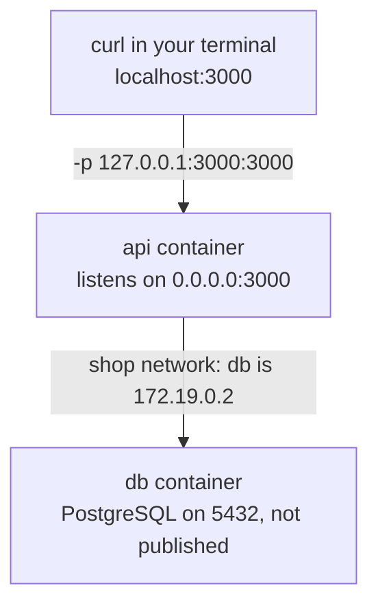

import Term from '~/components/Term.astro';
import TryIt from '~/components/TryIt.astro';
import Analogy from '~/components/Analogy.astro';
import SelfCheck from '~/components/SelfCheck.astro';
import Quiz from '~/components/Quiz.astro';
import QuizQuestion from '~/components/QuizQuestion.astro';
import QuizOption from '~/components/QuizOption.astro';

## The problem

Picture Ana with the API already in an image ([lesson 4](/en/phase-7/docker-multi-stage-build/)) and PostgreSQL in a container with its data in a volume ([lesson 5](/en/phase-7/docker-volumes/)). She starts the API with her usual `.env`, the one with `DATABASE_URL=postgres://shop:…@localhost:5432/shop`, and asks `/health`: `503`, “The database is not responding.” And PostgreSQL is running.

Luis, meanwhile, has copied `docker run -p 3000:3000` from a tutorial. He's in a café, and anyone on the same Wi-Fi can open the shop on his laptop.

Both problems have the same root: **a container has its own network**, and Docker decides what goes in and out of it.

## The analogy

<Analogy>

Think of an office building. Each company has its own switchboard, with its own extensions. If you dial “reception” at company A, A's reception rings, never B's, even if they're on the same floor.

To call another company, you go through the building's switchboard. In some buildings it only knows numbers: you need the exact extension. In others it has a directory, and it's enough to say “put me through to Accounting.”

And for someone from the street to come in, you open a door. You can open it to the street, and anyone comes in, or only to the inner hallway, and only people already in the building come in.

The building is your computer; each company, a container; “reception,” `localhost`; the switchboard with a directory, a network you create; and the door, a published port.

<div slot="limits">

- In a building, the switchboard doesn't change numbers. In Docker, a container's IP can change every time you create it: that's why calling it by name matters.
- A door to the hallway is only as safe as the building. With `127.0.0.1`, any program on your computer gets in, not just the ones you trust.
- On a Mac and on Windows there's a building inside another: the containers live in Docker Desktop's virtual machine, and Docker brings the doors all the way to your computer.

</div>

</Analogy>

## How it really works

### Each container has its own network

The Linux kernel gives each container its own **network namespace**: its network cards, its IP, its ports and its own `127.0.0.1`. It's the same isolation that separates its processes, the one from [the introduction](/en/phase-7/), applied to the network.

Docker connects that namespace to a <Term id="docker-network">Docker network</Term>, a private network inside your computer, with addresses from the `172.16.0.0` to `172.31.255.255` range you saw in [lesson 5 of Phase 0](/en/phase-0/ip-ports-sockets/). If you don't name another one, the network is called `bridge`.

### localhost inside a container is the container

This is what happened to Ana, and what [lesson 3](/en/phase-7/dockerfile/#the-database-is-outside-the-container) warned about. The outputs in this lesson come from Docker Engine 29 on a Mac, inside a virtual machine running Linux, like Docker Desktop's. We captured them with other ports and names, swapped for the lesson's: nothing else changes. Your IDs, IPs and times will be different.

You work in your project's folder; if the `shop` container from lesson 4 is still running, delete it first with `docker rm -f shop`, because it uses the same port.

<TryIt
  title="The API with your usual .env"
  cmd={`docker run -d --name api --env-file .env -p 127.0.0.1:3000:3000 shop-api\ncurl -s localhost:3000/health`}
  output={`afdc8efbb1b748d4a68ac7428ae6c7c56443d08e31d526363596088d59291266
{"type":"about:blank","title":"Service Unavailable","status":503,"detail":"The database is not responding"}`}
>

`--env-file .env` creates a variable inside for each line of your `.env`, as in lesson 3. Among them, `DATABASE_URL`, which points to `localhost:5432`.

The API starts and answers, but its `/health` route (lesson 4) can't talk to PostgreSQL. It doesn't matter that your PostgreSQL is running.

</TryIt>

Who answers `localhost` in there? Ask the API itself. The image doesn't bring `curl`, but it brings Node, and its `fetch` does the same, like the `HEALTHCHECK` from lesson 4:

<TryIt
  title="Inside the container, localhost is itself"
  cmd={`docker exec api node -e "fetch('http://localhost:3000/health').then((r) => r.text()).then(console.log)"\ndocker exec api hostname -i`}
  output={`{"type":"about:blank","title":"Service Unavailable","status":503,"detail":"The database is not responding"}
172.17.0.3`}
>

- **`node -e "…"`** runs the code between the quotes: it requests `localhost:3000/health` and writes the response.
- **The API itself** answers, with its `503`: `localhost` inside the container is the container.
- **`hostname -i`** writes the container's IP on the `bridge` network: `172.17.0.3`, not your computer's.

</TryIt>

So `localhost:5432` inside the container looks for a PostgreSQL **in the API's own container**, where there isn't one.

| From where | `localhost` is |
|---|---|
| Your terminal | Your computer, where your PostgreSQL from Phase 5 is |
| The `api` container | The `api` container, with no PostgreSQL |
| The `db` container | The `db` container |

To reach your computer from a container, lesson 3 used the special name `host.docker.internal`. To reach another container, what you need is a network with names, a bit further down.

### Publishing a port opens a door on your computer

From outside Docker, you reach a container through a published port. <Term id="port-publishing">Publishing a port</Term> is joining one on your computer to one in the container, with `-p`, as in [lesson 1](/en/phase-7/docker-image-vs-container/#docker-run-word-by-word). In `-p 127.0.0.1:3000:3000`:

- **`127.0.0.1`**: which address on your computer Docker listens on. This is <Term id="localhost">localhost</Term>'s: only programs on your own computer get in.
- **The first `3000`**: the <Term id="port">port</Term> on your computer; **the second**, the container's, where the API listens.

Inside, the API listens on `0.0.0.0` (`ENV HOST=0.0.0.0`, lesson 3), because what's published comes in through the container's network, not through its `127.0.0.1`. **Who can get in is decided by the address in `-p`**, not by the API's.

### With no IP in front, the port opens to your whole network

If you remove `127.0.0.1:`, Docker listens on **all** your computer's addresses, `0.0.0.0` and `[::]`, like the table in [lesson 5 of Phase 0](/en/phase-0/ip-ports-sockets/#what-ties-the-three-together-sockets). Check it without opening anything: `docker create` prepares a container without starting it.

<TryIt
  title="Who each -p opens to"
  cmd={`docker create --name open -p 3000:3000 shop-api\ndocker inspect --format '{{json .HostConfig.PortBindings}}' api open\ndocker rm open`}
  output={`681c8a60ba59ee01022b004dc644528881d2f39f82cc473e7f98591d32d856b3
{"3000/tcp":[{"HostIp":"127.0.0.1","HostPort":"3000"}]}
{"3000/tcp":[{"HostIp":"","HostPort":"3000"}]}
open`}
>

`api` is the container from before, still running. `docker inspect` shows everything Docker knows about a container; `--format` picks a piece, here its published ports. `"HostIp":""`, empty, means “all of them”: with `docker run`, `docker ps` would show it as `0.0.0.0:3000->3000/tcp, [::]:3000->3000/tcp`.

</TryIt>

With `127.0.0.1`, not even your own laptop gets in through its Wi-Fi IP. Find yours with `ipconfig getifaddr en0` on a Mac, or `hostname -I` on Linux:

<TryIt
  title="From the Wi-Fi, you can't get in"
  cmd={`curl -sS -m 3 http://192.168.1.133:3000/health`}
  output="curl: (7) Failed to connect to 192.168.1.133 port 3000 after 3 ms: Couldn't connect to server"
>

`-m 3` stops waiting after three seconds. Nobody listens on the Wi-Fi IP: that's what you want. With `-p 3000:3000`, the shop would answer, to you and to anyone in the café. Your IP will be different.

</TryIt>

You can delete this container now: `docker rm -f api`.

[Docker's documentation](https://docs.docker.com/engine/network/port-publishing/) puts it bluntly: “*Publishing container ports is insecure by default*.”

**On Linux there's something worse.** A firewall is a program that decides which connections to let in; on Ubuntu, the usual one is `ufw`, and you'll set it up in Phase 8. Docker publishes ports with its own rules in the kernel, and those rules apply **before** `ufw`'s. [Docker's documentation](https://docs.docker.com/engine/network/packet-filtering-firewalls/) explains it: packets are diverted “*before the firewall rules can be applied, effectively ignoring your firewall configuration*.” Even if `ufw` closes port 3000, a `-p 3000:3000` leaves it open to the internet on a server.

The course's rule: **always `127.0.0.1:` in front**. When something has to be public, in Phase 8, a web server in front will decide.

### The default network doesn't know names

Docker comes with three networks:

<TryIt
  title="Docker's networks"
  cmd="docker network ls"
  output={`NETWORK ID     NAME      DRIVER    SCOPE
fc409dd26ee2   bridge    bridge    local
662a6ec1c404   host      host      local
612be13019d0   none      null      local`}
>

- **`bridge`** is the default network: if you don't name another one, every container joins it.
- **`host`** removes the isolation: the container uses the machine's network. On a Mac, that machine is Docker's virtual one, not your Mac.
- **`none`**, no network.

`DRIVER` is the type of network. If you've already created other networks, they show up too.

</TryIt>

On `bridge`, containers see each other by IP, but **not by name**. If you start PostgreSQL with `--name db` and ask for `db` from another container, nobody finds it:

<TryIt
  title="On the default network, db doesn't exist"
  cmd={`docker run --rm shop-api getent hosts db\necho $?`}
  output="2"
>

`getent hosts db` asks which IP the name `db` has, as the API does when it connects. It writes nothing: it doesn't find it. `echo $?` writes its <Term id="exit-code">exit code</Term>, and `2` means “that name doesn't exist.”

</TryIt>

Using the IP, `172.17.0.2`, would work until you recreate the container and it gets another one.

### On your own network, a container's name is its address

A network you create with `docker network create` has something `bridge` doesn't: **its own <Term id="dns">DNS</Term>**. Inside each container, Docker listens on `127.0.0.11` and answers with the IP of any container on the network, by its name. What it doesn't know, like `example.com`, it asks outside, to your computer's DNS, as in [lesson 7 of Phase 0](/en/phase-0/what-is-dns/).

| | The `bridge` network | A network of your own (`docker network create`) |
|---|---|---|
| Containers find each other | Only by IP | By name |
| Who joins | Everyone that doesn't name another | Only the ones you start with `--network` |
| Isolation | They share a network with any container | They only see the ones on their network |

That's why Docker's documentation recommends your own networks. The API, with `DATABASE_URL=postgres://shop:…@db:5432/shop`, asks for `db`, and Docker answers with whatever IP it has that day.

The full path of a request looks like this:



`db` doesn't publish any port: only the containers on its network reach it. Your PostgreSQL from Phase 5 can stay on your computer's port 5432 without clashing.

### Compose creates the network for you

In [lesson 7](/en/phase-7/docker-compose/), a `compose.yaml` file starts the API, PostgreSQL and Redis with one command. Compose creates a network for the project on its own, `shop_default`, and puts all the services on it, each with its name: `db`, `redis`, `api`. It's the same thing you're about to do by hand.

## Try it

The goal: get the API to talk to the PostgreSQL from lesson 5 by its name, and find out why a second copy can't.

You need the `shop-api` image from lesson 4 (if you don't have it, `docker build -t shop-api .` in your project) and the `data` volume from [lesson 5](/en/phase-7/docker-volumes/), with your data. If lesson 5's PostgreSQL container is still running, stop it with `docker stop` and delete it with `docker rm`: the volume stays. If lesson 4's API is still running, delete it with `docker rm -f shop`.

<TryIt
  title="1. Create the network"
  cmd="docker network create shop"
  output="f202c031fe5594f6eb31a41ef36ebf97f5bbb012e23cf72f917d933ad5356de2"
>

The new network's ID. If you get `network with name shop already exists`, you already had it: carry on.

</TryIt>

<TryIt
  title="2. PostgreSQL, on the network and with its volume"
  cmd="docker run -d --name db --network shop -v data:/var/lib/postgresql postgres:18"
  output="38d8bd52e7ea84725c7b1e39a87e3f98cb840dc6f9e8c016587bb675ab843e32"
>

- **`--name db`** is also its name on the network.
- **`--network shop`** puts it on your network, instead of on `bridge`.
- **`-v data:/var/lib/postgresql`**, the volume from lesson 5, with your data, your user and its password.
- **No `-e POSTGRES_PASSWORD`:** the image only uses it the first time, with the volume empty. It's already saved.
- **No `-p`:** nobody outside needs it.

</TryIt>

<TryIt
  title="3. Is db found by its name?"
  cmd="docker run --rm --network shop shop-api getent hosts db"
  output="172.19.0.2      db"
>

Now it is: Docker's DNS answers with `db`'s IP. Yours may be different, like `172.18.0.2`: there were other networks here. If it writes nothing, `db` isn't on `shop`: go over step 2.

</TryIt>

<TryIt
  title="4. The API, on the same network"
  cmd={`docker run -d --name api --network shop --env-file .env \\\n  -e DATABASE_URL=postgres://shop:YOUR-PASSWORD@db:5432/shop \\\n  -p 127.0.0.1:3000:3000 shop-api`}
  output="e65c154a2df5dc4e47fc525b8774a9c1c20aa61f8dc48e93b12fbb36bb48fce1"
>

Replace `YOUR-PASSWORD` with the PostgreSQL password from [lesson 5](/en/phase-7/docker-volumes/). The `\` at the end of the line continues the command on the next one.

**`-e` wins over `--env-file`:** your `.env` keeps `localhost`, for when you start the API without Docker, and in the container the `DATABASE_URL` with `db` is the one that counts.

</TryIt>

<TryIt
  title="5. Ask the shop"
  cmd={`curl -s localhost:3000/health\ndocker ps`}
  output={`{"status":"ok"}
CONTAINER ID   IMAGE         COMMAND                  CREATED          STATUS                    PORTS                      NAMES
e65c154a2df5   shop-api      "docker-entrypoint.s…"   17 seconds ago   Up 17 seconds (healthy)   127.0.0.1:3000->3000/tcp   api
38d8bd52e7ea   postgres:18   "docker-entrypoint.s…"   26 seconds ago   Up 26 seconds             5432/tcp                   db`}
>

`{"status":"ok"}`: the API has talked to PostgreSQL. Look at `PORTS`. The API has an arrow, `127.0.0.1:3000->3000/tcp`: published, only on your computer. `db` says `5432/tcp`, with no arrow: it's the port it uses inside, not published.

`(healthy)` shows up after ten seconds, once lesson 4's `HEALTHCHECK` has asked `/health`; before that, `(health: starting)`. If `curl` says `503`, wait a few seconds, in case PostgreSQL is still starting, and then check the password and that both have `--network shop`.

</TryIt>

<TryIt
  title="6. Who answers the names"
  cmd="docker exec api cat /etc/resolv.conf"
  output={`# Generated by Docker Engine.
…
nameserver 127.0.0.11
options ndots:0
…`}
>

`/etc/resolv.conf` tells a program which DNS server to ask. Here, `127.0.0.11`: Docker's DNS, inside the container. We've trimmed the comments (`…`).

</TryIt>

<TryIt
  title="7. Look inside the network"
  cmd="docker network inspect shop"
  output={`[
    {
        "Name": "shop",
        "Id": "f202c031fe5594f6eb31a41ef36ebf97f5bbb012e23cf72f917d933ad5356de2",
        "Created": "2026-10-14T07:21:27.272237505+02:00",
        "Scope": "local",
        "Driver": "bridge",
        …
            "Config": [
                {
                    "Subnet": "172.19.0.0/16",
                    "Gateway": "172.19.0.1"
                }
            ]
        …
        "Containers": {
            "38d8bd52e7ea84725c7b1e39a87e3f98cb840dc6f9e8c016587bb675ab843e32": {
                "Name": "db",
                …
                "IPv4Address": "172.19.0.2/16",
                …
            },
            "e65c154a2df5dc4e47fc525b8774a9c1c20aa61f8dc48e93b12fbb36bb48fce1": {
                "Name": "api",
                …
                "IPv4Address": "172.19.0.3/16",
                …
            }
        },
        …
    }
]`}
>

- **`Driver: bridge`**: it's the same type as the default network, but yours, with DNS.
- **`Subnet`**: the network's addresses, `172.19.0.0/16`, private ones. **`Gateway`**, `172.19.0.1`, is its <Term id="gateway">gateway</Term>, the way out to your computer.
- **`Containers`**: who's inside and with which IP. If you recreate `db`, its IP may change; its name, no.

We've trimmed the output (`…`).

</TryIt>

<SelfCheck question="Challenge: start a second API, api2, on port 3001 and with the same DATABASE_URL, but without --network. What does /health answer, and why? Fix it without deleting it.">

```sh
docker run -d --name api2 --env-file .env \
  -e DATABASE_URL=postgres://shop:YOUR-PASSWORD@db:5432/shop \
  -p 127.0.0.1:3001:3000 shop-api
curl -s localhost:3001/health
```

It answers `503`, “The database is not responding.” `api2` is on the `bridge` network, where nobody knows the name `db`: `docker exec api2 getent hosts db` writes nothing.

`docker network connect shop api2` connects it to your network without stopping it, and the next `curl -s localhost:3001/health` says `{"status":"ok"}`. A container can be on several networks at once.

</SelfCheck>

To finish, clean up. The `data` volume stays, with your data:

```sh
docker rm -f api api2
docker stop db && docker rm db
docker network rm shop
```

`docker stop` before `rm` lets PostgreSQL shut down properly. A network can only be deleted when there are no containers left on it.

## You have already seen it

- **Your home.** The router hands out private IPs to your devices, as in [Phase 0](/en/phase-0/ip-ports-sockets/). Docker acts as the router for your containers.
- **nginx's `access.log` in lesson 1.** Your requests came from `172.17.0.1`: the `bridge` network's gateway, where whatever reaches a published port comes in.
- **`docker ps`.** Its `PORTS` column, since lesson 1, tells you what's published and where.
- **A website's development server.** Vite only listens on `localhost` until you ask it for `--host`, as [Phase 0](/en/phase-0/ip-ports-sockets/#you-have-already-seen-it) told you: the same decision as the `127.0.0.1:` in `-p`.

## Common mistakes

- **`localhost` in a container's configuration.** A `DATABASE_URL` or `REDIS_URL` with `localhost` points, inside the container, to the container itself. Use the other container's name, on a network of your own.
- **`-p 3000:3000` without `127.0.0.1:`.** It opens the port to your whole network and, on a Linux server, to the internet even if `ufw` says no.
- **Expecting names on the default network.** If `getent hosts db` writes nothing, one of the two isn't on your network: start it with `--network` or use `docker network connect`.
- **A server listening on `127.0.0.1` inside the container.** With `-e HOST=127.0.0.1`, `curl -sS localhost:3000/health` says `curl: (52) Empty reply from server`: the port is published, but inside nobody listens on the container's network. Inside, `0.0.0.0`.
- **Publishing the database port “just in case.”** `-p 5432:5432` opens your database to your whole network, and it can clash with port 5432 of your PostgreSQL from Phase 5. The API reaches `db` through Docker's network without publishing anything.

## Summary

- Each container has its own network: its IP, its ports and its `localhost`, which is itself.
- Publishing a port with `-p` opens a door from outside. With no IP in front, it opens on all your computer's addresses and, on Linux, bypasses `ufw`: always `127.0.0.1:` in front.
- On the default network, `bridge`, containers don't find each other by name. On a network of your own, made with `docker network create`, Docker resolves each name to its IP.
- The API reaches PostgreSQL with `DATABASE_URL=postgres://shop:…@db:5432/shop`, and `db` doesn't need any published port.
- `docker network inspect` tells you who's on a network and with which IP. In lesson 7, Compose creates that network for you.

## Did you get it?

<Quiz>

<QuizQuestion
  question="The API, in a container, has REDIS_URL=redis://localhost:6379, and Redis is in another container on the same network, called redis. Does it get there?"
  review="localhost inside a container is the container"
>

<QuizOption text="Yes: both are on your computer, and localhost is your computer.">

Inside a container, `localhost` is the container itself, with its own network. No Redis listens there.

</QuizOption>

<QuizOption text="No: it has to use redis://redis:6379, the container’s name." correct>

On a network of your own, Docker's DNS resolves `redis` to that container's IP. `localhost` would stay inside the API's.

</QuizOption>

<QuizOption text="Yes, as long as Redis publishes its port with -p 127.0.0.1:6379:6379.">

Publishing opens the port on your computer, not in the API's container. Its `localhost` is still itself, and between containers you don't need to publish anything.

</QuizOption>

</QuizQuestion>

<QuizQuestion
  question="In a café, you start the shop with -p 3000:3000. Who can open it?"
  review="With no IP in front, the port opens to your whole network"
>

<QuizOption text="Anyone on the same Wi-Fi who knows your IP." correct>

With no IP in front, Docker listens on all your computer's addresses, the Wi-Fi one too. With `127.0.0.1:` in front, only you would get in.

</QuizOption>

<QuizOption text="Only you: containers are isolated, and nothing from outside gets into them.">

They're isolated until you publish a port: that's exactly opening a door. What matters is which address you open it on.

</QuizOption>

<QuizOption text="Only you, because the API inside the container listens on 127.0.0.1.">

Inside, it listens on `0.0.0.0`, and even if it didn't, who gets in is decided by the address in `-p`, which here is all of them.

</QuizOption>

</QuizQuestion>

<QuizQuestion
  question="On your Ubuntu server, ufw only lets in 22 and 443. You start PostgreSQL with -p 5432:5432. Is 5432 open to the internet?"
  review="With no IP in front, the port opens to your whole network"
>

<QuizOption text="No: ufw blocks everything that isn’t on its list, including what Docker publishes.">

Docker's rules apply before `ufw`'s, so `ufw` doesn't even see it. It's the trap Docker's documentation warns about.

</QuizOption>

<QuizOption text="No: Docker only publishes ports for your own computer.">

That only happens with `127.0.0.1:` in front. With no IP, Docker listens on all the server's addresses, the public one too.

</QuizOption>

<QuizOption text="Yes: Docker publishes with its own rules, which bypass ufw’s." correct>

The packets go to the container before `ufw` looks at them. With `-p 127.0.0.1:5432:5432`, or without publishing the port, it wouldn't happen.

</QuizOption>

</QuizQuestion>

<QuizQuestion
  question="You start db and api without --network, and the API says it can’t find the name db. What do you do?"
  review="The default network doesn't know names"
>

<QuizOption text="Publish db’s 5432, so the API finds it.">

Publishing opens a port on your computer, but it doesn't give names: on the default network, `db` still doesn't exist.

</QuizOption>

<QuizOption text="Put both on a network created with docker network create." correct>

Only the networks you create have DNS. With both inside, `db` resolves to its IP.

</QuizOption>

<QuizOption text="Wait a few seconds: Docker takes a while to register the name db on the default network.">

It's not a matter of time: the default network has no DNS for containers, and `db` will never exist on it.

</QuizOption>

</QuizQuestion>

<QuizQuestion
  question="docker ps shows 5432/tcp in db’s PORTS column, with no arrow. What does it mean?"
  review="Publishing a port opens a door on your computer"
>

<QuizOption text="That PostgreSQL is published on your computer’s port 5432.">

Published shows with an arrow: `127.0.0.1:5432->5432/tcp`. With no arrow, nobody from outside gets in.

</QuizOption>

<QuizOption text="That PostgreSQL isn’t listening, and the API won’t be able to connect.">

PostgreSQL listens on the container's port 5432. The API, on the same network, gets there with no problem.

</QuizOption>

<QuizOption text="That it’s the port inside the container, not published." correct>

It's what you want for a database: the API gets there through Docker's network, and nobody outside sees it.

</QuizOption>

</QuizQuestion>

<QuizQuestion
  question="You recreate the db container with the same name and the same volume, and its IP goes from 172.18.0.2 to 172.18.0.4. What happens to the API, with DATABASE_URL pointing to db?"
  review="On your own network, a container's name is its address"
>

<QuizOption text="It keeps working: Docker’s DNS gives it the new IP." correct>

The API resolves the name when it connects. That's why names are used and not IPs: the IP belongs to a container, the name belongs to the service.

</QuizOption>

<QuizOption text="It stops working until you recreate the API with the new IP.">

The API doesn't keep the IP in its configuration, only the name `db`, which is still valid.

</QuizOption>

<QuizOption text="It loses the data: a new container is an empty database.">

The data is in the `data` volume ([lesson 5](/en/phase-7/docker-volumes/)), not in the container. The new one finds it where it was.

</QuizOption>

</QuizQuestion>

</Quiz>

## Further reading

- [Networking overview](https://docs.docker.com/engine/network/), from Docker's documentation: the types of network and how containers connect.
- [Port publishing and mapping](https://docs.docker.com/engine/network/port-publishing/): why publishing is insecure by default, and how to change the address Docker uses when you don't name one.
- [Docker with iptables and ufw](https://docs.docker.com/engine/network/packet-filtering-firewalls/): why Docker and `ufw` don't get along.
- [Bridge network driver](https://docs.docker.com/engine/network/drivers/bridge/): the differences between the default network and your own.
