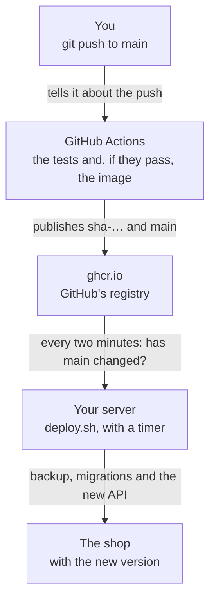

import { Aside } from '@astrojs/starlight/components';
import Term from '~/components/Term.astro';
import TryIt from '~/components/TryIt.astro';
import Analogy from '~/components/Analogy.astro';
import ProjectCode from '~/components/ProjectCode.astro';
import Quiz from '~/components/Quiz.astro';
import QuizQuestion from '~/components/QuizQuestion.astro';
import QuizOption from '~/components/QuizOption.astro';

## The problem

Imagine Ana changes the shop's title. To get it to the server, she copies the folder with `rsync`, logs in over SSH, types `docker compose up --build` and waits for the image to build. Five steps by hand, and any of them can be forgotten.

One Friday night she forgets to run the tests. The new version doesn't start, the shop answers `502` and Ana doesn't remember which version was there before.

**Every step done by hand is a step someone skips.** In this lesson, a `git push` runs the tests, publishes the image and reaches the server without you logging in to it; and if the new version doesn't work, the server goes back to the previous one on its own.

## The analogy

<Analogy>

Think of a newsstand. The printer (GitHub) only prints an edition if the proofreader (the tests) approves it, and leaves it at the distributor's warehouse (ghcr.io).

The vendor (your server) drops by the warehouse every little while. If there's a new edition, they take it, put it in the window and keep yesterday's under the counter. If the new one came out badly printed, they put yesterday's back.

<div slot="limits">

- The warehouse doesn't deliver anything to the newsstand: it's the vendor who goes. That part does match: GitHub doesn't get into your server.
- Changing the newspaper in the window is instant. Changing the API leaves the shop a few seconds without answering.
- Going back to yesterday's paper changes nothing else. Going back to the previous version doesn't undo what the new one's migrations changed.

</div>

</Analogy>

## How it really works

### CI and CD: check every change and deploy it on its own

They're two halves of the same idea:

- **<Term id="continuous-integration">Continuous integration</Term> (CI)** merges changes into the main branch often, and a program checks each one first: it installs, checks the types and runs the tests. If something breaks, you know within minutes, and you know which change it was.
- **<Term id="continuous-deployment">Continuous deployment</Term> (CD)** takes every change that passes those checks to production, with nobody in between. If the last step is a button a person presses, it's called continuous delivery, with the same initials.

In the shop, a change travels this way:



### GitHub Actions: a borrowed computer for every push

<Term id="github-actions">GitHub Actions</Term> runs tasks when something happens in a repository. They're described in a **workflow**, a YAML file in `.github/workflows`, with **jobs** made of **steps**. Each job runs on a fresh virtual machine that GitHub lends you, the **runner**, which is deleted when it's done.

**GitHub only reads the workflows at the root of a repository.** In the step's folder, inside the course's repository, `publish.yml` does nothing: in "Try it," the step will be the root of your own repository. In October 2026, Actions is free for public repositories; for private ones, a free account gets 2,000 minutes a month, and each push to `main` uses about 4.

### When it runs: pull request and push to main

<ProjectCode file="shop-api/36-deployment/.github/workflows/publish.yml" region="when" />

- **`pull_request`**: with every pull request, a proposed change that's reviewed before it's merged into `main`. It only checks.
- **`push` to `main`**: yours, or the one GitHub makes when it accepts a pull request. It checks and publishes.
- **`concurrency`**: in a pull request, a new push cancels the previous check; on `main`, none is cut off halfway.

### check: the tests, with their PostgreSQL

The first job starts with a database:

<ProjectCode file="shop-api/36-deployment/.github/workflows/publish.yml" region="service" />

**`services`** starts containers that live as long as the job: the shop's PostgreSQL 18, pinned by its <Term id="image-digest">digest</Term> and with its <Term id="healthcheck">healthcheck</Term>, which the steps wait for. Then come the tests' user and the commands you've used on your computer since [Phase 3](/en/phase-3/):

<ProjectCode file="shop-api/36-deployment/.github/workflows/publish.yml" region="database" />

<ProjectCode file="shop-api/36-deployment/.github/workflows/publish.yml" region="checks" />

### Actions pinned by their SHA

The steps with `uses:` are **actions**, programs other people publish on GitHub: `checkout` downloads your repository and `setup-node` installs Node.

<ProjectCode file="shop-api/36-deployment/.github/workflows/publish.yml" region="actions" />

After the `@` there's no `v7`, but the action's **commit SHA**. It's [Phase 7](/en/phase-7/docker-registry/#pinning-by-digest-and-letting-a-robot-update-it)'s rule for digests: a tag can be moved to other code, as in the attack on `trivy-action`, and a SHA can't. **`persist-credentials: false`** doesn't leave `checkout`'s token on the disk, where another program could read it.

### publish: only on main, and only if check passes

<ProjectCode file="shop-api/36-deployment/.github/workflows/publish.yml" region="publish" />

- **`needs: check`**: it waits for `check` to finish successfully. If it fails, `publish` doesn't even start.
- **`if: … == 'push'`**: in a pull request it's skipped. A proposal publishes nothing.
- **`permissions`**: the only job that can write packages, `packages: write`. Above, for the whole workflow, there's only reading: `permissions: contents: read`.

It's Phase 6's <Term id="least-privilege">least privilege</Term>: `check` runs the code of every pull request and of hundreds of npm packages, and its token can't publish.

### The GITHUB_TOKEN: a key that lasts one run

In [Phase 7](/en/phase-7/docker-registry/#publishing-to-docker-hub-or-ghcrio) you logged in to ghcr.io with a token you created yourself. In Actions you don't need one:

<ProjectCode file="shop-api/36-deployment/.github/workflows/publish.yml" region="token" />

**`secrets.GITHUB_TOKEN`** is created by GitHub when each job starts, with that job's permissions, and stops working when the job ends: there's no password to keep or to leak. In a pull request from someone else's copy (a *fork*), it can only read.

### One image for two processors

<ProjectCode file="shop-api/36-deployment/.github/workflows/publish.yml" region="platforms" />

The image is built twice: **`linux/amd64`**, for Intel and AMD, the ones in most VPSs, and **`linux/arm64`**, for ARM, like the Multipass VM on a Mac with an Apple chip. QEMU imitates ARM on the runner, which is amd64, and Buildx joins both into an **index**, like `node:26-slim`'s in [Phase 7](/en/phase-7/docker-registry/#one-digest-for-each-processor):

```
$ docker buildx imagetools inspect ghcr.io/backendfromscratch/shop-api:main
Name:      ghcr.io/backendfromscratch/shop-api:main
MediaType: application/vnd.oci.image.index.v1+json
Digest:    sha256:c4160dfa995813805af864b6c353de84e7e886e8a0bddeb5282fe5f9932bce63
…
  Platform:    linux/amd64
…
  Platform:    linux/arm64
…
  Platform:    unknown/unknown
…
  Platform:    unknown/unknown
…
```

One image per processor, and two `unknown/unknown` notes about how they were built. Your server downloads only its own.

### Two tags: sha-… forever, main for the latest

<ProjectCode file="shop-api/36-deployment/.github/workflows/publish.yml" region="tags" />

Each image comes out with two <Term id="tag">tags</Term>:

- **`sha-` and the first 7 letters of the commit**, like `sha-3ace67e`: this version, forever.
- **`main`**: the latest one that passed the tests. It moves with every push, and it's the one your server follows.

### The image is born private

The first time, ghcr.io creates the `shop-api` package as **private**, even if your repository is public, and your server, with no GitHub account, can't download it:

```
$ docker pull ghcr.io/backendfromscratch/shop-api:main
Error response from daemon: error from registry: unauthorized
unauthorized
```

Make it public once, in "Try it." **It can't be made private again**, but it carries no secrets: they live in the server's `.env`. For a private image, the server would need `docker login ghcr.io` with a token of yours with a single permission, `read:packages`.

### The server asks, GitHub doesn't come in

GitHub doesn't send anything to your server. **It's the server that asks**, every two minutes, whether `main` points to another image:

- **GitHub can't reach your VM.** It has a <Term id="private-ip">private IP</Term> behind your router, and nobody on the internet can start a conversation with it: [Phase 0's NAT](/en/phase-0/ip-ports-sockets/#how-your-private-ip-address-gets-out-to-the-internet-nat). By asking, the VM and a VPS work the same.
- **GitHub keeps no key to your server.** Whoever gets into your GitHub account will be able to publish an image, but not to open a terminal on your server. Careful: your server deploys that image on its own, with your secrets. Protect your account with two-factor authentication.
- **There's no new door.** The server only goes out, and `ufw` stays as in [lesson 2](/en/phase-8/secure-linux-server/).

The one that asks is a <Term id="systemd">systemd timer</Term>, like the nightly backup's in [lesson 3](/en/phase-8/docker-compose-production/#a-copy-every-night), with its service:

<ProjectCode file="shop-api/36-deployment/deployment/shop-deploy.timer" />

<ProjectCode file="shop-api/36-deployment/deployment/shop-deploy.service" />

**`OnUnitActiveSec=2min`** means "two minutes after the previous run started." systemd can delay it up to a minute to group tasks together: in practice, between two and three.

### deploy.sh, step by step

The service runs `deployment/deploy.sh`. First of all, it makes sure there aren't two at once:

<ProjectCode file="shop-api/36-deployment/deployment/deploy.sh" region="one-at-a-time" />

`flock` is a lock on a file: if the timer and you launch it at the same time, the second one ends without doing anything. Then it keeps the running image under a name of its own, `:previous`:

<ProjectCode file="shop-api/36-deployment/deployment/deploy.sh" region="previous" />

That way, going back doesn't depend on the registry, which may be down. Only if the API is healthy: a broken version isn't worth going back to. Now it asks the registry and compares:

<ProjectCode file="shop-api/36-deployment/deployment/deploy.sh" region="ask" />

It compares the **image ID**, its <Term id="hash">hash</Term>, because `main` always has the same name. With nothing new, it ends without writing anything. `pull` only downloads the <Term id="image-layer">layers</Term> it doesn't have: it's the wait of every deployment that [Phase 7](/en/phase-7/docker-multi-stage-build/) told you about. With a new image, first the backup and the migrations:

<ProjectCode file="shop-api/36-deployment/deployment/deploy.sh" region="migrate" />

The <Term id="migration">migrations</Term> run with the new image while the old API keeps serving; if they fail, the API isn't touched. Then, the new API:

<ProjectCode file="shop-api/36-deployment/deployment/deploy.sh" region="start" />

- **`--no-build`**: the server never builds; it uses the downloaded image.
- **`--no-deps`**: only the API. **PostgreSQL and Redis have to be running already**, as you left them in lesson 3.
- **`wait_for_health`** asks Docker every 2 seconds, for up to 60, whether [Phase 7](/en/phase-7/docker-multi-stage-build/#healthcheck-is-the-shop-fine)'s healthcheck considers it `healthy`.

Every deploy leaves the old image on disk, and nothing deletes it: `docker image prune` frees the ones that no longer have a name (without `-a`, so it doesn't take `:previous`), and a full disk takes PostgreSQL down.

### If the new version doesn't get healthy, it goes back on its own

If the new API isn't healthy within 60 seconds, the script goes back to `:previous`:

<ProjectCode file="shop-api/36-deployment/deployment/deploy.sh" region="roll-back" />

`fail` writes the image down in `.deploy-failed`, and the following runs don't repeat it:

<ProjectCode file="shop-api/36-deployment/deployment/deploy.sh" region="failed" />

This is how it looked on our VM, with a version we prepared for the test (in a test registry, `localhost:5000`, without going through GitHub): it required a new variable, `NOTIFICATIONS_EMAIL`, that the server's `.env` didn't have (we trimmed lines, `…`):

```
$ journalctl -u shop-deploy --since 02:43 --no-pager
Oct 18 02:43:34 course systemd[1]: Starting shop-deploy.service - Deploys the shop's new image, if there is one...
Oct 18 02:43:34 course deploy.sh[55030]: deploy: new image: 06012f0dc592 -> be6d411ce72c (the one running is kept as localhost:5000/shop-api:previous)
…
Oct 18 02:43:36 course deploy.sh[55030]: deploy: waiting for /health (up to 60 s)
Oct 18 02:44:38 course deploy.sh[55030]: deploy: the new image didn't start or didn't get healthy: going back to 06012f0dc592
…
Oct 18 02:44:49 course deploy.sh[55030]: deploy: back done: the API is running 06012f0dc592 again. The new image's migrations are still applied
Oct 18 02:44:49 course systemd[1]: shop-deploy.service: Main process exited, code=exited, status=1/FAILURE
…
Oct 18 02:45:34 course systemd[1]: Starting shop-deploy.service - Deploys the shop's new image, if there is one...
Oct 18 02:45:34 course deploy.sh[62734]: deploy: image be6d411ce72c already failed: waiting for a new one (to retry it: rm /opt/shop/.deploy-failed)
…
```

While it waited, `docker compose -f compose.production.yaml logs api` kept repeating why: `Configuration: NOTIFICATIONS_EMAIL: NOTIFICATIONS_EMAIL is missing, or it is not an email`. **Look at the logs while it waits:** after the rollback, that container no longer exists. The image isn't retried on its own, because every attempt is a minute without an API:

- **If the fault is the server's,** fix it and delete the file. We added `NOTIFICATIONS_EMAIL` to `.env` and ran `rm .deploy-failed`: on the next run, `done`.
- **If it's the code's,** don't delete anything: fix it and push. The new image will have another ID.

### A few seconds without a shop

To switch images, Compose stops the old container and starts the new one. In between, nginx answers `502`, as in [lesson 4](/en/phase-8/nginx-reverse-proxy/#when-the-api-fails-502-and-504). This is how one deployment looked, asking `/health` every 0.2 seconds:

```
02:41:55 200
02:42:00 502
02:42:02 200
02:42:05 502
02:42:09 200
…
```

**Two windows:** the moment with no container and, after it, a few seconds in which nginx keeps setting aside the copies that failed: after a failure, it sets them aside for 10 seconds ([lesson 4](/en/phase-8/nginx-reverse-proxy/#two-copies-and-nginx-finds-out-on-its-own)), and each nginx process keeps its own count.

In our tests, **a few seconds** without answering per deployment (between 1 and 11); a failed one, more than a minute. For a small shop that's acceptable; deploying without interruptions (two copies that take turns, or *blue-green*) is a topic for Phase 9.

### A rollback brings back the code, not the schema

A <Term id="rollback">rollback</Term> changes the image, but the new version's migrations **stay applied**: as in [Phase 5](/en/phase-5/database-migrations/#only-forward-and-a-table-that-records-it), they only go forward. A bad migration can only be undone by hand, with the backup from before migrating. It isn't a [Phase 5 transaction](/en/phase-5/acid-transactions/#begin-and-commit-several-commands-as-one)'s `ROLLBACK`: here nothing in the database is undone.

The rule that makes rollbacks safe is called **expand and contract**. Imagine you want to rename the `name` column of `products` to `title`:

1. **Expand:** a migration that only adds `title`, copying what's in `name`, and code that writes to both and reads the new one. The old code keeps working, because `name` is still there.
2. **Contract:** days later, when you're no longer going to go back to the old version, another migration drops `name`.

### The other model: GitHub comes in over SSH

Many tutorials do the opposite, the **push model**: an Actions job keeps an SSH <Term id="private-key">private key</Term> in the repository's secrets, logs in to the server and runs `docker compose pull` and `up`. [Kamal](https://kamal-deploy.org/), for example, deploys that way. If you use it, limit that key: in [Phase 1](/en/phase-1/what-is-ssh/#authorized_keys-the-list-of-keys-that-open-the-door)'s `authorized_keys`, it can carry a forced command in front:

```
command="/opt/shop/deployment/deploy.sh",restrict ssh-ed25519 AAAAC3Nz… github-actions
```

Whoever logs in with it can only launch the deployment: **`restrict`** takes away the terminal, the tunnels and everything else.

| | The server asks (pull) | GitHub comes in (push) |
|---|---|---|
| Server with no public IP (your VM) | Works | Can't reach it |
| A key to the server on GitHub | No | Yes, limited with `command=` |
| When the change arrives | Up to 2 or 3 minutes later | As soon as the workflow ends |
| Several servers | Each one asks on its own | The workflow goes into all of them |
| Seeing the deployment on GitHub | No: in the server's journal | Yes, in the same run |

**Pull fits** a server nobody can reach from the internet, or if you don't want keys outside. **Push**, if you want to see the deployment on GitHub or chain more steps after it.

### This website: GitHub Actions checks, Cloudflare deploys

This website's workflow, `.github/workflows/ci.yml`, is triggered like this:

```yaml
on:
  push:
    branches: [main]
  pull_request:
  workflow_dispatch:
  # Once a week, everything, even if nothing changed: what changes outside the repository (a new
  # Node 26 release, a package removed from npm) shows up here, not in the next unrelated PR.
  schedule:
    - cron: '17 5 * * 1'
```

The same `push` to `main` and `pull_request`, plus a button (`workflow_dispatch`) and Mondays at 5:17 UTC (`schedule`). It checks the website and the guided projects. **It doesn't deploy.**

Cloudflare deploys, with [Workers Builds](https://developers.cloudflare.com/workers/ci-cd/builds/): with every push to `main`, GitHub tells it, and Cloudflare downloads the commit, builds the website and publishes it. It's the diagram from [Phase 1](/en/phase-1/git-internals/#coming-up-a-push-that-deploys). Cloudflare doesn't wait for Actions: what reaches `main` already passed the checks in its pull request, because `main` requires them to pass. Here, too, GitHub keeps nobody's key: it's Cloudflare that has permission to read the repository.

## Try it

The goal: get a change from a `git push` to your server without logging in to it; keep a broken one on GitHub; and go back to the previous version on purpose.

You need a GitHub account, your SSH key on it (from [Phase 1](/en/phase-1/what-is-ssh/)) and the shop running on your server, as you left it in lesson 5.

**The outputs come from two places.** GitHub's, from our practice repository, `backendfromscratch/shop-practice`. The server's, from lesson 3's VM, which downloads from ghcr.io. Our images carry our username, `backendfromscratch`; yours, yours. Your IDs, SHAs, times and durations will be different.

### Your repository on GitHub

On GitHub's website, create an empty repository, `shop-api`, without a README. Public, so you don't use up minutes. On **your computer**:

```sh
curl -O https://backenddesdecero.com/practicas/shop-api/36-deployment.tar.gz
tar -xzf 36-deployment.tar.gz
cd 36-deployment
git init -b main
git add .
git commit -m "The shop, ready to be published"
git remote add origin git@github.com:ana/shop-api.git
git push -u origin main
```

Change `ana` to your username. On Windows, type them in WSL, as in the earlier phases: creating the repository doesn't need the VM. **The step ends up at the root**, with `.github/workflows/publish.yml` next to `package.json`, where GitHub looks for it. In your repository's *Actions* tab you'll see the *Publish* run. Ours, with GitHub's `gh` command:

```
$ gh run view 39124680707 -R backendfromscratch/shop-practice

✓ main Publish · 39124680707
Triggered via push about 3 minutes ago

JOBS
✓ check in 1m34s (ID 117667203758)
✓ publish in 1m43s (ID 117667506988)
…
```

The two `✓` marks: `check` passed the tests and `publish` uploaded the image. If one comes out red, its log says which step failed.

Now **make the image public**: on your GitHub profile, *Packages* → `shop-api` → *Package settings* → *Change visibility* → *Public*.

### The server follows your image

Copy the step's `deployment/` folder to the server, which brings the script and the timer. From **your computer**, with your user and your server's IP:

```sh
rsync -av 36-deployment/deployment ubuntu@192.168.5.15:/opt/shop/
```

On Windows, from PowerShell as in lesson 3, with the step downloaded there (`curl.exe -O` and `tar -xzf`): `scp -r` instead of `rsync -av`. Only that folder: you've changed the rest of `/opt/shop` in lessons 3 to 5, and you don't want to overwrite it.

**Inside the server**, in `/opt/shop`, make the scripts executable (the download doesn't bring that permission, and copying may have taken it away from the backup script) and tell it which image to follow, with your username, in lowercase:

```sh
cd /opt/shop
chmod +x deployment/*.sh
echo "IMAGE=ghcr.io/ana/shop-api:main" >> .env
```

Launch the first deployment by hand:

<TryIt
  title="1. The first deployment"
  cmd="deployment/deploy.sh"
  output={`deploy: new image: cfb554da465a -> 0a2cfede5bc0 (the one running is kept as ghcr.io/backendfromscratch/shop-api:previous)
deploy: backup before migrating
Backup made: backups/shop-2026-10-18-135136.sql.gz (4.0K)
deploy: migrations
…
No new migrations: the database is up to date
No practice accounts: they are not loaded (--no-accounts)
The database already has products: the sample ones are not loaded again
deploy: starting the API with the new image
…
 Container shop-api-1 Recreate 
 Container shop-api-1 Recreated 
 Container shop-api-1 Starting 
 Container shop-api-1 Started 
deploy: waiting for /health (up to 60 s)
deploy: done: the API is running 0a2cfede5bc0`}
>

The first line swaps the image you built on the server (`cfb5…`) for the one GitHub published (`0a2c…`), and keeps the old one as `:previous`. Then come the script's steps, up to `done`. We trimmed lines (`…`). If it says `unauthorized`, the image is still private; if it says `Permission denied`, the `chmod` is missing.

</TryIt>

And now, the timer:

<TryIt
  title="2. Every two minutes"
  cmd={`sudo cp deployment/shop-deploy.service deployment/shop-deploy.timer /etc/systemd/system/
sudo systemctl daemon-reload
sudo systemctl enable --now shop-deploy.timer
systemctl list-timers shop-deploy.timer`}
  output={`Created symlink '/etc/systemd/system/timers.target.wants/shop-deploy.timer' → '/etc/systemd/system/shop-deploy.timer'.
NEXT LEFT LAST                          PASSED UNIT              ACTIVATES
-       - Sun 2026-10-18 13:51:54 CEST 6ms ago shop-deploy.timer shop-deploy.service
…`}
>

When it's turned on, the timer launches the first run: `LAST` is right now, and `NEXT` shows `-` while it lasts. A few seconds later, `NEXT` will say the next one, two minutes later. If your user or your folder aren't `ubuntu` and `/opt/shop`, change the `.service` before copying it.

</TryIt>

### A change, from git push to the server

On **your computer**, in a new branch, change the shop's title in `src/shop.ts`: the two lines `Ana and Luis's shop` become `Ana and Luis's shop (version 2)`. Push it and open a pull request:

```sh
git switch -c title-change
git commit -am "The shop says it's version 2"
git push -u origin title-change
```

GitHub gives you the link to create the pull request. In it, the *checks* say this:

```
$ gh pr checks 3 -R backendfromscratch/shop-practice
publish	skipping	0	https://github.com/backendfromscratch/shop-practice/actions/runs/39083247371/job/117544690156	
…
check	pass	1m33s	https://github.com/backendfromscratch/shop-practice/actions/runs/39083247371/job/117544400939	
```

`check` passes, and `publish` is skipped (`skipping`): it's a pull request.

Before accepting it, get a measurement ready: how long will the shop go without answering? In another terminal on your computer, leave this running:

<TryIt
  title="3. The seconds without a shop"
  cmd={`while true; do echo "$(date +%T) $(curl -s -o /dev/null -w '%{http_code}' --cacert ~/ca/ca.crt https://shop.example/health)"; sleep 0.2; done | uniq -f1`}
  output={`13:52:06 200
13:56:28 502
13:56:39 200`}
>

Every 0.2 seconds it asks `/health` and writes the time and the code. **`uniq -f1`** skips the first column, the time, and only lets a line through when the code changes: at first you'll see a single `200`, and the others arrive with the deployment. Here, about eleven seconds of `502`. Stop it with <kbd>Ctrl</kbd> + <kbd>C</kbd>.

Put your name from lesson 5 and your `ca.crt` (with Let's Encrypt, without `--cacert`). We measured it on the server itself; from your computer it comes out the same. On Windows, in WSL; if WSL can't reach your VM, skip the measurement.

</TryIt>

Now accept the pull request with *Merge pull request*. The push to `main` launches the workflow again, this time with publishing:

```
$ gh run view 39124970379 -R backendfromscratch/shop-practice --log | grep 'pushing manifest'
publish	Run docker/build-push-action@c3c9e263c25d99ce0380d002d59b67737d91b0dc	2026-10-18T11:55:33.2719654Z #27 pushing manifest for ghcr.io/backendfromscratch/shop-api:main@sha256:c4160dfa995813805af864b6c353de84e7e886e8a0bddeb5282fe5f9932bce63
…
publish	Run docker/build-push-action@c3c9e263c25d99ce0380d002d59b67737d91b0dc	2026-10-18T11:55:35.9178495Z #27 pushing manifest for ghcr.io/backendfromscratch/shop-api:sha-3ace67e@sha256:c4160dfa995813805af864b6c353de84e7e886e8a0bddeb5282fe5f9932bce63
…
```

The same digest, `c416…`, with both tags: `main` and `sha-3ace67e`, the new commit on `main`. Don't log in to the server: wait a few minutes and look at its journal.

<TryIt
  title="4. The server deploys it on its own"
  cmd="journalctl -u shop-deploy --since 13:55 --no-pager"
  output={`Oct 18 13:56:22 course systemd[1]: Starting shop-deploy.service - Deploys the shop's new image, if there is one...
Oct 18 13:56:25 course deploy.sh[62801]: deploy: new image: 0a2cfede5bc0 -> c4160dfa9958 (the one running is kept as ghcr.io/backendfromscratch/shop-api:previous)
Oct 18 13:56:25 course deploy.sh[62801]: deploy: backup before migrating
Oct 18 13:56:25 course deploy.sh[63039]: Backup made: backups/shop-2026-10-18-135625.sql.gz (4.0K)
Oct 18 13:56:25 course deploy.sh[62801]: deploy: migrations
…
Oct 18 13:56:27 course deploy.sh[62801]: deploy: starting the API with the new image
…
Oct 18 13:56:28 course deploy.sh[62801]: deploy: waiting for /health (up to 60 s)
Oct 18 13:56:38 course deploy.sh[62801]: deploy: done: the API is running c4160dfa9958
Oct 18 13:56:38 course systemd[1]: shop-deploy.service: Deactivated successfully.
Oct 18 13:56:38 course systemd[1]: Finished shop-deploy.service - Deploys the shop's new image, if there is one.`}
>

Put your time in `--since`. The timer saw a new image and deployed it in 16 seconds, with nobody logging in; the measurement's `502` started at `13:56:28`, when the new API was starting. From the push to `main` to `done`, 4 minutes and 28 seconds: three and a half in Actions. If you don't see anything, wait for another run and check that `publish` finished.

</TryIt>

<TryIt
  title="5. Has it arrived?"
  cmd="curl -s --cacert ~/ca/ca.crt https://shop.example/shop | grep h1"
  output={`        <h1>Ana and Luis's shop (version 2)</h1>`}
>

With your name and your `ca.crt`, as in the measurement. Or open it in the browser: `/shop` says it's version 2.

</TryIt>

### A broken change stays on GitHub

Now break something on purpose, in another branch: in `src/app.ts`, make `/health` answer `{ status: 'fine' }` instead of `'ok'`. Push it and open another pull request. This time:

```
$ gh pr checks 4 -R backendfromscratch/shop-practice
check	fail	1m34s	https://github.com/backendfromscratch/shop-practice/actions/runs/39083261157/job/117544441908	
publish	skipping	0	https://github.com/backendfromscratch/shop-practice/actions/runs/39083261157/job/117544734565	
…
```

`check` fails. The log says which test and why:

```
$ gh run view 39083261157 -R backendfromscratch/shop-practice --log-failed | grep -E 'not ok|ℹ (tests|pass|fail)|expected|actual|\+ |\- |Process completed' | cut -c1-200 | head -30
…
check	tests	2026-10-18T00:36:02.5657869Z ℹ tests 230
check	tests	2026-10-18T00:36:02.5658500Z ℹ pass 225
check	tests	2026-10-18T00:36:02.5658722Z ℹ fail 1
check	tests	2026-10-18T00:36:02.5668922Z   + actual - expected
check	tests	2026-10-18T00:36:02.5669523Z   +   status: 'fine'
check	tests	2026-10-18T00:36:02.5669746Z   -   status: 'ok'
…
check	tests	2026-10-18T00:36:02.5798586Z ##[error]Process completed with exit code 1.
```

A test expected `ok` (`expected`) and got `fine` (`actual`). **Don't accept it.** No image has been published, so the server has nothing to do:

<TryIt
  title="6. The server, silent"
  cmd="journalctl -u shop-deploy -n 3 --no-pager"
  output={`Oct 18 13:58:22 course systemd[1]: Starting shop-deploy.service - Deploys the shop's new image, if there is one...
Oct 18 13:58:23 course systemd[1]: shop-deploy.service: Deactivated successfully.
Oct 18 13:58:23 course systemd[1]: Finished shop-deploy.service - Deploys the shop's new image, if there is one.`}
>

It starts, asks and ends within a second, without writing a line of its own: `main` hasn't changed. Close the pull request.

</TryIt>

GitHub lets you accept a pull request with the *checks* in red. To prevent it, protect `main`, like this website's repository: in your repository's *Settings* → *Rules*, a rule that requires `check` to pass before merging.

### Roll back on purpose

Imagine version 2 isn't well liked. Go back to the first one by its tag, `sha-` and the first 7 letters of your first commit (`git log --oneline`). On the server:

<TryIt
  title="7. To the previous version"
  cmd={`sed -i "s|^IMAGE=.*|IMAGE=ghcr.io/ana/shop-api:sha-5f108c1|" .env
deployment/deploy.sh
curl -s --cacert ~/ca/ca.crt https://shop.example/shop | grep h1`}
  output={`deploy: new image: c4160dfa9958 -> 0a2cfede5bc0 (the one running is kept as ghcr.io/backendfromscratch/shop-api:previous)
deploy: backup before migrating
…
deploy: starting the API with the new image
…
deploy: waiting for /health (up to 60 s)
deploy: done: the API is running 0a2cfede5bc0
        <h1>Ana and Luis's shop</h1>`}
>

`sed` changes the `IMAGE` line in `.env`. Look at `0a2c…`, the ID of the first deployment. **While `IMAGE` names a `sha-`, the server doesn't follow `main`.** If the timer beats you to it, `deploy.sh` writes nothing: look at the journal.

</TryIt>

To follow `main` again, put the line back:

<TryIt
  title="8. With main again"
  cmd={`sed -i "s|^IMAGE=.*|IMAGE=ghcr.io/ana/shop-api:main|" .env
deployment/deploy.sh`}
  output={`deploy: new image: 0a2cfede5bc0 -> c4160dfa9958 (the one running is kept as ghcr.io/backendfromscratch/shop-api:previous)
…
deploy: done: the API is running c4160dfa9958`}
>

`c416…` is version 2 again. This rollback was safe because the change only touched the code. With a migration, think first about "A rollback brings back the code, not the schema."

</TryIt>

## You have already seen it

- **The apps on your phone.** They update on their own at night: the phone asks the app store whether there's a new version, as your server asks ghcr.io.
- **The green check or the red cross next to a commit on GitHub.** They're the *checks* of that project's continuous integration.

## Common mistakes

- **Forgetting to make the image public.** The server says `unauthorized` every two minutes and the shop stays on the old version.
- **`packages: write` for the whole workflow.** The code of a pull request, or of an npm package, could publish an image in your name.
- **Actions by tag, `@v4`.** Whoever moves that tag runs code in your CI: pin them by SHA and let Dependabot propose the new ones.
- **Renaming or dropping a column in the same deployment as the code.** If you roll back, the old code can't find what it's looking for: expand first, contract later.
- **Deleting `.deploy-failed` without fixing anything.** The server tries the same image again, with another minute without a shop.
- **Running `deploy.sh` with `sudo`.** The lock and the backups end up belonging to `root`, and the timer, which runs as `ubuntu`, can no longer use them.

## Summary

- Continuous integration checks every change before it's merged; continuous deployment takes each one that passes to production on its own.
- `publish.yml` runs the tests with a PostgreSQL on every pull request and, on `main`, publishes an image for amd64 and arm64 to ghcr.io, with the `sha-…` and `main` tags. Actions pinned by SHA, and `packages: write` only where it publishes.
- The server asks every two minutes with a systemd timer: backup, migrations, the new API and, if it doesn't get healthy within 60 seconds, back to the previous one. GitHub has no key to the server.
- Every deployment leaves the shop a few seconds without answering; without interruptions, in Phase 9.
- A rollback brings back the code, not the schema: migrations that only add, and the old parts dropped in another deployment.

## Did you get it?

<Quiz>

<QuizQuestion
  question="You open a pull request and check comes out red, with publish skipping. What happens on your server?"
  review="publish: only on main, and only if check passes"
>

<QuizOption text="Nothing: no new image has been published, and main still points to the same one." correct>

`publish` doesn't run in a pull request, and even on `main`, `needs: check` would stop it. The timer asks, sees the same ID and ends silently.

</QuizOption>

<QuizOption text="The server downloads the pull request’s image and rolls back when it sees it fail.">

A pull request never publishes, and the rollback is for images that don't get healthy, not for red tests.

</QuizOption>

<QuizOption text="The shop is left without an API until you fix the test.">

The shop keeps the image it had. What's broken stays on GitHub, which is what continuous integration is after.

</QuizOption>

</QuizQuestion>

<QuizQuestion
  question="Your first push to main publishes the image without errors, but the server’s journal says unauthorized every two minutes. What’s missing?"
  review="The image is born private"
>

<QuizOption text="Giving the server the workflow’s GITHUB_TOKEN so it can download.">

That token only works while the run lasts, and it doesn't leave GitHub. Keeping it on the server wouldn't work the next day either.

</QuizOption>

<QuizOption text="Making the image public on ghcr.io, since it’s born private." correct>

ghcr.io creates the package as private the first time. Once it's public, the server downloads it without credentials. The other way out: a token with `read:packages` and `docker login` on the server.

</QuizOption>

<QuizOption text="Adding packages: write to the check job.">

Publishing already worked. The problem is with whoever reads: your server, with no account.

</QuizOption>

</QuizQuestion>

<QuizQuestion
  question="A version renames the name column of products to title, and its code uses the new name. It doesn’t get healthy and the script rolls back. How is the shop left?"
  review="A rollback brings back the code, not the schema"
>

<QuizOption text="Fine: the rollback undoes the migration too.">

The script only changes the image. Migrations go forward, and the new version's one stays applied.

</QuizOption>

<QuizOption text="Fine: the script restores the backup it made before migrating.">

The script makes the backup, but doesn't restore it: that's done by hand. Restoring it, besides, would delete whatever came in afterward.

</QuizOption>

<QuizOption text="Broken too: the old code looks for name, which no longer exists." correct>

That's why you expand and contract: first the new column is added and the code uses both, and the old one is dropped in a later deployment.

</QuizOption>

</QuizQuestion>

<QuizQuestion
  question="A teammate suggests putting permissions: packages: write at the top of the workflow, so it isn’t repeated. What do you tell them?"
  review="publish: only on main, and only if check passes"
>

<QuizOption text="That it makes no difference: the token stops working when the run ends.">

One run is enough to publish a malicious image that your server would deploy.

</QuizOption>

<QuizOption text="That it shouldn’t: other people’s code runs in check." correct>

`check` installs hundreds of packages and runs the code of every pull request. With the permission only in `publish`, a malicious package can't touch the registry.

</QuizOption>

<QuizOption text="That it shouldn’t: GitHub rejects that permission outside a job.">

GitHub accepts it in both places. It goes in the job because of least privilege, not because it's required.

</QuizOption>

</QuizQuestion>

<QuizQuestion
  question="Your server is the VM on your laptop. You read a tutorial in which an Actions job logs in over SSH to deploy. Does it work for you?"
  review="The server asks, GitHub doesn't come in"
>

<QuizOption text="Yes, if you open 22 in ufw.">

`ufw` isn't the problem. The VM has a private IP behind your router, and nobody on the internet can start a conversation with it.

</QuizOption>

<QuizOption text="Yes, with a key limited with command= in authorized_keys.">

Limiting the key is fine on a server that can be reached. Here the connection doesn't even get as far as asking for the key.

</QuizOption>

<QuizOption text="No: nobody on the internet can reach your VM." correct>

Behind NAT, conversations can only be started from inside. That's why the server asks: it's the one going out to ghcr.io, and that way it works the same on your VM and on a VPS.

</QuizOption>

</QuizQuestion>

<QuizQuestion
  question="At three in the morning, the journal says “back done” and, since then, “already failed: waiting for a new one.” The logs say a variable is missing from the .env. What do you do?"
  review="If the new version doesn't get healthy, it goes back on its own"
>

<QuizOption text="Add the variable to the .env and delete .deploy-failed." correct>

The fault was the server's, not the image's. With the variable in place and the file deleted, the timer's next run tries it again.

</QuizOption>

<QuizOption text="Push the same commit again so it gets published once more.">

Without the variable, the new image fails the same way, and the shop spends another minute without an API. First the `.env` has to be fixed.

</QuizOption>

<QuizOption text="Restart the timer with systemctl restart.">

Restarting it changes neither `.deploy-failed` nor the `.env`: it will keep waiting.

</QuizOption>

</QuizQuestion>

</Quiz>

## Further reading

- [Understand GitHub Actions](https://docs.github.com/en/actions/get-started/understand-github-actions), from GitHub's documentation: workflows, jobs, steps and runners.
- [GITHUB_TOKEN](https://docs.github.com/en/actions/concepts/security/github_token): what it is, how long it lasts and how to limit its permissions.
- [Publishing Docker images](https://docs.github.com/en/actions/tutorials/publish-packages/publish-docker-images): publishing to ghcr.io from Actions.
- [Parallel Change](https://martinfowler.com/bliki/ParallelChange.html), by Martin Fowler: expand and contract.
