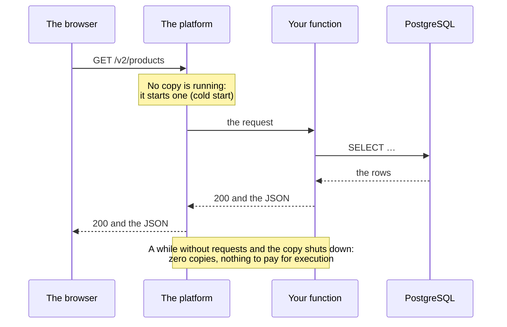

import Term from '~/components/Term.astro';
import TryIt from '~/components/TryIt.astro';
import Analogy from '~/components/Analogy.astro';
import SelfCheck from '~/components/SelfCheck.astro';
import Quiz from '~/components/Quiz.astro';
import QuizQuestion from '~/components/QuizQuestion.astro';
import QuizOption from '~/components/QuizOption.astro';

## The problem

Picture Ana showing a friend her shop, already on her VPS, with HTTPS and deployed with every `git push`. Her friend asks: “Why don't you put it in the cloud? At my company we have everything on AWS, with Lambda and RDS.”

Ana doesn't know what to say. Isn't her VPS the cloud? And job ads say the same thing: “experience with AWS (EC2, S3, RDS) and serverless.”

**The cloud isn't a place, it's a way of renting computers.** There are several, and they differ in one thing: how much of the work you do and how much the provider does. This lesson sorts them out with the same shop, and translates AWS's names into what you've already done.

## The analogy

<Analogy>

Think about how to feed a hundred guests.

- **You rent a fully equipped kitchen.** The oven belongs to the owner; you shop, cook, serve and do the dishes.
- **You hire a caterer with your recipe.** You give them the recipe; they cook, serve and clean up.
- **You pay per dish at a food stall that only lights the stove when someone orders.** No orders, nothing to pay; a thousand orders, and more cooks show up.
- **You go to a restaurant.** You pick from the menu and cook nothing.

The rented kitchen is **IaaS**; the caterer, **PaaS**; the stall that charges per dish, **serverless**; and the restaurant, **SaaS**.

<div slot="limits">

- If you switch caterers, you take your recipe with you. In the cloud, the more is done for you, the harder it is to leave: your code ends up using pieces only that provider has.
- Paying per dish isn't always more expensive than cooking. With few visits, serverless can cost you nothing; with many, and steady, a rented server usually comes out cheaper.

</div>

</Analogy>

## How it really works

### The cloud is renting someone else's computers, over the internet

The most quoted definition is NIST's, the United States standards institute, in its document [SP 800-145](https://csrc.nist.gov/pubs/sp/800/145/final), from 2011: shared resources (servers, storage, networks, applications) that you use over the network, and that you ask for and give back quickly, without talking to anyone. It requires five characteristics, and **your VPS from [lesson 1](/en/phase-8/what-is-a-vps/) meets them all**:

| Characteristic | On your VPS |
|---|---|
| You ask for it yourself, whenever you want | You created it from a dashboard |
| You reach it over the network | You log in over SSH from your terminal |
| Resources shared between customers | It shares the physical computer with other VPSs |
| It grows and shrinks quickly | You move to a bigger plan in minutes |
| What you use is measured, and billed | The provider counts your server, your disk and your IP |

So **Ana is already in the cloud.** What changes with AWS is how many things are done for her.

### Three models, by how much is done for you

The same document defines three models. Split your shop into layers and look at who takes care of each one:

| Layer | Your VPS (IaaS) | A platform (PaaS) | A finished program (SaaS) |
|---|---|---|---|
| The building, the computers and the network | The provider | The provider | The provider |
| The operating system: Ubuntu, its updates, `ufw` | You | The provider | The provider |
| What runs your code: Docker, Node, nginx, the certificate | You | The provider | The provider |
| Your application and its configuration | You | You | The provider |
| Your data | You | You | You, within what the program allows |

- **<Term id="iaas">IaaS</Term>** (*Infrastructure as a Service*): you rent processor, memory, disk and network, and install whatever you want, **operating system included**. It's your VPS.
- **<Term id="paas">PaaS</Term>** (*Platform as a Service*): you upload your application and the platform runs it. In NIST's words, you don't manage or control “the underlying cloud infrastructure including network, servers, operating systems, or storage.”
- **<Term id="saas">SaaS</Term>** (*Software as a Service*): you use someone else's program, almost always in the browser. NIST's example is web email; GitHub is one too.

### Serverless: you don't see the server either

<Term id="serverless">Serverless</Term> isn't in NIST's document: it became popular later, with AWS Lambda, in 2014. **There are servers, but you never see them:** you upload functions, and the platform starts copies when requests arrive and shuts them down when there are none. You'll also see it called **FaaS** (*Functions as a Service*).

Two things set it apart from a PaaS: **it can go down to zero copies**, and then you pay nothing for execution, and **it's billed per request**. [AWS Lambda](https://docs.aws.amazon.com/lambda/latest/dg/welcome.html) charges for each request and for the time your code runs. This is how one goes:



The first request after a while without visits waits for a copy to start: that's the **cold start**.

### The same shop, in each model

**On IaaS, the way you already have it.** Everything in this phase is your work, from the firewall to the deployment, and in exchange you see and change everything. On AWS it would be the same, with an EC2 server instead of your VPS.

**On PaaS, you give it the repository.** Platforms like [Render](https://render.com/docs/deploys) or Railway connect to your GitHub and, with every push to `main`, build the image with your `Dockerfile` from [Phase 7](/en/phase-7/dockerfile/), start it and give it a name with HTTPS. [Fly.io](https://docs.fly.io/launch/deploy) does the same with its own command, `fly deploy`. Heroku works in a similar way, but builds with its own system.

Almost all of this phase disappears: the server, its security, nginx, the certificate and the deployment script. Still yours are the code, the secrets (in the platform's dashboard, not in a `.env`) and the migrations. Almost all of them offer you PostgreSQL and Redis, managed.

Heroku, from Salesforce, was one of the first to deploy with a `git push`. In 2026 it moved to a *sustaining engineering* model, focused on keeping the platform stable and secure ([its announcement](https://www.heroku.com/blog/march-2026-update/)).

**On serverless, each request can land on a different copy**, and copies appear and disappear on their own. Three consequences:

- **Nothing is kept in memory.** Phase 6's limit on attempts, kept in memory, wouldn't hold up; the one shared in Redis from [Phase 7](/en/phase-7/docker-compose/#two-copies-of-the-api-a-single-count-in-redis) would.
- **Connections to PostgreSQL multiply.** A hundred copies are a hundred <Term id="connection-pool">connection pools</Term>, and PostgreSQL accepts a limited number.
- **Each request has a maximum time:** on Lambda, 30 seconds by default and up to 15 minutes per HTTP request, according to its [documentation](https://docs.aws.amazon.com/lambda/latest/dg/welcome.html). The SSE from [Phase 4](/en/phase-4/websockets-vs-sse/), which keeps the connection open, is a poor fit.

### The AWS names, translated

AWS (*Amazon Web Services*) has hundreds of services. These are the ones you'll hear first:

| Name | What it is | In this course |
|---|---|---|
| **EC2** (*Elastic Compute Cloud*) | Virtual servers: IaaS | Your VPS from lesson 1 |
| **S3** (*Simple Storage Service*) | Object storage: whole files, by their name, over HTTP | A place off the server for each night's backup |
| **RDS** (*Relational Database Service*) | Managed databases, PostgreSQL among them | The `db` service in your `compose.production.yaml` |
| **IAM** (*Identity and Access Management*) | Who can do what in your account | The roles and permissions from [Phase 6](/en/phase-6/rbac-roles-permissions/) |
| **Lambda** | Serverless functions | The previous section |
| **Regions and zones** | Where the machines are | The region you chose in lesson 1 |

**S3 stores files, but it isn't a disk.** According to its [documentation](https://docs.aws.amazon.com/AmazonS3/latest/userguide/Welcome.html), it stores objects inside *buckets*, each one with its name, its key: `backups/shop-2026-10-18.sql.gz`. An object is uploaded and downloaded whole, with HTTP requests like the ones in [Phase 2](/en/phase-2/http-methods/). To change one letter, you upload it again.

**IAM is Phase 6's RBAC, for your AWS account.** Each person and each program has a policy with what it can do, and nothing more: <Term id="least-privilege">least privilege</Term>. This one lets the server upload backups to the `shop-backups` bucket:

```json
{
  "Version": "2012-10-17",
  "Statement": [
    {
      "Effect": "Allow",
      "Action": "s3:PutObject",
      "Resource": "arn:aws:s3:::shop-backups/*"
    }
  ]
}
```

`Action` is what's allowed, uploading an object; `Resource`, where. `2012-10-17` is the version of the policy language, not a date of yours. If someone steals the server's credentials, they can upload files, but not read your backups or delete them. They could overwrite one with the same name, though: S3 versioning, if you turn it on, keeps the previous one.

**A region is a place in the world**, like `eu-south-2`, the one in Spain. Inside it there are several **availability zones**: separate data centers, so that a failure in one zone doesn't reach the others. In October 2026, according to its [list](https://docs.aws.amazon.com/global-infrastructure/latest/regions/aws-regions.html), AWS had 34 regions, and the one in Spain, 3 zones.

### Managed databases: what they take off your plate and what they cost

In the [introduction to Phase 5](/en/phase-5/#why-postgresql) we told you that the services that give you a database already installed almost all offer PostgreSQL. They're <Term id="managed-service">managed services</Term>: Amazon RDS, DigitalOcean's PostgreSQL, Render's… You connect with a `DATABASE_URL`, as always.

The [RDS documentation](https://docs.aws.amazon.com/AmazonRDS/latest/UserGuide/Welcome.html) compares who does what. In short:

| Task | PostgreSQL on your server | Managed PostgreSQL (RDS) |
|---|---|---|
| Installing and updating it, with its system | You | The provider |
| The backups | You: your `backup.sh` from [lesson 3](/en/phase-8/docker-compose-production/#a-copy-every-night) | The provider, and you can go back to any minute of the days it keeps |
| Carrying on if its machine breaks | You, or nobody | The provider, if you pay for it: a standby copy in another zone takes over |
| The schema, the queries, the indexes and the migrations | You | **You** |

The last row never changes: a slow query still needs its index and its `EXPLAIN`, as in [Phase 5](/en/phase-5/database-indexes-explain/).

**What it costs.** On October 18, 2026, DigitalOcean's smallest managed PostgreSQL cost $15.15 a month, with 1 GiB of memory, 1 processor and 10 GiB of disk ([its prices](https://www.digitalocean.com/pricing/managed-databases)). Its cheapest VPS, with half the memory, cost $4. And the standby copy is another machine: it's paid for separately.

**It's worth it** when losing data, or an hour without a database, costs you more than the bill, or when nobody on the team wants to restore backups at three in the morning. For learning, or for a small shop with backups you've tried restoring, your PostgreSQL in Compose does the job.

### Tied to a provider: lock-in

The more is done for you, the more you use pieces only that provider has: its functions, its policies, its configuration file. Leaving means rewriting them: that's called ***lock-in*** (being tied to the provider). Two things from the course leave the door open:

- **Your Docker image** starts the same on your VPS, on EC2, on Render or on Fly.io.
- **PostgreSQL is a standard:** a `pg_dump` from RDS restores into your Compose, and the other way around.

### This website is serverless; your shop, IaaS

**This website lives on Cloudflare Workers,** a serverless platform, and uses its simplest part: files, with no server code. Astro generates them when it builds the site, and Cloudflare delivers the files from its data centers, like a <Term id="cdn">CDN</Term>. Its configuration, `wrangler.jsonc`, only says which folder to publish.

There's no Ubuntu to update, no nginx and no certificate to renew. And according to [Cloudflare's documentation](https://developers.cloudflare.com/workers/static-assets/billing-and-limitations/), on October 18, 2026, requests for static files are free and unlimited. What it can't do is run the shop's API as it is, with its PostgreSQL next to it and a process always running.

That's why **your shop is IaaS:** everything in sight and everything changeable, and also everything your responsibility. How each change to this website reaches Cloudflare, you saw in [lesson 6](/en/phase-8/ci-cd-github-actions/#this-website-github-actions-checks-cloudflare-deploys).

### How to choose

| | IaaS: your VPS, EC2 | PaaS: Render, Railway, Fly.io | Serverless: Lambda, Workers |
|---|---|---|---|
| What you upload | Whatever you want | Your repository or your image | Functions, or files |
| Who manages the system | You | The platform | The platform |
| What you pay for | The server, whether you use it or not | Your application running, and its extras | Each request and its time |
| With no visits at all | You pay the same | You pay, except on plans (often free) that put it to sleep | Almost nothing |
| What you can't change | Almost nothing | The system, the network and how it's built | The maximum time and what's kept between requests |

Three questions almost always decide it: **who's going to look after the server?** If nobody wants to, PaaS or serverless. **What's the traffic like?** Steady, a server comes out cheap; in spikes or almost none, serverless. **Do you need open connections,** like SSE or WebSocket? A server or a PaaS.

## Try it

The goal: find out who answers on each website, from its headers alone. `curl -I` sends a `HEAD`, the `GET` without the content from [Phase 2](/en/phase-2/http-methods/#head-and-options-asking-without-requesting-the-content).

### Who serves this website

On **your computer**:

<TryIt
  title="1. This website's headers"
  cmd="curl -I https://backenddesdecero.com/en/"
  output={`HTTP/2 200 
date: Sun, 18 Oct 2026 00:59:25 GMT
content-type: text/html
cf-cache-status: HIT
cache-control: public, max-age=0, must-revalidate
…
server: cloudflare
cf-ray: a4c399ad2f37014c-MAD
alt-svc: h3=":443"; ma=86400`}
>

Not one line mentions a server of ours:

- **`server: cloudflare`**: the one answering is Cloudflare.
- **`cf-ray`**: your request's number at Cloudflare. The three letters at the end are the data center that answered you, with its airport's code: `MAD`, Madrid. Yours will be the one closest to you.
- **`cf-cache-status: HIT`**: the file was already in that data center's <Term id="cache">cache</Term>.

We removed two long lines (`…`). Your time and your `cf-ray` will be different.

</TryIt>

### Who serves your shop

On the free path, the shop has to be running on your VM, the way you left it in [lesson 5](/en/phase-8/lets-encrypt-nginx/). On **your computer**, in the folder where you copied `ca.crt`, and with your sslip.io name:

<TryIt
  title="2. Your shop's headers"
  cmd="curl -I --cacert ca.crt https://192-168-5-15.sslip.io/"
  windows="curl.exe --ssl-no-revoke -I --cacert ca.crt https://192-168-5-15.sslip.io/"
  output={`HTTP/2 200 
server: nginx/1.28.3 (Ubuntu)
date: Sun, 18 Oct 2026 01:00:13 GMT
content-type: application/json
cross-origin-opener-policy: same-origin
…
strict-transport-security: max-age=15552000; includeSubDomains
…
x-request-id: 0098a47e-edee-4ac2-9775-5db4bdb9e619
x-xss-protection: 0`}
>

Here **your nginx answers**: `server: nginx/1.28.3 (Ubuntu)`, and not a single `cf-`. The other headers come from your API: the security ones from [Phase 6](/en/phase-6/owasp-top-10/) and the `x-request-id` from its logs.

If you get `Could not resolve host`, use lesson 5's plan B, the `hosts` file. If you get `Failed to connect`, the VM is off: `multipass start course`. If you get `502`, the API is missing: on the VM, `docker compose -f compose.production.yaml up -d`.

</TryIt>

The `server` line is set by whoever faces the visitor, not by whoever does the work. Check it **inside the VM**, by asking the API for the same thing without nginx:

<TryIt
  title="3. The API, without nginx in front"
  cmd="curl -I http://127.0.0.1:3000/"
  output={`HTTP/1.1 200 OK
content-type: application/json
cross-origin-opener-policy: same-origin
…
x-request-id: 4410f731-562b-45cc-95bb-0bab295edf85
x-xss-protection: 0
Date: Sun, 18 Oct 2026 01:00:13 GMT
Connection: keep-alive
Keep-Alive: timeout=5`}
>

The API's headers are the same, but **there's no `server` line**: nginx was adding it. It's the same with Cloudflare: `server: cloudflare` tells you who's in front, not what's behind. If you get `Connection refused`, the API is stopped.

</TryIt>

On the paid path, do step 2 with your domain and without `--cacert`: any curl accepts your Let's Encrypt certificate. The headers are the same.

<SelfCheck question="Challenge: you put your domain behind Cloudflare’s proxy, and curl -I now says server: cloudflare. Has your shop stopped being on your VPS?">

No. It's still on your VPS, with your nginx and your API: Cloudflare has stepped in front, like nginx in front of the API, and passes the requests on to your server. The `server` line is set by whoever faces the visitor, and now that's Cloudflare.

</SelfCheck>

## You have already seen it

- **Your email, your phone's photos and your shared documents** are SaaS: someone else's program, on their servers.
- **GitHub Actions**, from [lesson 6](/en/phase-8/ci-cd-github-actions/), lends you a computer for each run that you don't manage.
- **If you've published a frontend on Vercel or Netlify,** you've used a PaaS, and its functions are serverless.

## Common mistakes

- **Believing that in the cloud the provider takes care of security.** It takes care of what it manages. On EC2, the operating system is yours. And an S3 bucket you make public can be read by anyone, even though S3 creates them private.
- **Leaving something running and getting a surprise on the bill.** Set up a spending alert on day one (on AWS, with AWS Budgets), and delete whatever you don't use.
- **Using the main AWS account for everything.** It's your `root`: use it only to get started, and work with IAM users that have just what they need. Their access keys are secrets: never in the code or in Git.
- **Treating S3 like a disk.** It's no good for a log that grows line by line, or for PostgreSQL's folder.

## Summary

- The cloud is renting computers over the internet: you ask for them yourself, they grow and shrink, and you pay for what you use. Your VPS already is.
- IaaS gives you the server and you manage it; PaaS runs your code without you seeing the server; serverless runs functions only when requests arrive; SaaS is a finished program.
- On AWS, EC2 is your VPS, S3 stores whole files, RDS is managed PostgreSQL and IAM decides who can do what.
- A managed database takes the backups, the updates and its machine's failures off your hands, in exchange for paying more; the schema and the queries are still yours.
- The more is done for you, the more you're tied. Docker and PostgreSQL leave the door open.

## Did you get it?

<Quiz>

<QuizQuestion
  question="Ana has the shop on an EC2 server. A serious security flaw comes out in OpenSSH. Who installs the update?"
  review="Three models, by how much is done for you"
>

<QuizOption text="AWS: in the cloud, the provider patches its customers’ servers.">

On IaaS, the provider looks after the hardware and the network, not your system.

</QuizOption>

<QuizOption text="Ana: on IaaS, the operating system is hers." correct>

EC2 is like her VPS: she manages the Ubuntu inside it. With the automatic updates from lesson 2, it would install itself.

</QuizOption>

<QuizOption text="Nobody: you don’t log in to EC2 servers over SSH, only from the AWS dashboard.">

You log in to EC2 over SSH, like any VPS. That's why the flaw affects it.

</QuizOption>

</QuizQuestion>

<QuizQuestion
  question="You want the API to write its log to a file in S3, adding a line with each request. What happens?"
  review="The AWS names, translated"
>

<QuizOption text="Nothing strange: S3 is a disk in the cloud, and you write to it like any other.">

S3 stores whole objects by their name. It isn't a disk you can add a line to.

</QuizOption>

<QuizOption text="It can’t be done: S3 only accepts images and videos.">

S3 stores any file. The problem is writing it bit by bit.

</QuizOption>

<QuizOption text="Every line forces you to upload the whole object again." correct>

An object is uploaded whole. Logs are written on the server, and finished files are uploaded to S3.

</QuizOption>

</QuizQuestion>

<QuizQuestion
  question="You move the API to serverless functions with the limit on attempts in the process’s memory, as in Phase 6. Does it work?"
  review="The same shop, in each model"
>

<QuizOption text="No: each copy has its own memory, and copies come and go." correct>

An attempt counted in one copy isn't seen by the next. The limit has to live outside, in Redis, as in Phase 7.

</QuizOption>

<QuizOption text="Yes: the platform shares memory between all the copies of the same function.">

Each copy is a separate process, often on another machine. There's no shared memory.

</QuizOption>

<QuizOption text="Yes, but slower: the platform saves the memory to disk between requests.">

What a copy keeps in memory is lost when it shuts down, and nothing passes it on to the others.

</QuizOption>

</QuizQuestion>

<QuizQuestion
  question="curl -I on a website answers with server: cloudflare and a cf-ray. What do you know about how it’s built?"
  review="Who serves your shop"
>

<QuizOption text="That it’s a static-file website, because Cloudflare only serves files.">

Cloudflare also sits in front of servers with their API and their database.

</QuizOption>

<QuizOption text="That Cloudflare answers in front, but anything can be behind it." correct>

The `server` line is set by whoever faces the visitor, like nginx in front of your API. Behind it there can be files, a VPS or functions.

</QuizOption>

<QuizOption text="That it’s hosted on a Cloudflare VPS, in the data center the cf-ray names.">

The `cf-ray` says which Cloudflare data center answered you, not where the website is.

</QuizOption>

</QuizQuestion>

<QuizQuestion
  question="The shop sells a lot, an hour without a database costs more than a year of managed PostgreSQL, and nobody on the team has ever restored a backup. What do you do?"
  review="Managed databases: what they take off your plate and what they cost"
>

<QuizOption text="Stay with PostgreSQL in Compose: there’s already a script that makes a backup every night.">

A backup nobody has restored may or may not work, and the script doesn't cover the machine breaking.

</QuizOption>

<QuizOption text="Move to a managed one, and stop worrying about the schema and the indexes too.">

The provider looks after the machine and the backups. The schema, the slow queries and the indexes are still yours.

</QuizOption>

<QuizOption text="Move to managed PostgreSQL, with a standby copy in another zone." correct>

The bill costs less than the risk: the provider makes the backups and switches to the standby copy if the machine breaks.

</QuizOption>

</QuizQuestion>

<QuizQuestion
  question="You deploy the shop on a PaaS and want to be able to leave if it raises its prices. What helps you most?"
  review="Tied to a provider: lock-in"
>

<QuizOption text="Nothing special: on any PaaS your code is yours, and you take it with you unchanged.">

The code is, but not the platform's own services or its configuration.

</QuizOption>

<QuizOption text="Keeping the shop in a Docker image and the database in PostgreSQL." correct>

The image starts the same anywhere, and a `pg_dump` restores into any PostgreSQL.

</QuizOption>

<QuizOption text="Using all the platform’s own services, to migrate everything together the day you leave.">

It's the other way around: none of its own services exist at the next provider, and you'll have to replace each one.

</QuizOption>

</QuizQuestion>

</Quiz>

## Further reading

- [The NIST Definition of Cloud Computing (SP 800-145)](https://csrc.nist.gov/pubs/sp/800/145/final): three pages with the characteristics and the models.
- [What is Amazon RDS?](https://docs.aws.amazon.com/AmazonRDS/latest/UserGuide/Welcome.html): the whole table of who does what.
- [What is Amazon S3?](https://docs.aws.amazon.com/AmazonS3/latest/userguide/Welcome.html): buckets, objects and keys.
- [What is AWS Lambda?](https://docs.aws.amazon.com/lambda/latest/dg/welcome.html): the kinds of functions and how they're billed.
