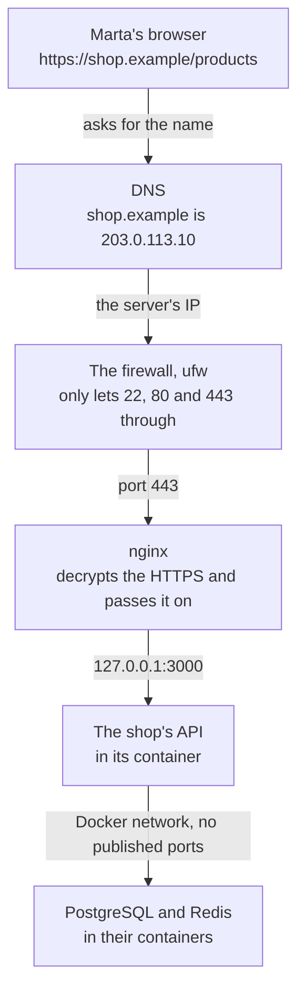

import { Aside } from '@astrojs/starlight/components';
import Term from '~/components/Term.astro';
import TryIt from '~/components/TryIt.astro';
import Analogy from '~/components/Analogy.astro';

At the end of Phase 7, the whole shop starts with one `docker compose up`: the API, PostgreSQL and Redis. But it starts on your computer. You close your laptop's lid and the shop is gone.

In this phase you put it on a **server** that answers other people, with its own name and its HTTPS padlock. And by the end, every `git push` to `main` reaches that server without you having to log in to it.

## What deploying is

Picture giving Marta, a customer, your shop's address: `http://localhost:3000/products`. Marta opens it on her phone and sees nothing. <Term id="localhost">localhost</Term> is always the machine where it's typed: for Marta, her own phone, where there's no shop at all.

For Marta to reach it, the shop has to be on a computer that stays on when you turn yours off, with an address anyone can reach. Putting it there, and then every new version, is **deploying**: a <Term id="deployment">deployment</Term>, the word you already saw in [Phase 1's Git lesson](/en/phase-1/git-internals/).

Deploying has two parts, and this phase does both:

- **The first time:** prepare the server, lock it down, start the shop, put a web server in front of it and give it a name with HTTPS. That's lessons 1 to 5.
- **Every time after that:** a new version arrives on its own, with its tests passed, and you can go back to the previous one if something goes wrong. That's lesson 6.

## Where the shop ends up at the end of the phase

This is the path one of Marta's requests takes once the phase is over, from her browser to the database:



Each piece belongs to a lesson:

- **The name** (`shop.example`) is translated into the server's IP by <Term id="dns">DNS</Term>, as in [Phase 0](/en/phase-0/what-is-dns/). [Lesson 5](/en/phase-8/lets-encrypt-nginx/).
- **The server's IP** is a <Term id="public-ip">public IP</Term>: anyone on the internet can reach it. Your home router doesn't give you that, and that's why servers live in data centers. Lesson 1.
- **The server's firewall**, `ufw`, closes every <Term id="port">port</Term> but three: 22, for you to log in over <Term id="ssh">SSH</Term>, and 80 and 443 for the web. Lesson 2.
- **The API, PostgreSQL and Redis** start with Docker Compose, as in Phase 7, but with the configuration of a real server. [Lesson 3](/en/phase-8/docker-compose-production/).
- **nginx** receives the requests on 443, the HTTPS port, and passes them on to the API, which only listens inside the server. Lessons [4](/en/phase-8/nginx-reverse-proxy/) and [5](/en/phase-8/lets-encrypt-nginx/).

<Analogy>

Think of a company's offices, in a building with a reception desk. Visitors look up the address (DNS), get to the building (the IP) and can only come in through the main door: the others are locked (the firewall).

At the entrance, reception (nginx) sees to everyone, checks what each visitor brings and takes them to the office they're looking for (the API). The archive in the basement (PostgreSQL and Redis) has no door to the street: only the people from the office go down there.

<div slot="limits">

- A building's reception asks visitors for their name. nginx doesn't know who you are: the API checks that, with Phase 6's accounts.
- A building has a single address. A server can have several names, and nginx serves each one its own website.
- A building gets a few visitors a day. A server on the internet gets programs that try doors nonstop from the very first minute, as you'll see in [lesson 2](/en/phase-8/secure-linux-server/).

</div>

</Analogy>

## Two paths: free or paid

For all of this you need a server. This phase lets you choose between two, and **the lessons are the same for both**. Where something changes, each lesson shows the free path first, which everyone can follow, and then the paid one.

| | Free: your virtual machine | Paid: a rented server |
|---|---|---|
| What it is | The `course` VM from Phase 1, on your computer | A server in a data center, with Ubuntu 26.04 |
| What it costs | Nothing | A few euros a month, and a domain if you want one |
| Who can reach the shop | Only your computer | Anyone, from the internet |
| Its address | A <Term id="private-ip">private IP</Term>, like `192.168.64.2` | A public IP |
| The name | A name that points to your VM's IP, or your computer's `hosts` file | Your own domain |
| HTTPS | With a certificate from your own authority: the browser warns you, and you'll learn why | With Let's Encrypt, free and with no warnings |
| Real attacks | No: nobody outside can see it | Yes, from the moment you turn it on |

### Free: your virtual machine

Your server is the `course` <Term id="virtual-machine">virtual machine</Term>, the one you created with Multipass in [lesson 4 of Phase 1](/en/phase-1/linux-users-and-permissions/). It runs Ubuntu, like almost every rented server, so SSH, users, the firewall, systemd, Docker, nginx and the deployment work the same as on a real one.

In the introductions to [Phases 3](/en/phase-3/) and [4](/en/phase-4/) we told you that machine was resting until now. Here you wake it up: **this very API goes on it**.

**What it can't have:** a public IP, a domain anyone can resolve, or a Let's Encrypt certificate, which needs to check from the internet that the name is yours. You can only reach it from your computer, at its private address.

### Paid: a rented server

A **VPS** is a virtual server you rent by the month in a data center. Lesson 1 tells you what it is inside and how to choose one. Some providers are Hetzner, DigitalOcean, OVHcloud and Scaleway.

Prices change. On October 17, 2026, two small plans were these:

- **Hetzner Cloud CX23:** 2 processors, 4 GB of memory and 40 GB of disk, for €5.49 a month before VAT and without the IPv4.
- **DigitalOcean Basic:** 4 dollars a month, but with 512 MB of memory, too little for the shop. You need about 2 GB, and the plans with that cost more.

The domain is paid for separately, every year, to a registrar; [lesson 5](/en/phase-8/lets-encrypt-nginx/) tells you how. Without one, you can follow the whole phase with the server's IP, as on the free path.

**What you gain:** your shop truly on the internet, with a name, a certificate the browser accepts and bots attacking it from the very first minute. **What it costs:** money every month, and a server that's your responsibility for as long as it's on. If you choose it, delete it in the provider's dashboard when you're done: a server that's turned off is still billed.

### On Windows

In the earlier phases, on Windows, your practice server was your WSL Ubuntu. **In this phase it doesn't work as a server:** WSL isn't a separate computer. Windows starts it and connects it on its own, so you don't have a machine to log in to over SSH like a real server, nor a way to check from outside what the firewall lets through and that only nginx can be reached.

For the free path, install **Multipass for Windows** ([installation guide](https://canonical.com/multipass/docs/stable/how-to-guides/install-multipass/)). It needs Windows 10 or 11 and a way to create virtual machines:

- **On Windows Pro or Enterprise,** Hyper-V, which comes with Windows and is what Multipass uses by default.
- **On Windows Home,** which doesn't come with Hyper-V, VirtualBox: install it and tell Multipass to use it with `multipass set local.driver=virtualbox`.

The `multipass` commands are typed in PowerShell, not in WSL. If neither of the two works on your computer, the paid path works the same on any system: all you need is a terminal with `ssh`.

## The lessons

1. [VPS](/en/phase-8/what-is-a-vps/)
2. [Server security](/en/phase-8/secure-linux-server/)
3. [Production](/en/phase-8/docker-compose-production/)
4. [Reverse proxy](/en/phase-8/nginx-reverse-proxy/)
5. [HTTPS](/en/phase-8/lets-encrypt-nginx/)
6. CI/CD
7. Cloud models
8. Terraform

The first two prepare the server. From 3 to 6, your project gains new files, with its downloadable folder as in the earlier phases. The last two look beyond your server:

| Lesson | What the shop gains | Folder |
|---|---|---|
| 1. VPS | Nothing yet: you have a server and log in to it over SSH | — |
| 2. Security | Nothing in the shop: the server gets locked down (your user, SSH with a key only, firewall and automatic updates) | — |
| 3. Production | The shop on the server: secrets that only live there, starting on its own after a reboot, your admin account and a copy of the database every night | `35-production` |
| 4. Reverse proxy | nginx in front, and an API that knows the IP of whoever is talking to it | `35-production` |
| 5. HTTPS | A name and its certificate | `35-production` |
| 6. CI/CD | Every `git push` to `main` passes the tests, publishes the image and reaches the server; and the way back | `36-deployment` |
| 7. Cloud models | Nothing: the same shop on IaaS, PaaS and serverless, and AWS's names | — |
| 8. Terraform | Nothing in the shop: you describe a server in a file, and practice with Docker on your computer | — |

## Where you will practice

There are three places: your computer, the server and, from lesson 6, GitHub:

| Where | What for | From |
|---|---|---|
| Your computer | Your project, in `~/backend-course/phase-3/shop-api`; from there you copy the shop to the server | Lesson 3 |
| The server (the `course` VM or your VPS) | Docker, nginx and the shop running. You log in over SSH | Lesson 1 |
| GitHub | Your own repository, where the tests run and the image is published. A free account is enough | Lesson 6 |

- **The outputs** were captured on a virtual machine with Ubuntu 26.04, an ARM processor, 2 GB of memory and 15 GB of disk, with Docker Engine 29.9.1. Your versions, times and addresses will be different.
- **Your `course` VM runs Ubuntu 24.04**, the one from Phase 1, and a server rented today, 26.04. Both are LTS versions, with long-term support. The commands are the same, but some versions and messages change: if your screen differs from the output, that's the first thing to look at.
- **The names:** you're `ana` on your `laptop`, and on the server, `ubuntu` on `course`. The public IPs in the examples, like `203.0.113.10`, are reserved for documentation: your server's will be different.

## Before you start: prepare the server

### Free path: more memory and disk for course

In Phase 1, Multipass created `course` with the bare minimum: 1 GB of memory and 5 GB of disk. PostgreSQL, Redis, the API's image and nginx don't fit in there. **Give it 2 GB of memory and 15 GB of disk.** Multipass only changes that with the machine stopped:

<TryIt
  title="More memory and disk for course"
  cmd={`multipass stop course
multipass set local.course.memory=2G
multipass set local.course.disk=15G
multipass start course`}
>

Type it in your computer's terminal (on Windows, in PowerShell), not inside the VM:

- **`stop`** shuts the VM down, like a computer shutting down properly.
- **`set local.course.memory=2G`** changes the memory Multipass gives it. Your computer's memory is only used as the VM needs it, not all at once.
- **`set local.course.disk=15G`** makes its disk bigger. **The disk can only grow:** if you ask for less than it has, Multipass refuses, because shrinking a disk can delete data.
- **`start`** turns it back on.

These are the commands from [Multipass's documentation](https://canonical.com/multipass/docs/stable/how-to-guides/manage-instances/modify-an-instance/). If it says the VM isn't stopped, wait for `stop` to finish and try again. If `course` doesn't exist, see the note below.

</TryIt>

<Aside type="note" title="If you don't have the course VM">

If you're on Windows, or you deleted the VM, create it now, already with this phase's memory and disk and with Ubuntu 26.04, the same as the outputs:

```sh
multipass launch 26.04 --name course --memory 2G --disk 15G
```

If Multipass can't find the `26.04` image, `multipass find` shows you the ones it has. Lesson 1 tells you how to log in to it over SSH with your key.

</Aside>

Check the change with `multipass info course`, from your computer. Look at three things: `State`, which says it's running; `IPv4`, the VM's address, which you'll use in every lesson; and `Memory usage` and `Disk usage`, which end in `out of` and the total, a bit under 2G and 15G, because the system keeps a part for itself.

Now log in to the VM with `multipass shell course` and check it from inside:

<TryIt
  title="The memory and the disk, from inside"
  cmd={`free -h\ndf -h /`}
  output={`               total        used        free      shared  buff/cache   available
Mem:           1.9Gi       478Mi       186Mi       1.1Mi       1.3Gi       1.4Gi
Swap:             0B          0B          0B
Filesystem      Size  Used Avail Use% Mounted on
/dev/vda1        14G  3.5G   11G  26% /`}
>

`free -h` counts the memory (`-h`, *human*, in readable units), and `df -h /`, the space on the disk where `/` lives. Look at the `total` of `Mem:`, close to 2 GB, and at the disk's `Size`, close to 15 GB.

If `df` still says about 5 GB, the disk grew but the partition inside didn't. [Multipass's documentation](https://canonical.com/multipass/docs/stable/how-to-guides/manage-instances/modify-an-instance/) explains how to grow it. Your `used` and `free` numbers will be different.

</TryIt>

### If your computer has 8 GB of memory

With the VM running, Docker Desktop open, the browser and the editor, an 8 GB laptop is tight. Docker Desktop brings its own virtual machine, and in this phase you don't need it: **Docker works inside the server.**

- **Quit Docker Desktop while you practice on the VM:** on the Mac, from the whale icon in the menu bar, *Quit Docker Desktop*; on Windows, from the same icon, next to the clock.
- **Stop the VM when you're done** with `multipass stop course`: it stops using memory until you turn it on again.
- **Lesson 8** uses Docker on your computer again: open it again then.

### Install Docker on the VM

Inside `course`, Docker is installed as on Linux: with `apt`, from Docker's own repository. These are the same commands as in [Phase 7's introduction](/en/phase-7/#on-ubuntu-and-on-wsl-docker-engine), where they're explained word by word. **Type them inside the VM,** at the `ubuntu@course:~$` prompt, not on your computer.

First, the key Docker signs its packages with:

<TryIt
  title="The Docker repository's key"
  cmd={`sudo apt update\nsudo apt install -y ca-certificates curl\nsudo install -m 0755 -d /etc/apt/keyrings\nsudo curl -fsSL https://download.docker.com/linux/ubuntu/gpg -o /etc/apt/keyrings/docker.asc\nsudo chmod a+r /etc/apt/keyrings/docker.asc`}
>

They update `apt`'s catalog, install what's needed to download over HTTPS, and save Docker's public key in `/etc/apt/keyrings`, where `apt` looks for other repositories' keys.

</TryIt>

Then, where the repository is:

<TryIt
  title="Add Docker's repository"
  cmd={`sudo tee /etc/apt/sources.list.d/docker.sources <<EOF
Types: deb
URIs: https://download.docker.com/linux/ubuntu
Suites: $(. /etc/os-release && echo "\${UBUNTU_CODENAME:-$VERSION_CODENAME}")
Components: stable
Architectures: $(dpkg --print-architecture)
Signed-By: /etc/apt/keyrings/docker.asc
EOF
sudo apt update`}
  output={`Types: deb
URIs: https://download.docker.com/linux/ubuntu
Suites: resolute
Components: stable
Architectures: arm64
Signed-By: /etc/apt/keyrings/docker.asc
…
Get:1 https://download.docker.com/linux/ubuntu resolute InRelease [32.5 kB]
Get:2 https://download.docker.com/linux/ubuntu resolute/stable arm64 Packages [31.8 kB]
…
Reading package lists...`}
>

Look at `Suites:`: it's your Ubuntu's name. The outputs are from Ubuntu 26.04, `resolute`; **on your Phase 1 VM, with Ubuntu 24.04, you'll see `noble`.** `Architectures` is your processor: `arm64` on a Mac with Apple Silicon, `amd64` on almost every PC and on many VPSs.

The `Get:` lines from `download.docker.com` say that `apt` already reads Docker's catalog. If you see `NO_PUBKEY` or `not signed`, the key is missing: repeat the previous step. We trimmed the output (`…`).

</TryIt>

And Docker, with Compose:

<TryIt
  title="Install Docker Engine"
  cmd="sudo apt install -y docker-ce docker-ce-cli containerd.io docker-buildx-plugin docker-compose-plugin"
  output={`…
Setting up containerd.io (2.4.2-2~ubuntu.26.04~resolute) ...
…
Setting up docker-compose-plugin (5.6.0-1~ubuntu.26.04~resolute) ...
…
Setting up docker-ce-cli (5:29.9.1-1~ubuntu.26.04~resolute) ...
…
Setting up docker-ce (5:29.9.1-1~ubuntu.26.04~resolute) ...
…
Created symlink '/etc/systemd/system/multi-user.target.wants/docker.service' → '/usr/lib/systemd/system/docker.service'.
Created symlink '/etc/systemd/system/sockets.target.wants/docker.socket' → '/usr/lib/systemd/system/docker.socket'.
…`}
>

These are Phase 7's five packages: the engine (`docker-ce`), the `docker` command, `containerd`, and the plugins to build images and for `docker compose`. The `Created symlink` lines set the engine up as a <Term id="systemd">systemd</Term> service: **it starts on its own every time the server boots**, and that's what will bring the shop back on its own after a reboot, in [lesson 3](/en/phase-8/docker-compose-production/#if-it-crashes-it-comes-back-the-restart-policy).

We captured this output in an Ubuntu 26.04 container, where the service can't start: we removed two lines that only show up there (`…`). Your versions may be newer.

</TryIt>

Check that the engine is running:

<TryIt
  title="Is the engine running?"
  cmd="systemctl status docker"
  output={`● docker.service - Docker Application Container Engine
     Loaded: loaded (/usr/lib/systemd/system/docker.service; enabled; preset: enabled)
     Active: active (running) since Sat 2026-10-17 18:20:35 CEST; 1h 49min ago
…`}
>

It's the `systemctl status` you used to look at nginx in [lesson 6 of Phase 1](/en/phase-1/systemd-services-and-apt/). Look at two words: `enabled`, it starts at boot, and `active (running)`, it's running now. If it says `inactive`, start it with `sudo systemctl start docker`. Quit with <kbd>q</kbd> if the output doesn't fit on the screen. Your date and time will be different.

</TryIt>

### Without sudo: the docker group

As in Phase 7, the `docker` command can only talk to the engine if you're in the `docker` group. Add `ubuntu`:

```sh
sudo usermod -aG docker $USER
exit
```

A new group only counts in new sessions: that's why `exit`. Log back in with `multipass shell course`.

<Aside type="caution" title="The docker group is as good as being root">

Whoever is in the `docker` group can do on the server the same as `root`, as you saw in [Phase 7](/en/phase-7/#without-sudo-the-docker-group). Here the `ubuntu` user can already be root with `sudo`, so you're not giving it anything it didn't have. On a server with more people, put in the group only those who can already use `sudo`.

</Aside>

### Hello, Docker, from the server

Now you can start your first container on the server, without `sudo`:

<TryIt
  title="Hello, Docker, on the VM"
  cmd="docker run hello-world"
  output={`Unable to find image 'hello-world:latest' locally
latest: Pulling from library/hello-world
58dee6a49ef1: Pulling fs layer
58dee6a49ef1: Download complete
58dee6a49ef1: Pull complete
c3bdf82c34d1: Download complete
Digest: sha256:11a3eb1597e864c51b3f56733cb2e8a90bf0c284bfc05f9444d81c558bc848aa
Status: Downloaded newer image for hello-world:latest

Hello from Docker!
This message shows that your installation appears to be working correctly.
…`}
>

It's the same `hello-world` as in [Phase 7](/en/phase-7/#your-first-container), but now it's the server that downloads and runs it, not your computer. Look for `Hello from Docker!`. The rest of the output is the same as back then, and we trimmed it (`…`).

If it says `permission denied`, your session doesn't have the `docker` group yet: log out with `exit` and log back in. If it says `failed to connect`, the engine isn't running: go back to `systemctl status docker`.

</TryIt>

Also check that you have Compose, which you'll use from [lesson 3](/en/phase-8/docker-compose-production/):

<TryIt
  title="Docker Compose, on the VM"
  cmd="docker compose version"
  output="Docker Compose version v5.6.0"
>

If you get an error instead of the version, the `docker-compose-plugin` package is missing: install it with `apt`, as before.

</TryIt>

### Paid path

If you choose a VPS, you don't have a server yet: **lesson 1 shows you how to rent it** and log in to it for the first time, and [lesson 2](/en/phase-8/secure-linux-server/), how to lock it down. Once it's ready, install Docker with these same commands, inside the VPS. There, `Suites:` will say `resolute`, as in the outputs, and `Architectures:` will almost always be `amd64`.

## Ready to start

Before lesson 1, check that you have this:

- **On the free path:** `multipass info course` says it's running, with about 2 GB of memory and 15 GB of disk; inside the VM, `docker run hello-world` prints `Hello from Docker!` without `sudo`, and `docker compose version` answers.
- **On the paid path:** an account with a provider, or the decision of which one, and a way to pay. Everything else comes in lesson 1.
- **On both:** your project, in `~/backend-course/phase-3/shop-api`, up to date with Phase 7, and your SSH key from [Phase 1](/en/phase-1/what-is-ssh/).

Start with [lesson 1, “VPS”](/en/phase-8/what-is-a-vps/): you'll learn exactly what a rented server is and what a data center gives you that your home doesn't, and you'll log in to yours over SSH.
