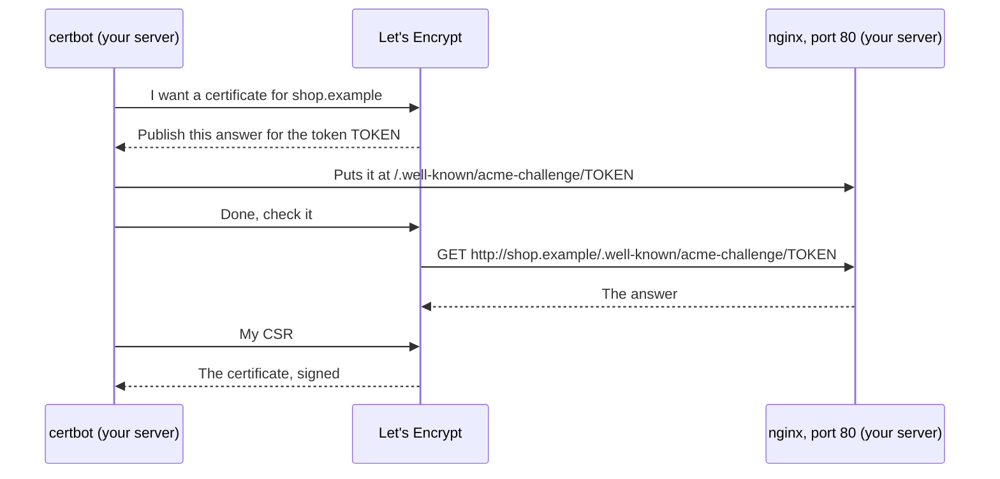

import Term from '~/components/Term.astro';
import TryIt from '~/components/TryIt.astro';
import Analogy from '~/components/Analogy.astro';
import ProjectCode from '~/components/ProjectCode.astro';
import Quiz from '~/components/Quiz.astro';
import QuizQuestion from '~/components/QuizQuestion.astro';
import QuizOption from '~/components/QuizOption.astro';

## The problem

At the end of [lesson 4](/en/phase-8/nginx-reverse-proxy/), the shop answers over HTTPS, but only with `curl -k`, which skips the certificate check. Marta opens the address in her browser and sees a red screen: "Your connection is not private." She isn't going to buy there.

The provisional certificate claims to be for `shop.example`, a name that doesn't point to your server, and nobody the browser knows signed it. **Two things are missing: a real name and a signature to trust.**

## The analogy

<Analogy>

Think of opening a shop on a street. First, an address that shows up on the maps: the domain. Then, a seal on the door from a body everyone knows: "these premises belong to who they say."

That body, Let's Encrypt, doesn't ask you for papers: it gives you a code and comes by to see whether you've put it in the window. If it's there, you control the premises.

With no address on the maps, like your virtual machine, you make your own seal. It's valid at home, where they know it; a stranger has no reason to believe it.

<div slot="limits">

- The body doesn't check who you are or whether your shop is honest: only that you control the address. A scam website can have a padlock too.
- A shop's seal lasts for years. A Let's Encrypt certificate lasts 90 days, and a program renews it without you noticing.

</div>

</Analogy>

## How it really works

### A name: the domain and its records

A <Term id="domain-name">domain name</Term>, like `shop.example`, is bought by the year from a **registrar**: Cloudflare Registrar, Porkbun or Namecheap, for example. Prices change: on October 17, 2026, a `.com` cost $11.08 a year at Porkbun.

From its dashboard you decide where it points, with the <Term id="dns-record">records</Term> you saw in [Phase 0](/en/phase-0/what-is-dns/#record-types):

| Name | Type | Value | TTL |
|---|---|---|---|
| `shop.example` | A | `203.0.113.10`, your server's IPv4 | 300 |
| `shop.example` | AAAA | `2001:db8::10`, its IPv6, if it has one | 300 |

The <Term id="ttl">TTL</Term> is the number of seconds each cache can keep the answer. **While you're setting up the server, keep it low** (300, five minutes): if you get the IP wrong, the fix arrives soon. It's the false "propagation" from [Phase 0](/en/phase-0/what-is-dns/#the-ttl-and-propagation).

### How Let's Encrypt knows the domain is yours

<Term id="lets-encrypt">Let's Encrypt</Term> is the free, automatic certificate authority we promised you in [Phase 0](/en/phase-0/tls-and-https/#certificates-and-certificate-authorities). It talks to a program on your server, **certbot**, through a protocol, <Term id="acme">ACME</Term>. The most common check is called **HTTP-01**:



Let's Encrypt asks for the file **from the internet**: if it gets it, whoever asks for the certificate controls the name's server. And **it always starts on port 80**, over http. [Let's Encrypt's documentation](https://letsencrypt.org/docs/challenge-types/) puts it like this: "*The HTTP-01 challenge can only be done on port 80*."

That's why the shop's site leaves that path out of the redirect:

<ProjectCode file="shop-api/35-production/nginx/shop.conf" region="port-80" />

Whatever asks for `/.well-known/acme-challenge/` is looked up in `/var/www/html`; everything else is redirected. That way the challenge doesn't depend on 443. While it lasts, certbot also adds its own answer, and removes it when it's done.

The <Term id="csr">CSR</Term> (*Certificate Signing Request*) is the request for a signature: your public key and the names the certificate must cover. **The private key never leaves your server.**

### certbot: request, install and renew

With `sudo certbot --nginx -d shop.example`, certbot does all of that and also changes your nginx site. It looks for the block with `server_name shop.example` and replaces the two certificate lines with Let's Encrypt's, which the file already has commented out:

<ProjectCode file="shop-api/35-production/nginx/shop.conf" region="https" />

- **`fullchain.pem`**: your certificate and, behind it, the one of the intermediate authority that signed it. The browser needs both to reach a root on its list.
- **`privkey.pem`**: the private key, which only `root` reads.

Let's Encrypt's certificates **last 90 days** in October 2026, and will go down to 64 in February 2027 and to 45 in 2028, according to its [schedule](https://letsencrypt.org/2025/12/02/from-90-to-45/). Nobody renews them by hand: certbot installs a systemd timer that tries twice a day and only renews the ones that expire soon.

### Why your VM can't have one

Your VM has a <Term id="private-ip">private IP</Term>: nobody on the internet can reach it. We tried it on the VM the outputs come from, with `certbot certonly --dry-run`, which uses Let's Encrypt's test servers and saves nothing:

```
Certbot failed to authenticate some domains (authenticator: nginx). The Certificate Authority reported these problems:
  Identifier: 192-168-5-15.sslip.io
  Type:   dns
  Detail: no valid A records found for 192-168-5-15.sslip.io; no valid AAAA records found for 192-168-5-15.sslip.io
```

**It doesn't even try:** the name points to a private address, and Let's Encrypt discards it.

### Without a domain: sslip.io and your own authority

For the VM, two free pieces:

- **A name:** [sslip.io](https://sslip.io) is a public DNS server that answers with the IP written in the name: `192-168-5-15.sslip.io` is `192.168.5.15`. Some home routers discard public DNS answers with private IPs (the protection against *DNS rebinding*: an attack in which a website switches its IP to one on your network so your browser talks to your devices). If it happens to you, plan B is your computer's `hosts` file.
- **An authority:** with `openssl` you create a certificate authority, your own, that signs the shop's certificate. Your computer trusts what it signs if you give it its certificate; Marta's browser doesn't.

And lesson 4's self-signed one? You'd have to hand out every server's certificate. **With an authority, you trust it once and it's valid for everything it signs**, as with the real ones.

### Real HTTPS: the redirect and HSTS

With the good certificate, two things that were already there start to work:

- **The redirect.** Whoever types `http://` gets a `301` to the same address with `https://`: port 80's `return 301`.
- **`strict-transport-security`**, the <Term id="hsts">HSTS</Term> header the API has sent since [Phase 6](/en/phase-6/owasp-top-10/#the-headers-before-and-after). We told you it would act with HTTPS: the browser only pays attention to it if it arrives with a valid certificate. From then on, for `max-age=15552000` seconds (180 days), it goes straight to `https://`.

## Try it

The goal: get your computer to talk to the shop over HTTPS **without `-k`**, read the certificate's chain and see what the browser says. Already have a domain and a VPS? Go to [With a domain: Let's Encrypt](#with-a-domain-lets-encrypt).

The outputs are from lesson 4's VM, `192.168.5.15`, and from another machine playing your computer. **Use your IP with dashes:** with `192.168.64.2`, your name is `192-168-64-2.sslip.io`. Your dates and times will be different.

### A name for your VM

On the server, ask a public DNS, Cloudflare's (`1.1.1.1`), for the name:

<TryIt
  title="1. sslip.io's A record"
  cmd="dig +noall +answer 192-168-5-15.sslip.io @1.1.1.1"
  output={`192-168-5-15.sslip.io.	3600	IN	A	192.168.5.15`}
>

An **A** record with your IP and a **TTL** of `3600` seconds. Nobody registered that name: sslip.io reads it and answers.

</TryIt>

Now on **your computer**, with your network's DNS:

<TryIt
  title="2. From your computer"
  cmd="dig +short 192-168-5-15.sslip.io"
  output={`192.168.5.15`}
>

If your IP comes out, go on. If nothing comes out, your router is discarding the answer: go to plan B. On Windows, `nslookup 192-168-5-15.sslip.io`, which prints more lines.

</TryIt>

<TryIt
  title="Plan B: the hosts file"
  cmd={`echo "192.168.5.15 192-168-5-15.sslip.io" | sudo tee -a /etc/hosts`}
  windows={`Add-Content -Path C:\\Windows\\System32\\drivers\\etc\\hosts -Value "192.168.5.15 192-168-5-15.sslip.io"`}
  output={`192.168.5.15 192-168-5-15.sslip.io`}
>

Only if step 2 gave nothing. Your computer looks at `hosts` before asking the DNS, so the name works all the same. It needs administrator permissions: on Windows, open PowerShell with "Run as administrator." Delete that line when you finish the phase.

</TryIt>

### Your authority and the shop's certificate

On the server, create the authority in a folder of its own:

<TryIt
  title="3. The authority"
  cmd={`mkdir ~/authority && cd ~/authority
openssl req -x509 -newkey ec -pkeyopt ec_paramgen_curve:prime256v1 -nodes -days 365 -subj "/CN=Ana's shop authority" -keyout ca.key -out ca.crt
ls -l`}
  output={`-----
total 8
-rw-rw-r-- 1 ubuntu ubuntu 607 Oct 18 02:24 ca.crt
-rw------- 1 ubuntu ubuntu 241 Oct 18 02:24 ca.key`}
>

The provisional certificate's command, with another name and a year of life. **`ca.key` is the key that signs:** `-rw-------`, for you only. `ca.crt` is the authority's certificate, the one you'll hand out.

</TryIt>

<TryIt
  title="4. What makes it an authority?"
  cmd="openssl x509 -in ca.crt -noout -subject -issuer -dates -ext basicConstraints"
  output={`subject=CN=Ana's shop authority
issuer=CN=Ana's shop authority
notBefore=Oct 18 00:24:13 2026 GMT
notAfter=Oct 18 00:24:13 2027 GMT
X509v3 Basic Constraints: critical
    CA:TRUE`}
>

- **`subject` and `issuer` the same:** it signs itself. It's a root, like the ones your system comes with.
- **`CA:TRUE`:** it can sign other certificates.

</TryIt>

Now the shop's key and its CSR, with the name:

<TryIt
  title="5. The shop's key and its CSR"
  cmd={`openssl req -newkey ec -pkeyopt ec_paramgen_curve:prime256v1 -nodes -subj "/CN=192-168-5-15.sslip.io" -addext "subjectAltName=DNS:192-168-5-15.sslip.io" -addext "extendedKeyUsage=serverAuth" -keyout shop.key -out shop.csr
openssl req -in shop.csr -noout -subject -verify`}
  output={`-----
Certificate request self-signature verify OK
subject=CN=192-168-5-15.sslip.io`}
>

Without `-x509`, `openssl req` makes a request instead of a certificate.

- **`subjectAltName`**: where browsers look for the name; only old programs look at `CN`.
- **`extendedKeyUsage=serverAuth`**: what the certificate is for, identifying a server. macOS and Safari require it on server certificates, and tools like mkcert always add it.
- **`-verify`**: checks that the CSR is signed with `shop.key`.

</TryIt>

<TryIt
  title="6. Your authority signs it"
  cmd={`openssl x509 -req -in shop.csr -CA ca.crt -CAkey ca.key -days 90 -copy_extensions copy -out shop.crt
openssl x509 -in shop.crt -noout -subject -issuer -dates -ext subjectAltName,extendedKeyUsage`}
  output={`Certificate request self-signature ok
subject=CN=192-168-5-15.sslip.io
subject=CN=192-168-5-15.sslip.io
issuer=CN=Ana's shop authority
notBefore=Oct 18 00:24:13 2026 GMT
notAfter=Jan 16 00:24:13 2027 GMT
X509v3 Subject Alternative Name: 
    DNS:192-168-5-15.sslip.io
X509v3 Extended Key Usage: 
    TLS Web Server Authentication`}
>

- **`-CA` and `-CAkey`**: sign with your authority. `-copy_extensions copy` carries the CSR's extensions over to the certificate: the name and the usage.
- **`issuer`** is now your authority, and it expires in 90 days, like a Let's Encrypt one.

</TryIt>

Copy it where nginx looks for it, over the provisional one:

<TryIt
  title="7. To /etc/ssl/shop"
  cmd={`sudo cp shop.crt shop.key /etc/ssl/shop/
sudo ls -l /etc/ssl/shop`}
  output={`total 8
-rw-r--r-- 1 root root 660 Oct 18 02:24 shop.crt
-rw------- 1 root root 241 Oct 18 02:24 shop.key`}
>

The key, `-rw-------`: for `root` only. `ca.key` isn't copied, because nginx doesn't need it; and it shouldn't stay on the server longer than necessary: you'll delete it before you trust your authority.

</TryIt>

### nginx, with the new name

Go back to `/opt/shop` and put your name in the two `server_name` lines:

<TryIt
  title="8. The name in the site"
  cmd={`sed -i 's/server_name shop.example;/server_name 192-168-5-15.sslip.io;/' nginx/shop.conf
grep -n "server_name" nginx/shop.conf`}
  output={`9:#   1. shop.example, in the two server_name lines, to your name: your domain or, with the free
41:    server_name 192-168-5-15.sslip.io;
59:    server_name 192-168-5-15.sslip.io;`}
>

`sed -i` changes the file. Line 9 is a comment; 41 and 59, the two `server` blocks.

</TryIt>

<TryIt
  title="9. Install it and reload"
  cmd={`sudo cp nginx/shop.conf /etc/nginx/sites-available/shop
sudo nginx -t && sudo systemctl reload nginx`}
  output={`nginx: the configuration file /etc/nginx/nginx.conf syntax is ok
nginx: configuration file /etc/nginx/nginx.conf test is successful`}
>

If `nginx -t` says `key values mismatch`, you copied the key of one certificate and the certificate of another: repeat step 7.

</TryIt>

The shop only accepts requests with the session cookie from its own websites, `ALLOWED_ORIGINS` ([Phase 6](/en/phase-6/csrf-ssrf/#second-wall-where-the-request-comes-from)). Now it has a different name:

<TryIt
  title="10. The shop's origin"
  cmd={`sed -i 's|^ALLOWED_ORIGINS=.*|ALLOWED_ORIGINS=https://192-168-5-15.sslip.io|' .env
grep ^ALLOWED_ORIGINS .env
docker compose -f compose.production.yaml up -d api`}
  output={`ALLOWED_ORIGINS=https://192-168-5-15.sslip.io
…
[+] up 4/4
…
 ✔ Container shop-api-1     Started                                         1.9s
 ✔ Container shop-migrate-1 Exited                                          1.1s`}
>

`up -d api` recreates the API so it reads the new `.env`. Wait a few seconds before the next step: while it starts, nginx answers `502`.

</TryIt>

### From your computer

On **your computer**, without `-k`:

<TryIt
  title="11. Without your authority"
  cmd="curl https://192-168-5-15.sslip.io/health"
  windows="curl.exe https://192-168-5-15.sslip.io/health"
  output={`curl: (60) SSL certificate OpenSSL verify result: unable to get local issuer certificate (20)
More details here: https://curl.se/docs/sslcerts.html
…`}
>

The name matches now; what fails is **the signature**: `unable to get local issuer certificate`, it can't find whoever signed it on your system. The text changes depending on your system.

</TryIt>

Bring over the authority's certificate, never its key, and give it to curl:

<TryIt
  title="12. With your authority"
  cmd={`scp ubuntu@192.168.5.15:authority/ca.crt .
curl --cacert ca.crt -i https://192-168-5-15.sslip.io/health`}
  windows={`scp ubuntu@192.168.5.15:authority/ca.crt .
curl.exe --ssl-no-revoke --cacert ca.crt -i https://192-168-5-15.sslip.io/health`}
  output={`ca.crt                                        100%  607     2.2MB/s   00:00
HTTP/2 200 
server: nginx/1.28.3 (Ubuntu)
…
strict-transport-security: max-age=15552000; includeSubDomains
…
x-xss-protection: 0

{"status":"ok"}`}
>

**`HTTP/2 200` without `-k`:** curl has checked the chain up to your authority, and the name. It's the HTTPS [Phase 2](/en/phase-2/http2-vs-http3/#what-changes-for-the-server-and-what-doesnt) promised your VM's nginx, and with it, HTTP/2. And there's `strict-transport-security`: `max-age` is 180 days, and **`includeSubDomains`** extends the rule to every name that ends in yours.

On Windows, `--ssl-no-revoke`: `curl.exe` asks whether the certificate has been revoked, and your authority doesn't publish that list.

</TryIt>

<TryIt
  title="13. Over http"
  cmd="curl -i http://192-168-5-15.sslip.io/health"
  windows="curl.exe -i http://192-168-5-15.sslip.io/health"
  output={`HTTP/1.1 301 Moved Permanently
Server: nginx/1.28.3 (Ubuntu)
…
Location: https://192-168-5-15.sslip.io/health
…`}
>

The `301`, now to a name with a valid certificate.

</TryIt>

### The chain, and what the browser says

`openssl s_client` is a TLS client: it connects and tells you what it sees. On the server:

<TryIt
  title="14. The chain"
  cmd="openssl s_client -connect 192-168-5-15.sslip.io:443 -servername 192-168-5-15.sslip.io -CAfile ~/authority/ca.crt < /dev/null"
  output={`Connecting to 192.168.5.15
CONNECTED(00000003)
depth=1 CN=Ana's shop authority
verify return:1
depth=0 CN=192-168-5-15.sslip.io
verify return:1
---
Certificate chain
 0 s:CN=192-168-5-15.sslip.io
   i:CN=Ana's shop authority
   a:PKEY: EC, (prime256v1); sigalg: ecdsa-with-SHA256
   v:NotBefore: Oct 18 00:24:13 2026 GMT; NotAfter: Jan 16 00:24:13 2027 GMT
---
…
Verification: OK
…
Verify return code: 0 (ok)
…`}
>

- **`-servername`**: the name that goes in the SNI, so nginx picks the certificate ([Phase 0](/en/phase-0/tls-and-https/#what-https-protects-and-what-it-doesnt)). `< /dev/null` closes the connection when it's done.
- **`depth=1` and `depth=0`**: the check, from the root (your authority) to the shop.
- **`Certificate chain`**: what nginx sends, a single certificate. `s:` is whose it is; `i:`, who signed it. With Let's Encrypt you'd see two: yours and the intermediate's, the `fullchain.pem`.

</TryIt>

<TryIt
  title="15. Without -CAfile"
  cmd={`openssl s_client -connect 192-168-5-15.sslip.io:443 -servername 192-168-5-15.sslip.io < /dev/null 2>&1 | grep -E "depth|verify|Verify return code"`}
  output={`depth=0 CN=192-168-5-15.sslip.io
verify error:num=20:unable to get local issuer certificate
…
Verify return code: 21 (unable to verify the first certificate)`}
>

curl's error `20` from step 11.

</TryIt>

Open `https://192-168-5-15.sslip.io/health` in your computer's browser. We did it with Chromium 153, the base of Chrome and Edge, in English:

```text
Your connection is not private

Attackers might be trying to steal your information from 192-168-5-15.sslip.io (for example, passwords, messages, or credit cards). Learn more about this warning

NET::ERR_CERT_AUTHORITY_INVALID
Back to safety
Advanced
```

**`ERR_CERT_AUTHORITY_INVALID`**: the authority isn't on its list. It's the first of the three checks from [Phase 0](/en/phase-0/tls-and-https/#certificates-and-certificate-authorities); the name and the dates are fine. When you press "Advanced":

```text
This server could not prove that it is 192-168-5-15.sslip.io; its security certificate is not trusted by your computer's operating system. This may be caused by a misconfiguration or an attacker intercepting your connection.

Proceed to 192-168-5-15.sslip.io (unsafe)
```

Firefox and Safari word it differently. If you go in with "Proceed," the connection is encrypted, but the browser ignores the HSTS header: it doesn't come from a valid certificate.

### Trusting your authority (optional)

To get the padlock, add `ca.crt` to your computer's authorities. On macOS, double-clicking it adds it to Keychain Access: open it there and, under "Trust," choose "Always Trust." On Windows, double-click it, "Install Certificate" and the "Trusted Root Certification Authorities" store. Firefox can use its own list, in its certificate settings.

**Think it over first:** your computer will trust **any** certificate `ca.key` signs, for any name, `your-bank.example` included. Whoever has that key could pass themselves off as any website to you. Before you trust it, delete `ca.key` on the server: it has already signed the certificate, and for another one you'll make another authority.

<TryIt
  title="Delete the authority's key"
  cmd={`rm ~/authority/ca.key
ls -l ~/authority`}
  output={`total 16
-rw-rw-r-- 1 ubuntu ubuntu 607 Oct 18 02:24 ca.crt
-rw-rw-r-- 1 ubuntu ubuntu 660 Oct 18 02:24 shop.crt
-rw-rw-r-- 1 ubuntu ubuntu 473 Oct 18 02:24 shop.csr
-rw------- 1 ubuntu ubuntu 241 Oct 18 02:24 shop.key`}
>

Without `ca.key`, nobody signs anything else with your authority. When you finish the phase, remove your computer's trust in it, where you added it, and delete `ca.crt` if you like. If Chrome has already seen the HSTS header, delete it at `chrome://net-internals/#hsts`, with "Delete domain security policies" and your name.

</TryIt>

### With a domain: Let's Encrypt

On a VPS with a domain, steps 3 to 7 and the browser's warning go away: Let's Encrypt does them. Before you start, check on your server that 80 lets the challenge through. It works the same on the VM:

<TryIt
  title="16. A test challenge"
  cmd={`sudo mkdir -p /var/www/html/.well-known/acme-challenge
echo "challenge-test" | sudo tee /var/www/html/.well-known/acme-challenge/test`}
  output={`challenge-test`}
>

A file where Let's Encrypt would look for it.

</TryIt>

<TryIt
  title="17. What Let's Encrypt would see"
  cmd="curl -i http://192-168-5-15.sslip.io/.well-known/acme-challenge/test"
  windows="curl.exe -i http://192-168-5-15.sslip.io/.well-known/acme-challenge/test"
  output={`HTTP/1.1 200 OK
Server: nginx/1.28.3 (Ubuntu)
…
challenge-test`}
>

From your computer: **`200`, not `301`**. On the server, delete it with `sudo rm -r /var/www/html/.well-known`.

</TryIt>

And the steps, on your VPS:

1. **Buy the domain** from a registrar and create the A record with your server's IP, and the AAAA one if it has IPv6, with TTL 300. Check it from your computer with `dig +short shop.example`.

2. **Open 80 and 443** in `ufw` ([lesson 2](/en/phase-8/secure-linux-server/#the-firewall-ufw)) and in the provider's firewall.

3. **Put your domain** in the two `server_name` lines and in `ALLOWED_ORIGINS`, as in steps 8 to 10.

4. **Install certbot.** In October 2026, its instructions recommend the *snap* package. If you have the `apt` one, remove it first (`sudo apt remove certbot`).

<TryIt
  title="18. certbot, as a snap"
  cmd={`sudo snap install --classic certbot
sudo ln -s /snap/bin/certbot /usr/local/bin/certbot
certbot --version`}
  output={`…
certbot 5.8.0 from Certbot Project (certbot-eff✓) installed
certbot 5.8.0`}
>

`ln -s` creates a link so the `certbot` command can be found. Captured on the VM: your version may be newer.

</TryIt>

5. **Ask for the certificate:** first, as a test, `sudo certbot certonly --nginx --dry-run -d shop.example`: if it fails, it doesn't use up Let's Encrypt's limits. Then, `sudo certbot --nginx -d shop.example`. The first time it asks you for an email and to accept the terms; it does the challenge, changes the two `ssl_certificate` lines of your site and reloads nginx. If you copy `shop.conf` again, change those two lines yourself: they're commented out in the file.

6. **Test the renewal:** `sudo certbot renew --dry-run` simulates it against the test servers.

7. **Open `https://shop.example`** in the browser: now, at last, the padlock.

The renewal is launched by a systemd timer the snap installs:

<TryIt
  title="19. certbot's timer"
  cmd="systemctl cat snap.certbot.renew.timer"
  output={`# /etc/systemd/system/snap.certbot.renew.timer
…
[Timer]
Unit=snap.certbot.renew.service
OnCalendar=*-*-* 01:12
OnCalendar=*-*-* 20:03
…`}
>

Twice a day. certbot looks at each certificate and only renews the ones close to expiring: the rest of the days, it does nothing.

</TryIt>

With your domain and HTTPS you can now offer "Sign in with Google": Google requires an `https://` callback URL on a domain of yours, not an IP or sslip.io. The steps are in [Phase 6](/en/phase-6/oauth-openid-connect/#from-practice-to-google): you register `https://shop.example/v2/session/provider/callback` and remove the `#` from the four `OIDC_*` lines of `.env`.

## You have already seen it

- **This website's padlock.** Its certificate is signed by Google Trust Services, valid for 90 days (from October 9, 2026 to January 7, 2027), and covers `backenddesdecero.com` and `*.backenddesdecero.com`. Cloudflare, which serves the site, requests and renews it without us doing anything.

## Common mistakes

- **Closing 80 "because everything goes over HTTPS now."** The renewal fails silently and the certificate expires weeks later.
- **An AAAA that points somewhere else.** If it exists, Let's Encrypt tries IPv6 first ([its documentation](https://letsencrypt.org/docs/ipv6-support/)). If your server doesn't have IPv6, don't create the record.
- **Asking for the certificate before the DNS points to the server.** Let's Encrypt sees the old IP, and retrying many times runs into its limits.
- **Going in by the IP with a certificate that only has the name.** curl says `no alternative certificate subject name matches target ipv4 address`: the URL's name has to be in `subjectAltName`.
- **Copying or sharing `ca.key`.** With it, anyone can sign any name your computer will accept.
- **Trying HTTPS with your domain and going back to http.** Whoever saw HSTS won't be able to get in over http for 180 days, on any subdomain either (`includeSubDomains`). Test with a subdomain, like `shop.yourdomain.com`.
- **Removing the authority after the browser saw HSTS.** For 180 days it won't let you "Proceed" past the warning, unless you delete the rule.

## Summary

- A domain is bought by the year; its A and AAAA records point to your server, and the TTL says how long a change takes to show.
- Let's Encrypt checks that the domain is yours by asking for a file over port 80 from the internet. certbot does it all and renews on its own.
- No public IP, no Let's Encrypt. With sslip.io and your own authority you have real HTTPS on your computer, and a warning on any other.
- With a valid certificate, the redirect to https and the HSTS header start protecting.

## Did you get it?

<Quiz>

<QuizQuestion
  question="You close port 80 in ufw because the shop already goes entirely over HTTPS. Three months later, the certificate has expired. What happened?"
  review="How Let's Encrypt knows the domain is yours"
>

<QuizOption text="The renewal needs Let’s Encrypt to reach your port 80, and it couldn’t." correct>

The HTTP-01 challenge always starts over http, on 80. Without it, every renewal attempt failed, and the certificate reached its date.

</QuizOption>

<QuizOption text="certbot downloads the new certificate over 80, and the firewall blocked it.">

certbot goes out to the internet, and `ufw` doesn't cut what goes out. What couldn't come in was the challenge's check.

</QuizOption>

<QuizOption text="The HSTS header blocks renewal while it’s still active in browsers.">

HSTS is an instruction for browsers; Let's Encrypt doesn't use it at all. The problem is the closed 80.

</QuizOption>

</QuizQuestion>

<QuizQuestion
  question="With your own authority, curl --cacert ca.crt works, but Marta opens the shop from her phone and sees NET::ERR_CERT_AUTHORITY_INVALID. Why?"
  review="The chain, and what the browser says"
>

<QuizOption text="Because the certificate is for another name and her phone detects it.">

A wrong name gives a different error (`ERR_CERT_COMMON_NAME_INVALID`). Here the name is fine; what fails is the signature.

</QuizOption>

<QuizOption text="Because your authority isn’t among the ones her phone knows." correct>

curl trusts it because you gave it `ca.crt`. Marta's phone only knows its system's authorities, and yours isn't there.

</QuizOption>

<QuizOption text="Because phones don’t accept certificates that last only 90 days.">

Let's Encrypt's last 90 days and work on any phone. The duration has nothing to do with it.

</QuizOption>

</QuizQuestion>

<QuizQuestion
  question="You change your domain’s A record to a new server. An hour later, some people still reach the old one. What’s going on?"
  review="A name: the domain and its records"
>

<QuizOption text="DNS changes take up to 48 hours to be copied to every server in the world.">

Nobody copies anything. Each resolver keeps the old answer for as long as its TTL lasts, and then asks again.

</QuizOption>

<QuizOption text="Their browser remembers the old IP because of the HSTS header.">

HSTS only remembers to use https with that name, not the IP. The IP is kept by the DNS caches.

</QuizOption>

<QuizOption text="Their resolvers kept the old answer and won’t ask until its TTL runs out." correct>

That's why a low TTL is a good idea before a change.

</QuizOption>

</QuizQuestion>

<QuizQuestion
  question="For your authority to sign the shop’s certificate, what do you have to give it?"
  review="Your authority and the shop's certificate"
>

<QuizOption text="The shop’s private key, so it can put it in the certificate.">

The private key never leaves the server. What goes in the certificate is the public key.

</QuizOption>

<QuizOption text="The CSR: the shop’s public key and its name." correct>

The authority signs that data. The CSR is signed with the private key, which proves you have it without showing it.

</QuizOption>

<QuizOption text="Lesson 4’s provisional certificate, so it can change its signature.">

That certificate is for `shop.example`, and a signature isn't changed: a new certificate is made from a CSR.

</QuizOption>

</QuizQuestion>

<QuizQuestion
  question="curl --cacert ca.crt https://192.168.5.15/health fails, even though it works with the sslip.io name. Why?"
  review="Common mistakes"
>

<QuizOption text="Because your authority can’t sign certificates for IP addresses.">

It could, with `IP:192.168.5.15` in `subjectAltName`; you didn't ask it to.

</QuizOption>

<QuizOption text="Because nginx only listens on 443 when a name arrives.">

nginx listens on the IP and answers; it's curl that cuts it off, when it compares the address with the certificate's names.

</QuizOption>

<QuizOption text="Because the certificate only covers the name in subjectAltName." correct>

curl compares what you typed in the URL with `subjectAltName`. The IP isn't there, so there's no certificate for it.

</QuizOption>

</QuizQuestion>

<QuizQuestion
  question="Marta visited your shop, with its Let’s Encrypt certificate, a week ago. Today she types http://shop.example. What happens?"
  review="Real HTTPS: the redirect and HSTS"
>

<QuizOption text="Her browser goes straight to https://, without using port 80." correct>

She received `strict-transport-security` over a valid connection, and for 180 days the browser switches `http` to `https` before it sends anything.

</QuizOption>

<QuizOption text="nginx answers her with a 301, as it does anyone who arrives over http.">

That happens the first time, or without HSTS. With the header remembered, the request over http never goes out.

</QuizOption>

<QuizOption text="The browser doesn’t let her in: with HSTS, http is forbidden.">

It doesn't block her: it takes her to the same address with https, which works.

</QuizOption>

</QuizQuestion>

</Quiz>

## Further reading

- [How It Works](https://letsencrypt.org/how-it-works/), from Let's Encrypt: ACME and the domain check, step by step.
- [Challenge Types](https://letsencrypt.org/docs/challenge-types/): HTTP-01, DNS-01 (for `*.shop.example` certificates) and when to use each one.
- [Certbot instructions](https://certbot.eff.org/instructions?ws=nginx&os=snap): nginx with the snap, the exact command for your system.
- [RFC 8555](https://www.rfc-editor.org/rfc/rfc8555): the ACME protocol.
- [sslip.io](https://sslip.io): how its names work.
- [Strict-Transport-Security](https://developer.mozilla.org/en-US/docs/Web/HTTP/Reference/Headers/Strict-Transport-Security), on MDN.
